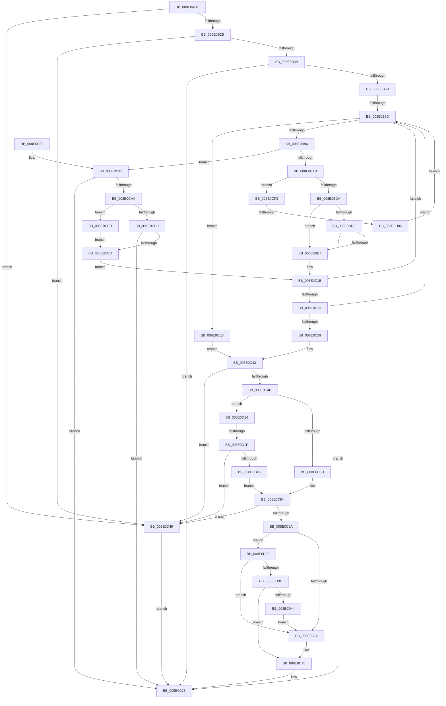

# FilterEvalStrict

- RVA: `0x008E0ADC`–`0x008E0D53` (길이 `631` bytes)
- VA: `0x00000001408E0ADC`
- 실행 섹션: `PAGE`
- PDB 이름 있음: `예`; PDB Function 태그: `예`
- unwind 정보 RVA: `0x00085DAC`
- 디코드: `167`개 명령, `631/631` bytes 표시
- 미해석 바이트: `0` (있으면 어셈블리에 `.byte`로 보존)

> 이 문서는 커널 이미지의 기계어와 PDB 기호를 분석해 생성했습니다. 4번과 5번은 함수 원형과 자료형을 바이너리 사용 방식에서 추정한 C 해석이며 원본 소스 복구 결과는 아닙니다.

## 1. Dependencies

- 직접 호출 지점: **5**; 고유 호출 대상: **4**
- 직접 호출자로 확인된 함수: **5**
- RIP 상대 이미지 참조: **0**

### Outgoing calls
- `0x008E0B4C` → [FindFilterOperatorClose](../9F/FindFilterOperatorClose_function_009F53D0.md) (function, `0x009F53D0`)
- `0x008E0BC8` → [guard_dispatch_icall](../../text/6B/guard_dispatch_icall_function_006BAAD0.md) (function, `0x006BAAD0`)
- `0x008E0C11` → [PropertyEval](../9C/PropertyEval_function_009CB300.md) (function, `0x009CB300`)
- `0x008E0C9A` → [FindFilterOperatorClose](../9F/FindFilterOperatorClose_function_009F53D0.md) (function, `0x009F53D0`)
- `0x008E0CBD` → [FilterEvalStrict](FilterEvalStrict_function_008E0ADC.md) (function, `0x008E0ADC`)

### Direct callers
- [ValidFilter](../8D/ValidFilter_function_008DBDC8.md) at `0x008DBE3B`
- [ConstraintEval](../8D/ConstraintEval_function_008DC1D0.md) at `0x008DC40C`
- [PiDqQueryEvaluateFilter](PiDqQueryEvaluateFilter_function_008E01C4.md) at `0x008E027D`
- [FilterEvalStrict](FilterEvalStrict_function_008E0ADC.md) at `0x008E0CBD`
- [sub_00B1CF9C](../B1/Unknown_function_00B1CF9C.md) at `0x00B1CFEE`

### Static image references
- 디코드된 RIP-relative 메모리 참조가 없습니다.

## 2. Other-region calls and transfers

- 다른 실행 섹션으로 향하는 call: **1**
  - `0x008E0BC8` → [guard_dispatch_icall](../../text/6B/guard_dispatch_icall_function_006BAAD0.md) (`PAGE` → `.text`)
- call이 아닌 외부 분기/꼬리 이동: **3**
  - `0x008E0B87` → [sub_00B1CF9C](../B1/Unknown_function_00B1CF9C.md) (`tail-transfer`)
  - `0x008E0D00` → [sub_00B1CF9C + 0xEA](../B1/Unknown_function_00B1CF9C.md) (`tail-transfer`)
  - `0x008E0D19` → [sub_00B1CF9C + 0x101](../B1/Unknown_function_00B1CF9C.md) (`tail-transfer`)

## 3. Assembly (complete function range)

```asm
008E0ADC  48 89 5C 24 20                  mov qword ptr [rsp + 0x20], rbx
008E0AE1  48 89 54 24 10                  mov qword ptr [rsp + 0x10], rdx
008E0AE6  48 89 4C 24 08                  mov qword ptr [rsp + 8], rcx
008E0AEB  55                              push rbp
008E0AEC  56                              push rsi
008E0AED  57                              push rdi
008E0AEE  41 54                           push r12
008E0AF0  41 55                           push r13
008E0AF2  41 56                           push r14
008E0AF4  41 57                           push r15
008E0AF6  48 8B EC                        mov rbp, rsp
008E0AF9  48 83 EC 70                     sub rsp, 0x70
008E0AFD  45 33 FF                        xor r15d, r15d
008E0B00  C7 45 D8 01 00 00 00            mov dword ptr [rbp - 0x28], 1
008E0B07  44 89 7D 50                     mov dword ptr [rbp + 0x50], r15d
008E0B0B  49 8B F9                        mov rdi, r9
008E0B0E  44 89 7D DC                     mov dword ptr [rbp - 0x24], r15d
008E0B12  41 8B F0                        mov esi, r8d
008E0B15  44 89 7D D0                     mov dword ptr [rbp - 0x30], r15d
008E0B19  4C 89 7D E8                     mov qword ptr [rbp - 0x18], r15
008E0B1D  44 89 7D D4                     mov dword ptr [rbp - 0x2c], r15d
008E0B21  41 83 F8 03                     cmp r8d, 3
008E0B25  0F 82 1E 02 00 00               jb 0x1408e0d49
008E0B2B  45 8B 31                        mov r14d, dword ptr [r9]
008E0B2E  41 81 E6 00 00 F0 0F            and r14d, 0xff00000
008E0B35  0F 84 0E 02 00 00               je 0x1408e0d49
008E0B3B  4C 8B 65 60                     mov r12, qword ptr [rbp + 0x60]
008E0B3F  4C 8D 45 50                     lea r8, [rbp + 0x50]
008E0B43  49 8B D1                        mov rdx, r9
008E0B46  8B CE                           mov ecx, esi
008E0B48  45 89 3C 24                     mov dword ptr [r12], r15d
008E0B4C  E8 7F 48 11 00                  call 0x1409f53d0
008E0B51  8B D8                           mov ebx, eax
008E0B53  85 C0                           test eax, eax
008E0B55  0F 85 1D 01 00 00               jne 0x1408e0c78
008E0B5B  8B 45 50                        mov eax, dword ptr [rbp + 0x50]
008E0B5E  45 8D 6F 38                     lea r13d, [r15 + 0x38]
008E0B62  48 6B C0 38                     imul rax, rax, 0x38
008E0B66  49 03 FD                        add rdi, r13
008E0B69  41 BF 01 00 00 C0               mov r15d, 0xc0000001
008E0B6F  48 03 C2                        add rax, rdx
008E0B72  48 89 45 F0                     mov qword ptr [rbp - 0x10], rax
008E0B76  8B C6                           mov eax, esi
008E0B78  2B 45 50                        sub eax, dword ptr [rbp + 0x50]
008E0B7B  FF CE                           dec esi
008E0B7D  89 45 E0                        mov dword ptr [rbp - 0x20], eax
008E0B80  41 81 FE 00 00 30 00            cmp r14d, 0x300000
008E0B87  0F 85 0F C4 23 00               jne 0x140b1cf9c
008E0B8D  83 FE 01                        cmp esi, 1
008E0B90  0F 86 4F 01 00 00               jbe 0x1408e0ce5
008E0B96  83 65 50 00                     and dword ptr [rbp + 0x50], 0
008E0B9A  41 83 24 24 00                  and dword ptr [r12], 0
008E0B9F  F7 07 00 00 F0 0F               test dword ptr [rdi], 0xff00000
008E0BA5  0F 85 E6 00 00 00               jne 0x1408e0c91
008E0BAB  48 8B 4D 48                     mov rcx, qword ptr [rbp + 0x48]
008E0BAF  48 8D 45 E8                     lea rax, [rbp - 0x18]
008E0BB3  48 89 44 24 20                  mov qword ptr [rsp + 0x20], rax
008E0BB8  48 8D 57 08                     lea rdx, [rdi + 8]
008E0BBC  48 8B 45 40                     mov rax, qword ptr [rbp + 0x40]
008E0BC0  4C 8D 4D D4                     lea r9, [rbp - 0x2c]
008E0BC4  4C 8D 45 D0                     lea r8, [rbp - 0x30]
008E0BC8  E8 03 9F DD FF                  call 0x1406baad0
008E0BCD  8B D8                           mov ebx, eax
008E0BCF  3D 25 02 00 C0                  cmp eax, 0xc0000225
008E0BD4  0F 84 19 01 00 00               je 0x1408e0cf3
008E0BDA  85 C0                           test eax, eax
008E0BDC  74 09                           je 0x1408e0be7
008E0BDE  41 3B C7                        cmp eax, r15d
008E0BE1  0F 85 91 00 00 00               jne 0x1408e0c78
008E0BE7  8B 4D D0                        mov ecx, dword ptr [rbp - 0x30]
008E0BEA  48 8B 55 E8                     mov rdx, qword ptr [rbp - 0x18]
008E0BEE  44 8B 45 D4                     mov r8d, dword ptr [rbp - 0x2c]
008E0BF2  8B 47 2C                        mov eax, dword ptr [rdi + 0x2c]
008E0BF5  44 8B 0F                        mov r9d, dword ptr [rdi]
008E0BF8  4C 89 64 24 38                  mov qword ptr [rsp + 0x38], r12
008E0BFD  89 44 24 30                     mov dword ptr [rsp + 0x30], eax
008E0C01  48 8B 47 30                     mov rax, qword ptr [rdi + 0x30]
008E0C05  48 89 44 24 28                  mov qword ptr [rsp + 0x28], rax
008E0C0A  8B 47 28                        mov eax, dword ptr [rdi + 0x28]
008E0C0D  89 44 24 20                     mov dword ptr [rsp + 0x20], eax
008E0C11  E8 EA A6 0E 00                  call 0x1409cb300
008E0C16  49 03 FD                        add rdi, r13
008E0C19  FF CE                           dec esi
008E0C1B  85 DB                           test ebx, ebx
008E0C1D  0F 85 6A FF FF FF               jne 0x1408e0b8d
008E0C23  33 C0                           xor eax, eax
008E0C25  41 81 FE 00 00 30 00            cmp r14d, 0x300000
008E0C2C  0F 94 C0                        sete al
008E0C2F  41 39 04 24                     cmp dword ptr [r12], eax
008E0C33  0F 85 54 FF FF FF               jne 0x1408e0b8d
008E0C39  48 8B 7D F0                     mov rdi, qword ptr [rbp - 0x10]
008E0C3D  8D 4B 01                        lea ecx, [rbx + 1]
008E0C40  8B 75 E0                        mov esi, dword ptr [rbp - 0x20]
008E0C43  85 F6                           test esi, esi
008E0C45  0F 84 FE 00 00 00               je 0x1408e0d49
008E0C4B  8B 07                           mov eax, dword ptr [rdi]
008E0C4D  25 00 00 F0 0F                  and eax, 0xff00000
008E0C52  3D 00 00 40 00                  cmp eax, 0x400000
008E0C57  0F 85 B7 00 00 00               jne 0x1408e0d14
008E0C5D  41 81 FE 00 00 30 00            cmp r14d, 0x300000
008E0C64  0F 85 DF 00 00 00               jne 0x1408e0d49
008E0C6A  85 C9                           test ecx, ecx
008E0C6C  0F 84 C0 00 00 00               je 0x1408e0d32
008E0C72  44 8B FB                        mov r15d, ebx
008E0C75  41 8B C7                        mov eax, r15d
008E0C78  48 8B 9C 24 C8 00 00 00         mov rbx, qword ptr [rsp + 0xc8]
008E0C80  48 83 C4 70                     add rsp, 0x70
008E0C84  41 5F                           pop r15
008E0C86  41 5E                           pop r14
008E0C88  41 5D                           pop r13
008E0C8A  41 5C                           pop r12
008E0C8C  5F                              pop rdi
008E0C8D  5E                              pop rsi
008E0C8E  5D                              pop rbp
008E0C8F  C3                              ret
008E0C90  CC                              int3
008E0C91  4C 8D 45 50                     lea r8, [rbp + 0x50]
008E0C95  48 8B D7                        mov rdx, rdi
008E0C98  8B CE                           mov ecx, esi
008E0C9A  E8 31 47 11 00                  call 0x1409f53d0
008E0C9F  44 8B 6D 50                     mov r13d, dword ptr [rbp + 0x50]
008E0CA3  41 FF C5                        inc r13d
008E0CA6  85 C0                           test eax, eax
008E0CA8  75 CE                           jne 0x1408e0c78
008E0CAA  48 8B 55 48                     mov rdx, qword ptr [rbp + 0x48]
008E0CAE  4C 8B CF                        mov r9, rdi
008E0CB1  48 8B 4D 40                     mov rcx, qword ptr [rbp + 0x40]
008E0CB5  45 8B C5                        mov r8d, r13d
008E0CB8  4C 89 64 24 20                  mov qword ptr [rsp + 0x20], r12
008E0CBD  E8 1A FE FF FF                  call 0x1408e0adc
008E0CC2  8B D8                           mov ebx, eax
008E0CC4  41 3B C7                        cmp eax, r15d
008E0CC7  74 24                           je 0x1408e0ced
008E0CC9  85 C0                           test eax, eax
008E0CCB  75 AB                           jne 0x1408e0c78
008E0CCD  41 8B C5                        mov eax, r13d
008E0CD0  48 6B C8 38                     imul rcx, rax, 0x38
008E0CD4  48 03 F9                        add rdi, rcx
008E0CD7  41 2B F5                        sub esi, r13d
008E0CDA  41 BD 38 00 00 00               mov r13d, 0x38
008E0CE0  E9 36 FF FF FF                  jmp 0x1408e0c1b
008E0CE5  8B 4D DC                        mov ecx, dword ptr [rbp - 0x24]
008E0CE8  E9 56 FF FF FF                  jmp 0x1408e0c43
008E0CED  83 65 D8 00                     and dword ptr [rbp - 0x28], 0
008E0CF1  EB DA                           jmp 0x1408e0ccd
008E0CF3  8B 07                           mov eax, dword ptr [rdi]
008E0CF5  41 8B DF                        mov ebx, r15d
008E0CF8  25 FF 0F 00 00                  and eax, 0xfff
008E0CFD  83 F8 01                        cmp eax, 1
008E0D00  0F 84 80 C3 23 00               je 0x140b1d086
008E0D06  83 65 D8 00                     and dword ptr [rbp - 0x28], 0
008E0D0A  49 03 FD                        add rdi, r13
008E0D0D  FF CE                           dec esi
008E0D0F  E9 79 FE FF FF                  jmp 0x1408e0b8d
008E0D14  3D 00 00 20 00                  cmp eax, 0x200000
008E0D19  0F 84 7E C3 23 00               je 0x140b1d09d
008E0D1F  3D 00 00 60 00                  cmp eax, 0x600000
008E0D24  75 23                           jne 0x1408e0d49
008E0D26  41 81 FE 00 00 50 00            cmp r14d, 0x500000
008E0D2D  E9 32 FF FF FF                  jmp 0x1408e0c64
008E0D32  83 7D D8 00                     cmp dword ptr [rbp - 0x28], 0
008E0D36  0F 85 36 FF FF FF               jne 0x1408e0c72
008E0D3C  85 DB                           test ebx, ebx
008E0D3E  0F 84 31 FF FF FF               je 0x1408e0c75
008E0D44  E9 29 FF FF FF                  jmp 0x1408e0c72
008E0D49  B8 0D 00 00 C0                  mov eax, 0xc000000d
008E0D4E  E9 25 FF FF FF                  jmp 0x1408e0c78
```

## 4. C-style interpretation (structured pseudocode)

```c
__int64 __fastcall FilterEvalStrict(__int64 a1, __int64 a2, int a3, __int64 a4, __int64 a5)
{
    __int64 result;
    __int64 v_r13;
    __int64 v_r14;
    __int64 v_r15;
    __int64 v_rdi;
    __int64 v_rsi;
    __int64 v_rsp;
    unsigned __int64 v_stack_m48;
    unsigned __int64 v_stack_m50;
    unsigned int v_stack_m58;
    unsigned int v_stack_m5C;
    unsigned int v_stack_m60;
    unsigned int v_stack_m64;
    unsigned int v_stack_m68;
    unsigned __int64 v_stack_m70;
    unsigned int v_stack_m78;
    unsigned __int64 v_stack_m80;
    unsigned __int64 v_stack_m88;
    unsigned __int64 v_stack_p10;
    unsigned int v_stack_p18;
    unsigned __int64 v_stack_p20;
    unsigned __int64 v_stack_p8;

    v_stack_p20 = v_rbx;
    v_stack_p10 = a2;
    v_stack_p8 = a1;
    v_rsp = (v_rsp) - (112);
    v_r15 = 0;
    v_stack_m60 = 1;
    v_stack_p18 = 0;
    v_stack_m5C = 0;
    v_stack_m68 = 0;
    v_stack_m50 = 0;
    v_stack_m64 = 0;
    if (a3 < 3) goto loc_008E0D49;
    v_r14 = (unsigned int)(((unsigned int)(*(unsigned int *)(a4))) & (0xFF00000ULL));
    if (condition_is_equal) goto loc_008E0D49;
    *(unsigned int *)(a5) = 0;
    result = FindFilterOperatorClose((unsigned int)((unsigned int)((unsigned int)(a3))), a4, v_stack_p18, a4);
    if ((unsigned int)(result) != 0) goto loc_008E0C78;
    result = ((unsigned int)(v_stack_p18)) * ((unsigned int)(v_stack_p18));
    v_rdi = (a4) + (v_r15 + 56);
    result = (result) + (a4);
    v_stack_m48 = result;
    result = (unsigned int)(((unsigned int)((unsigned int)((unsigned int)(a3)))) - (v_stack_p18));
    v_rsi = (unsigned int)(((unsigned int)(a3)) - 1);
    v_stack_m58 = (unsigned int)(result);
loc_008E0B8D:
    if (((unsigned int)(v_rsi)) <= 1) goto loc_008E0CE5;
    if (((*(unsigned int *)(v_rdi)) & (0xFF00000ULL)) != 0) goto loc_008E0C91;
    v_stack_m88 = v_stack_m50;
    result = guard_dispatch_icall(v_stack_p10, v_rdi + 8, v_stack_m68, v_stack_m64);
    if (((unsigned int)(result)) == 0xC0000225ULL) goto loc_008E0CF3;
    if ((unsigned int)(result) == 0) goto loc_008E0BE7;
    if (((unsigned int)(result)) != ((unsigned int)((unsigned int)(0xC0000001ULL)))) goto loc_008E0C78;
loc_008E0BE7:
    v_stack_m70 = a5;
    v_stack_m78 = (unsigned int)((unsigned int)(*(unsigned int *)(v_rdi + 44)));
    v_stack_m80 = *(unsigned __int64 *)(v_rdi + 48);
    v_stack_m88 = (unsigned int)((unsigned int)(*(unsigned int *)(v_rdi + 40)));
    result = PropertyEval((unsigned int)(v_stack_m68), v_stack_m50, (unsigned int)(v_stack_m64), (unsigned int)(*(unsigned int *)(v_rdi)));
    v_rdi = (v_rdi) + (v_r15 + 56);
    v_rsi = (unsigned int)((v_rsi) - 1);
loc_008E0C1B:
    if ((unsigned int)((unsigned int)((unsigned int)(result))) != 0) goto loc_008E0B8D;
    result = 0;
    result = (((unsigned int)(v_r14)) == 0x300000ULL) ? 1 : 0;
    if ((*(unsigned int *)(a5)) != ((unsigned int)(result))) goto loc_008E0B8D;
loc_008E0C43:
    if ((unsigned int)((unsigned int)(v_stack_m58)) == 0) goto loc_008E0D49;
    result = (unsigned int)(((unsigned int)(*(unsigned int *)(v_stack_m48))) & (0xFF00000ULL));
    if (((unsigned int)(result)) != 0x400000ULL) goto loc_008E0D14;
loc_008E0C64:
    if (((unsigned int)(v_r14)) != 0x300000ULL) goto loc_008E0D49;
    if ((unsigned int)((unsigned int)((unsigned int)(result)) + 1) == 0) goto loc_008E0D32;
loc_008E0C72:
loc_008E0C75:
loc_008E0C78:
    v_rsp = (v_rsp) + (112);
    return (unsigned int)((unsigned int)((unsigned int)((unsigned int)((unsigned int)((unsigned int)(result))))));
loc_008E0C91:
    result = FindFilterOperatorClose((unsigned int)((unsigned int)((unsigned int)(v_stack_m58))), v_stack_m48, v_stack_p18, (unsigned int)(*(unsigned int *)(v_rdi)));
    v_r13 = (unsigned int)(((unsigned int)(v_stack_p18)) + 1);
    if ((unsigned int)(result) != 0) goto loc_008E0C78;
    v_stack_p20 = a5;
    result = FilterEvalStrict(v_stack_p8, v_stack_p10, (unsigned int)((unsigned int)(v_r13)), v_stack_m48);
    if (((unsigned int)(result)) == ((unsigned int)((unsigned int)((unsigned int)((unsigned int)((unsigned int)(result))))))) goto loc_008E0CED;
    if ((unsigned int)(result) != 0) goto loc_008E0C78;
loc_008E0CCD:
    a1 = (v_stack_p8) * ((unsigned int)((unsigned int)(v_r13)));
    v_rdi = (v_stack_m48) + (a1);
    v_rsi = (unsigned int)(((unsigned int)(v_stack_m58)) - ((unsigned int)(v_r13)));
    goto loc_008E0C1B;
loc_008E0CE5:
    goto loc_008E0C43;
loc_008E0CED:
    goto loc_008E0CCD;
loc_008E0CF3:
    result = (unsigned int)(((unsigned int)(*(unsigned int *)(v_rdi))) & (0xFFFULL));
    v_rdi = (v_rdi) + (56);
    v_rsi = (unsigned int)((v_rsi) - 1);
    goto loc_008E0B8D;
loc_008E0D14:
    if (((unsigned int)(result)) != 0x600000ULL) goto loc_008E0D49;
    goto loc_008E0C64;
loc_008E0D32:
    if (v_stack_m60 != 0) goto loc_008E0C72;
    if ((unsigned int)((unsigned int)((unsigned int)((unsigned int)((unsigned int)((unsigned int)((unsigned int)(result))))))) == 0) goto loc_008E0C75;
    goto loc_008E0C72;
loc_008E0D49:
    goto loc_008E0C78;
}
```

## 5. (Beta) C Style

```c
int64_t FilterEvalStrict(int64_t Arg1, int64_t Arg2, int32_t Arg3, void *Arg4, void *Arg5)
{
    uint8_t *arg4 = (uint8_t *)Arg4;
    uint8_t *arg5 = (uint8_t *)Arg5;

    int64_t result;
    int64_t local_r13;
    int64_t local_r14;
    int64_t local_r15;
    int64_t local_rdi;
    int64_t local_rsi;
    int64_t local_rsp;
    uint64_t v_stack_m48;
    uint64_t v_stack_m50;
    uint32_t v_stack_m58;
    uint32_t v_stack_m5C;
    uint32_t v_stack_m60;
    uint32_t v_stack_m64;
    uint32_t v_stack_m68;
    uint64_t v_stack_m70;
    uint32_t v_stack_m78;
    uint64_t v_stack_m80;
    uint64_t v_stack_m88;
    uint64_t v_stack_p10;
    uint32_t v_stack_p18;
    uint64_t v_stack_p20;
    uint64_t v_stack_p8;

    v_stack_p20 = local_rbx;
    v_stack_p10 = Arg2;
    v_stack_p8 = Arg1;
    local_rsp = (local_rsp) - (112);
    local_r15 = 0;
    v_stack_m60 = 1;
    v_stack_p18 = 0;
    v_stack_m5C = 0;
    v_stack_m68 = 0;
    v_stack_m50 = 0;
    v_stack_m64 = 0;
    if (Arg3 < 3) goto loc_008E0D49;
    local_r14 = (uint32_t)(((uint32_t)(*(uint32_t *)(arg4))) & (0xFF00000ULL));
    if (condition_is_equal) goto loc_008E0D49;
    *(uint32_t *)(arg5) = 0;
    result = FindFilterOperatorClose((uint32_t)((uint32_t)((uint32_t)(Arg3))), Arg4, v_stack_p18, Arg4);
    if ((uint32_t)(result) != 0) goto loc_008E0C78;
    result = ((uint32_t)(v_stack_p18)) * ((uint32_t)(v_stack_p18));
    local_rdi = (Arg4) + (local_r15 + 56);
    result = (result) + (Arg4);
    v_stack_m48 = result;
    result = (uint32_t)(((uint32_t)((uint32_t)((uint32_t)(Arg3)))) - (v_stack_p18));
    local_rsi = (uint32_t)(((uint32_t)(Arg3)) - 1);
    v_stack_m58 = (uint32_t)(result);
loc_008E0B8D:
    if (((uint32_t)(local_rsi)) <= 1) goto loc_008E0CE5;
    if (((*(uint32_t *)(local_rdi)) & (0xFF00000ULL)) != 0) goto loc_008E0C91;
    v_stack_m88 = v_stack_m50;
    result = guard_dispatch_icall(v_stack_p10, local_rdi + 8, v_stack_m68, v_stack_m64);
    if (((uint32_t)(result)) == 0xC0000225ULL) goto loc_008E0CF3;
    if ((uint32_t)(result) == 0) goto loc_008E0BE7;
    if (((uint32_t)(result)) != ((uint32_t)((uint32_t)(0xC0000001ULL)))) goto loc_008E0C78;
loc_008E0BE7:
    v_stack_m70 = Arg5;
    v_stack_m78 = (uint32_t)((uint32_t)(*(uint32_t *)(local_rdi + 0x2C)));
    v_stack_m80 = *(uint64_t *)(local_rdi + 0x30);
    v_stack_m88 = (uint32_t)((uint32_t)(*(uint32_t *)(local_rdi + 0x28)));
    result = PropertyEval((uint32_t)(v_stack_m68), v_stack_m50, (uint32_t)(v_stack_m64), (uint32_t)(*(uint32_t *)(local_rdi)));
    local_rdi = (local_rdi) + (local_r15 + 56);
    local_rsi = (uint32_t)((local_rsi) - 1);
loc_008E0C1B:
    if ((uint32_t)((uint32_t)((uint32_t)(result))) != 0) goto loc_008E0B8D;
    result = 0;
    result = (((uint32_t)(local_r14)) == 0x300000ULL) ? 1 : 0;
    if ((*(uint32_t *)(arg5)) != ((uint32_t)(result))) goto loc_008E0B8D;
loc_008E0C43:
    if ((uint32_t)((uint32_t)(v_stack_m58)) == 0) goto loc_008E0D49;
    result = (uint32_t)(((uint32_t)(*(uint32_t *)(v_stack_m48))) & (0xFF00000ULL));
    if (((uint32_t)(result)) != 0x400000ULL) goto loc_008E0D14;
loc_008E0C64:
    if (((uint32_t)(local_r14)) != 0x300000ULL) goto loc_008E0D49;
    if ((uint32_t)((uint32_t)((uint32_t)(result)) + 1) == 0) goto loc_008E0D32;
loc_008E0C72:
loc_008E0C75:
loc_008E0C78:
    local_rsp = (local_rsp) + (112);
    return (uint32_t)((uint32_t)((uint32_t)((uint32_t)((uint32_t)((uint32_t)(result))))));
loc_008E0C91:
    result = FindFilterOperatorClose((uint32_t)((uint32_t)((uint32_t)(v_stack_m58))), v_stack_m48, v_stack_p18, (uint32_t)(*(uint32_t *)(local_rdi)));
    local_r13 = (uint32_t)(((uint32_t)(v_stack_p18)) + 1);
    if ((uint32_t)(result) != 0) goto loc_008E0C78;
    v_stack_p20 = Arg5;
    result = FilterEvalStrict(v_stack_p8, v_stack_p10, (uint32_t)((uint32_t)(local_r13)), v_stack_m48);
    if (((uint32_t)(result)) == ((uint32_t)((uint32_t)((uint32_t)((uint32_t)((uint32_t)(result))))))) goto loc_008E0CED;
    if ((uint32_t)(result) != 0) goto loc_008E0C78;
loc_008E0CCD:
    Arg1 = (v_stack_p8) * ((uint32_t)((uint32_t)(local_r13)));
    local_rdi = (v_stack_m48) + (Arg1);
    local_rsi = (uint32_t)(((uint32_t)(v_stack_m58)) - ((uint32_t)(local_r13)));
    goto loc_008E0C1B;
loc_008E0CE5:
    goto loc_008E0C43;
loc_008E0CED:
    goto loc_008E0CCD;
loc_008E0CF3:
    result = (uint32_t)(((uint32_t)(*(uint32_t *)(local_rdi))) & (0xFFFULL));
    local_rdi = (local_rdi) + (56);
    local_rsi = (uint32_t)((local_rsi) - 1);
    goto loc_008E0B8D;
loc_008E0D14:
    if (((uint32_t)(result)) != 0x600000ULL) goto loc_008E0D49;
    goto loc_008E0C64;
loc_008E0D32:
    if (v_stack_m60 != 0) goto loc_008E0C72;
    if ((uint32_t)((uint32_t)((uint32_t)((uint32_t)((uint32_t)((uint32_t)((uint32_t)(result))))))) == 0) goto loc_008E0C75;
    goto loc_008E0C72;
loc_008E0D49:
    goto loc_008E0C78;
}
```

### 관측된 메모리 오프셋

구조체 형식이 확인되지 않은 접근은 인자 기준의 오프셋으로만 기록했습니다.

| 기준 인자 | 오프셋 표현 | 폭 (bit) | 접근 |
|---|---:|---:|---|
| `Arg4` | `+ 0x0` | `32` | `R` |
| `Arg4` | `+ 0x8` | `64` | `R` |
| `Arg4` | `+ 0x28` | `32` | `R` |
| `Arg4` | `+ 0x2C` | `32` | `R` |
| `Arg4` | `+ 0x30` | `64` | `R` |
| `Arg5` | `+ 0x0` | `32` | `R` |
| `Arg5` | `+ 0x0` | `32` | `R/W` |
| `Arg5` | `+ 0x0` | `32` | `W` |

## 6. Execution-region graph

[열기: 2D/3D 그래프와 함수 탐색 컨트롤 패널](../../../control-panel.html?section=page&rva=0x008E0ADC&view=graph)

- 2D 그래프는 위에서 아래로 흐르고, 3D 그래프는 빈 공간을 드래그해 회전합니다. Shift+드래그는 이동, 휠은 확대·축소, 함수 노드 선택은 대상 보고서 이동입니다.

### Static fallback


