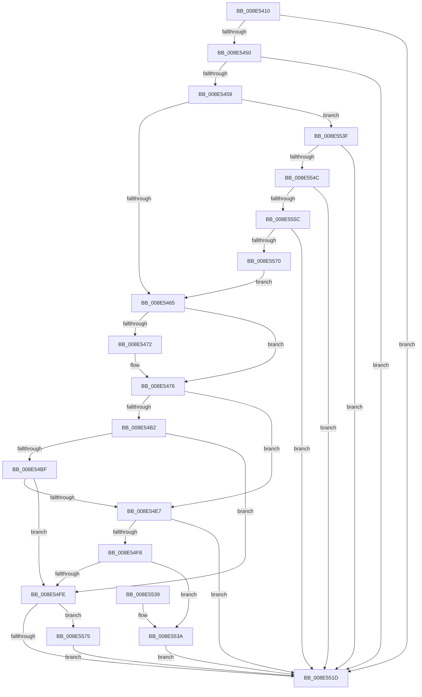

# IopDeviceInterfaceFilterCallback

- RVA: `0x008E5410`–`0x008E557B` (길이 `363` bytes)
- VA: `0x00000001408E5410`
- 실행 섹션: `PAGE`
- PDB 이름 있음: `예`; PDB Function 태그: `아니요`
- unwind 정보 RVA: `0x00086600`
- 디코드: `104`개 명령, `363/363` bytes 표시
- 미해석 바이트: `0` (있으면 어셈블리에 `.byte`로 보존)

> 이 문서는 커널 이미지의 기계어와 PDB 기호를 분석해 생성했습니다. 4번과 5번은 함수 원형과 자료형을 바이너리 사용 방식에서 추정한 C 해석이며 원본 소스 복구 결과는 아닙니다.

## 1. Dependencies

- 직접 호출 지점: **11**; 고유 호출 대상: **10**
- 직접 호출자로 확인된 함수: **1**
- RIP 상대 이미지 참조: **0**

### Outgoing calls
- `0x008E548D` → [ExAcquireResourceSharedLite](../../text/21/ExAcquireResourceSharedLite_function_00211BC0.md) (function, `0x00211BC0`)
- `0x008E549A` → [ExReleaseResourceLite](../../text/25/ExReleaseResourceLite_function_0025FA10.md) (function, `0x0025FA10`)
- `0x008E54A8` → [KeLeaveCriticalRegionThread](../../text/25/KeLeaveCriticalRegionThread_function_0025EFF0.md) (function, `0x0025EFF0`)
- `0x008E54B5` → [PsGetSessionById](../../text/22/PsGetSessionById_function_00225150.md) (function, `0x00225150`)
- `0x008E54D5` → [ObfDereferenceObjectWithTag](../../text/2F/ObfDereferenceObjectWithTag_function_002F78E0.md) (function, `0x002F78E0`)
- `0x008E54DD` → [PsGetServerSiloServiceSessionId](../../text/45/PsGetServerSiloServiceSessionId_function_0045ED00.md) (function, `0x0045ED00`)
- `0x008E54EF` → [PiAuIsLocalSystem](PiAuIsLocalSystem_function_008E6D34.md) (function, `0x008E6D34`)
- `0x008E5514` → [PiPnpRtlApplyMandatoryDeviceInterfaceFilters](PiPnpRtlApplyMandatoryDeviceInterfaceFilters_function_008E59D0.md) (function, `0x008E59D0`)
- `0x008E5543` → [RtlInitUnicodeStringEx](../../text/46/RtlInitUnicodeStringEx_function_00463960.md) (function, `0x00463960`)
- `0x008E5553` → [RtlInitUnicodeStringEx](../../text/46/RtlInitUnicodeStringEx_function_00463960.md) (function, `0x00463960`)
- `0x008E5567` → [RtlEqualUnicodeString](../93/RtlEqualUnicodeString_function_00932A20.md) (function, `0x00932A20`)

### Direct callers
- [PiPnpRtlInterfaceFilterCallback](PiPnpRtlInterfaceFilterCallback_function_008E4FC0.md) at `0x008E50C1`

### Static image references
- 디코드된 RIP-relative 메모리 참조가 없습니다.

## 2. Other-region calls and transfers

- 다른 실행 섹션으로 향하는 call: **8**
  - `0x008E548D` → [ExAcquireResourceSharedLite](../../text/21/ExAcquireResourceSharedLite_function_00211BC0.md) (`PAGE` → `.text`)
  - `0x008E549A` → [ExReleaseResourceLite](../../text/25/ExReleaseResourceLite_function_0025FA10.md) (`PAGE` → `.text`)
  - `0x008E54A8` → [KeLeaveCriticalRegionThread](../../text/25/KeLeaveCriticalRegionThread_function_0025EFF0.md) (`PAGE` → `.text`)
  - `0x008E54B5` → [PsGetSessionById](../../text/22/PsGetSessionById_function_00225150.md) (`PAGE` → `.text`)
  - `0x008E54D5` → [ObfDereferenceObjectWithTag](../../text/2F/ObfDereferenceObjectWithTag_function_002F78E0.md) (`PAGE` → `.text`)
  - `0x008E54DD` → [PsGetServerSiloServiceSessionId](../../text/45/PsGetServerSiloServiceSessionId_function_0045ED00.md) (`PAGE` → `.text`)
  - `0x008E5543` → [RtlInitUnicodeStringEx](../../text/46/RtlInitUnicodeStringEx_function_00463960.md) (`PAGE` → `.text`)
  - `0x008E5553` → [RtlInitUnicodeStringEx](../../text/46/RtlInitUnicodeStringEx_function_00463960.md) (`PAGE` → `.text`)
- 별도 외부 분기/꼬리 이동을 확인하지 못했습니다.

## 3. Assembly (complete function range)

```asm
008E5410  48 89 5C 24 08                  mov qword ptr [rsp + 8], rbx
008E5415  48 89 74 24 10                  mov qword ptr [rsp + 0x10], rsi
008E541A  55                              push rbp
008E541B  57                              push rdi
008E541C  41 54                           push r12
008E541E  41 56                           push r14
008E5420  41 57                           push r15
008E5422  48 8B EC                        mov rbp, rsp
008E5425  48 83 EC 60                     sub rsp, 0x60
008E5429  33 FF                           xor edi, edi
008E542B  0F 57 C0                        xorps xmm0, xmm0
008E542E  40 88 7D D0                     mov byte ptr [rbp - 0x30], dil
008E5432  0F 57 C9                        xorps xmm1, xmm1
008E5435  49 8B F1                        mov rsi, r9
008E5438  4C 8B FA                        mov r15, rdx
008E543B  4C 8B E1                        mov r12, rcx
008E543E  0F 11 45 D8                     movups xmmword ptr [rbp - 0x28], xmm0
008E5442  0F 11 4D E8                     movups xmmword ptr [rbp - 0x18], xmm1
008E5446  41 83 F8 03                     cmp r8d, 3
008E544A  0F 85 CD 00 00 00               jne 0x1408e551d
008E5450  4D 85 C9                        test r9, r9
008E5453  0F 84 C4 00 00 00               je 0x1408e551d
008E5459  49 8B 11                        mov rdx, qword ptr [r9]
008E545C  48 85 D2                        test rdx, rdx
008E545F  0F 85 DA 00 00 00               jne 0x1408e553f
008E5465  48 8B 5E 08                     mov rbx, qword ptr [rsi + 8]
008E5469  40 88 7D 40                     mov byte ptr [rbp + 0x40], dil
008E546D  48 85 DB                        test rbx, rbx
008E5470  75 04                           jne 0x1408e5476
008E5472  48 8B 5E 18                     mov rbx, qword ptr [rsi + 0x18]
008E5476  65 48 8B 04 25 88 01 00 00      mov rax, qword ptr gs:[0x188]
008E547F  B2 01                           mov dl, 1
008E5481  66 FF 88 E4 01 00 00            dec word ptr [rax + 0x1e4]
008E5488  90                              nop
008E5489  48 8B 4B 30                     mov rcx, qword ptr [rbx + 0x30]
008E548D  E8 2E C7 92 FF                  call 0x140211bc0
008E5492  48 8B 4B 30                     mov rcx, qword ptr [rbx + 0x30]
008E5496  44 8B 73 78                     mov r14d, dword ptr [rbx + 0x78]
008E549A  E8 71 A5 97 FF                  call 0x14025fa10
008E549F  65 48 8B 0C 25 88 01 00 00      mov rcx, qword ptr gs:[0x188]
008E54A8  E8 43 9B 97 FF                  call 0x14025eff0
008E54AD  45 85 F6                        test r14d, r14d
008E54B0  74 35                           je 0x1408e54e7
008E54B2  41 8B CE                        mov ecx, r14d
008E54B5  E8 96 FC 93 FF                  call 0x140225150
008E54BA  48 85 C0                        test rax, rax
008E54BD  74 3F                           je 0x1408e54fe
008E54BF  48 8B 88 E8 02 00 00            mov rcx, qword ptr [rax + 0x2e8]
008E54C6  BA 50 73 51 79                  mov edx, 0x79517350
008E54CB  48 8B 99 A0 00 00 00            mov rbx, qword ptr [rcx + 0xa0]
008E54D2  48 8B C8                        mov rcx, rax
008E54D5  E8 06 24 A1 FF                  call 0x1402f78e0
008E54DA  48 8B CB                        mov rcx, rbx
008E54DD  E8 1E 98 B7 FF                  call 0x14045ed00
008E54E2  44 3B F0                        cmp r14d, eax
008E54E5  75 17                           jne 0x1408e54fe
008E54E7  48 8D 55 40                     lea rdx, [rbp + 0x40]
008E54EB  48 8D 4E 08                     lea rcx, [rsi + 8]
008E54EF  E8 40 18 00 00                  call 0x1408e6d34
008E54F4  85 C0                           test eax, eax
008E54F6  78 25                           js 0x1408e551d
008E54F8  40 38 7D 40                     cmp byte ptr [rbp + 0x40], dil
008E54FC  75 3C                           jne 0x1408e553a
008E54FE  48 8D 45 D0                     lea rax, [rbp - 0x30]
008E5502  45 33 C0                        xor r8d, r8d
008E5505  4C 8D 4E 08                     lea r9, [rsi + 8]
008E5509  48 89 44 24 20                  mov qword ptr [rsp + 0x20], rax
008E550E  49 8B D7                        mov rdx, r15
008E5511  49 8B CC                        mov rcx, r12
008E5514  E8 B7 04 00 00                  call 0x1408e59d0
008E5519  85 C0                           test eax, eax
008E551B  79 58                           jns 0x1408e5575
008E551D  4C 8D 5C 24 60                  lea r11, [rsp + 0x60]
008E5522  40 8A C7                        mov al, dil
008E5525  49 8B 5B 30                     mov rbx, qword ptr [r11 + 0x30]
008E5529  49 8B 73 38                     mov rsi, qword ptr [r11 + 0x38]
008E552D  49 8B E3                        mov rsp, r11
008E5530  41 5F                           pop r15
008E5532  41 5E                           pop r14
008E5534  41 5C                           pop r12
008E5536  5F                              pop rdi
008E5537  5D                              pop rbp
008E5538  C3                              ret
008E5539  CC                              int3
008E553A  40 B7 01                        mov dil, 1
008E553D  EB DE                           jmp 0x1408e551d
008E553F  48 8D 4D E8                     lea rcx, [rbp - 0x18]
008E5543  E8 18 E4 B7 FF                  call 0x140463960
008E5548  85 C0                           test eax, eax
008E554A  78 D1                           js 0x1408e551d
008E554C  49 8B D7                        mov rdx, r15
008E554F  48 8D 4D D8                     lea rcx, [rbp - 0x28]
008E5553  E8 08 E4 B7 FF                  call 0x140463960
008E5558  85 C0                           test eax, eax
008E555A  78 C1                           js 0x1408e551d
008E555C  41 B0 01                        mov r8b, 1
008E555F  48 8D 55 D8                     lea rdx, [rbp - 0x28]
008E5563  48 8D 4D E8                     lea rcx, [rbp - 0x18]
008E5567  E8 B4 D4 04 00                  call 0x140932a20
008E556C  3C 01                           cmp al, 1
008E556E  74 AD                           je 0x1408e551d
008E5570  E9 F0 FE FF FF                  jmp 0x1408e5465
008E5575  40 8A 7D D0                     mov dil, byte ptr [rbp - 0x30]
008E5579  EB A2                           jmp 0x1408e551d
```

## 4. C-style interpretation (structured pseudocode)

```c
__int64 __fastcall IopDeviceInterfaceFilterCallback(__int64 a1, __int64 a2, int a3, __int64 a4)
{
    __int64 result;
    __int64 v_rbx;
    __int64 v_rdi;
    __int64 v_rsp;
    unsigned __int64 v_stack_m28;
    unsigned __int64 v_stack_m40;
    unsigned __int64 v_stack_m50;
    unsigned __int8 v_stack_m58;
    unsigned __int64 v_stack_m68;
    unsigned __int64 v_stack_p10;
    unsigned __int8 v_stack_p18;
    unsigned __int64 v_stack_p8;

    v_stack_p8 = v_rbx;
    v_stack_p10 = v_rsi;
    v_rsp = (v_rsp) - (96);
    v_rdi = 0;
    v_stack_m58 = 0;
    v_stack_m50 = v_xmm0;
    v_stack_m40 = v_xmm1;
    if (a3 != 3) goto loc_008E551D;
    if (a4 == 0) goto loc_008E551D;
    if (*(unsigned __int64 *)(a4) != 0) goto loc_008E553F;
loc_008E5465:
    v_stack_p18 = 0;
    v_rbx = *(unsigned __int64 *)(a4 + 8);
    if (*(unsigned __int64 *)(a4 + 8) == 0) {
        v_rbx = *(unsigned __int64 *)(a4 + 24);
    }
    result = ExAcquireResourceSharedLite(*(unsigned __int64 *)(v_rbx + 48), 1, a3, a4);
    result = ExReleaseResourceLite(*(unsigned __int64 *)(v_rbx + 48), 1, a3, a4);
    result = KeLeaveCriticalRegionThread(*(unsigned __int64 *)(gs_base + (0 + 392)), 1, a3, a4);
    if ((unsigned int)((unsigned int)(*(unsigned int *)(v_rbx + 120))) == 0) goto loc_008E54E7;
    result = PsGetSessionById((unsigned int)((unsigned int)((unsigned int)(*(unsigned int *)(v_rbx + 120)))), 1, a3, a4);
    if (result == 0) goto loc_008E54FE;
    result = ObfDereferenceObjectWithTag(result, (unsigned int)(0x79517350ULL), a3, a4);
    result = PsGetServerSiloServiceSessionId(*(unsigned __int64 *)(*(unsigned __int64 *)(result + 744) + 160), (unsigned int)(0x79517350ULL), a3, a4);
    if (((unsigned int)((unsigned int)(*(unsigned int *)(v_rbx + 120)))) != ((unsigned int)(result))) goto loc_008E54FE;
loc_008E54E7:
    result = PiAuIsLocalSystem(a4 + 8, v_stack_p18, a3, a4);
    if (sign_flag) goto loc_008E551D;
    if (v_stack_p18 != 0) goto loc_008E553A;
loc_008E54FE:
    a3 = 0;
    v_stack_m68 = v_stack_m58;
    result = PiPnpRtlApplyMandatoryDeviceInterfaceFilters(a1, a2, a3, a4 + 8);
    if (!sign_flag) goto loc_008E5575;
loc_008E551D:
    return 0;
loc_008E553A:
    goto loc_008E551D;
loc_008E553F:
    result = RtlInitUnicodeStringEx(v_stack_m40, a2, a3, a4 + 8);
    if (sign_flag) goto loc_008E551D;
    result = RtlInitUnicodeStringEx(v_stack_m50, a2, a3, a4 + 8);
    if (sign_flag) goto loc_008E551D;
    result = RtlEqualUnicodeString(v_stack_m40, v_stack_m50, 1, a4 + 8);
    if (((unsigned __int8)(result)) == 1) goto loc_008E551D;
    goto loc_008E5465;
loc_008E5575:
    goto loc_008E551D;
}
```

## 5. (Beta) C Style

```c
int64_t IopDeviceInterfaceFilterCallback(int64_t Arg1, int64_t Arg2, int32_t Arg3, void *Arg4)
{
    uint8_t *arg4 = (uint8_t *)Arg4;

    int64_t result;
    int64_t local_rbx;
    int64_t local_rdi;
    int64_t local_rsp;
    uint64_t v_stack_m28;
    uint64_t v_stack_m40;
    uint64_t v_stack_m50;
    uint8_t v_stack_m58;
    uint64_t v_stack_m68;
    uint64_t v_stack_p10;
    uint8_t v_stack_p18;
    uint64_t v_stack_p8;

    v_stack_p8 = local_rbx;
    v_stack_p10 = local_rsi;
    local_rsp = (local_rsp) - (96);
    local_rdi = 0;
    v_stack_m58 = 0;
    v_stack_m50 = v_xmm0;
    v_stack_m40 = v_xmm1;
    if (Arg3 != 3) goto loc_008E551D;
    if (Arg4 == NULL) goto loc_008E551D;
    if (*(uint64_t *)(arg4) != 0) goto loc_008E553F;
loc_008E5465:
    v_stack_p18 = 0;
    local_rbx = *(uint64_t *)(arg4 + 0x8);
    if (*(uint64_t *)(arg4 + 0x8) == 0) {
        local_rbx = *(uint64_t *)(arg4 + 0x18);
    }
    result = ExAcquireResourceSharedLite(*(uint64_t *)(local_rbx + 0x30), 1, Arg3, Arg4);
    result = ExReleaseResourceLite(*(uint64_t *)(local_rbx + 0x30), 1, Arg3, Arg4);
    result = KeLeaveCriticalRegionThread(*(uint64_t *)(gs_base + (0 + 0x188)), 1, Arg3, Arg4);
    if ((uint32_t)((uint32_t)(*(uint32_t *)(local_rbx + 0x78))) == 0) goto loc_008E54E7;
    result = PsGetSessionById((uint32_t)((uint32_t)((uint32_t)(*(uint32_t *)(local_rbx + 0x78)))), 1, Arg3, Arg4);
    if (result == 0) goto loc_008E54FE;
    result = ObfDereferenceObjectWithTag(result, (uint32_t)(0x79517350ULL), Arg3, Arg4);
    result = PsGetServerSiloServiceSessionId(*(uint64_t *)(*(uint64_t *)(result + 0x2E8) + 0xA0), (uint32_t)(0x79517350ULL), Arg3, Arg4);
    if (((uint32_t)((uint32_t)(*(uint32_t *)(local_rbx + 0x78)))) != ((uint32_t)(result))) goto loc_008E54FE;
loc_008E54E7:
    result = PiAuIsLocalSystem(Arg4 + 8, v_stack_p18, Arg3, Arg4);
    if (sign_flag) goto loc_008E551D;
    if (v_stack_p18 != 0) goto loc_008E553A;
loc_008E54FE:
    Arg3 = 0;
    v_stack_m68 = v_stack_m58;
    result = PiPnpRtlApplyMandatoryDeviceInterfaceFilters(Arg1, Arg2, Arg3, Arg4 + 8);
    if (!sign_flag) goto loc_008E5575;
loc_008E551D:
    return 0;
loc_008E553A:
    goto loc_008E551D;
loc_008E553F:
    result = RtlInitUnicodeStringEx(v_stack_m40, Arg2, Arg3, Arg4 + 8);
    if (sign_flag) goto loc_008E551D;
    result = RtlInitUnicodeStringEx(v_stack_m50, Arg2, Arg3, Arg4 + 8);
    if (sign_flag) goto loc_008E551D;
    result = RtlEqualUnicodeString(v_stack_m40, v_stack_m50, 1, Arg4 + 8);
    if (((uint8_t)(result)) == 1) goto loc_008E551D;
    goto loc_008E5465;
loc_008E5575:
    goto loc_008E551D;
}
```

### 관측된 메모리 오프셋

구조체 형식이 확인되지 않은 접근은 인자 기준의 오프셋으로만 기록했습니다.

| 기준 인자 | 오프셋 표현 | 폭 (bit) | 접근 |
|---|---:|---:|---|
| `Arg4` | `+ 0x8` | `64` | `R` |
| `Arg4` | `+ 0x18` | `64` | `R` |

## 6. Execution-region graph

[열기: 2D/3D 그래프와 함수 탐색 컨트롤 패널](../../../control-panel.html?section=page&rva=0x008E5410&view=graph)

- 2D 그래프는 위에서 아래로 흐르고, 3D 그래프는 빈 공간을 드래그해 회전합니다. Shift+드래그는 이동, 휠은 확대·축소, 함수 노드 선택은 대상 보고서 이동입니다.

### Static fallback


