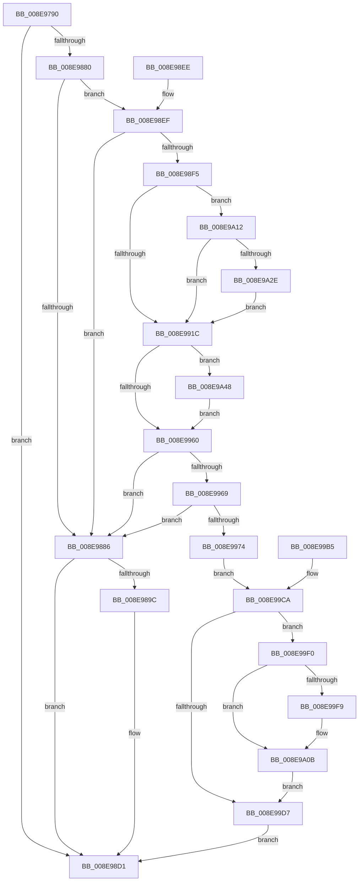

# IopWriteFile

- RVA: `0x008E9790`–`0x008E9A58` (길이 `712` bytes)
- VA: `0x00000001408E9790`
- 실행 섹션: `PAGE`
- PDB 이름 있음: `예`; PDB Function 태그: `아니요`
- unwind 정보 RVA: `0x00086B38`
- 디코드: `154`개 명령, `712/712` bytes 표시
- 미해석 바이트: `0` (있으면 어셈블리에 `.byte`로 보존)

> 이 문서는 커널 이미지의 기계어와 PDB 기호를 분석해 생성했습니다. 4번과 5번은 함수 원형과 자료형을 바이너리 사용 방식에서 추정한 C 해석이며 원본 소스 복구 결과는 아닙니다.

## 1. Dependencies

- 직접 호출 지점: **11**; 고유 호출 대상: **10**
- 직접 호출자로 확인된 함수: **2**
- RIP 상대 이미지 참조: **1**

### Outgoing calls
- `0x008E9877` → [IopValidateAndGetWriteParameters](../../text/40/IopValidateAndGetWriteParameters_function_00400C30.md) (function, `0x00400C30`)
- `0x008E9893` → [IopAllocateAndPopulateWriteIrp](../../text/40/IopAllocateAndPopulateWriteIrp_function_004011F4.md) (function, `0x004011F4`)
- `0x008E98CC` → [IopSynchronousServiceTail](IopSynchronousServiceTail_function_008EB440.md) (function, `0x008EB440`)
- `0x008E994F` → [guard_dispatch_icall](../../text/6B/guard_dispatch_icall_function_006BAAD0.md) (function, `0x006BAAD0`)
- `0x008E99DA` → [IopReleaseFileObjectLock](../../text/25/IopReleaseFileObjectLock_function_00250A90.md) (function, `0x00250A90`)
- `0x008E99E2` → [ObfDereferenceObject](../../text/2F/ObfDereferenceObject_function_002F9350.md) (function, `0x002F9350`)
- `0x008E99FE` → [KeSetEvent](../../text/33/KeSetEvent_function_0033F310.md) (function, `0x0033F310`)
- `0x008E9A0B` → [ObfDereferenceObject](../../text/2F/ObfDereferenceObject_function_002F9350.md) (function, `0x002F9350`)
- `0x008E9A21` → [MmIsDriverVerifying](../../text/4A/MmIsDriverVerifying_function_004A8770.md) (function, `0x004A8770`)
- `0x008E9A36` → [VfFastIoSnapState](../../pagevrfy/BB/VfFastIoSnapState_function_00BB97BC.md) (function, `0x00BB97BC`)
- `0x008E9A4E` → [VfFastIoCheckState](../../pagevrfy/BB/VfFastIoCheckState_function_00BB9440.md) (function, `0x00BB9440`)

### Direct callers
- [IopIoRingDispatchWrite](../72/IopIoRingDispatchWrite_function_00720248.md) at `0x0072039F`
- [NtWriteFile](NtWriteFile_function_008E92D0.md) at `0x008E959D`

### Static image references
- `0x008E990E` → RVA `0x00F04A20` (`.data`; read)

## 2. Other-region calls and transfers

- 다른 실행 섹션으로 향하는 call: **10**
  - `0x008E9877` → [IopValidateAndGetWriteParameters](../../text/40/IopValidateAndGetWriteParameters_function_00400C30.md) (`PAGE` → `.text`)
  - `0x008E9893` → [IopAllocateAndPopulateWriteIrp](../../text/40/IopAllocateAndPopulateWriteIrp_function_004011F4.md) (`PAGE` → `.text`)
  - `0x008E994F` → [guard_dispatch_icall](../../text/6B/guard_dispatch_icall_function_006BAAD0.md) (`PAGE` → `.text`)
  - `0x008E99DA` → [IopReleaseFileObjectLock](../../text/25/IopReleaseFileObjectLock_function_00250A90.md) (`PAGE` → `.text`)
  - `0x008E99E2` → [ObfDereferenceObject](../../text/2F/ObfDereferenceObject_function_002F9350.md) (`PAGE` → `.text`)
  - `0x008E99FE` → [KeSetEvent](../../text/33/KeSetEvent_function_0033F310.md) (`PAGE` → `.text`)
  - `0x008E9A0B` → [ObfDereferenceObject](../../text/2F/ObfDereferenceObject_function_002F9350.md) (`PAGE` → `.text`)
  - `0x008E9A21` → [MmIsDriverVerifying](../../text/4A/MmIsDriverVerifying_function_004A8770.md) (`PAGE` → `.text`)
  - `0x008E9A36` → [VfFastIoSnapState](../../pagevrfy/BB/VfFastIoSnapState_function_00BB97BC.md) (`PAGE` → `PAGEVRFY`)
  - `0x008E9A4E` → [VfFastIoCheckState](../../pagevrfy/BB/VfFastIoCheckState_function_00BB9440.md) (`PAGE` → `PAGEVRFY`)
- 별도 외부 분기/꼬리 이동을 확인하지 못했습니다.

## 3. Assembly (complete function range)

```asm
008E9790  4C 8B DC                        mov r11, rsp
008E9793  49 89 5B 10                     mov qword ptr [r11 + 0x10], rbx
008E9797  49 89 73 20                     mov qword ptr [r11 + 0x20], rsi
008E979B  49 89 4B 08                     mov qword ptr [r11 + 8], rcx
008E979F  57                              push rdi
008E97A0  41 54                           push r12
008E97A2  41 55                           push r13
008E97A4  41 56                           push r14
008E97A6  41 57                           push r15
008E97A8  48 81 EC F0 00 00 00            sub rsp, 0xf0
008E97AF  48 8B F9                        mov rdi, rcx
008E97B2  33 C0                           xor eax, eax
008E97B4  89 44 24 6B                     mov dword ptr [rsp + 0x6b], eax
008E97B8  88 44 24 6F                     mov byte ptr [rsp + 0x6f], al
008E97BC  41 89 43 94                     mov dword ptr [r11 - 0x6c], eax
008E97C0  49 89 43 A0                     mov qword ptr [r11 - 0x60], rax
008E97C4  41 89 43 BC                     mov dword ptr [r11 - 0x44], eax
008E97C8  33 DB                           xor ebx, ebx
008E97CA  49 89 5B 18                     mov qword ptr [r11 + 0x18], rbx
008E97CE  48 89 5C 24 60                  mov qword ptr [rsp + 0x60], rbx
008E97D3  66 89 44 24 68                  mov word ptr [rsp + 0x68], ax
008E97D8  C6 44 24 6A 01                  mov byte ptr [rsp + 0x6a], 1
008E97DD  48 89 4C 24 70                  mov qword ptr [rsp + 0x70], rcx
008E97E2  48 89 5C 24 78                  mov qword ptr [rsp + 0x78], rbx
008E97E7  49 89 9B 68 FF FF FF            mov qword ptr [r11 - 0x98], rbx
008E97EE  4D 89 83 70 FF FF FF            mov qword ptr [r11 - 0x90], r8
008E97F5  4D 89 8B 78 FF FF FF            mov qword ptr [r11 - 0x88], r9
008E97FC  4C 8B AC 24 40 01 00 00         mov r13, qword ptr [rsp + 0x140]
008E9804  4D 89 6B 80                     mov qword ptr [r11 - 0x80], r13
008E9808  4C 8B B4 24 48 01 00 00         mov r14, qword ptr [rsp + 0x148]
008E9810  4D 89 73 88                     mov qword ptr [r11 - 0x78], r14
008E9814  44 8B BC 24 50 01 00 00         mov r15d, dword ptr [rsp + 0x150]
008E981C  45 89 7B 90                     mov dword ptr [r11 - 0x70], r15d
008E9820  49 89 5B 98                     mov qword ptr [r11 - 0x68], rbx
008E9824  48 8B 84 24 70 01 00 00         mov rax, qword ptr [rsp + 0x170]
008E982C  49 89 43 A8                     mov qword ptr [r11 - 0x58], rax
008E9830  48 8B 84 24 78 01 00 00         mov rax, qword ptr [rsp + 0x178]
008E9838  49 89 43 B0                     mov qword ptr [r11 - 0x50], rax
008E983C  8B 84 24 80 01 00 00            mov eax, dword ptr [rsp + 0x180]
008E9843  41 89 43 B8                     mov dword ptr [r11 - 0x48], eax
008E9847  48 8B 84 24 88 01 00 00         mov rax, qword ptr [rsp + 0x188]
008E984F  49 89 43 C0                     mov qword ptr [r11 - 0x40], rax
008E9853  49 89 5B C8                     mov qword ptr [r11 - 0x38], rbx
008E9857  8B 84 24 68 01 00 00            mov eax, dword ptr [rsp + 0x168]
008E985E  89 44 24 20                     mov dword ptr [rsp + 0x20], eax
008E9862  4C 8B 8C 24 60 01 00 00         mov r9, qword ptr [rsp + 0x160]
008E986A  4C 8B 84 24 58 01 00 00         mov r8, qword ptr [rsp + 0x158]
008E9872  48 8D 4C 24 60                  lea rcx, [rsp + 0x60]
008E9877  E8 B4 73 B1 FF                  call 0x140400c30
008E987C  85 C0                           test eax, eax
008E987E  78 51                           js 0x1408e98d1
008E9880  38 5C 24 69                     cmp byte ptr [rsp + 0x69], bl
008E9884  75 69                           jne 0x1408e98ef
008E9886  48 8D 94 24 30 01 00 00         lea rdx, [rsp + 0x130]
008E988E  48 8D 4C 24 60                  lea rcx, [rsp + 0x60]
008E9893  E8 5C 79 B1 FF                  call 0x1404011f4
008E9898  85 C0                           test eax, eax
008E989A  78 35                           js 0x1408e98d1
008E989C  C7 44 24 30 01 00 00 00         mov dword ptr [rsp + 0x30], 1
008E98A4  0F B6 44 24 69                  movzx eax, byte ptr [rsp + 0x69]
008E98A9  88 44 24 28                     mov byte ptr [rsp + 0x28], al
008E98AD  0F B6 44 24 68                  movzx eax, byte ptr [rsp + 0x68]
008E98B2  88 44 24 20                     mov byte ptr [rsp + 0x20], al
008E98B6  44 0F B6 4C 24 6A               movzx r9d, byte ptr [rsp + 0x6a]
008E98BC  4C 8B C7                        mov r8, rdi
008E98BF  48 8B 94 24 30 01 00 00         mov rdx, qword ptr [rsp + 0x130]
008E98C7  48 8B 4C 24 78                  mov rcx, qword ptr [rsp + 0x78]
008E98CC  E8 6F 1B 00 00                  call 0x1408eb440
008E98D1  4C 8D 9C 24 F0 00 00 00         lea r11, [rsp + 0xf0]
008E98D9  49 8B 5B 38                     mov rbx, qword ptr [r11 + 0x38]
008E98DD  49 8B 73 48                     mov rsi, qword ptr [r11 + 0x48]
008E98E1  49 8B E3                        mov rsp, r11
008E98E4  41 5F                           pop r15
008E98E6  41 5E                           pop r14
008E98E8  41 5D                           pop r13
008E98EA  41 5C                           pop r12
008E98EC  5F                              pop rdi
008E98ED  C3                              ret
008E98EE  CC                              int3
008E98EF  48 39 5F 30                     cmp qword ptr [rdi + 0x30], rbx
008E98F3  74 91                           je 0x1408e9886
008E98F5  48 8B 74 24 78                  mov rsi, qword ptr [rsp + 0x78]
008E98FA  48 8B 46 08                     mov rax, qword ptr [rsi + 8]
008E98FE  48 8B 48 50                     mov rcx, qword ptr [rax + 0x50]
008E9902  0F 57 C0                        xorps xmm0, xmm0
008E9905  0F 11 44 24 50                  movups xmmword ptr [rsp + 0x50], xmm0
008E990A  4C 8B 61 18                     mov r12, qword ptr [rcx + 0x18]
008E990E  8B 05 0C B1 61 00               mov eax, dword ptr [rip + 0x61b10c]
008E9914  A8 10                           test al, 0x10
008E9916  0F 85 F6 00 00 00               jne 0x1408e9a12
008E991C  48 89 74 24 38                  mov qword ptr [rsp + 0x38], rsi
008E9921  48 8D 44 24 50                  lea rax, [rsp + 0x50]
008E9926  48 89 44 24 30                  mov qword ptr [rsp + 0x30], rax
008E992B  4C 89 74 24 28                  mov qword ptr [rsp + 0x28], r14
008E9930  8B 84 24 B8 00 00 00            mov eax, dword ptr [rsp + 0xb8]
008E9937  89 44 24 20                     mov dword ptr [rsp + 0x20], eax
008E993B  41 B1 01                        mov r9b, 1
008E993E  45 8B C7                        mov r8d, r15d
008E9941  48 8D 94 24 B0 00 00 00         lea rdx, [rsp + 0xb0]
008E9949  48 8B CF                        mov rcx, rdi
008E994C  49 8B C4                        mov rax, r12
008E994F  E8 7C 11 DD FF                  call 0x1406baad0
008E9954  0F B6 F0                        movzx esi, al
008E9957  48 85 DB                        test rbx, rbx
008E995A  0F 85 E8 00 00 00               jne 0x1408e9a48
008E9960  40 84 F6                        test sil, sil
008E9963  0F 84 1D FF FF FF               je 0x1408e9886
008E9969  83 7C 24 50 00                  cmp dword ptr [rsp + 0x50], 0
008E996E  0F 85 12 FF FF FF               jne 0x1408e9886
008E9974  65 48 8B 04 25 88 01 00 00      mov rax, qword ptr gs:[0x188]
008E997D  48 FF 80 88 03 00 00            inc qword ptr [rax + 0x388]
008E9984  65 FF 04 25 E0 2E 00 00         inc dword ptr gs:[0x2ee0]
008E998C  65 48 8B 04 25 88 01 00 00      mov rax, qword ptr gs:[0x188]
008E9995  8B 4C 24 58                     mov ecx, dword ptr [rsp + 0x58]
008E9999  48 01 88 A0 03 00 00            add qword ptr [rax + 0x3a0], rcx
008E99A0  65 48 01 0C 25 F0 2E 00 00      add qword ptr gs:[0x2ef0], rcx
008E99A9  0F 10 44 24 50                  movups xmm0, xmmword ptr [rsp + 0x50]
008E99AE  41 0F 11 45 00                  movups xmmword ptr [r13], xmm0
008E99B3  EB 15                           jmp 0x1408e99ca
008E99B5  89 44 24 50                     mov dword ptr [rsp + 0x50], eax
008E99B9  48 C7 44 24 58 00 00 00 00      mov qword ptr [rsp + 0x58], 0
008E99C2  48 8B BC 24 20 01 00 00         mov rdi, qword ptr [rsp + 0x120]
008E99CA  48 8B 8C 24 80 00 00 00         mov rcx, qword ptr [rsp + 0x80]
008E99D2  48 85 C9                        test rcx, rcx
008E99D5  75 19                           jne 0x1408e99f0
008E99D7  48 8B CF                        mov rcx, rdi
008E99DA  E8 B1 70 96 FF                  call 0x140250a90
008E99DF  48 8B CF                        mov rcx, rdi
008E99E2  E8 69 F9 A0 FF                  call 0x1402f9350
008E99E7  8B 44 24 50                     mov eax, dword ptr [rsp + 0x50]
008E99EB  E9 E1 FE FF FF                  jmp 0x1408e98d1
008E99F0  F7 47 50 00 00 00 08            test dword ptr [rdi + 0x50], 0x8000000
008E99F7  75 12                           jne 0x1408e9a0b
008E99F9  45 33 C0                        xor r8d, r8d
008E99FC  33 D2                           xor edx, edx
008E99FE  E8 0D 59 A5 FF                  call 0x14033f310
008E9A03  48 8B 8C 24 80 00 00 00         mov rcx, qword ptr [rsp + 0x80]
008E9A0B  E8 40 F9 A0 FF                  call 0x1402f9350
008E9A10  EB C5                           jmp 0x1408e99d7
008E9A12  48 8B 46 08                     mov rax, qword ptr [rsi + 8]
008E9A16  48 89 84 24 40 01 00 00         mov qword ptr [rsp + 0x140], rax
008E9A1E  48 8B C8                        mov rcx, rax
008E9A21  E8 4A ED BB FF                  call 0x1404a8770
008E9A26  85 C0                           test eax, eax
008E9A28  0F 84 EE FE FF FF               je 0x1408e991c
008E9A2E  48 8B 8C 24 40 01 00 00         mov rcx, qword ptr [rsp + 0x140]
008E9A36  E8 81 FD 2C 00                  call 0x140bb97bc
008E9A3B  48 8B D8                        mov rbx, rax
008E9A3E  48 8B 74 24 78                  mov rsi, qword ptr [rsp + 0x78]
008E9A43  E9 D4 FE FF FF                  jmp 0x1408e991c
008E9A48  49 8B D4                        mov rdx, r12
008E9A4B  48 8B CB                        mov rcx, rbx
008E9A4E  E8 ED F9 2C 00                  call 0x140bb9440
008E9A53  E9 08 FF FF FF                  jmp 0x1408e9960
```

## 4. C-style interpretation (structured pseudocode)

```c
__int64 __fastcall IopWriteFile(__int64 a1, __int64 a2, __int64 a3, __int64 a4, __int64 a5, __int64 a6, unsigned int a7, __int64 a8, __int64 a9, unsigned int a10, __int64 a11, __int64 a12, unsigned int a13, __int64 a14)
{
    __int64 result;
    __int64 v_rbx;
    __int64 v_rsp;
    unsigned __int64 v_stack_m28;
    unsigned int v_stack_m38;
    unsigned __int64 v_stack_m40;
    unsigned __int64 v_stack_m70;
    unsigned __int64 v_stack_m78;
    unsigned int v_stack_m98;
    unsigned __int64 v_stack_mA0;
    unsigned __int64 v_stack_mA8;
    unsigned __int8 v_stack_mA9;
    unsigned int v_stack_mAD;
    unsigned __int8 v_stack_mAE;
    unsigned __int8 v_stack_mAF;
    unsigned __int16 v_stack_mB0;
    unsigned __int64 v_stack_mB8;
    unsigned __int64 v_stack_mC0;
    unsigned __int64 v_stack_mC8;
    unsigned int v_stack_mD0;
    unsigned int v_stack_mE8;
    unsigned __int8 v_stack_mF0;
    unsigned int v_stack_mF8;
    unsigned __int64 v_stack_p18;
    unsigned __int64 v_stack_p30;
    unsigned __int64 v_stack_p50;

    *(unsigned __int64 *)(v_rsp + 16) = v_rbx;
    *(unsigned __int64 *)(v_rsp + 32) = v_rsi;
    *(unsigned __int64 *)(v_rsp + 8) = a1;
    v_rsp = (v_rsp) - (240);
    result = 0;
    v_stack_mAD = 0;
    v_stack_mA9 = 0;
    *(unsigned int *)(v_rsp - 108) = 0;
    *(unsigned __int64 *)(v_rsp - 96) = 0;
    *(unsigned int *)(v_rsp - 68) = 0;
    v_rbx = 0;
    *(unsigned __int64 *)(v_rsp + 24) = 0;
    v_stack_mB8 = 0;
    v_stack_mB0 = 0;
    v_stack_mAE = 1;
    v_stack_mA8 = a1;
    v_stack_mA0 = 0;
    *(unsigned __int64 *)(v_rsp - 152) = 0;
    *(unsigned __int64 *)(v_rsp - 144) = a3;
    *(unsigned __int64 *)(v_rsp - 136) = a4;
    *(unsigned __int64 *)(v_rsp - 128) = a5;
    *(unsigned __int64 *)(v_rsp - 120) = a6;
    *(unsigned int *)(v_rsp - 112) = (unsigned int)((unsigned int)(a7));
    *(unsigned __int64 *)(v_rsp - 104) = 0;
    *(unsigned __int64 *)(v_rsp - 88) = a11;
    *(unsigned __int64 *)(v_rsp - 80) = a12;
    *(unsigned int *)(v_rsp - 72) = (unsigned int)((unsigned int)(a13));
    *(unsigned __int64 *)(v_rsp - 64) = a14;
    *(unsigned __int64 *)(v_rsp - 56) = 0;
    v_stack_mF8 = (unsigned int)((unsigned int)(a10));
    result = IopValidateAndGetWriteParameters(v_stack_mB8, a2, a8, a9);
    if (sign_flag) goto loc_008E98D1;
    if (v_stack_mAF != 0) goto loc_008E98EF;
loc_008E9886:
    result = IopAllocateAndPopulateWriteIrp(v_stack_mB8, v_stack_p18, a8, a9);
    if (!(sign_flag)) {
        v_stack_mE8 = 1;
        result = v_stack_mAF;
        v_stack_mF0 = (unsigned __int8)(result);
        result = v_stack_mB0;
        v_stack_mF8 = (unsigned __int8)(result);
        a4 = v_stack_mAE;
        a3 = a1;
        a2 = v_stack_p18;
        a1 = v_stack_mA0;
        result = IopSynchronousServiceTail(a1, a2, a3, a4);
    }
    return result;
loc_008E98EF:
    if ((*(unsigned __int64 *)(a1 + 48)) == (*(unsigned __int64 *)(v_stack_m28 + 56))) goto loc_008E9886;
    v_stack_mA0 = v_xmm0;
    if ((((unsigned __int8)((unsigned int)(*(unsigned int *)(v_rip + 6402316)))) & (16)) != 0) goto loc_008E9A12;
loc_008E991C:
    v_stack_mB8 = v_stack_m78;
    v_stack_mC0 = v_stack_mA0;
    v_stack_mC8 = a6;
    v_stack_mD0 = (unsigned int)((unsigned int)(v_stack_m38));
    result = guard_dispatch_icall(a1, v_stack_m40, (unsigned int)((unsigned int)((unsigned int)(a7))), 1);
    if (*(unsigned __int64 *)(v_stack_m28 + 56) != 0) goto loc_008E9A48;
loc_008E9960:
    if ((unsigned __int8)((unsigned __int8)(result)) == 0) goto loc_008E9886;
    if (v_stack_mA0 != 0) goto loc_008E9886;
    *(unsigned __int64 *)(a5) = v_xmm0;
    goto loc_008E99CA;
loc_008E99CA:
    if (v_stack_m70 != 0) goto loc_008E99F0;
loc_008E99D7:
    result = IopReleaseFileObjectLock(a1, v_stack_m40, (unsigned int)((unsigned int)((unsigned int)(a7))), 1);
    result = ObfDereferenceObject(a1, v_stack_m40, (unsigned int)((unsigned int)((unsigned int)(a7))), 1);
    goto loc_008E98D1;
loc_008E99F0:
    result = (unsigned int)(v_stack_mA0);
    if (((*(unsigned int *)(a1 + 80)) & (0x8000000ULL)) == 0) {
        a3 = 0;
        a2 = 0;
        result = KeSetEvent(a1, a2, a3, 1);
        a1 = v_stack_m70;
    }
    result = ObfDereferenceObject(a1, a2, a3, 1);
    goto loc_008E99D7;
loc_008E9A12:
    v_stack_p50 = *(unsigned __int64 *)((unsigned __int8)(result) + 8);
    result = MmIsDriverVerifying(*(unsigned __int64 *)((unsigned __int8)(result) + 8), a2, a3, 1);
    if ((unsigned int)(result) == 0) goto loc_008E991C;
    result = VfFastIoSnapState(a5, a2, a3, 1);
    goto loc_008E991C;
loc_008E9A48:
    result = VfFastIoCheckState(result, *(unsigned __int64 *)(*(unsigned __int64 *)(*(unsigned __int64 *)(v_stack_m78 + 8) + 80) + 24), a3, 1);
    goto loc_008E9960;
}
```

## 5. (Beta) C Style

```c
int64_t IopWriteFile(void *Arg1, int64_t Arg2, int64_t Arg3, int64_t Arg4, void *Arg5, int64_t Arg6, uint32_t Arg7, int64_t Arg8, int64_t Arg9, uint32_t Arg10, int64_t Arg11, int64_t Arg12, uint32_t Arg13, int64_t Arg14)
{
    uint8_t *arg1 = (uint8_t *)Arg1;
    uint8_t *arg5 = (uint8_t *)Arg5;

    int64_t result;
    int64_t local_rbx;
    int64_t local_rsp;
    uint64_t v_stack_m28;
    uint32_t v_stack_m38;
    uint64_t v_stack_m40;
    uint64_t v_stack_m70;
    uint64_t v_stack_m78;
    uint32_t v_stack_m98;
    uint64_t v_stack_mA0;
    uint64_t v_stack_mA8;
    uint8_t v_stack_mA9;
    uint32_t v_stack_mAD;
    uint8_t v_stack_mAE;
    uint8_t v_stack_mAF;
    uint16_t v_stack_mB0;
    uint64_t v_stack_mB8;
    uint64_t v_stack_mC0;
    uint64_t v_stack_mC8;
    uint32_t v_stack_mD0;
    uint32_t v_stack_mE8;
    uint8_t v_stack_mF0;
    uint32_t v_stack_mF8;
    uint64_t v_stack_p18;
    uint64_t v_stack_p30;
    uint64_t v_stack_p50;

    *(uint64_t *)(local_rsp + 0x10) = local_rbx;
    *(uint64_t *)(local_rsp + 0x20) = local_rsi;
    *(void **)(local_rsp + 0x8) = Arg1;
    local_rsp = (local_rsp) - (240);
    result = 0;
    v_stack_mAD = 0;
    v_stack_mA9 = 0;
    *(uint32_t *)(local_rsp - 0x6C) = 0;
    *(uint64_t *)(local_rsp - 0x60) = 0;
    *(uint32_t *)(local_rsp - 0x44) = 0;
    local_rbx = 0;
    *(uint64_t *)(local_rsp + 0x18) = 0;
    v_stack_mB8 = 0;
    v_stack_mB0 = 0;
    v_stack_mAE = 1;
    v_stack_mA8 = Arg1;
    v_stack_mA0 = 0;
    *(uint64_t *)(local_rsp - 0x98) = 0;
    *(uint64_t *)(local_rsp - 0x90) = Arg3;
    *(uint64_t *)(local_rsp - 0x88) = Arg4;
    *(void **)(local_rsp - 0x80) = Arg5;
    *(uint64_t *)(local_rsp - 0x78) = Arg6;
    *(uint32_t *)(local_rsp - 0x70) = (uint32_t)((uint32_t)(Arg7));
    *(uint64_t *)(local_rsp - 0x68) = 0;
    *(uint64_t *)(local_rsp - 0x58) = Arg11;
    *(uint64_t *)(local_rsp - 0x50) = Arg12;
    *(uint32_t *)(local_rsp - 0x48) = (uint32_t)((uint32_t)(Arg13));
    *(uint64_t *)(local_rsp - 0x40) = Arg14;
    *(uint64_t *)(local_rsp - 0x38) = 0;
    v_stack_mF8 = (uint32_t)((uint32_t)(Arg10));
    result = IopValidateAndGetWriteParameters(v_stack_mB8, Arg2, Arg8, Arg9);
    if (sign_flag) goto loc_008E98D1;
    if (v_stack_mAF != 0) goto loc_008E98EF;
loc_008E9886:
    result = IopAllocateAndPopulateWriteIrp(v_stack_mB8, v_stack_p18, Arg8, Arg9);
    if (!(sign_flag)) {
        v_stack_mE8 = 1;
        result = v_stack_mAF;
        v_stack_mF0 = (uint8_t)(result);
        result = v_stack_mB0;
        v_stack_mF8 = (uint8_t)(result);
        Arg4 = v_stack_mAE;
        Arg3 = Arg1;
        Arg2 = v_stack_p18;
        Arg1 = v_stack_mA0;
        result = IopSynchronousServiceTail(Arg1, Arg2, Arg3, Arg4);
    }
    return result;
loc_008E98EF:
    if ((*(uint64_t *)(arg1 + 0x30)) == (*(uint64_t *)(v_stack_m28 + 0x38))) goto loc_008E9886;
    v_stack_mA0 = v_xmm0;
    if ((((uint8_t)((uint32_t)(*(uint32_t *)(v_rip + 0x61B10C)))) & (16)) != 0) goto loc_008E9A12;
loc_008E991C:
    v_stack_mB8 = v_stack_m78;
    v_stack_mC0 = v_stack_mA0;
    v_stack_mC8 = Arg6;
    v_stack_mD0 = (uint32_t)((uint32_t)(v_stack_m38));
    result = guard_dispatch_icall(Arg1, v_stack_m40, (uint32_t)((uint32_t)((uint32_t)(Arg7))), 1);
    if (*(uint64_t *)(v_stack_m28 + 0x38) != 0) goto loc_008E9A48;
loc_008E9960:
    if ((uint8_t)((uint8_t)(result)) == 0) goto loc_008E9886;
    if (v_stack_mA0 != 0) goto loc_008E9886;
    *(uint64_t *)(arg5) = v_xmm0;
    goto loc_008E99CA;
loc_008E99CA:
    if (v_stack_m70 != 0) goto loc_008E99F0;
loc_008E99D7:
    result = IopReleaseFileObjectLock(Arg1, v_stack_m40, (uint32_t)((uint32_t)((uint32_t)(Arg7))), 1);
    result = ObfDereferenceObject(Arg1, v_stack_m40, (uint32_t)((uint32_t)((uint32_t)(Arg7))), 1);
    goto loc_008E98D1;
loc_008E99F0:
    result = (uint32_t)(v_stack_mA0);
    if (((*(uint32_t *)(arg1 + 0x50)) & (0x8000000ULL)) == 0) {
        Arg3 = 0;
        Arg2 = 0;
        result = KeSetEvent(Arg1, Arg2, Arg3, 1);
        Arg1 = v_stack_m70;
    }
    result = ObfDereferenceObject(Arg1, Arg2, Arg3, 1);
    goto loc_008E99D7;
loc_008E9A12:
    v_stack_p50 = *(uint64_t *)((uint8_t)(result) + 0x8);
    result = MmIsDriverVerifying(*(uint64_t *)((uint8_t)(result) + 0x8), Arg2, Arg3, 1);
    if ((uint32_t)(result) == 0) goto loc_008E991C;
    result = VfFastIoSnapState(Arg5, Arg2, Arg3, 1);
    goto loc_008E991C;
loc_008E9A48:
    result = VfFastIoCheckState(result, *(uint64_t *)(*(uint64_t *)(*(uint64_t *)(v_stack_m78 + 0x8) + 0x50) + 0x18), Arg3, 1);
    goto loc_008E9960;
}
```

### 관측된 메모리 오프셋

구조체 형식이 확인되지 않은 접근은 인자 기준의 오프셋으로만 기록했습니다.

| 기준 인자 | 오프셋 표현 | 폭 (bit) | 접근 |
|---|---:|---:|---|
| `Arg1` | `+ 0x30` | `64` | `R` |
| `Arg1` | `+ 0x50` | `32` | `R` |
| `Arg5` | `+ 0x0` | `128` | `R` |

## 6. Execution-region graph

[열기: 2D/3D 그래프와 함수 탐색 컨트롤 패널](../../../control-panel.html?section=page&rva=0x008E9790&view=graph)

- 2D 그래프는 위에서 아래로 흐르고, 3D 그래프는 빈 공간을 드래그해 회전합니다. Shift+드래그는 이동, 휠은 확대·축소, 함수 노드 선택은 대상 보고서 이동입니다.

### Static fallback


