# KeUserModeCallback

- RVA: `0x008E8A00`–`0x008E8F7E` (길이 `1,406` bytes)
- VA: `0x00000001408E8A00`
- 실행 섹션: `PAGE`
- PDB 이름 있음: `예`; PDB Function 태그: `아니요`
- unwind 정보 RVA: `0x00086A94`
- 디코드: `304`개 명령, `1,406/1,406` bytes 표시
- 미해석 바이트: `0` (있으면 어셈블리에 `.byte`로 보존)

> 이 문서는 커널 이미지의 기계어와 PDB 기호를 분석해 생성했습니다. 4번과 5번은 함수 원형과 자료형을 바이너리 사용 방식에서 추정한 C 해석이며 원본 소스 복구 결과는 아닙니다.

## 1. Dependencies

- 직접 호출 지점: **17**; 고유 호출 대상: **13**
- 직접 호출자로 확인된 함수: **0**
- RIP 상대 이미지 참조: **2**

### Outgoing calls
- `0x008E8A6D` → [KeBugCheckEx](../../text/4F/KeBugCheckEx_function_004FD660.md) (function, `0x004FD660`)
- `0x008E8ABF` → [KeGetProcessorNodeNumberByIndex](../../text/44/KeGetProcessorNodeNumberByIndex_function_004402A0.md) (function, `0x004402A0`)
- `0x008E8AF4` → [MmCreateKernelStack](../../text/33/MmCreateKernelStack_function_00337D20.md) (function, `0x00337D20`)
- `0x008E8BF7` → [memcpy](../../text/6C/memcpy_function_006C6840.md) (function, `0x006C6840`)
- `0x008E8C2D` → [ExRaiseAccessViolation](ExRaiseAccessViolation_function_008E9240.md) (function, `0x008E9240`)
- `0x008E8CA8` → [KiCallUserMode](../../text/6B/KiCallUserMode_function_006B2180.md) (function, `0x006B2180`)
- `0x008E8CBA` → [KeExitRetpoline](../../text/46/KeExitRetpoline_function_00468E7C.md) (function, `0x00468E7C`)
- `0x008E8D28` → [PspUpdateCalloutParameters](../../text/49/PspUpdateCalloutParameters_function_0049BBA4.md) (function, `0x0049BBA4`)
- `0x008E8D31` → [PsSessionGetWin32Callouts](../../text/47/PsSessionGetWin32Callouts_function_00474F98.md) (function, `0x00474F98`)
- `0x008E8D3C` → [ExReferenceCallBackBlock](../../text/2F/ExReferenceCallBackBlock_function_002F0040.md) (function, `0x002F0040`)
- `0x008E8D5B` → [guard_dispatch_icall](../../text/6B/guard_dispatch_icall_function_006BAAD0.md) (function, `0x006BAAD0`)
- `0x008E8D66` → [ExDereferenceCallBackBlock](../../text/44/ExDereferenceCallBackBlock_function_0044D730.md) (function, `0x0044D730`)
- `0x008E8DE8` → [MmDeleteKernelStack](../../text/33/MmDeleteKernelStack_function_0033A960.md) (function, `0x0033A960`)
- `0x008E8E38` → [MmDeleteKernelStack](../../text/33/MmDeleteKernelStack_function_0033A960.md) (function, `0x0033A960`)
- `0x008E8E70` → [KeBugCheckEx](../../text/4F/KeBugCheckEx_function_004FD660.md) (function, `0x004FD660`)
- `0x008E8EBE` → [MmCreateKernelStack](../../text/33/MmCreateKernelStack_function_00337D20.md) (function, `0x00337D20`)
- `0x008E8F78` → [KeBugCheckEx](../../text/4F/KeBugCheckEx_function_004FD660.md) (function, `0x004FD660`)

### Direct callers
- 이 함수 시작 RVA로 연결되는 직접 call은 확인되지 않았습니다. 간접 호출은 완전히 역산할 수 없습니다.

### Static image references
- `0x008E8B18` → RVA `0x00FC5020` (`ALMOSTRO`; read)
- `0x008E8B3D` → RVA `0x01201841` (`CFGRO`; read)

## 2. Other-region calls and transfers

- 다른 실행 섹션으로 향하는 call: **16**
  - `0x008E8A6D` → [KeBugCheckEx](../../text/4F/KeBugCheckEx_function_004FD660.md) (`PAGE` → `.text`)
  - `0x008E8ABF` → [KeGetProcessorNodeNumberByIndex](../../text/44/KeGetProcessorNodeNumberByIndex_function_004402A0.md) (`PAGE` → `.text`)
  - `0x008E8AF4` → [MmCreateKernelStack](../../text/33/MmCreateKernelStack_function_00337D20.md) (`PAGE` → `.text`)
  - `0x008E8BF7` → [memcpy](../../text/6C/memcpy_function_006C6840.md) (`PAGE` → `.text`)
  - `0x008E8CA8` → [KiCallUserMode](../../text/6B/KiCallUserMode_function_006B2180.md) (`PAGE` → `.text`)
  - `0x008E8CBA` → [KeExitRetpoline](../../text/46/KeExitRetpoline_function_00468E7C.md) (`PAGE` → `.text`)
  - `0x008E8D28` → [PspUpdateCalloutParameters](../../text/49/PspUpdateCalloutParameters_function_0049BBA4.md) (`PAGE` → `.text`)
  - `0x008E8D31` → [PsSessionGetWin32Callouts](../../text/47/PsSessionGetWin32Callouts_function_00474F98.md) (`PAGE` → `.text`)
  - `0x008E8D3C` → [ExReferenceCallBackBlock](../../text/2F/ExReferenceCallBackBlock_function_002F0040.md) (`PAGE` → `.text`)
  - `0x008E8D5B` → [guard_dispatch_icall](../../text/6B/guard_dispatch_icall_function_006BAAD0.md) (`PAGE` → `.text`)
  - `0x008E8D66` → [ExDereferenceCallBackBlock](../../text/44/ExDereferenceCallBackBlock_function_0044D730.md) (`PAGE` → `.text`)
  - `0x008E8DE8` → [MmDeleteKernelStack](../../text/33/MmDeleteKernelStack_function_0033A960.md) (`PAGE` → `.text`)
  - `0x008E8E38` → [MmDeleteKernelStack](../../text/33/MmDeleteKernelStack_function_0033A960.md) (`PAGE` → `.text`)
  - `0x008E8E70` → [KeBugCheckEx](../../text/4F/KeBugCheckEx_function_004FD660.md) (`PAGE` → `.text`)
  - `0x008E8EBE` → [MmCreateKernelStack](../../text/33/MmCreateKernelStack_function_00337D20.md) (`PAGE` → `.text`)
  - `0x008E8F78` → [KeBugCheckEx](../../text/4F/KeBugCheckEx_function_004FD660.md) (`PAGE` → `.text`)
- 별도 외부 분기/꼬리 이동을 확인하지 못했습니다.

## 3. Assembly (complete function range)

```asm
008E8A00  48 8B C4                        mov rax, rsp
008E8A03  4C 89 48 20                     mov qword ptr [rax + 0x20], r9
008E8A07  44 89 40 18                     mov dword ptr [rax + 0x18], r8d
008E8A0B  48 89 50 10                     mov qword ptr [rax + 0x10], rdx
008E8A0F  89 48 08                        mov dword ptr [rax + 8], ecx
008E8A12  53                              push rbx
008E8A13  56                              push rsi
008E8A14  57                              push rdi
008E8A15  41 54                           push r12
008E8A17  41 55                           push r13
008E8A19  41 56                           push r14
008E8A1B  41 57                           push r15
008E8A1D  48 81 EC 20 01 00 00            sub rsp, 0x120
008E8A24  0F 57 C0                        xorps xmm0, xmm0
008E8A27  0F 11 40 90                     movups xmmword ptr [rax - 0x70], xmm0
008E8A2B  0F 11 40 A0                     movups xmmword ptr [rax - 0x60], xmm0
008E8A2F  0F 11 40 B0                     movups xmmword ptr [rax - 0x50], xmm0
008E8A33  33 F6                           xor esi, esi
008E8A35  8B CE                           mov ecx, esi
008E8A37  44 8B FE                        mov r15d, esi
008E8A3A  48 89 74 24 48                  mov qword ptr [rsp + 0x48], rsi
008E8A3F  8B FE                           mov edi, esi
008E8A41  48 89 74 24 30                  mov qword ptr [rsp + 0x30], rsi
008E8A46  65 48 8B 1C 25 88 01 00 00      mov rbx, qword ptr gs:[0x188]
008E8A4F  48 89 5C 24 70                  mov qword ptr [rsp + 0x70], rbx
008E8A54  F6 43 7D 01                     test byte ptr [rbx + 0x7d], 1
008E8A58  74 19                           je 0x1408e8a73
008E8A5A  48 89 74 24 20                  mov qword ptr [rsp + 0x20], rsi
008E8A5F  45 33 C9                        xor r9d, r9d
008E8A62  45 33 C0                        xor r8d, r8d
008E8A65  48 8B D3                        mov rdx, rbx
008E8A68  B9 07 01 00 00                  mov ecx, 0x107
008E8A6D  E8 EE 4B C1 FF                  call 0x1404fd660
008E8A72  CC                              int3
008E8A73  44 0F 20 C0                     mov rax, cr8
008E8A77  84 C0                           test al, al
008E8A79  0F 85 D5 03 00 00               jne 0x1408e8e54
008E8A7F  0F B6 83 4A 02 00 00            movzx eax, byte ptr [rbx + 0x24a]
008E8A86  84 C0                           test al, al
008E8A88  0F 85 CE 04 00 00               jne 0x1408e8f5c
008E8A8E  39 8B E4 01 00 00               cmp dword ptr [rbx + 0x1e4], ecx
008E8A94  0F 85 C2 04 00 00               jne 0x1408e8f5c
008E8A9A  4C 8D AB DB 02 00 00            lea r13, [rbx + 0x2db]
008E8AA1  4C 89 6C 24 78                  mov qword ptr [rsp + 0x78], r13
008E8AA6  41 0F B6 45 00                  movzx eax, byte ptr [r13]
008E8AAB  FE C0                           inc al
008E8AAD  41 88 45 00                     mov byte ptr [r13], al
008E8AB1  3C 1F                           cmp al, 0x1f
008E8AB3  0F 87 8B 04 00 00               ja 0x1408e8f44
008E8AB9  8B 8B 4C 02 00 00               mov ecx, dword ptr [rbx + 0x24c]
008E8ABF  E8 DC 77 B5 FF                  call 0x1404402a0
008E8AC4  0F B7 F8                        movzx edi, ax
008E8AC7  C7 84 24 E8 00 00 00 10 00 00 00  mov dword ptr [rsp + 0xe8], 0x10
008E8AD2  C7 84 24 EC 00 00 00 05 00 00 00  mov dword ptr [rsp + 0xec], 5
008E8ADD  89 BC 24 F0 00 00 00            mov dword ptr [rsp + 0xf0], edi
008E8AE4  48 89 9C 24 F8 00 00 00         mov qword ptr [rsp + 0xf8], rbx
008E8AEC  48 8D 8C 24 E8 00 00 00         lea rcx, [rsp + 0xe8]
008E8AF4  E8 27 F2 A4 FF                  call 0x140337d20
008E8AF9  44 8B F0                        mov r14d, eax
008E8AFC  48 8B 8C 24 00 01 00 00         mov rcx, qword ptr [rsp + 0x100]
008E8B04  48 89 4C 24 40                  mov qword ptr [rsp + 0x40], rcx
008E8B09  85 C0                           test eax, eax
008E8B0B  0F 88 3E 04 00 00               js 0x1408e8f4f
008E8B11  4C 8D 79 B0                     lea r15, [rcx - 0x50]
008E8B15  49 89 0F                        mov qword ptr [r15], rcx
008E8B18  8B 05 02 C5 6D 00               mov eax, dword ptr [rip + 0x6dc502]
008E8B1E  48 2B C8                        sub rcx, rax
008E8B21  49 89 4F 08                     mov qword ptr [r15 + 8], rcx
008E8B25  48 8B 43 38                     mov rax, qword ptr [rbx + 0x38]
008E8B29  49 89 47 10                     mov qword ptr [r15 + 0x10], rax
008E8B2D  48 8B 43 30                     mov rax, qword ptr [rbx + 0x30]
008E8B31  49 89 47 18                     mov qword ptr [r15 + 0x18], rax
008E8B35  48 8B 43 28                     mov rax, qword ptr [rbx + 0x28]
008E8B39  49 89 47 28                     mov qword ptr [r15 + 0x28], rax
008E8B3D  40 38 35 FD 8C 91 00            cmp byte ptr [rip + 0x918cfd], sil
008E8B44  0F 85 2C 03 00 00               jne 0x1408e8e76
008E8B4A  49 89 77 48                     mov qword ptr [r15 + 0x48], rsi
008E8B4E  49 89 77 30                     mov qword ptr [r15 + 0x30], rsi
008E8B52  49 89 77 40                     mov qword ptr [r15 + 0x40], rsi
008E8B56  48 8B C6                        mov rax, rsi
008E8B59  49 89 47 38                     mov qword ptr [r15 + 0x38], rax
008E8B5D  4C 8B A3 90 00 00 00            mov r12, qword ptr [rbx + 0x90]
008E8B64  49 8D 84 24 80 01 00 00         lea rax, [r12 + 0x180]
008E8B6C  48 89 44 24 38                  mov qword ptr [rsp + 0x38], rax
008E8B71  48 8B 08                        mov rcx, qword ptr [rax]
008E8B74  48 89 4C 24 58                  mov qword ptr [rsp + 0x58], rcx
008E8B79  48 89 8C 24 B0 00 00 00         mov qword ptr [rsp + 0xb0], rcx
008E8B81  44 8B 84 24 70 01 00 00         mov r8d, dword ptr [rsp + 0x170]
008E8B89  49 8D 40 0F                     lea rax, [r8 + 0xf]
008E8B8D  48 83 E0 F0                     and rax, 0xfffffffffffffff0
008E8B91  48 83 C0 58                     add rax, 0x58
008E8B95  4C 8B F1                        mov r14, rcx
008E8B98  4C 2B F0                        sub r14, rax
008E8B9B  49 83 E6 F0                     and r14, 0xfffffffffffffff0
008E8B9F  49 8B CE                        mov rcx, r14
008E8BA2  48 8D 50 FF                     lea rdx, [rax - 1]
008E8BA6  49 03 D6                        add rdx, r14
008E8BA9  4C 3B F2                        cmp r14, rdx
008E8BAC  77 7F                           ja 0x1408e8c2d
008E8BAE  48 B8 00 00 FF FF FF 7F 00 00   movabs rax, 0x7fffffff0000
008E8BB8  48 3B D0                        cmp rdx, rax
008E8BBB  73 70                           jae 0x1408e8c2d
008E8BBD  48 81 E2 00 F0 FF FF            and rdx, 0xfffffffffffff000
008E8BC4  48 81 C2 00 10 00 00            add rdx, 0x1000
008E8BCB  0F 1F 44 00 00                  nop dword ptr [rax + rax]
008E8BD0  0F B6 01                        movzx eax, byte ptr [rcx]
008E8BD3  88 01                           mov byte ptr [rcx], al
008E8BD5  48 81 E1 00 F0 FF FF            and rcx, 0xfffffffffffff000
008E8BDC  48 81 C1 00 10 00 00            add rcx, 0x1000
008E8BE3  48 3B CA                        cmp rcx, rdx
008E8BE6  75 E8                           jne 0x1408e8bd0
008E8BE8  49 8D 7E 58                     lea rdi, [r14 + 0x58]
008E8BEC  48 8B 94 24 68 01 00 00         mov rdx, qword ptr [rsp + 0x168]
008E8BF4  48 8B CF                        mov rcx, rdi
008E8BF7  E8 44 DC DD FF                  call 0x1406c6840
008E8BFC  49 89 7E 20                     mov qword ptr [r14 + 0x20], rdi
008E8C00  8B 84 24 70 01 00 00            mov eax, dword ptr [rsp + 0x170]
008E8C07  41 89 46 28                     mov dword ptr [r14 + 0x28], eax
008E8C0B  8B 84 24 60 01 00 00            mov eax, dword ptr [rsp + 0x160]
008E8C12  41 89 46 2C                     mov dword ptr [r14 + 0x2c], eax
008E8C16  48 8B 44 24 58                  mov rax, qword ptr [rsp + 0x58]
008E8C1B  49 89 46 48                     mov qword ptr [r14 + 0x48], rax
008E8C1F  49 8B 84 24 68 01 00 00         mov rax, qword ptr [r12 + 0x168]
008E8C27  49 89 46 30                     mov qword ptr [r14 + 0x30], rax
008E8C2B  EB 29                           jmp 0x1408e8c56
008E8C2D  E8 0E 06 00 00                  call 0x1408e9240
008E8C32  90                              nop
008E8C33  44 8B F0                        mov r14d, eax
008E8C36  33 F6                           xor esi, esi
008E8C38  48 8B 4C 24 40                  mov rcx, qword ptr [rsp + 0x40]
008E8C3D  48 8B 5C 24 70                  mov rbx, qword ptr [rsp + 0x70]
008E8C42  4C 8B 6C 24 78                  mov r13, qword ptr [rsp + 0x78]
008E8C47  48 8B 7C 24 30                  mov rdi, qword ptr [rsp + 0x30]
008E8C4C  4C 8B 7C 24 48                  mov r15, qword ptr [rsp + 0x48]
008E8C51  E9 47 01 00 00                  jmp 0x1408e8d9d
008E8C56  4C 8B E6                        mov r12, rsi
008E8C59  48 89 74 24 60                  mov qword ptr [rsp + 0x60], rsi
008E8C5E  F7 43 74 00 00 10 00            test dword ptr [rbx + 0x74], 0x100000
008E8C65  0F 85 A8 02 00 00               jne 0x1408e8f13
008E8C6B  65 40 8A 3C 25 5E 08 00 00      mov dil, byte ptr gs:[0x85e]
008E8C74  48 8B 44 24 38                  mov rax, qword ptr [rsp + 0x38]
008E8C79  4C 89 30                        mov qword ptr [rax], r14
008E8C7C  48 8B 44 24 30                  mov rax, qword ptr [rsp + 0x30]
008E8C81  48 89 44 24 28                  mov qword ptr [rsp + 0x28], rax
008E8C86  48 8B 44 24 48                  mov rax, qword ptr [rsp + 0x48]
008E8C8B  48 89 44 24 20                  mov qword ptr [rsp + 0x20], rax
008E8C90  4C 8B 4C 24 40                  mov r9, qword ptr [rsp + 0x40]
008E8C95  4D 8B C7                        mov r8, r15
008E8C98  48 8B 94 24 80 01 00 00         mov rdx, qword ptr [rsp + 0x180]
008E8CA0  48 8B 8C 24 78 01 00 00         mov rcx, qword ptr [rsp + 0x178]
008E8CA8  E8 D3 94 DC FF                  call 0x1406b2180
008E8CAD  44 8B F0                        mov r14d, eax
008E8CB0  89 44 24 54                     mov dword ptr [rsp + 0x54], eax
008E8CB4  40 F6 C7 01                     test dil, 1
008E8CB8  74 05                           je 0x1408e8cbf
008E8CBA  E8 BD 01 B8 FF                  call 0x140468e7c
008E8CBF  0F AE E8                        lfence
008E8CC2  48 8B 83 F0 00 00 00            mov rax, qword ptr [rbx + 0xf0]
008E8CC9  8B 88 40 17 00 00               mov ecx, dword ptr [rax + 0x1740]
008E8CCF  89 4C 24 50                     mov dword ptr [rsp + 0x50], ecx
008E8CD3  EB 2C                           jmp 0x1408e8d01
008E8CD5  B9 01 00 00 00                  mov ecx, 1
008E8CDA  89 4C 24 50                     mov dword ptr [rsp + 0x50], ecx
008E8CDE  33 F6                           xor esi, esi
008E8CE0  48 8B 84 24 B0 00 00 00         mov rax, qword ptr [rsp + 0xb0]
008E8CE8  48 89 44 24 58                  mov qword ptr [rsp + 0x58], rax
008E8CED  44 8B 74 24 54                  mov r14d, dword ptr [rsp + 0x54]
008E8CF2  48 8B 5C 24 70                  mov rbx, qword ptr [rsp + 0x70]
008E8CF7  4C 8B 64 24 60                  mov r12, qword ptr [rsp + 0x60]
008E8CFC  4C 8B 6C 24 78                  mov r13, qword ptr [rsp + 0x78]
008E8D01  4C 8B 54 24 38                  mov r10, qword ptr [rsp + 0x38]
008E8D06  85 C9                           test ecx, ecx
008E8D08  74 66                           je 0x1408e8d70
008E8D0A  49 81 02 00 FF FF FF            add qword ptr [r10], -0x100
008E8D11  0F 57 C0                        xorps xmm0, xmm0
008E8D14  0F 11 44 24 60                  movups xmmword ptr [rsp + 0x60], xmm0
008E8D19  45 33 C9                        xor r9d, r9d
008E8D1C  45 33 C0                        xor r8d, r8d
008E8D1F  48 8D 54 24 60                  lea rdx, [rsp + 0x60]
008E8D24  41 8D 49 07                     lea ecx, [r9 + 7]
008E8D28  E8 77 2E BB FF                  call 0x14049bba4
008E8D2D  85 C0                           test eax, eax
008E8D2F  74 3F                           je 0x1408e8d70
008E8D31  E8 62 C2 B8 FF                  call 0x140474f98
008E8D36  4C 8B F8                        mov r15, rax
008E8D39  48 8B C8                        mov rcx, rax
008E8D3C  E8 FF 72 A0 FF                  call 0x1402f0040
008E8D41  48 8B F8                        mov rdi, rax
008E8D44  48 85 C0                        test rax, rax
008E8D47  74 22                           je 0x1408e8d6b
008E8D49  48 8B 40 08                     mov rax, qword ptr [rax + 8]
008E8D4D  4C 8D 44 24 60                  lea r8, [rsp + 0x60]
008E8D52  BA 07 00 00 00                  mov edx, 7
008E8D57  48 8B 4F 10                     mov rcx, qword ptr [rdi + 0x10]
008E8D5B  E8 70 1D DD FF                  call 0x1406baad0
008E8D60  48 8B D7                        mov rdx, rdi
008E8D63  49 8B CF                        mov rcx, r15
008E8D66  E8 C5 49 B6 FF                  call 0x14044d730
008E8D6B  4C 8B 54 24 38                  mov r10, qword ptr [rsp + 0x38]
008E8D70  4D 85 E4                        test r12, r12
008E8D73  74 11                           je 0x1408e8d86
008E8D75  49 8B D4                        mov rdx, r12
008E8D78  49 8B C4                        mov rax, r12
008E8D7B  48 C1 EA 20                     shr rdx, 0x20
008E8D7F  B9 A7 06 00 00                  mov ecx, 0x6a7
008E8D84  0F 30                           wrmsr
008E8D86  48 8B 44 24 58                  mov rax, qword ptr [rsp + 0x58]
008E8D8B  49 89 02                        mov qword ptr [r10], rax
008E8D8E  48 8B 7C 24 30                  mov rdi, qword ptr [rsp + 0x30]
008E8D93  4C 8B 7C 24 48                  mov r15, qword ptr [rsp + 0x48]
008E8D98  48 8B 4C 24 40                  mov rcx, qword ptr [rsp + 0x40]
008E8D9D  41 FE 4D 00                     dec byte ptr [r13]
008E8DA1  48 85 C9                        test rcx, rcx
008E8DA4  74 47                           je 0x1408e8ded
008E8DA6  48 89 B4 24 88 00 00 00         mov qword ptr [rsp + 0x88], rsi
008E8DAE  0F 57 C0                        xorps xmm0, xmm0
008E8DB1  F3 0F 7F 84 24 A0 00 00 00      movdqu xmmword ptr [rsp + 0xa0], xmm0
008E8DBA  C7 84 24 80 00 00 00 04 00 00 00  mov dword ptr [rsp + 0x80], 4
008E8DC5  C7 84 24 84 00 00 00 05 00 00 00  mov dword ptr [rsp + 0x84], 5
008E8DD0  48 89 8C 24 98 00 00 00         mov qword ptr [rsp + 0x98], rcx
008E8DD8  48 89 9C 24 90 00 00 00         mov qword ptr [rsp + 0x90], rbx
008E8DE0  48 8D 8C 24 80 00 00 00         lea rcx, [rsp + 0x80]
008E8DE8  E8 73 1B A5 FF                  call 0x14033a960
008E8DED  48 85 FF                        test rdi, rdi
008E8DF0  74 4B                           je 0x1408e8e3d
008E8DF2  48 89 B4 24 88 00 00 00         mov qword ptr [rsp + 0x88], rsi
008E8DFA  48 89 B4 24 A0 00 00 00         mov qword ptr [rsp + 0xa0], rsi
008E8E02  C7 84 24 80 00 00 00 04 00 00 00  mov dword ptr [rsp + 0x80], 4
008E8E0D  C7 84 24 84 00 00 00 02 00 00 00  mov dword ptr [rsp + 0x84], 2
008E8E18  4C 89 BC 24 98 00 00 00         mov qword ptr [rsp + 0x98], r15
008E8E20  48 89 BC 24 A8 00 00 00         mov qword ptr [rsp + 0xa8], rdi
008E8E28  48 89 9C 24 90 00 00 00         mov qword ptr [rsp + 0x90], rbx
008E8E30  48 8D 8C 24 80 00 00 00         lea rcx, [rsp + 0x80]
008E8E38  E8 23 1B A5 FF                  call 0x14033a960
008E8E3D  41 8B C6                        mov eax, r14d
008E8E40  48 81 C4 20 01 00 00            add rsp, 0x120
008E8E47  41 5F                           pop r15
008E8E49  41 5E                           pop r14
008E8E4B  41 5D                           pop r13
008E8E4D  41 5C                           pop r12
008E8E4F  5F                              pop rdi
008E8E50  5E                              pop rsi
008E8E51  5B                              pop rbx
008E8E52  C3                              ret
008E8E53  CC                              int3
008E8E54  44 0F 20 C0                     mov rax, cr8
008E8E58  44 0F B6 C0                     movzx r8d, al
008E8E5C  48 8B 94 24 58 01 00 00         mov rdx, qword ptr [rsp + 0x158]
008E8E64  48 89 74 24 20                  mov qword ptr [rsp + 0x20], rsi
008E8E69  45 33 C9                        xor r9d, r9d
008E8E6C  41 8D 49 4A                     lea ecx, [r9 + 0x4a]
008E8E70  E8 EB 47 C1 FF                  call 0x1404fd660
008E8E75  CC                              int3
008E8E76  89 B4 24 C4 00 00 00            mov dword ptr [rsp + 0xc4], esi
008E8E7D  0F 57 C0                        xorps xmm0, xmm0
008E8E80  F3 0F 7F 84 24 D0 00 00 00      movdqu xmmword ptr [rsp + 0xd0], xmm0
008E8E89  48 89 B4 24 E0 00 00 00         mov qword ptr [rsp + 0xe0], rsi
008E8E91  C7 84 24 B8 00 00 00 10 00 00 00  mov dword ptr [rsp + 0xb8], 0x10
008E8E9C  C7 84 24 BC 00 00 00 02 00 00 00  mov dword ptr [rsp + 0xbc], 2
008E8EA7  89 BC 24 C0 00 00 00            mov dword ptr [rsp + 0xc0], edi
008E8EAE  48 89 9C 24 C8 00 00 00         mov qword ptr [rsp + 0xc8], rbx
008E8EB6  48 8D 8C 24 B8 00 00 00         lea rcx, [rsp + 0xb8]
008E8EBE  E8 5D EE A4 FF                  call 0x140337d20
008E8EC3  44 8B F0                        mov r14d, eax
008E8EC6  85 C0                           test eax, eax
008E8EC8  0F 88 89 00 00 00               js 0x1408e8f57
008E8ECE  48 8B 84 24 D0 00 00 00         mov rax, qword ptr [rsp + 0xd0]
008E8ED6  48 89 44 24 48                  mov qword ptr [rsp + 0x48], rax
008E8EDB  48 8B BC 24 D8 00 00 00         mov rdi, qword ptr [rsp + 0xd8]
008E8EE3  48 89 7C 24 30                  mov qword ptr [rsp + 0x30], rdi
008E8EE8  45 85 F6                        test r14d, r14d
008E8EEB  0F 88 A2 FE FF FF               js 0x1408e8d93
008E8EF1  48 8B 83 10 04 00 00            mov rax, qword ptr [rbx + 0x410]
008E8EF8  49 89 47 48                     mov qword ptr [r15 + 0x48], rax
008E8EFC  48 8B 83 18 04 00 00            mov rax, qword ptr [rbx + 0x418]
008E8F03  49 89 47 30                     mov qword ptr [r15 + 0x30], rax
008E8F07  48 8B 83 20 04 00 00            mov rax, qword ptr [rbx + 0x420]
008E8F0E  E9 46 FC FF FF                  jmp 0x1408e8b59
008E8F13  B9 A0 06 00 00                  mov ecx, 0x6a0
008E8F18  0F 32                           rdmsr
008E8F1A  48 C1 E2 20                     shl rdx, 0x20
008E8F1E  48 0B C2                        or rax, rdx
008E8F21  A8 01                           test al, 1
008E8F23  0F 84 42 FD FF FF               je 0x1408e8c6b
008E8F29  B9 A7 06 00 00                  mov ecx, 0x6a7
008E8F2E  0F 32                           rdmsr
008E8F30  48 C1 E2 20                     shl rdx, 0x20
008E8F34  48 0B C2                        or rax, rdx
008E8F37  4C 8B E0                        mov r12, rax
008E8F3A  48 89 44 24 60                  mov qword ptr [rsp + 0x60], rax
008E8F3F  E9 27 FD FF FF                  jmp 0x1408e8c6b
008E8F44  41 BE FD 00 00 C0               mov r14d, 0xc00000fd
008E8F4A  E9 4E FE FF FF                  jmp 0x1408e8d9d
008E8F4F  48 8B FE                        mov rdi, rsi
008E8F52  E9 46 FE FF FF                  jmp 0x1408e8d9d
008E8F57  48 8B FE                        mov rdi, rsi
008E8F5A  EB 8C                           jmp 0x1408e8ee8
008E8F5C  44 8B 8B E4 01 00 00            mov r9d, dword ptr [rbx + 0x1e4]
008E8F63  4C 8B C0                        mov r8, rax
008E8F66  48 8B 94 24 58 01 00 00         mov rdx, qword ptr [rsp + 0x158]
008E8F6E  48 89 74 24 20                  mov qword ptr [rsp + 0x20], rsi
008E8F73  B9 01 00 00 00                  mov ecx, 1
008E8F78  E8 E3 46 C1 FF                  call 0x1404fd660
008E8F7D  90                              nop
```

## 4. C-style interpretation (structured pseudocode)

```c
__int64 __fastcall KeUserModeCallback(int a1, __int64 a2, int a3, __int64 a4, __int64 a5)
{
    __int64 result;
    __int64 v_r14;
    __int64 v_rsi;
    __int64 v_rsp;
    unsigned __int64 v_stack_m100;
    unsigned int v_stack_m104;
    unsigned int v_stack_m108;
    unsigned __int64 v_stack_m110;
    unsigned __int64 v_stack_m118;
    unsigned __int64 v_stack_m120;
    unsigned __int64 v_stack_m128;
    unsigned __int64 v_stack_m130;
    unsigned __int64 v_stack_m138;
    unsigned __int64 v_stack_m58;
    unsigned __int64 v_stack_m60;
    unsigned int v_stack_m68;
    unsigned int v_stack_m6C;
    unsigned int v_stack_m70;
    unsigned __int64 v_stack_mA8;
    unsigned __int64 v_stack_mB0;
    unsigned __int64 v_stack_mB8;
    unsigned __int64 v_stack_mC0;
    unsigned __int64 v_stack_mC8;
    unsigned __int64 v_stack_mD0;
    unsigned int v_stack_mD4;
    unsigned int v_stack_mD8;
    unsigned __int64 v_stack_mE0;
    unsigned __int64 v_stack_mE8;
    unsigned __int64 v_stack_mF8;
    unsigned __int64 v_stack_p10;
    unsigned __int64 v_stack_p158;
    unsigned int v_stack_p18;
    unsigned __int64 v_stack_p20;
    unsigned __int64 v_stack_p30;
    unsigned __int64 v_stack_p48;
    unsigned __int64 v_stack_p60;
    unsigned int v_stack_p8;
    unsigned int v_stack_pB8;
    unsigned int v_stack_pBC;
    unsigned int v_stack_pC0;
    unsigned int v_stack_pC4;
    unsigned __int64 v_stack_pC8;
    unsigned __int64 v_stack_pD0;
    unsigned __int64 v_stack_pD8;
    unsigned __int64 v_stack_pE0;

    *(unsigned __int64 *)(v_rsp + 32) = a4;
    *(unsigned int *)(v_rsp + 24) = a3;
    *(unsigned __int64 *)(v_rsp + 16) = a2;
    *(unsigned int *)(v_rsp + 8) = a1;
    v_rsp = (v_rsp) - (288);
    *(unsigned __int64 *)(v_rsp - 112) = v_xmm0;
    *(unsigned __int64 *)(v_rsp - 96) = v_xmm0;
    *(unsigned __int64 *)(v_rsp - 80) = v_xmm0;
    v_rsi = 0;
    v_stack_m110 = 0;
    v_stack_m128 = 0;
    v_stack_mE8 = *(unsigned __int64 *)(gs_base + (0 + 392));
    result = v_rsp;
    if (((*(unsigned __int8 *)(*(unsigned __int64 *)(gs_base + (0 + 392)) + 125)) & (1)) != 0) {
        v_stack_m138 = 0;
        a4 = 0;
        a3 = 0;
        a2 = *(unsigned __int64 *)(gs_base + (0 + 392));
        a1 = 263;
        result = KeBugCheckEx(a1, a2, a3, a4);
    }
    if ((unsigned __int8)(v_cr8) != 0) goto loc_008E8E54;
    if ((unsigned __int8)(*(unsigned __int8 *)(*(unsigned __int64 *)(gs_base + (0 + 392)) + 586)) != 0) goto loc_008E8F5C;
    if ((*(unsigned int *)(*(unsigned __int64 *)(gs_base + (0 + 392)) + 484)) != a1) goto loc_008E8F5C;
    v_stack_mE0 = *(unsigned __int64 *)(gs_base + (0 + 392)) + 731;
    result = (unsigned __int8)((*(unsigned __int8 *)(*(unsigned __int64 *)(gs_base + (0 + 392)) + 731)) + 1);
    *(unsigned __int8 *)(*(unsigned __int64 *)(gs_base + (0 + 392)) + 731) = (unsigned __int8)(result);
    if (((unsigned __int8)(result)) > 31) goto loc_008E8F44;
    result = KeGetProcessorNodeNumberByIndex((unsigned int)(*(unsigned int *)(*(unsigned __int64 *)(gs_base + (0 + 392)) + 588)), a2, a3, a4);
    v_stack_m70 = 16;
    v_stack_m6C = 5;
    v_stack_m68 = (unsigned int)((unsigned __int16)(result));
    v_stack_m60 = *(unsigned __int64 *)(gs_base + (0 + 392));
    result = MmCreateKernelStack(v_stack_m70, a2, a3, a4);
    v_stack_m118 = v_stack_m58;
    if (sign_flag) goto loc_008E8F4F;
    *(unsigned __int64 *)(v_stack_m58 - 80) = v_stack_m58;
    a1 = (v_stack_m58) - ((unsigned int)(*(unsigned int *)(v_rip + 7193858)));
    *(unsigned __int64 *)(v_stack_m58 - 80 + 8) = a1;
    *(unsigned __int64 *)(v_stack_m58 - 80 + 16) = *(unsigned __int64 *)(*(unsigned __int64 *)(gs_base + (0 + 392)) + 56);
    *(unsigned __int64 *)(v_stack_m58 - 80 + 24) = *(unsigned __int64 *)(*(unsigned __int64 *)(gs_base + (0 + 392)) + 48);
    *(unsigned __int64 *)(v_stack_m58 - 80 + 40) = *(unsigned __int64 *)(*(unsigned __int64 *)(gs_base + (0 + 392)) + 40);
    if ((*(unsigned __int8 *)(v_rip + 9538813)) != 0) goto loc_008E8E76;
    *(unsigned __int64 *)(v_stack_m58 - 80 + 72) = 0;
    *(unsigned __int64 *)(v_stack_m58 - 80 + 48) = 0;
    *(unsigned __int64 *)(v_stack_m58 - 80 + 64) = 0;
loc_008E8B59:
    *(unsigned __int64 *)(v_stack_m58 - 80 + 56) = 0;
    v_stack_m120 = *(unsigned __int64 *)(*(unsigned __int64 *)(gs_base + (0 + 392)) + 144) + 384;
    v_stack_m100 = *(unsigned __int64 *)(*(unsigned __int64 *)(*(unsigned __int64 *)(gs_base + (0 + 392)) + 144) + 384);
    v_stack_mA8 = *(unsigned __int64 *)(*(unsigned __int64 *)(*(unsigned __int64 *)(gs_base + (0 + 392)) + 144) + 384);
    result = ((unsigned int)(v_stack_p18) + 15) & (-16);
    result = (result) + (88);
    v_r14 = (*(unsigned __int64 *)(*(unsigned __int64 *)(*(unsigned __int64 *)(gs_base + (0 + 392)) + 144) + 384)) - (result);
    v_r14 = (v_r14) & (-16);
    a2 = (result - 1) + (v_r14);
    if (v_r14 > a2) goto loc_008E8C2D;
    if (a2 >= result) goto loc_008E8C2D;
    a2 = (a2) & (0xFFFFFFFFFFFFF000ULL);
    a2 = (a2) + (0x1000ULL);
loc_008E8BD0:
    *(unsigned __int8 *)(v_r14) = (unsigned __int8)(*(unsigned __int8 *)(v_r14));
    a1 = (v_r14) & (0xFFFFFFFFFFFFF000ULL);
    a1 = (a1) + (0x1000ULL);
    if (a1 != a2) goto loc_008E8BD0;
    result = memcpy(v_r14 + 88, v_stack_p10, (unsigned int)(v_stack_p18), a4);
    *(unsigned __int64 *)(v_r14 + 32) = v_r14 + 88;
    *(unsigned int *)(v_r14 + 40) = (unsigned int)((unsigned int)(v_stack_p18));
    *(unsigned int *)(v_r14 + 44) = (unsigned int)((unsigned int)(v_stack_p8));
    *(unsigned __int64 *)(v_r14 + 72) = v_stack_m100;
    *(unsigned __int64 *)(v_r14 + 48) = *(unsigned __int64 *)(*(unsigned __int64 *)(*(unsigned __int64 *)(gs_base + (0 + 392)) + 144) + 360);
    goto loc_008E8C56;
loc_008E8C2D:
    result = ExRaiseAccessViolation(v_r14 + 88, v_stack_p10, (unsigned int)(v_stack_p18), a4);
    v_rsi = 0;
    goto loc_008E8D9D;
loc_008E8C56:
    v_stack_mF8 = 0;
    if (((*(unsigned int *)(v_stack_mE8 + 116)) & (0x100000ULL)) != 0) goto loc_008E8F13;
loc_008E8C6B:
    *(unsigned __int64 *)(v_stack_m120) = (unsigned int)((unsigned int)(result));
    v_stack_m130 = v_stack_m128;
    v_stack_m138 = v_stack_m110;
    result = KiCallUserMode(v_stack_p20, a5, v_stack_m110, v_stack_m118);
    v_stack_m104 = (unsigned int)(result);
    if ((((unsigned __int8)(*(unsigned __int8 *)(gs_base + (0 + 2142)))) & (1)) != 0) {
        result = KeExitRetpoline(v_stack_p20, a5, v_stack_m110, v_stack_m118);
    }
    v_stack_m108 = (unsigned int)((unsigned int)(*(unsigned int *)(*(unsigned __int64 *)(v_stack_mE8 + 240) + 5952)));
    goto loc_008E8D01;
loc_008E8D01:
    if ((unsigned int)((unsigned int)(*(unsigned int *)(*(unsigned __int64 *)(v_stack_mE8 + 240) + 5952))) == 0) goto loc_008E8D70;
    v_stack_mF8 = v_xmm0;
    a4 = 0;
    a3 = 0;
    result = PspUpdateCalloutParameters(a4 + 7, v_stack_mF8, a3, a4);
    if ((unsigned int)(result) == 0) goto loc_008E8D70;
    result = PsSessionGetWin32Callouts(a4 + 7, v_stack_mF8, a3, a4);
    result = ExReferenceCallBackBlock(result, v_stack_mF8, a3, a4);
    if (result != 0) {
        result = *(unsigned __int64 *)(result + 8);
        a3 = v_stack_mF8;
        a2 = 7;
        a1 = *(unsigned __int64 *)(result + 16);
        result = guard_dispatch_icall(a1, a2, a3, a4);
        a2 = result;
        a1 = result;
        result = ExDereferenceCallBackBlock(a1, a2, a3, a4);
    }
loc_008E8D70:
    if (0 != 0) {
        a2 = 0;
        result = 0;
        a2 = (a2) >> (32);
        a1 = 0x6A7ULL;
    }
    *(unsigned __int64 *)(v_stack_m120) = v_stack_m100;
loc_008E8D93:
loc_008E8D9D:
    result = v_stack_m100;
    if (v_stack_m118 != 0) {
        v_stack_mD0 = 0;
        v_stack_mB8 = v_xmm0;
        v_stack_mD8 = 4;
        v_stack_mD4 = 5;
        v_stack_mC0 = v_stack_m118;
        v_stack_mC8 = v_stack_mE8;
        a1 = v_stack_mD8;
        result = MmDeleteKernelStack(a1, a2, a3, a4);
    }
    if (v_stack_m128 != 0) {
        v_stack_mD0 = 0;
        v_stack_mB8 = 0;
        v_stack_mD8 = 4;
        v_stack_mD4 = 2;
        v_stack_mC0 = v_stack_m110;
        v_stack_mB0 = v_stack_m128;
        v_stack_mC8 = v_stack_mE8;
        a1 = v_stack_mD8;
        result = MmDeleteKernelStack(a1, a2, a3, a4);
    }
    v_rsp = (v_rsp) + (288);
    return (unsigned int)((unsigned int)((unsigned int)((unsigned int)(result))));
loc_008E8E54:
    v_stack_p20 = 0;
    a4 = 0;
    result = KeBugCheckEx(a4 + 74, v_stack_p158, (unsigned __int8)(v_cr8), a4);
loc_008E8E76:
    v_stack_pC4 = 0;
    v_stack_pD0 = v_xmm0;
    v_stack_pE0 = 0;
    v_stack_pB8 = 16;
    v_stack_pBC = 2;
    v_stack_pC0 = (unsigned int)(v_stack_m128);
    v_stack_pC8 = v_stack_mE8;
    result = MmCreateKernelStack(v_stack_pB8, v_stack_p158, (unsigned __int8)(v_cr8), a4);
    if (sign_flag) goto loc_008E8F57;
    v_stack_p48 = v_stack_pD0;
    v_stack_p30 = v_stack_pD8;
loc_008E8EE8:
    if (sign_flag) goto loc_008E8D93;
    *(unsigned __int64 *)(v_stack_m110 + 72) = *(unsigned __int64 *)(v_stack_mE8 + 1040);
    *(unsigned __int64 *)(v_stack_m110 + 48) = *(unsigned __int64 *)(v_stack_mE8 + 1048);
    goto loc_008E8B59;
loc_008E8F13:
    a2 = (v_stack_p158) << (32);
    result = (*(unsigned __int64 *)(v_stack_mE8 + 1056)) | (a2);
    if ((((unsigned __int8)(result)) & (1)) == 0) goto loc_008E8C6B;
    a2 = (a2) << (32);
    result = (result) | (a2);
    v_stack_p60 = result;
    goto loc_008E8C6B;
loc_008E8F44:
    goto loc_008E8D9D;
loc_008E8F4F:
    goto loc_008E8D9D;
loc_008E8F57:
    goto loc_008E8EE8;
loc_008E8F5C:
    v_stack_p20 = 0;
    result = KeBugCheckEx(1, v_stack_p158, result, (unsigned int)(*(unsigned int *)(v_stack_mE8 + 484)));
    return result;
}
```

## 5. (Beta) C Style

```c
int64_t KeUserModeCallback(int32_t Arg1, int64_t Arg2, int32_t Arg3, int64_t Arg4, int64_t Arg5)
{
    int64_t result;
    int64_t local_r14;
    int64_t local_rsi;
    int64_t local_rsp;
    uint64_t v_stack_m100;
    uint32_t v_stack_m104;
    uint32_t v_stack_m108;
    uint64_t v_stack_m110;
    uint64_t v_stack_m118;
    uint64_t v_stack_m120;
    uint64_t v_stack_m128;
    uint64_t v_stack_m130;
    uint64_t v_stack_m138;
    uint64_t v_stack_m58;
    uint64_t v_stack_m60;
    uint32_t v_stack_m68;
    uint32_t v_stack_m6C;
    uint32_t v_stack_m70;
    uint64_t v_stack_mA8;
    uint64_t v_stack_mB0;
    uint64_t v_stack_mB8;
    uint64_t v_stack_mC0;
    uint64_t v_stack_mC8;
    uint64_t v_stack_mD0;
    uint32_t v_stack_mD4;
    uint32_t v_stack_mD8;
    uint64_t v_stack_mE0;
    uint64_t v_stack_mE8;
    uint64_t v_stack_mF8;
    uint64_t v_stack_p10;
    uint64_t v_stack_p158;
    uint32_t v_stack_p18;
    uint64_t v_stack_p20;
    uint64_t v_stack_p30;
    uint64_t v_stack_p48;
    uint64_t v_stack_p60;
    uint32_t v_stack_p8;
    uint32_t v_stack_pB8;
    uint32_t v_stack_pBC;
    uint32_t v_stack_pC0;
    uint32_t v_stack_pC4;
    uint64_t v_stack_pC8;
    uint64_t v_stack_pD0;
    uint64_t v_stack_pD8;
    uint64_t v_stack_pE0;

    *(uint64_t *)(local_rsp + 0x20) = Arg4;
    *(uint32_t *)(local_rsp + 0x18) = Arg3;
    *(uint64_t *)(local_rsp + 0x10) = Arg2;
    *(uint32_t *)(local_rsp + 0x8) = Arg1;
    local_rsp = (local_rsp) - (288);
    *(uint64_t *)(local_rsp - 0x70) = v_xmm0;
    *(uint64_t *)(local_rsp - 0x60) = v_xmm0;
    *(uint64_t *)(local_rsp - 0x50) = v_xmm0;
    local_rsi = 0;
    v_stack_m110 = 0;
    v_stack_m128 = 0;
    v_stack_mE8 = *(uint64_t *)(gs_base + (0 + 0x188));
    result = local_rsp;
    if (((*(uint8_t *)(*(uint64_t *)(gs_base + (0 + 0x188)) + 0x7D)) & (1)) != 0) {
        v_stack_m138 = 0;
        Arg4 = 0;
        Arg3 = 0;
        Arg2 = *(uint64_t *)(gs_base + (0 + 0x188));
        Arg1 = 263;
        result = KeBugCheckEx(Arg1, Arg2, Arg3, Arg4);
    }
    if ((uint8_t)(v_cr8) != 0) goto loc_008E8E54;
    if ((uint8_t)(*(uint8_t *)(*(uint64_t *)(gs_base + (0 + 0x188)) + 0x24A)) != 0) goto loc_008E8F5C;
    if ((*(uint32_t *)(*(uint64_t *)(gs_base + (0 + 0x188)) + 0x1E4)) != Arg1) goto loc_008E8F5C;
    v_stack_mE0 = *(uint64_t *)(gs_base + (0 + 0x188)) + 731;
    result = (uint8_t)((*(uint8_t *)(*(uint64_t *)(gs_base + (0 + 0x188)) + 0x2DB)) + 1);
    *(uint8_t *)(*(uint64_t *)(gs_base + (0 + 0x188)) + 0x2DB) = (uint8_t)(result);
    if (((uint8_t)(result)) > 31) goto loc_008E8F44;
    result = KeGetProcessorNodeNumberByIndex((uint32_t)(*(uint32_t *)(*(uint64_t *)(gs_base + (0 + 0x188)) + 0x24C)), Arg2, Arg3, Arg4);
    v_stack_m70 = 16;
    v_stack_m6C = 5;
    v_stack_m68 = (uint32_t)((uint16_t)(result));
    v_stack_m60 = *(uint64_t *)(gs_base + (0 + 0x188));
    result = MmCreateKernelStack(v_stack_m70, Arg2, Arg3, Arg4);
    v_stack_m118 = v_stack_m58;
    if (sign_flag) goto loc_008E8F4F;
    *(uint64_t *)(v_stack_m58 - 0x50) = v_stack_m58;
    Arg1 = (v_stack_m58) - ((uint32_t)(*(uint32_t *)(v_rip + 0x6DC502)));
    *(uint64_t *)(v_stack_m58 - 0x50 + 0x8) = Arg1;
    *(uint64_t *)(v_stack_m58 - 0x50 + 0x10) = *(uint64_t *)(*(uint64_t *)(gs_base + (0 + 0x188)) + 0x38);
    *(uint64_t *)(v_stack_m58 - 0x50 + 0x18) = *(uint64_t *)(*(uint64_t *)(gs_base + (0 + 0x188)) + 0x30);
    *(uint64_t *)(v_stack_m58 - 0x50 + 0x28) = *(uint64_t *)(*(uint64_t *)(gs_base + (0 + 0x188)) + 0x28);
    if ((*(uint8_t *)(v_rip + 0x918CFD)) != 0) goto loc_008E8E76;
    *(uint64_t *)(v_stack_m58 - 0x50 + 0x48) = 0;
    *(uint64_t *)(v_stack_m58 - 0x50 + 0x30) = 0;
    *(uint64_t *)(v_stack_m58 - 0x50 + 0x40) = 0;
loc_008E8B59:
    *(uint64_t *)(v_stack_m58 - 0x50 + 0x38) = 0;
    v_stack_m120 = *(uint64_t *)(*(uint64_t *)(gs_base + (0 + 0x188)) + 0x90) + 384;
    v_stack_m100 = *(uint64_t *)(*(uint64_t *)(*(uint64_t *)(gs_base + (0 + 0x188)) + 0x90) + 0x180);
    v_stack_mA8 = *(uint64_t *)(*(uint64_t *)(*(uint64_t *)(gs_base + (0 + 0x188)) + 0x90) + 0x180);
    result = ((uint32_t)(v_stack_p18) + 15) & (-16);
    result = (result) + (88);
    local_r14 = (*(uint64_t *)(*(uint64_t *)(*(uint64_t *)(gs_base + (0 + 0x188)) + 0x90) + 0x180)) - (result);
    local_r14 = (local_r14) & (-16);
    Arg2 = (result - 1) + (local_r14);
    if (local_r14 > Arg2) goto loc_008E8C2D;
    if (Arg2 >= result) goto loc_008E8C2D;
    Arg2 = (Arg2) & (0xFFFFFFFFFFFFF000ULL);
    Arg2 = (Arg2) + (0x1000ULL);
loc_008E8BD0:
    *(uint8_t *)(local_r14) = (uint8_t)(*(uint8_t *)(local_r14));
    Arg1 = (local_r14) & (0xFFFFFFFFFFFFF000ULL);
    Arg1 = (Arg1) + (0x1000ULL);
    if (Arg1 != Arg2) goto loc_008E8BD0;
    result = memcpy(local_r14 + 88, v_stack_p10, (uint32_t)(v_stack_p18), Arg4);
    *(uint64_t *)(local_r14 + 0x20) = local_r14 + 88;
    *(uint32_t *)(local_r14 + 0x28) = (uint32_t)((uint32_t)(v_stack_p18));
    *(uint32_t *)(local_r14 + 0x2C) = (uint32_t)((uint32_t)(v_stack_p8));
    *(uint64_t *)(local_r14 + 0x48) = v_stack_m100;
    *(uint64_t *)(local_r14 + 0x30) = *(uint64_t *)(*(uint64_t *)(*(uint64_t *)(gs_base + (0 + 0x188)) + 0x90) + 0x168);
    goto loc_008E8C56;
loc_008E8C2D:
    result = ExRaiseAccessViolation(local_r14 + 88, v_stack_p10, (uint32_t)(v_stack_p18), Arg4);
    local_rsi = 0;
    goto loc_008E8D9D;
loc_008E8C56:
    v_stack_mF8 = 0;
    if (((*(uint32_t *)(v_stack_mE8 + 0x74)) & (0x100000ULL)) != 0) goto loc_008E8F13;
loc_008E8C6B:
    *(uint64_t *)(v_stack_m120) = (uint32_t)((uint32_t)(result));
    v_stack_m130 = v_stack_m128;
    v_stack_m138 = v_stack_m110;
    result = KiCallUserMode(v_stack_p20, Arg5, v_stack_m110, v_stack_m118);
    v_stack_m104 = (uint32_t)(result);
    if ((((uint8_t)(*(uint8_t *)(gs_base + (0 + 0x85E)))) & (1)) != 0) {
        result = KeExitRetpoline(v_stack_p20, Arg5, v_stack_m110, v_stack_m118);
    }
    v_stack_m108 = (uint32_t)((uint32_t)(*(uint32_t *)(*(uint64_t *)(v_stack_mE8 + 0xF0) + 0x1740)));
    goto loc_008E8D01;
loc_008E8D01:
    if ((uint32_t)((uint32_t)(*(uint32_t *)(*(uint64_t *)(v_stack_mE8 + 0xF0) + 0x1740))) == 0) goto loc_008E8D70;
    v_stack_mF8 = v_xmm0;
    Arg4 = 0;
    Arg3 = 0;
    result = PspUpdateCalloutParameters(Arg4 + 7, v_stack_mF8, Arg3, Arg4);
    if ((uint32_t)(result) == 0) goto loc_008E8D70;
    result = PsSessionGetWin32Callouts(Arg4 + 7, v_stack_mF8, Arg3, Arg4);
    result = ExReferenceCallBackBlock(result, v_stack_mF8, Arg3, Arg4);
    if (result != 0) {
        result = *(uint64_t *)(result + 0x8);
        Arg3 = v_stack_mF8;
        Arg2 = 7;
        Arg1 = *(uint64_t *)(result + 0x10);
        result = guard_dispatch_icall(Arg1, Arg2, Arg3, Arg4);
        Arg2 = result;
        Arg1 = result;
        result = ExDereferenceCallBackBlock(Arg1, Arg2, Arg3, Arg4);
    }
loc_008E8D70:
    if (0 != 0) {
        Arg2 = 0;
        result = 0;
        Arg2 = (Arg2) >> (32);
        Arg1 = 0x6A7ULL;
    }
    *(uint64_t *)(v_stack_m120) = v_stack_m100;
loc_008E8D93:
loc_008E8D9D:
    result = v_stack_m100;
    if (v_stack_m118 != 0) {
        v_stack_mD0 = 0;
        v_stack_mB8 = v_xmm0;
        v_stack_mD8 = 4;
        v_stack_mD4 = 5;
        v_stack_mC0 = v_stack_m118;
        v_stack_mC8 = v_stack_mE8;
        Arg1 = v_stack_mD8;
        result = MmDeleteKernelStack(Arg1, Arg2, Arg3, Arg4);
    }
    if (v_stack_m128 != 0) {
        v_stack_mD0 = 0;
        v_stack_mB8 = 0;
        v_stack_mD8 = 4;
        v_stack_mD4 = 2;
        v_stack_mC0 = v_stack_m110;
        v_stack_mB0 = v_stack_m128;
        v_stack_mC8 = v_stack_mE8;
        Arg1 = v_stack_mD8;
        result = MmDeleteKernelStack(Arg1, Arg2, Arg3, Arg4);
    }
    local_rsp = (local_rsp) + (288);
    return (uint32_t)((uint32_t)((uint32_t)((uint32_t)(result))));
loc_008E8E54:
    v_stack_p20 = 0;
    Arg4 = 0;
    result = KeBugCheckEx(Arg4 + 74, v_stack_p158, (uint8_t)(v_cr8), Arg4);
loc_008E8E76:
    v_stack_pC4 = 0;
    v_stack_pD0 = v_xmm0;
    v_stack_pE0 = 0;
    v_stack_pB8 = 16;
    v_stack_pBC = 2;
    v_stack_pC0 = (uint32_t)(v_stack_m128);
    v_stack_pC8 = v_stack_mE8;
    result = MmCreateKernelStack(v_stack_pB8, v_stack_p158, (uint8_t)(v_cr8), Arg4);
    if (sign_flag) goto loc_008E8F57;
    v_stack_p48 = v_stack_pD0;
    v_stack_p30 = v_stack_pD8;
loc_008E8EE8:
    if (sign_flag) goto loc_008E8D93;
    *(uint64_t *)(v_stack_m110 + 0x48) = *(uint64_t *)(v_stack_mE8 + 0x410);
    *(uint64_t *)(v_stack_m110 + 0x30) = *(uint64_t *)(v_stack_mE8 + 0x418);
    goto loc_008E8B59;
loc_008E8F13:
    Arg2 = (v_stack_p158) << (32);
    result = (*(uint64_t *)(v_stack_mE8 + 0x420)) | (Arg2);
    if ((((uint8_t)(result)) & (1)) == 0) goto loc_008E8C6B;
    Arg2 = (Arg2) << (32);
    result = (result) | (Arg2);
    v_stack_p60 = result;
    goto loc_008E8C6B;
loc_008E8F44:
    goto loc_008E8D9D;
loc_008E8F4F:
    goto loc_008E8D9D;
loc_008E8F57:
    goto loc_008E8EE8;
loc_008E8F5C:
    v_stack_p20 = 0;
    result = KeBugCheckEx(1, v_stack_p158, result, (uint32_t)(*(uint32_t *)(v_stack_mE8 + 0x1E4)));
    return result;
}
```

## 6. Execution-region graph

[열기: 2D/3D 그래프와 함수 탐색 컨트롤 패널](../../../control-panel.html?section=page&rva=0x008E8A00&view=graph)

- 2D 그래프는 위에서 아래로 흐르고, 3D 그래프는 빈 공간을 드래그해 회전합니다. Shift+드래그는 이동, 휠은 확대·축소, 함수 노드 선택은 대상 보고서 이동입니다.

### Static fallback

```mermaid
flowchart TD
  bb_008E8A00[BB_008E8A00]
  bb_008E8A5A[BB_008E8A5A]
  bb_008E8A73[BB_008E8A73]
  bb_008E8A7F[BB_008E8A7F]
  bb_008E8A8E[BB_008E8A8E]
  bb_008E8A9A[BB_008E8A9A]
  bb_008E8AB9[BB_008E8AB9]
  bb_008E8B11[BB_008E8B11]
  bb_008E8B4A[BB_008E8B4A]
  bb_008E8B59[BB_008E8B59]
  bb_008E8BAE[BB_008E8BAE]
  bb_008E8BBD[BB_008E8BBD]
  bb_008E8BD0[BB_008E8BD0]
  bb_008E8BE8[BB_008E8BE8]
  bb_008E8C2D[BB_008E8C2D]
  bb_008E8C56[BB_008E8C56]
  bb_008E8C6B[BB_008E8C6B]
  bb_008E8CBA[BB_008E8CBA]
  bb_008E8CBF[BB_008E8CBF]
  bb_008E8CD5[BB_008E8CD5]
  bb_008E8D01[BB_008E8D01]
  bb_008E8D0A[BB_008E8D0A]
  bb_008E8D31[BB_008E8D31]
  bb_008E8D49[BB_008E8D49]
  bb_008E8D6B[BB_008E8D6B]
  bb_008E8D70[BB_008E8D70]
  bb_008E8D75[BB_008E8D75]
  bb_008E8D86[BB_008E8D86]
  bb_008E8D93[BB_008E8D93]
  bb_008E8D9D[BB_008E8D9D]
  bb_008E8DA6[BB_008E8DA6]
  bb_008E8DED[BB_008E8DED]
  bb_008E8DF2[BB_008E8DF2]
  bb_008E8E3D[BB_008E8E3D]
  bb_008E8E53[BB_008E8E53]
  bb_008E8E54[BB_008E8E54]
  bb_008E8E76[BB_008E8E76]
  bb_008E8ECE[BB_008E8ECE]
  bb_008E8EE8[BB_008E8EE8]
  bb_008E8EF1[BB_008E8EF1]
  bb_008E8F13[BB_008E8F13]
  bb_008E8F29[BB_008E8F29]
  bb_008E8F44[BB_008E8F44]
  bb_008E8F4F[BB_008E8F4F]
  bb_008E8F57[BB_008E8F57]
  bb_008E8F5C[BB_008E8F5C]
  bb_008E8A00 -->|branch| bb_008E8A73
  bb_008E8A00 -->|fallthrough| bb_008E8A5A
  bb_008E8A5A -->|flow| bb_008E8A73
  bb_008E8A73 -->|branch| bb_008E8E54
  bb_008E8A73 -->|fallthrough| bb_008E8A7F
  bb_008E8A7F -->|branch| bb_008E8F5C
  bb_008E8A7F -->|fallthrough| bb_008E8A8E
  bb_008E8A8E -->|branch| bb_008E8F5C
  bb_008E8A8E -->|fallthrough| bb_008E8A9A
  bb_008E8A9A -->|branch| bb_008E8F44
  bb_008E8A9A -->|fallthrough| bb_008E8AB9
  bb_008E8AB9 -->|branch| bb_008E8F4F
  bb_008E8AB9 -->|fallthrough| bb_008E8B11
  bb_008E8B11 -->|branch| bb_008E8E76
  bb_008E8B11 -->|fallthrough| bb_008E8B4A
  bb_008E8B4A -->|flow| bb_008E8B59
  bb_008E8B59 -->|branch| bb_008E8C2D
  bb_008E8B59 -->|fallthrough| bb_008E8BAE
  bb_008E8BAE -->|branch| bb_008E8C2D
  bb_008E8BAE -->|fallthrough| bb_008E8BBD
  bb_008E8BBD -->|flow| bb_008E8BD0
  bb_008E8BD0 -->|branch| bb_008E8BD0
  bb_008E8BD0 -->|fallthrough| bb_008E8BE8
  bb_008E8BE8 -->|branch| bb_008E8C56
  bb_008E8C2D -->|branch| bb_008E8D9D
  bb_008E8C56 -->|branch| bb_008E8F13
  bb_008E8C56 -->|fallthrough| bb_008E8C6B
  bb_008E8C6B -->|branch| bb_008E8CBF
  bb_008E8C6B -->|fallthrough| bb_008E8CBA
  bb_008E8CBA -->|flow| bb_008E8CBF
  bb_008E8CBF -->|branch| bb_008E8D01
  bb_008E8CD5 -->|flow| bb_008E8D01
  bb_008E8D01 -->|branch| bb_008E8D70
  bb_008E8D01 -->|fallthrough| bb_008E8D0A
  bb_008E8D0A -->|branch| bb_008E8D70
  bb_008E8D0A -->|fallthrough| bb_008E8D31
  bb_008E8D31 -->|branch| bb_008E8D6B
  bb_008E8D31 -->|fallthrough| bb_008E8D49
  bb_008E8D49 -->|flow| bb_008E8D6B
  bb_008E8D6B -->|flow| bb_008E8D70
  bb_008E8D70 -->|branch| bb_008E8D86
  bb_008E8D70 -->|fallthrough| bb_008E8D75
  bb_008E8D75 -->|flow| bb_008E8D86
  bb_008E8D86 -->|flow| bb_008E8D93
  bb_008E8D93 -->|flow| bb_008E8D9D
  bb_008E8D9D -->|branch| bb_008E8DED
  bb_008E8D9D -->|fallthrough| bb_008E8DA6
  bb_008E8DA6 -->|flow| bb_008E8DED
  bb_008E8DED -->|branch| bb_008E8E3D
  bb_008E8DED -->|fallthrough| bb_008E8DF2
  bb_008E8DF2 -->|flow| bb_008E8E3D
  bb_008E8E53 -->|flow| bb_008E8E54
  bb_008E8E54 -->|flow| bb_008E8E76
  bb_008E8E76 -->|branch| bb_008E8F57
  bb_008E8E76 -->|fallthrough| bb_008E8ECE
  bb_008E8ECE -->|flow| bb_008E8EE8
  bb_008E8EE8 -->|branch| bb_008E8D93
  bb_008E8EE8 -->|fallthrough| bb_008E8EF1
  bb_008E8EF1 -->|branch| bb_008E8B59
  bb_008E8F13 -->|branch| bb_008E8C6B
  bb_008E8F13 -->|fallthrough| bb_008E8F29
  bb_008E8F29 -->|branch| bb_008E8C6B
  bb_008E8F44 -->|branch| bb_008E8D9D
  bb_008E8F4F -->|branch| bb_008E8D9D
  bb_008E8F57 -->|branch| bb_008E8EE8
```


