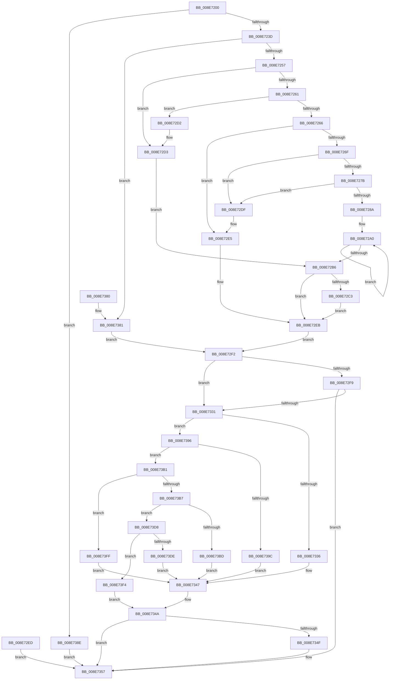

# NtAlpcQueryInformation

- RVA: `0x008E7200`–`0x008E741A` (길이 `538` bytes)
- VA: `0x00000001408E7200`
- 실행 섹션: `PAGE`
- PDB 이름 있음: `예`; PDB Function 태그: `아니요`
- unwind 정보 RVA: `0x00086848`
- 디코드: `144`개 명령, `538/538` bytes 표시
- 미해석 바이트: `0` (있으면 어셈블리에 `.byte`로 보존)

> 이 문서는 커널 이미지의 기계어와 PDB 기호를 분석해 생성했습니다. 4번과 5번은 함수 원형과 자료형을 바이너리 사용 방식에서 추정한 C 해석이며 원본 소스 복구 결과는 아닙니다.

## 1. Dependencies

- 직접 호출 지점: **10**; 고유 호출 대상: **10**
- 직접 호출자로 확인된 함수: **0**
- RIP 상대 이미지 참조: **1**

### Outgoing calls
- `0x008E72DF` → [ExRaiseAccessViolation](ExRaiseAccessViolation_function_008E9240.md) (function, `0x008E9240`)
- `0x008E72E5` → [ExRaiseDatatypeMisalignment](../89/ExRaiseDatatypeMisalignment_function_00899FD0.md) (function, `0x00899FD0`)
- `0x008E7320` → [ObReferenceObjectByHandle](../86/ObReferenceObjectByHandle_function_00868DB0.md) (function, `0x00868DB0`)
- `0x008E7342` → [AlpcpPortQueryBasicInfo](AlpcpPortQueryBasicInfo_function_008E7420.md) (function, `0x008E7420`)
- `0x008E7352` → [ObfDereferenceObject](../../text/2F/ObfDereferenceObject_function_002F9350.md) (function, `0x002F9350`)
- `0x008E7360` → [KeLeaveCriticalRegionThread](../../text/25/KeLeaveCriticalRegionThread_function_0025EFF0.md) (function, `0x0025EFF0`)
- `0x008E73AA` → [AlpcpPortQueryConnectedSidInfo](../9C/AlpcpPortQueryConnectedSidInfo_function_009CAC3C.md) (function, `0x009CAC3C`)
- `0x008E73CE` → [AlpcpWaitForPortReferences](../A9/AlpcpWaitForPortReferences_function_00A95A9C.md) (function, `0x00A95A9C`)
- `0x008E73EA` → [AlpcpPortQueryServerSessionInfo](../9C/AlpcpPortQueryServerSessionInfo_function_009CAB0C.md) (function, `0x009CAB0C`)
- `0x008E7410` → [AlpcpPortQueryServerInfo](../74/AlpcpPortQueryServerInfo_function_0074C784.md) (function, `0x0074C784`)

### Direct callers
- 이 함수 시작 RVA로 연결되는 직접 call은 확인되지 않았습니다. 간접 호출은 완전히 역산할 수 없습니다.

### Static image references
- `0x008E72F9` → RVA `0x00FC6C18` (`ALMOSTRO`; read)

## 2. Other-region calls and transfers

- 다른 실행 섹션으로 향하는 call: **2**
  - `0x008E7352` → [ObfDereferenceObject](../../text/2F/ObfDereferenceObject_function_002F9350.md) (`PAGE` → `.text`)
  - `0x008E7360` → [KeLeaveCriticalRegionThread](../../text/25/KeLeaveCriticalRegionThread_function_0025EFF0.md) (`PAGE` → `.text`)
- 별도 외부 분기/꼬리 이동을 확인하지 못했습니다.

## 3. Assembly (complete function range)

```asm
008E7200  48 89 5C 24 08                  mov qword ptr [rsp + 8], rbx
008E7205  48 89 74 24 10                  mov qword ptr [rsp + 0x10], rsi
008E720A  57                              push rdi
008E720B  41 54                           push r12
008E720D  41 55                           push r13
008E720F  41 56                           push r14
008E7211  41 57                           push r15
008E7213  48 83 EC 30                     sub rsp, 0x30
008E7217  45 8B E1                        mov r12d, r9d
008E721A  49 8B F8                        mov rdi, r8
008E721D  44 8B FA                        mov r15d, edx
008E7220  4C 8B D1                        mov r10, rcx
008E7223  65 48 8B 04 25 88 01 00 00      mov rax, qword ptr gs:[0x188]
008E722C  66 FF 88 E4 01 00 00            dec word ptr [rax + 0x1e4]
008E7233  90                              nop
008E7234  4D 85 C0                        test r8, r8
008E7237  0F 84 51 01 00 00               je 0x1408e738e
008E723D  65 48 8B 04 25 88 01 00 00      mov rax, qword ptr gs:[0x188]
008E7246  44 0F B6 A8 32 02 00 00         movzx r13d, byte ptr [rax + 0x232]
008E724E  45 84 ED                        test r13b, r13b
008E7251  0F 84 2A 01 00 00               je 0x1408e7381
008E7257  8D 42 FD                        lea eax, [rdx - 3]
008E725A  A9 F7 FF FF FF                  test eax, 0xfffffff7
008E725F  74 72                           je 0x1408e72d3
008E7261  45 85 C9                        test r9d, r9d
008E7264  74 6C                           je 0x1408e72d2
008E7266  49 8B C0                        mov rax, r8
008E7269  40 F6 C7 03                     test dil, 3
008E726D  75 76                           jne 0x1408e72e5
008E726F  49 8D 50 FF                     lea rdx, [r8 - 1]
008E7273  49 03 D4                        add rdx, r12
008E7276  4C 3B C2                        cmp r8, rdx
008E7279  77 64                           ja 0x1408e72df
008E727B  49 B8 00 00 FF FF FF 7F 00 00   movabs r8, 0x7fffffff0000
008E7285  49 3B D0                        cmp rdx, r8
008E7288  73 55                           jae 0x1408e72df
008E728A  48 81 E2 00 F0 FF FF            and rdx, 0xfffffffffffff000
008E7291  48 81 C2 00 10 00 00            add rdx, 0x1000
008E7298  0F 1F 84 00 00 00 00 00         nop dword ptr [rax + rax]
008E72A0  0F B6 08                        movzx ecx, byte ptr [rax]
008E72A3  88 08                           mov byte ptr [rax], cl
008E72A5  48 25 00 F0 FF FF               and rax, 0xfffffffffffff000
008E72AB  48 05 00 10 00 00               add rax, 0x1000
008E72B1  48 3B C2                        cmp rax, rdx
008E72B4  75 EA                           jne 0x1408e72a0
008E72B6  48 8B B4 24 80 00 00 00         mov rsi, qword ptr [rsp + 0x80]
008E72BE  48 85 F6                        test rsi, rsi
008E72C1  74 28                           je 0x1408e72eb
008E72C3  49 3B F0                        cmp rsi, r8
008E72C6  4C 0F 42 C6                     cmovb r8, rsi
008E72CA  41 8B 00                        mov eax, dword ptr [r8]
008E72CD  41 89 00                        mov dword ptr [r8], eax
008E72D0  EB 19                           jmp 0x1408e72eb
008E72D2  90                              nop
008E72D3  49 B8 00 00 FF FF FF 7F 00 00   movabs r8, 0x7fffffff0000
008E72DD  EB D7                           jmp 0x1408e72b6
008E72DF  E8 5C 1F 00 00                  call 0x1408e9240
008E72E4  CC                              int3
008E72E5  E8 E6 2C FB FF                  call 0x140899fd0
008E72EA  CC                              int3
008E72EB  EB 05                           jmp 0x1408e72f2
008E72ED  44 8B F0                        mov r14d, eax
008E72F0  EB 65                           jmp 0x1408e7357
008E72F2  33 DB                           xor ebx, ebx
008E72F4  4D 85 D2                        test r10, r10
008E72F7  74 38                           je 0x1408e7331
008E72F9  4C 8B 05 18 F9 6D 00            mov r8, qword ptr [rip + 0x6df918]
008E7300  48 89 5C 24 70                  mov qword ptr [rsp + 0x70], rbx
008E7305  48 89 5C 24 28                  mov qword ptr [rsp + 0x28], rbx
008E730A  48 8D 44 24 70                  lea rax, [rsp + 0x70]
008E730F  48 89 44 24 20                  mov qword ptr [rsp + 0x20], rax
008E7314  45 0F B6 CD                     movzx r9d, r13b
008E7318  BA 00 00 02 00                  mov edx, 0x20000
008E731D  49 8B CA                        mov rcx, r10
008E7320  E8 8B 1A F8 FF                  call 0x140868db0
008E7325  44 8B F0                        mov r14d, eax
008E7328  48 8B 5C 24 70                  mov rbx, qword ptr [rsp + 0x70]
008E732D  85 C0                           test eax, eax
008E732F  78 26                           js 0x1408e7357
008E7331  45 85 FF                        test r15d, r15d
008E7334  75 60                           jne 0x1408e7396
008E7336  4C 8B CE                        mov r9, rsi
008E7339  45 8B C4                        mov r8d, r12d
008E733C  48 8B D7                        mov rdx, rdi
008E733F  48 8B CB                        mov rcx, rbx
008E7342  E8 D9 00 00 00                  call 0x1408e7420
008E7347  44 8B F0                        mov r14d, eax
008E734A  48 85 DB                        test rbx, rbx
008E734D  74 08                           je 0x1408e7357
008E734F  48 8B CB                        mov rcx, rbx
008E7352  E8 F9 1F A1 FF                  call 0x1402f9350
008E7357  65 48 8B 0C 25 88 01 00 00      mov rcx, qword ptr gs:[0x188]
008E7360  E8 8B 7C 97 FF                  call 0x14025eff0
008E7365  41 8B C6                        mov eax, r14d
008E7368  48 8B 5C 24 60                  mov rbx, qword ptr [rsp + 0x60]
008E736D  48 8B 74 24 68                  mov rsi, qword ptr [rsp + 0x68]
008E7372  48 83 C4 30                     add rsp, 0x30
008E7376  41 5F                           pop r15
008E7378  41 5E                           pop r14
008E737A  41 5D                           pop r13
008E737C  41 5C                           pop r12
008E737E  5F                              pop rdi
008E737F  C3                              ret
008E7380  CC                              int3
008E7381  48 8B B4 24 80 00 00 00         mov rsi, qword ptr [rsp + 0x80]
008E7389  E9 64 FF FF FF                  jmp 0x1408e72f2
008E738E  41 BE 0D 00 00 C0               mov r14d, 0xc000000d
008E7394  EB C1                           jmp 0x1408e7357
008E7396  41 83 EF 03                     sub r15d, 3
008E739A  75 15                           jne 0x1408e73b1
008E739C  44 88 6C 24 20                  mov byte ptr [rsp + 0x20], r13b
008E73A1  4C 8B CE                        mov r9, rsi
008E73A4  48 8B D7                        mov rdx, rdi
008E73A7  48 8B CB                        mov rcx, rbx
008E73AA  E8 8D 38 0E 00                  call 0x1409cac3c
008E73AF  EB 96                           jmp 0x1408e7347
008E73B1  41 83 EF 01                     sub r15d, 1
008E73B5  74 48                           je 0x1408e73ff
008E73B7  41 83 EF 07                     sub r15d, 7
008E73BB  75 1B                           jne 0x1408e73d8
008E73BD  44 88 6C 24 20                  mov byte ptr [rsp + 0x20], r13b
008E73C2  4C 8B CE                        mov r9, rsi
008E73C5  45 8B C4                        mov r8d, r12d
008E73C8  48 8B D7                        mov rdx, rdi
008E73CB  48 8B CB                        mov rcx, rbx
008E73CE  E8 C9 E6 1A 00                  call 0x140a95a9c
008E73D3  E9 6F FF FF FF                  jmp 0x1408e7347
008E73D8  41 83 FF 01                     cmp r15d, 1
008E73DC  75 16                           jne 0x1408e73f4
008E73DE  4C 8B CE                        mov r9, rsi
008E73E1  45 8B C4                        mov r8d, r12d
008E73E4  48 8B D7                        mov rdx, rdi
008E73E7  48 8B CB                        mov rcx, rbx
008E73EA  E8 1D 37 0E 00                  call 0x1409cab0c
008E73EF  E9 53 FF FF FF                  jmp 0x1408e7347
008E73F4  41 BE 0D 00 00 C0               mov r14d, 0xc000000d
008E73FA  E9 4B FF FF FF                  jmp 0x1408e734a
008E73FF  44 88 6C 24 20                  mov byte ptr [rsp + 0x20], r13b
008E7404  4C 8B CE                        mov r9, rsi
008E7407  45 8B C4                        mov r8d, r12d
008E740A  48 8B D7                        mov rdx, rdi
008E740D  48 8B CB                        mov rcx, rbx
008E7410  E8 6F 53 E6 FF                  call 0x14074c784
008E7415  E9 2D FF FF FF                  jmp 0x1408e7347
```

## 4. C-style interpretation (structured pseudocode)

```c
__int64 __fastcall NtAlpcQueryInformation(__int64 a1, __int64 a2, __int64 a3, int a4, __int64 a5)
{
    __int64 result;
    __int64 v_r15;
    __int64 v_rbx;
    __int64 v_rsp;
    unsigned __int64 v_stack_m30;
    unsigned __int64 v_stack_m38;
    unsigned __int64 v_stack_p10;
    unsigned __int64 v_stack_p18;
    unsigned __int8 v_stack_p20;
    unsigned __int64 v_stack_p8;

    v_stack_p8 = v_rbx;
    v_stack_p10 = v_rsi;
    v_rsp = (v_rsp) - (48);
    if (a3 == 0) goto loc_008E738E;
    if ((unsigned __int8)(*(unsigned __int8 *)(*(unsigned __int64 *)(gs_base + (0 + 392)) + 562)) == 0) goto loc_008E7381;
    if ((((unsigned int)(a2 - 3)) & (0xFFFFFFF7ULL)) == 0) goto loc_008E72D3;
    if (a4 == 0) goto loc_008E72D2;
    if ((((unsigned __int8)(a3)) & (3)) != 0) goto loc_008E72E5;
    a2 = (a3 - 1) + ((unsigned int)(a4));
    if (a3 > a2) goto loc_008E72DF;
    if (a2 >= a3) goto loc_008E72DF;
    a2 = (a2) & (0xFFFFFFFFFFFFF000ULL);
    a2 = (a2) + (0x1000ULL);
loc_008E72A0:
    *(unsigned __int8 *)(a3) = (unsigned __int8)(*(unsigned __int8 *)(a3));
    result = (a3) & (0xFFFFFFFFFFFFF000ULL);
    result = (result) + (0x1000ULL);
    if (result != a2) goto loc_008E72A0;
loc_008E72B6:
    if (a5 == 0) goto loc_008E72EB;
    if (a5 < a3) { a3 = a5; }
    *(unsigned int *)(a3) = (unsigned int)((unsigned int)(*(unsigned int *)(a3)));
    goto loc_008E72EB;
loc_008E72D2:
loc_008E72D3:
    goto loc_008E72B6;
loc_008E72DF:
    result = ExRaiseAccessViolation(*(unsigned __int8 *)(a3), a2, a3, a4);
loc_008E72E5:
    result = ExRaiseDatatypeMisalignment(*(unsigned __int8 *)(a3), a2, a3, a4);
loc_008E72EB:
    goto loc_008E72F2;
loc_008E72F2:
    v_rbx = 0;
    if (a1 == 0) goto loc_008E7331;
    v_stack_p18 = 0;
    v_stack_m30 = 0;
    v_stack_m38 = v_stack_p18;
    result = ObReferenceObjectByHandle(a1, (unsigned int)(0x20000ULL), *(unsigned __int64 *)(v_rip + 7207192), (unsigned __int8)(*(unsigned __int8 *)(*(unsigned __int64 *)(gs_base + (0 + 392)) + 562)));
    if (sign_flag) goto loc_008E7357;
loc_008E7331:
    if ((unsigned int)((unsigned int)((unsigned int)(a2))) != 0) goto loc_008E7396;
    result = AlpcpPortQueryBasicInfo(v_stack_p18, a3, (unsigned int)((unsigned int)((unsigned int)(a4))), a5);
loc_008E7347:
loc_008E734A:
    if (v_stack_p18 != 0) {
        a1 = v_stack_p18;
        result = ObfDereferenceObject(a1, a3, (unsigned int)((unsigned int)((unsigned int)(a4))), a5);
    }
    result = KeLeaveCriticalRegionThread(*(unsigned __int64 *)(gs_base + (0 + 392)), a3, (unsigned int)((unsigned int)((unsigned int)(a4))), a5);
    v_rsp = (v_rsp) + (48);
    return (unsigned int)((unsigned int)((unsigned int)((unsigned int)(result))));
loc_008E7381:
    goto loc_008E72F2;
loc_008E738E:
    goto loc_008E7357;
loc_008E7396:
    v_r15 = (unsigned int)(((unsigned int)((unsigned int)(a2))) - (3));
    if (condition_is_not_equal) goto loc_008E73B1;
    v_stack_p20 = (unsigned __int8)(*(unsigned __int8 *)(*(unsigned __int64 *)(gs_base + (0 + 392)) + 562));
    result = AlpcpPortQueryConnectedSidInfo(v_stack_p8, a3, (unsigned int)((unsigned int)((unsigned int)(a4))), a5);
    goto loc_008E7347;
loc_008E73B1:
    v_r15 = (unsigned int)((v_r15) - (1));
    if (condition_is_equal) goto loc_008E73FF;
    v_r15 = (unsigned int)((v_r15) - (7));
    if (condition_is_not_equal) goto loc_008E73D8;
    v_stack_p20 = (unsigned __int8)(*(unsigned __int8 *)(*(unsigned __int64 *)(gs_base + (0 + 392)) + 562));
    result = AlpcpWaitForPortReferences(v_stack_p8, a3, (unsigned int)((unsigned int)((unsigned int)(a4))), a5);
    goto loc_008E7347;
loc_008E73D8:
    if (((unsigned int)(v_r15)) != 1) goto loc_008E73F4;
    result = AlpcpPortQueryServerSessionInfo(v_stack_p8, a3, (unsigned int)((unsigned int)((unsigned int)(a4))), a5);
    goto loc_008E7347;
loc_008E73F4:
    goto loc_008E734A;
loc_008E73FF:
    v_stack_p20 = (unsigned __int8)(*(unsigned __int8 *)(*(unsigned __int64 *)(gs_base + (0 + 392)) + 562));
    result = AlpcpPortQueryServerInfo(v_stack_p8, a3, (unsigned int)((unsigned int)((unsigned int)(a4))), a5);
    goto loc_008E7347;
}
```

## 5. (Beta) C Style

```c
int64_t NtAlpcQueryInformation(int64_t Arg1, void *Arg2, int64_t Arg3, int32_t Arg4, int64_t Arg5)
{
    uint8_t *arg2 = (uint8_t *)Arg2;

    int64_t result;
    int64_t local_r15;
    int64_t local_rbx;
    int64_t local_rsp;
    uint64_t v_stack_m30;
    uint64_t v_stack_m38;
    uint64_t v_stack_p10;
    uint64_t v_stack_p18;
    uint8_t v_stack_p20;
    uint64_t v_stack_p8;

    v_stack_p8 = local_rbx;
    v_stack_p10 = local_rsi;
    local_rsp = (local_rsp) - (48);
    if (Arg3 == 0) goto loc_008E738E;
    if ((uint8_t)(*(uint8_t *)(*(uint64_t *)(gs_base + (0 + 0x188)) + 0x232)) == 0) goto loc_008E7381;
    if ((((uint32_t)(Arg2 - 3)) & (0xFFFFFFF7ULL)) == 0) goto loc_008E72D3;
    if (Arg4 == 0) goto loc_008E72D2;
    if ((((uint8_t)(Arg3)) & (3)) != 0) goto loc_008E72E5;
    Arg2 = (Arg3 - 1) + ((uint32_t)(Arg4));
    if (Arg3 > Arg2) goto loc_008E72DF;
    if (Arg2 >= Arg3) goto loc_008E72DF;
    Arg2 = (Arg2) & (0xFFFFFFFFFFFFF000ULL);
    Arg2 = (Arg2) + (0x1000ULL);
loc_008E72A0:
    *(uint8_t *)(Arg3) = (uint8_t)(*(uint8_t *)(Arg3));
    result = (Arg3) & (0xFFFFFFFFFFFFF000ULL);
    result = (result) + (0x1000ULL);
    if (result != Arg2) goto loc_008E72A0;
loc_008E72B6:
    if (Arg5 == 0) goto loc_008E72EB;
    if (Arg5 < Arg3) { Arg3 = Arg5; }
    *(uint32_t *)(Arg3) = (uint32_t)((uint32_t)(*(uint32_t *)(Arg3)));
    goto loc_008E72EB;
loc_008E72D2:
loc_008E72D3:
    goto loc_008E72B6;
loc_008E72DF:
    result = ExRaiseAccessViolation(*(uint8_t *)(Arg3), Arg2, Arg3, Arg4);
loc_008E72E5:
    result = ExRaiseDatatypeMisalignment(*(uint8_t *)(Arg3), Arg2, Arg3, Arg4);
loc_008E72EB:
    goto loc_008E72F2;
loc_008E72F2:
    local_rbx = 0;
    if (Arg1 == 0) goto loc_008E7331;
    v_stack_p18 = 0;
    v_stack_m30 = 0;
    v_stack_m38 = v_stack_p18;
    result = ObReferenceObjectByHandle(Arg1, (uint32_t)(0x20000ULL), *(uint64_t *)(v_rip + 0x6DF918), (uint8_t)(*(uint8_t *)(*(uint64_t *)(gs_base + (0 + 0x188)) + 0x232)));
    if (sign_flag) goto loc_008E7357;
loc_008E7331:
    if ((uint32_t)((uint32_t)((uint32_t)(Arg2))) != 0) goto loc_008E7396;
    result = AlpcpPortQueryBasicInfo(v_stack_p18, Arg3, (uint32_t)((uint32_t)((uint32_t)(Arg4))), Arg5);
loc_008E7347:
loc_008E734A:
    if (v_stack_p18 != 0) {
        Arg1 = v_stack_p18;
        result = ObfDereferenceObject(Arg1, Arg3, (uint32_t)((uint32_t)((uint32_t)(Arg4))), Arg5);
    }
    result = KeLeaveCriticalRegionThread(*(uint64_t *)(gs_base + (0 + 0x188)), Arg3, (uint32_t)((uint32_t)((uint32_t)(Arg4))), Arg5);
    local_rsp = (local_rsp) + (48);
    return (uint32_t)((uint32_t)((uint32_t)((uint32_t)(result))));
loc_008E7381:
    goto loc_008E72F2;
loc_008E738E:
    goto loc_008E7357;
loc_008E7396:
    local_r15 = (uint32_t)(((uint32_t)((uint32_t)(Arg2))) - (3));
    if (condition_is_not_equal) goto loc_008E73B1;
    v_stack_p20 = (uint8_t)(*(uint8_t *)(*(uint64_t *)(gs_base + (0 + 0x188)) + 0x232));
    result = AlpcpPortQueryConnectedSidInfo(v_stack_p8, Arg3, (uint32_t)((uint32_t)((uint32_t)(Arg4))), Arg5);
    goto loc_008E7347;
loc_008E73B1:
    local_r15 = (uint32_t)((local_r15) - (1));
    if (condition_is_equal) goto loc_008E73FF;
    local_r15 = (uint32_t)((local_r15) - (7));
    if (condition_is_not_equal) goto loc_008E73D8;
    v_stack_p20 = (uint8_t)(*(uint8_t *)(*(uint64_t *)(gs_base + (0 + 0x188)) + 0x232));
    result = AlpcpWaitForPortReferences(v_stack_p8, Arg3, (uint32_t)((uint32_t)((uint32_t)(Arg4))), Arg5);
    goto loc_008E7347;
loc_008E73D8:
    if (((uint32_t)(local_r15)) != 1) goto loc_008E73F4;
    result = AlpcpPortQueryServerSessionInfo(v_stack_p8, Arg3, (uint32_t)((uint32_t)((uint32_t)(Arg4))), Arg5);
    goto loc_008E7347;
loc_008E73F4:
    goto loc_008E734A;
loc_008E73FF:
    v_stack_p20 = (uint8_t)(*(uint8_t *)(*(uint64_t *)(gs_base + (0 + 0x188)) + 0x232));
    result = AlpcpPortQueryServerInfo(v_stack_p8, Arg3, (uint32_t)((uint32_t)((uint32_t)(Arg4))), Arg5);
    goto loc_008E7347;
}
```

### 관측된 메모리 오프셋

구조체 형식이 확인되지 않은 접근은 인자 기준의 오프셋으로만 기록했습니다.

| 기준 인자 | 오프셋 표현 | 폭 (bit) | 접근 |
|---|---:|---:|---|
| `Arg2` | `- 0x3` | `32` | `R` |

## 6. Execution-region graph

[열기: 2D/3D 그래프와 함수 탐색 컨트롤 패널](../../../control-panel.html?section=page&rva=0x008E7200&view=graph)

- 2D 그래프는 위에서 아래로 흐르고, 3D 그래프는 빈 공간을 드래그해 회전합니다. Shift+드래그는 이동, 휠은 확대·축소, 함수 노드 선택은 대상 보고서 이동입니다.

### Static fallback


