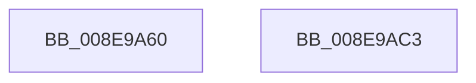

# NtDeviceIoControlFile

- RVA: `0x008E9A60`–`0x008E9AC4` (길이 `100` bytes)
- VA: `0x00000001408E9A60`
- 실행 섹션: `PAGE`
- PDB 이름 있음: `예`; PDB Function 태그: `아니요`
- unwind 정보 RVA: `0x0006E590`
- 디코드: `19`개 명령, `100/100` bytes 표시
- 미해석 바이트: `0` (있으면 어셈블리에 `.byte`로 보존)

> 이 문서는 커널 이미지의 기계어와 PDB 기호를 분석해 생성했습니다. 4번과 5번은 함수 원형과 자료형을 바이너리 사용 방식에서 추정한 C 해석이며 원본 소스 복구 결과는 아닙니다.

## 1. Dependencies

- 직접 호출 지점: **1**; 고유 호출 대상: **1**
- 직접 호출자로 확인된 함수: **1**
- RIP 상대 이미지 참조: **0**

### Outgoing calls
- `0x008E9AB9` → [IopXxxControlFile](IopXxxControlFile_function_008E9AD0.md) (function, `0x008E9AD0`)

### Direct callers
- [PopFlushVolumeWorker](../../pagelk/B7/PopFlushVolumeWorker_function_00B7AEB0.md) at `0x00B7B121`

### Static image references
- 디코드된 RIP-relative 메모리 참조가 없습니다.

## 2. Other-region calls and transfers

- 다른 실행 섹션으로 향하는 call: **0**
- 별도 외부 분기/꼬리 이동을 확인하지 못했습니다.

## 3. Assembly (complete function range)

```asm
008E9A60  48 83 EC 68                     sub rsp, 0x68
008E9A64  8B 84 24 B8 00 00 00            mov eax, dword ptr [rsp + 0xb8]
008E9A6B  C7 44 24 58 00 00 00 00         mov dword ptr [rsp + 0x58], 0
008E9A73  C6 44 24 50 01                  mov byte ptr [rsp + 0x50], 1
008E9A78  89 44 24 48                     mov dword ptr [rsp + 0x48], eax
008E9A7C  48 8B 84 24 B0 00 00 00         mov rax, qword ptr [rsp + 0xb0]
008E9A84  48 89 44 24 40                  mov qword ptr [rsp + 0x40], rax
008E9A89  8B 84 24 A8 00 00 00            mov eax, dword ptr [rsp + 0xa8]
008E9A90  89 44 24 38                     mov dword ptr [rsp + 0x38], eax
008E9A94  48 8B 84 24 A0 00 00 00         mov rax, qword ptr [rsp + 0xa0]
008E9A9C  48 89 44 24 30                  mov qword ptr [rsp + 0x30], rax
008E9AA1  8B 84 24 98 00 00 00            mov eax, dword ptr [rsp + 0x98]
008E9AA8  89 44 24 28                     mov dword ptr [rsp + 0x28], eax
008E9AAC  48 8B 84 24 90 00 00 00         mov rax, qword ptr [rsp + 0x90]
008E9AB4  48 89 44 24 20                  mov qword ptr [rsp + 0x20], rax
008E9AB9  E8 12 00 00 00                  call 0x1408e9ad0
008E9ABE  48 83 C4 68                     add rsp, 0x68
008E9AC2  C3                              ret
008E9AC3  CC                              int3
```

## 4. C-style interpretation (structured pseudocode)

```c
__int64 __fastcall NtDeviceIoControlFile(__int64 a1, __int64 a2, __int64 a3, __int64 a4, __int64 a5, unsigned int a6, __int64 a7, unsigned int a8, __int64 a9, unsigned int a10)
{
    __int64 result;
    __int64 v_rsp;
    unsigned int v_stack_m10;
    unsigned __int8 v_stack_m18;
    unsigned int v_stack_m20;
    unsigned __int64 v_stack_m28;
    unsigned int v_stack_m30;
    unsigned __int64 v_stack_m38;
    unsigned int v_stack_m40;
    unsigned __int64 v_stack_m48;

    v_rsp = (v_rsp) - (104);
    v_stack_m10 = 0;
    v_stack_m18 = 1;
    v_stack_m20 = (unsigned int)((unsigned int)(a10));
    v_stack_m28 = a9;
    v_stack_m30 = (unsigned int)((unsigned int)(a8));
    v_stack_m38 = a7;
    v_stack_m40 = (unsigned int)((unsigned int)(a6));
    v_stack_m48 = a5;
    result = IopXxxControlFile(a1, a2, a3, a4);
    v_rsp = (v_rsp) + (104);
    return result;
}
```

## 5. (Beta) C Style

```c
int64_t NtDeviceIoControlFile(int64_t Arg1, int64_t Arg2, int64_t Arg3, int64_t Arg4, int64_t Arg5, uint32_t Arg6, int64_t Arg7, uint32_t Arg8, int64_t Arg9, uint32_t Arg10)
{
    int64_t result;
    int64_t local_rsp;
    uint32_t v_stack_m10;
    uint8_t v_stack_m18;
    uint32_t v_stack_m20;
    uint64_t v_stack_m28;
    uint32_t v_stack_m30;
    uint64_t v_stack_m38;
    uint32_t v_stack_m40;
    uint64_t v_stack_m48;

    local_rsp = (local_rsp) - (104);
    v_stack_m10 = 0;
    v_stack_m18 = 1;
    v_stack_m20 = (uint32_t)((uint32_t)(Arg10));
    v_stack_m28 = Arg9;
    v_stack_m30 = (uint32_t)((uint32_t)(Arg8));
    v_stack_m38 = Arg7;
    v_stack_m40 = (uint32_t)((uint32_t)(Arg6));
    v_stack_m48 = Arg5;
    result = IopXxxControlFile(Arg1, Arg2, Arg3, Arg4);
    local_rsp = (local_rsp) + (104);
    return result;
}
```

## 6. Execution-region graph

[열기: 2D/3D 그래프와 함수 탐색 컨트롤 패널](../../../control-panel.html?section=page&rva=0x008E9A60&view=graph)

- 2D 그래프는 위에서 아래로 흐르고, 3D 그래프는 빈 공간을 드래그해 회전합니다. Shift+드래그는 이동, 휠은 확대·축소, 함수 노드 선택은 대상 보고서 이동입니다.

### Static fallback


