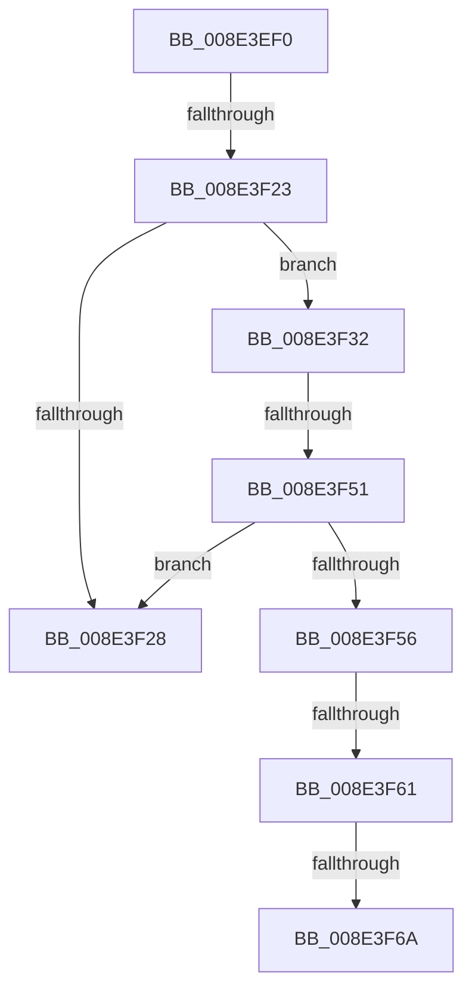

# NtPlugPlayControl

- RVA: `0x008E3EF0`–`0x008E3F77` (길이 `135` bytes)
- VA: `0x00000001408E3EF0`
- 실행 섹션: `PAGE`
- PDB 이름 있음: `예`; PDB Function 태그: `아니요`
- unwind 정보 RVA: `0x00086198`
- 디코드: `32`개 명령, `135/135` bytes 표시
- 미해석 바이트: `0` (있으면 어셈블리에 `.byte`로 보존)

> 이 문서는 커널 이미지의 기계어와 PDB 기호를 분석해 생성했습니다. 4번과 5번은 함수 원형과 자료형을 바이너리 사용 방식에서 추정한 C 해석이며 원본 소스 복구 결과는 아닙니다.

## 1. Dependencies

- 직접 호출 지점: **1**; 고유 호출 대상: **1**
- 직접 호출자로 확인된 함수: **0**
- RIP 상대 이미지 참조: **1**

### Outgoing calls
- `0x008E3F6A` → [PsIsCurrentThreadInServerSilo](../../text/43/PsIsCurrentThreadInServerSilo_function_004362E0.md) (function, `0x004362E0`)

### Direct callers
- 이 함수 시작 RVA로 연결되는 직접 call은 확인되지 않았습니다. 간접 호출은 완전히 역산할 수 없습니다.

### Static image references
- `0x008E3F3D` → RVA `0x00001640` (`.rdata`; read)

## 2. Other-region calls and transfers

- 다른 실행 섹션으로 향하는 call: **1**
  - `0x008E3F6A` → [PsIsCurrentThreadInServerSilo](../../text/43/PsIsCurrentThreadInServerSilo_function_004362E0.md) (`PAGE` → `.text`)
- call이 아닌 외부 분기/꼬리 이동: **6**
  - `0x008E3F1D` → [sub_008E40CB + 0xC](Unknown_function_008E40CB.md) (`tail-transfer`)
  - `0x008E3F2D` → [sub_008E4018](Unknown_function_008E4018.md) (`tail-transfer`)
  - `0x008E3F4B` → [sub_008E412B](Unknown_function_008E412B.md) (`tail-transfer`)
  - `0x008E3F5B` → [sub_008E4109](Unknown_function_008E4109.md) (`tail-transfer`)
  - `0x008E3F64` → [sub_008E4109 + 0xA](Unknown_function_008E4109.md) (`tail-transfer`)
  - `0x008E3F71` → [sub_008E40CB](Unknown_function_008E40CB.md) (`tail-transfer`)

## 3. Assembly (complete function range)

```asm
008E3EF0  48 89 5C 24 18                  mov qword ptr [rsp + 0x18], rbx
008E3EF5  48 89 6C 24 20                  mov qword ptr [rsp + 0x20], rbp
008E3EFA  56                              push rsi
008E3EFB  57                              push rdi
008E3EFC  41 57                           push r15
008E3EFE  48 83 EC 30                     sub rsp, 0x30
008E3F02  65 48 8B 04 25 88 01 00 00      mov rax, qword ptr gs:[0x188]
008E3F0B  4C 8B FA                        mov r15, rdx
008E3F0E  41 8B F0                        mov esi, r8d
008E3F11  8B E9                           mov ebp, ecx
008E3F13  0F B6 B8 32 02 00 00            movzx edi, byte ptr [rax + 0x232]
008E3F1A  40 84 FF                        test dil, dil
008E3F1D  0F 85 B4 01 00 00               jne 0x1408e40d7
008E3F23  83 FD 18                        cmp ebp, 0x18
008E3F26  72 0A                           jb 0x1408e3f32
008E3F28  B8 EF 00 00 C0                  mov eax, 0xc00000ef
008E3F2D  E9 E6 00 00 00                  jmp 0x1408e4018
008E3F32  48 8D 0C 6D 00 00 00 00         lea rcx, [rbp*2]
008E3F3A  48 03 CD                        add rcx, rbp
008E3F3D  48 8D 05 FC D6 71 FF            lea rax, [rip - 0x8e2904]
008E3F44  39 2C C8                        cmp dword ptr [rax + rcx*8], ebp
008E3F47  48 8D 1C C8                     lea rbx, [rax + rcx*8]
008E3F4B  0F 85 DA 01 00 00               jne 0x1408e412b
008E3F51  48 85 DB                        test rbx, rbx
008E3F54  74 D2                           je 0x1408e3f28
008E3F56  48 83 7B 08 00                  cmp qword ptr [rbx + 8], 0
008E3F5B  0F 84 A8 01 00 00               je 0x1408e4109
008E3F61  39 73 04                        cmp dword ptr [rbx + 4], esi
008E3F64  0F 85 A9 01 00 00               jne 0x1408e4113
008E3F6A  E8 71 23 B5 FF                  call 0x1404362e0
008E3F6F  84 C0                           test al, al
008E3F71  0F 85 54 01 00 00               jne 0x1408e40cb
```

## 4. C-style interpretation (structured pseudocode)

```c
__int64 __fastcall NtPlugPlayControl(int a1, __int64 a2, int a3)
{
    __int64 result;
    __int64 v_rsp;
    unsigned __int64 v_stack_p18;
    unsigned __int64 v_stack_p20;

    v_stack_p18 = v_rbx;
    v_stack_p20 = v_rbp;
    v_rsp = (v_rsp) - (48);
    if (((unsigned int)((unsigned int)(a1))) < 24) goto loc_008E3F32;
loc_008E3F28:
loc_008E3F32:
    a1 = ((unsigned int)(a1) * 2) + ((unsigned int)(a1));
    if (v_rip - 9316612 + a1 * 8 == 0) goto loc_008E3F28;
    result = PsIsCurrentThreadInServerSilo(a1, a2, a3, a4);
}
```

## 5. (Beta) C Style

```c
int64_t NtPlugPlayControl(int32_t Arg1, int64_t Arg2, int32_t Arg3)
{
    int64_t result;
    int64_t local_rsp;
    uint64_t v_stack_p18;
    uint64_t v_stack_p20;

    v_stack_p18 = local_rbx;
    v_stack_p20 = local_rbp;
    local_rsp = (local_rsp) - (48);
    if (((uint32_t)((uint32_t)(Arg1))) < 24) goto loc_008E3F32;
loc_008E3F28:
loc_008E3F32:
    Arg1 = ((uint32_t)(Arg1) * 2) + ((uint32_t)(Arg1));
    if (v_rip - 9316612 + Arg1 * 8 == 0) goto loc_008E3F28;
    result = PsIsCurrentThreadInServerSilo(Arg1, Arg2, Arg3, a4);
}
```

## 6. Execution-region graph

[열기: 2D/3D 그래프와 함수 탐색 컨트롤 패널](../../../control-panel.html?section=page&rva=0x008E3EF0&view=graph)

- 2D 그래프는 위에서 아래로 흐르고, 3D 그래프는 빈 공간을 드래그해 회전합니다. Shift+드래그는 이동, 휠은 확대·축소, 함수 노드 선택은 대상 보고서 이동입니다.

### Static fallback


