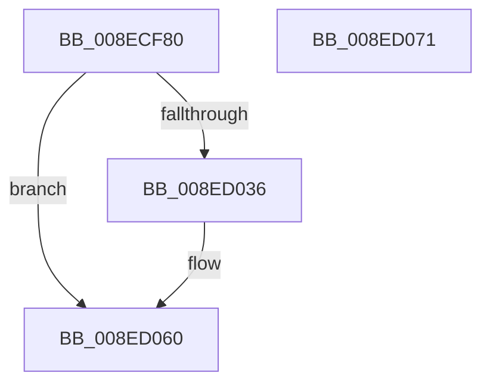

# NtQueryDirectoryFile

- RVA: `0x008ECF80`–`0x008ED072` (길이 `242` bytes)
- VA: `0x00000001408ECF80`
- 실행 섹션: `PAGE`
- PDB 이름 있음: `예`; PDB Function 태그: `아니요`
- unwind 정보 RVA: `0x00086CF8`
- 디코드: `62`개 명령, `242/242` bytes 표시
- 미해석 바이트: `0` (있으면 어셈블리에 `.byte`로 보존)

> 이 문서는 커널 이미지의 기계어와 PDB 기호를 분석해 생성했습니다. 4번과 5번은 함수 원형과 자료형을 바이너리 사용 방식에서 추정한 C 해석이며 원본 소스 복구 결과는 아닙니다.

## 1. Dependencies

- 직접 호출 지점: **2**; 고유 호출 대상: **2**
- 직접 호출자로 확인된 함수: **0**
- RIP 상대 이미지 참조: **0**

### Outgoing calls
- `0x008ED02D` → [BuildQueryDirectoryIrp](BuildQueryDirectoryIrp_function_008EC770.md) (function, `0x008EC770`)
- `0x008ED05B` → [IopSynchronousServiceTail](IopSynchronousServiceTail_function_008EB440.md) (function, `0x008EB440`)

### Direct callers
- 이 함수 시작 RVA로 연결되는 직접 call은 확인되지 않았습니다. 간접 호출은 완전히 역산할 수 없습니다.

### Static image references
- 디코드된 RIP-relative 메모리 참조가 없습니다.

## 2. Other-region calls and transfers

- 다른 실행 섹션으로 향하는 call: **0**
- 별도 외부 분기/꼬리 이동을 확인하지 못했습니다.

## 3. Assembly (complete function range)

```asm
008ECF80  48 89 5C 24 08                  mov qword ptr [rsp + 8], rbx
008ECF85  55                              push rbp
008ECF86  48 8D 6C 24 E1                  lea rbp, [rsp - 0x1f]
008ECF8B  48 81 EC A0 00 00 00            sub rsp, 0xa0
008ECF92  F6 5D 6F                        neg byte ptr [rbp + 0x6f]
008ECF95  48 8B D9                        mov rbx, rcx
008ECF98  4C 8B DA                        mov r11, rdx
008ECF9B  C6 45 6F 00                     mov byte ptr [rbp + 0x6f], 0
008ECF9F  1A C0                           sbb al, al
008ECFA1  C6 45 FF 00                     mov byte ptr [rbp - 1], 0
008ECFA5  48 83 65 17 00                  and qword ptr [rbp + 0x17], 0
008ECFAA  24 02                           and al, 2
008ECFAC  48 83 65 0F 00                  and qword ptr [rbp + 0xf], 0
008ECFB1  48 83 65 07 00                  and qword ptr [rbp + 7], 0
008ECFB6  44 0F B6 D0                     movzx r10d, al
008ECFBA  41 8A C2                        mov al, r10b
008ECFBD  0C 01                           or al, 1
008ECFBF  80 7D 7F 00                     cmp byte ptr [rbp + 0x7f], 0
008ECFC3  0F B6 C8                        movzx ecx, al
008ECFC6  48 8D 45 FF                     lea rax, [rbp - 1]
008ECFCA  48 89 44 24 78                  mov qword ptr [rsp + 0x78], rax
008ECFCF  41 0F 44 CA                     cmove ecx, r10d
008ECFD3  0F B6 D1                        movzx edx, cl
008ECFD6  48 8D 45 07                     lea rax, [rbp + 7]
008ECFDA  48 89 44 24 70                  mov qword ptr [rsp + 0x70], rax
008ECFDF  48 8B CB                        mov rcx, rbx
008ECFE2  48 8D 45 0F                     lea rax, [rbp + 0xf]
008ECFE6  48 89 44 24 68                  mov qword ptr [rsp + 0x68], rax
008ECFEB  48 8D 45 17                     lea rax, [rbp + 0x17]
008ECFEF  48 89 44 24 60                  mov qword ptr [rsp + 0x60], rax
008ECFF4  48 8D 45 6F                     lea rax, [rbp + 0x6f]
008ECFF8  48 89 44 24 58                  mov qword ptr [rsp + 0x58], rax
008ECFFD  48 8B 45 77                     mov rax, qword ptr [rbp + 0x77]
008ED001  48 89 44 24 48                  mov qword ptr [rsp + 0x48], rax
008ED006  8B 45 67                        mov eax, dword ptr [rbp + 0x67]
008ED009  89 54 24 40                     mov dword ptr [rsp + 0x40], edx
008ED00D  49 8B D3                        mov rdx, r11
008ED010  89 44 24 38                     mov dword ptr [rsp + 0x38], eax
008ED014  8B 45 5F                        mov eax, dword ptr [rbp + 0x5f]
008ED017  89 44 24 30                     mov dword ptr [rsp + 0x30], eax
008ED01B  48 8B 45 57                     mov rax, qword ptr [rbp + 0x57]
008ED01F  48 89 44 24 28                  mov qword ptr [rsp + 0x28], rax
008ED024  48 8B 45 4F                     mov rax, qword ptr [rbp + 0x4f]
008ED028  48 89 44 24 20                  mov qword ptr [rsp + 0x20], rax
008ED02D  E8 3E F7 FF FF                  call 0x1408ec770
008ED032  85 C0                           test eax, eax
008ED034  75 2A                           jne 0x1408ed060
008ED036  8A 45 6F                        mov al, byte ptr [rbp + 0x6f]
008ED039  41 B1 01                        mov r9b, 1
008ED03C  4C 8B 45 07                     mov r8, qword ptr [rbp + 7]
008ED040  48 8B 55 0F                     mov rdx, qword ptr [rbp + 0xf]
008ED044  48 8B 4D 17                     mov rcx, qword ptr [rbp + 0x17]
008ED048  C7 44 24 30 02 00 00 00         mov dword ptr [rsp + 0x30], 2
008ED050  88 44 24 28                     mov byte ptr [rsp + 0x28], al
008ED054  8A 45 FF                        mov al, byte ptr [rbp - 1]
008ED057  88 44 24 20                     mov byte ptr [rsp + 0x20], al
008ED05B  E8 E0 E3 FF FF                  call 0x1408eb440
008ED060  48 8B 9C 24 B0 00 00 00         mov rbx, qword ptr [rsp + 0xb0]
008ED068  48 81 C4 A0 00 00 00            add rsp, 0xa0
008ED06F  5D                              pop rbp
008ED070  C3                              ret
008ED071  CC                              int3
```

## 4. C-style interpretation (structured pseudocode)

```c
__int64 __fastcall NtQueryDirectoryFile(__int64 a1, __int64 a2, __int64 a3, __int64 a4, __int64 a5, __int64 a6, unsigned int a7, unsigned int a8, unsigned __int8 a9, __int64 a10, unsigned __int8 a11)
{
    __int64 result;
    __int64 v_rsp;
    unsigned __int64 v_stack_m10;
    unsigned __int64 v_stack_m18;
    unsigned __int64 v_stack_m20;
    unsigned __int64 v_stack_m27;
    unsigned __int8 v_stack_m28;
    unsigned __int64 v_stack_m30;
    unsigned __int64 v_stack_m38;
    unsigned __int64 v_stack_m40;
    unsigned __int64 v_stack_m48;
    unsigned __int64 v_stack_m50;
    unsigned __int64 v_stack_m60;
    unsigned int v_stack_m68;
    unsigned int v_stack_m70;
    unsigned int v_stack_m78;
    unsigned __int64 v_stack_m80;
    unsigned __int64 v_stack_m88;
    unsigned __int8 v_stack_p48;
    unsigned __int64 v_stack_p8;

    v_stack_p8 = v_rbx;
    v_rsp = (v_rsp) - (160);
    v_stack_p48 = 0;
    v_stack_m28 = 0;
    result = (unsigned __int8)((result) & (2));
    result = (unsigned __int8)(((unsigned __int8)((unsigned __int8)(result))) | (1));
    v_stack_m30 = v_stack_m28;
    a1 = (unsigned __int8)(result);
    if (a11 == 0) { a1 = (unsigned int)((unsigned __int8)(result)); }
    v_stack_m38 = v_stack_m20;
    v_stack_m40 = v_stack_m18;
    v_stack_m48 = v_stack_m10;
    v_stack_m50 = a9;
    v_stack_m60 = a10;
    v_stack_m68 = (unsigned int)((unsigned __int8)(a1));
    v_stack_m70 = (unsigned int)((unsigned int)(a8));
    v_stack_m78 = (unsigned int)((unsigned int)(a7));
    v_stack_m80 = a6;
    v_stack_m88 = a5;
    result = BuildQueryDirectoryIrp(a1, a2, a3, a4);
    if ((unsigned int)(result) == 0) {
        result = a9;
        a4 = 1;
        a3 = v_stack_m20;
        a2 = v_stack_m18;
        a1 = v_stack_m10;
        v_stack_m78 = 2;
        v_stack_m80 = (unsigned __int8)(result);
        result = v_stack_m28;
        v_stack_m88 = (unsigned __int8)(result);
        result = IopSynchronousServiceTail(a1, a2, a3, a4);
    }
    v_rsp = (v_rsp) + (160);
    return result;
}
```

## 5. (Beta) C Style

```c
int64_t NtQueryDirectoryFile(int64_t Arg1, int64_t Arg2, int64_t Arg3, int64_t Arg4, int64_t Arg5, int64_t Arg6, uint32_t Arg7, uint32_t Arg8, uint8_t Arg9, int64_t Arg10, uint8_t Arg11)
{
    int64_t result;
    int64_t local_rsp;
    uint64_t v_stack_m10;
    uint64_t v_stack_m18;
    uint64_t v_stack_m20;
    uint64_t v_stack_m27;
    uint8_t v_stack_m28;
    uint64_t v_stack_m30;
    uint64_t v_stack_m38;
    uint64_t v_stack_m40;
    uint64_t v_stack_m48;
    uint64_t v_stack_m50;
    uint64_t v_stack_m60;
    uint32_t v_stack_m68;
    uint32_t v_stack_m70;
    uint32_t v_stack_m78;
    uint64_t v_stack_m80;
    uint64_t v_stack_m88;
    uint8_t v_stack_p48;
    uint64_t v_stack_p8;

    v_stack_p8 = local_rbx;
    local_rsp = (local_rsp) - (160);
    v_stack_p48 = 0;
    v_stack_m28 = 0;
    result = (uint8_t)((result) & (2));
    result = (uint8_t)(((uint8_t)((uint8_t)(result))) | (1));
    v_stack_m30 = v_stack_m28;
    Arg1 = (uint8_t)(result);
    if (Arg11 == 0) { Arg1 = (uint32_t)((uint8_t)(result)); }
    v_stack_m38 = v_stack_m20;
    v_stack_m40 = v_stack_m18;
    v_stack_m48 = v_stack_m10;
    v_stack_m50 = Arg9;
    v_stack_m60 = Arg10;
    v_stack_m68 = (uint32_t)((uint8_t)(Arg1));
    v_stack_m70 = (uint32_t)((uint32_t)(Arg8));
    v_stack_m78 = (uint32_t)((uint32_t)(Arg7));
    v_stack_m80 = Arg6;
    v_stack_m88 = Arg5;
    result = BuildQueryDirectoryIrp(Arg1, Arg2, Arg3, Arg4);
    if ((uint32_t)(result) == 0) {
        result = Arg9;
        Arg4 = 1;
        Arg3 = v_stack_m20;
        Arg2 = v_stack_m18;
        Arg1 = v_stack_m10;
        v_stack_m78 = 2;
        v_stack_m80 = (uint8_t)(result);
        result = v_stack_m28;
        v_stack_m88 = (uint8_t)(result);
        result = IopSynchronousServiceTail(Arg1, Arg2, Arg3, Arg4);
    }
    local_rsp = (local_rsp) + (160);
    return result;
}
```

## 6. Execution-region graph

[열기: 2D/3D 그래프와 함수 탐색 컨트롤 패널](../../../control-panel.html?section=page&rva=0x008ECF80&view=graph)

- 2D 그래프는 위에서 아래로 흐르고, 3D 그래프는 빈 공간을 드래그해 회전합니다. Shift+드래그는 이동, 휠은 확대·축소, 함수 노드 선택은 대상 보고서 이동입니다.

### Static fallback


