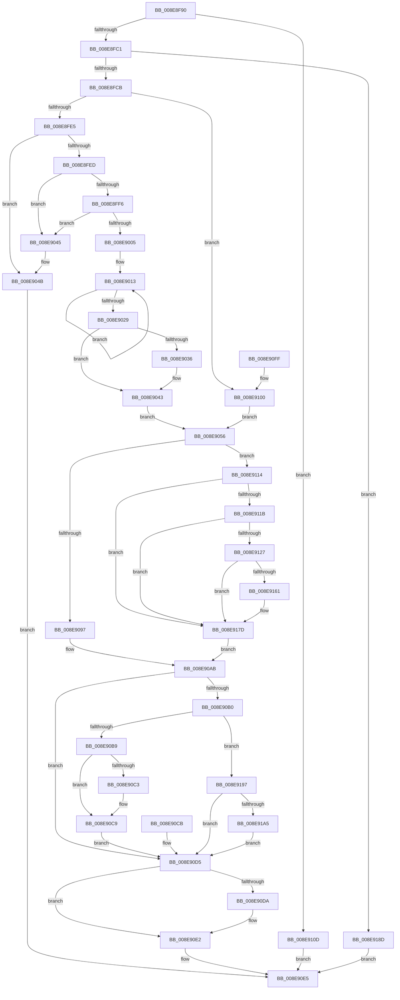

# NtQueryEvent

- RVA: `0x008E8F90`–`0x008E91B0` (길이 `544` bytes)
- VA: `0x00000001408E8F90`
- 실행 섹션: `PAGE`
- PDB 이름 있음: `예`; PDB Function 태그: `아니요`
- unwind 정보 RVA: `0x00086AD8`
- 디코드: `140`개 명령, `544/544` bytes 표시
- 미해석 바이트: `0` (있으면 어셈블리에 `.byte`로 보존)

> 이 문서는 커널 이미지의 기계어와 PDB 기호를 분석해 생성했습니다. 4번과 5번은 함수 원형과 자료형을 바이너리 사용 방식에서 추정한 C 해석이며 원본 소스 복구 결과는 아닙니다.

## 1. Dependencies

- 직접 호출 지점: **6**; 고유 호출 대상: **5**
- 직접 호출자로 확인된 함수: **0**
- RIP 상대 이미지 참조: **2**

### Outgoing calls
- `0x008E9045` → [ExRaiseAccessViolation](ExRaiseAccessViolation_function_008E9240.md) (function, `0x008E9240`)
- `0x008E904B` → [ExRaiseDatatypeMisalignment](../89/ExRaiseDatatypeMisalignment_function_00899FD0.md) (function, `0x00899FD0`)
- `0x008E907D` → [ObReferenceObjectByHandle](../86/ObReferenceObjectByHandle_function_00868DB0.md) (function, `0x00868DB0`)
- `0x008E90DD` → [ObfDereferenceObject](../../text/2F/ObfDereferenceObject_function_002F9350.md) (function, `0x002F9350`)
- `0x008E9147` → [ObReferenceObjectByHandle](../86/ObReferenceObjectByHandle_function_00868DB0.md) (function, `0x00868DB0`)
- `0x008E9171` → [ExpQueryCrossVmEvent](../AD/ExpQueryCrossVmEvent_function_00AD4B08.md) (function, `0x00AD4B08`)

### Direct callers
- 이 함수 시작 RVA로 연결되는 직접 call은 확인되지 않았습니다. 간접 호출은 완전히 역산할 수 없습니다.

### Static image references
- `0x008E9056` → RVA `0x00FC6B80` (`ALMOSTRO`; read)
- `0x008E911B` → RVA `0x00EFA110` (`.data`; read)

## 2. Other-region calls and transfers

- 다른 실행 섹션으로 향하는 call: **1**
  - `0x008E90DD` → [ObfDereferenceObject](../../text/2F/ObfDereferenceObject_function_002F9350.md) (`PAGE` → `.text`)
- 별도 외부 분기/꼬리 이동을 확인하지 못했습니다.

## 3. Assembly (complete function range)

```asm
008E8F90  48 8B C4                        mov rax, rsp
008E8F93  48 89 58 08                     mov qword ptr [rax + 8], rbx
008E8F97  48 89 70 18                     mov qword ptr [rax + 0x18], rsi
008E8F9B  57                              push rdi
008E8F9C  41 54                           push r12
008E8F9E  41 55                           push r13
008E8FA0  41 56                           push r14
008E8FA2  41 57                           push r15
008E8FA4  48 83 EC 50                     sub rsp, 0x50
008E8FA8  49 8B D8                        mov rbx, r8
008E8FAB  4C 8B E1                        mov r12, rcx
008E8FAE  45 33 ED                        xor r13d, r13d
008E8FB1  44 89 68 B8                     mov dword ptr [rax - 0x48], r13d
008E8FB5  44 89 68 10                     mov dword ptr [rax + 0x10], r13d
008E8FB9  85 D2                           test edx, edx
008E8FBB  0F 85 4C 01 00 00               jne 0x1408e910d
008E8FC1  41 83 F9 08                     cmp r9d, 8
008E8FC5  0F 85 C2 01 00 00               jne 0x1408e918d
008E8FCB  65 48 8B 04 25 88 01 00 00      mov rax, qword ptr gs:[0x188]
008E8FD4  44 0F B6 B8 32 02 00 00         movzx r15d, byte ptr [rax + 0x232]
008E8FDC  45 84 FF                        test r15b, r15b
008E8FDF  0F 84 1B 01 00 00               je 0x1408e9100
008E8FE5  48 8B C3                        mov rax, rbx
008E8FE8  F6 C3 03                        test bl, 3
008E8FEB  75 5E                           jne 0x1408e904b
008E8FED  49 8D 50 07                     lea rdx, [r8 + 7]
008E8FF1  48 3B DA                        cmp rbx, rdx
008E8FF4  77 4F                           ja 0x1408e9045
008E8FF6  49 B8 00 00 FF FF FF 7F 00 00   movabs r8, 0x7fffffff0000
008E9000  49 3B D0                        cmp rdx, r8
008E9003  73 40                           jae 0x1408e9045
008E9005  48 81 E2 00 F0 FF FF            and rdx, 0xfffffffffffff000
008E900C  48 81 C2 00 10 00 00            add rdx, 0x1000
008E9013  0F B6 08                        movzx ecx, byte ptr [rax]
008E9016  88 08                           mov byte ptr [rax], cl
008E9018  48 25 00 F0 FF FF               and rax, 0xfffffffffffff000
008E901E  48 05 00 10 00 00               add rax, 0x1000
008E9024  48 3B C2                        cmp rax, rdx
008E9027  75 EA                           jne 0x1408e9013
008E9029  48 8B BC 24 A0 00 00 00         mov rdi, qword ptr [rsp + 0xa0]
008E9031  48 85 FF                        test rdi, rdi
008E9034  74 0D                           je 0x1408e9043
008E9036  49 3B F8                        cmp rdi, r8
008E9039  4C 0F 42 C7                     cmovb r8, rdi
008E903D  41 8B 00                        mov eax, dword ptr [r8]
008E9040  41 89 00                        mov dword ptr [r8], eax
008E9043  EB 11                           jmp 0x1408e9056
008E9045  E8 F6 01 00 00                  call 0x1408e9240
008E904A  CC                              int3
008E904B  E8 80 0F FB FF                  call 0x140899fd0
008E9050  90                              nop
008E9051  E9 8F 00 00 00                  jmp 0x1408e90e5
008E9056  4C 8B 05 23 DB 6D 00            mov r8, qword ptr [rip + 0x6ddb23]
008E905D  4C 89 6C 24 38                  mov qword ptr [rsp + 0x38], r13
008E9062  4C 89 6C 24 28                  mov qword ptr [rsp + 0x28], r13
008E9067  48 8D 44 24 38                  lea rax, [rsp + 0x38]
008E906C  48 89 44 24 20                  mov qword ptr [rsp + 0x20], rax
008E9071  45 0F B6 CF                     movzx r9d, r15b
008E9075  BA 01 00 00 00                  mov edx, 1
008E907A  49 8B CC                        mov rcx, r12
008E907D  E8 2E FD F7 FF                  call 0x140868db0
008E9082  44 8B F0                        mov r14d, eax
008E9085  48 8B 74 24 38                  mov rsi, qword ptr [rsp + 0x38]
008E908A  48 89 74 24 40                  mov qword ptr [rsp + 0x40], rsi
008E908F  89 44 24 38                     mov dword ptr [rsp + 0x38], eax
008E9093  85 C0                           test eax, eax
008E9095  78 7D                           js 0x1408e9114
008E9097  8B 4E 04                        mov ecx, dword ptr [rsi + 4]
008E909A  89 8C 24 88 00 00 00            mov dword ptr [rsp + 0x88], ecx
008E90A1  0F B6 06                        movzx eax, byte ptr [rsi]
008E90A4  83 E0 7F                        and eax, 0x7f
008E90A7  89 44 24 30                     mov dword ptr [rsp + 0x30], eax
008E90AB  45 85 F6                        test r14d, r14d
008E90AE  78 25                           js 0x1408e90d5
008E90B0  45 84 FF                        test r15b, r15b
008E90B3  0F 84 DE 00 00 00               je 0x1408e9197
008E90B9  89 03                           mov dword ptr [rbx], eax
008E90BB  89 4B 04                        mov dword ptr [rbx + 4], ecx
008E90BE  48 85 FF                        test rdi, rdi
008E90C1  74 06                           je 0x1408e90c9
008E90C3  C7 07 08 00 00 00               mov dword ptr [rdi], 8
008E90C9  EB 0A                           jmp 0x1408e90d5
008E90CB  48 8B 74 24 40                  mov rsi, qword ptr [rsp + 0x40]
008E90D0  44 8B 74 24 38                  mov r14d, dword ptr [rsp + 0x38]
008E90D5  48 85 F6                        test rsi, rsi
008E90D8  74 08                           je 0x1408e90e2
008E90DA  48 8B CE                        mov rcx, rsi
008E90DD  E8 6E 02 A1 FF                  call 0x1402f9350
008E90E2  41 8B C6                        mov eax, r14d
008E90E5  4C 8D 5C 24 50                  lea r11, [rsp + 0x50]
008E90EA  49 8B 5B 30                     mov rbx, qword ptr [r11 + 0x30]
008E90EE  49 8B 73 40                     mov rsi, qword ptr [r11 + 0x40]
008E90F2  49 8B E3                        mov rsp, r11
008E90F5  41 5F                           pop r15
008E90F7  41 5E                           pop r14
008E90F9  41 5D                           pop r13
008E90FB  41 5C                           pop r12
008E90FD  5F                              pop rdi
008E90FE  C3                              ret
008E90FF  CC                              int3
008E9100  48 8B BC 24 A0 00 00 00         mov rdi, qword ptr [rsp + 0xa0]
008E9108  E9 49 FF FF FF                  jmp 0x1408e9056
008E910D  B8 03 00 00 C0                  mov eax, 0xc0000003
008E9112  EB D1                           jmp 0x1408e90e5
008E9114  3D 24 00 00 C0                  cmp eax, 0xc0000024
008E9119  75 62                           jne 0x1408e917d
008E911B  4C 8B 05 EE 0F 61 00            mov r8, qword ptr [rip + 0x610fee]
008E9122  4D 85 C0                        test r8, r8
008E9125  74 56                           je 0x1408e917d
008E9127  4C 89 6C 24 38                  mov qword ptr [rsp + 0x38], r13
008E912C  4C 89 6C 24 28                  mov qword ptr [rsp + 0x28], r13
008E9131  48 8D 44 24 38                  lea rax, [rsp + 0x38]
008E9136  48 89 44 24 20                  mov qword ptr [rsp + 0x20], rax
008E913B  45 0F B6 CF                     movzx r9d, r15b
008E913F  BA 01 00 00 00                  mov edx, 1
008E9144  49 8B CC                        mov rcx, r12
008E9147  E8 64 FC F7 FF                  call 0x140868db0
008E914C  44 8B F0                        mov r14d, eax
008E914F  48 8B 74 24 38                  mov rsi, qword ptr [rsp + 0x38]
008E9154  48 89 74 24 40                  mov qword ptr [rsp + 0x40], rsi
008E9159  89 44 24 38                     mov dword ptr [rsp + 0x38], eax
008E915D  85 C0                           test eax, eax
008E915F  78 1C                           js 0x1408e917d
008E9161  4C 8D 84 24 88 00 00 00         lea r8, [rsp + 0x88]
008E9169  48 8D 54 24 30                  lea rdx, [rsp + 0x30]
008E916E  48 8B CE                        mov rcx, rsi
008E9171  E8 92 B9 1E 00                  call 0x140ad4b08
008E9176  44 8B F0                        mov r14d, eax
008E9179  89 44 24 38                     mov dword ptr [rsp + 0x38], eax
008E917D  8B 44 24 30                     mov eax, dword ptr [rsp + 0x30]
008E9181  8B 8C 24 88 00 00 00            mov ecx, dword ptr [rsp + 0x88]
008E9188  E9 1E FF FF FF                  jmp 0x1408e90ab
008E918D  B8 04 00 00 C0                  mov eax, 0xc0000004
008E9192  E9 4E FF FF FF                  jmp 0x1408e90e5
008E9197  89 03                           mov dword ptr [rbx], eax
008E9199  89 4B 04                        mov dword ptr [rbx + 4], ecx
008E919C  48 85 FF                        test rdi, rdi
008E919F  0F 84 30 FF FF FF               je 0x1408e90d5
008E91A5  C7 07 08 00 00 00               mov dword ptr [rdi], 8
008E91AB  E9 25 FF FF FF                  jmp 0x1408e90d5
```

## 4. C-style interpretation (structured pseudocode)

```c
__int64 __fastcall NtQueryEvent(__int64 a1, int a2, __int64 a3, int a4, __int64 a5)
{
    __int64 result;
    __int64 v_r13;
    __int64 v_r14;
    __int64 v_rsp;
    unsigned __int64 v_stack_m10;
    unsigned __int64 v_stack_m18;
    unsigned __int64 v_stack_m20;
    unsigned __int64 v_stack_m28;
    unsigned __int64 v_stack_m30;
    unsigned __int64 v_stack_m38;
    unsigned __int64 v_stack_m40;
    unsigned int v_stack_m48;
    unsigned __int64 v_stack_m50;
    unsigned __int64 v_stack_m58;
    unsigned int v_stack_p10;
    unsigned __int64 v_stack_p38;

    *(unsigned __int64 *)(v_rsp + 8) = v_rbx;
    *(unsigned __int64 *)(v_rsp + 24) = v_rsi;
    v_rsp = (v_rsp) - (80);
    v_r13 = 0;
    *(unsigned int *)(v_rsp - 72) = 0;
    *(unsigned int *)(v_rsp + 16) = 0;
    if (a2 != 0) goto loc_008E910D;
    if (a4 != 8) goto loc_008E918D;
    if ((unsigned __int8)(*(unsigned __int8 *)(*(unsigned __int64 *)(gs_base + (0 + 392)) + 562)) == 0) goto loc_008E9100;
    if ((((unsigned __int8)(a3)) & (3)) != 0) goto loc_008E904B;
    if (a3 > (a3 + 7)) goto loc_008E9045;
    if ((a3 + 7) >= a3) goto loc_008E9045;
    a2 = (a3 + 7) & (0xFFFFFFFFFFFFF000ULL);
    a2 = (a2) + (0x1000ULL);
loc_008E9013:
    *(unsigned __int8 *)(a3) = (unsigned __int8)(*(unsigned __int8 *)(a3));
    result = (a3) & (0xFFFFFFFFFFFFF000ULL);
    result = (result) + (0x1000ULL);
    if (result != a2) goto loc_008E9013;
    if (a5 != 0) {
        if (a5 < a3) { a3 = a5; }
        result = *(unsigned int *)(a3);
        *(unsigned int *)(a3) = (unsigned int)(result);
    }
    goto loc_008E9056;
loc_008E9045:
    result = ExRaiseAccessViolation(*(unsigned __int8 *)(a3), a2, a3, a4);
loc_008E904B:
    result = ExRaiseDatatypeMisalignment(*(unsigned __int8 *)(a3), a2, a3, a4);
    goto loc_008E90E5;
loc_008E9056:
    v_stack_m40 = 0;
    v_stack_m50 = 0;
    v_stack_m58 = v_stack_m40;
    result = ObReferenceObjectByHandle(a1, 1, *(unsigned __int64 *)(v_rip + 7199523), (unsigned __int8)(*(unsigned __int8 *)(*(unsigned __int64 *)(gs_base + (0 + 392)) + 562)));
    v_stack_m38 = v_stack_m40;
    v_stack_m40 = (unsigned int)(result);
    if (sign_flag) goto loc_008E9114;
    v_stack_p10 = (unsigned int)((unsigned int)(*(unsigned int *)(v_stack_m40 + 4)));
    result = (unsigned int)((*(unsigned __int8 *)(v_stack_m40)) & (127));
    v_stack_m48 = (unsigned int)(result);
loc_008E90AB:
    if (sign_flag) goto loc_008E90D5;
    if ((unsigned __int8)(*(unsigned __int8 *)(*(unsigned __int64 *)(gs_base + (0 + 392)) + 562)) == 0) goto loc_008E9197;
    *(unsigned int *)(a3) = (unsigned int)(result);
    *(unsigned int *)(a3 + 4) = (unsigned int)((unsigned int)(*(unsigned int *)(v_stack_m40 + 4)));
    if (a5 != 0) {
        *(unsigned int *)(a5) = 8;
    }
    goto loc_008E90D5;
loc_008E90D5:
    if (v_stack_m40 != 0) {
        a1 = v_stack_m40;
        result = ObfDereferenceObject(a1, 1, *(unsigned __int64 *)(v_rip + 7199523), (unsigned __int8)(*(unsigned __int8 *)(*(unsigned __int64 *)(gs_base + (0 + 392)) + 562)));
    }
loc_008E90E5:
    return (unsigned int)((unsigned int)((unsigned int)((unsigned int)(result))));
loc_008E9100:
    goto loc_008E9056;
loc_008E910D:
    goto loc_008E90E5;
loc_008E9114:
    if (((unsigned int)((unsigned int)(0xC0000003ULL))) != 0xC0000024ULL) goto loc_008E917D;
    if (*(unsigned __int64 *)(v_rip + 6361070) == 0) goto loc_008E917D;
    v_stack_m18 = 0;
    v_stack_m28 = 0;
    v_stack_m30 = v_stack_m18;
    result = ObReferenceObjectByHandle(a1, 1, *(unsigned __int64 *)(v_rip + 6361070), (unsigned __int8)(*(unsigned __int8 *)(*(unsigned __int64 *)(gs_base + (0 + 392)) + 562)));
    v_stack_m10 = v_stack_m18;
    v_stack_m18 = (unsigned int)(result);
    v_r14 = (unsigned int)((unsigned int)(result));
    if (!(sign_flag)) {
        a3 = v_stack_p38;
        a2 = v_stack_m20;
        a1 = v_stack_m18;
        result = ExpQueryCrossVmEvent(a1, a2, a3, (unsigned __int8)(*(unsigned __int8 *)(*(unsigned __int64 *)(gs_base + (0 + 392)) + 562)));
        v_r14 = (unsigned int)(result);
        v_stack_m18 = (unsigned int)(result);
    }
    goto loc_008E90AB;
loc_008E918D:
    goto loc_008E90E5;
loc_008E9197:
    *(unsigned int *)(*(unsigned __int64 *)(v_stack_m28 + 48)) = (unsigned int)((unsigned int)(0xC0000004ULL));
    *(unsigned int *)(*(unsigned __int64 *)(v_stack_m28 + 48) + 4) = (unsigned int)((unsigned int)(v_stack_p38));
    if (a5 == 0) goto loc_008E90D5;
    *(unsigned int *)(a5) = 8;
    goto loc_008E90D5;
}
```

## 5. (Beta) C Style

```c
int64_t NtQueryEvent(int64_t Arg1, int32_t Arg2, void *Arg3, int32_t Arg4, int64_t Arg5)
{
    uint8_t *arg3 = (uint8_t *)Arg3;

    int64_t result;
    int64_t local_r13;
    int64_t local_r14;
    int64_t local_rsp;
    uint64_t v_stack_m10;
    uint64_t v_stack_m18;
    uint64_t v_stack_m20;
    uint64_t v_stack_m28;
    uint64_t v_stack_m30;
    uint64_t v_stack_m38;
    uint64_t v_stack_m40;
    uint32_t v_stack_m48;
    uint64_t v_stack_m50;
    uint64_t v_stack_m58;
    uint32_t v_stack_p10;
    uint64_t v_stack_p38;

    *(uint64_t *)(local_rsp + 0x8) = local_rbx;
    *(uint64_t *)(local_rsp + 0x18) = local_rsi;
    local_rsp = (local_rsp) - (80);
    local_r13 = 0;
    *(uint32_t *)(local_rsp - 0x48) = 0;
    *(uint32_t *)(local_rsp + 0x10) = 0;
    if (Arg2 != 0) goto loc_008E910D;
    if (Arg4 != 8) goto loc_008E918D;
    if ((uint8_t)(*(uint8_t *)(*(uint64_t *)(gs_base + (0 + 0x188)) + 0x232)) == 0) goto loc_008E9100;
    if ((((uint8_t)(Arg3)) & (3)) != 0) goto loc_008E904B;
    if (Arg3 > (Arg3 + 7)) goto loc_008E9045;
    if ((Arg3 + 7) >= Arg3) goto loc_008E9045;
    Arg2 = (Arg3 + 7) & (0xFFFFFFFFFFFFF000ULL);
    Arg2 = (Arg2) + (0x1000ULL);
loc_008E9013:
    *(uint8_t *)(arg3) = (uint8_t)(*(uint8_t *)(arg3));
    result = (Arg3) & (0xFFFFFFFFFFFFF000ULL);
    result = (result) + (0x1000ULL);
    if (result != Arg2) goto loc_008E9013;
    if (Arg5 != 0) {
        if (Arg5 < Arg3) { Arg3 = Arg5; }
        result = *(uint32_t *)(arg3);
        *(uint32_t *)(arg3) = (uint32_t)(result);
    }
    goto loc_008E9056;
loc_008E9045:
    result = ExRaiseAccessViolation(*(uint8_t *)(arg3), Arg2, Arg3, Arg4);
loc_008E904B:
    result = ExRaiseDatatypeMisalignment(*(uint8_t *)(arg3), Arg2, Arg3, Arg4);
    goto loc_008E90E5;
loc_008E9056:
    v_stack_m40 = 0;
    v_stack_m50 = 0;
    v_stack_m58 = v_stack_m40;
    result = ObReferenceObjectByHandle(Arg1, 1, *(uint64_t *)(v_rip + 0x6DDB23), (uint8_t)(*(uint8_t *)(*(uint64_t *)(gs_base + (0 + 0x188)) + 0x232)));
    v_stack_m38 = v_stack_m40;
    v_stack_m40 = (uint32_t)(result);
    if (sign_flag) goto loc_008E9114;
    v_stack_p10 = (uint32_t)((uint32_t)(*(uint32_t *)(v_stack_m40 + 0x4)));
    result = (uint32_t)((*(uint8_t *)(v_stack_m40)) & (127));
    v_stack_m48 = (uint32_t)(result);
loc_008E90AB:
    if (sign_flag) goto loc_008E90D5;
    if ((uint8_t)(*(uint8_t *)(*(uint64_t *)(gs_base + (0 + 0x188)) + 0x232)) == 0) goto loc_008E9197;
    *(uint32_t *)(arg3) = (uint32_t)(result);
    *(uint32_t *)(arg3 + 0x4) = (uint32_t)((uint32_t)(*(uint32_t *)(v_stack_m40 + 0x4)));
    if (Arg5 != 0) {
        *(uint32_t *)(Arg5) = 8;
    }
    goto loc_008E90D5;
loc_008E90D5:
    if (v_stack_m40 != 0) {
        Arg1 = v_stack_m40;
        result = ObfDereferenceObject(Arg1, 1, *(uint64_t *)(v_rip + 0x6DDB23), (uint8_t)(*(uint8_t *)(*(uint64_t *)(gs_base + (0 + 0x188)) + 0x232)));
    }
loc_008E90E5:
    return (uint32_t)((uint32_t)((uint32_t)((uint32_t)(result))));
loc_008E9100:
    goto loc_008E9056;
loc_008E910D:
    goto loc_008E90E5;
loc_008E9114:
    if (((uint32_t)((uint32_t)(0xC0000003ULL))) != 0xC0000024ULL) goto loc_008E917D;
    if (*(uint64_t *)(v_rip + 0x610FEE) == 0) goto loc_008E917D;
    v_stack_m18 = 0;
    v_stack_m28 = 0;
    v_stack_m30 = v_stack_m18;
    result = ObReferenceObjectByHandle(Arg1, 1, *(uint64_t *)(v_rip + 0x610FEE), (uint8_t)(*(uint8_t *)(*(uint64_t *)(gs_base + (0 + 0x188)) + 0x232)));
    v_stack_m10 = v_stack_m18;
    v_stack_m18 = (uint32_t)(result);
    local_r14 = (uint32_t)((uint32_t)(result));
    if (!(sign_flag)) {
        Arg3 = v_stack_p38;
        Arg2 = v_stack_m20;
        Arg1 = v_stack_m18;
        result = ExpQueryCrossVmEvent(Arg1, Arg2, Arg3, (uint8_t)(*(uint8_t *)(*(uint64_t *)(gs_base + (0 + 0x188)) + 0x232)));
        local_r14 = (uint32_t)(result);
        v_stack_m18 = (uint32_t)(result);
    }
    goto loc_008E90AB;
loc_008E918D:
    goto loc_008E90E5;
loc_008E9197:
    *(uint32_t *)(*(uint64_t *)(v_stack_m28 + 0x30)) = (uint32_t)((uint32_t)(0xC0000004ULL));
    *(uint32_t *)(*(uint64_t *)(v_stack_m28 + 0x30) + 0x4) = (uint32_t)((uint32_t)(v_stack_p38));
    if (Arg5 == 0) goto loc_008E90D5;
    *(uint32_t *)(Arg5) = 8;
    goto loc_008E90D5;
}
```

### 관측된 메모리 오프셋

구조체 형식이 확인되지 않은 접근은 인자 기준의 오프셋으로만 기록했습니다.

| 기준 인자 | 오프셋 표현 | 폭 (bit) | 접근 |
|---|---:|---:|---|
| `Arg3` | `+ 0x7` | `64` | `R` |

## 6. Execution-region graph

[열기: 2D/3D 그래프와 함수 탐색 컨트롤 패널](../../../control-panel.html?section=page&rva=0x008E8F90&view=graph)

- 2D 그래프는 위에서 아래로 흐르고, 3D 그래프는 빈 공간을 드래그해 회전합니다. Shift+드래그는 이동, 휠은 확대·축소, 함수 노드 선택은 대상 보고서 이동입니다.

### Static fallback


