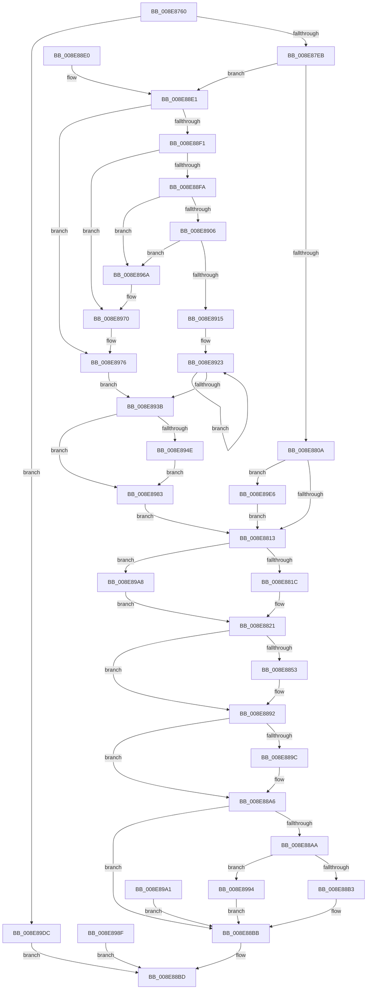

# NtRemoveIoCompletionEx

- RVA: `0x008E8760`–`0x008E89F0` (길이 `656` bytes)
- VA: `0x00000001408E8760`
- 실행 섹션: `PAGE`
- PDB 이름 있음: `예`; PDB Function 태그: `아니요`
- unwind 정보 RVA: `0x00086A40`
- 디코드: `164`개 명령, `656/656` bytes 표시
- 미해석 바이트: `0` (있으면 어셈블리에 `.byte`로 보존)

> 이 문서는 커널 이미지의 기계어와 PDB 기호를 분석해 생성했습니다. 4번과 5번은 함수 원형과 자료형을 바이너리 사용 방식에서 추정한 C 해석이며 원본 소스 복구 결과는 아닙니다.

## 1. Dependencies

- 직접 호출 지점: **8**; 고유 호출 대상: **8**
- 직접 호출자로 확인된 함수: **0**
- RIP 상대 이미지 참조: **2**

### Outgoing calls
- `0x008E8848` → [ObReferenceObjectByHandle](../86/ObReferenceObjectByHandle_function_00868DB0.md) (function, `0x00868DB0`)
- `0x008E8881` → [IoRemoveIoCompletion](../../text/20/IoRemoveIoCompletion_function_0020B580.md) (function, `0x0020B580`)
- `0x008E888D` → [ObfDereferenceObject](../../text/2F/ObfDereferenceObject_function_002F9350.md) (function, `0x002F9350`)
- `0x008E88A1` → [ExFreePoolWithTag](../../poolcode/B8/ExFreePoolWithTag_function_00B82870.md) (function, `0x00B82870`)
- `0x008E88C8` → [_security_check_cookie](../../text/6A/_security_check_cookie_function_006AC640.md) (function, `0x006AC640`)
- `0x008E896A` → [ExRaiseAccessViolation](ExRaiseAccessViolation_function_008E9240.md) (function, `0x008E9240`)
- `0x008E8970` → [ExRaiseDatatypeMisalignment](../89/ExRaiseDatatypeMisalignment_function_00899FD0.md) (function, `0x00899FD0`)
- `0x008E89BA` → [ExAllocatePool2](../../poolcode/B8/ExAllocatePool2_function_00B820F0.md) (function, `0x00B820F0`)

### Direct callers
- 이 함수 시작 RVA로 연결되는 직접 call은 확인되지 않았습니다. 간접 호출은 완전히 역산할 수 없습니다.

### Static image references
- `0x008E8775` → RVA `0x00E0A740` (`.data`; read)
- `0x008E8821` → RVA `0x00FC6CC0` (`ALMOSTRO`; read)

## 2. Other-region calls and transfers

- 다른 실행 섹션으로 향하는 call: **5**
  - `0x008E8881` → [IoRemoveIoCompletion](../../text/20/IoRemoveIoCompletion_function_0020B580.md) (`PAGE` → `.text`)
  - `0x008E888D` → [ObfDereferenceObject](../../text/2F/ObfDereferenceObject_function_002F9350.md) (`PAGE` → `.text`)
  - `0x008E88A1` → [ExFreePoolWithTag](../../poolcode/B8/ExFreePoolWithTag_function_00B82870.md) (`PAGE` → `POOLCODE`)
  - `0x008E88C8` → [_security_check_cookie](../../text/6A/_security_check_cookie_function_006AC640.md) (`PAGE` → `.text`)
  - `0x008E89BA` → [ExAllocatePool2](../../poolcode/B8/ExAllocatePool2_function_00B820F0.md) (`PAGE` → `POOLCODE`)
- 별도 외부 분기/꼬리 이동을 확인하지 못했습니다.

## 3. Assembly (complete function range)

```asm
008E8760  4C 8B DC                        mov r11, rsp
008E8763  53                              push rbx
008E8764  56                              push rsi
008E8765  57                              push rdi
008E8766  41 54                           push r12
008E8768  41 55                           push r13
008E876A  41 56                           push r14
008E876C  41 57                           push r15
008E876E  48 81 EC 00 01 00 00            sub rsp, 0x100
008E8775  48 8B 05 C4 1F 52 00            mov rax, qword ptr [rip + 0x521fc4]
008E877C  48 33 C4                        xor rax, rsp
008E877F  48 89 84 24 F0 00 00 00         mov qword ptr [rsp + 0xf0], rax
008E8787  4D 8B E9                        mov r13, r9
008E878A  41 8B F8                        mov edi, r8d
008E878D  4C 8B E2                        mov r12, rdx
008E8790  48 8B D9                        mov rbx, rcx
008E8793  4C 8B BC 24 60 01 00 00         mov r15, qword ptr [rsp + 0x160]
008E879B  0F 57 C0                        xorps xmm0, xmm0
008E879E  0F 11 44 24 70                  movups xmmword ptr [rsp + 0x70], xmm0
008E87A3  0F 11 84 24 80 00 00 00         movups xmmword ptr [rsp + 0x80], xmm0
008E87AB  0F 11 84 24 90 00 00 00         movups xmmword ptr [rsp + 0x90], xmm0
008E87B3  0F 11 84 24 A0 00 00 00         movups xmmword ptr [rsp + 0xa0], xmm0
008E87BB  0F 11 84 24 B0 00 00 00         movups xmmword ptr [rsp + 0xb0], xmm0
008E87C3  41 0F 11 43 88                  movups xmmword ptr [r11 - 0x78], xmm0
008E87C8  41 0F 11 43 98                  movups xmmword ptr [r11 - 0x68], xmm0
008E87CD  41 0F 11 43 A8                  movups xmmword ptr [r11 - 0x58], xmm0
008E87D2  33 C9                           xor ecx, ecx
008E87D4  48 89 4C 24 50                  mov qword ptr [rsp + 0x50], rcx
008E87D9  89 4C 24 44                     mov dword ptr [rsp + 0x44], ecx
008E87DD  8D 47 FF                        lea eax, [rdi - 1]
008E87E0  3D FE FF FF 07                  cmp eax, 0x7fffffe
008E87E5  0F 87 F1 01 00 00               ja 0x1408e89dc
008E87EB  48 89 4C 24 48                  mov qword ptr [rsp + 0x48], rcx
008E87F0  65 48 8B 04 25 88 01 00 00      mov rax, qword ptr gs:[0x188]
008E87F9  44 0F B6 B0 32 02 00 00         movzx r14d, byte ptr [rax + 0x232]
008E8801  45 84 F6                        test r14b, r14b
008E8804  0F 85 D7 00 00 00               jne 0x1408e88e1
008E880A  4D 85 FF                        test r15, r15
008E880D  0F 84 D3 01 00 00               je 0x1408e89e6
008E8813  83 FF 10                        cmp edi, 0x10
008E8816  0F 87 8C 01 00 00               ja 0x1408e89a8
008E881C  48 8D 74 24 70                  lea rsi, [rsp + 0x70]
008E8821  4C 8B 05 98 E4 6D 00            mov r8, qword ptr [rip + 0x6de498]
008E8828  48 89 4C 24 58                  mov qword ptr [rsp + 0x58], rcx
008E882D  48 89 4C 24 28                  mov qword ptr [rsp + 0x28], rcx
008E8832  48 8D 44 24 58                  lea rax, [rsp + 0x58]
008E8837  48 89 44 24 20                  mov qword ptr [rsp + 0x20], rax
008E883C  45 0F B6 CE                     movzx r9d, r14b
008E8840  BA 02 00 00 00                  mov edx, 2
008E8845  48 8B CB                        mov rcx, rbx
008E8848  E8 63 05 F8 FF                  call 0x140868db0
008E884D  8B D8                           mov ebx, eax
008E884F  85 C0                           test eax, eax
008E8851  78 3F                           js 0x1408e8892
008E8853  0F B6 84 24 68 01 00 00         movzx eax, byte ptr [rsp + 0x168]
008E885B  88 44 24 38                     mov byte ptr [rsp + 0x38], al
008E885F  4C 89 7C 24 30                  mov qword ptr [rsp + 0x30], r15
008E8864  44 88 74 24 28                  mov byte ptr [rsp + 0x28], r14b
008E8869  48 8D 44 24 44                  lea rax, [rsp + 0x44]
008E886E  48 89 44 24 20                  mov qword ptr [rsp + 0x20], rax
008E8873  44 8B CF                        mov r9d, edi
008E8876  4C 8B C6                        mov r8, rsi
008E8879  49 8B D4                        mov rdx, r12
008E887C  48 8B 4C 24 58                  mov rcx, qword ptr [rsp + 0x58]
008E8881  E8 FA 2C 92 FF                  call 0x14020b580
008E8886  8B D8                           mov ebx, eax
008E8888  48 8B 4C 24 58                  mov rcx, qword ptr [rsp + 0x58]
008E888D  E8 BE 0A A1 FF                  call 0x1402f9350
008E8892  48 8D 44 24 70                  lea rax, [rsp + 0x70]
008E8897  48 3B F0                        cmp rsi, rax
008E889A  74 0A                           je 0x1408e88a6
008E889C  33 D2                           xor edx, edx
008E889E  48 8B CE                        mov rcx, rsi
008E88A1  E8 CA 9F 29 00                  call 0x140b82870
008E88A6  85 DB                           test ebx, ebx
008E88A8  78 11                           js 0x1408e88bb
008E88AA  45 84 F6                        test r14b, r14b
008E88AD  0F 85 E1 00 00 00               jne 0x1408e8994
008E88B3  8B 44 24 44                     mov eax, dword ptr [rsp + 0x44]
008E88B7  41 89 45 00                     mov dword ptr [r13], eax
008E88BB  8B C3                           mov eax, ebx
008E88BD  48 8B 8C 24 F0 00 00 00         mov rcx, qword ptr [rsp + 0xf0]
008E88C5  48 33 CC                        xor rcx, rsp
008E88C8  E8 73 3D DC FF                  call 0x1406ac640
008E88CD  48 81 C4 00 01 00 00            add rsp, 0x100
008E88D4  41 5F                           pop r15
008E88D6  41 5E                           pop r14
008E88D8  41 5D                           pop r13
008E88DA  41 5C                           pop r12
008E88DC  5F                              pop rdi
008E88DD  5E                              pop rsi
008E88DE  5B                              pop rbx
008E88DF  C3                              ret
008E88E0  CC                              int3
008E88E1  48 8B C7                        mov rax, rdi
008E88E4  48 C1 E0 05                     shl rax, 5
008E88E8  48 85 C0                        test rax, rax
008E88EB  0F 84 85 00 00 00               je 0x1408e8976
008E88F1  49 8B CC                        mov rcx, r12
008E88F4  41 F6 C4 07                     test r12b, 7
008E88F8  75 76                           jne 0x1408e8970
008E88FA  4C 8D 42 FF                     lea r8, [rdx - 1]
008E88FE  4C 03 C0                        add r8, rax
008E8901  4D 3B E0                        cmp r12, r8
008E8904  77 64                           ja 0x1408e896a
008E8906  48 BA 00 00 FF FF FF 7F 00 00   movabs rdx, 0x7fffffff0000
008E8910  4C 3B C2                        cmp r8, rdx
008E8913  73 55                           jae 0x1408e896a
008E8915  49 81 E0 00 F0 FF FF            and r8, 0xfffffffffffff000
008E891C  49 81 C0 00 10 00 00            add r8, 0x1000
008E8923  0F B6 01                        movzx eax, byte ptr [rcx]
008E8926  88 01                           mov byte ptr [rcx], al
008E8928  48 81 E1 00 F0 FF FF            and rcx, 0xfffffffffffff000
008E892F  48 81 C1 00 10 00 00            add rcx, 0x1000
008E8936  49 3B C8                        cmp rcx, r8
008E8939  75 E8                           jne 0x1408e8923
008E893B  48 8B CA                        mov rcx, rdx
008E893E  4C 3B EA                        cmp r13, rdx
008E8941  49 0F 42 CD                     cmovb rcx, r13
008E8945  8B 01                           mov eax, dword ptr [rcx]
008E8947  89 01                           mov dword ptr [rcx], eax
008E8949  4D 85 FF                        test r15, r15
008E894C  74 35                           je 0x1408e8983
008E894E  48 8D 44 24 50                  lea rax, [rsp + 0x50]
008E8953  48 89 44 24 48                  mov qword ptr [rsp + 0x48], rax
008E8958  4C 3B FA                        cmp r15, rdx
008E895B  49 0F 42 D7                     cmovb rdx, r15
008E895F  90                              nop
008E8960  48 8B 02                        mov rax, qword ptr [rdx]
008E8963  48 89 44 24 50                  mov qword ptr [rsp + 0x50], rax
008E8968  EB 19                           jmp 0x1408e8983
008E896A  E8 D1 08 00 00                  call 0x1408e9240
008E896F  CC                              int3
008E8970  E8 5B 16 FB FF                  call 0x140899fd0
008E8975  CC                              int3
008E8976  90                              nop
008E8977  48 BA 00 00 FF FF FF 7F 00 00   movabs rdx, 0x7fffffff0000
008E8981  EB B8                           jmp 0x1408e893b
008E8983  4C 8B 7C 24 48                  mov r15, qword ptr [rsp + 0x48]
008E8988  33 C9                           xor ecx, ecx
008E898A  E9 84 FE FF FF                  jmp 0x1408e8813
008E898F  E9 29 FF FF FF                  jmp 0x1408e88bd
008E8994  8B 44 24 44                     mov eax, dword ptr [rsp + 0x44]
008E8998  41 89 45 00                     mov dword ptr [r13], eax
008E899C  E9 1A FF FF FF                  jmp 0x1408e88bb
008E89A1  8B D8                           mov ebx, eax
008E89A3  E9 13 FF FF FF                  jmp 0x1408e88bb
008E89A8  48 8B D7                        mov rdx, rdi
008E89AB  48 C1 E2 03                     shl rdx, 3
008E89AF  B9 40 00 00 00                  mov ecx, 0x40
008E89B4  41 B8 49 6F 43 6F               mov r8d, 0x6f436f49
008E89BA  E8 31 97 29 00                  call 0x140b820f0
008E89BF  48 8D 74 24 70                  lea rsi, [rsp + 0x70]
008E89C4  48 85 C0                        test rax, rax
008E89C7  48 0F 45 F0                     cmovne rsi, rax
008E89CB  B9 10 00 00 00                  mov ecx, 0x10
008E89D0  0F 45 CF                        cmovne ecx, edi
008E89D3  8B F9                           mov edi, ecx
008E89D5  33 C9                           xor ecx, ecx
008E89D7  E9 45 FE FF FF                  jmp 0x1408e8821
008E89DC  B8 0D 00 00 C0                  mov eax, 0xc000000d
008E89E1  E9 D7 FE FF FF                  jmp 0x1408e88bd
008E89E6  4C 8B 7C 24 48                  mov r15, qword ptr [rsp + 0x48]
008E89EB  E9 23 FE FF FF                  jmp 0x1408e8813
```

## 4. C-style interpretation (structured pseudocode)

```c
__int64 __fastcall NtRemoveIoCompletionEx(__int64 a1, __int64 a2, int a3, __int64 a4, __int64 a5, unsigned __int8 a6)
{
    __int64 result;
    __int64 v_rbx;
    __int64 v_rsi;
    __int64 v_rsp;
    unsigned __int8 v_stack_m100;
    unsigned __int64 v_stack_m108;
    unsigned __int64 v_stack_m110;
    unsigned __int64 v_stack_m118;
    unsigned __int64 v_stack_m48;
    unsigned __int64 v_stack_m88;
    unsigned __int64 v_stack_m98;
    unsigned __int64 v_stack_mA8;
    unsigned __int64 v_stack_mB8;
    unsigned __int64 v_stack_mC8;
    unsigned __int64 v_stack_mE0;
    unsigned __int64 v_stack_mE8;
    unsigned __int64 v_stack_mF0;
    unsigned int v_stack_mF4;
    unsigned int v_stack_p44;
    unsigned __int64 v_stack_p48;
    unsigned __int64 v_stack_p50;
    unsigned __int64 v_stack_p70;

    v_rsp = (v_rsp) - (256);
    result = (*(unsigned __int64 *)(v_rip + 5382084)) ^ (v_rsp);
    v_stack_m48 = result;
    v_stack_mC8 = v_xmm0;
    v_stack_mB8 = v_xmm0;
    v_stack_mA8 = v_xmm0;
    v_stack_m98 = v_xmm0;
    v_stack_m88 = v_xmm0;
    *(unsigned __int64 *)(v_rsp - 120) = v_xmm0;
    *(unsigned __int64 *)(v_rsp - 104) = v_xmm0;
    *(unsigned __int64 *)(v_rsp - 88) = v_xmm0;
    a1 = 0;
    v_stack_mE8 = 0;
    v_stack_mF4 = 0;
    if (((unsigned int)((unsigned int)(a3) - 1)) > 0x7FFFFFEULL) goto loc_008E89DC;
    v_stack_mF0 = 0;
    if ((unsigned __int8)(*(unsigned __int8 *)(*(unsigned __int64 *)(gs_base + (0 + 392)) + 562)) != 0) goto loc_008E88E1;
    if (a5 == 0) goto loc_008E89E6;
loc_008E8813:
    if (((unsigned int)((unsigned int)(a3))) > 16) goto loc_008E89A8;
loc_008E8821:
    v_stack_mE0 = 0;
    v_stack_m110 = 0;
    v_stack_m118 = v_stack_mE0;
    result = ObReferenceObjectByHandle(0, 2, *(unsigned __int64 *)(v_rip + 7201944), (unsigned __int8)(*(unsigned __int8 *)(*(unsigned __int64 *)(gs_base + (0 + 392)) + 562)));
    v_rbx = (unsigned int)((unsigned int)(result));
    if (!(sign_flag)) {
        result = a6;
        v_stack_m100 = (unsigned __int8)(result);
        v_stack_m108 = a5;
        v_stack_m110 = (unsigned __int8)(*(unsigned __int8 *)(*(unsigned __int64 *)(gs_base + (0 + 392)) + 562));
        result = v_stack_mF4;
        v_stack_m118 = result;
        a4 = (unsigned int)((unsigned int)(a3));
        a3 = v_stack_mC8;
        a2 = a2;
        a1 = v_stack_mE0;
        result = IoRemoveIoCompletion(a1, a2, a3, a4);
        v_rbx = (unsigned int)(result);
        a1 = v_stack_mE0;
        result = ObfDereferenceObject(a1, a2, a3, a4);
    }
    result = v_stack_mC8;
    if (v_stack_mC8 != v_stack_mC8) {
        a2 = 0;
        a1 = v_stack_mC8;
        result = ExFreePoolWithTag(a1, a2, a3, a4);
    }
    if (sign_flag) goto loc_008E88BB;
    if ((unsigned __int8)(*(unsigned __int8 *)(*(unsigned __int64 *)(gs_base + (0 + 392)) + 562)) != 0) goto loc_008E8994;
    *(unsigned int *)(a4) = (unsigned int)((unsigned int)(v_stack_mF4));
loc_008E88BB:
loc_008E88BD:
    a1 = (v_stack_m48) ^ (v_rsp);
    result = _security_check_cookie(a1, a2, a3, a4);
    v_rsp = (v_rsp) + (256);
    return result;
loc_008E88E1:
    result = ((unsigned int)(a3)) << (5);
    if (result == 0) goto loc_008E8976;
    if (((0) & (7)) != 0) goto loc_008E8970;
    a3 = (a2 - 1) + (result);
    if (0 > a3) goto loc_008E896A;
    if (a3 >= 0) goto loc_008E896A;
    a3 = (a3) & (0xFFFFFFFFFFFFF000ULL);
    a3 = (a3) + (0x1000ULL);
loc_008E8923:
    *(unsigned __int8 *)(0) = (unsigned __int8)(*(unsigned __int8 *)(0));
    a1 = (0) & (0xFFFFFFFFFFFFF000ULL);
    a1 = (a1) + (0x1000ULL);
    if (a1 != a3) goto loc_008E8923;
loc_008E893B:
    a1 = 0;
    if (a4 < 0) { a1 = a4; }
    *(unsigned int *)(a1) = (unsigned int)((unsigned int)(*(unsigned int *)(a1)));
    if (a5 == 0) goto loc_008E8983;
    v_stack_p48 = v_stack_p50;
    if (a5 < 0) { a2 = a5; }
    v_stack_p50 = *(unsigned __int64 *)(a2);
    goto loc_008E8983;
loc_008E896A:
    result = ExRaiseAccessViolation(a1, a2, a3, a4);
loc_008E8970:
    result = ExRaiseDatatypeMisalignment(a1, a2, a3, a4);
loc_008E8976:
    goto loc_008E893B;
loc_008E8983:
    a1 = 0;
    goto loc_008E8813;
loc_008E8994:
    *(unsigned int *)(a4) = (unsigned int)((unsigned int)(v_stack_p44));
    goto loc_008E88BB;
loc_008E89A8:
    a2 = ((unsigned int)(a3)) << (3);
    result = ExAllocatePool2(64, a2, (unsigned int)(0x6F436F49ULL), a4);
    v_rsi = v_stack_p70;
    if (result != 0) { v_rsi = result; }
    a1 = 16;
    if (result != 0) { a1 = (unsigned int)((unsigned int)(a3)); }
    a1 = 0;
    goto loc_008E8821;
loc_008E89DC:
    goto loc_008E88BD;
loc_008E89E6:
    goto loc_008E8813;
}
```

## 5. (Beta) C Style

```c
int64_t NtRemoveIoCompletionEx(int64_t Arg1, void *Arg2, void *Arg3, int64_t Arg4, int64_t Arg5, uint8_t Arg6)
{
    uint8_t *arg2 = (uint8_t *)Arg2;
    uint8_t *arg3 = (uint8_t *)Arg3;

    int64_t result;
    int64_t local_rbx;
    int64_t local_rsi;
    int64_t local_rsp;
    uint8_t v_stack_m100;
    uint64_t v_stack_m108;
    uint64_t v_stack_m110;
    uint64_t v_stack_m118;
    uint64_t v_stack_m48;
    uint64_t v_stack_m88;
    uint64_t v_stack_m98;
    uint64_t v_stack_mA8;
    uint64_t v_stack_mB8;
    uint64_t v_stack_mC8;
    uint64_t v_stack_mE0;
    uint64_t v_stack_mE8;
    uint64_t v_stack_mF0;
    uint32_t v_stack_mF4;
    uint32_t v_stack_p44;
    uint64_t v_stack_p48;
    uint64_t v_stack_p50;
    uint64_t v_stack_p70;

    local_rsp = (local_rsp) - (256);
    result = (*(uint64_t *)(v_rip + 0x521FC4)) ^ (local_rsp);
    v_stack_m48 = result;
    v_stack_mC8 = v_xmm0;
    v_stack_mB8 = v_xmm0;
    v_stack_mA8 = v_xmm0;
    v_stack_m98 = v_xmm0;
    v_stack_m88 = v_xmm0;
    *(uint64_t *)(local_rsp - 0x78) = v_xmm0;
    *(uint64_t *)(local_rsp - 0x68) = v_xmm0;
    *(uint64_t *)(local_rsp - 0x58) = v_xmm0;
    Arg1 = 0;
    v_stack_mE8 = 0;
    v_stack_mF4 = 0;
    if (((uint32_t)((uint32_t)(Arg3) - 1)) > 0x7FFFFFEULL) goto loc_008E89DC;
    v_stack_mF0 = 0;
    if ((uint8_t)(*(uint8_t *)(*(uint64_t *)(gs_base + (0 + 0x188)) + 0x232)) != 0) goto loc_008E88E1;
    if (Arg5 == 0) goto loc_008E89E6;
loc_008E8813:
    if (((uint32_t)((uint32_t)(Arg3))) > 16) goto loc_008E89A8;
loc_008E8821:
    v_stack_mE0 = 0;
    v_stack_m110 = 0;
    v_stack_m118 = v_stack_mE0;
    result = ObReferenceObjectByHandle(0, 2, *(uint64_t *)(v_rip + 0x6DE498), (uint8_t)(*(uint8_t *)(*(uint64_t *)(gs_base + (0 + 0x188)) + 0x232)));
    local_rbx = (uint32_t)((uint32_t)(result));
    if (!(sign_flag)) {
        result = Arg6;
        v_stack_m100 = (uint8_t)(result);
        v_stack_m108 = Arg5;
        v_stack_m110 = (uint8_t)(*(uint8_t *)(*(uint64_t *)(gs_base + (0 + 0x188)) + 0x232));
        result = v_stack_mF4;
        v_stack_m118 = result;
        Arg4 = (uint32_t)((uint32_t)(Arg3));
        Arg3 = v_stack_mC8;
        Arg2 = Arg2;
        Arg1 = v_stack_mE0;
        result = IoRemoveIoCompletion(Arg1, Arg2, Arg3, Arg4);
        local_rbx = (uint32_t)(result);
        Arg1 = v_stack_mE0;
        result = ObfDereferenceObject(Arg1, Arg2, Arg3, Arg4);
    }
    result = v_stack_mC8;
    if (v_stack_mC8 != v_stack_mC8) {
        Arg2 = 0;
        Arg1 = v_stack_mC8;
        result = ExFreePoolWithTag(Arg1, Arg2, Arg3, Arg4);
    }
    if (sign_flag) goto loc_008E88BB;
    if ((uint8_t)(*(uint8_t *)(*(uint64_t *)(gs_base + (0 + 0x188)) + 0x232)) != 0) goto loc_008E8994;
    *(uint32_t *)(Arg4) = (uint32_t)((uint32_t)(v_stack_mF4));
loc_008E88BB:
loc_008E88BD:
    Arg1 = (v_stack_m48) ^ (local_rsp);
    result = _security_check_cookie(Arg1, Arg2, Arg3, Arg4);
    local_rsp = (local_rsp) + (256);
    return result;
loc_008E88E1:
    result = ((uint32_t)(Arg3)) << (5);
    if (result == 0) goto loc_008E8976;
    if (((0) & (7)) != 0) goto loc_008E8970;
    Arg3 = (Arg2 - 1) + (result);
    if (0 > Arg3) goto loc_008E896A;
    if (Arg3 >= 0) goto loc_008E896A;
    Arg3 = (Arg3) & (0xFFFFFFFFFFFFF000ULL);
    Arg3 = (Arg3) + (0x1000ULL);
loc_008E8923:
    *(uint8_t *)(0) = (uint8_t)(*(uint8_t *)(0));
    Arg1 = (0) & (0xFFFFFFFFFFFFF000ULL);
    Arg1 = (Arg1) + (0x1000ULL);
    if (Arg1 != Arg3) goto loc_008E8923;
loc_008E893B:
    Arg1 = 0;
    if (Arg4 < 0) { Arg1 = Arg4; }
    *(uint32_t *)(Arg1) = (uint32_t)((uint32_t)(*(uint32_t *)(Arg1)));
    if (Arg5 == 0) goto loc_008E8983;
    v_stack_p48 = v_stack_p50;
    if (Arg5 < 0) { Arg2 = Arg5; }
    v_stack_p50 = *(uint64_t *)(arg2);
    goto loc_008E8983;
loc_008E896A:
    result = ExRaiseAccessViolation(Arg1, Arg2, Arg3, Arg4);
loc_008E8970:
    result = ExRaiseDatatypeMisalignment(Arg1, Arg2, Arg3, Arg4);
loc_008E8976:
    goto loc_008E893B;
loc_008E8983:
    Arg1 = 0;
    goto loc_008E8813;
loc_008E8994:
    *(uint32_t *)(Arg4) = (uint32_t)((uint32_t)(v_stack_p44));
    goto loc_008E88BB;
loc_008E89A8:
    Arg2 = ((uint32_t)(Arg3)) << (3);
    result = ExAllocatePool2(64, Arg2, (uint32_t)(0x6F436F49ULL), Arg4);
    local_rsi = v_stack_p70;
    if (result != 0) { local_rsi = result; }
    Arg1 = 16;
    if (result != 0) { Arg1 = (uint32_t)((uint32_t)(Arg3)); }
    Arg1 = 0;
    goto loc_008E8821;
loc_008E89DC:
    goto loc_008E88BD;
loc_008E89E6:
    goto loc_008E8813;
}
```

### 관측된 메모리 오프셋

구조체 형식이 확인되지 않은 접근은 인자 기준의 오프셋으로만 기록했습니다.

| 기준 인자 | 오프셋 표현 | 폭 (bit) | 접근 |
|---|---:|---:|---|
| `Arg2` | `- 0x1` | `64` | `R` |
| `Arg3` | `- 0x1` | `32` | `R` |

## 6. Execution-region graph

[열기: 2D/3D 그래프와 함수 탐색 컨트롤 패널](../../../control-panel.html?section=page&rva=0x008E8760&view=graph)

- 2D 그래프는 위에서 아래로 흐르고, 3D 그래프는 빈 공간을 드래그해 회전합니다. Shift+드래그는 이동, 휠은 확대·축소, 함수 노드 선택은 대상 보고서 이동입니다.

### Static fallback


