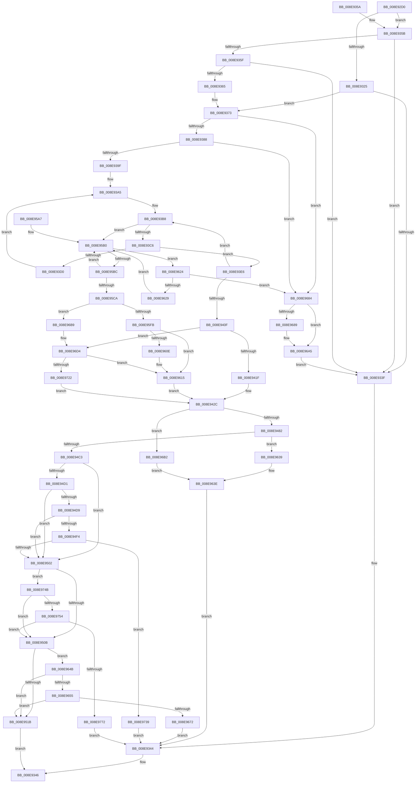

# NtWriteFile

- RVA: `0x008E92D0`–`0x008E9784` (길이 `1,204` bytes)
- VA: `0x00000001408E92D0`
- 실행 섹션: `PAGE`
- PDB 이름 있음: `예`; PDB Function 태그: `아니요`
- unwind 정보 RVA: `0x00086B1C`
- 디코드: `284`개 명령, `1,204/1,204` bytes 표시
- 미해석 바이트: `0` (있으면 어셈블리에 `.byte`로 보존)

> 이 문서는 커널 이미지의 기계어와 PDB 기호를 분석해 생성했습니다. 4번과 5번은 함수 원형과 자료형을 바이너리 사용 방식에서 추정한 C 해석이며 원본 소스 복구 결과는 아닙니다.

## 1. Dependencies

- 직접 호출 지점: **22**; 고유 호출 대상: **16**
- 직접 호출자로 확인된 함수: **2**
- RIP 상대 이미지 참조: **4**

### Outgoing calls
- `0x008E938E` → [ExpLookupHandleTableEntry](../86/ExpLookupHandleTableEntry_function_00869DB0.md) (function, `0x00869DB0`)
- `0x008E93D9` → [ExpBlockOnLockedHandleEntry](../86/ExpBlockOnLockedHandleEntry_function_00868838.md) (function, `0x00868838`)
- `0x008E9424` → [ExGetHandlePointer](../../text/43/ExGetHandlePointer_function_00430C90.md) (function, `0x00430C90`)
- `0x008E942F` → [KeLeaveCriticalRegionThread](../../text/25/KeLeaveCriticalRegionThread_function_0025EFF0.md) (function, `0x0025EFF0`)
- `0x008E9442` → [ObpTraceObjectReferenceIfActive](../../text/21/ObpTraceObjectReferenceIfActive_function_00210780.md) (function, `0x00210780`)
- `0x008E959D` → [IopWriteFile](IopWriteFile_function_008E9790.md) (function, `0x008E9790`)
- `0x008E95CD` → [ExGetHandlePointer](../../text/43/ExGetHandlePointer_function_00430C90.md) (function, `0x00430C90`)
- `0x008E95E0` → [ExSlowReplenishHandleTableEntry](../../text/44/ExSlowReplenishHandleTableEntry_function_0044BEF0.md) (function, `0x0044BEF0`)
- `0x008E9610` → [ExfUnblockPushLock](../../text/2A/ExfUnblockPushLock_function_002A3FE0.md) (function, `0x002A3FE0`)
- `0x008E962F` → [ExpBlockOnLockedHandleEntry](../86/ExpBlockOnLockedHandleEntry_function_00868838.md) (function, `0x00868838`)
- `0x008E9641` → [HalPutDmaAdapter](../../text/48/HalPutDmaAdapter_function_0048E530.md) (function, `0x0048E530`)
- `0x008E9665` → [PsIsProcessAppContainer](../A3/PsIsProcessAppContainer_function_00A38C44.md) (function, `0x00A38C44`)
- `0x008E9675` → [ObfDereferenceObject](../../text/2F/ObfDereferenceObject_function_002F9350.md) (function, `0x002F9350`)
- `0x008E96A0` → [ExHandleLogBadReference](../../text/44/ExHandleLogBadReference_function_00440580.md) (function, `0x00440580`)
- `0x008E96A8` → [KeLeaveCriticalRegionThread](../../text/25/KeLeaveCriticalRegionThread_function_0025EFF0.md) (function, `0x0025EFF0`)
- `0x008E96CE` → [KeBugCheckEx](../../text/4F/KeBugCheckEx_function_004FD660.md) (function, `0x004FD660`)
- `0x008E96F2` → [ExGetHandlePointer](../../text/43/ExGetHandlePointer_function_00430C90.md) (function, `0x00430C90`)
- `0x008E9702` → [ObpIncrPointerCountEx](../../text/41/ObpIncrPointerCountEx_function_00419CB0.md) (function, `0x00419CB0`)
- `0x008E9715` → [ExFastReplenishHandleTableEntry](../../text/47/ExFastReplenishHandleTableEntry_function_0047E210.md) (function, `0x0047E210`)
- `0x008E9741` → [HalPutDmaAdapter](../../text/48/HalPutDmaAdapter_function_0048E530.md) (function, `0x0048E530`)
- `0x008E9765` → [ObpAuditObjectAccess](../94/ObpAuditObjectAccess_function_0094C270.md) (function, `0x0094C270`)
- `0x008E977A` → [HalPutDmaAdapter](../../text/48/HalPutDmaAdapter_function_0048E530.md) (function, `0x0048E530`)

### Direct callers
- [SmKmIssueFileIo](../../text/60/SmKmIssueFileIo_function_0060F2F4.md) at `0x0060F348`
- [DifNtWriteFileWrapper](../../text/63/DifNtWriteFileWrapper_function_00637CD0.md) at `0x00637E16`

### Static image references
- `0x008E9365` → RVA `0x00F0F5B8` (`.data`; read)
- `0x008E944A` → RVA `0x00000000` (`image boundary/outside`; read)
- `0x008E9463` → RVA `0x00FC6E4C` (`ALMOSTRO`; read)
- `0x008E946D` → RVA `0x00FC6AE0` (`ALMOSTRO`; read)

## 2. Other-region calls and transfers

- 다른 실행 섹션으로 향하는 call: **16**
  - `0x008E9424` → [ExGetHandlePointer](../../text/43/ExGetHandlePointer_function_00430C90.md) (`PAGE` → `.text`)
  - `0x008E942F` → [KeLeaveCriticalRegionThread](../../text/25/KeLeaveCriticalRegionThread_function_0025EFF0.md) (`PAGE` → `.text`)
  - `0x008E9442` → [ObpTraceObjectReferenceIfActive](../../text/21/ObpTraceObjectReferenceIfActive_function_00210780.md) (`PAGE` → `.text`)
  - `0x008E95CD` → [ExGetHandlePointer](../../text/43/ExGetHandlePointer_function_00430C90.md) (`PAGE` → `.text`)
  - `0x008E95E0` → [ExSlowReplenishHandleTableEntry](../../text/44/ExSlowReplenishHandleTableEntry_function_0044BEF0.md) (`PAGE` → `.text`)
  - `0x008E9610` → [ExfUnblockPushLock](../../text/2A/ExfUnblockPushLock_function_002A3FE0.md) (`PAGE` → `.text`)
  - `0x008E9641` → [HalPutDmaAdapter](../../text/48/HalPutDmaAdapter_function_0048E530.md) (`PAGE` → `.text`)
  - `0x008E9675` → [ObfDereferenceObject](../../text/2F/ObfDereferenceObject_function_002F9350.md) (`PAGE` → `.text`)
  - `0x008E96A0` → [ExHandleLogBadReference](../../text/44/ExHandleLogBadReference_function_00440580.md) (`PAGE` → `.text`)
  - `0x008E96A8` → [KeLeaveCriticalRegionThread](../../text/25/KeLeaveCriticalRegionThread_function_0025EFF0.md) (`PAGE` → `.text`)
  - `0x008E96CE` → [KeBugCheckEx](../../text/4F/KeBugCheckEx_function_004FD660.md) (`PAGE` → `.text`)
  - `0x008E96F2` → [ExGetHandlePointer](../../text/43/ExGetHandlePointer_function_00430C90.md) (`PAGE` → `.text`)
  - `0x008E9702` → [ObpIncrPointerCountEx](../../text/41/ObpIncrPointerCountEx_function_00419CB0.md) (`PAGE` → `.text`)
  - `0x008E9715` → [ExFastReplenishHandleTableEntry](../../text/47/ExFastReplenishHandleTableEntry_function_0047E210.md) (`PAGE` → `.text`)
  - `0x008E9741` → [HalPutDmaAdapter](../../text/48/HalPutDmaAdapter_function_0048E530.md) (`PAGE` → `.text`)
  - `0x008E977A` → [HalPutDmaAdapter](../../text/48/HalPutDmaAdapter_function_0048E530.md) (`PAGE` → `.text`)
- 별도 외부 분기/꼬리 이동을 확인하지 못했습니다.

## 3. Assembly (complete function range)

```asm
008E92D0  4C 89 4C 24 20                  mov qword ptr [rsp + 0x20], r9
008E92D5  4C 89 44 24 18                  mov qword ptr [rsp + 0x18], r8
008E92DA  48 89 54 24 10                  mov qword ptr [rsp + 0x10], rdx
008E92DF  53                              push rbx
008E92E0  55                              push rbp
008E92E1  56                              push rsi
008E92E2  57                              push rdi
008E92E3  41 54                           push r12
008E92E5  41 55                           push r13
008E92E7  41 56                           push r14
008E92E9  41 57                           push r15
008E92EB  48 81 EC 88 00 00 00            sub rsp, 0x88
008E92F2  65 48 8B 04 25 88 01 00 00      mov rax, qword ptr gs:[0x188]
008E92FB  48 8B E9                        mov rbp, rcx
008E92FE  65 4C 8B 3C 25 88 01 00 00      mov r15, qword ptr gs:[0x188]
008E9307  48 C7 84 24 D0 00 00 00 00 00 00 00  mov qword ptr [rsp + 0xd0], 0
008E9313  0F B6 80 32 02 00 00            movzx eax, byte ptr [rax + 0x232]
008E931A  88 84 24 D0 00 00 00            mov byte ptr [rsp + 0xd0], al
008E9321  85 C9                           test ecx, ecx
008E9323  78 36                           js 0x1408e935b
008E9325  49 8B 87 B8 00 00 00            mov rax, qword ptr [r15 + 0xb8]
008E932C  4C 8B A8 00 03 00 00            mov r13, qword ptr [rax + 0x300]
008E9333  8B 80 F4 01 00 00               mov eax, dword ptr [rax + 0x1f4]
008E9339  0F BA E0 1A                     bt eax, 0x1a
008E933D  72 34                           jb 0x1408e9373
008E933F  BB 08 00 00 C0                  mov ebx, 0xc0000008
008E9344  8B C3                           mov eax, ebx
008E9346  48 81 C4 88 00 00 00            add rsp, 0x88
008E934D  41 5F                           pop r15
008E934F  41 5E                           pop r14
008E9351  41 5D                           pop r13
008E9353  41 5C                           pop r12
008E9355  5F                              pop rdi
008E9356  5E                              pop rsi
008E9357  5D                              pop rbp
008E9358  5B                              pop rbx
008E9359  C3                              ret
008E935A  CC                              int3
008E935B  84 C0                           test al, al
008E935D  75 E0                           jne 0x1408e933f
008E935F  48 83 FD FD                     cmp rbp, -3
008E9363  77 DA                           ja 0x1408e933f
008E9365  4C 8B 2D 4C 62 62 00            mov r13, qword ptr [rip + 0x62624c]
008E936C  48 81 F5 00 00 00 80            xor rbp, 0xffffffff80000000
008E9373  66 41 FF 8F E4 01 00 00         dec word ptr [r15 + 0x1e4]
008E937B  90                              nop
008E937C  F7 C5 FC 03 00 00               test ebp, 0x3fc
008E9382  0F 84 FC 02 00 00               je 0x1408e9684
008E9388  48 8B D5                        mov rdx, rbp
008E938B  49 8B CD                        mov rcx, r13
008E938E  E8 1D 0A F8 FF                  call 0x140869db0
008E9393  48 8B F8                        mov rdi, rax
008E9396  48 85 C0                        test rax, rax
008E9399  0F 84 E5 02 00 00               je 0x1408e9684
008E939F  0F 0D 08                        prefetchw byte ptr [rax]
008E93A2  48 8B 00                        mov rax, qword ptr [rax]
008E93A5  4C 8B 77 08                     mov r14, qword ptr [rdi + 8]
008E93A9  48 89 44 24 70                  mov qword ptr [rsp + 0x70], rax
008E93AE  48 8B 74 24 70                  mov rsi, qword ptr [rsp + 0x70]
008E93B3  4C 89 74 24 78                  mov qword ptr [rsp + 0x78], r14
008E93B8  90                              nop
008E93B9  48 F7 C6 FE FF 01 00            test rsi, 0x1fffe
008E93C0  0F 84 EA 01 00 00               je 0x1408e95b0
008E93C6  40 0F B6 C6                     movzx eax, sil
008E93CA  F6 D0                           not al
008E93CC  A8 01                           test al, 1
008E93CE  74 16                           je 0x1408e93e6
008E93D0  4C 8B C6                        mov r8, rsi
008E93D3  48 8B D7                        mov rdx, rdi
008E93D6  49 8B CD                        mov rcx, r13
008E93D9  E8 5A F4 F7 FF                  call 0x140868838
008E93DE  0F 0D 0F                        prefetchw byte ptr [rdi]
008E93E1  48 8B 07                        mov rax, qword ptr [rdi]
008E93E4  EB BF                           jmp 0x1408e93a5
008E93E6  48 8D 5E FE                     lea rbx, [rsi - 2]
008E93EA  49 8B CE                        mov rcx, r14
008E93ED  48 8B C6                        mov rax, rsi
008E93F0  49 8B D6                        mov rdx, r14
008E93F3  F0 48 0F C7 0F                  lock cmpxchg16b xmmword ptr [rdi]
008E93F8  48 8B F0                        mov rsi, rax
008E93FB  48 89 44 24 70                  mov qword ptr [rsp + 0x70], rax
008E9400  0F 94 C0                        sete al
008E9403  48 89 54 24 78                  mov qword ptr [rsp + 0x78], rdx
008E9408  4C 8B F2                        mov r14, rdx
008E940B  84 C0                           test al, al
008E940D  74 A9                           je 0x1408e93b8
008E940F  48 8B CE                        mov rcx, rsi
008E9412  48 D1 E9                        shr rcx, 1
008E9415  66 83 F9 10                     cmp cx, 0x10
008E9419  0F 84 B5 02 00 00               je 0x1408e96d4
008E941F  48 8D 4C 24 70                  lea rcx, [rsp + 0x70]
008E9424  E8 67 78 B4 FF                  call 0x140430c90
008E9429  48 8B D8                        mov rbx, rax
008E942C  49 8B CF                        mov rcx, r15
008E942F  E8 BC 5B 97 FF                  call 0x14025eff0
008E9434  BA 01 00 00 00                  mov edx, 1
008E9439  41 B8 44 66 6C 74               mov r8d, 0x746c6644
008E943F  48 8B CB                        mov rcx, rbx
008E9442  E8 39 73 92 FF                  call 0x140210780
008E9447  48 8B C3                        mov rax, rbx
008E944A  4C 8D 15 AF 6B 71 FF            lea r10, [rip - 0x8e9451]
008E9451  48 C1 E8 08                     shr rax, 8
008E9455  4C 8D 7B 30                     lea r15, [rbx + 0x30]
008E9459  0F B6 C8                        movzx ecx, al
008E945C  0F B6 43 18                     movzx eax, byte ptr [rbx + 0x18]
008E9460  48 33 C8                        xor rcx, rax
008E9463  0F B6 05 E2 D9 6D 00            movzx eax, byte ptr [rip + 0x6dd9e2]
008E946A  48 33 C8                        xor rcx, rax
008E946D  48 8B 05 6C D6 6D 00            mov rax, qword ptr [rip + 0x6dd66c]
008E9474  49 39 84 CA 00 78 FC 00         cmp qword ptr [r10 + rcx*8 + 0xfc7800], rax
008E947C  0F 85 30 02 00 00               jne 0x1408e96b2
008E9482  44 0F B6 83 80 00 00 00         movzx r8d, byte ptr [rbx + 0x80]
008E948A  45 8B E6                        mov r12d, r14d
008E948D  41 F6 D0                        not r8b
008E9490  48 C1 FE 11                     sar rsi, 0x11
008E9494  41 81 E0 80 00 00 00            and r8d, 0x80
008E949B  83 E6 07                        and esi, 7
008E949E  41 83 C8 40                     or r8d, 0x40
008E94A2  41 81 E4 FF FF FF 01            and r12d, 0x1ffffff
008E94A9  41 C1 E8 05                     shr r8d, 5
008E94AD  8B D6                           mov edx, esi
008E94AF  83 CA 08                        or edx, 8
008E94B2  41 0F BA E6 19                  bt r14d, 0x19
008E94B7  0F 43 D6                        cmovae edx, esi
008E94BA  45 85 E0                        test r8d, r12d
008E94BD  0F 84 76 01 00 00               je 0x1408e9639
008E94C3  44 0F B6 8C 24 D0 00 00 00      movzx r9d, byte ptr [rsp + 0xd0]
008E94CC  45 84 C9                        test r9b, r9b
008E94CF  74 31                           je 0x1408e9502
008E94D1  0F B6 43 1A                     movzx eax, byte ptr [rbx + 0x1a]
008E94D5  A8 40                           test al, 0x40
008E94D7  74 29                           je 0x1408e9502
008E94D9  83 E0 7F                        and eax, 0x7f
008E94DC  48 8B CB                        mov rcx, rbx
008E94DF  42 0F B6 84 10 80 FF F0 00      movzx eax, byte ptr [rax + r10 + 0xf0ff80]
008E94E8  48 2B C8                        sub rcx, rax
008E94EB  48 8B 01                        mov rax, qword ptr [rcx]
008E94EE  80 78 18 00                     cmp byte ptr [rax + 0x18], 0
008E94F2  74 0E                           je 0x1408e9502
008E94F4  48 8B 40 10                     mov rax, qword ptr [rax + 0x10]
008E94F8  48 83 F8 01                     cmp rax, 1
008E94FC  0F 84 37 02 00 00               je 0x1408e9739
008E9502  F6 C2 04                        test dl, 4
008E9505  0F 85 40 02 00 00               jne 0x1408e974b
008E950B  49 8B 87 D0 00 00 00            mov rax, qword ptr [r15 + 0xd0]
008E9512  48 85 C0                        test rax, rax
008E9515  0F 85 30 01 00 00               jne 0x1408e964b
008E951B  48 8B 84 24 10 01 00 00         mov rax, qword ptr [rsp + 0x110]
008E9523  49 8B CF                        mov rcx, r15
008E9526  4C 8B 8C 24 E8 00 00 00         mov r9, qword ptr [rsp + 0xe8]
008E952E  4C 8B 84 24 E0 00 00 00         mov r8, qword ptr [rsp + 0xe0]
008E9536  48 8B 94 24 D8 00 00 00         mov rdx, qword ptr [rsp + 0xd8]
008E953E  48 C7 44 24 68 00 00 00 00      mov qword ptr [rsp + 0x68], 0
008E9547  C7 44 24 60 00 00 00 00         mov dword ptr [rsp + 0x60], 0
008E954F  48 C7 44 24 58 00 00 00 00      mov qword ptr [rsp + 0x58], 0
008E9558  48 C7 44 24 50 00 00 00 00      mov qword ptr [rsp + 0x50], 0
008E9561  44 89 64 24 48                  mov dword ptr [rsp + 0x48], r12d
008E9566  48 89 44 24 40                  mov qword ptr [rsp + 0x40], rax
008E956B  48 8B 84 24 08 01 00 00         mov rax, qword ptr [rsp + 0x108]
008E9573  48 89 44 24 38                  mov qword ptr [rsp + 0x38], rax
008E9578  8B 84 24 00 01 00 00            mov eax, dword ptr [rsp + 0x100]
008E957F  89 44 24 30                     mov dword ptr [rsp + 0x30], eax
008E9583  48 8B 84 24 F8 00 00 00         mov rax, qword ptr [rsp + 0xf8]
008E958B  48 89 44 24 28                  mov qword ptr [rsp + 0x28], rax
008E9590  48 8B 84 24 F0 00 00 00         mov rax, qword ptr [rsp + 0xf0]
008E9598  48 89 44 24 20                  mov qword ptr [rsp + 0x20], rax
008E959D  E8 EE 01 00 00                  call 0x1408e9790
008E95A2  E9 9F FD FF FF                  jmp 0x1408e9346
008E95A7  66 0F 1F 84 00 00 00 00 00      nop word ptr [rax + rax]
008E95B0  0F 0D 0F                        prefetchw byte ptr [rdi]
008E95B3  4C 8B 07                        mov r8, qword ptr [rdi]
008E95B6  41 F6 C0 01                     test r8b, 1
008E95BA  74 68                           je 0x1408e9624
008E95BC  49 8D 48 FF                     lea rcx, [r8 - 1]
008E95C0  49 8B C0                        mov rax, r8
008E95C3  F0 48 0F B1 0F                  lock cmpxchg qword ptr [rdi], rcx
008E95C8  75 E6                           jne 0x1408e95b0
008E95CA  48 8B CF                        mov rcx, rdi
008E95CD  E8 BE 76 B4 FF                  call 0x140430c90
008E95D2  0F 10 07                        movups xmm0, xmmword ptr [rdi]
008E95D5  48 8B CF                        mov rcx, rdi
008E95D8  48 8B D8                        mov rbx, rax
008E95DB  0F 11 44 24 70                  movups xmmword ptr [rsp + 0x70], xmm0
008E95E0  E8 0B 29 B6 FF                  call 0x14044bef0
008E95E5  FF C0                           inc eax
008E95E7  48 63 C8                        movsxd rcx, eax
008E95EA  48 8B C1                        mov rax, rcx
008E95ED  F0 48 0F C1 03                  lock xadd qword ptr [rbx], rax
008E95F2  48 85 C0                        test rax, rax
008E95F5  0F 8E BE 00 00 00               jle 0x1408e96b9
008E95FB  F0 48 FF 07                     lock inc qword ptr [rdi]
008E95FF  49 8D 4D 30                     lea rcx, [r13 + 0x30]
008E9603  F0 83 0C 24 00                  lock or dword ptr [rsp], 0
008E9608  48 83 39 00                     cmp qword ptr [rcx], 0
008E960C  74 07                           je 0x1408e9615
008E960E  33 D2                           xor edx, edx
008E9610  E8 CB A9 9B FF                  call 0x1402a3fe0
008E9615  4C 8B 74 24 78                  mov r14, qword ptr [rsp + 0x78]
008E961A  48 8B 74 24 70                  mov rsi, qword ptr [rsp + 0x70]
008E961F  E9 08 FE FF FF                  jmp 0x1408e942c
008E9624  4D 85 C0                        test r8, r8
008E9627  74 5B                           je 0x1408e9684
008E9629  48 8B D7                        mov rdx, rdi
008E962C  49 8B CD                        mov rcx, r13
008E962F  E8 04 F2 F7 FF                  call 0x140868838
008E9634  E9 77 FF FF FF                  jmp 0x1408e95b0
008E9639  BB 22 00 00 C0                  mov ebx, 0xc0000022
008E963E  49 8B CF                        mov rcx, r15
008E9641  E8 EA 4E BA FF                  call 0x14048e530
008E9646  E9 F9 FC FF FF                  jmp 0x1408e9344
008E964B  8B 00                           mov eax, dword ptr [rax]
008E964D  A8 04                           test al, 4
008E964F  0F 84 C6 FE FF FF               je 0x1408e951b
008E9655  65 48 8B 04 25 88 01 00 00      mov rax, qword ptr gs:[0x188]
008E965E  48 8B 88 B8 00 00 00            mov rcx, qword ptr [rax + 0xb8]
008E9665  E8 DA F5 14 00                  call 0x140a38c44
008E966A  84 C0                           test al, al
008E966C  0F 84 A9 FE FF FF               je 0x1408e951b
008E9672  49 8B CF                        mov rcx, r15
008E9675  E8 D6 FC A0 FF                  call 0x1402f9350
008E967A  BB 10 09 00 C0                  mov ebx, 0xc0000910
008E967F  E9 C0 FC FF FF                  jmp 0x1408e9344
008E9684  48 85 ED                        test rbp, rbp
008E9687  74 1C                           je 0x1408e96a5
008E9689  65 4C 8B 04 25 88 01 00 00      mov r8, qword ptr gs:[0x188]
008E9692  48 8B D5                        mov rdx, rbp
008E9695  49 8B CD                        mov rcx, r13
008E9698  45 0F B6 80 32 02 00 00         movzx r8d, byte ptr [r8 + 0x232]
008E96A0  E8 DB 6E B5 FF                  call 0x140440580
008E96A5  49 8B CF                        mov rcx, r15
008E96A8  E8 43 59 97 FF                  call 0x14025eff0
008E96AD  E9 8D FC FF FF                  jmp 0x1408e933f
008E96B2  BB 24 00 00 C0                  mov ebx, 0xc0000024
008E96B7  EB 85                           jmp 0x1408e963e
008E96B9  33 D2                           xor edx, edx
008E96BB  4C 8D 43 30                     lea r8, [rbx + 0x30]
008E96BF  48 03 C1                        add rax, rcx
008E96C2  48 89 44 24 20                  mov qword ptr [rsp + 0x20], rax
008E96C7  8D 4A 18                        lea ecx, [rdx + 0x18]
008E96CA  44 8D 4A 10                     lea r9d, [rdx + 0x10]
008E96CE  E8 8D 3F C1 FF                  call 0x1404fd660
008E96D3  CC                              int3
008E96D4  48 8D 41 FF                     lea rax, [rcx - 1]
008E96D8  48 81 E6 01 00 FE FF            and rsi, 0xfffffffffffe0001
008E96DF  0F B7 C8                        movzx ecx, ax
008E96E2  48 03 C9                        add rcx, rcx
008E96E5  48 0B CE                        or rcx, rsi
008E96E8  48 89 4C 24 70                  mov qword ptr [rsp + 0x70], rcx
008E96ED  48 8D 4C 24 70                  lea rcx, [rsp + 0x70]
008E96F2  E8 99 75 B4 FF                  call 0x140430c90
008E96F7  BA F0 7F 00 00                  mov edx, 0x7ff0
008E96FC  48 8B C8                        mov rcx, rax
008E96FF  48 8B D8                        mov rbx, rax
008E9702  E8 A9 05 B3 FF                  call 0x140419cb0
008E9707  41 B8 F0 7F 00 00               mov r8d, 0x7ff0
008E970D  48 8D 54 24 70                  lea rdx, [rsp + 0x70]
008E9712  48 8B CF                        mov rcx, rdi
008E9715  E8 F6 4A B9 FF                  call 0x14047e210
008E971A  85 C0                           test eax, eax
008E971C  0F 84 F3 FE FF FF               je 0x1408e9615
008E9722  F7 D8                           neg eax
008E9724  48 98                           cdqe
008E9726  F0 48 01 03                     lock add qword ptr [rbx], rax
008E972A  4C 8B 74 24 78                  mov r14, qword ptr [rsp + 0x78]
008E972F  48 8B 74 24 70                  mov rsi, qword ptr [rsp + 0x70]
008E9734  E9 F3 FC FF FF                  jmp 0x1408e942c
008E9739  49 8B CF                        mov rcx, r15
008E973C  BB 06 A0 00 C0                  mov ebx, 0xc000a006
008E9741  E8 EA 4D BA FF                  call 0x14048e530
008E9746  E9 F9 FB FF FF                  jmp 0x1408e9344
008E974B  45 84 C9                        test r9b, r9b
008E974E  0F 84 B7 FD FF FF               je 0x1408e950b
008E9754  44 89 44 24 20                  mov dword ptr [rsp + 0x20], r8d
008E9759  4C 8B CB                        mov r9, rbx
008E975C  4C 8B C7                        mov r8, rdi
008E975F  48 8B D5                        mov rdx, rbp
008E9762  49 8B CD                        mov rcx, r13
008E9765  E8 06 2B 06 00                  call 0x14094c270
008E976A  84 C0                           test al, al
008E976C  0F 85 99 FD FF FF               jne 0x1408e950b
008E9772  49 8B CF                        mov rcx, r15
008E9775  BB 08 00 00 C0                  mov ebx, 0xc0000008
008E977A  E8 B1 4D BA FF                  call 0x14048e530
008E977F  E9 C0 FB FF FF                  jmp 0x1408e9344
```

## 4. C-style interpretation (structured pseudocode)

```c
__int64 __fastcall NtWriteFile(__int64 a1, __int64 a2, __int64 a3, __int64 a4, __int64 a5, __int64 a6, unsigned int a7, __int64 a8, __int64 a9)
{
    __int64 result;
    __int64 v_r12;
    __int64 v_rbp;
    __int64 v_rsi;
    __int64 v_rsp;
    unsigned int v_stack_p0;
    unsigned __int64 v_stack_p10;
    unsigned __int64 v_stack_p18;
    unsigned __int64 v_stack_p20;
    unsigned __int64 v_stack_p28;
    unsigned int v_stack_p30;
    unsigned __int64 v_stack_p38;
    unsigned __int64 v_stack_p40;
    unsigned int v_stack_p48;
    unsigned __int64 v_stack_p50;
    unsigned __int64 v_stack_p58;
    unsigned int v_stack_p60;
    unsigned __int64 v_stack_p68;
    unsigned __int64 v_stack_p70;
    unsigned __int64 v_stack_p78;
    unsigned __int64 v_stack_p8;
    unsigned __int8 v_stack_pD0;
    unsigned __int64 v_stack_pD8;
    unsigned __int64 v_stack_pE0;
    unsigned __int64 v_stack_pE8;

    v_stack_p20 = a4;
    v_stack_p18 = a3;
    v_stack_p10 = a2;
    v_rsp = (v_rsp) - (136);
    v_stack_p8 = 0;
    v_stack_p8 = (unsigned __int8)(*(unsigned __int8 *)(*(unsigned __int64 *)(gs_base + (0 + 392)) + 562));
    if (sign_flag) goto loc_008E935B;
    if (condition_is_below) goto loc_008E9373;
loc_008E933F:
loc_008E9344:
loc_008E9346:
    v_rsp = (v_rsp) + (136);
    return (unsigned int)((unsigned int)((unsigned int)(0xC0000008ULL)));
loc_008E935B:
    if ((unsigned __int8)((unsigned int)((unsigned int)((unsigned int)(0xC0000008ULL)))) != 0) goto loc_008E933F;
    if (a1 > -3) goto loc_008E933F;
    v_rbp = (a1) ^ (0xFFFFFFFF80000000ULL);
loc_008E9373:
    if ((((unsigned int)(v_rbp)) & (0x3FCULL)) == 0) goto loc_008E9684;
    result = ExpLookupHandleTableEntry(*(unsigned __int64 *)(v_rip + 6447692), v_rbp, a3, a4);
    if (result == 0) goto loc_008E9684;
loc_008E93A5:
    v_stack_p70 = *(unsigned __int64 *)(result);
    v_stack_p78 = *(unsigned __int64 *)(result + 8);
loc_008E93B8:
    if (((v_stack_p70) & (0x1FFFEULL)) == 0) goto loc_008E95B0;
    result = (unsigned __int8)(~((unsigned __int8)(v_stack_p70)));
    if ((((unsigned __int8)(result)) & (1)) == 0) goto loc_008E93E6;
    result = ExpBlockOnLockedHandleEntry(*(unsigned __int64 *)(v_rip + 6447692), result, v_stack_p70, a4);
    goto loc_008E93A5;
loc_008E93E6:
    v_stack_p70 = v_stack_p70;
    result = ((((unsigned __int8)(result)) & (1)) == 0) ? 1 : 0;
    v_stack_p78 = *(unsigned __int64 *)(result + 8);
    if ((unsigned __int8)(result) == 0) goto loc_008E93B8;
    a1 = (v_stack_p70) >> (1);
    if (((unsigned __int16)(a1)) == 16) goto loc_008E96D4;
    result = ExGetHandlePointer(v_stack_p70, *(unsigned __int64 *)(result + 8), v_stack_p70, a4);
loc_008E942C:
    result = KeLeaveCriticalRegionThread(*(unsigned __int64 *)(gs_base + (0 + 392)), *(unsigned __int64 *)(result + 8), v_stack_p70, a4);
    result = ObpTraceObjectReferenceIfActive(result, 1, (unsigned int)(0x746C6644ULL), a4);
    result = (result) >> (8);
    a1 = ((unsigned __int8)(result)) ^ (*(unsigned __int8 *)(result + 24));
    a1 = (a1) ^ (*(unsigned __int8 *)(v_rip + 7199202));
    if ((*(unsigned __int64 *)(v_rip - 9344081 + a1 * 8 + 16545792)) != (*(unsigned __int64 *)(v_rip + 7198316))) goto loc_008E96B2;
    a3 = (unsigned __int8)(~(*(unsigned __int8 *)(result + 128)));
    v_rsi = (v_stack_p70) >> (17);
    a3 = (unsigned int)((a3) & (128));
    v_rsi = (unsigned int)((v_rsi) & (7));
    a3 = (unsigned int)((a3) | (64));
    v_r12 = (unsigned int)(((unsigned int)((unsigned int)(*(unsigned __int64 *)(result + 8)))) & (0x1FFFFFFULL));
    a3 = (unsigned int)((a3) >> (5));
    a2 = (unsigned int)(((unsigned int)((unsigned int)(v_rsi))) | (8));
    if (condition_is_above_or_equal) { a2 = (unsigned int)(v_rsi); }
    if ((((unsigned int)(a3)) & ((unsigned int)(v_r12))) == 0) goto loc_008E9639;
    if ((unsigned __int8)(v_stack_pD0) == 0) goto loc_008E9502;
    if ((((unsigned __int8)(*(unsigned __int8 *)(result + 26))) & (64)) == 0) goto loc_008E9502;
    result = (unsigned int)((*(unsigned __int8 *)(result + 26)) & (127));
    a1 = (result) - (*(unsigned __int8 *)(result + v_rip - 9344081 * 1 + 15794048));
    if ((*(unsigned __int8 *)(*(unsigned __int64 *)(a1) + 24)) == 0) goto loc_008E9502;
    if ((*(unsigned __int64 *)(*(unsigned __int64 *)(a1) + 16)) == 1) goto loc_008E9739;
loc_008E9502:
    if ((((unsigned __int8)(a2)) & (4)) != 0) goto loc_008E974B;
loc_008E950B:
    if (*(unsigned __int64 *)(result + 48 + 208) != 0) goto loc_008E964B;
loc_008E951B:
    v_stack_p68 = 0;
    v_stack_p60 = 0;
    v_stack_p58 = 0;
    v_stack_p50 = 0;
    v_stack_p48 = (unsigned int)(v_r12);
    v_stack_p40 = a9;
    v_stack_p38 = a8;
    v_stack_p30 = (unsigned int)((unsigned int)(a7));
    v_stack_p28 = a6;
    v_stack_p20 = a5;
    result = IopWriteFile(result + 48, v_stack_pD8, v_stack_pE0, v_stack_pE8);
    goto loc_008E9346;
loc_008E95B0:
    if ((((unsigned __int8)(*(unsigned __int64 *)(result))) & (1)) == 0) goto loc_008E9624;
    if ((((unsigned __int8)(*(unsigned __int64 *)(result))) & (1)) != 0) goto loc_008E95B0;
    result = ExGetHandlePointer(result, v_stack_pD8, *(unsigned __int64 *)(result), v_stack_pE8);
    v_stack_p70 = v_xmm0;
    result = ExSlowReplenishHandleTableEntry(result, v_stack_pD8, *(unsigned __int64 *)(result), v_stack_pE8);
    result = (unsigned int)((result) + 1);
    if (condition_is_less_or_equal) goto loc_008E96B9;
    result = (int)((unsigned int)(result));
    if ((*(unsigned __int64 *)(*(unsigned __int64 *)(v_rip + 6447692) + 48)) != 0) {
        a2 = 0;
        result = ExfUnblockPushLock(*(unsigned __int64 *)(v_rip + 6447692) + 48, a2, *(unsigned __int64 *)(result), v_stack_pE8);
    }
    goto loc_008E942C;
loc_008E9624:
    if (*(unsigned __int64 *)(result) == 0) goto loc_008E9684;
    result = ExpBlockOnLockedHandleEntry(*(unsigned __int64 *)(v_rip + 6447692), result, *(unsigned __int64 *)(result), v_stack_pE8);
    goto loc_008E95B0;
loc_008E9639:
loc_008E963E:
    result = HalPutDmaAdapter(result + 48, result, *(unsigned __int64 *)(result), v_stack_pE8);
    goto loc_008E9344;
loc_008E964B:
    if ((((unsigned __int8)((unsigned int)(*(unsigned int *)(result)))) & (4)) == 0) goto loc_008E951B;
    result = PsIsProcessAppContainer(*(unsigned __int64 *)(*(unsigned __int64 *)(gs_base + (0 + 392)) + 184), result, *(unsigned __int64 *)(result), v_stack_pE8);
    if ((unsigned __int8)(result) == 0) goto loc_008E951B;
    result = ObfDereferenceObject(result + 48, result, *(unsigned __int64 *)(result), v_stack_pE8);
    goto loc_008E9344;
loc_008E9684:
    if (v_rbp != 0) {
        a3 = *(unsigned __int64 *)(gs_base + (0 + 392));
        a2 = v_rbp;
        a1 = *(unsigned __int64 *)(v_rip + 6447692);
        a3 = *(unsigned __int8 *)(a3 + 562);
        result = ExHandleLogBadReference(a1, a2, a3, v_stack_pE8);
    }
    result = KeLeaveCriticalRegionThread(result + 48, a2, a3, v_stack_pE8);
    goto loc_008E933F;
loc_008E96B2:
    goto loc_008E963E;
loc_008E96B9:
    a2 = 0;
    result = (result) + (result + 48);
    v_stack_p20 = result;
    result = KeBugCheckEx(a2 + 24, a2, (unsigned int)(0xC0000024ULL) + 48, a2 + 16);
loc_008E96D4:
    v_rsi = (v_stack_p70) & (0xFFFFFFFFFFFE0001ULL);
    a1 = ((unsigned __int16)(a2 + 24 - 1)) + ((unsigned __int16)(a2 + 24 - 1));
    a1 = (a1) | (v_rsi);
    v_stack_p70 = a1;
    result = ExGetHandlePointer(v_stack_p70, a2, (unsigned int)(0xC0000024ULL) + 48, a2 + 16);
    result = ObpIncrPointerCountEx(result, (unsigned int)(0x7FF0ULL), (unsigned int)(0xC0000024ULL) + 48, a2 + 16);
    result = ExFastReplenishHandleTableEntry(result, v_stack_p70, (unsigned int)(0x7FF0ULL), a2 + 16);
    if ((unsigned int)(result) == 0) goto loc_008E9615;
    result = (unsigned int)(-(result));
    goto loc_008E942C;
loc_008E9739:
    result = HalPutDmaAdapter(result + 48, v_stack_p70, (unsigned int)(0x7FF0ULL), a2 + 16);
    goto loc_008E9344;
loc_008E974B:
    if ((unsigned __int8)(a2 + 16) == 0) goto loc_008E950B;
    v_stack_p20 = (unsigned int)((unsigned int)(0x7FF0ULL));
    result = ObpAuditObjectAccess(*(unsigned __int64 *)(v_rip + 6447692), v_rbp, result, (unsigned int)(0xC000A006ULL));
    if ((unsigned __int8)(result) != 0) goto loc_008E950B;
    result = HalPutDmaAdapter(result + 48, v_rbp, result, (unsigned int)(0xC000A006ULL));
    goto loc_008E9344;
}
```

## 5. (Beta) C Style

```c
int64_t NtWriteFile(int64_t Arg1, int64_t Arg2, int64_t Arg3, int64_t Arg4, int64_t Arg5, int64_t Arg6, uint32_t Arg7, int64_t Arg8, int64_t Arg9)
{
    int64_t result;
    int64_t local_r12;
    int64_t local_rbp;
    int64_t local_rsi;
    int64_t local_rsp;
    uint32_t v_stack_p0;
    uint64_t v_stack_p10;
    uint64_t v_stack_p18;
    uint64_t v_stack_p20;
    uint64_t v_stack_p28;
    uint32_t v_stack_p30;
    uint64_t v_stack_p38;
    uint64_t v_stack_p40;
    uint32_t v_stack_p48;
    uint64_t v_stack_p50;
    uint64_t v_stack_p58;
    uint32_t v_stack_p60;
    uint64_t v_stack_p68;
    uint64_t v_stack_p70;
    uint64_t v_stack_p78;
    uint64_t v_stack_p8;
    uint8_t v_stack_pD0;
    uint64_t v_stack_pD8;
    uint64_t v_stack_pE0;
    uint64_t v_stack_pE8;

    v_stack_p20 = Arg4;
    v_stack_p18 = Arg3;
    v_stack_p10 = Arg2;
    local_rsp = (local_rsp) - (136);
    v_stack_p8 = 0;
    v_stack_p8 = (uint8_t)(*(uint8_t *)(*(uint64_t *)(gs_base + (0 + 0x188)) + 0x232));
    if (sign_flag) goto loc_008E935B;
    if (condition_is_below) goto loc_008E9373;
loc_008E933F:
loc_008E9344:
loc_008E9346:
    local_rsp = (local_rsp) + (136);
    return (uint32_t)((uint32_t)((uint32_t)(0xC0000008ULL)));
loc_008E935B:
    if ((uint8_t)((uint32_t)((uint32_t)((uint32_t)(0xC0000008ULL)))) != 0) goto loc_008E933F;
    if (Arg1 > -3) goto loc_008E933F;
    local_rbp = (Arg1) ^ (0xFFFFFFFF80000000ULL);
loc_008E9373:
    if ((((uint32_t)(local_rbp)) & (0x3FCULL)) == 0) goto loc_008E9684;
    result = ExpLookupHandleTableEntry(*(uint64_t *)(v_rip + 0x62624C), local_rbp, Arg3, Arg4);
    if (result == 0) goto loc_008E9684;
loc_008E93A5:
    v_stack_p70 = *(uint64_t *)(result);
    v_stack_p78 = *(uint64_t *)(result + 0x8);
loc_008E93B8:
    if (((v_stack_p70) & (0x1FFFEULL)) == 0) goto loc_008E95B0;
    result = (uint8_t)(~((uint8_t)(v_stack_p70)));
    if ((((uint8_t)(result)) & (1)) == 0) goto loc_008E93E6;
    result = ExpBlockOnLockedHandleEntry(*(uint64_t *)(v_rip + 0x62624C), result, v_stack_p70, Arg4);
    goto loc_008E93A5;
loc_008E93E6:
    v_stack_p70 = v_stack_p70;
    result = ((((uint8_t)(result)) & (1)) == 0) ? 1 : 0;
    v_stack_p78 = *(uint64_t *)(result + 0x8);
    if ((uint8_t)(result) == 0) goto loc_008E93B8;
    Arg1 = (v_stack_p70) >> (1);
    if (((uint16_t)(Arg1)) == 16) goto loc_008E96D4;
    result = ExGetHandlePointer(v_stack_p70, *(uint64_t *)(result + 0x8), v_stack_p70, Arg4);
loc_008E942C:
    result = KeLeaveCriticalRegionThread(*(uint64_t *)(gs_base + (0 + 0x188)), *(uint64_t *)(result + 0x8), v_stack_p70, Arg4);
    result = ObpTraceObjectReferenceIfActive(result, 1, (uint32_t)(0x746C6644ULL), Arg4);
    result = (result) >> (8);
    Arg1 = ((uint8_t)(result)) ^ (*(uint8_t *)(result + 0x18));
    Arg1 = (Arg1) ^ (*(uint8_t *)(v_rip + 0x6DD9E2));
    if ((*(uint64_t *)(v_rip - 0x8E9451 + Arg1 * 8 + 0xFC7800)) != (*(uint64_t *)(v_rip + 0x6DD66C))) goto loc_008E96B2;
    Arg3 = (uint8_t)(~(*(uint8_t *)(result + 0x80)));
    local_rsi = (v_stack_p70) >> (17);
    Arg3 = (uint32_t)((Arg3) & (128));
    local_rsi = (uint32_t)((local_rsi) & (7));
    Arg3 = (uint32_t)((Arg3) | (64));
    local_r12 = (uint32_t)(((uint32_t)((uint32_t)(*(uint64_t *)(result + 0x8)))) & (0x1FFFFFFULL));
    Arg3 = (uint32_t)((Arg3) >> (5));
    Arg2 = (uint32_t)(((uint32_t)((uint32_t)(local_rsi))) | (8));
    if (condition_is_above_or_equal) { Arg2 = (uint32_t)(local_rsi); }
    if ((((uint32_t)(Arg3)) & ((uint32_t)(local_r12))) == 0) goto loc_008E9639;
    if ((uint8_t)(v_stack_pD0) == 0) goto loc_008E9502;
    if ((((uint8_t)(*(uint8_t *)(result + 0x1A))) & (64)) == 0) goto loc_008E9502;
    result = (uint32_t)((*(uint8_t *)(result + 0x1A)) & (127));
    Arg1 = (result) - (*(uint8_t *)(result + v_rip - 0x8E9451 * 1 + 0xF0FF80));
    if ((*(uint8_t *)(*(uint64_t *)(Arg1) + 0x18)) == 0) goto loc_008E9502;
    if ((*(uint64_t *)(*(uint64_t *)(Arg1) + 0x10)) == 1) goto loc_008E9739;
loc_008E9502:
    if ((((uint8_t)(Arg2)) & (4)) != 0) goto loc_008E974B;
loc_008E950B:
    if (*(uint64_t *)(result + 0x30 + 0xD0) != 0) goto loc_008E964B;
loc_008E951B:
    v_stack_p68 = 0;
    v_stack_p60 = 0;
    v_stack_p58 = 0;
    v_stack_p50 = 0;
    v_stack_p48 = (uint32_t)(local_r12);
    v_stack_p40 = Arg9;
    v_stack_p38 = Arg8;
    v_stack_p30 = (uint32_t)((uint32_t)(Arg7));
    v_stack_p28 = Arg6;
    v_stack_p20 = Arg5;
    result = IopWriteFile(result + 48, v_stack_pD8, v_stack_pE0, v_stack_pE8);
    goto loc_008E9346;
loc_008E95B0:
    if ((((uint8_t)(*(uint64_t *)(result))) & (1)) == 0) goto loc_008E9624;
    if ((((uint8_t)(*(uint64_t *)(result))) & (1)) != 0) goto loc_008E95B0;
    result = ExGetHandlePointer(result, v_stack_pD8, *(uint64_t *)(result), v_stack_pE8);
    v_stack_p70 = v_xmm0;
    result = ExSlowReplenishHandleTableEntry(result, v_stack_pD8, *(uint64_t *)(result), v_stack_pE8);
    result = (uint32_t)((result) + 1);
    if (condition_is_less_or_equal) goto loc_008E96B9;
    result = (int32_t)((uint32_t)(result));
    if ((*(uint64_t *)(*(uint64_t *)(v_rip + 0x62624C) + 0x30)) != 0) {
        Arg2 = 0;
        result = ExfUnblockPushLock(*(uint64_t *)(v_rip + 0x62624C) + 48, Arg2, *(uint64_t *)(result), v_stack_pE8);
    }
    goto loc_008E942C;
loc_008E9624:
    if (*(uint64_t *)(result) == 0) goto loc_008E9684;
    result = ExpBlockOnLockedHandleEntry(*(uint64_t *)(v_rip + 0x62624C), result, *(uint64_t *)(result), v_stack_pE8);
    goto loc_008E95B0;
loc_008E9639:
loc_008E963E:
    result = HalPutDmaAdapter(result + 48, result, *(uint64_t *)(result), v_stack_pE8);
    goto loc_008E9344;
loc_008E964B:
    if ((((uint8_t)((uint32_t)(*(uint32_t *)(result)))) & (4)) == 0) goto loc_008E951B;
    result = PsIsProcessAppContainer(*(uint64_t *)(*(uint64_t *)(gs_base + (0 + 0x188)) + 0xB8), result, *(uint64_t *)(result), v_stack_pE8);
    if ((uint8_t)(result) == 0) goto loc_008E951B;
    result = ObfDereferenceObject(result + 48, result, *(uint64_t *)(result), v_stack_pE8);
    goto loc_008E9344;
loc_008E9684:
    if (local_rbp != 0) {
        Arg3 = *(uint64_t *)(gs_base + (0 + 0x188));
        Arg2 = local_rbp;
        Arg1 = *(uint64_t *)(v_rip + 0x62624C);
        Arg3 = *(uint8_t *)(Arg3 + 0x232);
        result = ExHandleLogBadReference(Arg1, Arg2, Arg3, v_stack_pE8);
    }
    result = KeLeaveCriticalRegionThread(result + 48, Arg2, Arg3, v_stack_pE8);
    goto loc_008E933F;
loc_008E96B2:
    goto loc_008E963E;
loc_008E96B9:
    Arg2 = 0;
    result = (result) + (result + 48);
    v_stack_p20 = result;
    result = KeBugCheckEx(Arg2 + 24, Arg2, (uint32_t)(0xC0000024ULL) + 48, Arg2 + 16);
loc_008E96D4:
    local_rsi = (v_stack_p70) & (0xFFFFFFFFFFFE0001ULL);
    Arg1 = ((uint16_t)(Arg2 + 24 - 1)) + ((uint16_t)(Arg2 + 24 - 1));
    Arg1 = (Arg1) | (local_rsi);
    v_stack_p70 = Arg1;
    result = ExGetHandlePointer(v_stack_p70, Arg2, (uint32_t)(0xC0000024ULL) + 48, Arg2 + 16);
    result = ObpIncrPointerCountEx(result, (uint32_t)(0x7FF0ULL), (uint32_t)(0xC0000024ULL) + 48, Arg2 + 16);
    result = ExFastReplenishHandleTableEntry(result, v_stack_p70, (uint32_t)(0x7FF0ULL), Arg2 + 16);
    if ((uint32_t)(result) == 0) goto loc_008E9615;
    result = (uint32_t)(-(result));
    goto loc_008E942C;
loc_008E9739:
    result = HalPutDmaAdapter(result + 48, v_stack_p70, (uint32_t)(0x7FF0ULL), Arg2 + 16);
    goto loc_008E9344;
loc_008E974B:
    if ((uint8_t)(Arg2 + 16) == 0) goto loc_008E950B;
    v_stack_p20 = (uint32_t)((uint32_t)(0x7FF0ULL));
    result = ObpAuditObjectAccess(*(uint64_t *)(v_rip + 0x62624C), local_rbp, result, (uint32_t)(0xC000A006ULL));
    if ((uint8_t)(result) != 0) goto loc_008E950B;
    result = HalPutDmaAdapter(result + 48, local_rbp, result, (uint32_t)(0xC000A006ULL));
    goto loc_008E9344;
}
```

## 6. Execution-region graph

[열기: 2D/3D 그래프와 함수 탐색 컨트롤 패널](../../../control-panel.html?section=page&rva=0x008E92D0&view=graph)

- 2D 그래프는 위에서 아래로 흐르고, 3D 그래프는 빈 공간을 드래그해 회전합니다. Shift+드래그는 이동, 휠은 확대·축소, 함수 노드 선택은 대상 보고서 이동입니다.

### Static fallback


