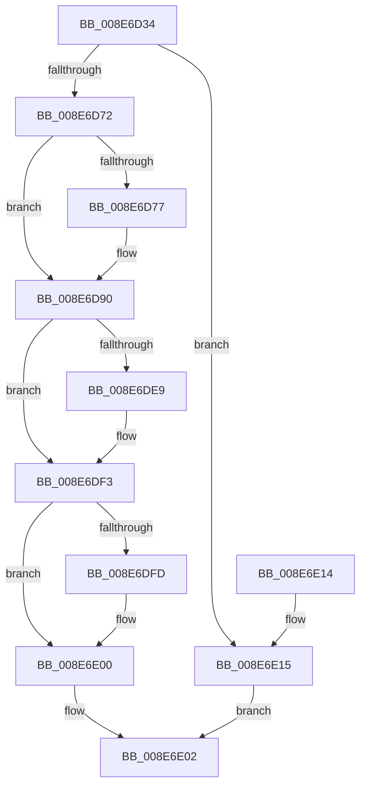

# PiAuIsLocalSystem

- RVA: `0x008E6D34`–`0x008E6E1C` (길이 `232` bytes)
- VA: `0x00000001408E6D34`
- 실행 섹션: `PAGE`
- PDB 이름 있음: `예`; PDB Function 태그: `아니요`
- unwind 정보 RVA: `0x000867FC`
- 디코드: `57`개 명령, `232/232` bytes 표시
- 미해석 바이트: `0` (있으면 어셈블리에 `.byte`로 보존)

> 이 문서는 커널 이미지의 기계어와 PDB 기호를 분석해 생성했습니다. 4번과 5번은 함수 원형과 자료형을 바이너리 사용 방식에서 추정한 C 해석이며 원본 소스 복구 결과는 아닙니다.

## 1. Dependencies

- 직접 호출 지점: **3**; 고유 호출 대상: **3**
- 직접 호출자로 확인된 함수: **2**
- RIP 상대 이미지 참조: **2**

### Outgoing calls
- `0x008E6D7C` → [SeCaptureSubjectContext](../86/SeCaptureSubjectContext_function_0086B820.md) (function, `0x0086B820`)
- `0x008E6DDD` → [SeAccessCheck](../../text/3A/SeAccessCheck_function_003A6BC0.md) (function, `0x003A6BC0`)
- `0x008E6DEE` → [SeReleaseSubjectContext](../86/SeReleaseSubjectContext_function_0086B710.md) (function, `0x0086B710`)

### Direct callers
- [IopDeviceInterfaceFilterCallback](IopDeviceInterfaceFilterCallback_function_008E5410.md) at `0x008E54EF`
- [PiCMMandatoryFilterCallback](PiCMMandatoryFilterCallback_function_008E6490.md) at `0x008E654F`

### Static image references
- `0x008E6D52` → RVA `0x00E663A0` (`.data`; read)
- `0x008E6DC3` → RVA `0x000114A8` (`.rdata`; read)

## 2. Other-region calls and transfers

- 다른 실행 섹션으로 향하는 call: **1**
  - `0x008E6DDD` → [SeAccessCheck](../../text/3A/SeAccessCheck_function_003A6BC0.md) (`PAGE` → `.text`)
- 별도 외부 분기/꼬리 이동을 확인하지 못했습니다.

## 3. Assembly (complete function range)

```asm
008E6D34  48 8B C4                        mov rax, rsp
008E6D37  48 89 58 08                     mov qword ptr [rax + 8], rbx
008E6D3B  48 89 70 20                     mov qword ptr [rax + 0x20], rsi
008E6D3F  57                              push rdi
008E6D40  48 83 EC 70                     sub rsp, 0x70
008E6D44  83 60 18 00                     and dword ptr [rax + 0x18], 0
008E6D48  0F 57 C0                        xorps xmm0, xmm0
008E6D4B  83 60 10 00                     and dword ptr [rax + 0x10], 0
008E6D4F  48 8B DA                        mov rbx, rdx
008E6D52  48 8B 35 47 F6 57 00            mov rsi, qword ptr [rip + 0x57f647]
008E6D59  48 8B F9                        mov rdi, rcx
008E6D5C  C6 02 00                        mov byte ptr [rdx], 0
008E6D5F  0F 11 40 D8                     movups xmmword ptr [rax - 0x28], xmm0
008E6D63  0F 11 40 E8                     movups xmmword ptr [rax - 0x18], xmm0
008E6D67  B0 01                           mov al, 1
008E6D69  48 85 F6                        test rsi, rsi
008E6D6C  0F 84 A3 00 00 00               je 0x1408e6e15
008E6D72  48 85 C9                        test rcx, rcx
008E6D75  75 19                           jne 0x1408e6d90
008E6D77  48 8D 4C 24 50                  lea rcx, [rsp + 0x50]
008E6D7C  E8 9F 4A F8 FF                  call 0x14086b820
008E6D81  65 48 8B 04 25 88 01 00 00      mov rax, qword ptr gs:[0x188]
008E6D8A  8A 80 32 02 00 00               mov al, byte ptr [rax + 0x232]
008E6D90  48 8D 8C 24 88 00 00 00         lea rcx, [rsp + 0x88]
008E6D98  48 85 FF                        test rdi, rdi
008E6D9B  48 89 4C 24 48                  mov qword ptr [rsp + 0x48], rcx
008E6DA0  48 8D 54 24 50                  lea rdx, [rsp + 0x50]
008E6DA5  48 0F 45 D7                     cmovne rdx, rdi
008E6DA9  48 8D 8C 24 90 00 00 00         lea rcx, [rsp + 0x90]
008E6DB1  48 89 4C 24 40                  mov qword ptr [rsp + 0x40], rcx
008E6DB6  41 B9 00 00 0F 00               mov r9d, 0xf0000
008E6DBC  88 44 24 38                     mov byte ptr [rsp + 0x38], al
008E6DC0  45 33 C0                        xor r8d, r8d
008E6DC3  48 8D 05 DE A6 72 FF            lea rax, [rip - 0x8d5922]
008E6DCA  48 8B CE                        mov rcx, rsi
008E6DCD  48 89 44 24 30                  mov qword ptr [rsp + 0x30], rax
008E6DD2  48 83 64 24 28 00               and qword ptr [rsp + 0x28], 0
008E6DD8  83 64 24 20 00                  and dword ptr [rsp + 0x20], 0
008E6DDD  E8 DE FD AB FF                  call 0x1403a6bc0
008E6DE2  88 03                           mov byte ptr [rbx], al
008E6DE4  48 85 FF                        test rdi, rdi
008E6DE7  75 0A                           jne 0x1408e6df3
008E6DE9  48 8D 4C 24 50                  lea rcx, [rsp + 0x50]
008E6DEE  E8 1D 49 F8 FF                  call 0x14086b710
008E6DF3  83 BC 24 88 00 00 00 00         cmp dword ptr [rsp + 0x88], 0
008E6DFB  7D 03                           jge 0x1408e6e00
008E6DFD  C6 03 00                        mov byte ptr [rbx], 0
008E6E00  33 C0                           xor eax, eax
008E6E02  4C 8D 5C 24 70                  lea r11, [rsp + 0x70]
008E6E07  49 8B 5B 10                     mov rbx, qword ptr [r11 + 0x10]
008E6E0B  49 8B 73 28                     mov rsi, qword ptr [r11 + 0x28]
008E6E0F  49 8B E3                        mov rsp, r11
008E6E12  5F                              pop rdi
008E6E13  C3                              ret
008E6E14  CC                              int3
008E6E15  B8 0D 00 00 C0                  mov eax, 0xc000000d
008E6E1A  EB E6                           jmp 0x1408e6e02
```

## 4. C-style interpretation (structured pseudocode)

```c
__int64 __fastcall PiAuIsLocalSystem(__int64 a1, __int64 a2, int a3)
{
    __int64 result;
    __int64 v_rsp;
    unsigned __int64 v_stack_m28;
    unsigned __int64 v_stack_m30;
    unsigned __int64 v_stack_m38;
    unsigned __int8 v_stack_m40;
    unsigned __int64 v_stack_m48;
    unsigned __int64 v_stack_m50;
    unsigned int v_stack_m58;
    unsigned __int64 v_stack_m8;
    unsigned __int64 v_stack_p10;
    unsigned __int64 v_stack_p18;

    *(unsigned __int64 *)(v_rsp + 8) = v_rbx;
    *(unsigned __int64 *)(v_rsp + 32) = v_rsi;
    v_rsp = (v_rsp) - (112);
    *(unsigned __int8 *)(a2) = 0;
    *(unsigned __int64 *)(v_rsp - 40) = v_xmm0;
    *(unsigned __int64 *)(v_rsp - 24) = v_xmm0;
    if (*(unsigned __int64 *)(v_rip + 5764679) == 0) goto loc_008E6E15;
    result = 1;
    if (a1 == 0) {
        a1 = v_stack_m28;
        result = SeCaptureSubjectContext(a1, a2, a3, a4);
        result = *(unsigned __int64 *)(gs_base + (0 + 392));
        result = *(unsigned __int8 *)(result + 562);
    }
    v_stack_m30 = v_stack_p10;
    a2 = v_stack_m28;
    if (a1 != 0) { a2 = a1; }
    v_stack_m38 = v_stack_p18;
    v_stack_m40 = (unsigned __int8)(result);
    a3 = 0;
    v_stack_m48 = v_rip - 9263394;
    result = SeAccessCheck(*(unsigned __int64 *)(v_rip + 5764679), a2, a3, (unsigned int)(0xF0000ULL));
    *(unsigned __int8 *)(a2) = (unsigned __int8)(result);
    if (a1 == 0) {
        a1 = v_stack_m28;
        result = SeReleaseSubjectContext(a1, a2, a3, (unsigned int)(0xF0000ULL));
    }
    if (v_stack_p10 < 0) {
        *(unsigned __int8 *)(a2) = 0;
    }
    result = 0;
loc_008E6E02:
    return result;
loc_008E6E15:
    goto loc_008E6E02;
}
```

## 5. (Beta) C Style

```c
int64_t PiAuIsLocalSystem(int64_t Arg1, void *Arg2, int32_t Arg3)
{
    uint8_t *arg2 = (uint8_t *)Arg2;

    int64_t result;
    int64_t local_rsp;
    uint64_t v_stack_m28;
    uint64_t v_stack_m30;
    uint64_t v_stack_m38;
    uint8_t v_stack_m40;
    uint64_t v_stack_m48;
    uint64_t v_stack_m50;
    uint32_t v_stack_m58;
    uint64_t v_stack_m8;
    uint64_t v_stack_p10;
    uint64_t v_stack_p18;

    *(uint64_t *)(local_rsp + 0x8) = local_rbx;
    *(uint64_t *)(local_rsp + 0x20) = local_rsi;
    local_rsp = (local_rsp) - (112);
    *(uint8_t *)(arg2) = 0;
    *(uint64_t *)(local_rsp - 0x28) = v_xmm0;
    *(uint64_t *)(local_rsp - 0x18) = v_xmm0;
    if (*(uint64_t *)(v_rip + 0x57F647) == 0) goto loc_008E6E15;
    result = 1;
    if (Arg1 == 0) {
        Arg1 = v_stack_m28;
        result = SeCaptureSubjectContext(Arg1, Arg2, Arg3, a4);
        result = *(uint64_t *)(gs_base + (0 + 0x188));
        result = *(uint8_t *)(result + 0x232);
    }
    v_stack_m30 = v_stack_p10;
    Arg2 = v_stack_m28;
    if (Arg1 != 0) { Arg2 = Arg1; }
    v_stack_m38 = v_stack_p18;
    v_stack_m40 = (uint8_t)(result);
    Arg3 = 0;
    v_stack_m48 = v_rip - 9263394;
    result = SeAccessCheck(*(uint64_t *)(v_rip + 0x57F647), Arg2, Arg3, (uint32_t)(0xF0000ULL));
    *(uint8_t *)(arg2) = (uint8_t)(result);
    if (Arg1 == 0) {
        Arg1 = v_stack_m28;
        result = SeReleaseSubjectContext(Arg1, Arg2, Arg3, (uint32_t)(0xF0000ULL));
    }
    if (v_stack_p10 < 0) {
        *(uint8_t *)(arg2) = 0;
    }
    result = 0;
loc_008E6E02:
    return result;
loc_008E6E15:
    goto loc_008E6E02;
}
```

### 관측된 메모리 오프셋

구조체 형식이 확인되지 않은 접근은 인자 기준의 오프셋으로만 기록했습니다.

| 기준 인자 | 오프셋 표현 | 폭 (bit) | 접근 |
|---|---:|---:|---|
| `Arg2` | `+ 0x0` | `8` | `W` |

## 6. Execution-region graph

[열기: 2D/3D 그래프와 함수 탐색 컨트롤 패널](../../../control-panel.html?section=page&rva=0x008E6D34&view=graph)

- 2D 그래프는 위에서 아래로 흐르고, 3D 그래프는 빈 공간을 드래그해 회전합니다. Shift+드래그는 이동, 휠은 확대·축소, 함수 노드 선택은 대상 보고서 이동입니다.

### Static fallback


