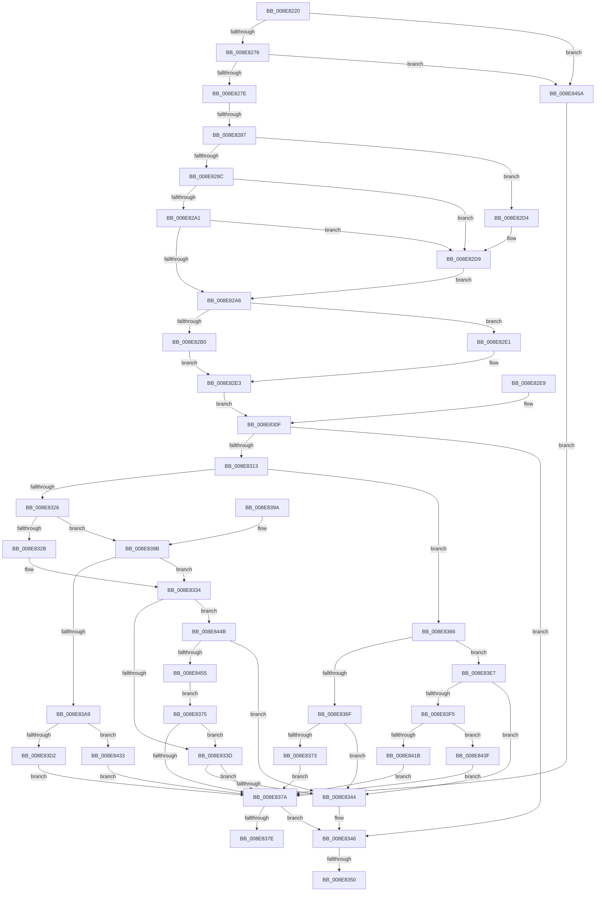

# PiCMCaptureObjectInputData

- RVA: `0x008E8220`–`0x008E8464` (길이 `580` bytes)
- VA: `0x00000001408E8220`
- 실행 섹션: `PAGE`
- PDB 이름 있음: `예`; PDB Function 태그: `예`
- unwind 정보 RVA: `0x000869A0`
- 디코드: `159`개 명령, `580/580` bytes 표시
- 미해석 바이트: `0` (있으면 어셈블리에 `.byte`로 보존)

> 이 문서는 커널 이미지의 기계어와 PDB 기호를 분석해 생성했습니다. 4번과 5번은 함수 원형과 자료형을 바이너리 사용 방식에서 추정한 C 해석이며 원본 소스 복구 결과는 아닙니다.

## 1. Dependencies

- 직접 호출 지점: **5**; 고유 호출 대상: **4**
- 직접 호출자로 확인된 함수: **15**
- RIP 상대 이미지 참조: **0**

### Outgoing calls
- `0x008E82D4` → [ExRaiseDatatypeMisalignment](../89/ExRaiseDatatypeMisalignment_function_00899FD0.md) (function, `0x00899FD0`)
- `0x008E831D` → [Feature_KernelPnP_ObjectNameUpdates__private_IsEnabledDeviceUsageNoInline](../../text/4F/Feature_KernelPnP_ObjectNameUpdates__private_IsEnabledDeviceUsageNoInline_function_004F2E10.md) (function, `0x004F2E10`)
- `0x008E835B` → [PiControlFreeUserModeCallersBuffer](../../text/44/PiControlFreeUserModeCallersBuffer_function_00448990.md) (function, `0x00448990`)
- `0x008E83C7` → [PiControlMakeUserModeCallersCopy](PiControlMakeUserModeCallersCopy_function_008E4630.md) (function, `0x008E4630`)
- `0x008E8410` → [PiControlMakeUserModeCallersCopy](PiControlMakeUserModeCallersCopy_function_008E4630.md) (function, `0x008E4630`)

### Direct callers
- [PiCMDeleteDeviceInterfaceKey](../70/PiCMDeleteDeviceInterfaceKey_function_007014E4.md) at `0x00701529`
- [PiCMCreateObject](../70/PiCMCreateObject_function_007015EC.md) at `0x00701631`
- [PiCMDeleteDevice](../70/PiCMDeleteDevice_function_007017A4.md) at `0x007017E9`
- [PiCMGetObjectList](PiCMGetObjectList_function_008E7720.md) at `0x008E7770`
- [PiCMValidateDeviceInstance](PiCMValidateDeviceInstance_function_008E799C.md) at `0x008E7A15`
- [sub_008E7DFF](Unknown_function_008E7DFF.md) at `0x008E7E58`
- [PiCMDeviceAction](../96/PiCMDeviceAction_function_0096488C.md) at `0x009648EE`
- [PiCMGetDeviceStatus](../9D/PiCMGetDeviceStatus_function_009D136C.md) at `0x009D13B6`
- [PiCMGetObjectPropertyKeys](../A7/PiCMGetObjectPropertyKeys_function_00A7C554.md) at `0x00A7C5A4`
- [PiCMGetDeviceDepth](../A9/PiCMGetDeviceDepth_function_00A96B98.md) at `0x00A96BE6`
- [PiCMQueryRemove](../AD/PiCMQueryRemove_function_00AD43F4.md) at `0x00AD4477`
- [PiCMDeleteDeviceKey](../AD/PiCMDeleteDeviceKey_function_00AD6780.md) at `0x00AD67E0`
- [PiCMUnregisterDeviceInterface](../AD/PiCMUnregisterDeviceInterface_function_00AD9758.md) at `0x00AD97A6`
- [PiCMDeleteClassKey](../AD/PiCMDeleteClassKey_function_00AD9EB4.md) at `0x00AD9EF9`
- [PiCMDeleteObject](../AD/PiCMDeleteObject_function_00AD9FE4.md) at `0x00ADA029`

### Static image references
- 디코드된 RIP-relative 메모리 참조가 없습니다.

## 2. Other-region calls and transfers

- 다른 실행 섹션으로 향하는 call: **2**
  - `0x008E831D` → [Feature_KernelPnP_ObjectNameUpdates__private_IsEnabledDeviceUsageNoInline](../../text/4F/Feature_KernelPnP_ObjectNameUpdates__private_IsEnabledDeviceUsageNoInline_function_004F2E10.md) (`PAGE` → `.text`)
  - `0x008E835B` → [PiControlFreeUserModeCallersBuffer](../../text/44/PiControlFreeUserModeCallersBuffer_function_00448990.md) (`PAGE` → `.text`)
- call이 아닌 외부 분기/꼬리 이동: **3**
  - `0x008E8281` → [sub_00B1D74C](../B1/Unknown_function_00B1D74C.md) (`tail-transfer`)
  - `0x008E834A` → [sub_00B1D74C + 0xA2](../B1/Unknown_function_00B1D74C.md) (`tail-transfer`)
  - `0x008E8361` → [sub_00B1D74C + 0xA2](../B1/Unknown_function_00B1D74C.md) (`tail-transfer`)

## 3. Assembly (complete function range)

```asm
008E8220  48 89 5C 24 10                  mov qword ptr [rsp + 0x10], rbx
008E8225  48 89 74 24 18                  mov qword ptr [rsp + 0x18], rsi
008E822A  4C 89 4C 24 20                  mov qword ptr [rsp + 0x20], r9
008E822F  57                              push rdi
008E8230  41 54                           push r12
008E8232  41 55                           push r13
008E8234  41 56                           push r14
008E8236  41 57                           push r15
008E8238  48 83 EC 50                     sub rsp, 0x50
008E823C  4D 8B F1                        mov r14, r9
008E823F  4C 89 4C 24 40                  mov qword ptr [rsp + 0x40], r9
008E8244  33 FF                           xor edi, edi
008E8246  89 7C 24 38                     mov dword ptr [rsp + 0x38], edi
008E824A  65 48 8B 04 25 88 01 00 00      mov rax, qword ptr gs:[0x188]
008E8253  44 8A A0 32 02 00 00            mov r12b, byte ptr [rax + 0x232]
008E825A  44 88 A4 24 80 00 00 00         mov byte ptr [rsp + 0x80], r12b
008E8262  44 88 64 24 30                  mov byte ptr [rsp + 0x30], r12b
008E8267  8B DF                           mov ebx, edi
008E8269  89 5C 24 34                     mov dword ptr [rsp + 0x34], ebx
008E826D  48 85 C9                        test rcx, rcx
008E8270  0F 84 E4 01 00 00               je 0x1408e845a
008E8276  85 D2                           test edx, edx
008E8278  0F 84 DC 01 00 00               je 0x1408e845a
008E827E  45 85 C0                        test r8d, r8d
008E8281  0F 85 C5 54 23 00               jne 0x140b1d74c
008E8287  F6 C1 07                        test cl, 7
008E828A  75 48                           jne 0x1408e82d4
008E828C  44 8B C2                        mov r8d, edx
008E828F  4C 03 C1                        add r8, rcx
008E8292  48 B8 00 00 FF FF FF 7F 00 00   movabs rax, 0x7fffffff0000
008E829C  4C 3B C0                        cmp r8, rax
008E829F  77 38                           ja 0x1408e82d9
008E82A1  4C 3B C1                        cmp r8, rcx
008E82A4  72 33                           jb 0x1408e82d9
008E82A6  BE 0D 00 00 C0                  mov esi, 0xc000000d
008E82AB  83 FA 28                        cmp edx, 0x28
008E82AE  72 31                           jb 0x1408e82e1
008E82B0  0F 10 01                        movups xmm0, xmmword ptr [rcx]
008E82B3  41 0F 11 01                     movups xmmword ptr [r9], xmm0
008E82B7  0F 10 49 10                     movups xmm1, xmmword ptr [rcx + 0x10]
008E82BB  41 0F 11 49 10                  movups xmmword ptr [r9 + 0x10], xmm1
008E82C0  F2 0F 10 41 20                  movsd xmm0, qword ptr [rcx + 0x20]
008E82C5  F2 41 0F 11 41 20               movsd qword ptr [r9 + 0x20], xmm0
008E82CB  41 83 39 28                     cmp dword ptr [r9], 0x28
008E82CF  0F 45 DE                        cmovne ebx, esi
008E82D2  EB 0F                           jmp 0x1408e82e3
008E82D4  E8 F7 1C FB FF                  call 0x140899fd0
008E82D9  8A 00                           mov al, byte ptr [rax]
008E82DB  8B 5C 24 34                     mov ebx, dword ptr [rsp + 0x34]
008E82DF  EB C5                           jmp 0x1408e82a6
008E82E1  8B DE                           mov ebx, esi
008E82E3  89 5C 24 34                     mov dword ptr [rsp + 0x34], ebx
008E82E7  EB 26                           jmp 0x1408e830f
008E82E9  8B D8                           mov ebx, eax
008E82EB  89 44 24 34                     mov dword ptr [rsp + 0x34], eax
008E82EF  33 FF                           xor edi, edi
008E82F1  BE 0D 00 00 C0                  mov esi, 0xc000000d
008E82F6  4C 8B B4 24 98 00 00 00         mov r14, qword ptr [rsp + 0x98]
008E82FE  89 7C 24 38                     mov dword ptr [rsp + 0x38], edi
008E8302  44 8A 64 24 30                  mov r12b, byte ptr [rsp + 0x30]
008E8307  44 88 A4 24 80 00 00 00         mov byte ptr [rsp + 0x80], r12b
008E830F  85 DB                           test ebx, ebx
008E8311  78 33                           js 0x1408e8346
008E8313  4D 8D 7E 10                     lea r15, [r14 + 0x10]
008E8317  4D 8B 2F                        mov r13, qword ptr [r15]
008E831A  49 89 3F                        mov qword ptr [r15], rdi
008E831D  E8 EE AA C0 FF                  call 0x1404f2e10
008E8322  85 C0                           test eax, eax
008E8324  75 40                           jne 0x1408e8366
008E8326  4D 85 ED                        test r13, r13
008E8329  75 70                           jne 0x1408e839b
008E832B  4C 8B 64 24 40                  mov r12, qword ptr [rsp + 0x40]
008E8330  49 83 C4 18                     add r12, 0x18
008E8334  4D 85 ED                        test r13, r13
008E8337  0F 84 0E 01 00 00               je 0x1408e844b
008E833D  41 83 3C 24 02                  cmp dword ptr [r12], 2
008E8342  73 36                           jae 0x1408e837a
008E8344  8B DE                           mov ebx, esi
008E8346  39 7C 24 38                     cmp dword ptr [rsp + 0x38], edi
008E834A  0F 84 9E 54 23 00               je 0x140b1d7ee
008E8350  49 8B 56 10                     mov rdx, qword ptr [r14 + 0x10]
008E8354  8A 8C 24 80 00 00 00            mov cl, byte ptr [rsp + 0x80]
008E835B  E8 30 06 B6 FF                  call 0x140448990
008E8360  90                              nop
008E8361  E9 88 54 23 00                  jmp 0x140b1d7ee
008E8366  41 8B 4E 18                     mov ecx, dword ptr [r14 + 0x18]
008E836A  4D 85 ED                        test r13, r13
008E836D  75 78                           jne 0x1408e83e7
008E836F  85 C9                           test ecx, ecx
008E8371  75 D1                           jne 0x1408e8344
008E8373  EB 05                           jmp 0x1408e837a
008E8375  4D 85 ED                        test r13, r13
008E8378  75 C3                           jne 0x1408e833d
008E837A  85 DB                           test ebx, ebx
008E837C  78 C8                           js 0x1408e8346
008E837E  8B C3                           mov eax, ebx
008E8380  4C 8D 5C 24 50                  lea r11, [rsp + 0x50]
008E8385  49 8B 5B 38                     mov rbx, qword ptr [r11 + 0x38]
008E8389  49 8B 73 40                     mov rsi, qword ptr [r11 + 0x40]
008E838D  49 8B E3                        mov rsp, r11
008E8390  41 5F                           pop r15
008E8392  41 5E                           pop r14
008E8394  41 5D                           pop r13
008E8396  41 5C                           pop r12
008E8398  5F                              pop rdi
008E8399  C3                              ret
008E839A  CC                              int3
008E839B  4D 8D 66 18                     lea r12, [r14 + 0x18]
008E839F  45 8B 04 24                     mov r8d, dword ptr [r12]
008E83A3  41 83 F8 02                     cmp r8d, 2
008E83A7  72 8B                           jb 0x1408e8334
008E83A9  BE 01 00 00 00                  mov esi, 1
008E83AE  89 74 24 28                     mov dword ptr [rsp + 0x28], esi
008E83B2  8A 84 24 80 00 00 00            mov al, byte ptr [rsp + 0x80]
008E83B9  88 44 24 20                     mov byte ptr [rsp + 0x20], al
008E83BD  44 8D 4E 01                     lea r9d, [rsi + 1]
008E83C1  49 8B D5                        mov rdx, r13
008E83C4  49 8B CF                        mov rcx, r15
008E83C7  E8 64 C2 FF FF                  call 0x1408e4630
008E83CC  8B D8                           mov ebx, eax
008E83CE  85 C0                           test eax, eax
008E83D0  78 61                           js 0x1408e8433
008E83D2  89 74 24 38                     mov dword ptr [rsp + 0x38], esi
008E83D6  41 8B 0C 24                     mov ecx, dword ptr [r12]
008E83DA  48 D1 E9                        shr rcx, 1
008E83DD  49 8B 07                        mov rax, qword ptr [r15]
008E83E0  66 89 7C 48 FE                  mov word ptr [rax + rcx*2 - 2], di
008E83E5  EB 93                           jmp 0x1408e837a
008E83E7  8D 41 FE                        lea eax, [rcx - 2]
008E83EA  3D FD FF 00 00                  cmp eax, 0xfffd
008E83EF  0F 87 4F FF FF FF               ja 0x1408e8344
008E83F5  BE 01 00 00 00                  mov esi, 1
008E83FA  89 74 24 28                     mov dword ptr [rsp + 0x28], esi
008E83FE  44 88 64 24 20                  mov byte ptr [rsp + 0x20], r12b
008E8403  44 8D 4E 01                     lea r9d, [rsi + 1]
008E8407  44 8B C1                        mov r8d, ecx
008E840A  49 8B D5                        mov rdx, r13
008E840D  49 8B CF                        mov rcx, r15
008E8410  E8 1B C2 FF FF                  call 0x1408e4630
008E8415  8B D8                           mov ebx, eax
008E8417  85 C0                           test eax, eax
008E8419  78 24                           js 0x1408e843f
008E841B  89 74 24 38                     mov dword ptr [rsp + 0x38], esi
008E841F  41 8B 56 18                     mov edx, dword ptr [r14 + 0x18]
008E8423  48 D1 EA                        shr rdx, 1
008E8426  49 8B 0F                        mov rcx, qword ptr [r15]
008E8429  66 89 7C 51 FE                  mov word ptr [rcx + rdx*2 - 2], di
008E842E  E9 47 FF FF FF                  jmp 0x1408e837a
008E8433  49 89 3F                        mov qword ptr [r15], rdi
008E8436  41 89 3C 24                     mov dword ptr [r12], edi
008E843A  E9 3B FF FF FF                  jmp 0x1408e837a
008E843F  49 89 3F                        mov qword ptr [r15], rdi
008E8442  41 89 7E 18                     mov dword ptr [r14 + 0x18], edi
008E8446  E9 2F FF FF FF                  jmp 0x1408e837a
008E844B  41 39 3C 24                     cmp dword ptr [r12], edi
008E844F  0F 87 EF FE FF FF               ja 0x1408e8344
008E8455  E9 1B FF FF FF                  jmp 0x1408e8375
008E845A  BB 0D 00 00 C0                  mov ebx, 0xc000000d
008E845F  E9 16 FF FF FF                  jmp 0x1408e837a
```

## 4. C-style interpretation (structured pseudocode)

```c
__int64 __fastcall PiCMCaptureObjectInputData(__int64 a1, int a2, int a3, __int64 a4)
{
    __int64 result;
    __int64 v_r12;
    __int64 v_rbx;
    __int64 v_rdi;
    __int64 v_rsp;
    unsigned int v_stack_m18;
    unsigned __int64 v_stack_m28;
    unsigned __int8 v_stack_m30;
    unsigned __int64 v_stack_m38;
    unsigned int v_stack_m40;
    unsigned int v_stack_m44;
    unsigned __int8 v_stack_m48;
    unsigned __int64 v_stack_p10;
    unsigned __int64 v_stack_p18;
    unsigned __int64 v_stack_p20;
    unsigned __int8 v_stack_p30;
    unsigned __int8 v_stack_p8;

    v_stack_p10 = v_rbx;
    v_stack_p18 = v_rsi;
    v_stack_p20 = a4;
    v_rsp = (v_rsp) - (80);
    v_stack_m38 = a4;
    v_rdi = 0;
    v_stack_m40 = 0;
    v_stack_p8 = (unsigned __int8)(*(unsigned __int8 *)(*(unsigned __int64 *)(gs_base + (0 + 392)) + 562));
    v_stack_m48 = (unsigned __int8)(*(unsigned __int8 *)(*(unsigned __int64 *)(gs_base + (0 + 392)) + 562));
    v_stack_m44 = 0;
    if (a1 == 0) goto loc_008E845A;
    if (a2 == 0) goto loc_008E845A;
    if ((((unsigned __int8)(a1)) & (7)) != 0) goto loc_008E82D4;
    a3 = ((unsigned int)(a2)) + (a1);
    if (a3 > (*(unsigned __int64 *)(gs_base + (0 + 392)))) goto loc_008E82D9;
    if (a3 < a1) goto loc_008E82D9;
loc_008E82A6:
    if (a2 < 40) goto loc_008E82E1;
    *(unsigned __int64 *)(a4) = v_xmm0;
    *(unsigned __int64 *)(a4 + 16) = v_xmm1;
    *(unsigned __int64 *)(a4 + 32) = v_xmm0;
    v_rbx = 0;
    if ((*(unsigned int *)(a4)) != 40) { v_rbx = (unsigned int)((unsigned int)(0xC000000DULL)); }
    goto loc_008E82E3;
loc_008E82D4:
    result = ExRaiseDatatypeMisalignment(a1, a2, a3, a4);
loc_008E82D9:
    goto loc_008E82A6;
loc_008E82E1:
loc_008E82E3:
    v_stack_m44 = (unsigned int)((unsigned int)((unsigned int)((unsigned int)(0xC000000DULL))));
    goto loc_008E830F;
loc_008E830F:
    if (sign_flag) goto loc_008E8346;
    *(unsigned __int64 *)(a4 + 16) = 0;
    result = Feature_KernelPnP_ObjectNameUpdates__private_IsEnabledDeviceUsageNoInline(a1, a2, a3, a4);
    if ((unsigned int)(result) != 0) goto loc_008E8366;
    if (*(unsigned __int64 *)(a4 + 16) != 0) goto loc_008E839B;
    v_r12 = (v_stack_m38) + (24);
loc_008E8334:
    if (*(unsigned __int64 *)(a4 + 16) == 0) goto loc_008E844B;
loc_008E833D:
    if ((*(unsigned int *)(v_r12)) >= 2) goto loc_008E837A;
loc_008E8344:
loc_008E8346:
    result = PiControlFreeUserModeCallersBuffer(v_stack_p8, *(unsigned __int64 *)(a4 + 16), a3, a4);
loc_008E8366:
    if (*(unsigned __int64 *)(a4 + 16) != 0) goto loc_008E83E7;
    if ((unsigned int)((unsigned int)(*(unsigned int *)(a4 + 24))) != 0) goto loc_008E8344;
    goto loc_008E837A;
loc_008E8375:
    if (*(unsigned __int64 *)(a4 + 16) != 0) goto loc_008E833D;
loc_008E837A:
    if (sign_flag) goto loc_008E8346;
    return (unsigned int)((unsigned int)((unsigned int)((unsigned int)((unsigned int)(0xC000000DULL)))));
loc_008E839B:
    if (((unsigned int)((unsigned int)(*(unsigned int *)(a4 + 24)))) < 2) goto loc_008E8334;
    v_stack_m28 = 1;
    v_stack_m30 = (unsigned __int8)(v_stack_p30);
    result = PiControlMakeUserModeCallersCopy(a4 + 16, *(unsigned __int64 *)(a4 + 16), (unsigned int)(*(unsigned int *)(a4 + 24)), 1 + 1);
    if (sign_flag) goto loc_008E8433;
    v_stack_m18 = 1;
    a1 = ((unsigned int)(*(unsigned int *)(a4 + 24))) >> (1);
    *(unsigned __int16 *)(*(unsigned __int64 *)(a4 + 16) + a1 * 2 - 2) = 0;
    goto loc_008E837A;
loc_008E83E7:
    if (((unsigned int)(a1 - 2)) > 0xFFFDULL) goto loc_008E8344;
    v_stack_m28 = 1;
    v_stack_m30 = (unsigned __int8)(a4 + 24);
    result = PiControlMakeUserModeCallersCopy(a4 + 16, *(unsigned __int64 *)(a4 + 16), (unsigned int)((unsigned int)(a1)), 1 + 1);
    if (sign_flag) goto loc_008E843F;
    v_stack_m18 = 1;
    a2 = ((unsigned int)(*(unsigned int *)(a4 + 24))) >> (1);
    *(unsigned __int16 *)(*(unsigned __int64 *)(a4 + 16) + a2 * 2 - 2) = 0;
    goto loc_008E837A;
loc_008E8433:
    *(unsigned __int64 *)(a4 + 16) = 0;
    *(unsigned int *)(a4 + 24) = 0;
    goto loc_008E837A;
loc_008E843F:
    *(unsigned __int64 *)(a4 + 16) = 0;
    *(unsigned int *)(a4 + 24) = 0;
    goto loc_008E837A;
loc_008E844B:
    if ((*(unsigned int *)(a4 + 24)) > 0) goto loc_008E8344;
    goto loc_008E8375;
loc_008E845A:
    goto loc_008E837A;
}
```

## 5. (Beta) C Style

```c
int64_t PiCMCaptureObjectInputData(int64_t Arg1, int32_t Arg2, int32_t Arg3, void *Arg4)
{
    uint8_t *arg4 = (uint8_t *)Arg4;

    int64_t result;
    int64_t local_r12;
    int64_t local_rbx;
    int64_t local_rdi;
    int64_t local_rsp;
    uint32_t v_stack_m18;
    uint64_t v_stack_m28;
    uint8_t v_stack_m30;
    uint64_t v_stack_m38;
    uint32_t v_stack_m40;
    uint32_t v_stack_m44;
    uint8_t v_stack_m48;
    uint64_t v_stack_p10;
    uint64_t v_stack_p18;
    uint64_t v_stack_p20;
    uint8_t v_stack_p30;
    uint8_t v_stack_p8;

    v_stack_p10 = local_rbx;
    v_stack_p18 = local_rsi;
    v_stack_p20 = Arg4;
    local_rsp = (local_rsp) - (80);
    v_stack_m38 = Arg4;
    local_rdi = 0;
    v_stack_m40 = 0;
    v_stack_p8 = (uint8_t)(*(uint8_t *)(*(uint64_t *)(gs_base + (0 + 0x188)) + 0x232));
    v_stack_m48 = (uint8_t)(*(uint8_t *)(*(uint64_t *)(gs_base + (0 + 0x188)) + 0x232));
    v_stack_m44 = 0;
    if (Arg1 == 0) goto loc_008E845A;
    if (Arg2 == 0) goto loc_008E845A;
    if ((((uint8_t)(Arg1)) & (7)) != 0) goto loc_008E82D4;
    Arg3 = ((uint32_t)(Arg2)) + (Arg1);
    if (Arg3 > (*(uint64_t *)(gs_base + (0 + 0x188)))) goto loc_008E82D9;
    if (Arg3 < Arg1) goto loc_008E82D9;
loc_008E82A6:
    if (Arg2 < 40) goto loc_008E82E1;
    *(uint64_t *)(arg4) = v_xmm0;
    *(uint64_t *)(arg4 + 0x10) = v_xmm1;
    *(uint64_t *)(arg4 + 0x20) = v_xmm0;
    local_rbx = 0;
    if ((*(uint32_t *)(arg4)) != 40) { local_rbx = (uint32_t)((uint32_t)(0xC000000DULL)); }
    goto loc_008E82E3;
loc_008E82D4:
    result = ExRaiseDatatypeMisalignment(Arg1, Arg2, Arg3, Arg4);
loc_008E82D9:
    goto loc_008E82A6;
loc_008E82E1:
loc_008E82E3:
    v_stack_m44 = (uint32_t)((uint32_t)((uint32_t)((uint32_t)(0xC000000DULL))));
    goto loc_008E830F;
loc_008E830F:
    if (sign_flag) goto loc_008E8346;
    *(uint64_t *)(arg4 + 0x10) = 0;
    result = Feature_KernelPnP_ObjectNameUpdates__private_IsEnabledDeviceUsageNoInline(Arg1, Arg2, Arg3, Arg4);
    if ((uint32_t)(result) != 0) goto loc_008E8366;
    if (*(uint64_t *)(arg4 + 0x10) != 0) goto loc_008E839B;
    local_r12 = (v_stack_m38) + (24);
loc_008E8334:
    if (*(uint64_t *)(arg4 + 0x10) == 0) goto loc_008E844B;
loc_008E833D:
    if ((*(uint32_t *)(local_r12)) >= 2) goto loc_008E837A;
loc_008E8344:
loc_008E8346:
    result = PiControlFreeUserModeCallersBuffer(v_stack_p8, *(uint64_t *)(arg4 + 0x10), Arg3, Arg4);
loc_008E8366:
    if (*(uint64_t *)(arg4 + 0x10) != 0) goto loc_008E83E7;
    if ((uint32_t)((uint32_t)(*(uint32_t *)(arg4 + 0x18))) != 0) goto loc_008E8344;
    goto loc_008E837A;
loc_008E8375:
    if (*(uint64_t *)(arg4 + 0x10) != 0) goto loc_008E833D;
loc_008E837A:
    if (sign_flag) goto loc_008E8346;
    return (uint32_t)((uint32_t)((uint32_t)((uint32_t)((uint32_t)(0xC000000DULL)))));
loc_008E839B:
    if (((uint32_t)((uint32_t)(*(uint32_t *)(arg4 + 0x18)))) < 2) goto loc_008E8334;
    v_stack_m28 = 1;
    v_stack_m30 = (uint8_t)(v_stack_p30);
    result = PiControlMakeUserModeCallersCopy(Arg4 + 16, *(uint64_t *)(arg4 + 0x10), (uint32_t)(*(uint32_t *)(arg4 + 0x18)), 1 + 1);
    if (sign_flag) goto loc_008E8433;
    v_stack_m18 = 1;
    Arg1 = ((uint32_t)(*(uint32_t *)(arg4 + 0x18))) >> (1);
    *(uint16_t *)(*(uint64_t *)(arg4 + 0x10) + Arg1 * 2 - 0x2) = 0;
    goto loc_008E837A;
loc_008E83E7:
    if (((uint32_t)(Arg1 - 2)) > 0xFFFDULL) goto loc_008E8344;
    v_stack_m28 = 1;
    v_stack_m30 = (uint8_t)(Arg4 + 24);
    result = PiControlMakeUserModeCallersCopy(Arg4 + 16, *(uint64_t *)(arg4 + 0x10), (uint32_t)((uint32_t)(Arg1)), 1 + 1);
    if (sign_flag) goto loc_008E843F;
    v_stack_m18 = 1;
    Arg2 = ((uint32_t)(*(uint32_t *)(arg4 + 0x18))) >> (1);
    *(uint16_t *)(*(uint64_t *)(arg4 + 0x10) + Arg2 * 2 - 0x2) = 0;
    goto loc_008E837A;
loc_008E8433:
    *(uint64_t *)(arg4 + 0x10) = 0;
    *(uint32_t *)(arg4 + 0x18) = 0;
    goto loc_008E837A;
loc_008E843F:
    *(uint64_t *)(arg4 + 0x10) = 0;
    *(uint32_t *)(arg4 + 0x18) = 0;
    goto loc_008E837A;
loc_008E844B:
    if ((*(uint32_t *)(arg4 + 0x18)) > 0) goto loc_008E8344;
    goto loc_008E8375;
loc_008E845A:
    goto loc_008E837A;
}
```

### 관측된 메모리 오프셋

구조체 형식이 확인되지 않은 접근은 인자 기준의 오프셋으로만 기록했습니다.

| 기준 인자 | 오프셋 표현 | 폭 (bit) | 접근 |
|---|---:|---:|---|
| `Arg4` | `+ 0x0` | `32` | `R` |
| `Arg4` | `+ 0x0` | `32` | `W` |
| `Arg4` | `+ 0x0` | `64` | `R` |
| `Arg4` | `+ 0x0` | `64` | `W` |
| `Arg4` | `+ 0x10` | `64` | `R` |
| `Arg4` | `+ 0x18` | `32` | `R` |
| `Arg4` | `+ 0x18` | `32` | `W` |
| `Arg4` | `+ 0x18` | `64` | `R` |

## 6. Execution-region graph

[열기: 2D/3D 그래프와 함수 탐색 컨트롤 패널](../../../control-panel.html?section=page&rva=0x008E8220&view=graph)

- 2D 그래프는 위에서 아래로 흐르고, 3D 그래프는 빈 공간을 드래그해 회전합니다. Shift+드래그는 이동, 휠은 확대·축소, 함수 노드 선택은 대상 보고서 이동입니다.

### Static fallback


