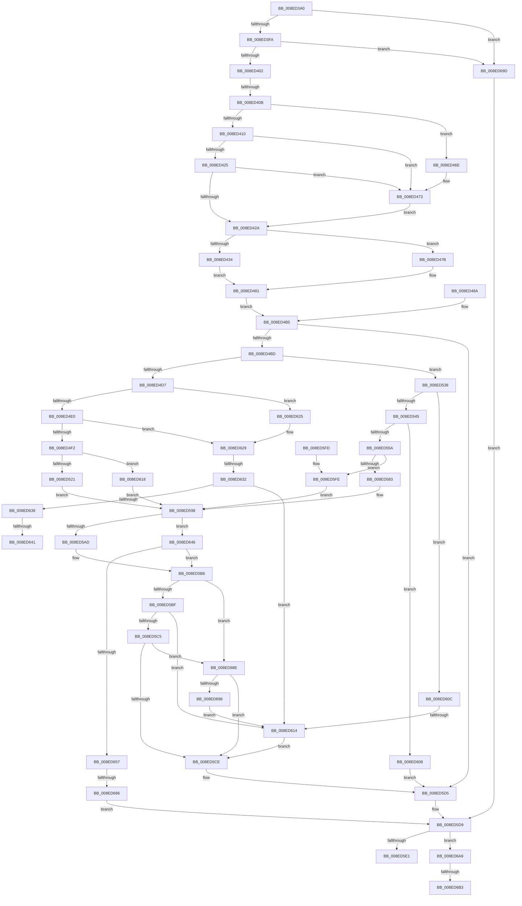

# PiCMCapturePropertyInputData

- RVA: `0x008ED3A0`–`0x008ED6C4` (길이 `804` bytes)
- VA: `0x00000001408ED3A0`
- 실행 섹션: `PAGE`
- PDB 이름 있음: `예`; PDB Function 태그: `예`
- unwind 정보 RVA: `0x00086D60`
- 디코드: `205`개 명령, `804/804` bytes 표시
- 미해석 바이트: `0` (있으면 어셈블리에 `.byte`로 보존)

> 이 문서는 커널 이미지의 기계어와 PDB 기호를 분석해 생성했습니다. 4번과 5번은 함수 원형과 자료형을 바이너리 사용 방식에서 추정한 C 해석이며 원본 소스 복구 결과는 아닙니다.

## 1. Dependencies

- 직접 호출 지점: **6**; 고유 호출 대상: **4**
- 직접 호출자로 확인된 함수: **2**
- RIP 상대 이미지 참조: **0**

### Outgoing calls
- `0x008ED46E` → [ExRaiseDatatypeMisalignment](../89/ExRaiseDatatypeMisalignment_function_00899FD0.md) (function, `0x00899FD0`)
- `0x008ED4CE` → [Feature_KernelPnP_ObjectNameUpdates__private_IsEnabledDeviceUsageNoInline](../../text/4F/Feature_KernelPnP_ObjectNameUpdates__private_IsEnabledDeviceUsageNoInline_function_004F2E10.md) (function, `0x004F2E10`)
- `0x008ED512` → [PiControlMakeUserModeCallersCopy](PiControlMakeUserModeCallersCopy_function_008E4630.md) (function, `0x008E4630`)
- `0x008ED578` → [PiControlMakeUserModeCallersCopy](PiControlMakeUserModeCallersCopy_function_008E4630.md) (function, `0x008E4630`)
- `0x008ED670` → [PiControlMakeUserModeCallersCopy](PiControlMakeUserModeCallersCopy_function_008E4630.md) (function, `0x008E4630`)
- `0x008ED6B9` → [PiControlFreeUserModeCallersBuffer](../../text/44/PiControlFreeUserModeCallersBuffer_function_00448990.md) (function, `0x00448990`)

### Direct callers
- [PiCMHandleIoctl](PiCMHandleIoctl_function_008EB880.md) at `0x008EB95C`
- [PiCMSetObjectProperty](../96/PiCMSetObjectProperty_function_00962564.md) at `0x009625BD`

### Static image references
- 디코드된 RIP-relative 메모리 참조가 없습니다.

## 2. Other-region calls and transfers

- 다른 실행 섹션으로 향하는 call: **2**
  - `0x008ED4CE` → [Feature_KernelPnP_ObjectNameUpdates__private_IsEnabledDeviceUsageNoInline](../../text/4F/Feature_KernelPnP_ObjectNameUpdates__private_IsEnabledDeviceUsageNoInline_function_004F2E10.md) (`PAGE` → `.text`)
  - `0x008ED6B9` → [PiControlFreeUserModeCallersBuffer](../../text/44/PiControlFreeUserModeCallersBuffer_function_00448990.md) (`PAGE` → `.text`)
- call이 아닌 외부 분기/꼬리 이동: **8**
  - `0x008ED405` → [sub_00B1D9AC](../B1/Unknown_function_00B1D9AC.md) (`tail-transfer`)
  - `0x008ED60E` → [sub_00B1D9AC + 0xDB](../B1/Unknown_function_00B1D9AC.md) (`tail-transfer`)
  - `0x008ED62C` → [sub_00B1D9AC + 0xD0](../B1/Unknown_function_00B1D9AC.md) (`tail-transfer`)
  - `0x008ED63B` → [sub_00B1D9AC + 0xD0](../B1/Unknown_function_00B1D9AC.md) (`tail-transfer`)
  - `0x008ED641` → [sub_00B1D9AC + 0xDB](../B1/Unknown_function_00B1D9AC.md) (`tail-transfer`)
  - `0x008ED680` → [sub_00B1D9AC + 0xE6](../B1/Unknown_function_00B1D9AC.md) (`tail-transfer`)
  - `0x008ED6AD` → [sub_00B1D9AC + 0xF3](../B1/Unknown_function_00B1D9AC.md) (`tail-transfer`)
  - `0x008ED6BF` → [sub_00B1D9AC + 0xF3](../B1/Unknown_function_00B1D9AC.md) (`tail-transfer`)

## 3. Assembly (complete function range)

```asm
008ED3A0  48 89 5C 24 10                  mov qword ptr [rsp + 0x10], rbx
008ED3A5  48 89 74 24 18                  mov qword ptr [rsp + 0x18], rsi
008ED3AA  4C 89 4C 24 20                  mov qword ptr [rsp + 0x20], r9
008ED3AF  57                              push rdi
008ED3B0  41 54                           push r12
008ED3B2  41 55                           push r13
008ED3B4  41 56                           push r14
008ED3B6  41 57                           push r15
008ED3B8  48 83 EC 50                     sub rsp, 0x50
008ED3BC  4D 8B F1                        mov r14, r9
008ED3BF  4D 8B E9                        mov r13, r9
008ED3C2  4C 89 4C 24 48                  mov qword ptr [rsp + 0x48], r9
008ED3C7  33 DB                           xor ebx, ebx
008ED3C9  89 5C 24 3C                     mov dword ptr [rsp + 0x3c], ebx
008ED3CD  89 5C 24 34                     mov dword ptr [rsp + 0x34], ebx
008ED3D1  65 48 8B 04 25 88 01 00 00      mov rax, qword ptr gs:[0x188]
008ED3DA  8A 80 32 02 00 00               mov al, byte ptr [rax + 0x232]
008ED3E0  88 84 24 80 00 00 00            mov byte ptr [rsp + 0x80], al
008ED3E7  88 44 24 30                     mov byte ptr [rsp + 0x30], al
008ED3EB  8B FB                           mov edi, ebx
008ED3ED  89 5C 24 38                     mov dword ptr [rsp + 0x38], ebx
008ED3F1  48 85 C9                        test rcx, rcx
008ED3F4  0F 84 A3 02 00 00               je 0x1408ed69d
008ED3FA  85 D2                           test edx, edx
008ED3FC  0F 84 9B 02 00 00               je 0x1408ed69d
008ED402  45 85 C0                        test r8d, r8d
008ED405  0F 85 A1 05 23 00               jne 0x140b1d9ac
008ED40B  F6 C1 07                        test cl, 7
008ED40E  75 5E                           jne 0x1408ed46e
008ED410  44 8B C2                        mov r8d, edx
008ED413  4C 03 C1                        add r8, rcx
008ED416  48 B8 00 00 FF FF FF 7F 00 00   movabs rax, 0x7fffffff0000
008ED420  4C 3B C0                        cmp r8, rax
008ED423  77 4E                           ja 0x1408ed473
008ED425  4C 3B C1                        cmp r8, rcx
008ED428  72 49                           jb 0x1408ed473
008ED42A  BE 0D 00 00 C0                  mov esi, 0xc000000d
008ED42F  83 FA 48                        cmp edx, 0x48
008ED432  72 47                           jb 0x1408ed47b
008ED434  0F 10 01                        movups xmm0, xmmword ptr [rcx]
008ED437  41 0F 29 01                     movaps xmmword ptr [r9], xmm0
008ED43B  0F 10 49 10                     movups xmm1, xmmword ptr [rcx + 0x10]
008ED43F  41 0F 29 49 10                  movaps xmmword ptr [r9 + 0x10], xmm1
008ED444  0F 10 41 20                     movups xmm0, xmmword ptr [rcx + 0x20]
008ED448  41 0F 29 41 20                  movaps xmmword ptr [r9 + 0x20], xmm0
008ED44D  0F 10 49 30                     movups xmm1, xmmword ptr [rcx + 0x30]
008ED451  41 0F 29 49 30                  movaps xmmword ptr [r9 + 0x30], xmm1
008ED456  F2 0F 10 41 40                  movsd xmm0, qword ptr [rcx + 0x40]
008ED45B  F2 41 0F 11 41 40               movsd qword ptr [r9 + 0x40], xmm0
008ED461  41 83 39 48                     cmp dword ptr [r9], 0x48
008ED465  0F 45 FE                        cmovne edi, esi
008ED468  89 7C 24 38                     mov dword ptr [rsp + 0x38], edi
008ED46C  EB 13                           jmp 0x1408ed481
008ED46E  E8 5D CB FA FF                  call 0x140899fd0
008ED473  8A 00                           mov al, byte ptr [rax]
008ED475  8B 7C 24 38                     mov edi, dword ptr [rsp + 0x38]
008ED479  EB AF                           jmp 0x1408ed42a
008ED47B  8B FE                           mov edi, esi
008ED47D  89 74 24 38                     mov dword ptr [rsp + 0x38], esi
008ED481  8A 84 24 80 00 00 00            mov al, byte ptr [rsp + 0x80]
008ED488  EB 2B                           jmp 0x1408ed4b5
008ED48A  8B F8                           mov edi, eax
008ED48C  89 44 24 38                     mov dword ptr [rsp + 0x38], eax
008ED490  33 DB                           xor ebx, ebx
008ED492  BE 0D 00 00 C0                  mov esi, 0xc000000d
008ED497  4C 8B B4 24 98 00 00 00         mov r14, qword ptr [rsp + 0x98]
008ED49F  8B C3                           mov eax, ebx
008ED4A1  89 5C 24 3C                     mov dword ptr [rsp + 0x3c], ebx
008ED4A5  8A 44 24 30                     mov al, byte ptr [rsp + 0x30]
008ED4A9  88 84 24 80 00 00 00            mov byte ptr [rsp + 0x80], al
008ED4B0  4C 8B 6C 24 48                  mov r13, qword ptr [rsp + 0x48]
008ED4B5  85 FF                           test edi, edi
008ED4B7  0F 88 18 01 00 00               js 0x1408ed5d5
008ED4BD  4D 8D 66 10                     lea r12, [r14 + 0x10]
008ED4C1  4D 8B 3C 24                     mov r15, qword ptr [r12]
008ED4C5  4C 89 7C 24 40                  mov qword ptr [rsp + 0x40], r15
008ED4CA  49 89 1C 24                     mov qword ptr [r12], rbx
008ED4CE  E8 3D 59 C0 FF                  call 0x1404f2e10
008ED4D3  85 C0                           test eax, eax
008ED4D5  75 61                           jne 0x1408ed538
008ED4D7  4D 85 FF                        test r15, r15
008ED4DA  0F 84 45 01 00 00               je 0x1408ed625
008ED4E0  4D 8D 6E 18                     lea r13, [r14 + 0x18]
008ED4E4  45 8B 45 00                     mov r8d, dword ptr [r13]
008ED4E8  41 83 F8 02                     cmp r8d, 2
008ED4EC  0F 82 37 01 00 00               jb 0x1408ed629
008ED4F2  44 8D 78 01                     lea r15d, [rax + 1]
008ED4F6  44 89 7C 24 28                  mov dword ptr [rsp + 0x28], r15d
008ED4FB  8A 84 24 80 00 00 00            mov al, byte ptr [rsp + 0x80]
008ED502  88 44 24 20                     mov byte ptr [rsp + 0x20], al
008ED506  45 8D 4F 01                     lea r9d, [r15 + 1]
008ED50A  48 8B 54 24 40                  mov rdx, qword ptr [rsp + 0x40]
008ED50F  49 8B CC                        mov rcx, r12
008ED512  E8 19 71 FF FF                  call 0x1408e4630
008ED517  8B F8                           mov edi, eax
008ED519  85 C0                           test eax, eax
008ED51B  0F 88 F7 00 00 00               js 0x1408ed618
008ED521  44 89 7C 24 3C                  mov dword ptr [rsp + 0x3c], r15d
008ED526  41 8B 4D 00                     mov ecx, dword ptr [r13]
008ED52A  48 D1 E9                        shr rcx, 1
008ED52D  49 8B 04 24                     mov rax, qword ptr [r12]
008ED531  66 89 5C 48 FE                  mov word ptr [rax + rcx*2 - 2], bx
008ED536  EB 60                           jmp 0x1408ed598
008ED538  41 8B 4E 18                     mov ecx, dword ptr [r14 + 0x18]
008ED53C  4D 85 FF                        test r15, r15
008ED53F  0F 84 C7 00 00 00               je 0x1408ed60c
008ED545  8D 41 FE                        lea eax, [rcx - 2]
008ED548  3D FD FF 00 00                  cmp eax, 0xfffd
008ED54D  8A 84 24 80 00 00 00            mov al, byte ptr [rsp + 0x80]
008ED554  0F 87 AE 00 00 00               ja 0x1408ed608
008ED55A  41 BF 01 00 00 00               mov r15d, 1
008ED560  44 89 7C 24 28                  mov dword ptr [rsp + 0x28], r15d
008ED565  88 44 24 20                     mov byte ptr [rsp + 0x20], al
008ED569  45 8D 4F 01                     lea r9d, [r15 + 1]
008ED56D  44 8B C1                        mov r8d, ecx
008ED570  48 8B 54 24 40                  mov rdx, qword ptr [rsp + 0x40]
008ED575  49 8B CC                        mov rcx, r12
008ED578  E8 B3 70 FF FF                  call 0x1408e4630
008ED57D  8B F8                           mov edi, eax
008ED57F  85 C0                           test eax, eax
008ED581  78 7B                           js 0x1408ed5fe
008ED583  44 89 7C 24 3C                  mov dword ptr [rsp + 0x3c], r15d
008ED588  41 8B 56 18                     mov edx, dword ptr [r14 + 0x18]
008ED58C  48 D1 EA                        shr rdx, 1
008ED58F  49 8B 0C 24                     mov rcx, qword ptr [r12]
008ED593  66 89 5C 51 FE                  mov word ptr [rcx + rdx*2 - 2], bx
008ED598  4D 8D 6E 38                     lea r13, [r14 + 0x38]
008ED59C  49 8B 45 00                     mov rax, qword ptr [r13]
008ED5A0  49 89 5D 00                     mov qword ptr [r13], rbx
008ED5A4  48 85 C0                        test rax, rax
008ED5A7  0F 85 99 00 00 00               jne 0x1408ed646
008ED5AD  4C 8B 64 24 48                  mov r12, qword ptr [rsp + 0x48]
008ED5B2  49 83 C4 40                     add r12, 0x40
008ED5B6  48 85 C0                        test rax, rax
008ED5B9  0F 85 CF 00 00 00               jne 0x1408ed68e
008ED5BF  41 39 1C 24                     cmp dword ptr [r12], ebx
008ED5C3  77 4F                           ja 0x1408ed614
008ED5C5  48 85 C0                        test rax, rax
008ED5C8  0F 85 C0 00 00 00               jne 0x1408ed68e
008ED5CE  8A 84 24 80 00 00 00            mov al, byte ptr [rsp + 0x80]
008ED5D5  8B 74 24 34                     mov esi, dword ptr [rsp + 0x34]
008ED5D9  85 FF                           test edi, edi
008ED5DB  0F 88 C8 00 00 00               js 0x1408ed6a9
008ED5E1  8B C7                           mov eax, edi
008ED5E3  4C 8D 5C 24 50                  lea r11, [rsp + 0x50]
008ED5E8  49 8B 5B 38                     mov rbx, qword ptr [r11 + 0x38]
008ED5EC  49 8B 73 40                     mov rsi, qword ptr [r11 + 0x40]
008ED5F0  49 8B E3                        mov rsp, r11
008ED5F3  41 5F                           pop r15
008ED5F5  41 5E                           pop r14
008ED5F7  41 5D                           pop r13
008ED5F9  41 5C                           pop r12
008ED5FB  5F                              pop rdi
008ED5FC  C3                              ret
008ED5FD  CC                              int3
008ED5FE  49 89 1C 24                     mov qword ptr [r12], rbx
008ED602  41 89 5E 18                     mov dword ptr [r14 + 0x18], ebx
008ED606  EB 90                           jmp 0x1408ed598
008ED608  8B FE                           mov edi, esi
008ED60A  EB C9                           jmp 0x1408ed5d5
008ED60C  85 C9                           test ecx, ecx
008ED60E  0F 84 73 04 23 00               je 0x140b1da87
008ED614  8B FE                           mov edi, esi
008ED616  EB B6                           jmp 0x1408ed5ce
008ED618  49 89 1C 24                     mov qword ptr [r12], rbx
008ED61C  41 89 5D 00                     mov dword ptr [r13], ebx
008ED620  E9 73 FF FF FF                  jmp 0x1408ed598
008ED625  49 83 C5 18                     add r13, 0x18
008ED629  4D 85 FF                        test r15, r15
008ED62C  0F 85 4A 04 23 00               jne 0x140b1da7c
008ED632  41 39 5D 00                     cmp dword ptr [r13], ebx
008ED636  77 DC                           ja 0x1408ed614
008ED638  4D 85 FF                        test r15, r15
008ED63B  0F 85 3B 04 23 00               jne 0x140b1da7c
008ED641  E9 41 04 23 00                  jmp 0x140b1da87
008ED646  4D 8D 66 40                     lea r12, [r14 + 0x40]
008ED64A  45 8B 04 24                     mov r8d, dword ptr [r12]
008ED64E  45 85 C0                        test r8d, r8d
008ED651  0F 84 5F FF FF FF               je 0x1408ed5b6
008ED657  44 89 7C 24 28                  mov dword ptr [rsp + 0x28], r15d
008ED65C  8A 8C 24 80 00 00 00            mov cl, byte ptr [rsp + 0x80]
008ED663  88 4C 24 20                     mov byte ptr [rsp + 0x20], cl
008ED667  45 8B CF                        mov r9d, r15d
008ED66A  48 8B D0                        mov rdx, rax
008ED66D  49 8B CD                        mov rcx, r13
008ED670  E8 BB 6F FF FF                  call 0x1408e4630
008ED675  8B F8                           mov edi, eax
008ED677  85 C0                           test eax, eax
008ED679  8A 84 24 80 00 00 00            mov al, byte ptr [rsp + 0x80]
008ED680  0F 88 0C 04 23 00               js 0x140b1da92
008ED686  41 8B F7                        mov esi, r15d
008ED689  E9 4B FF FF FF                  jmp 0x1408ed5d9
008ED68E  41 39 1C 24                     cmp dword ptr [r12], ebx
008ED692  0F 85 36 FF FF FF               jne 0x1408ed5ce
008ED698  E9 77 FF FF FF                  jmp 0x1408ed614
008ED69D  BF 0D 00 00 C0                  mov edi, 0xc000000d
008ED6A2  8B F3                           mov esi, ebx
008ED6A4  E9 30 FF FF FF                  jmp 0x1408ed5d9
008ED6A9  39 5C 24 3C                     cmp dword ptr [rsp + 0x3c], ebx
008ED6AD  0F 84 EC 03 23 00               je 0x140b1da9f
008ED6B3  49 8B 56 10                     mov rdx, qword ptr [r14 + 0x10]
008ED6B7  8A C8                           mov cl, al
008ED6B9  E8 D2 B2 B5 FF                  call 0x140448990
008ED6BE  90                              nop
008ED6BF  E9 DB 03 23 00                  jmp 0x140b1da9f
```

## 4. C-style interpretation (structured pseudocode)

```c
__int64 __fastcall PiCMCapturePropertyInputData(__int64 a1, int a2, int a3, __int64 a4)
{
    __int64 result;
    __int64 v_r12;
    __int64 v_r13;
    __int64 v_rbx;
    __int64 v_rdi;
    __int64 v_rsp;
    unsigned int v_stack_m14;
    unsigned __int64 v_stack_m28;
    unsigned __int64 v_stack_m30;
    unsigned __int64 v_stack_m38;
    unsigned int v_stack_m3C;
    unsigned int v_stack_m40;
    unsigned int v_stack_m44;
    unsigned __int8 v_stack_m48;
    unsigned int v_stack_m50;
    unsigned __int8 v_stack_m58;
    unsigned __int64 v_stack_p10;
    unsigned __int64 v_stack_p18;
    unsigned __int64 v_stack_p20;
    unsigned __int8 v_stack_p30;
    unsigned __int8 v_stack_p8;

    v_stack_p10 = v_rbx;
    v_stack_p18 = v_rsi;
    v_stack_p20 = a4;
    v_rsp = (v_rsp) - (80);
    v_stack_m30 = a4;
    v_rbx = 0;
    v_stack_m3C = 0;
    v_stack_m44 = 0;
    v_stack_p8 = (unsigned __int8)(*(unsigned __int8 *)(*(unsigned __int64 *)(gs_base + (0 + 392)) + 562));
    v_stack_m48 = (unsigned __int8)(*(unsigned __int8 *)(*(unsigned __int64 *)(gs_base + (0 + 392)) + 562));
    v_stack_m40 = 0;
    if (a1 == 0) goto loc_008ED69D;
    if (a2 == 0) goto loc_008ED69D;
    if ((((unsigned __int8)(a1)) & (7)) != 0) goto loc_008ED46E;
    a3 = ((unsigned int)(a2)) + (a1);
    if (a3 > (*(unsigned __int8 *)(*(unsigned __int64 *)(gs_base + (0 + 392)) + 562))) goto loc_008ED473;
    if (a3 < a1) goto loc_008ED473;
loc_008ED42A:
    if (a2 < 72) goto loc_008ED47B;
    *(unsigned __int64 *)(a4) = v_xmm0;
    *(unsigned __int64 *)(a4 + 16) = v_xmm1;
    *(unsigned __int64 *)(a4 + 32) = v_xmm0;
    *(unsigned __int64 *)(a4 + 48) = v_xmm1;
    *(unsigned __int64 *)(a4 + 64) = v_xmm0;
    v_rdi = 0;
    if ((*(unsigned int *)(a4)) != 72) { v_rdi = (unsigned int)((unsigned int)(0xC000000DULL)); }
    v_stack_m40 = (unsigned int)(v_rdi);
    goto loc_008ED481;
loc_008ED46E:
    result = ExRaiseDatatypeMisalignment(a1, a2, a3, a4);
loc_008ED473:
    goto loc_008ED42A;
loc_008ED47B:
    v_stack_m40 = (unsigned int)((unsigned int)(0xC000000DULL));
loc_008ED481:
    goto loc_008ED4B5;
loc_008ED4B5:
    if (sign_flag) goto loc_008ED5D5;
    v_stack_m38 = *(unsigned __int64 *)(a4 + 16);
    *(unsigned __int64 *)(a4 + 16) = 0;
    result = Feature_KernelPnP_ObjectNameUpdates__private_IsEnabledDeviceUsageNoInline(a1, a2, a3, a4);
    if ((unsigned int)(result) != 0) goto loc_008ED538;
    if (*(unsigned __int64 *)(a4 + 16) == 0) goto loc_008ED625;
    if (((unsigned int)((unsigned int)(*(unsigned int *)(a4 + 24)))) < 2) goto loc_008ED629;
    v_stack_m50 = (unsigned int)(result + 1);
    v_stack_m58 = (unsigned __int8)(v_stack_p8);
    result = PiControlMakeUserModeCallersCopy(a4 + 16, v_stack_m38, (unsigned int)(*(unsigned int *)(a4 + 24)), result + 1 + 1);
    if (sign_flag) goto loc_008ED618;
    v_stack_m3C = (unsigned int)(result + 1);
    a1 = ((unsigned int)(*(unsigned int *)(a4 + 24))) >> (1);
    *(unsigned __int16 *)(*(unsigned __int64 *)(a4 + 16) + a1 * 2 - 2) = 0;
    goto loc_008ED598;
loc_008ED538:
    if (result + 1 == 0) goto loc_008ED60C;
    if (((unsigned int)((unsigned int)(*(unsigned int *)(a4 + 24)) - 2)) > 0xFFFDULL) goto loc_008ED608;
    v_stack_m50 = 1;
    v_stack_m58 = (unsigned __int8)(v_stack_p8);
    result = PiControlMakeUserModeCallersCopy(a4 + 16, v_stack_m38, (unsigned int)((unsigned int)((unsigned int)(*(unsigned int *)(a4 + 24)))), 1 + 1);
    if (sign_flag) goto loc_008ED5FE;
    v_stack_m3C = 1;
    a2 = ((unsigned int)(*(unsigned int *)(a4 + 24))) >> (1);
    *(unsigned __int16 *)(*(unsigned __int64 *)(a4 + 16) + a2 * 2 - 2) = 0;
loc_008ED598:
    *(unsigned __int64 *)(a4 + 56) = 0;
    if (*(unsigned __int64 *)(a4 + 56) != 0) goto loc_008ED646;
    v_r12 = (v_stack_m30) + (64);
loc_008ED5B6:
    if (*(unsigned __int64 *)(a4 + 56) != 0) goto loc_008ED68E;
    if ((*(unsigned int *)(v_r12)) > 0) goto loc_008ED614;
    if (*(unsigned __int64 *)(a4 + 56) != 0) goto loc_008ED68E;
loc_008ED5CE:
loc_008ED5D5:
loc_008ED5D9:
    if (sign_flag) goto loc_008ED6A9;
    return (unsigned int)((unsigned int)((unsigned int)((unsigned int)(result))));
loc_008ED5FE:
    *(unsigned __int64 *)(v_r12) = *(unsigned __int64 *)(v_stack_m28 + 56);
    *(unsigned int *)(a4 + 24) = (unsigned int)(*(unsigned __int64 *)(v_stack_m28 + 56));
    goto loc_008ED598;
loc_008ED608:
    goto loc_008ED5D5;
loc_008ED60C:
loc_008ED614:
    goto loc_008ED5CE;
loc_008ED618:
    *(unsigned __int64 *)(v_r12) = *(unsigned __int64 *)(v_stack_m28 + 56);
    *(unsigned int *)(a4 + 56) = (unsigned int)(*(unsigned __int64 *)(v_stack_m28 + 56));
    goto loc_008ED598;
loc_008ED625:
    v_r13 = (a4 + 56) + (24);
loc_008ED629:
    if ((*(unsigned int *)(v_r13)) > ((unsigned int)(*(unsigned __int64 *)(v_stack_m28 + 56)))) goto loc_008ED614;
loc_008ED646:
    if ((unsigned int)((unsigned int)(*(unsigned int *)(a4 + 64))) == 0) goto loc_008ED5B6;
    v_stack_m28 = 1;
    v_stack_m30 = (unsigned __int8)(v_stack_p30);
    result = PiControlMakeUserModeCallersCopy(v_r13, (unsigned int)((unsigned int)((unsigned int)((unsigned int)(result)))), (unsigned int)(*(unsigned int *)(a4 + 64)), 1);
    goto loc_008ED5D9;
loc_008ED68E:
    if ((*(unsigned int *)(a4 + 64)) != ((unsigned int)(*(unsigned __int64 *)(v_stack_m28 + 56)))) goto loc_008ED5CE;
    goto loc_008ED614;
loc_008ED69D:
    goto loc_008ED5D9;
loc_008ED6A9:
    result = PiControlFreeUserModeCallersBuffer((unsigned __int8)(v_stack_p30), *(unsigned __int64 *)(a4 + 16), (unsigned int)(*(unsigned int *)(a4 + 64)), 1);
}
```

## 5. (Beta) C Style

```c
int64_t PiCMCapturePropertyInputData(int64_t Arg1, int32_t Arg2, int32_t Arg3, void *Arg4)
{
    uint8_t *arg4 = (uint8_t *)Arg4;

    int64_t result;
    int64_t local_r12;
    int64_t local_r13;
    int64_t local_rbx;
    int64_t local_rdi;
    int64_t local_rsp;
    uint32_t v_stack_m14;
    uint64_t v_stack_m28;
    uint64_t v_stack_m30;
    uint64_t v_stack_m38;
    uint32_t v_stack_m3C;
    uint32_t v_stack_m40;
    uint32_t v_stack_m44;
    uint8_t v_stack_m48;
    uint32_t v_stack_m50;
    uint8_t v_stack_m58;
    uint64_t v_stack_p10;
    uint64_t v_stack_p18;
    uint64_t v_stack_p20;
    uint8_t v_stack_p30;
    uint8_t v_stack_p8;

    v_stack_p10 = local_rbx;
    v_stack_p18 = local_rsi;
    v_stack_p20 = Arg4;
    local_rsp = (local_rsp) - (80);
    v_stack_m30 = Arg4;
    local_rbx = 0;
    v_stack_m3C = 0;
    v_stack_m44 = 0;
    v_stack_p8 = (uint8_t)(*(uint8_t *)(*(uint64_t *)(gs_base + (0 + 0x188)) + 0x232));
    v_stack_m48 = (uint8_t)(*(uint8_t *)(*(uint64_t *)(gs_base + (0 + 0x188)) + 0x232));
    v_stack_m40 = 0;
    if (Arg1 == 0) goto loc_008ED69D;
    if (Arg2 == 0) goto loc_008ED69D;
    if ((((uint8_t)(Arg1)) & (7)) != 0) goto loc_008ED46E;
    Arg3 = ((uint32_t)(Arg2)) + (Arg1);
    if (Arg3 > (*(uint8_t *)(*(uint64_t *)(gs_base + (0 + 0x188)) + 0x232))) goto loc_008ED473;
    if (Arg3 < Arg1) goto loc_008ED473;
loc_008ED42A:
    if (Arg2 < 72) goto loc_008ED47B;
    *(uint64_t *)(arg4) = v_xmm0;
    *(uint64_t *)(arg4 + 0x10) = v_xmm1;
    *(uint64_t *)(arg4 + 0x20) = v_xmm0;
    *(uint64_t *)(arg4 + 0x30) = v_xmm1;
    *(uint64_t *)(arg4 + 0x40) = v_xmm0;
    local_rdi = 0;
    if ((*(uint32_t *)(arg4)) != 72) { local_rdi = (uint32_t)((uint32_t)(0xC000000DULL)); }
    v_stack_m40 = (uint32_t)(local_rdi);
    goto loc_008ED481;
loc_008ED46E:
    result = ExRaiseDatatypeMisalignment(Arg1, Arg2, Arg3, Arg4);
loc_008ED473:
    goto loc_008ED42A;
loc_008ED47B:
    v_stack_m40 = (uint32_t)((uint32_t)(0xC000000DULL));
loc_008ED481:
    goto loc_008ED4B5;
loc_008ED4B5:
    if (sign_flag) goto loc_008ED5D5;
    v_stack_m38 = *(uint64_t *)(arg4 + 0x10);
    *(uint64_t *)(arg4 + 0x10) = 0;
    result = Feature_KernelPnP_ObjectNameUpdates__private_IsEnabledDeviceUsageNoInline(Arg1, Arg2, Arg3, Arg4);
    if ((uint32_t)(result) != 0) goto loc_008ED538;
    if (*(uint64_t *)(arg4 + 0x10) == 0) goto loc_008ED625;
    if (((uint32_t)((uint32_t)(*(uint32_t *)(arg4 + 0x18)))) < 2) goto loc_008ED629;
    v_stack_m50 = (uint32_t)(result + 1);
    v_stack_m58 = (uint8_t)(v_stack_p8);
    result = PiControlMakeUserModeCallersCopy(Arg4 + 16, v_stack_m38, (uint32_t)(*(uint32_t *)(arg4 + 0x18)), result + 1 + 1);
    if (sign_flag) goto loc_008ED618;
    v_stack_m3C = (uint32_t)(result + 1);
    Arg1 = ((uint32_t)(*(uint32_t *)(arg4 + 0x18))) >> (1);
    *(uint16_t *)(*(uint64_t *)(arg4 + 0x10) + Arg1 * 2 - 0x2) = 0;
    goto loc_008ED598;
loc_008ED538:
    if (result + 1 == 0) goto loc_008ED60C;
    if (((uint32_t)((uint32_t)(*(uint32_t *)(arg4 + 0x18)) - 2)) > 0xFFFDULL) goto loc_008ED608;
    v_stack_m50 = 1;
    v_stack_m58 = (uint8_t)(v_stack_p8);
    result = PiControlMakeUserModeCallersCopy(Arg4 + 16, v_stack_m38, (uint32_t)((uint32_t)((uint32_t)(*(uint32_t *)(arg4 + 0x18)))), 1 + 1);
    if (sign_flag) goto loc_008ED5FE;
    v_stack_m3C = 1;
    Arg2 = ((uint32_t)(*(uint32_t *)(arg4 + 0x18))) >> (1);
    *(uint16_t *)(*(uint64_t *)(arg4 + 0x10) + Arg2 * 2 - 0x2) = 0;
loc_008ED598:
    *(uint64_t *)(arg4 + 0x38) = 0;
    if (*(uint64_t *)(arg4 + 0x38) != 0) goto loc_008ED646;
    local_r12 = (v_stack_m30) + (64);
loc_008ED5B6:
    if (*(uint64_t *)(arg4 + 0x38) != 0) goto loc_008ED68E;
    if ((*(uint32_t *)(local_r12)) > 0) goto loc_008ED614;
    if (*(uint64_t *)(arg4 + 0x38) != 0) goto loc_008ED68E;
loc_008ED5CE:
loc_008ED5D5:
loc_008ED5D9:
    if (sign_flag) goto loc_008ED6A9;
    return (uint32_t)((uint32_t)((uint32_t)((uint32_t)(result))));
loc_008ED5FE:
    *(uint64_t *)(local_r12) = *(uint64_t *)(v_stack_m28 + 0x38);
    *(uint32_t *)(arg4 + 0x18) = (uint32_t)(*(uint64_t *)(v_stack_m28 + 0x38));
    goto loc_008ED598;
loc_008ED608:
    goto loc_008ED5D5;
loc_008ED60C:
loc_008ED614:
    goto loc_008ED5CE;
loc_008ED618:
    *(uint64_t *)(local_r12) = *(uint64_t *)(v_stack_m28 + 0x38);
    *(uint32_t *)(arg4 + 0x38) = (uint32_t)(*(uint64_t *)(v_stack_m28 + 0x38));
    goto loc_008ED598;
loc_008ED625:
    local_r13 = (Arg4 + 56) + (24);
loc_008ED629:
    if ((*(uint32_t *)(local_r13)) > ((uint32_t)(*(uint64_t *)(v_stack_m28 + 0x38)))) goto loc_008ED614;
loc_008ED646:
    if ((uint32_t)((uint32_t)(*(uint32_t *)(arg4 + 0x40))) == 0) goto loc_008ED5B6;
    v_stack_m28 = 1;
    v_stack_m30 = (uint8_t)(v_stack_p30);
    result = PiControlMakeUserModeCallersCopy(local_r13, (uint32_t)((uint32_t)((uint32_t)((uint32_t)(result)))), (uint32_t)(*(uint32_t *)(arg4 + 0x40)), 1);
    goto loc_008ED5D9;
loc_008ED68E:
    if ((*(uint32_t *)(arg4 + 0x40)) != ((uint32_t)(*(uint64_t *)(v_stack_m28 + 0x38)))) goto loc_008ED5CE;
    goto loc_008ED614;
loc_008ED69D:
    goto loc_008ED5D9;
loc_008ED6A9:
    result = PiControlFreeUserModeCallersBuffer((uint8_t)(v_stack_p30), *(uint64_t *)(arg4 + 0x10), (uint32_t)(*(uint32_t *)(arg4 + 0x40)), 1);
}
```

### 관측된 메모리 오프셋

구조체 형식이 확인되지 않은 접근은 인자 기준의 오프셋으로만 기록했습니다.

| 기준 인자 | 오프셋 표현 | 폭 (bit) | 접근 |
|---|---:|---:|---|
| `Arg4` | `+ 0x0` | `32` | `R` |
| `Arg4` | `+ 0x0` | `32` | `W` |
| `Arg4` | `+ 0x0` | `64` | `R` |
| `Arg4` | `+ 0x0` | `64` | `W` |
| `Arg4` | `+ 0x10` | `64` | `R` |
| `Arg4` | `+ 0x18` | `32` | `R` |
| `Arg4` | `+ 0x18` | `32` | `W` |
| `Arg4` | `+ 0x18` | `64` | `R` |
| `Arg4` | `+ 0x38` | `64` | `R` |
| `Arg4` | `+ 0x40` | `64` | `R` |

## 6. Execution-region graph

[열기: 2D/3D 그래프와 함수 탐색 컨트롤 패널](../../../control-panel.html?section=page&rva=0x008ED3A0&view=graph)

- 2D 그래프는 위에서 아래로 흐르고, 3D 그래프는 빈 공간을 드래그해 회전합니다. Shift+드래그는 이동, 휠은 확대·축소, 함수 노드 선택은 대상 보고서 이동입니다.

### Static fallback


