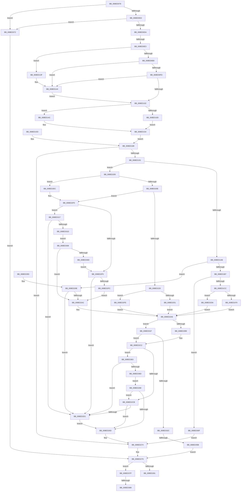

# PiCMCaptureRegistryPropertyInputData

- RVA: `0x008ED078`–`0x008ED39A` (길이 `802` bytes)
- VA: `0x00000001408ED078`
- 실행 섹션: `PAGE`
- PDB 이름 있음: `예`; PDB Function 태그: `예`
- unwind 정보 RVA: `0x00086D0C`
- 디코드: `209`개 명령, `802/802` bytes 표시
- 미해석 바이트: `0` (있으면 어셈블리에 `.byte`로 보존)

> 이 문서는 커널 이미지의 기계어와 PDB 기호를 분석해 생성했습니다. 4번과 5번은 함수 원형과 자료형을 바이너리 사용 방식에서 추정한 C 해석이며 원본 소스 복구 결과는 아닙니다.

## 1. Dependencies

- 직접 호출 지점: **6**; 고유 호출 대상: **4**
- 직접 호출자로 확인된 함수: **2**
- RIP 상대 이미지 참조: **0**

### Outgoing calls
- `0x008ED13F` → [ExRaiseDatatypeMisalignment](../89/ExRaiseDatatypeMisalignment_function_00899FD0.md) (function, `0x00899FD0`)
- `0x008ED1A2` → [Feature_KernelPnP_ObjectNameUpdates__private_IsEnabledDeviceUsageNoInline](../../text/4F/Feature_KernelPnP_ObjectNameUpdates__private_IsEnabledDeviceUsageNoInline_function_004F2E10.md) (function, `0x004F2E10`)
- `0x008ED1EA` → [PiControlMakeUserModeCallersCopy](PiControlMakeUserModeCallersCopy_function_008E4630.md) (function, `0x008E4630`)
- `0x008ED242` → [PiControlMakeUserModeCallersCopy](PiControlMakeUserModeCallersCopy_function_008E4630.md) (function, `0x008E4630`)
- `0x008ED345` → [PiControlMakeUserModeCallersCopy](PiControlMakeUserModeCallersCopy_function_008E4630.md) (function, `0x008E4630`)
- `0x008ED38F` → [PiControlFreeUserModeCallersBuffer](../../text/44/PiControlFreeUserModeCallersBuffer_function_00448990.md) (function, `0x00448990`)

### Direct callers
- [PiCMHandleIoctl](PiCMHandleIoctl_function_008EB880.md) at `0x008EBA05`
- [PiCMSetRegistryProperty](../96/PiCMSetRegistryProperty_function_00963118.md) at `0x00963165`

### Static image references
- 디코드된 RIP-relative 메모리 참조가 없습니다.

## 2. Other-region calls and transfers

- 다른 실행 섹션으로 향하는 call: **2**
  - `0x008ED1A2` → [Feature_KernelPnP_ObjectNameUpdates__private_IsEnabledDeviceUsageNoInline](../../text/4F/Feature_KernelPnP_ObjectNameUpdates__private_IsEnabledDeviceUsageNoInline_function_004F2E10.md) (`PAGE` → `.text`)
  - `0x008ED38F` → [PiControlFreeUserModeCallersBuffer](../../text/44/PiControlFreeUserModeCallersBuffer_function_00448990.md) (`PAGE` → `.text`)
- call이 아닌 외부 분기/꼬리 이동: **4**
  - `0x008ED0DD` → [sub_00B1D8AA](../B1/Unknown_function_00B1D8AA.md) (`tail-transfer`)
  - `0x008ED355` → [sub_00B1D8AA + 0xC7](../B1/Unknown_function_00B1D8AA.md) (`tail-transfer`)
  - `0x008ED383` → [sub_00B1D8AA + 0xD4](../B1/Unknown_function_00B1D8AA.md) (`tail-transfer`)
  - `0x008ED395` → [sub_00B1D8AA + 0xD4](../B1/Unknown_function_00B1D8AA.md) (`tail-transfer`)

## 3. Assembly (complete function range)

```asm
008ED078  48 89 5C 24 10                  mov qword ptr [rsp + 0x10], rbx
008ED07D  48 89 74 24 18                  mov qword ptr [rsp + 0x18], rsi
008ED082  4C 89 4C 24 20                  mov qword ptr [rsp + 0x20], r9
008ED087  57                              push rdi
008ED088  41 54                           push r12
008ED08A  41 55                           push r13
008ED08C  41 56                           push r14
008ED08E  41 57                           push r15
008ED090  48 83 EC 50                     sub rsp, 0x50
008ED094  49 8B F1                        mov rsi, r9
008ED097  4D 8B E9                        mov r13, r9
008ED09A  4C 89 4C 24 48                  mov qword ptr [rsp + 0x48], r9
008ED09F  33 DB                           xor ebx, ebx
008ED0A1  89 5C 24 3C                     mov dword ptr [rsp + 0x3c], ebx
008ED0A5  89 5C 24 34                     mov dword ptr [rsp + 0x34], ebx
008ED0A9  65 48 8B 04 25 88 01 00 00      mov rax, qword ptr gs:[0x188]
008ED0B2  8A 80 32 02 00 00               mov al, byte ptr [rax + 0x232]
008ED0B8  88 84 24 80 00 00 00            mov byte ptr [rsp + 0x80], al
008ED0BF  88 44 24 30                     mov byte ptr [rsp + 0x30], al
008ED0C3  8B FB                           mov edi, ebx
008ED0C5  89 5C 24 38                     mov dword ptr [rsp + 0x38], ebx
008ED0C9  48 85 C9                        test rcx, rcx
008ED0CC  0F 84 A0 02 00 00               je 0x1408ed372
008ED0D2  85 D2                           test edx, edx
008ED0D4  0F 84 98 02 00 00               je 0x1408ed372
008ED0DA  45 85 C0                        test r8d, r8d
008ED0DD  0F 85 C7 07 23 00               jne 0x140b1d8aa
008ED0E3  F6 C1 07                        test cl, 7
008ED0E6  75 57                           jne 0x1408ed13f
008ED0E8  44 8B C2                        mov r8d, edx
008ED0EB  4C 03 C1                        add r8, rcx
008ED0EE  48 B8 00 00 FF FF FF 7F 00 00   movabs rax, 0x7fffffff0000
008ED0F8  4C 3B C0                        cmp r8, rax
008ED0FB  77 47                           ja 0x1408ed144
008ED0FD  4C 3B C1                        cmp r8, rcx
008ED100  72 42                           jb 0x1408ed144
008ED102  41 BE 0D 00 00 C0               mov r14d, 0xc000000d
008ED108  83 FA 38                        cmp edx, 0x38
008ED10B  72 3F                           jb 0x1408ed14c
008ED10D  0F 10 01                        movups xmm0, xmmword ptr [rcx]
008ED110  41 0F 11 01                     movups xmmword ptr [r9], xmm0
008ED114  0F 10 49 10                     movups xmm1, xmmword ptr [rcx + 0x10]
008ED118  41 0F 11 49 10                  movups xmmword ptr [r9 + 0x10], xmm1
008ED11D  0F 10 41 20                     movups xmm0, xmmword ptr [rcx + 0x20]
008ED121  41 0F 11 41 20                  movups xmmword ptr [r9 + 0x20], xmm0
008ED126  F2 0F 10 49 30                  movsd xmm1, qword ptr [rcx + 0x30]
008ED12B  F2 41 0F 11 49 30               movsd qword ptr [r9 + 0x30], xmm1
008ED131  41 83 39 38                     cmp dword ptr [r9], 0x38
008ED135  41 0F 45 FE                     cmovne edi, r14d
008ED139  89 7C 24 38                     mov dword ptr [rsp + 0x38], edi
008ED13D  EB 15                           jmp 0x1408ed154
008ED13F  E8 8C CE FA FF                  call 0x140899fd0
008ED144  8A 00                           mov al, byte ptr [rax]
008ED146  8B 7C 24 38                     mov edi, dword ptr [rsp + 0x38]
008ED14A  EB B6                           jmp 0x1408ed102
008ED14C  41 8B FE                        mov edi, r14d
008ED14F  44 89 74 24 38                  mov dword ptr [rsp + 0x38], r14d
008ED154  8A 84 24 80 00 00 00            mov al, byte ptr [rsp + 0x80]
008ED15B  EB 2C                           jmp 0x1408ed189
008ED15D  8B F8                           mov edi, eax
008ED15F  89 44 24 38                     mov dword ptr [rsp + 0x38], eax
008ED163  33 DB                           xor ebx, ebx
008ED165  41 BE 0D 00 00 C0               mov r14d, 0xc000000d
008ED16B  48 8B B4 24 98 00 00 00         mov rsi, qword ptr [rsp + 0x98]
008ED173  8B C3                           mov eax, ebx
008ED175  89 5C 24 3C                     mov dword ptr [rsp + 0x3c], ebx
008ED179  8A 44 24 30                     mov al, byte ptr [rsp + 0x30]
008ED17D  88 84 24 80 00 00 00            mov byte ptr [rsp + 0x80], al
008ED184  4C 8B 6C 24 48                  mov r13, qword ptr [rsp + 0x48]
008ED189  85 FF                           test edi, edi
008ED18B  0F 88 E3 00 00 00               js 0x1408ed274
008ED191  4C 8D 66 10                     lea r12, [rsi + 0x10]
008ED195  4D 8B 3C 24                     mov r15, qword ptr [r12]
008ED199  4C 89 7C 24 40                  mov qword ptr [rsp + 0x40], r15
008ED19E  49 89 1C 24                     mov qword ptr [r12], rbx
008ED1A2  E8 69 5C C0 FF                  call 0x1404f2e10
008ED1A7  85 C0                           test eax, eax
008ED1A9  74 5A                           je 0x1408ed205
008ED1AB  8B 4E 18                        mov ecx, dword ptr [rsi + 0x18]
008ED1AE  4D 85 FF                        test r15, r15
008ED1B1  0F 84 E7 00 00 00               je 0x1408ed29e
008ED1B7  8D 41 FE                        lea eax, [rcx - 2]
008ED1BA  3D 8E 01 00 00                  cmp eax, 0x18e
008ED1BF  8A 84 24 80 00 00 00            mov al, byte ptr [rsp + 0x80]
008ED1C6  0F 87 43 01 00 00               ja 0x1408ed30f
008ED1CC  41 BF 01 00 00 00               mov r15d, 1
008ED1D2  44 89 7C 24 28                  mov dword ptr [rsp + 0x28], r15d
008ED1D7  88 44 24 20                     mov byte ptr [rsp + 0x20], al
008ED1DB  45 8D 4F 01                     lea r9d, [r15 + 1]
008ED1DF  44 8B C1                        mov r8d, ecx
008ED1E2  48 8B 54 24 40                  mov rdx, qword ptr [rsp + 0x40]
008ED1E7  49 8B CC                        mov rcx, r12
008ED1EA  E8 41 74 FF FF                  call 0x1408e4630
008ED1EF  8B F8                           mov edi, eax
008ED1F1  85 C0                           test eax, eax
008ED1F3  0F 89 DD 00 00 00               jns 0x1408ed2d6
008ED1F9  49 89 1C 24                     mov qword ptr [r12], rbx
008ED1FD  89 5E 18                        mov dword ptr [rsi + 0x18], ebx
008ED200  E9 A3 00 00 00                  jmp 0x1408ed2a8
008ED205  4D 85 FF                        test r15, r15
008ED208  0F 84 DE 00 00 00               je 0x1408ed2ec
008ED20E  4C 8D 6E 18                     lea r13, [rsi + 0x18]
008ED212  45 8B 45 00                     mov r8d, dword ptr [r13]
008ED216  41 83 F8 02                     cmp r8d, 2
008ED21A  0F 82 D0 00 00 00               jb 0x1408ed2f0
008ED220  41 BF 01 00 00 00               mov r15d, 1
008ED226  44 89 7C 24 28                  mov dword ptr [rsp + 0x28], r15d
008ED22B  8A 84 24 80 00 00 00            mov al, byte ptr [rsp + 0x80]
008ED232  88 44 24 20                     mov byte ptr [rsp + 0x20], al
008ED236  45 8D 4F 01                     lea r9d, [r15 + 1]
008ED23A  48 8B 54 24 40                  mov rdx, qword ptr [rsp + 0x40]
008ED23F  49 8B CC                        mov rcx, r12
008ED242  E8 E9 73 FF FF                  call 0x1408e4630
008ED247  8B F8                           mov edi, eax
008ED249  85 C0                           test eax, eax
008ED24B  0F 88 AD 00 00 00               js 0x1408ed2fe
008ED251  44 89 7C 24 3C                  mov dword ptr [rsp + 0x3c], r15d
008ED256  41 8B 4D 00                     mov ecx, dword ptr [r13]
008ED25A  48 D1 E9                        shr rcx, 1
008ED25D  49 8B 04 24                     mov rax, qword ptr [r12]
008ED261  66 89 5C 48 FE                  mov word ptr [rax + rcx*2 - 2], bx
008ED266  EB 40                           jmp 0x1408ed2a8
008ED268  48 85 C0                        test rax, rax
008ED26B  75 5E                           jne 0x1408ed2cb
008ED26D  8A 84 24 80 00 00 00            mov al, byte ptr [rsp + 0x80]
008ED274  44 8B 74 24 34                  mov r14d, dword ptr [rsp + 0x34]
008ED279  85 FF                           test edi, edi
008ED27B  0F 88 FE 00 00 00               js 0x1408ed37f
008ED281  8B C7                           mov eax, edi
008ED283  4C 8D 5C 24 50                  lea r11, [rsp + 0x50]
008ED288  49 8B 5B 38                     mov rbx, qword ptr [r11 + 0x38]
008ED28C  49 8B 73 40                     mov rsi, qword ptr [r11 + 0x40]
008ED290  49 8B E3                        mov rsp, r11
008ED293  41 5F                           pop r15
008ED295  41 5E                           pop r14
008ED297  41 5D                           pop r13
008ED299  41 5C                           pop r12
008ED29B  5F                              pop rdi
008ED29C  C3                              ret
008ED29D  CC                              int3
008ED29E  85 C9                           test ecx, ecx
008ED2A0  75 2F                           jne 0x1408ed2d1
008ED2A2  41 BF 01 00 00 00               mov r15d, 1
008ED2A8  4C 8D 6E 28                     lea r13, [rsi + 0x28]
008ED2AC  49 8B 45 00                     mov rax, qword ptr [r13]
008ED2B0  49 89 5D 00                     mov qword ptr [r13], rbx
008ED2B4  48 85 C0                        test rax, rax
008ED2B7  75 66                           jne 0x1408ed31f
008ED2B9  4C 8B 64 24 48                  mov r12, qword ptr [rsp + 0x48]
008ED2BE  49 83 C4 30                     add r12, 0x30
008ED2C2  48 85 C0                        test rax, rax
008ED2C5  0F 84 98 00 00 00               je 0x1408ed363
008ED2CB  41 39 1C 24                     cmp dword ptr [r12], ebx
008ED2CF  75 9C                           jne 0x1408ed26d
008ED2D1  41 8B FE                        mov edi, r14d
008ED2D4  EB 97                           jmp 0x1408ed26d
008ED2D6  44 89 7C 24 3C                  mov dword ptr [rsp + 0x3c], r15d
008ED2DB  8B 56 18                        mov edx, dword ptr [rsi + 0x18]
008ED2DE  48 D1 EA                        shr rdx, 1
008ED2E1  49 8B 0C 24                     mov rcx, qword ptr [r12]
008ED2E5  66 89 5C 51 FE                  mov word ptr [rcx + rdx*2 - 2], bx
008ED2EA  EB BC                           jmp 0x1408ed2a8
008ED2EC  49 83 C5 18                     add r13, 0x18
008ED2F0  4D 85 FF                        test r15, r15
008ED2F3  74 22                           je 0x1408ed317
008ED2F5  41 83 7D 00 02                  cmp dword ptr [r13], 2
008ED2FA  72 D5                           jb 0x1408ed2d1
008ED2FC  EB A4                           jmp 0x1408ed2a2
008ED2FE  49 89 1C 24                     mov qword ptr [r12], rbx
008ED302  41 89 5D 00                     mov dword ptr [r13], ebx
008ED306  EB A0                           jmp 0x1408ed2a8
008ED308  4D 85 FF                        test r15, r15
008ED30B  74 95                           je 0x1408ed2a2
008ED30D  EB E6                           jmp 0x1408ed2f5
008ED30F  41 8B FE                        mov edi, r14d
008ED312  E9 5D FF FF FF                  jmp 0x1408ed274
008ED317  41 39 5D 00                     cmp dword ptr [r13], ebx
008ED31B  77 B4                           ja 0x1408ed2d1
008ED31D  EB E9                           jmp 0x1408ed308
008ED31F  4C 8D 66 30                     lea r12, [rsi + 0x30]
008ED323  45 8B 04 24                     mov r8d, dword ptr [r12]
008ED327  45 85 C0                        test r8d, r8d
008ED32A  74 96                           je 0x1408ed2c2
008ED32C  44 89 7C 24 28                  mov dword ptr [rsp + 0x28], r15d
008ED331  8A 8C 24 80 00 00 00            mov cl, byte ptr [rsp + 0x80]
008ED338  88 4C 24 20                     mov byte ptr [rsp + 0x20], cl
008ED33C  45 8B CF                        mov r9d, r15d
008ED33F  48 8B D0                        mov rdx, rax
008ED342  49 8B CD                        mov rcx, r13
008ED345  E8 E6 72 FF FF                  call 0x1408e4630
008ED34A  8B F8                           mov edi, eax
008ED34C  85 C0                           test eax, eax
008ED34E  8A 84 24 80 00 00 00            mov al, byte ptr [rsp + 0x80]
008ED355  0F 88 16 06 23 00               js 0x140b1d971
008ED35B  45 8B F7                        mov r14d, r15d
008ED35E  E9 16 FF FF FF                  jmp 0x1408ed279
008ED363  41 39 1C 24                     cmp dword ptr [r12], ebx
008ED367  0F 87 64 FF FF FF               ja 0x1408ed2d1
008ED36D  E9 F6 FE FF FF                  jmp 0x1408ed268
008ED372  BF 0D 00 00 C0                  mov edi, 0xc000000d
008ED377  44 8B F3                        mov r14d, ebx
008ED37A  E9 FA FE FF FF                  jmp 0x1408ed279
008ED37F  39 5C 24 3C                     cmp dword ptr [rsp + 0x3c], ebx
008ED383  0F 84 F5 05 23 00               je 0x140b1d97e
008ED389  48 8B 56 10                     mov rdx, qword ptr [rsi + 0x10]
008ED38D  8A C8                           mov cl, al
008ED38F  E8 FC B5 B5 FF                  call 0x140448990
008ED394  90                              nop
008ED395  E9 E4 05 23 00                  jmp 0x140b1d97e
```

## 4. C-style interpretation (structured pseudocode)

```c
__int64 __fastcall PiCMCaptureRegistryPropertyInputData(__int64 a1, int a2, int a3, __int64 a4)
{
    __int64 result;
    __int64 v_r12;
    __int64 v_r13;
    __int64 v_rbx;
    __int64 v_rdi;
    __int64 v_rsp;
    unsigned int v_stack_m14;
    unsigned __int64 v_stack_m28;
    unsigned __int64 v_stack_m30;
    unsigned __int64 v_stack_m38;
    unsigned int v_stack_m3C;
    unsigned int v_stack_m40;
    unsigned int v_stack_m44;
    unsigned __int8 v_stack_m48;
    unsigned int v_stack_m50;
    unsigned __int8 v_stack_m58;
    unsigned __int64 v_stack_m8;
    unsigned __int64 v_stack_p10;
    unsigned __int64 v_stack_p18;
    unsigned __int64 v_stack_p20;
    unsigned __int8 v_stack_p30;
    unsigned __int8 v_stack_p8;

    v_stack_p10 = v_rbx;
    v_stack_p18 = v_rsi;
    v_stack_p20 = a4;
    v_rsp = (v_rsp) - (80);
    v_stack_m30 = a4;
    v_rbx = 0;
    v_stack_m3C = 0;
    v_stack_m44 = 0;
    v_stack_p8 = (unsigned __int8)(*(unsigned __int8 *)(*(unsigned __int64 *)(gs_base + (0 + 392)) + 562));
    v_stack_m48 = (unsigned __int8)(*(unsigned __int8 *)(*(unsigned __int64 *)(gs_base + (0 + 392)) + 562));
    v_stack_m40 = 0;
    if (a1 == 0) goto loc_008ED372;
    if (a2 == 0) goto loc_008ED372;
    if ((((unsigned __int8)(a1)) & (7)) != 0) goto loc_008ED13F;
    a3 = ((unsigned int)(a2)) + (a1);
    if (a3 > (*(unsigned __int8 *)(*(unsigned __int64 *)(gs_base + (0 + 392)) + 562))) goto loc_008ED144;
    if (a3 < a1) goto loc_008ED144;
loc_008ED102:
    if (a2 < 56) goto loc_008ED14C;
    *(unsigned __int64 *)(a4) = v_xmm0;
    *(unsigned __int64 *)(a4 + 16) = v_xmm1;
    *(unsigned __int64 *)(a4 + 32) = v_xmm0;
    *(unsigned __int64 *)(a4 + 48) = v_xmm1;
    v_rdi = 0;
    if ((*(unsigned int *)(a4)) != 56) { v_rdi = (unsigned int)((unsigned int)(0xC000000DULL)); }
    v_stack_m40 = (unsigned int)(v_rdi);
    goto loc_008ED154;
loc_008ED13F:
    result = ExRaiseDatatypeMisalignment(a1, a2, a3, a4);
loc_008ED144:
    goto loc_008ED102;
loc_008ED14C:
    v_stack_m40 = (unsigned int)((unsigned int)(0xC000000DULL));
loc_008ED154:
    goto loc_008ED189;
loc_008ED189:
    if (sign_flag) goto loc_008ED274;
    v_stack_m38 = *(unsigned __int64 *)(a4 + 16);
    *(unsigned __int64 *)(a4 + 16) = 0;
    result = Feature_KernelPnP_ObjectNameUpdates__private_IsEnabledDeviceUsageNoInline(a1, a2, a3, a4);
    if ((unsigned int)(result) == 0) goto loc_008ED205;
    if (*(unsigned __int64 *)(a4 + 16) == 0) goto loc_008ED29E;
    if (((unsigned int)((unsigned int)(*(unsigned int *)(a4 + 24)) - 2)) > 398) goto loc_008ED30F;
    v_stack_m50 = 1;
    v_stack_m58 = (unsigned __int8)(v_stack_p8);
    result = PiControlMakeUserModeCallersCopy(a4 + 16, v_stack_m38, (unsigned int)((unsigned int)((unsigned int)(*(unsigned int *)(a4 + 24)))), 1 + 1);
    if (!sign_flag) goto loc_008ED2D6;
    *(unsigned __int64 *)(a4 + 16) = 0;
    *(unsigned int *)(a4 + 24) = 0;
    goto loc_008ED2A8;
loc_008ED205:
    if (1 == 0) goto loc_008ED2EC;
    if (((unsigned int)((unsigned int)(*(unsigned int *)(a4 + 24)))) < 2) goto loc_008ED2F0;
    v_stack_m50 = 1;
    v_stack_m58 = (unsigned __int8)(v_stack_p8);
    result = PiControlMakeUserModeCallersCopy(a4 + 16, v_stack_m38, (unsigned int)(*(unsigned int *)(a4 + 24)), 1 + 1);
    if (sign_flag) goto loc_008ED2FE;
    v_stack_m3C = 1;
    a1 = ((unsigned int)(*(unsigned int *)(a4 + 24))) >> (1);
    *(unsigned __int16 *)(*(unsigned __int64 *)(a4 + 16) + a1 * 2 - 2) = 0;
    goto loc_008ED2A8;
loc_008ED268:
    if (*(unsigned __int64 *)(a4 + 16) != 0) goto loc_008ED2CB;
loc_008ED26D:
loc_008ED274:
loc_008ED279:
    if (sign_flag) goto loc_008ED37F;
    return (unsigned int)((unsigned int)((unsigned int)((unsigned int)(result))));
loc_008ED29E:
    if ((unsigned int)(a1) != 0) goto loc_008ED2D1;
loc_008ED2A2:
loc_008ED2A8:
    *(unsigned __int64 *)(*(unsigned __int64 *)(v_stack_m28 + 64) + 40) = *(unsigned __int64 *)(v_stack_m28 + 56);
    if (*(unsigned __int64 *)(*(unsigned __int64 *)(v_stack_m28 + 64) + 40) != 0) goto loc_008ED31F;
    v_r12 = (v_stack_m8) + (48);
loc_008ED2C2:
    if (*(unsigned __int64 *)(*(unsigned __int64 *)(v_stack_m28 + 64) + 40) == 0) goto loc_008ED363;
loc_008ED2CB:
    if ((*(unsigned int *)(v_r12)) != ((unsigned int)(*(unsigned __int64 *)(v_stack_m28 + 56)))) goto loc_008ED26D;
loc_008ED2D1:
    goto loc_008ED26D;
loc_008ED2D6:
    v_stack_m14 = 1;
    a2 = ((unsigned int)(*(unsigned int *)(*(unsigned __int64 *)(v_stack_m28 + 64) + 24))) >> (1);
    *(unsigned __int16 *)(*(unsigned __int64 *)(v_r12) + a2 * 2 - 2) = (unsigned __int16)(*(unsigned __int64 *)(v_stack_m28 + 56));
    goto loc_008ED2A8;
loc_008ED2EC:
    v_r13 = (*(unsigned __int64 *)(v_stack_m28 + 64) + 40) + (24);
loc_008ED2F0:
    if (1 == 0) goto loc_008ED317;
loc_008ED2F5:
    if ((*(unsigned int *)(v_r13)) < 2) goto loc_008ED2D1;
    goto loc_008ED2A2;
loc_008ED2FE:
    *(unsigned __int64 *)(v_r12) = *(unsigned __int64 *)(v_stack_m28 + 56);
    *(unsigned int *)(v_r13) = (unsigned int)(*(unsigned __int64 *)(v_stack_m28 + 56));
    goto loc_008ED2A8;
loc_008ED308:
    if (1 == 0) goto loc_008ED2A2;
    goto loc_008ED2F5;
loc_008ED30F:
    goto loc_008ED274;
loc_008ED317:
    if ((*(unsigned int *)(v_r13)) > ((unsigned int)(*(unsigned __int64 *)(v_stack_m28 + 56)))) goto loc_008ED2D1;
    goto loc_008ED308;
loc_008ED31F:
    if ((unsigned int)((unsigned int)(*(unsigned int *)(*(unsigned __int64 *)(v_stack_m28 + 64) + 48))) == 0) goto loc_008ED2C2;
    v_stack_m28 = 1;
    v_stack_m30 = (unsigned __int8)(v_stack_p30);
    result = PiControlMakeUserModeCallersCopy(v_r13, *(unsigned __int64 *)(*(unsigned __int64 *)(v_stack_m28 + 64) + 40), (unsigned int)(*(unsigned int *)(*(unsigned __int64 *)(v_stack_m28 + 64) + 48)), 1);
    goto loc_008ED279;
loc_008ED363:
    if ((*(unsigned int *)(*(unsigned __int64 *)(v_stack_m28 + 64) + 48)) > ((unsigned int)(*(unsigned __int64 *)(v_stack_m28 + 56)))) goto loc_008ED2D1;
    goto loc_008ED268;
loc_008ED372:
    goto loc_008ED279;
loc_008ED37F:
    result = PiControlFreeUserModeCallersBuffer((unsigned __int8)(v_stack_p30), *(unsigned __int64 *)(*(unsigned __int64 *)(v_stack_m28 + 64) + 16), (unsigned int)(*(unsigned int *)(*(unsigned __int64 *)(v_stack_m28 + 64) + 48)), 1);
}
```

## 5. (Beta) C Style

```c
int64_t PiCMCaptureRegistryPropertyInputData(int64_t Arg1, int32_t Arg2, int32_t Arg3, void *Arg4)
{
    uint8_t *arg4 = (uint8_t *)Arg4;

    int64_t result;
    int64_t local_r12;
    int64_t local_r13;
    int64_t local_rbx;
    int64_t local_rdi;
    int64_t local_rsp;
    uint32_t v_stack_m14;
    uint64_t v_stack_m28;
    uint64_t v_stack_m30;
    uint64_t v_stack_m38;
    uint32_t v_stack_m3C;
    uint32_t v_stack_m40;
    uint32_t v_stack_m44;
    uint8_t v_stack_m48;
    uint32_t v_stack_m50;
    uint8_t v_stack_m58;
    uint64_t v_stack_m8;
    uint64_t v_stack_p10;
    uint64_t v_stack_p18;
    uint64_t v_stack_p20;
    uint8_t v_stack_p30;
    uint8_t v_stack_p8;

    v_stack_p10 = local_rbx;
    v_stack_p18 = local_rsi;
    v_stack_p20 = Arg4;
    local_rsp = (local_rsp) - (80);
    v_stack_m30 = Arg4;
    local_rbx = 0;
    v_stack_m3C = 0;
    v_stack_m44 = 0;
    v_stack_p8 = (uint8_t)(*(uint8_t *)(*(uint64_t *)(gs_base + (0 + 0x188)) + 0x232));
    v_stack_m48 = (uint8_t)(*(uint8_t *)(*(uint64_t *)(gs_base + (0 + 0x188)) + 0x232));
    v_stack_m40 = 0;
    if (Arg1 == 0) goto loc_008ED372;
    if (Arg2 == 0) goto loc_008ED372;
    if ((((uint8_t)(Arg1)) & (7)) != 0) goto loc_008ED13F;
    Arg3 = ((uint32_t)(Arg2)) + (Arg1);
    if (Arg3 > (*(uint8_t *)(*(uint64_t *)(gs_base + (0 + 0x188)) + 0x232))) goto loc_008ED144;
    if (Arg3 < Arg1) goto loc_008ED144;
loc_008ED102:
    if (Arg2 < 56) goto loc_008ED14C;
    *(uint64_t *)(arg4) = v_xmm0;
    *(uint64_t *)(arg4 + 0x10) = v_xmm1;
    *(uint64_t *)(arg4 + 0x20) = v_xmm0;
    *(uint64_t *)(arg4 + 0x30) = v_xmm1;
    local_rdi = 0;
    if ((*(uint32_t *)(arg4)) != 56) { local_rdi = (uint32_t)((uint32_t)(0xC000000DULL)); }
    v_stack_m40 = (uint32_t)(local_rdi);
    goto loc_008ED154;
loc_008ED13F:
    result = ExRaiseDatatypeMisalignment(Arg1, Arg2, Arg3, Arg4);
loc_008ED144:
    goto loc_008ED102;
loc_008ED14C:
    v_stack_m40 = (uint32_t)((uint32_t)(0xC000000DULL));
loc_008ED154:
    goto loc_008ED189;
loc_008ED189:
    if (sign_flag) goto loc_008ED274;
    v_stack_m38 = *(uint64_t *)(arg4 + 0x10);
    *(uint64_t *)(arg4 + 0x10) = 0;
    result = Feature_KernelPnP_ObjectNameUpdates__private_IsEnabledDeviceUsageNoInline(Arg1, Arg2, Arg3, Arg4);
    if ((uint32_t)(result) == 0) goto loc_008ED205;
    if (*(uint64_t *)(arg4 + 0x10) == 0) goto loc_008ED29E;
    if (((uint32_t)((uint32_t)(*(uint32_t *)(arg4 + 0x18)) - 2)) > 398) goto loc_008ED30F;
    v_stack_m50 = 1;
    v_stack_m58 = (uint8_t)(v_stack_p8);
    result = PiControlMakeUserModeCallersCopy(Arg4 + 16, v_stack_m38, (uint32_t)((uint32_t)((uint32_t)(*(uint32_t *)(arg4 + 0x18)))), 1 + 1);
    if (!sign_flag) goto loc_008ED2D6;
    *(uint64_t *)(arg4 + 0x10) = 0;
    *(uint32_t *)(arg4 + 0x18) = 0;
    goto loc_008ED2A8;
loc_008ED205:
    if (1 == 0) goto loc_008ED2EC;
    if (((uint32_t)((uint32_t)(*(uint32_t *)(arg4 + 0x18)))) < 2) goto loc_008ED2F0;
    v_stack_m50 = 1;
    v_stack_m58 = (uint8_t)(v_stack_p8);
    result = PiControlMakeUserModeCallersCopy(Arg4 + 16, v_stack_m38, (uint32_t)(*(uint32_t *)(arg4 + 0x18)), 1 + 1);
    if (sign_flag) goto loc_008ED2FE;
    v_stack_m3C = 1;
    Arg1 = ((uint32_t)(*(uint32_t *)(arg4 + 0x18))) >> (1);
    *(uint16_t *)(*(uint64_t *)(arg4 + 0x10) + Arg1 * 2 - 0x2) = 0;
    goto loc_008ED2A8;
loc_008ED268:
    if (*(uint64_t *)(arg4 + 0x10) != 0) goto loc_008ED2CB;
loc_008ED26D:
loc_008ED274:
loc_008ED279:
    if (sign_flag) goto loc_008ED37F;
    return (uint32_t)((uint32_t)((uint32_t)((uint32_t)(result))));
loc_008ED29E:
    if ((uint32_t)(Arg1) != 0) goto loc_008ED2D1;
loc_008ED2A2:
loc_008ED2A8:
    *(uint64_t *)(*(uint64_t *)(v_stack_m28 + 0x40) + 0x28) = *(uint64_t *)(v_stack_m28 + 0x38);
    if (*(uint64_t *)(*(uint64_t *)(v_stack_m28 + 0x40) + 0x28) != 0) goto loc_008ED31F;
    local_r12 = (v_stack_m8) + (48);
loc_008ED2C2:
    if (*(uint64_t *)(*(uint64_t *)(v_stack_m28 + 0x40) + 0x28) == 0) goto loc_008ED363;
loc_008ED2CB:
    if ((*(uint32_t *)(local_r12)) != ((uint32_t)(*(uint64_t *)(v_stack_m28 + 0x38)))) goto loc_008ED26D;
loc_008ED2D1:
    goto loc_008ED26D;
loc_008ED2D6:
    v_stack_m14 = 1;
    Arg2 = ((uint32_t)(*(uint32_t *)(*(uint64_t *)(v_stack_m28 + 0x40) + 0x18))) >> (1);
    *(uint16_t *)(*(uint64_t *)(local_r12) + Arg2 * 2 - 0x2) = (uint16_t)(*(uint64_t *)(v_stack_m28 + 0x38));
    goto loc_008ED2A8;
loc_008ED2EC:
    local_r13 = (*(uint64_t *)(v_stack_m28 + 0x40) + 40) + (24);
loc_008ED2F0:
    if (1 == 0) goto loc_008ED317;
loc_008ED2F5:
    if ((*(uint32_t *)(local_r13)) < 2) goto loc_008ED2D1;
    goto loc_008ED2A2;
loc_008ED2FE:
    *(uint64_t *)(local_r12) = *(uint64_t *)(v_stack_m28 + 0x38);
    *(uint32_t *)(local_r13) = (uint32_t)(*(uint64_t *)(v_stack_m28 + 0x38));
    goto loc_008ED2A8;
loc_008ED308:
    if (1 == 0) goto loc_008ED2A2;
    goto loc_008ED2F5;
loc_008ED30F:
    goto loc_008ED274;
loc_008ED317:
    if ((*(uint32_t *)(local_r13)) > ((uint32_t)(*(uint64_t *)(v_stack_m28 + 0x38)))) goto loc_008ED2D1;
    goto loc_008ED308;
loc_008ED31F:
    if ((uint32_t)((uint32_t)(*(uint32_t *)(*(uint64_t *)(v_stack_m28 + 0x40) + 0x30))) == 0) goto loc_008ED2C2;
    v_stack_m28 = 1;
    v_stack_m30 = (uint8_t)(v_stack_p30);
    result = PiControlMakeUserModeCallersCopy(local_r13, *(uint64_t *)(*(uint64_t *)(v_stack_m28 + 0x40) + 0x28), (uint32_t)(*(uint32_t *)(*(uint64_t *)(v_stack_m28 + 0x40) + 0x30)), 1);
    goto loc_008ED279;
loc_008ED363:
    if ((*(uint32_t *)(*(uint64_t *)(v_stack_m28 + 0x40) + 0x30)) > ((uint32_t)(*(uint64_t *)(v_stack_m28 + 0x38)))) goto loc_008ED2D1;
    goto loc_008ED268;
loc_008ED372:
    goto loc_008ED279;
loc_008ED37F:
    result = PiControlFreeUserModeCallersBuffer((uint8_t)(v_stack_p30), *(uint64_t *)(*(uint64_t *)(v_stack_m28 + 0x40) + 0x10), (uint32_t)(*(uint32_t *)(*(uint64_t *)(v_stack_m28 + 0x40) + 0x30)), 1);
}
```

### 관측된 메모리 오프셋

구조체 형식이 확인되지 않은 접근은 인자 기준의 오프셋으로만 기록했습니다.

| 기준 인자 | 오프셋 표현 | 폭 (bit) | 접근 |
|---|---:|---:|---|
| `Arg4` | `+ 0x0` | `32` | `R` |
| `Arg4` | `+ 0x0` | `32` | `W` |
| `Arg4` | `+ 0x0` | `64` | `R` |
| `Arg4` | `+ 0x0` | `64` | `W` |
| `Arg4` | `+ 0x10` | `64` | `R` |
| `Arg4` | `+ 0x18` | `32` | `R` |
| `Arg4` | `+ 0x18` | `32` | `W` |
| `Arg4` | `+ 0x18` | `64` | `R` |
| `Arg4` | `+ 0x28` | `64` | `R` |
| `Arg4` | `+ 0x30` | `64` | `R` |

## 6. Execution-region graph

[열기: 2D/3D 그래프와 함수 탐색 컨트롤 패널](../../../control-panel.html?section=page&rva=0x008ED078&view=graph)

- 2D 그래프는 위에서 아래로 흐르고, 3D 그래프는 빈 공간을 드래그해 회전합니다. Shift+드래그는 이동, 휠은 확대·축소, 함수 노드 선택은 대상 보고서 이동입니다.

### Static fallback


