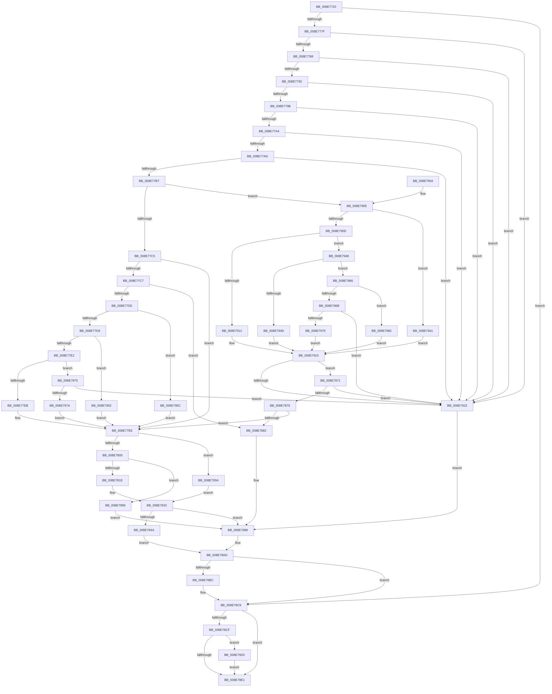

# PiCMGetObjectList

- RVA: `0x008E7720`–`0x008E7996` (길이 `630` bytes)
- VA: `0x00000001408E7720`
- 실행 섹션: `PAGE`
- PDB 이름 있음: `예`; PDB Function 태그: `아니요`
- unwind 정보 RVA: `0x000868C4`
- 디코드: `170`개 명령, `630/630` bytes 표시
- 미해석 바이트: `0` (있으면 어셈블리에 `.byte`로 보존)

> 이 문서는 커널 이미지의 기계어와 PDB 기호를 분석해 생성했습니다. 4번과 5번은 함수 원형과 자료형을 바이너리 사용 방식에서 추정한 C 해석이며 원본 소스 복구 결과는 아닙니다.

## 1. Dependencies

- 직접 호출 지점: **6**; 고유 호출 대상: **5**
- 직접 호출자로 확인된 함수: **1**
- RIP 상대 이미지 참조: **1**

### Outgoing calls
- `0x008E7770` → [PiCMCaptureObjectInputData](PiCMCaptureObjectInputData_function_008E8220.md) (function, `0x008E8220`)
- `0x008E780D` → [ExAllocatePool2](../../poolcode/B8/ExAllocatePool2_function_00B820F0.md) (function, `0x00B820F0`)
- `0x008E783C` → [PnpGetObjectList](PnpGetObjectList_function_008E7520.md) (function, `0x008E7520`)
- `0x008E78B0` → [PiCMReturnBufferResultData](PiCMReturnBufferResultData_function_008ED6D0.md) (function, `0x008ED6D0`)
- `0x008E78C4` → [ExFreePoolWithTag](../../poolcode/B8/ExFreePoolWithTag_function_00B82870.md) (function, `0x00B82870`)
- `0x008E7933` → [ExFreePoolWithTag](../../poolcode/B8/ExFreePoolWithTag_function_00B82870.md) (function, `0x00B82870`)

### Direct callers
- [PiCMHandleIoctl](PiCMHandleIoctl_function_008EB880.md) at `0x008EBE59`

### Static image references
- `0x008E7915` → RVA `0x00E663D0` (`.data`; read)

## 2. Other-region calls and transfers

- 다른 실행 섹션으로 향하는 call: **3**
  - `0x008E780D` → [ExAllocatePool2](../../poolcode/B8/ExAllocatePool2_function_00B820F0.md) (`PAGE` → `POOLCODE`)
  - `0x008E78C4` → [ExFreePoolWithTag](../../poolcode/B8/ExFreePoolWithTag_function_00B82870.md) (`PAGE` → `POOLCODE`)
  - `0x008E7933` → [ExFreePoolWithTag](../../poolcode/B8/ExFreePoolWithTag_function_00B82870.md) (`PAGE` → `POOLCODE`)
- 별도 외부 분기/꼬리 이동을 확인하지 못했습니다.

## 3. Assembly (complete function range)

```asm
008E7720  48 8B C4                        mov rax, rsp
008E7723  48 89 58 08                     mov qword ptr [rax + 8], rbx
008E7727  48 89 70 10                     mov qword ptr [rax + 0x10], rsi
008E772B  48 89 78 18                     mov qword ptr [rax + 0x18], rdi
008E772F  4C 89 60 20                     mov qword ptr [rax + 0x20], r12
008E7733  55                              push rbp
008E7734  41 55                           push r13
008E7736  41 56                           push r14
008E7738  48 8B EC                        mov rbp, rsp
008E773B  48 81 EC 80 00 00 00            sub rsp, 0x80
008E7742  4C 8B 6D 48                     mov r13, qword ptr [rbp + 0x48]
008E7746  0F 57 C0                        xorps xmm0, xmm0
008E7749  33 FF                           xor edi, edi
008E774B  45 8B F1                        mov r14d, r9d
008E774E  4D 8B E0                        mov r12, r8
008E7751  89 7D 48                        mov dword ptr [rbp + 0x48], edi
008E7754  44 8B 45 40                     mov r8d, dword ptr [rbp + 0x40]
008E7758  4C 8D 4D D0                     lea r9, [rbp - 0x30]
008E775C  33 C0                           xor eax, eax
008E775E  41 89 7D 00                     mov dword ptr [r13], edi
008E7762  0F 11 45 D0                     movups xmmword ptr [rbp - 0x30], xmm0
008E7766  48 89 45 F0                     mov qword ptr [rbp - 0x10], rax
008E776A  8B F7                           mov esi, edi
008E776C  0F 11 45 E0                     movups xmmword ptr [rbp - 0x20], xmm0
008E7770  E8 AB 0A 00 00                  call 0x1408e8220
008E7775  8B D8                           mov ebx, eax
008E7777  85 C0                           test eax, eax
008E7779  0F 88 4A 01 00 00               js 0x1408e78c9
008E777F  39 7D EC                        cmp dword ptr [rbp - 0x14], edi
008E7782  0F 85 9A 01 00 00               jne 0x1408e7922
008E7788  48 39 7D E0                     cmp qword ptr [rbp - 0x20], rdi
008E778C  0F 85 90 01 00 00               jne 0x1408e7922
008E7792  39 7D E8                        cmp dword ptr [rbp - 0x18], edi
008E7795  0F 85 87 01 00 00               jne 0x1408e7922
008E779B  39 7D D4                        cmp dword ptr [rbp - 0x2c], edi
008E779E  0F 85 7E 01 00 00               jne 0x1408e7922
008E77A4  4D 85 E4                        test r12, r12
008E77A7  0F 84 75 01 00 00               je 0x1408e7922
008E77AD  41 83 FE 14                     cmp r14d, 0x14
008E77B1  0F 82 6B 01 00 00               jb 0x1408e7922
008E77B7  8B 4D D8                        mov ecx, dword ptr [rbp - 0x28]
008E77BA  8D 5F 06                        lea ebx, [rdi + 6]
008E77BD  3B CB                           cmp ecx, ebx
008E77BF  0F 8F 40 01 00 00               jg 0x1408e7905
008E77C5  74 27                           je 0x1408e77ee
008E77C7  83 E9 01                        sub ecx, 1
008E77CA  0F 84 B2 00 00 00               je 0x1408e7882
008E77D0  83 E9 01                        sub ecx, 1
008E77D3  0F 84 83 01 00 00               je 0x1408e795c
008E77D9  83 E9 01                        sub ecx, 1
008E77DC  0F 84 70 01 00 00               je 0x1408e7952
008E77E2  83 E9 01                        sub ecx, 1
008E77E5  0F 85 8A 01 00 00               jne 0x1408e7975
008E77EB  8D 5F 03                        lea ebx, [rdi + 3]
008E77EE  41 8D 46 EC                     lea eax, [r14 - 0x14]
008E77F2  83 F8 02                        cmp eax, 2
008E77F5  0F 43 F8                        cmovae edi, eax
008E77F8  85 FF                           test edi, edi
008E77FA  0F 84 3A 01 00 00               je 0x1408e793a
008E7800  8B D7                           mov edx, edi
008E7802  B9 00 01 00 00                  mov ecx, 0x100
008E7807  41 B8 50 6E 70 34               mov r8d, 0x34706e50
008E780D  E8 DE A8 29 00                  call 0x140b820f0
008E7812  48 8B F0                        mov rsi, rax
008E7815  48 85 C0                        test rax, rax
008E7818  0F 84 6B 01 00 00               je 0x1408e7989
008E781E  D1 EF                           shr edi, 1
008E7820  83 64 24 38 00                  and dword ptr [rsp + 0x38], 0
008E7825  48 8D 45 48                     lea rax, [rbp + 0x48]
008E7829  48 89 44 24 30                  mov qword ptr [rsp + 0x30], rax
008E782E  8B D3                           mov edx, ebx
008E7830  89 7C 24 28                     mov dword ptr [rsp + 0x28], edi
008E7834  48 89 74 24 20                  mov qword ptr [rsp + 0x20], rsi
008E7839  89 7D 48                        mov dword ptr [rbp + 0x48], edi
008E783C  E8 DF FC FF FF                  call 0x1408e7520
008E7841  33 FF                           xor edi, edi
008E7843  44 8B D0                        mov r10d, eax
008E7846  85 C0                           test eax, eax
008E7848  78 3E                           js 0x1408e7888
008E784A  8B 4D 48                        mov ecx, dword ptr [rbp + 0x48]
008E784D  4C 8B CE                        mov r9, rsi
008E7850  4C 89 6C 24 40                  mov qword ptr [rsp + 0x40], r13
008E7855  44 89 74 24 38                  mov dword ptr [rsp + 0x38], r14d
008E785A  4C 89 64 24 30                  mov qword ptr [rsp + 0x30], r12
008E785F  8D 14 09                        lea edx, [rcx + rcx]
008E7862  8B 4D F0                        mov ecx, dword ptr [rbp - 0x10]
008E7865  89 4C 24 28                     mov dword ptr [rsp + 0x28], ecx
008E7869  8B C8                           mov ecx, eax
008E786B  89 54 24 20                     mov dword ptr [rsp + 0x20], edx
008E786F  EB 3C                           jmp 0x1408e78ad
008E7871  85 DB                           test ebx, ebx
008E7873  0F 84 A9 00 00 00               je 0x1408e7922
008E7879  83 FB 01                        cmp ebx, 1
008E787C  0F 85 6C FF FF FF               jne 0x1408e77ee
008E7882  41 BA BB 00 00 C0               mov r10d, 0xc00000bb
008E7888  8B 55 48                        mov edx, dword ptr [rbp + 0x48]
008E788B  41 8B CA                        mov ecx, r10d
008E788E  8B 45 F0                        mov eax, dword ptr [rbp - 0x10]
008E7891  03 D2                           add edx, edx
008E7893  4C 89 6C 24 40                  mov qword ptr [rsp + 0x40], r13
008E7898  45 33 C9                        xor r9d, r9d
008E789B  44 89 74 24 38                  mov dword ptr [rsp + 0x38], r14d
008E78A0  4C 89 64 24 30                  mov qword ptr [rsp + 0x30], r12
008E78A5  89 44 24 28                     mov dword ptr [rsp + 0x28], eax
008E78A9  89 7C 24 20                     mov dword ptr [rsp + 0x20], edi
008E78AD  45 33 C0                        xor r8d, r8d
008E78B0  E8 1B 5E 00 00                  call 0x1408ed6d0
008E78B5  8B D8                           mov ebx, eax
008E78B7  48 85 F6                        test rsi, rsi
008E78BA  74 0D                           je 0x1408e78c9
008E78BC  BA 50 6E 70 34                  mov edx, 0x34706e50
008E78C1  48 8B CE                        mov rcx, rsi
008E78C4  E8 A7 AF 29 00                  call 0x140b82870
008E78C9  48 39 7D E0                     cmp qword ptr [rbp - 0x20], rdi
008E78CD  74 12                           je 0x1408e78e1
008E78CF  65 48 8B 04 25 88 01 00 00      mov rax, qword ptr gs:[0x188]
008E78D8  40 38 B8 32 02 00 00            cmp byte ptr [rax + 0x232], dil
008E78DF  75 4C                           jne 0x1408e792d
008E78E1  4C 8D 9C 24 80 00 00 00         lea r11, [rsp + 0x80]
008E78E9  8B C3                           mov eax, ebx
008E78EB  49 8B 5B 20                     mov rbx, qword ptr [r11 + 0x20]
008E78EF  49 8B 73 28                     mov rsi, qword ptr [r11 + 0x28]
008E78F3  49 8B 7B 30                     mov rdi, qword ptr [r11 + 0x30]
008E78F7  4D 8B 63 38                     mov r12, qword ptr [r11 + 0x38]
008E78FB  49 8B E3                        mov rsp, r11
008E78FE  41 5E                           pop r14
008E7900  41 5D                           pop r13
008E7902  5D                              pop rbp
008E7903  C3                              ret
008E7904  CC                              int3
008E7905  81 E9 01 00 01 00               sub ecx, 0x10001
008E790B  74 34                           je 0x1408e7941
008E790D  83 E9 01                        sub ecx, 1
008E7910  75 36                           jne 0x1408e7948
008E7912  8D 59 08                        lea ebx, [rcx + 8]
008E7915  48 39 3D B4 EA 57 00            cmp qword ptr [rip + 0x57eab4], rdi
008E791C  0F 85 4F FF FF FF               jne 0x1408e7871
008E7922  41 BA 0D 00 00 C0               mov r10d, 0xc000000d
008E7928  E9 5B FF FF FF                  jmp 0x1408e7888
008E792D  48 8B 4D E0                     mov rcx, qword ptr [rbp - 0x20]
008E7931  33 D2                           xor edx, edx
008E7933  E8 38 AF 29 00                  call 0x140b82870
008E7938  EB A7                           jmp 0x1408e78e1
008E793A  33 FF                           xor edi, edi
008E793C  E9 DF FE FF FF                  jmp 0x1408e7820
008E7941  BB 07 00 00 00                  mov ebx, 7
008E7946  EB CD                           jmp 0x1408e7915
008E7948  83 E9 01                        sub ecx, 1
008E794B  75 19                           jne 0x1408e7966
008E794D  8D 59 09                        lea ebx, [rcx + 9]
008E7950  EB C3                           jmp 0x1408e7915
008E7952  BB 04 00 00 00                  mov ebx, 4
008E7957  E9 92 FE FF FF                  jmp 0x1408e77ee
008E795C  BB 02 00 00 00                  mov ebx, 2
008E7961  E9 88 FE FF FF                  jmp 0x1408e77ee
008E7966  83 E9 01                        sub ecx, 1
008E7969  74 17                           je 0x1408e7982
008E796B  83 F9 01                        cmp ecx, 1
008E796E  75 B2                           jne 0x1408e7922
008E7970  8D 59 0A                        lea ebx, [rcx + 0xa]
008E7973  EB A0                           jmp 0x1408e7915
008E7975  83 F9 01                        cmp ecx, 1
008E7978  75 A8                           jne 0x1408e7922
008E797A  8D 59 04                        lea ebx, [rcx + 4]
008E797D  E9 6C FE FF FF                  jmp 0x1408e77ee
008E7982  BB 0A 00 00 00                  mov ebx, 0xa
008E7987  EB 8C                           jmp 0x1408e7915
008E7989  33 FF                           xor edi, edi
008E798B  41 BA 9A 00 00 C0               mov r10d, 0xc000009a
008E7991  E9 F2 FE FF FF                  jmp 0x1408e7888
```

## 4. C-style interpretation (structured pseudocode)

```c
__int64 __fastcall PiCMGetObjectList(__int64 a1, __int64 a2, __int64 a3, int a4, unsigned int a5, unsigned int a6)
{
    __int64 result;
    __int64 v_rdi;
    __int64 v_rsp;
    unsigned __int64 v_stack_m18;
    unsigned __int64 v_stack_m28;
    unsigned int v_stack_m2C;
    unsigned int v_stack_m30;
    unsigned __int64 v_stack_m38;
    unsigned int v_stack_m40;
    unsigned int v_stack_m44;
    unsigned __int64 v_stack_m48;
    unsigned __int64 v_stack_m58;
    unsigned int v_stack_m60;
    unsigned __int64 v_stack_m68;
    unsigned int v_stack_m70;
    unsigned __int64 v_stack_m78;
    unsigned int v_stack_p30;

    *(unsigned __int64 *)(v_rsp + 8) = v_rbx;
    *(unsigned __int64 *)(v_rsp + 16) = v_rsi;
    *(unsigned __int64 *)(v_rsp + 24) = v_rdi;
    *(unsigned __int64 *)(v_rsp + 32) = v_r12;
    v_rsp = (v_rsp) - (128);
    v_rdi = 0;
    v_stack_p30 = 0;
    result = 0;
    *(unsigned int *)(a6) = 0;
    v_stack_m48 = v_xmm0;
    v_stack_m28 = 0;
    v_stack_m38 = v_xmm0;
    result = PiCMCaptureObjectInputData(a1, a2, (unsigned int)(a5), v_stack_m48);
    if (sign_flag) goto loc_008E78C9;
    if (v_stack_m2C != 0) goto loc_008E7922;
    if (v_stack_m38 != 0) goto loc_008E7922;
    if (v_stack_m30 != 0) goto loc_008E7922;
    if (v_stack_m44 != 0) goto loc_008E7922;
    if (a3 == 0) goto loc_008E7922;
    if (((unsigned int)((unsigned int)(a4))) < 20) goto loc_008E7922;
    if (((unsigned int)((unsigned int)(v_stack_m40))) > ((unsigned int)(v_rdi + 6))) goto loc_008E7905;
    if (((unsigned int)((unsigned int)(v_stack_m40))) == ((unsigned int)(v_rdi + 6))) goto loc_008E77EE;
    a1 = (unsigned int)(((unsigned int)(v_stack_m40)) - (1));
    if (condition_is_equal) goto loc_008E7882;
    a1 = (unsigned int)((a1) - (1));
    if (condition_is_equal) goto loc_008E795C;
    a1 = (unsigned int)((a1) - (1));
    if (condition_is_equal) goto loc_008E7952;
    a1 = (unsigned int)((a1) - (1));
    if (condition_is_not_equal) goto loc_008E7975;
loc_008E77EE:
    if (((unsigned int)((unsigned int)(a4) - 20)) >= 2) { v_rdi = (unsigned int)((unsigned int)(a4) - 20); }
    if ((unsigned int)(v_rdi) == 0) goto loc_008E793A;
    result = ExAllocatePool2(256, (unsigned int)((unsigned int)(v_rdi)), (unsigned int)(0x34706E50ULL), v_stack_m48);
    if (result == 0) goto loc_008E7989;
    v_rdi = (unsigned int)((v_rdi) >> (1));
loc_008E7820:
    v_stack_m68 = a6;
    v_stack_m70 = (unsigned int)(v_rdi);
    v_stack_m78 = result;
    v_stack_p30 = (unsigned int)(v_rdi);
    result = PnpGetObjectList(256, (unsigned int)((unsigned int)(v_rdi + 3)), (unsigned int)(0x34706E50ULL), v_stack_m48);
    v_rdi = 0;
    if (sign_flag) goto loc_008E7888;
    v_stack_m58 = a6;
    v_stack_m60 = (unsigned int)((unsigned int)(a4));
    v_stack_m68 = a3;
    v_stack_m70 = (unsigned int)((unsigned int)(v_stack_m28));
    v_stack_m78 = (unsigned int)((unsigned int)(a6) + (unsigned int)(a6) * 1);
    goto loc_008E78AD;
loc_008E7871:
    if ((unsigned int)(v_rdi + 3) == 0) goto loc_008E7922;
    if (((unsigned int)(v_rdi + 3)) != 1) goto loc_008E77EE;
loc_008E7882:
loc_008E7888:
    a2 = (unsigned int)(((unsigned int)(a6)) + ((unsigned int)((unsigned int)(a6))));
    v_stack_m58 = a6;
    a4 = 0;
    v_stack_m60 = (unsigned int)((unsigned int)(a4));
    v_stack_m68 = a3;
    v_stack_m70 = (unsigned int)((unsigned int)(v_stack_m28));
    v_stack_m78 = 0;
loc_008E78AD:
    a3 = 0;
    result = PiCMReturnBufferResultData((unsigned int)((unsigned int)((unsigned int)(0xC00000BBULL))), a2, a3, a4);
    if (result != 0) {
        a2 = 0x34706E50ULL;
        a1 = result;
        result = ExFreePoolWithTag(a1, a2, a3, a4);
    }
    if (v_stack_m38 == 0) goto loc_008E78E1;
    if ((*(unsigned __int8 *)(*(unsigned __int64 *)(gs_base + (0 + 392)) + 562)) != 0) goto loc_008E792D;
loc_008E78E1:
    return (unsigned int)((unsigned int)((unsigned int)((unsigned int)(result))));
loc_008E7905:
    a1 = (unsigned int)((a1) - (0x10001ULL));
    if (condition_is_equal) goto loc_008E7941;
    a1 = (unsigned int)((a1) - (1));
    if (condition_is_not_equal) goto loc_008E7948;
loc_008E7915:
    if ((*(unsigned __int64 *)(v_rip + 5761716)) != (*(unsigned __int64 *)(v_stack_m18 + 48))) goto loc_008E7871;
loc_008E7922:
    goto loc_008E7888;
loc_008E792D:
    a2 = 0;
    result = ExFreePoolWithTag(v_stack_m38, a2, a3, a4);
    goto loc_008E78E1;
loc_008E793A:
    v_rdi = 0;
    goto loc_008E7820;
loc_008E7941:
    goto loc_008E7915;
loc_008E7948:
    a1 = (unsigned int)((v_stack_m38) - (1));
    if (condition_is_not_equal) goto loc_008E7966;
    goto loc_008E7915;
loc_008E7952:
    goto loc_008E77EE;
loc_008E795C:
    goto loc_008E77EE;
loc_008E7966:
    a1 = (unsigned int)((a1) - (1));
    if (condition_is_equal) goto loc_008E7982;
    if (((unsigned int)(a1)) != 1) goto loc_008E7922;
    goto loc_008E7915;
loc_008E7975:
    if (((unsigned int)(a1)) != 1) goto loc_008E7922;
    goto loc_008E77EE;
loc_008E7982:
    goto loc_008E7915;
loc_008E7989:
    v_rdi = 0;
    goto loc_008E7888;
}
```

## 5. (Beta) C Style

```c
int64_t PiCMGetObjectList(int64_t Arg1, int64_t Arg2, int64_t Arg3, int32_t Arg4, uint32_t Arg5, void *Arg6)
{
    uint8_t *arg6 = (uint8_t *)Arg6;

    int64_t result;
    int64_t local_rdi;
    int64_t local_rsp;
    uint64_t v_stack_m18;
    uint64_t v_stack_m28;
    uint32_t v_stack_m2C;
    uint32_t v_stack_m30;
    uint64_t v_stack_m38;
    uint32_t v_stack_m40;
    uint32_t v_stack_m44;
    uint64_t v_stack_m48;
    uint64_t v_stack_m58;
    uint32_t v_stack_m60;
    uint64_t v_stack_m68;
    uint32_t v_stack_m70;
    uint64_t v_stack_m78;
    uint32_t v_stack_p30;

    *(uint64_t *)(local_rsp + 0x8) = local_rbx;
    *(uint64_t *)(local_rsp + 0x10) = local_rsi;
    *(uint64_t *)(local_rsp + 0x18) = local_rdi;
    *(uint64_t *)(local_rsp + 0x20) = local_r12;
    local_rsp = (local_rsp) - (128);
    local_rdi = 0;
    v_stack_p30 = 0;
    result = 0;
    *(uint32_t *)(arg6) = 0;
    v_stack_m48 = v_xmm0;
    v_stack_m28 = 0;
    v_stack_m38 = v_xmm0;
    result = PiCMCaptureObjectInputData(Arg1, Arg2, (uint32_t)(Arg5), v_stack_m48);
    if (sign_flag) goto loc_008E78C9;
    if (v_stack_m2C != 0) goto loc_008E7922;
    if (v_stack_m38 != 0) goto loc_008E7922;
    if (v_stack_m30 != 0) goto loc_008E7922;
    if (v_stack_m44 != 0) goto loc_008E7922;
    if (Arg3 == 0) goto loc_008E7922;
    if (((uint32_t)((uint32_t)(Arg4))) < 20) goto loc_008E7922;
    if (((uint32_t)((uint32_t)(v_stack_m40))) > ((uint32_t)(local_rdi + 6))) goto loc_008E7905;
    if (((uint32_t)((uint32_t)(v_stack_m40))) == ((uint32_t)(local_rdi + 6))) goto loc_008E77EE;
    Arg1 = (uint32_t)(((uint32_t)(v_stack_m40)) - (1));
    if (condition_is_equal) goto loc_008E7882;
    Arg1 = (uint32_t)((Arg1) - (1));
    if (condition_is_equal) goto loc_008E795C;
    Arg1 = (uint32_t)((Arg1) - (1));
    if (condition_is_equal) goto loc_008E7952;
    Arg1 = (uint32_t)((Arg1) - (1));
    if (condition_is_not_equal) goto loc_008E7975;
loc_008E77EE:
    if (((uint32_t)((uint32_t)(Arg4) - 20)) >= 2) { local_rdi = (uint32_t)((uint32_t)(Arg4) - 20); }
    if ((uint32_t)(local_rdi) == 0) goto loc_008E793A;
    result = ExAllocatePool2(256, (uint32_t)((uint32_t)(local_rdi)), (uint32_t)(0x34706E50ULL), v_stack_m48);
    if (result == 0) goto loc_008E7989;
    local_rdi = (uint32_t)((local_rdi) >> (1));
loc_008E7820:
    v_stack_m68 = Arg6;
    v_stack_m70 = (uint32_t)(local_rdi);
    v_stack_m78 = result;
    v_stack_p30 = (uint32_t)(local_rdi);
    result = PnpGetObjectList(256, (uint32_t)((uint32_t)(local_rdi + 3)), (uint32_t)(0x34706E50ULL), v_stack_m48);
    local_rdi = 0;
    if (sign_flag) goto loc_008E7888;
    v_stack_m58 = Arg6;
    v_stack_m60 = (uint32_t)((uint32_t)(Arg4));
    v_stack_m68 = Arg3;
    v_stack_m70 = (uint32_t)((uint32_t)(v_stack_m28));
    v_stack_m78 = (uint32_t)((uint32_t)(Arg6) + (uint32_t)(Arg6) * 1);
    goto loc_008E78AD;
loc_008E7871:
    if ((uint32_t)(local_rdi + 3) == 0) goto loc_008E7922;
    if (((uint32_t)(local_rdi + 3)) != 1) goto loc_008E77EE;
loc_008E7882:
loc_008E7888:
    Arg2 = (uint32_t)(((uint32_t)(Arg6)) + ((uint32_t)((uint32_t)(Arg6))));
    v_stack_m58 = Arg6;
    Arg4 = 0;
    v_stack_m60 = (uint32_t)((uint32_t)(Arg4));
    v_stack_m68 = Arg3;
    v_stack_m70 = (uint32_t)((uint32_t)(v_stack_m28));
    v_stack_m78 = 0;
loc_008E78AD:
    Arg3 = 0;
    result = PiCMReturnBufferResultData((uint32_t)((uint32_t)((uint32_t)(0xC00000BBULL))), Arg2, Arg3, Arg4);
    if (result != 0) {
        Arg2 = 0x34706E50ULL;
        Arg1 = result;
        result = ExFreePoolWithTag(Arg1, Arg2, Arg3, Arg4);
    }
    if (v_stack_m38 == 0) goto loc_008E78E1;
    if ((*(uint8_t *)(*(uint64_t *)(gs_base + (0 + 0x188)) + 0x232)) != 0) goto loc_008E792D;
loc_008E78E1:
    return (uint32_t)((uint32_t)((uint32_t)((uint32_t)(result))));
loc_008E7905:
    Arg1 = (uint32_t)((Arg1) - (0x10001ULL));
    if (condition_is_equal) goto loc_008E7941;
    Arg1 = (uint32_t)((Arg1) - (1));
    if (condition_is_not_equal) goto loc_008E7948;
loc_008E7915:
    if ((*(uint64_t *)(v_rip + 0x57EAB4)) != (*(uint64_t *)(v_stack_m18 + 0x30))) goto loc_008E7871;
loc_008E7922:
    goto loc_008E7888;
loc_008E792D:
    Arg2 = 0;
    result = ExFreePoolWithTag(v_stack_m38, Arg2, Arg3, Arg4);
    goto loc_008E78E1;
loc_008E793A:
    local_rdi = 0;
    goto loc_008E7820;
loc_008E7941:
    goto loc_008E7915;
loc_008E7948:
    Arg1 = (uint32_t)((v_stack_m38) - (1));
    if (condition_is_not_equal) goto loc_008E7966;
    goto loc_008E7915;
loc_008E7952:
    goto loc_008E77EE;
loc_008E795C:
    goto loc_008E77EE;
loc_008E7966:
    Arg1 = (uint32_t)((Arg1) - (1));
    if (condition_is_equal) goto loc_008E7982;
    if (((uint32_t)(Arg1)) != 1) goto loc_008E7922;
    goto loc_008E7915;
loc_008E7975:
    if (((uint32_t)(Arg1)) != 1) goto loc_008E7922;
    goto loc_008E77EE;
loc_008E7982:
    goto loc_008E7915;
loc_008E7989:
    local_rdi = 0;
    goto loc_008E7888;
}
```

### 관측된 메모리 오프셋

구조체 형식이 확인되지 않은 접근은 인자 기준의 오프셋으로만 기록했습니다.

| 기준 인자 | 오프셋 표현 | 폭 (bit) | 접근 |
|---|---:|---:|---|
| `Arg6` | `+ 0x0` | `32` | `W` |
| `Arg6` | `+ 0x0 + rcx*1` | `32` | `R` |

## 6. Execution-region graph

[열기: 2D/3D 그래프와 함수 탐색 컨트롤 패널](../../../control-panel.html?section=page&rva=0x008E7720&view=graph)

- 2D 그래프는 위에서 아래로 흐르고, 3D 그래프는 빈 공간을 드래그해 회전합니다. Shift+드래그는 이동, 휠은 확대·축소, 함수 노드 선택은 대상 보고서 이동입니다.

### Static fallback


