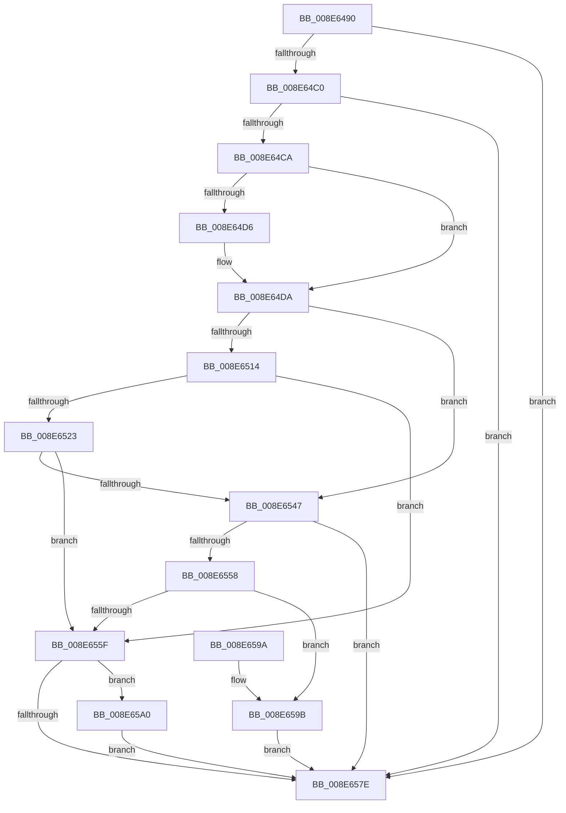

# PiCMMandatoryFilterCallback

- RVA: `0x008E6490`–`0x008E65A7` (길이 `279` bytes)
- VA: `0x00000001408E6490`
- 실행 섹션: `PAGE`
- PDB 이름 있음: `예`; PDB Function 태그: `아니요`
- unwind 정보 RVA: `0x0008671C`
- 디코드: `78`개 명령, `279/279` bytes 표시
- 미해석 바이트: `0` (있으면 어셈블리에 `.byte`로 보존)

> 이 문서는 커널 이미지의 기계어와 PDB 기호를 분석해 생성했습니다. 4번과 5번은 함수 원형과 자료형을 바이너리 사용 방식에서 추정한 C 해석이며 원본 소스 복구 결과는 아닙니다.

## 1. Dependencies

- 직접 호출 지점: **8**; 고유 호출 대상: **8**
- 직접 호출자로 확인된 함수: **1**
- RIP 상대 이미지 참조: **0**

### Outgoing calls
- `0x008E64F1` → [ExAcquireResourceSharedLite](../../text/21/ExAcquireResourceSharedLite_function_00211BC0.md) (function, `0x00211BC0`)
- `0x008E64FD` → [ExReleaseResourceLite](../../text/25/ExReleaseResourceLite_function_0025FA10.md) (function, `0x0025FA10`)
- `0x008E650B` → [KeLeaveCriticalRegionThread](../../text/25/KeLeaveCriticalRegionThread_function_0025EFF0.md) (function, `0x0025EFF0`)
- `0x008E6516` → [PsGetSessionById](../../text/22/PsGetSessionById_function_00225150.md) (function, `0x00225150`)
- `0x008E6536` → [ObfDereferenceObjectWithTag](../../text/2F/ObfDereferenceObjectWithTag_function_002F78E0.md) (function, `0x002F78E0`)
- `0x008E653E` → [PsGetServerSiloServiceSessionId](../../text/45/PsGetServerSiloServiceSessionId_function_0045ED00.md) (function, `0x0045ED00`)
- `0x008E654F` → [PiAuIsLocalSystem](PiAuIsLocalSystem_function_008E6D34.md) (function, `0x008E6D34`)
- `0x008E6575` → [PiPnpRtlApplyMandatoryDeviceFilters](PiPnpRtlApplyMandatoryDeviceFilters_function_008E5E90.md) (function, `0x008E5E90`)

### Direct callers
- [PiPnpRtlEnumeratorFilterCallback](PiPnpRtlEnumeratorFilterCallback_function_008E52F0.md) at `0x008E53AA`

### Static image references
- 디코드된 RIP-relative 메모리 참조가 없습니다.

## 2. Other-region calls and transfers

- 다른 실행 섹션으로 향하는 call: **6**
  - `0x008E64F1` → [ExAcquireResourceSharedLite](../../text/21/ExAcquireResourceSharedLite_function_00211BC0.md) (`PAGE` → `.text`)
  - `0x008E64FD` → [ExReleaseResourceLite](../../text/25/ExReleaseResourceLite_function_0025FA10.md) (`PAGE` → `.text`)
  - `0x008E650B` → [KeLeaveCriticalRegionThread](../../text/25/KeLeaveCriticalRegionThread_function_0025EFF0.md) (`PAGE` → `.text`)
  - `0x008E6516` → [PsGetSessionById](../../text/22/PsGetSessionById_function_00225150.md) (`PAGE` → `.text`)
  - `0x008E6536` → [ObfDereferenceObjectWithTag](../../text/2F/ObfDereferenceObjectWithTag_function_002F78E0.md) (`PAGE` → `.text`)
  - `0x008E653E` → [PsGetServerSiloServiceSessionId](../../text/45/PsGetServerSiloServiceSessionId_function_0045ED00.md) (`PAGE` → `.text`)
- 별도 외부 분기/꼬리 이동을 확인하지 못했습니다.

## 3. Assembly (complete function range)

```asm
008E6490  48 8B C4                        mov rax, rsp
008E6493  48 89 58 08                     mov qword ptr [rax + 8], rbx
008E6497  48 89 68 10                     mov qword ptr [rax + 0x10], rbp
008E649B  48 89 70 18                     mov qword ptr [rax + 0x18], rsi
008E649F  57                              push rdi
008E64A0  41 56                           push r14
008E64A2  41 57                           push r15
008E64A4  48 83 EC 40                     sub rsp, 0x40
008E64A8  33 FF                           xor edi, edi
008E64AA  49 8B F1                        mov rsi, r9
008E64AD  40 88 78 D8                     mov byte ptr [rax - 0x28], dil
008E64B1  4C 8B F2                        mov r14, rdx
008E64B4  4C 8B F9                        mov r15, rcx
008E64B7  4D 85 C9                        test r9, r9
008E64BA  0F 84 BE 00 00 00               je 0x1408e657e
008E64C0  41 83 F8 01                     cmp r8d, 1
008E64C4  0F 85 B4 00 00 00               jne 0x1408e657e
008E64CA  49 8B 19                        mov rbx, qword ptr [r9]
008E64CD  40 88 78 20                     mov byte ptr [rax + 0x20], dil
008E64D1  48 85 DB                        test rbx, rbx
008E64D4  75 04                           jne 0x1408e64da
008E64D6  49 8B 59 10                     mov rbx, qword ptr [r9 + 0x10]
008E64DA  65 48 8B 04 25 88 01 00 00      mov rax, qword ptr gs:[0x188]
008E64E3  B2 01                           mov dl, 1
008E64E5  66 FF 88 E4 01 00 00            dec word ptr [rax + 0x1e4]
008E64EC  90                              nop
008E64ED  48 8B 4B 30                     mov rcx, qword ptr [rbx + 0x30]
008E64F1  E8 CA B6 92 FF                  call 0x140211bc0
008E64F6  48 8B 4B 30                     mov rcx, qword ptr [rbx + 0x30]
008E64FA  8B 6B 78                        mov ebp, dword ptr [rbx + 0x78]
008E64FD  E8 0E 95 97 FF                  call 0x14025fa10
008E6502  65 48 8B 0C 25 88 01 00 00      mov rcx, qword ptr gs:[0x188]
008E650B  E8 E0 8A 97 FF                  call 0x14025eff0
008E6510  85 ED                           test ebp, ebp
008E6512  74 33                           je 0x1408e6547
008E6514  8B CD                           mov ecx, ebp
008E6516  E8 35 EC 93 FF                  call 0x140225150
008E651B  48 8B C8                        mov rcx, rax
008E651E  48 85 C0                        test rax, rax
008E6521  74 3C                           je 0x1408e655f
008E6523  48 8B 80 E8 02 00 00            mov rax, qword ptr [rax + 0x2e8]
008E652A  BA 50 73 51 79                  mov edx, 0x79517350
008E652F  48 8B 98 A0 00 00 00            mov rbx, qword ptr [rax + 0xa0]
008E6536  E8 A5 13 A1 FF                  call 0x1402f78e0
008E653B  48 8B CB                        mov rcx, rbx
008E653E  E8 BD 87 B7 FF                  call 0x14045ed00
008E6543  3B E8                           cmp ebp, eax
008E6545  75 18                           jne 0x1408e655f
008E6547  48 8D 54 24 78                  lea rdx, [rsp + 0x78]
008E654C  48 8B CE                        mov rcx, rsi
008E654F  E8 E0 07 00 00                  call 0x1408e6d34
008E6554  85 C0                           test eax, eax
008E6556  78 26                           js 0x1408e657e
008E6558  40 38 7C 24 78                  cmp byte ptr [rsp + 0x78], dil
008E655D  75 3C                           jne 0x1408e659b
008E655F  48 8D 44 24 30                  lea rax, [rsp + 0x30]
008E6564  4C 8B CE                        mov r9, rsi
008E6567  45 33 C0                        xor r8d, r8d
008E656A  48 89 44 24 20                  mov qword ptr [rsp + 0x20], rax
008E656F  49 8B D6                        mov rdx, r14
008E6572  49 8B CF                        mov rcx, r15
008E6575  E8 16 F9 FF FF                  call 0x1408e5e90
008E657A  85 C0                           test eax, eax
008E657C  79 22                           jns 0x1408e65a0
008E657E  48 8B 5C 24 60                  mov rbx, qword ptr [rsp + 0x60]
008E6583  40 8A C7                        mov al, dil
008E6586  48 8B 6C 24 68                  mov rbp, qword ptr [rsp + 0x68]
008E658B  48 8B 74 24 70                  mov rsi, qword ptr [rsp + 0x70]
008E6590  48 83 C4 40                     add rsp, 0x40
008E6594  41 5F                           pop r15
008E6596  41 5E                           pop r14
008E6598  5F                              pop rdi
008E6599  C3                              ret
008E659A  CC                              int3
008E659B  40 B7 01                        mov dil, 1
008E659E  EB DE                           jmp 0x1408e657e
008E65A0  40 8A 7C 24 30                  mov dil, byte ptr [rsp + 0x30]
008E65A5  EB D7                           jmp 0x1408e657e
```

## 4. C-style interpretation (structured pseudocode)

```c
__int64 __fastcall PiCMMandatoryFilterCallback(__int64 a1, __int64 a2, int a3, __int64 a4)
{
    __int64 result;
    __int64 v_rbx;
    __int64 v_rdi;
    __int64 v_rsp;
    unsigned __int64 v_stack_m28;
    unsigned __int64 v_stack_m38;
    unsigned __int64 v_stack_p10;
    unsigned __int64 v_stack_p18;
    unsigned __int64 v_stack_p20;
    unsigned __int8 v_stack_p30;
    unsigned __int64 v_stack_p8;

    *(unsigned __int64 *)(v_rsp + 8) = v_rbx;
    *(unsigned __int64 *)(v_rsp + 16) = v_rbp;
    *(unsigned __int64 *)(v_rsp + 24) = v_rsi;
    v_rsp = (v_rsp) - (64);
    v_rdi = 0;
    *(unsigned __int8 *)(v_rsp - 40) = 0;
    if (a4 == 0) goto loc_008E657E;
    if (a3 != 1) goto loc_008E657E;
    *(unsigned __int8 *)(v_rsp + 32) = 0;
    v_rbx = *(unsigned __int64 *)(a4);
    if (*(unsigned __int64 *)(a4) == 0) {
        v_rbx = *(unsigned __int64 *)(a4 + 16);
    }
    result = ExAcquireResourceSharedLite(*(unsigned __int64 *)(v_rbx + 48), 1, a3, a4);
    result = ExReleaseResourceLite(*(unsigned __int64 *)(v_rbx + 48), 1, a3, a4);
    result = KeLeaveCriticalRegionThread(*(unsigned __int64 *)(gs_base + (0 + 392)), 1, a3, a4);
    if ((unsigned int)((unsigned int)(*(unsigned int *)(v_rbx + 120))) == 0) goto loc_008E6547;
    result = PsGetSessionById((unsigned int)((unsigned int)((unsigned int)(*(unsigned int *)(v_rbx + 120)))), 1, a3, a4);
    if (result == 0) goto loc_008E655F;
    result = ObfDereferenceObjectWithTag(result, (unsigned int)(0x79517350ULL), a3, a4);
    result = PsGetServerSiloServiceSessionId(*(unsigned __int64 *)(*(unsigned __int64 *)(result + 744) + 160), (unsigned int)(0x79517350ULL), a3, a4);
    if (((unsigned int)((unsigned int)(*(unsigned int *)(v_rbx + 120)))) != ((unsigned int)(result))) goto loc_008E655F;
loc_008E6547:
    result = PiAuIsLocalSystem(a4, v_stack_p20, a3, a4);
    if (sign_flag) goto loc_008E657E;
    if (v_stack_p20 != 0) goto loc_008E659B;
loc_008E655F:
    a3 = 0;
    v_stack_m38 = v_stack_m28;
    result = PiPnpRtlApplyMandatoryDeviceFilters(a1, a2, a3, a4);
    if (!sign_flag) goto loc_008E65A0;
loc_008E657E:
    v_rsp = (v_rsp) + (64);
    return 0;
loc_008E659B:
    goto loc_008E657E;
loc_008E65A0:
    goto loc_008E657E;
}
```

## 5. (Beta) C Style

```c
int64_t PiCMMandatoryFilterCallback(int64_t Arg1, int64_t Arg2, int32_t Arg3, int64_t Arg4)
{
    int64_t result;
    int64_t local_rbx;
    int64_t local_rdi;
    int64_t local_rsp;
    uint64_t v_stack_m28;
    uint64_t v_stack_m38;
    uint64_t v_stack_p10;
    uint64_t v_stack_p18;
    uint64_t v_stack_p20;
    uint8_t v_stack_p30;
    uint64_t v_stack_p8;

    *(uint64_t *)(local_rsp + 0x8) = local_rbx;
    *(uint64_t *)(local_rsp + 0x10) = local_rbp;
    *(uint64_t *)(local_rsp + 0x18) = local_rsi;
    local_rsp = (local_rsp) - (64);
    local_rdi = 0;
    *(uint8_t *)(local_rsp - 0x28) = 0;
    if (Arg4 == 0) goto loc_008E657E;
    if (Arg3 != 1) goto loc_008E657E;
    *(uint8_t *)(local_rsp + 0x20) = 0;
    local_rbx = *(uint64_t *)(Arg4);
    if (*(uint64_t *)(Arg4) == 0) {
        local_rbx = *(uint64_t *)(Arg4 + 0x10);
    }
    result = ExAcquireResourceSharedLite(*(uint64_t *)(local_rbx + 0x30), 1, Arg3, Arg4);
    result = ExReleaseResourceLite(*(uint64_t *)(local_rbx + 0x30), 1, Arg3, Arg4);
    result = KeLeaveCriticalRegionThread(*(uint64_t *)(gs_base + (0 + 0x188)), 1, Arg3, Arg4);
    if ((uint32_t)((uint32_t)(*(uint32_t *)(local_rbx + 0x78))) == 0) goto loc_008E6547;
    result = PsGetSessionById((uint32_t)((uint32_t)((uint32_t)(*(uint32_t *)(local_rbx + 0x78)))), 1, Arg3, Arg4);
    if (result == 0) goto loc_008E655F;
    result = ObfDereferenceObjectWithTag(result, (uint32_t)(0x79517350ULL), Arg3, Arg4);
    result = PsGetServerSiloServiceSessionId(*(uint64_t *)(*(uint64_t *)(result + 0x2E8) + 0xA0), (uint32_t)(0x79517350ULL), Arg3, Arg4);
    if (((uint32_t)((uint32_t)(*(uint32_t *)(local_rbx + 0x78)))) != ((uint32_t)(result))) goto loc_008E655F;
loc_008E6547:
    result = PiAuIsLocalSystem(Arg4, v_stack_p20, Arg3, Arg4);
    if (sign_flag) goto loc_008E657E;
    if (v_stack_p20 != 0) goto loc_008E659B;
loc_008E655F:
    Arg3 = 0;
    v_stack_m38 = v_stack_m28;
    result = PiPnpRtlApplyMandatoryDeviceFilters(Arg1, Arg2, Arg3, Arg4);
    if (!sign_flag) goto loc_008E65A0;
loc_008E657E:
    local_rsp = (local_rsp) + (64);
    return 0;
loc_008E659B:
    goto loc_008E657E;
loc_008E65A0:
    goto loc_008E657E;
}
```

## 6. Execution-region graph

[열기: 2D/3D 그래프와 함수 탐색 컨트롤 패널](../../../control-panel.html?section=page&rva=0x008E6490&view=graph)

- 2D 그래프는 위에서 아래로 흐르고, 3D 그래프는 빈 공간을 드래그해 회전합니다. Shift+드래그는 이동, 휠은 확대·축소, 함수 노드 선택은 대상 보고서 이동입니다.

### Static fallback


