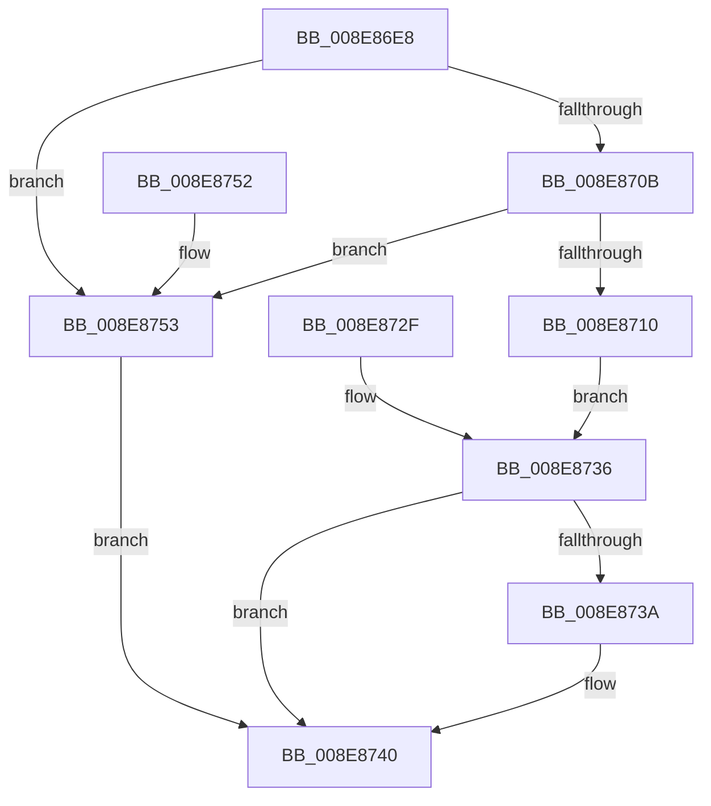

# PiCMReturnBasicResultData

- RVA: `0x008E86E8`–`0x008E875A` (길이 `114` bytes)
- VA: `0x00000001408E86E8`
- 실행 섹션: `PAGE`
- PDB 이름 있음: `예`; PDB Function 태그: `아니요`
- unwind 정보 RVA: `0x00086A14`
- 디코드: `36`개 명령, `114/114` bytes 표시
- 미해석 바이트: `0` (있으면 어셈블리에 `.byte`로 보존)

> 이 문서는 커널 이미지의 기계어와 PDB 기호를 분석해 생성했습니다. 4번과 5번은 함수 원형과 자료형을 바이너리 사용 방식에서 추정한 C 해석이며 원본 소스 복구 결과는 아닙니다.

## 1. Dependencies

- 직접 호출 지점: **1**; 고유 호출 대상: **1**
- 직접 호출자로 확인된 함수: **12**
- RIP 상대 이미지 참조: **0**

### Outgoing calls
- `0x008E8720` → [ProbeForWrite](ProbeForWrite_function_008E91C0.md) (function, `0x008E91C0`)

### Direct callers
- [PiCMDeleteDeviceInterfaceKey](../70/PiCMDeleteDeviceInterfaceKey_function_007014E4.md) at `0x007015A4`
- [PiCMCreateObject](../70/PiCMCreateObject_function_007015EC.md) at `0x0070175A`
- [PiCMDeleteDevice](../70/PiCMDeleteDevice_function_007017A4.md) at `0x00701852`
- [PiCMValidateDeviceInstance](PiCMValidateDeviceInstance_function_008E799C.md) at `0x008E7BF6`
- [PiCMSetObjectProperty](../96/PiCMSetObjectProperty_function_00962564.md) at `0x00962706`
- [PiCMSetRegistryProperty](../96/PiCMSetRegistryProperty_function_00963118.md) at `0x00963232`
- [PiCMDeviceAction](../96/PiCMDeviceAction_function_0096488C.md) at `0x0096492C`
- [PiCMDeleteDeviceKey](../AD/PiCMDeleteDeviceKey_function_00AD6780.md) at `0x00AD696E`
- [PiCMUnregisterDeviceInterface](../AD/PiCMUnregisterDeviceInterface_function_00AD9758.md) at `0x00AD98E0`
- [PiCMDeleteClassKey](../AD/PiCMDeleteClassKey_function_00AD9EB4.md) at `0x00AD9F8D`
- [PiCMDeleteObject](../AD/PiCMDeleteObject_function_00AD9FE4.md) at `0x00ADA14D`
- [PiCMSetDeviceProblem](../AD/PiCMSetDeviceProblem_function_00ADA9E0.md) at `0x00ADAAC6`

### Static image references
- 디코드된 RIP-relative 메모리 참조가 없습니다.

## 2. Other-region calls and transfers

- 다른 실행 섹션으로 향하는 call: **0**
- 별도 외부 분기/꼬리 이동을 확인하지 못했습니다.

## 3. Assembly (complete function range)

```asm
008E86E8  48 8B C4                        mov rax, rsp
008E86EB  48 89 58 08                     mov qword ptr [rax + 8], rbx
008E86EF  48 89 70 10                     mov qword ptr [rax + 0x10], rsi
008E86F3  57                              push rdi
008E86F4  48 83 EC 30                     sub rsp, 0x30
008E86F8  49 8B F0                        mov rsi, r8
008E86FB  48 8B 7C 24 60                  mov rdi, qword ptr [rsp + 0x60]
008E8700  83 27 00                        and dword ptr [rdi], 0
008E8703  33 DB                           xor ebx, ebx
008E8705  41 83 F9 08                     cmp r9d, 8
008E8709  72 48                           jb 0x1408e8753
008E870B  83 FA 08                        cmp edx, 8
008E870E  75 43                           jne 0x1408e8753
008E8710  89 50 E8                        mov dword ptr [rax - 0x18], edx
008E8713  89 48 EC                        mov dword ptr [rax - 0x14], ecx
008E8716  41 8B D1                        mov edx, r9d
008E8719  44 8D 43 04                     lea r8d, [rbx + 4]
008E871D  48 8B CE                        mov rcx, rsi
008E8720  E8 9B 0A 00 00                  call 0x1408e91c0
008E8725  48 8B 44 24 20                  mov rax, qword ptr [rsp + 0x20]
008E872A  48 89 06                        mov qword ptr [rsi], rax
008E872D  EB 07                           jmp 0x1408e8736
008E872F  8B D8                           mov ebx, eax
008E8731  48 8B 7C 24 60                  mov rdi, qword ptr [rsp + 0x60]
008E8736  85 DB                           test ebx, ebx
008E8738  78 06                           js 0x1408e8740
008E873A  C7 07 08 00 00 00               mov dword ptr [rdi], 8
008E8740  8B C3                           mov eax, ebx
008E8742  48 8B 5C 24 40                  mov rbx, qword ptr [rsp + 0x40]
008E8747  48 8B 74 24 48                  mov rsi, qword ptr [rsp + 0x48]
008E874C  48 83 C4 30                     add rsp, 0x30
008E8750  5F                              pop rdi
008E8751  C3                              ret
008E8752  CC                              int3
008E8753  BB 0D 00 00 C0                  mov ebx, 0xc000000d
008E8758  EB E6                           jmp 0x1408e8740
```

## 4. C-style interpretation (structured pseudocode)

```c
__int64 __fastcall PiCMReturnBasicResultData(int a1, int a2, __int64 a3, int a4, __int64 a5)
{
    __int64 result;
    __int64 v_rbx;
    __int64 v_rsp;
    unsigned __int64 v_stack_m18;
    unsigned __int64 v_stack_p10;
    unsigned __int64 v_stack_p28;
    unsigned __int64 v_stack_p8;

    *(unsigned __int64 *)(v_rsp + 8) = v_rbx;
    *(unsigned __int64 *)(v_rsp + 16) = v_rsi;
    v_rsp = (v_rsp) - (48);
    v_rbx = 0;
    if (a4 < 8) goto loc_008E8753;
    if (a2 != 8) goto loc_008E8753;
    *(unsigned int *)(v_rsp - 24) = a2;
    *(unsigned int *)(v_rsp - 20) = a1;
    result = ProbeForWrite(a3, (unsigned int)(a4), v_rbx + 4, a4);
    *(unsigned __int64 *)(a3) = v_stack_m18;
    goto loc_008E8736;
loc_008E8736:
    if (!(sign_flag)) {
        *(unsigned int *)(a5) = 8;
    }
    v_rsp = (v_rsp) + (48);
    return 0;
loc_008E8753:
    goto loc_008E8740;
}
```

## 5. (Beta) C Style

```c
int64_t PiCMReturnBasicResultData(int32_t Arg1, int32_t Arg2, void *Arg3, int32_t Arg4, void *Arg5)
{
    uint8_t *arg3 = (uint8_t *)Arg3;
    uint8_t *arg5 = (uint8_t *)Arg5;

    int64_t result;
    int64_t local_rbx;
    int64_t local_rsp;
    uint64_t v_stack_m18;
    uint64_t v_stack_p10;
    uint64_t v_stack_p28;
    uint64_t v_stack_p8;

    *(uint64_t *)(local_rsp + 0x8) = local_rbx;
    *(uint64_t *)(local_rsp + 0x10) = local_rsi;
    local_rsp = (local_rsp) - (48);
    local_rbx = 0;
    if (Arg4 < 8) goto loc_008E8753;
    if (Arg2 != 8) goto loc_008E8753;
    *(uint32_t *)(local_rsp - 0x18) = Arg2;
    *(uint32_t *)(local_rsp - 0x14) = Arg1;
    result = ProbeForWrite(Arg3, (uint32_t)(Arg4), local_rbx + 4, Arg4);
    *(uint64_t *)(arg3) = v_stack_m18;
    goto loc_008E8736;
loc_008E8736:
    if (!(sign_flag)) {
        *(uint32_t *)(arg5) = 8;
    }
    local_rsp = (local_rsp) + (48);
    return 0;
loc_008E8753:
    goto loc_008E8740;
}
```

### 관측된 메모리 오프셋

구조체 형식이 확인되지 않은 접근은 인자 기준의 오프셋으로만 기록했습니다.

| 기준 인자 | 오프셋 표현 | 폭 (bit) | 접근 |
|---|---:|---:|---|
| `Arg3` | `+ 0x0` | `64` | `W` |
| `Arg5` | `+ 0x0` | `32` | `R/W` |
| `Arg5` | `+ 0x0` | `32` | `W` |

## 6. Execution-region graph

[열기: 2D/3D 그래프와 함수 탐색 컨트롤 패널](../../../control-panel.html?section=page&rva=0x008E86E8&view=graph)

- 2D 그래프는 위에서 아래로 흐르고, 3D 그래프는 빈 공간을 드래그해 회전합니다. Shift+드래그는 이동, 휠은 확대·축소, 함수 노드 선택은 대상 보고서 이동입니다.

### Static fallback


