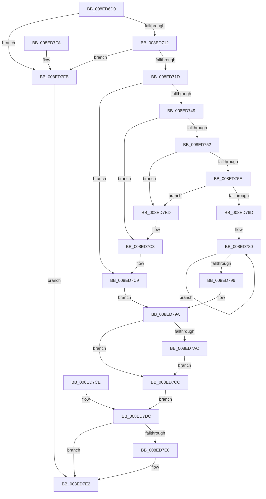

# PiCMReturnBufferResultData

- RVA: `0x008ED6D0`–`0x008ED802` (길이 `306` bytes)
- VA: `0x00000001408ED6D0`
- 실행 섹션: `PAGE`
- PDB 이름 있음: `예`; PDB Function 태그: `아니요`
- unwind 정보 RVA: `0x00086DB4`
- 디코드: `79`개 명령, `306/306` bytes 표시
- 미해석 바이트: `0` (있으면 어셈블리에 `.byte`로 보존)

> 이 문서는 커널 이미지의 기계어와 PDB 기호를 분석해 생성했습니다. 4번과 5번은 함수 원형과 자료형을 바이너리 사용 방식에서 추정한 C 해석이며 원본 소스 복구 결과는 아닙니다.

## 1. Dependencies

- 직접 호출 지점: **3**; 고유 호출 대상: **3**
- 직접 호출자로 확인된 함수: **11**
- RIP 상대 이미지 참조: **0**

### Outgoing calls
- `0x008ED7B6` → [memcpy](../../text/6C/memcpy_function_006C6840.md) (function, `0x006C6840`)
- `0x008ED7BD` → [ExRaiseAccessViolation](ExRaiseAccessViolation_function_008E9240.md) (function, `0x008E9240`)
- `0x008ED7C3` → [ExRaiseDatatypeMisalignment](../89/ExRaiseDatatypeMisalignment_function_00899FD0.md) (function, `0x00899FD0`)

### Direct callers
- [PiCMGetObjectList](PiCMGetObjectList_function_008E7720.md) at `0x008E78B0`
- [sub_008E7E6F](Unknown_function_008E7E6F.md) at `0x008E8017`
- [PiCMHandleIoctl](PiCMHandleIoctl_function_008EB880.md) at `0x008EBB3F`
- [PiCMHandleIoctl](PiCMHandleIoctl_function_008EB880.md) at `0x008EBD8B`
- [PiCMRegisterDeviceInterface](../96/PiCMRegisterDeviceInterface_function_00962A94.md) at `0x00962BF6`
- [PiCMEnumerateSubKeys](../99/PiCMEnumerateSubKeys_function_009926E8.md) at `0x00992821`
- [PiCMEnumerateSubKeys](../99/PiCMEnumerateSubKeys_function_009926E8.md) at `0x0099290D`
- [PiCMGetDeviceInterfaceList](../A1/PiCMGetDeviceInterfaceList_function_00A163D0.md) at `0x00A164AA`
- [PiCMGetDeviceIdList](../A2/PiCMGetDeviceIdList_function_00A2BAAC.md) at `0x00A2BC59`
- [PiCMGetDeviceInterfaceAlias](../A4/PiCMGetDeviceInterfaceAlias_function_00A47904.md) at `0x00A47A35`
- [PiCMGetObjectPropertyKeys](../A7/PiCMGetObjectPropertyKeys_function_00A7C554.md) at `0x00A7C6E0`
- [PiCMCreateDevice](../AC/PiCMCreateDevice_function_00ACB824.md) at `0x00ACBDC6`
- [PiCMQueryRemove](../AD/PiCMQueryRemove_function_00AD43F4.md) at `0x00AD47D1`

### Static image references
- 디코드된 RIP-relative 메모리 참조가 없습니다.

## 2. Other-region calls and transfers

- 다른 실행 섹션으로 향하는 call: **1**
  - `0x008ED7B6` → [memcpy](../../text/6C/memcpy_function_006C6840.md) (`PAGE` → `.text`)
- 별도 외부 분기/꼬리 이동을 확인하지 못했습니다.

## 3. Assembly (complete function range)

```asm
008ED6D0  48 89 5C 24 08                  mov qword ptr [rsp + 8], rbx
008ED6D5  48 89 74 24 10                  mov qword ptr [rsp + 0x10], rsi
008ED6DA  48 89 7C 24 18                  mov qword ptr [rsp + 0x18], rdi
008ED6DF  41 56                           push r14
008ED6E1  48 83 EC 40                     sub rsp, 0x40
008ED6E5  4D 8B F1                        mov r14, r9
008ED6E8  33 DB                           xor ebx, ebx
008ED6EA  48 8B B4 24 90 00 00 00         mov rsi, qword ptr [rsp + 0x90]
008ED6F2  89 1E                           mov dword ptr [rsi], ebx
008ED6F4  44 8B 5C 24 70                  mov r11d, dword ptr [rsp + 0x70]
008ED6F9  41 8D 7B 14                     lea edi, [r11 + 0x14]
008ED6FD  89 7C 24 70                     mov dword ptr [rsp + 0x70], edi
008ED701  44 8B 94 24 88 00 00 00         mov r10d, dword ptr [rsp + 0x88]
008ED709  44 3B D7                        cmp r10d, edi
008ED70C  0F 82 E9 00 00 00               jb 0x1408ed7fb
008ED712  83 7C 24 78 14                  cmp dword ptr [rsp + 0x78], 0x14
008ED717  0F 85 DE 00 00 00               jne 0x1408ed7fb
008ED71D  8B C3                           mov eax, ebx
008ED71F  89 5C 24 30                     mov dword ptr [rsp + 0x30], ebx
008ED723  C7 44 24 20 14 00 00 00         mov dword ptr [rsp + 0x20], 0x14
008ED72B  89 4C 24 24                     mov dword ptr [rsp + 0x24], ecx
008ED72F  89 54 24 28                     mov dword ptr [rsp + 0x28], edx
008ED733  44 89 44 24 2C                  mov dword ptr [rsp + 0x2c], r8d
008ED738  4C 8B 8C 24 80 00 00 00         mov r9, qword ptr [rsp + 0x80]
008ED740  45 85 D2                        test r10d, r10d
008ED743  0F 84 80 00 00 00               je 0x1408ed7c9
008ED749  49 8B C1                        mov rax, r9
008ED74C  41 F6 C1 03                     test r9b, 3
008ED750  75 71                           jne 0x1408ed7c3
008ED752  49 8D 51 FF                     lea rdx, [r9 - 1]
008ED756  49 03 D2                        add rdx, r10
008ED759  4C 3B CA                        cmp r9, rdx
008ED75C  77 5F                           ja 0x1408ed7bd
008ED75E  48 B9 00 00 FF FF FF 7F 00 00   movabs rcx, 0x7fffffff0000
008ED768  48 3B D1                        cmp rdx, rcx
008ED76B  73 50                           jae 0x1408ed7bd
008ED76D  48 81 E2 00 F0 FF FF            and rdx, 0xfffffffffffff000
008ED774  48 81 C2 00 10 00 00            add rdx, 0x1000
008ED77B  0F 1F 44 00 00                  nop dword ptr [rax + rax]
008ED780  0F B6 08                        movzx ecx, byte ptr [rax]
008ED783  88 08                           mov byte ptr [rax], cl
008ED785  48 25 00 F0 FF FF               and rax, 0xfffffffffffff000
008ED78B  48 05 00 10 00 00               add rax, 0x1000
008ED791  48 3B C2                        cmp rax, rdx
008ED794  75 EA                           jne 0x1408ed780
008ED796  8B 44 24 30                     mov eax, dword ptr [rsp + 0x30]
008ED79A  0F 10 44 24 20                  movups xmm0, xmmword ptr [rsp + 0x20]
008ED79F  41 0F 11 01                     movups xmmword ptr [r9], xmm0
008ED7A3  41 89 41 10                     mov dword ptr [r9 + 0x10], eax
008ED7A7  45 85 DB                        test r11d, r11d
008ED7AA  74 20                           je 0x1408ed7cc
008ED7AC  4D 8B C3                        mov r8, r11
008ED7AF  49 8D 49 10                     lea rcx, [r9 + 0x10]
008ED7B3  49 8B D6                        mov rdx, r14
008ED7B6  E8 85 90 DD FF                  call 0x1406c6840
008ED7BB  EB 0F                           jmp 0x1408ed7cc
008ED7BD  E8 7E BA FF FF                  call 0x1408e9240
008ED7C2  CC                              int3
008ED7C3  E8 08 C8 FA FF                  call 0x140899fd0
008ED7C8  CC                              int3
008ED7C9  90                              nop
008ED7CA  EB CE                           jmp 0x1408ed79a
008ED7CC  EB 0E                           jmp 0x1408ed7dc
008ED7CE  8B D8                           mov ebx, eax
008ED7D0  48 8B B4 24 90 00 00 00         mov rsi, qword ptr [rsp + 0x90]
008ED7D8  8B 7C 24 70                     mov edi, dword ptr [rsp + 0x70]
008ED7DC  85 DB                           test ebx, ebx
008ED7DE  78 02                           js 0x1408ed7e2
008ED7E0  89 3E                           mov dword ptr [rsi], edi
008ED7E2  8B C3                           mov eax, ebx
008ED7E4  48 8B 5C 24 50                  mov rbx, qword ptr [rsp + 0x50]
008ED7E9  48 8B 74 24 58                  mov rsi, qword ptr [rsp + 0x58]
008ED7EE  48 8B 7C 24 60                  mov rdi, qword ptr [rsp + 0x60]
008ED7F3  48 83 C4 40                     add rsp, 0x40
008ED7F7  41 5E                           pop r14
008ED7F9  C3                              ret
008ED7FA  CC                              int3
008ED7FB  BB 0D 00 00 C0                  mov ebx, 0xc000000d
008ED800  EB E0                           jmp 0x1408ed7e2
```

## 4. C-style interpretation (structured pseudocode)

```c
__int64 __fastcall PiCMReturnBufferResultData(int a1, int a2, int a3, __int64 a4, unsigned int a5, unsigned int a6, __int64 a7, unsigned int a8, __int64 a9)
{
    __int64 result;
    __int64 v_rbx;
    __int64 v_rsp;
    unsigned int v_stack_m18;
    unsigned int v_stack_m1C;
    unsigned int v_stack_m20;
    unsigned int v_stack_m24;
    unsigned int v_stack_m28;
    unsigned __int64 v_stack_p10;
    unsigned __int64 v_stack_p18;
    unsigned int v_stack_p28;
    unsigned __int64 v_stack_p48;
    unsigned __int64 v_stack_p8;

    v_stack_p8 = v_rbx;
    v_stack_p10 = v_rsi;
    v_stack_p18 = v_rdi;
    v_rsp = (v_rsp) - (64);
    v_rbx = 0;
    *(unsigned int *)(a9) = 0;
    v_stack_p28 = (unsigned int)((unsigned int)(a5) + 20);
    if (((unsigned int)((unsigned int)(a8))) < ((unsigned int)((unsigned int)(a5) + 20))) goto loc_008ED7FB;
    if (a6 != 20) goto loc_008ED7FB;
    v_stack_m18 = 0;
    v_stack_m28 = 20;
    v_stack_m24 = a1;
    v_stack_m20 = a2;
    v_stack_m1C = a3;
    if ((unsigned int)((unsigned int)(a8)) == 0) goto loc_008ED7C9;
    if ((((unsigned __int8)(a7)) & (3)) != 0) goto loc_008ED7C3;
    a2 = (a7 - 1) + ((unsigned int)(a8));
    if (a7 > a2) goto loc_008ED7BD;
    if (a2 >= a1) goto loc_008ED7BD;
    a2 = (a2) & (0xFFFFFFFFFFFFF000ULL);
    a2 = (a2) + (0x1000ULL);
loc_008ED780:
    *(unsigned __int8 *)(a7) = (unsigned __int8)(*(unsigned __int8 *)(a7));
    result = (a7) & (0xFFFFFFFFFFFFF000ULL);
    result = (result) + (0x1000ULL);
    if (result != a2) goto loc_008ED780;
loc_008ED79A:
    *(unsigned __int64 *)(a7) = v_xmm0;
    *(unsigned int *)(a7 + 16) = (unsigned int)((unsigned int)(v_stack_m18));
    if ((unsigned int)((unsigned int)(a5)) == 0) goto loc_008ED7CC;
    result = memcpy(a7 + 16, a4, (unsigned int)(a5), a7);
    goto loc_008ED7CC;
loc_008ED7BD:
    result = ExRaiseAccessViolation(a7 + 16, a4, (unsigned int)(a5), a7);
loc_008ED7C3:
    result = ExRaiseDatatypeMisalignment(a7 + 16, a4, (unsigned int)(a5), a7);
loc_008ED7C9:
    goto loc_008ED79A;
loc_008ED7CC:
    goto loc_008ED7DC;
loc_008ED7DC:
    if (!(sign_flag)) {
        *(unsigned int *)(a9) = (unsigned int)((unsigned int)(a5) + 20);
    }
    v_rsp = (v_rsp) + (64);
    return 0;
loc_008ED7FB:
    goto loc_008ED7E2;
}
```

## 5. (Beta) C Style

```c
int64_t PiCMReturnBufferResultData(int32_t Arg1, int32_t Arg2, int32_t Arg3, int64_t Arg4, void *Arg5, uint32_t Arg6, void *Arg7, uint32_t Arg8, void *Arg9)
{
    uint8_t *arg5 = (uint8_t *)Arg5;
    uint8_t *arg7 = (uint8_t *)Arg7;
    uint8_t *arg9 = (uint8_t *)Arg9;

    int64_t result;
    int64_t local_rbx;
    int64_t local_rsp;
    uint32_t v_stack_m18;
    uint32_t v_stack_m1C;
    uint32_t v_stack_m20;
    uint32_t v_stack_m24;
    uint32_t v_stack_m28;
    uint64_t v_stack_p10;
    uint64_t v_stack_p18;
    uint32_t v_stack_p28;
    uint64_t v_stack_p48;
    uint64_t v_stack_p8;

    v_stack_p8 = local_rbx;
    v_stack_p10 = local_rsi;
    v_stack_p18 = local_rdi;
    local_rsp = (local_rsp) - (64);
    local_rbx = 0;
    *(uint32_t *)(arg9) = 0;
    v_stack_p28 = (uint32_t)((uint32_t)(Arg5) + 20);
    if (((uint32_t)((uint32_t)(Arg8))) < ((uint32_t)((uint32_t)(Arg5) + 20))) goto loc_008ED7FB;
    if (Arg6 != 20) goto loc_008ED7FB;
    v_stack_m18 = 0;
    v_stack_m28 = 20;
    v_stack_m24 = Arg1;
    v_stack_m20 = Arg2;
    v_stack_m1C = Arg3;
    if ((uint32_t)((uint32_t)(Arg8)) == 0) goto loc_008ED7C9;
    if ((((uint8_t)(Arg7)) & (3)) != 0) goto loc_008ED7C3;
    Arg2 = (Arg7 - 1) + ((uint32_t)(Arg8));
    if (Arg7 > Arg2) goto loc_008ED7BD;
    if (Arg2 >= Arg1) goto loc_008ED7BD;
    Arg2 = (Arg2) & (0xFFFFFFFFFFFFF000ULL);
    Arg2 = (Arg2) + (0x1000ULL);
loc_008ED780:
    *(uint8_t *)(arg7) = (uint8_t)(*(uint8_t *)(arg7));
    result = (Arg7) & (0xFFFFFFFFFFFFF000ULL);
    result = (result) + (0x1000ULL);
    if (result != Arg2) goto loc_008ED780;
loc_008ED79A:
    *(uint64_t *)(arg7) = v_xmm0;
    *(uint32_t *)(arg7 + 0x10) = (uint32_t)((uint32_t)(v_stack_m18));
    if ((uint32_t)((uint32_t)(Arg5)) == 0) goto loc_008ED7CC;
    result = memcpy(Arg7 + 16, Arg4, (uint32_t)(Arg5), Arg7);
    goto loc_008ED7CC;
loc_008ED7BD:
    result = ExRaiseAccessViolation(Arg7 + 16, Arg4, (uint32_t)(Arg5), Arg7);
loc_008ED7C3:
    result = ExRaiseDatatypeMisalignment(Arg7 + 16, Arg4, (uint32_t)(Arg5), Arg7);
loc_008ED7C9:
    goto loc_008ED79A;
loc_008ED7CC:
    goto loc_008ED7DC;
loc_008ED7DC:
    if (!(sign_flag)) {
        *(uint32_t *)(arg9) = (uint32_t)((uint32_t)(Arg5) + 20);
    }
    local_rsp = (local_rsp) + (64);
    return 0;
loc_008ED7FB:
    goto loc_008ED7E2;
}
```

### 관측된 메모리 오프셋

구조체 형식이 확인되지 않은 접근은 인자 기준의 오프셋으로만 기록했습니다.

| 기준 인자 | 오프셋 표현 | 폭 (bit) | 접근 |
|---|---:|---:|---|
| `Arg5` | `+ 0x14` | `32` | `R` |
| `Arg7` | `+ 0x0 + rax*1` | `32` | `R` |
| `Arg9` | `+ 0x0` | `32` | `W` |

## 6. Execution-region graph

[열기: 2D/3D 그래프와 함수 탐색 컨트롤 패널](../../../control-panel.html?section=page&rva=0x008ED6D0&view=graph)

- 2D 그래프는 위에서 아래로 흐르고, 3D 그래프는 빈 공간을 드래그해 회전합니다. Shift+드래그는 이동, 휠은 확대·축소, 함수 노드 선택은 대상 보고서 이동입니다.

### Static fallback


