# PiCMValidateDeviceInstance

- RVA: `0x008E799C`–`0x008E7DE7` (길이 `1,099` bytes)
- VA: `0x00000001408E799C`
- 실행 섹션: `PAGE`
- PDB 이름 있음: `예`; PDB Function 태그: `아니요`
- unwind 정보 RVA: `0x000868E4`
- 디코드: `280`개 명령, `1,099/1,099` bytes 표시
- 미해석 바이트: `0` (있으면 어셈블리에 `.byte`로 보존)

> 이 문서는 커널 이미지의 기계어와 PDB 기호를 분석해 생성했습니다. 4번과 5번은 함수 원형과 자료형을 바이너리 사용 방식에서 추정한 C 해석이며 원본 소스 복구 결과는 아닙니다.

## 1. Dependencies

- 직접 호출 지점: **20**; 고유 호출 대상: **20**
- 직접 호출자로 확인된 함수: **1**
- RIP 상대 이미지 참조: **4**

### Outgoing calls
- `0x008E7A15` → [PiCMCaptureObjectInputData](PiCMCaptureObjectInputData_function_008E8220.md) (function, `0x008E8220`)
- `0x008E7A85` → [PnpOpenObjectRegKey](PnpOpenObjectRegKey_function_008E15E8.md) (function, `0x008E15E8`)
- `0x008E7AA2` → [SeCaptureSubjectContext](../86/SeCaptureSubjectContext_function_0086B820.md) (function, `0x0086B820`)
- `0x008E7AD9` → [ExAcquireResourceSharedLite](../../text/21/ExAcquireResourceSharedLite_function_00211BC0.md) (function, `0x00211BC0`)
- `0x008E7AE6` → [ExReleaseResourceLite](../../text/25/ExReleaseResourceLite_function_0025FA10.md) (function, `0x0025FA10`)
- `0x008E7AEB` → [KeLeaveCriticalRegion](../../text/25/KeLeaveCriticalRegion_function_0025D8B0.md) (function, `0x0025D8B0`)
- `0x008E7AFE` → [PsGetSessionById](../../text/22/PsGetSessionById_function_00225150.md) (function, `0x00225150`)
- `0x008E7B22` → [ObfDereferenceObjectWithTag](../../text/2F/ObfDereferenceObjectWithTag_function_002F78E0.md) (function, `0x002F78E0`)
- `0x008E7B2A` → [PsGetServerSiloServiceSessionId](../../text/45/PsGetServerSiloServiceSessionId_function_0045ED00.md) (function, `0x0045ED00`)
- `0x008E7B90` → [SeAccessCheck](../../text/3A/SeAccessCheck_function_003A6BC0.md) (function, `0x003A6BC0`)
- `0x008E7BB8` → [PiPnpRtlApplyMandatoryDeviceFilters](PiPnpRtlApplyMandatoryDeviceFilters_function_008E5E90.md) (function, `0x008E5E90`)
- `0x008E7BC7` → [SeReleaseSubjectContext](../86/SeReleaseSubjectContext_function_0086B710.md) (function, `0x0086B710`)
- `0x008E7BDC` → [ZwClose](../../text/6A/ZwClose_function_006AD2B0.md) (function, `0x006AD2B0`)
- `0x008E7BF6` → [PiCMReturnBasicResultData](PiCMReturnBasicResultData_function_008E86E8.md) (function, `0x008E86E8`)
- `0x008E7C78` → [RtlInitUnicodeStringEx](../../text/46/RtlInitUnicodeStringEx_function_00463960.md) (function, `0x00463960`)
- `0x008E7CAA` → [guard_dispatch_icall](../../text/6B/guard_dispatch_icall_function_006BAAD0.md) (function, `0x006BAAD0`)
- `0x008E7CC6` → [ExFreePoolWithTag](../../poolcode/B8/ExFreePoolWithTag_function_00B82870.md) (function, `0x00B82870`)
- `0x008E7D09` → [CmGetDeviceRegProp](CmGetDeviceRegProp_function_008ED870.md) (function, `0x008ED870`)
- `0x008E7D8A` → [PnpCtxRegQueryValue](../99/PnpCtxRegQueryValue_function_009940FC.md) (function, `0x009940FC`)
- `0x008E7DC3` → [PiAuDoesClientHaveAccess](../96/PiAuDoesClientHaveAccess_function_00962940.md) (function, `0x00962940`)

### Direct callers
- [PiCMHandleIoctl](PiCMHandleIoctl_function_008EB880.md) at `0x008EB923`

### Static image references
- `0x008E7A67` → RVA `0x00E66398` (`.data`; read)
- `0x008E7B36` → RVA `0x00E663A0` (`.data`; read)
- `0x008E7B76` → RVA `0x000114A8` (`.rdata`; read)
- `0x008E7D7B` → RVA `0x00AFF700` (` ?? ::NNGAKEGL::`string'`; read)

## 2. Other-region calls and transfers

- 다른 실행 섹션으로 향하는 call: **11**
  - `0x008E7AD9` → [ExAcquireResourceSharedLite](../../text/21/ExAcquireResourceSharedLite_function_00211BC0.md) (`PAGE` → `.text`)
  - `0x008E7AE6` → [ExReleaseResourceLite](../../text/25/ExReleaseResourceLite_function_0025FA10.md) (`PAGE` → `.text`)
  - `0x008E7AEB` → [KeLeaveCriticalRegion](../../text/25/KeLeaveCriticalRegion_function_0025D8B0.md) (`PAGE` → `.text`)
  - `0x008E7AFE` → [PsGetSessionById](../../text/22/PsGetSessionById_function_00225150.md) (`PAGE` → `.text`)
  - `0x008E7B22` → [ObfDereferenceObjectWithTag](../../text/2F/ObfDereferenceObjectWithTag_function_002F78E0.md) (`PAGE` → `.text`)
  - `0x008E7B2A` → [PsGetServerSiloServiceSessionId](../../text/45/PsGetServerSiloServiceSessionId_function_0045ED00.md) (`PAGE` → `.text`)
  - `0x008E7B90` → [SeAccessCheck](../../text/3A/SeAccessCheck_function_003A6BC0.md) (`PAGE` → `.text`)
  - `0x008E7BDC` → [ZwClose](../../text/6A/ZwClose_function_006AD2B0.md) (`PAGE` → `.text`)
  - `0x008E7C78` → [RtlInitUnicodeStringEx](../../text/46/RtlInitUnicodeStringEx_function_00463960.md) (`PAGE` → `.text`)
  - `0x008E7CAA` → [guard_dispatch_icall](../../text/6B/guard_dispatch_icall_function_006BAAD0.md) (`PAGE` → `.text`)
  - `0x008E7CC6` → [ExFreePoolWithTag](../../poolcode/B8/ExFreePoolWithTag_function_00B82870.md) (`PAGE` → `POOLCODE`)
- 별도 외부 분기/꼬리 이동을 확인하지 못했습니다.

## 3. Assembly (complete function range)

```asm
008E799C  48 8B C4                        mov rax, rsp
008E799F  48 89 58 08                     mov qword ptr [rax + 8], rbx
008E79A3  48 89 70 10                     mov qword ptr [rax + 0x10], rsi
008E79A7  48 89 78 20                     mov qword ptr [rax + 0x20], rdi
008E79AB  4C 89 40 18                     mov qword ptr [rax + 0x18], r8
008E79AF  55                              push rbp
008E79B0  41 54                           push r12
008E79B2  41 55                           push r13
008E79B4  41 56                           push r14
008E79B6  41 57                           push r15
008E79B8  48 8D 68 B1                     lea rbp, [rax - 0x4f]
008E79BC  48 81 EC E0 00 00 00            sub rsp, 0xe0
008E79C3  45 33 E4                        xor r12d, r12d
008E79C6  0F 57 C0                        xorps xmm0, xmm0
008E79C9  33 C0                           xor eax, eax
008E79CB  44 89 65 A3                     mov dword ptr [rbp - 0x5d], r12d
008E79CF  48 89 45 DF                     mov qword ptr [rbp - 0x21], rax
008E79D3  45 8B E9                        mov r13d, r9d
008E79D6  48 8B 45 7F                     mov rax, qword ptr [rbp + 0x7f]
008E79DA  4C 8D 4D BF                     lea r9, [rbp - 0x41]
008E79DE  4D 8B F8                        mov r15, r8
008E79E1  44 89 65 A7                     mov dword ptr [rbp - 0x59], r12d
008E79E5  44 8B 45 77                     mov r8d, dword ptr [rbp + 0x77]
008E79E9  41 8D 7C 24 01                  lea edi, [r12 + 1]
008E79EE  44 89 65 9F                     mov dword ptr [rbp - 0x61], r12d
008E79F2  44 89 20                        mov dword ptr [rax], r12d
008E79F5  0F 11 45 BF                     movups xmmword ptr [rbp - 0x41], xmm0
008E79F9  44 89 65 AB                     mov dword ptr [rbp - 0x55], r12d
008E79FD  0F 11 45 CF                     movups xmmword ptr [rbp - 0x31], xmm0
008E7A01  44 89 65 AF                     mov dword ptr [rbp - 0x51], r12d
008E7A05  0F 11 45 E7                     movups xmmword ptr [rbp - 0x19], xmm0
008E7A09  40 88 7D 97                     mov byte ptr [rbp - 0x69], dil
008E7A0D  0F 11 45 F7                     movups xmmword ptr [rbp - 9], xmm0
008E7A11  4C 89 65 B7                     mov qword ptr [rbp - 0x49], r12
008E7A15  E8 06 08 00 00                  call 0x1408e8220
008E7A1A  48 8B 75 CF                     mov rsi, qword ptr [rbp - 0x31]
008E7A1E  8B D8                           mov ebx, eax
008E7A20  85 C0                           test eax, eax
008E7A22  0F 88 D5 01 00 00               js 0x1408e7bfd
008E7A28  44 8B 75 C3                     mov r14d, dword ptr [rbp - 0x3d]
008E7A2C  48 85 F6                        test rsi, rsi
008E7A2F  0F 84 9D 03 00 00               je 0x1408e7dd2
008E7A35  41 8D 46 FF                     lea eax, [r14 - 1]
008E7A39  3B C7                           cmp eax, edi
008E7A3B  0F 87 91 03 00 00               ja 0x1408e7dd2
008E7A41  39 7D C7                        cmp dword ptr [rbp - 0x39], edi
008E7A44  0F 85 88 03 00 00               jne 0x1408e7dd2
008E7A4A  44 39 65 DB                     cmp dword ptr [rbp - 0x25], r12d
008E7A4E  0F 85 7E 03 00 00               jne 0x1408e7dd2
008E7A54  4D 85 FF                        test r15, r15
008E7A57  0F 84 75 03 00 00               je 0x1408e7dd2
008E7A5D  41 83 FD 08                     cmp r13d, 8
008E7A61  0F 82 6B 03 00 00               jb 0x1408e7dd2
008E7A67  48 8B 0D 2A E9 57 00            mov rcx, qword ptr [rip + 0x57e92a]
008E7A6E  48 8D 45 B7                     lea rax, [rbp - 0x49]
008E7A72  48 89 44 24 28                  mov qword ptr [rsp + 0x28], rax
008E7A77  44 8B CF                        mov r9d, edi
008E7A7A  44 8B C7                        mov r8d, edi
008E7A7D  44 88 64 24 20                  mov byte ptr [rsp + 0x20], r12b
008E7A82  48 8B D6                        mov rdx, rsi
008E7A85  E8 5E 9B FF FF                  call 0x1408e15e8
008E7A8A  8B D8                           mov ebx, eax
008E7A8C  85 C0                           test eax, eax
008E7A8E  0F 88 3F 01 00 00               js 0x1408e7bd3
008E7A94  41 83 FE 02                     cmp r14d, 2
008E7A98  0F 84 20 03 00 00               je 0x1408e7dbe
008E7A9E  48 8D 4D E7                     lea rcx, [rbp - 0x19]
008E7AA2  E8 79 3D F8 FF                  call 0x14086b820
008E7AA7  48 8B 45 E7                     mov rax, qword ptr [rbp - 0x19]
008E7AAB  40 8A D7                        mov dl, dil
008E7AAE  48 8B 5D F7                     mov rbx, qword ptr [rbp - 9]
008E7AB2  48 85 C0                        test rax, rax
008E7AB5  4C 8B 7D B7                     mov r15, qword ptr [rbp - 0x49]
008E7AB9  4C 8B 25 D8 E8 57 00            mov r12, qword ptr [rip + 0x57e8d8]
008E7AC0  48 0F 45 D8                     cmovne rbx, rax
008E7AC4  65 48 8B 04 25 88 01 00 00      mov rax, qword ptr gs:[0x188]
008E7ACD  66 FF 88 E4 01 00 00            dec word ptr [rax + 0x1e4]
008E7AD4  90                              nop
008E7AD5  48 8B 4B 30                     mov rcx, qword ptr [rbx + 0x30]
008E7AD9  E8 E2 A0 92 FF                  call 0x140211bc0
008E7ADE  48 8B 4B 30                     mov rcx, qword ptr [rbx + 0x30]
008E7AE2  44 8B 73 78                     mov r14d, dword ptr [rbx + 0x78]
008E7AE6  E8 25 7F 97 FF                  call 0x14025fa10
008E7AEB  E8 C0 5D 97 FF                  call 0x14025d8b0
008E7AF0  48 8B 75 CF                     mov rsi, qword ptr [rbp - 0x31]
008E7AF4  33 DB                           xor ebx, ebx
008E7AF6  45 85 F6                        test r14d, r14d
008E7AF9  74 3B                           je 0x1408e7b36
008E7AFB  41 8B CE                        mov ecx, r14d
008E7AFE  E8 4D D6 93 FF                  call 0x140225150
008E7B03  48 85 C0                        test rax, rax
008E7B06  0F 84 96 00 00 00               je 0x1408e7ba2
008E7B0C  48 8B 88 E8 02 00 00            mov rcx, qword ptr [rax + 0x2e8]
008E7B13  BA 50 73 51 79                  mov edx, 0x79517350
008E7B18  48 8B 99 A0 00 00 00            mov rbx, qword ptr [rcx + 0xa0]
008E7B1F  48 8B C8                        mov rcx, rax
008E7B22  E8 B9 FD A0 FF                  call 0x1402f78e0
008E7B27  48 8B CB                        mov rcx, rbx
008E7B2A  E8 D1 71 B7 FF                  call 0x14045ed00
008E7B2F  44 3B F0                        cmp r14d, eax
008E7B32  75 6E                           jne 0x1408e7ba2
008E7B34  33 DB                           xor ebx, ebx
008E7B36  48 8B 0D 63 E8 57 00            mov rcx, qword ptr [rip + 0x57e863]
008E7B3D  0F 57 C0                        xorps xmm0, xmm0
008E7B40  89 5D B3                        mov dword ptr [rbp - 0x4d], ebx
008E7B43  89 5D 9B                        mov dword ptr [rbp - 0x65], ebx
008E7B46  0F 11 45 07                     movups xmmword ptr [rbp + 7], xmm0
008E7B4A  0F 11 45 17                     movups xmmword ptr [rbp + 0x17], xmm0
008E7B4E  48 85 C9                        test rcx, rcx
008E7B51  0F 84 00 02 00 00               je 0x1408e7d57
008E7B57  48 8D 45 9B                     lea rax, [rbp - 0x65]
008E7B5B  41 B9 00 00 0F 00               mov r9d, 0xf0000
008E7B61  48 89 44 24 48                  mov qword ptr [rsp + 0x48], rax
008E7B66  48 8D 55 E7                     lea rdx, [rbp - 0x19]
008E7B6A  48 8D 45 B3                     lea rax, [rbp - 0x4d]
008E7B6E  45 33 C0                        xor r8d, r8d
008E7B71  48 89 44 24 40                  mov qword ptr [rsp + 0x40], rax
008E7B76  48 8D 05 2B 99 72 FF            lea rax, [rip - 0x8d66d5]
008E7B7D  40 88 7C 24 38                  mov byte ptr [rsp + 0x38], dil
008E7B82  48 89 44 24 30                  mov qword ptr [rsp + 0x30], rax
008E7B87  48 89 5C 24 28                  mov qword ptr [rsp + 0x28], rbx
008E7B8C  89 5C 24 20                     mov dword ptr [rsp + 0x20], ebx
008E7B90  E8 2B F0 AB FF                  call 0x1403a6bc0
008E7B95  39 5D 9B                        cmp dword ptr [rbp - 0x65], ebx
008E7B98  0F B6 C8                        movzx ecx, al
008E7B9B  0F 4C CB                        cmovl ecx, ebx
008E7B9E  84 C9                           test cl, cl
008E7BA0  75 21                           jne 0x1408e7bc3
008E7BA2  48 8D 45 97                     lea rax, [rbp - 0x69]
008E7BA6  4D 8B C7                        mov r8, r15
008E7BA9  4C 8D 4D E7                     lea r9, [rbp - 0x19]
008E7BAD  48 89 44 24 20                  mov qword ptr [rsp + 0x20], rax
008E7BB2  48 8B D6                        mov rdx, rsi
008E7BB5  49 8B CC                        mov rcx, r12
008E7BB8  E8 D3 E2 FF FF                  call 0x1408e5e90
008E7BBD  8B D8                           mov ebx, eax
008E7BBF  40 8A 7D 97                     mov dil, byte ptr [rbp - 0x69]
008E7BC3  48 8D 4D E7                     lea rcx, [rbp - 0x19]
008E7BC7  E8 44 3B F8 FF                  call 0x14086b710
008E7BCC  45 33 E4                        xor r12d, r12d
008E7BCF  85 DB                           test ebx, ebx
008E7BD1  79 69                           jns 0x1408e7c3c
008E7BD3  48 8B 4D B7                     mov rcx, qword ptr [rbp - 0x49]
008E7BD7  48 85 C9                        test rcx, rcx
008E7BDA  74 05                           je 0x1408e7be1
008E7BDC  E8 CF 56 DC FF                  call 0x1406ad2b0
008E7BE1  48 8B 45 7F                     mov rax, qword ptr [rbp + 0x7f]
008E7BE5  45 8B CD                        mov r9d, r13d
008E7BE8  4C 8B 45 67                     mov r8, qword ptr [rbp + 0x67]
008E7BEC  8B CB                           mov ecx, ebx
008E7BEE  8B 55 DF                        mov edx, dword ptr [rbp - 0x21]
008E7BF1  48 89 44 24 20                  mov qword ptr [rsp + 0x20], rax
008E7BF6  E8 ED 0A 00 00                  call 0x1408e86e8
008E7BFB  8B D8                           mov ebx, eax
008E7BFD  48 85 F6                        test rsi, rsi
008E7C00  74 16                           je 0x1408e7c18
008E7C02  65 48 8B 04 25 88 01 00 00      mov rax, qword ptr gs:[0x188]
008E7C0B  44 38 A0 32 02 00 00            cmp byte ptr [rax + 0x232], r12b
008E7C12  0F 85 A8 00 00 00               jne 0x1408e7cc0
008E7C18  4C 8D 9C 24 E0 00 00 00         lea r11, [rsp + 0xe0]
008E7C20  8B C3                           mov eax, ebx
008E7C22  49 8B 5B 30                     mov rbx, qword ptr [r11 + 0x30]
008E7C26  49 8B 73 38                     mov rsi, qword ptr [r11 + 0x38]
008E7C2A  49 8B 7B 48                     mov rdi, qword ptr [r11 + 0x48]
008E7C2E  49 8B E3                        mov rsp, r11
008E7C31  41 5F                           pop r15
008E7C33  41 5E                           pop r14
008E7C35  41 5D                           pop r13
008E7C37  41 5C                           pop r12
008E7C39  5D                              pop rbp
008E7C3A  C3                              ret
008E7C3B  CC                              int3
008E7C3C  40 84 FF                        test dil, dil
008E7C3F  74 75                           je 0x1408e7cb6
008E7C41  83 7D C3 02                     cmp dword ptr [rbp - 0x3d], 2
008E7C45  0F 84 16 01 00 00               je 0x1408e7d61
008E7C4B  4C 8B 7D B7                     mov r15, qword ptr [rbp - 0x49]
008E7C4F  48 8D 4D 07                     lea rcx, [rbp + 7]
008E7C53  4C 8B 35 3E E7 57 00            mov r14, qword ptr [rip + 0x57e73e]
008E7C5A  0F 57 C0                        xorps xmm0, xmm0
008E7C5D  48 8B D6                        mov rdx, rsi
008E7C60  44 89 65 A3                     mov dword ptr [rbp - 0x5d], r12d
008E7C64  0F 11 45 07                     movups xmmword ptr [rbp + 7], xmm0
008E7C68  44 89 65 9B                     mov dword ptr [rbp - 0x65], r12d
008E7C6C  44 89 65 9F                     mov dword ptr [rbp - 0x61], r12d
008E7C70  44 89 65 AB                     mov dword ptr [rbp - 0x55], r12d
008E7C74  44 89 65 AF                     mov dword ptr [rbp - 0x51], r12d
008E7C78  E8 E3 BC B7 FF                  call 0x140463960
008E7C7D  85 C0                           test eax, eax
008E7C7F  78 35                           js 0x1408e7cb6
008E7C81  49 8B 86 08 01 00 00            mov rax, qword ptr [r14 + 0x108]
008E7C88  48 85 C0                        test rax, rax
008E7C8B  74 29                           je 0x1408e7cb6
008E7C8D  48 8D 4D AF                     lea rcx, [rbp - 0x51]
008E7C91  44 89 64 24 28                  mov dword ptr [rsp + 0x28], r12d
008E7C96  48 89 4C 24 20                  mov qword ptr [rsp + 0x20], rcx
008E7C9B  4C 8D 4D AB                     lea r9, [rbp - 0x55]
008E7C9F  49 8B CE                        mov rcx, r14
008E7CA2  4C 8D 45 9F                     lea r8, [rbp - 0x61]
008E7CA6  48 8D 55 07                     lea rdx, [rbp + 7]
008E7CAA  E8 21 2E DD FF                  call 0x1406baad0
008E7CAF  3D 05 00 00 80                  cmp eax, 0x80000005
008E7CB4  75 1A                           jne 0x1408e7cd0
008E7CB6  BB 0E 00 00 C0                  mov ebx, 0xc000000e
008E7CBB  E9 13 FF FF FF                  jmp 0x1408e7bd3
008E7CC0  48 8B 4D CF                     mov rcx, qword ptr [rbp - 0x31]
008E7CC4  33 D2                           xor edx, edx
008E7CC6  E8 A5 AB 29 00                  call 0x140b82870
008E7CCB  E9 48 FF FF FF                  jmp 0x1408e7c18
008E7CD0  85 C0                           test eax, eax
008E7CD2  78 E2                           js 0x1408e7cb6
008E7CD4  44 89 64 24 38                  mov dword ptr [rsp + 0x38], r12d
008E7CD9  48 8D 45 A7                     lea rax, [rbp - 0x59]
008E7CDD  48 89 44 24 30                  mov qword ptr [rsp + 0x30], rax
008E7CE2  BF 04 00 00 00                  mov edi, 4
008E7CE7  48 8D 45 9B                     lea rax, [rbp - 0x65]
008E7CEB  89 7D A7                        mov dword ptr [rbp - 0x59], edi
008E7CEE  48 89 44 24 28                  mov qword ptr [rsp + 0x28], rax
008E7CF3  4D 8B C7                        mov r8, r15
008E7CF6  48 8D 45 A3                     lea rax, [rbp - 0x5d]
008E7CFA  48 8B D6                        mov rdx, rsi
008E7CFD  44 8D 4F 07                     lea r9d, [rdi + 7]
008E7D01  48 89 44 24 20                  mov qword ptr [rsp + 0x20], rax
008E7D06  49 8B CE                        mov rcx, r14
008E7D09  E8 62 5B 00 00                  call 0x1408ed870
008E7D0E  85 C0                           test eax, eax
008E7D10  75 40                           jne 0x1408e7d52
008E7D12  39 7D A7                        cmp dword ptr [rbp - 0x59], edi
008E7D15  72 3B                           jb 0x1408e7d52
008E7D17  8B 4D 9B                        mov ecx, dword ptr [rbp - 0x65]
008E7D1A  39 7D A3                        cmp dword ptr [rbp - 0x5d], edi
008E7D1D  75 33                           jne 0x1408e7d52
008E7D1F  8B 45 9F                        mov eax, dword ptr [rbp - 0x61]
008E7D22  40 84 CF                        test dil, cl
008E7D25  0F 85 B1 00 00 00               jne 0x1408e7ddc
008E7D2B  BA 00 04 00 00                  mov edx, 0x400
008E7D30  85 C2                           test edx, eax
008E7D32  0F 85 9B FE FF FF               jne 0x1408e7bd3
008E7D38  F6 C1 40                        test cl, 0x40
008E7D3B  0F 84 92 FE FF FF               je 0x1408e7bd3
008E7D41  0B C2                           or eax, edx
008E7D43  C7 45 AB 1C 00 00 00            mov dword ptr [rbp - 0x55], 0x1c
008E7D4A  89 45 9F                        mov dword ptr [rbp - 0x61], eax
008E7D4D  E9 81 FE FF FF                  jmp 0x1408e7bd3
008E7D52  41 8B CC                        mov ecx, r12d
008E7D55  EB C8                           jmp 0x1408e7d1f
008E7D57  BB 0D 00 00 C0                  mov ebx, 0xc000000d
008E7D5C  E9 5E FE FF FF                  jmp 0x1408e7bbf
008E7D61  48 8B 55 B7                     mov rdx, qword ptr [rbp - 0x49]
008E7D65  48 8D 45 9B                     lea rax, [rbp - 0x65]
008E7D69  48 89 44 24 28                  mov qword ptr [rsp + 0x28], rax
008E7D6E  4C 8D 4D A3                     lea r9, [rbp - 0x5d]
008E7D72  48 8D 45 A7                     lea rax, [rbp - 0x59]
008E7D76  BF 04 00 00 00                  mov edi, 4
008E7D7B  4C 8D 05 7E 79 21 00            lea r8, [rip + 0x21797e]
008E7D82  48 89 44 24 20                  mov qword ptr [rsp + 0x20], rax
008E7D87  89 7D 9B                        mov dword ptr [rbp - 0x65], edi
008E7D8A  E8 6D C3 0A 00                  call 0x1409940fc
008E7D8F  85 C0                           test eax, eax
008E7D91  0F 88 3C FE FF FF               js 0x1408e7bd3
008E7D97  39 7D A3                        cmp dword ptr [rbp - 0x5d], edi
008E7D9A  0F 85 33 FE FF FF               jne 0x1408e7bd3
008E7DA0  39 7D 9B                        cmp dword ptr [rbp - 0x65], edi
008E7DA3  0F 85 2A FE FF FF               jne 0x1408e7bd3
008E7DA9  44 39 65 A7                     cmp dword ptr [rbp - 0x59], r12d
008E7DAD  8B C3                           mov eax, ebx
008E7DAF  BB 0E 00 00 C0                  mov ebx, 0xc000000e
008E7DB4  0F 45 C3                        cmovne eax, ebx
008E7DB7  8B D8                           mov ebx, eax
008E7DB9  E9 15 FE FF FF                  jmp 0x1408e7bd3
008E7DBE  B9 02 00 00 00                  mov ecx, 2
008E7DC3  E8 78 AB 07 00                  call 0x140962940
008E7DC8  84 C0                           test al, al
008E7DCA  0F 84 CE FC FF FF               je 0x1408e7a9e
008E7DD0  EB 8F                           jmp 0x1408e7d61
008E7DD2  BB 0D 00 00 C0                  mov ebx, 0xc000000d
008E7DD7  E9 F7 FD FF FF                  jmp 0x1408e7bd3
008E7DDC  83 C8 10                        or eax, 0x10
008E7DDF  89 45 9F                        mov dword ptr [rbp - 0x61], eax
008E7DE2  E9 44 FF FF FF                  jmp 0x1408e7d2b
```

## 4. C-style interpretation (structured pseudocode)

```c
__int64 __fastcall PiCMValidateDeviceInstance(__int64 a1, __int64 a2, __int64 a3, int a4)
{
    __int64 result;
    __int64 v_r12;
    __int64 v_rbx;
    __int64 v_rsp;
    unsigned __int64 v_stack_m28;
    unsigned int v_stack_mA8;
    unsigned __int64 v_stack_mB0;
    unsigned int v_stack_mB8;
    unsigned __int64 v_stack_mC0;
    unsigned __int64 v_stack_mC8;
    unsigned __int8 v_stack_mD0;
    unsigned __int64 v_stack_mD8;
    unsigned __int64 v_stack_mE0;
    unsigned __int8 v_stack_mE8;

    *(unsigned __int64 *)(v_rsp + 8) = v_rbx;
    *(unsigned __int64 *)(v_rsp + 16) = v_rsi;
    *(unsigned __int64 *)(v_rsp + 32) = v_rdi;
    *(unsigned __int64 *)(v_rsp + 24) = a3;
    v_rsp = (v_rsp) - (224);
    v_r12 = 0;
    result = 0;
    *(unsigned int *)(v_rsp - 79 - 93) = 0;
    *(unsigned __int64 *)(v_rsp - 79 - 33) = 0;
    *(unsigned int *)(v_rsp - 79 - 89) = 0;
    *(unsigned int *)(v_rsp - 79 - 97) = 0;
    *(unsigned int *)(*(unsigned __int64 *)(v_rsp - 79 + 127)) = 0;
    *(unsigned __int64 *)(v_rsp - 79 - 65) = v_xmm0;
    *(unsigned int *)(v_rsp - 79 - 85) = 0;
    *(unsigned __int64 *)(v_rsp - 79 - 49) = v_xmm0;
    *(unsigned int *)(v_rsp - 79 - 81) = 0;
    *(unsigned __int64 *)(v_rsp - 79 - 25) = v_xmm0;
    *(unsigned __int8 *)(v_rsp - 79 - 105) = (unsigned __int8)(v_r12 + 1);
    *(unsigned __int64 *)(v_rsp - 79 - 9) = v_xmm0;
    *(unsigned __int64 *)(v_rsp - 79 - 73) = 0;
    result = PiCMCaptureObjectInputData(a1, a2, (unsigned int)(*(unsigned int *)(v_rsp - 79 + 119)), v_rsp - 79 - 65);
    if (sign_flag) goto loc_008E7BFD;
    if (*(unsigned __int64 *)(v_rsp - 79 - 49) == 0) goto loc_008E7DD2;
    if (((unsigned int)((unsigned int)(*(unsigned int *)(v_rsp - 79 - 61)) - 1)) > ((unsigned int)(v_r12 + 1))) goto loc_008E7DD2;
    if ((*(unsigned int *)(v_rsp - 79 - 57)) != ((unsigned int)(v_r12 + 1))) goto loc_008E7DD2;
    if ((*(unsigned int *)(v_rsp - 79 - 37)) != 0) goto loc_008E7DD2;
    if (a3 == 0) goto loc_008E7DD2;
    if (((unsigned int)((unsigned int)(a4))) < 8) goto loc_008E7DD2;
    v_stack_mE0 = v_rsp - 79 - 73;
    v_stack_mE8 = 0;
    result = PnpOpenObjectRegKey(*(unsigned __int64 *)(v_rip + 5761322), *(unsigned __int64 *)(v_rsp - 79 - 49), (unsigned int)((unsigned int)(v_r12 + 1)), (unsigned int)((unsigned int)(v_r12 + 1)));
    if (sign_flag) goto loc_008E7BD3;
    if (((unsigned int)((unsigned int)(*(unsigned int *)(v_rsp - 79 - 61)))) == 2) goto loc_008E7DBE;
loc_008E7A9E:
    result = SeCaptureSubjectContext(v_rsp - 79 - 25, *(unsigned __int64 *)(v_rsp - 79 - 49), (unsigned int)((unsigned int)(v_r12 + 1)), (unsigned int)((unsigned int)(v_r12 + 1)));
    v_rbx = *(unsigned __int64 *)(v_rsp - 79 - 9);
    if (*(unsigned __int64 *)(v_rsp - 79 - 25) != 0) { v_rbx = *(unsigned __int64 *)(v_rsp - 79 - 25); }
    result = ExAcquireResourceSharedLite(*(unsigned __int64 *)(v_rbx + 48), (unsigned __int8)(v_r12 + 1), (unsigned int)((unsigned int)(v_r12 + 1)), (unsigned int)((unsigned int)(v_r12 + 1)));
    result = ExReleaseResourceLite(*(unsigned __int64 *)(v_rbx + 48), (unsigned __int8)(v_r12 + 1), (unsigned int)((unsigned int)(v_r12 + 1)), (unsigned int)((unsigned int)(v_r12 + 1)));
    result = KeLeaveCriticalRegion(*(unsigned __int64 *)(v_rbx + 48), (unsigned __int8)(v_r12 + 1), (unsigned int)((unsigned int)(v_r12 + 1)), (unsigned int)((unsigned int)(v_r12 + 1)));
    v_rbx = 0;
    if ((unsigned int)((unsigned int)(*(unsigned int *)(v_rbx + 120))) == 0) goto loc_008E7B36;
    result = PsGetSessionById((unsigned int)((unsigned int)((unsigned int)(*(unsigned int *)(v_rbx + 120)))), (unsigned __int8)(v_r12 + 1), (unsigned int)((unsigned int)(v_r12 + 1)), (unsigned int)((unsigned int)(v_r12 + 1)));
    if (result == 0) goto loc_008E7BA2;
    result = ObfDereferenceObjectWithTag(result, (unsigned int)(0x79517350ULL), (unsigned int)((unsigned int)(v_r12 + 1)), (unsigned int)((unsigned int)(v_r12 + 1)));
    result = PsGetServerSiloServiceSessionId(*(unsigned __int64 *)(*(unsigned __int64 *)(result + 744) + 160), (unsigned int)(0x79517350ULL), (unsigned int)((unsigned int)(v_r12 + 1)), (unsigned int)((unsigned int)(v_r12 + 1)));
    if (((unsigned int)((unsigned int)(*(unsigned int *)(v_rbx + 120)))) != ((unsigned int)(result))) goto loc_008E7BA2;
    v_rbx = 0;
loc_008E7B36:
    *(unsigned int *)(v_rsp - 79 - 77) = 0;
    *(unsigned int *)(v_rsp - 79 - 101) = 0;
    *(unsigned __int64 *)(v_rsp - 79 + 7) = v_xmm0;
    *(unsigned __int64 *)(v_rsp - 79 + 23) = v_xmm0;
    if (*(unsigned __int64 *)(v_rip + 5761123) == 0) goto loc_008E7D57;
    v_stack_mC0 = v_rsp - 79 - 101;
    a3 = 0;
    v_stack_mC8 = v_rsp - 79 - 77;
    v_stack_mD0 = (unsigned __int8)(v_r12 + 1);
    v_stack_mD8 = v_rip - 9266901;
    v_stack_mE0 = 0;
    v_stack_mE8 = 0;
    result = SeAccessCheck(*(unsigned __int64 *)(v_rip + 5761123), v_rsp - 79 - 25, a3, (unsigned int)(0xF0000ULL));
    a1 = (unsigned __int8)(result);
    if ((*(unsigned int *)(v_rsp - 79 - 101)) < 0) { a1 = 0; }
    if ((unsigned __int8)(a1) != 0) goto loc_008E7BC3;
loc_008E7BA2:
    v_stack_mE8 = v_rsp - 79 - 105;
    result = PiPnpRtlApplyMandatoryDeviceFilters(*(unsigned __int64 *)(v_rip + 5761240), *(unsigned __int64 *)(v_rsp - 79 - 49), *(unsigned __int64 *)(v_rsp - 79 - 73), v_rsp - 79 - 25);
loc_008E7BBF:
loc_008E7BC3:
    result = SeReleaseSubjectContext(v_rsp - 79 - 25, *(unsigned __int64 *)(v_rsp - 79 - 49), *(unsigned __int64 *)(v_rsp - 79 - 73), v_rsp - 79 - 25);
    v_r12 = 0;
    if (!sign_flag) goto loc_008E7C3C;
loc_008E7BD3:
    if (*(unsigned __int64 *)(v_rsp - 79 - 73) != 0) {
        result = ZwClose(*(unsigned __int64 *)(v_rsp - 79 - 73), *(unsigned __int64 *)(v_rsp - 79 - 49), *(unsigned __int64 *)(v_rsp - 79 - 73), v_rsp - 79 - 25);
    }
    v_stack_mE8 = *(unsigned __int64 *)(v_rsp - 79 + 127);
    result = PiCMReturnBasicResultData((unsigned int)((unsigned int)((unsigned int)((unsigned int)(result)))), (unsigned int)(*(unsigned int *)(v_rsp - 79 - 33)), *(unsigned __int64 *)(v_rsp - 79 + 103), (unsigned int)((unsigned int)((unsigned int)(a4))));
loc_008E7BFD:
    if (*(unsigned __int64 *)(v_rsp - 79 - 49) == 0) goto loc_008E7C18;
    if ((*(unsigned __int8 *)(*(unsigned __int64 *)(gs_base + (0 + 392)) + 562)) != 0) goto loc_008E7CC0;
loc_008E7C18:
    return (unsigned int)((unsigned int)((unsigned int)((unsigned int)(result))));
loc_008E7C3C:
    if ((unsigned __int8)(*(unsigned __int64 *)(v_stack_m28 + 72)) == 0) goto loc_008E7CB6;
    if ((*(unsigned int *)(v_rsp - 79 - 61)) == 2) goto loc_008E7D61;
    *(unsigned int *)(v_rsp - 79 - 93) = 0;
    *(unsigned __int64 *)(v_rsp - 79 + 7) = v_xmm0;
    *(unsigned int *)(v_rsp - 79 - 101) = 0;
    *(unsigned int *)(v_rsp - 79 - 97) = 0;
    *(unsigned int *)(v_rsp - 79 - 85) = 0;
    *(unsigned int *)(v_rsp - 79 - 81) = 0;
    result = RtlInitUnicodeStringEx(v_rsp - 79 + 7, *(unsigned __int64 *)(v_stack_m28 + 56), *(unsigned __int64 *)(v_rsp - 79 + 103), (unsigned int)((unsigned int)((unsigned int)(a4))));
    if (sign_flag) goto loc_008E7CB6;
    if (*(unsigned __int64 *)(*(unsigned __int64 *)(v_rip + 5760830) + 264) == 0) goto loc_008E7CB6;
    v_stack_mB8 = 0;
    v_stack_mC0 = v_rsp - 79 - 81;
    result = guard_dispatch_icall(*(unsigned __int64 *)(v_rip + 5760830), v_rsp - 79 + 7, v_rsp - 79 - 97, v_rsp - 79 - 85);
    if (((unsigned int)(result)) != 0x80000005ULL) goto loc_008E7CD0;
loc_008E7CB6:
    goto loc_008E7BD3;
loc_008E7CC0:
    a2 = 0;
    result = ExFreePoolWithTag(*(unsigned __int64 *)(v_rsp - 79 - 49), a2, v_rsp - 79 - 97, v_rsp - 79 - 85);
    goto loc_008E7C18;
loc_008E7CD0:
    if (sign_flag) goto loc_008E7CB6;
    v_stack_mA8 = 0;
    v_stack_mB0 = v_rsp - 79 - 89;
    *(unsigned int *)(v_rsp - 79 - 89) = 4;
    v_stack_mB8 = v_rsp - 79 - 101;
    v_stack_mC0 = v_rsp - 79 - 93;
    result = CmGetDeviceRegProp(*(unsigned __int64 *)(v_rip + 5760830), *(unsigned __int64 *)(v_stack_m28 + 56), *(unsigned __int64 *)(v_rsp - 79 - 73), 4 + 7);
    if ((unsigned int)(result) != 0) goto loc_008E7D52;
    if ((*(unsigned int *)(v_rsp - 79 - 89)) < 4) goto loc_008E7D52;
    if ((*(unsigned int *)(v_rsp - 79 - 93)) != 4) goto loc_008E7D52;
loc_008E7D1F:
    if (((4) & ((unsigned __int8)((unsigned int)(*(unsigned int *)(v_rsp - 79 - 101))))) != 0) goto loc_008E7DDC;
loc_008E7D2B:
    if ((((unsigned int)((unsigned int)(0x400ULL))) & ((unsigned int)((unsigned int)(*(unsigned int *)(v_rsp - 79 - 97))))) != 0) goto loc_008E7BD3;
    if ((((unsigned __int8)((unsigned int)(*(unsigned int *)(v_rsp - 79 - 101)))) & (64)) == 0) goto loc_008E7BD3;
    result = (unsigned int)(((unsigned int)(*(unsigned int *)(v_rsp - 79 - 97))) | ((unsigned int)((unsigned int)(0x400ULL))));
    *(unsigned int *)(v_rsp - 79 - 85) = 28;
    *(unsigned int *)(v_rsp - 79 - 97) = (unsigned int)(result);
    goto loc_008E7BD3;
loc_008E7D52:
    goto loc_008E7D1F;
loc_008E7D57:
    goto loc_008E7BBF;
loc_008E7D61:
    v_stack_mB8 = v_rsp - 79 - 101;
    v_stack_mC0 = v_rsp - 79 - 89;
    *(unsigned int *)(v_rsp - 79 - 101) = 4;
    result = PnpCtxRegQueryValue(0, *(unsigned __int64 *)(v_rsp - 79 - 73), v_rip + 2193790, v_rsp - 79 - 93);
    if (sign_flag) goto loc_008E7BD3;
    if ((*(unsigned int *)(v_rsp - 79 - 93)) != 4) goto loc_008E7BD3;
    if ((*(unsigned int *)(v_rsp - 79 - 101)) != 4) goto loc_008E7BD3;
    result = (unsigned int)((unsigned int)((unsigned int)(0xC000000DULL)));
    if ((*(unsigned int *)(v_rsp - 79 - 89)) != 0) { result = (unsigned int)((unsigned int)(0xC000000EULL)); }
    goto loc_008E7BD3;
loc_008E7DBE:
    result = PiAuDoesClientHaveAccess(2, *(unsigned __int64 *)(v_rsp - 79 - 73), v_rip + 2193790, v_rsp - 79 - 93);
    if ((unsigned __int8)(result) == 0) goto loc_008E7A9E;
    goto loc_008E7D61;
loc_008E7DD2:
    goto loc_008E7BD3;
loc_008E7DDC:
    result = (unsigned int)((result) | (16));
    *(unsigned int *)(v_rsp - 79 - 97) = (unsigned int)(result);
    goto loc_008E7D2B;
}
```

## 5. (Beta) C Style

```c
int64_t PiCMValidateDeviceInstance(int64_t Arg1, int64_t Arg2, int64_t Arg3, int32_t Arg4)
{
    int64_t result;
    int64_t local_r12;
    int64_t local_rbx;
    int64_t local_rsp;
    uint64_t v_stack_m28;
    uint32_t v_stack_mA8;
    uint64_t v_stack_mB0;
    uint32_t v_stack_mB8;
    uint64_t v_stack_mC0;
    uint64_t v_stack_mC8;
    uint8_t v_stack_mD0;
    uint64_t v_stack_mD8;
    uint64_t v_stack_mE0;
    uint8_t v_stack_mE8;

    *(uint64_t *)(local_rsp + 0x8) = local_rbx;
    *(uint64_t *)(local_rsp + 0x10) = local_rsi;
    *(uint64_t *)(local_rsp + 0x20) = local_rdi;
    *(uint64_t *)(local_rsp + 0x18) = Arg3;
    local_rsp = (local_rsp) - (224);
    local_r12 = 0;
    result = 0;
    *(uint32_t *)(local_rsp - 0x4F - 0x5D) = 0;
    *(uint64_t *)(local_rsp - 0x4F - 0x21) = 0;
    *(uint32_t *)(local_rsp - 0x4F - 0x59) = 0;
    *(uint32_t *)(local_rsp - 0x4F - 0x61) = 0;
    *(uint32_t *)(*(uint64_t *)(local_rsp - 0x4F + 0x7F)) = 0;
    *(uint64_t *)(local_rsp - 0x4F - 0x41) = v_xmm0;
    *(uint32_t *)(local_rsp - 0x4F - 0x55) = 0;
    *(uint64_t *)(local_rsp - 0x4F - 0x31) = v_xmm0;
    *(uint32_t *)(local_rsp - 0x4F - 0x51) = 0;
    *(uint64_t *)(local_rsp - 0x4F - 0x19) = v_xmm0;
    *(uint8_t *)(local_rsp - 0x4F - 0x69) = (uint8_t)(local_r12 + 1);
    *(uint64_t *)(local_rsp - 0x4F - 0x9) = v_xmm0;
    *(uint64_t *)(local_rsp - 0x4F - 0x49) = 0;
    result = PiCMCaptureObjectInputData(Arg1, Arg2, (uint32_t)(*(uint32_t *)(local_rsp - 0x4F + 0x77)), local_rsp - 79 - 65);
    if (sign_flag) goto loc_008E7BFD;
    if (*(uint64_t *)(local_rsp - 0x4F - 0x31) == 0) goto loc_008E7DD2;
    if (((uint32_t)((uint32_t)(*(uint32_t *)(local_rsp - 0x4F - 0x3D)) - 1)) > ((uint32_t)(local_r12 + 1))) goto loc_008E7DD2;
    if ((*(uint32_t *)(local_rsp - 0x4F - 0x39)) != ((uint32_t)(local_r12 + 1))) goto loc_008E7DD2;
    if ((*(uint32_t *)(local_rsp - 0x4F - 0x25)) != 0) goto loc_008E7DD2;
    if (Arg3 == 0) goto loc_008E7DD2;
    if (((uint32_t)((uint32_t)(Arg4))) < 8) goto loc_008E7DD2;
    v_stack_mE0 = local_rsp - 79 - 73;
    v_stack_mE8 = 0;
    result = PnpOpenObjectRegKey(*(uint64_t *)(v_rip + 0x57E92A), *(uint64_t *)(local_rsp - 0x4F - 0x31), (uint32_t)((uint32_t)(local_r12 + 1)), (uint32_t)((uint32_t)(local_r12 + 1)));
    if (sign_flag) goto loc_008E7BD3;
    if (((uint32_t)((uint32_t)(*(uint32_t *)(local_rsp - 0x4F - 0x3D)))) == 2) goto loc_008E7DBE;
loc_008E7A9E:
    result = SeCaptureSubjectContext(local_rsp - 79 - 25, *(uint64_t *)(local_rsp - 0x4F - 0x31), (uint32_t)((uint32_t)(local_r12 + 1)), (uint32_t)((uint32_t)(local_r12 + 1)));
    local_rbx = *(uint64_t *)(local_rsp - 0x4F - 0x9);
    if (*(uint64_t *)(local_rsp - 0x4F - 0x19) != 0) { local_rbx = *(uint64_t *)(local_rsp - 0x4F - 0x19); }
    result = ExAcquireResourceSharedLite(*(uint64_t *)(local_rbx + 0x30), (uint8_t)(local_r12 + 1), (uint32_t)((uint32_t)(local_r12 + 1)), (uint32_t)((uint32_t)(local_r12 + 1)));
    result = ExReleaseResourceLite(*(uint64_t *)(local_rbx + 0x30), (uint8_t)(local_r12 + 1), (uint32_t)((uint32_t)(local_r12 + 1)), (uint32_t)((uint32_t)(local_r12 + 1)));
    result = KeLeaveCriticalRegion(*(uint64_t *)(local_rbx + 0x30), (uint8_t)(local_r12 + 1), (uint32_t)((uint32_t)(local_r12 + 1)), (uint32_t)((uint32_t)(local_r12 + 1)));
    local_rbx = 0;
    if ((uint32_t)((uint32_t)(*(uint32_t *)(local_rbx + 0x78))) == 0) goto loc_008E7B36;
    result = PsGetSessionById((uint32_t)((uint32_t)((uint32_t)(*(uint32_t *)(local_rbx + 0x78)))), (uint8_t)(local_r12 + 1), (uint32_t)((uint32_t)(local_r12 + 1)), (uint32_t)((uint32_t)(local_r12 + 1)));
    if (result == 0) goto loc_008E7BA2;
    result = ObfDereferenceObjectWithTag(result, (uint32_t)(0x79517350ULL), (uint32_t)((uint32_t)(local_r12 + 1)), (uint32_t)((uint32_t)(local_r12 + 1)));
    result = PsGetServerSiloServiceSessionId(*(uint64_t *)(*(uint64_t *)(result + 0x2E8) + 0xA0), (uint32_t)(0x79517350ULL), (uint32_t)((uint32_t)(local_r12 + 1)), (uint32_t)((uint32_t)(local_r12 + 1)));
    if (((uint32_t)((uint32_t)(*(uint32_t *)(local_rbx + 0x78)))) != ((uint32_t)(result))) goto loc_008E7BA2;
    local_rbx = 0;
loc_008E7B36:
    *(uint32_t *)(local_rsp - 0x4F - 0x4D) = 0;
    *(uint32_t *)(local_rsp - 0x4F - 0x65) = 0;
    *(uint64_t *)(local_rsp - 0x4F + 0x7) = v_xmm0;
    *(uint64_t *)(local_rsp - 0x4F + 0x17) = v_xmm0;
    if (*(uint64_t *)(v_rip + 0x57E863) == 0) goto loc_008E7D57;
    v_stack_mC0 = local_rsp - 79 - 101;
    Arg3 = 0;
    v_stack_mC8 = local_rsp - 79 - 77;
    v_stack_mD0 = (uint8_t)(local_r12 + 1);
    v_stack_mD8 = v_rip - 9266901;
    v_stack_mE0 = 0;
    v_stack_mE8 = 0;
    result = SeAccessCheck(*(uint64_t *)(v_rip + 0x57E863), local_rsp - 79 - 25, Arg3, (uint32_t)(0xF0000ULL));
    Arg1 = (uint8_t)(result);
    if ((*(uint32_t *)(local_rsp - 0x4F - 0x65)) < 0) { Arg1 = 0; }
    if ((uint8_t)(Arg1) != 0) goto loc_008E7BC3;
loc_008E7BA2:
    v_stack_mE8 = local_rsp - 79 - 105;
    result = PiPnpRtlApplyMandatoryDeviceFilters(*(uint64_t *)(v_rip + 0x57E8D8), *(uint64_t *)(local_rsp - 0x4F - 0x31), *(uint64_t *)(local_rsp - 0x4F - 0x49), local_rsp - 79 - 25);
loc_008E7BBF:
loc_008E7BC3:
    result = SeReleaseSubjectContext(local_rsp - 79 - 25, *(uint64_t *)(local_rsp - 0x4F - 0x31), *(uint64_t *)(local_rsp - 0x4F - 0x49), local_rsp - 79 - 25);
    local_r12 = 0;
    if (!sign_flag) goto loc_008E7C3C;
loc_008E7BD3:
    if (*(uint64_t *)(local_rsp - 0x4F - 0x49) != 0) {
        result = ZwClose(*(uint64_t *)(local_rsp - 0x4F - 0x49), *(uint64_t *)(local_rsp - 0x4F - 0x31), *(uint64_t *)(local_rsp - 0x4F - 0x49), local_rsp - 79 - 25);
    }
    v_stack_mE8 = *(uint64_t *)(local_rsp - 0x4F + 0x7F);
    result = PiCMReturnBasicResultData((uint32_t)((uint32_t)((uint32_t)((uint32_t)(result)))), (uint32_t)(*(uint32_t *)(local_rsp - 0x4F - 0x21)), *(uint64_t *)(local_rsp - 0x4F + 0x67), (uint32_t)((uint32_t)((uint32_t)(Arg4))));
loc_008E7BFD:
    if (*(uint64_t *)(local_rsp - 0x4F - 0x31) == 0) goto loc_008E7C18;
    if ((*(uint8_t *)(*(uint64_t *)(gs_base + (0 + 0x188)) + 0x232)) != 0) goto loc_008E7CC0;
loc_008E7C18:
    return (uint32_t)((uint32_t)((uint32_t)((uint32_t)(result))));
loc_008E7C3C:
    if ((uint8_t)(*(uint64_t *)(v_stack_m28 + 0x48)) == 0) goto loc_008E7CB6;
    if ((*(uint32_t *)(local_rsp - 0x4F - 0x3D)) == 2) goto loc_008E7D61;
    *(uint32_t *)(local_rsp - 0x4F - 0x5D) = 0;
    *(uint64_t *)(local_rsp - 0x4F + 0x7) = v_xmm0;
    *(uint32_t *)(local_rsp - 0x4F - 0x65) = 0;
    *(uint32_t *)(local_rsp - 0x4F - 0x61) = 0;
    *(uint32_t *)(local_rsp - 0x4F - 0x55) = 0;
    *(uint32_t *)(local_rsp - 0x4F - 0x51) = 0;
    result = RtlInitUnicodeStringEx(local_rsp - 79 + 7, *(uint64_t *)(v_stack_m28 + 0x38), *(uint64_t *)(local_rsp - 0x4F + 0x67), (uint32_t)((uint32_t)((uint32_t)(Arg4))));
    if (sign_flag) goto loc_008E7CB6;
    if (*(uint64_t *)(*(uint64_t *)(v_rip + 0x57E73E) + 0x108) == 0) goto loc_008E7CB6;
    v_stack_mB8 = 0;
    v_stack_mC0 = local_rsp - 79 - 81;
    result = guard_dispatch_icall(*(uint64_t *)(v_rip + 0x57E73E), local_rsp - 79 + 7, local_rsp - 79 - 97, local_rsp - 79 - 85);
    if (((uint32_t)(result)) != 0x80000005ULL) goto loc_008E7CD0;
loc_008E7CB6:
    goto loc_008E7BD3;
loc_008E7CC0:
    Arg2 = 0;
    result = ExFreePoolWithTag(*(uint64_t *)(local_rsp - 0x4F - 0x31), Arg2, local_rsp - 79 - 97, local_rsp - 79 - 85);
    goto loc_008E7C18;
loc_008E7CD0:
    if (sign_flag) goto loc_008E7CB6;
    v_stack_mA8 = 0;
    v_stack_mB0 = local_rsp - 79 - 89;
    *(uint32_t *)(local_rsp - 0x4F - 0x59) = 4;
    v_stack_mB8 = local_rsp - 79 - 101;
    v_stack_mC0 = local_rsp - 79 - 93;
    result = CmGetDeviceRegProp(*(uint64_t *)(v_rip + 0x57E73E), *(uint64_t *)(v_stack_m28 + 0x38), *(uint64_t *)(local_rsp - 0x4F - 0x49), 4 + 7);
    if ((uint32_t)(result) != 0) goto loc_008E7D52;
    if ((*(uint32_t *)(local_rsp - 0x4F - 0x59)) < 4) goto loc_008E7D52;
    if ((*(uint32_t *)(local_rsp - 0x4F - 0x5D)) != 4) goto loc_008E7D52;
loc_008E7D1F:
    if (((4) & ((uint8_t)((uint32_t)(*(uint32_t *)(local_rsp - 0x4F - 0x65))))) != 0) goto loc_008E7DDC;
loc_008E7D2B:
    if ((((uint32_t)((uint32_t)(0x400ULL))) & ((uint32_t)((uint32_t)(*(uint32_t *)(local_rsp - 0x4F - 0x61))))) != 0) goto loc_008E7BD3;
    if ((((uint8_t)((uint32_t)(*(uint32_t *)(local_rsp - 0x4F - 0x65)))) & (64)) == 0) goto loc_008E7BD3;
    result = (uint32_t)(((uint32_t)(*(uint32_t *)(local_rsp - 0x4F - 0x61))) | ((uint32_t)((uint32_t)(0x400ULL))));
    *(uint32_t *)(local_rsp - 0x4F - 0x55) = 28;
    *(uint32_t *)(local_rsp - 0x4F - 0x61) = (uint32_t)(result);
    goto loc_008E7BD3;
loc_008E7D52:
    goto loc_008E7D1F;
loc_008E7D57:
    goto loc_008E7BBF;
loc_008E7D61:
    v_stack_mB8 = local_rsp - 79 - 101;
    v_stack_mC0 = local_rsp - 79 - 89;
    *(uint32_t *)(local_rsp - 0x4F - 0x65) = 4;
    result = PnpCtxRegQueryValue(0, *(uint64_t *)(local_rsp - 0x4F - 0x49), v_rip + 2193790, local_rsp - 79 - 93);
    if (sign_flag) goto loc_008E7BD3;
    if ((*(uint32_t *)(local_rsp - 0x4F - 0x5D)) != 4) goto loc_008E7BD3;
    if ((*(uint32_t *)(local_rsp - 0x4F - 0x65)) != 4) goto loc_008E7BD3;
    result = (uint32_t)((uint32_t)((uint32_t)(0xC000000DULL)));
    if ((*(uint32_t *)(local_rsp - 0x4F - 0x59)) != 0) { result = (uint32_t)((uint32_t)(0xC000000EULL)); }
    goto loc_008E7BD3;
loc_008E7DBE:
    result = PiAuDoesClientHaveAccess(2, *(uint64_t *)(local_rsp - 0x4F - 0x49), v_rip + 2193790, local_rsp - 79 - 93);
    if ((uint8_t)(result) == 0) goto loc_008E7A9E;
    goto loc_008E7D61;
loc_008E7DD2:
    goto loc_008E7BD3;
loc_008E7DDC:
    result = (uint32_t)((result) | (16));
    *(uint32_t *)(local_rsp - 0x4F - 0x61) = (uint32_t)(result);
    goto loc_008E7D2B;
}
```

## 6. Execution-region graph

[열기: 2D/3D 그래프와 함수 탐색 컨트롤 패널](../../../control-panel.html?section=page&rva=0x008E799C&view=graph)

- 2D 그래프는 위에서 아래로 흐르고, 3D 그래프는 빈 공간을 드래그해 회전합니다. Shift+드래그는 이동, 휠은 확대·축소, 함수 노드 선택은 대상 보고서 이동입니다.

### Static fallback

```mermaid
flowchart TD
  bb_008E799C[BB_008E799C]
  bb_008E7A28[BB_008E7A28]
  bb_008E7A35[BB_008E7A35]
  bb_008E7A41[BB_008E7A41]
  bb_008E7A4A[BB_008E7A4A]
  bb_008E7A54[BB_008E7A54]
  bb_008E7A5D[BB_008E7A5D]
  bb_008E7A67[BB_008E7A67]
  bb_008E7A94[BB_008E7A94]
  bb_008E7A9E[BB_008E7A9E]
  bb_008E7AFB[BB_008E7AFB]
  bb_008E7B0C[BB_008E7B0C]
  bb_008E7B34[BB_008E7B34]
  bb_008E7B36[BB_008E7B36]
  bb_008E7B57[BB_008E7B57]
  bb_008E7BA2[BB_008E7BA2]
  bb_008E7BBF[BB_008E7BBF]
  bb_008E7BC3[BB_008E7BC3]
  bb_008E7BD3[BB_008E7BD3]
  bb_008E7BDC[BB_008E7BDC]
  bb_008E7BE1[BB_008E7BE1]
  bb_008E7BFD[BB_008E7BFD]
  bb_008E7C02[BB_008E7C02]
  bb_008E7C18[BB_008E7C18]
  bb_008E7C3B[BB_008E7C3B]
  bb_008E7C3C[BB_008E7C3C]
  bb_008E7C41[BB_008E7C41]
  bb_008E7C4B[BB_008E7C4B]
  bb_008E7C81[BB_008E7C81]
  bb_008E7C8D[BB_008E7C8D]
  bb_008E7CB6[BB_008E7CB6]
  bb_008E7CC0[BB_008E7CC0]
  bb_008E7CD0[BB_008E7CD0]
  bb_008E7CD4[BB_008E7CD4]
  bb_008E7D12[BB_008E7D12]
  bb_008E7D17[BB_008E7D17]
  bb_008E7D1F[BB_008E7D1F]
  bb_008E7D2B[BB_008E7D2B]
  bb_008E7D38[BB_008E7D38]
  bb_008E7D41[BB_008E7D41]
  bb_008E7D52[BB_008E7D52]
  bb_008E7D57[BB_008E7D57]
  bb_008E7D61[BB_008E7D61]
  bb_008E7D97[BB_008E7D97]
  bb_008E7DA0[BB_008E7DA0]
  bb_008E7DA9[BB_008E7DA9]
  bb_008E7DBE[BB_008E7DBE]
  bb_008E7DD0[BB_008E7DD0]
  bb_008E7DD2[BB_008E7DD2]
  bb_008E7DDC[BB_008E7DDC]
  bb_008E799C -->|branch| bb_008E7BFD
  bb_008E799C -->|fallthrough| bb_008E7A28
  bb_008E7A28 -->|branch| bb_008E7DD2
  bb_008E7A28 -->|fallthrough| bb_008E7A35
  bb_008E7A35 -->|branch| bb_008E7DD2
  bb_008E7A35 -->|fallthrough| bb_008E7A41
  bb_008E7A41 -->|branch| bb_008E7DD2
  bb_008E7A41 -->|fallthrough| bb_008E7A4A
  bb_008E7A4A -->|branch| bb_008E7DD2
  bb_008E7A4A -->|fallthrough| bb_008E7A54
  bb_008E7A54 -->|branch| bb_008E7DD2
  bb_008E7A54 -->|fallthrough| bb_008E7A5D
  bb_008E7A5D -->|branch| bb_008E7DD2
  bb_008E7A5D -->|fallthrough| bb_008E7A67
  bb_008E7A67 -->|branch| bb_008E7BD3
  bb_008E7A67 -->|fallthrough| bb_008E7A94
  bb_008E7A94 -->|branch| bb_008E7DBE
  bb_008E7A94 -->|fallthrough| bb_008E7A9E
  bb_008E7A9E -->|branch| bb_008E7B36
  bb_008E7A9E -->|fallthrough| bb_008E7AFB
  bb_008E7AFB -->|branch| bb_008E7BA2
  bb_008E7AFB -->|fallthrough| bb_008E7B0C
  bb_008E7B0C -->|branch| bb_008E7BA2
  bb_008E7B0C -->|fallthrough| bb_008E7B34
  bb_008E7B34 -->|flow| bb_008E7B36
  bb_008E7B36 -->|branch| bb_008E7D57
  bb_008E7B36 -->|fallthrough| bb_008E7B57
  bb_008E7B57 -->|branch| bb_008E7BC3
  bb_008E7B57 -->|fallthrough| bb_008E7BA2
  bb_008E7BA2 -->|flow| bb_008E7BBF
  bb_008E7BBF -->|flow| bb_008E7BC3
  bb_008E7BC3 -->|branch| bb_008E7C3C
  bb_008E7BC3 -->|fallthrough| bb_008E7BD3
  bb_008E7BD3 -->|branch| bb_008E7BE1
  bb_008E7BD3 -->|fallthrough| bb_008E7BDC
  bb_008E7BDC -->|flow| bb_008E7BE1
  bb_008E7BE1 -->|flow| bb_008E7BFD
  bb_008E7BFD -->|branch| bb_008E7C18
  bb_008E7BFD -->|fallthrough| bb_008E7C02
  bb_008E7C02 -->|branch| bb_008E7CC0
  bb_008E7C02 -->|fallthrough| bb_008E7C18
  bb_008E7C3B -->|flow| bb_008E7C3C
  bb_008E7C3C -->|branch| bb_008E7CB6
  bb_008E7C3C -->|fallthrough| bb_008E7C41
  bb_008E7C41 -->|branch| bb_008E7D61
  bb_008E7C41 -->|fallthrough| bb_008E7C4B
  bb_008E7C4B -->|branch| bb_008E7CB6
  bb_008E7C4B -->|fallthrough| bb_008E7C81
  bb_008E7C81 -->|branch| bb_008E7CB6
  bb_008E7C81 -->|fallthrough| bb_008E7C8D
  bb_008E7C8D -->|branch| bb_008E7CD0
  bb_008E7C8D -->|fallthrough| bb_008E7CB6
  bb_008E7CB6 -->|branch| bb_008E7BD3
  bb_008E7CC0 -->|branch| bb_008E7C18
  bb_008E7CD0 -->|branch| bb_008E7CB6
  bb_008E7CD0 -->|fallthrough| bb_008E7CD4
  bb_008E7CD4 -->|branch| bb_008E7D52
  bb_008E7CD4 -->|fallthrough| bb_008E7D12
  bb_008E7D12 -->|branch| bb_008E7D52
  bb_008E7D12 -->|fallthrough| bb_008E7D17
  bb_008E7D17 -->|branch| bb_008E7D52
  bb_008E7D17 -->|fallthrough| bb_008E7D1F
  bb_008E7D1F -->|branch| bb_008E7DDC
  bb_008E7D1F -->|fallthrough| bb_008E7D2B
  bb_008E7D2B -->|branch| bb_008E7BD3
  bb_008E7D2B -->|fallthrough| bb_008E7D38
  bb_008E7D38 -->|branch| bb_008E7BD3
  bb_008E7D38 -->|fallthrough| bb_008E7D41
  bb_008E7D41 -->|branch| bb_008E7BD3
  bb_008E7D52 -->|branch| bb_008E7D1F
  bb_008E7D57 -->|branch| bb_008E7BBF
  bb_008E7D61 -->|branch| bb_008E7BD3
  bb_008E7D61 -->|fallthrough| bb_008E7D97
  bb_008E7D97 -->|branch| bb_008E7BD3
  bb_008E7D97 -->|fallthrough| bb_008E7DA0
  bb_008E7DA0 -->|branch| bb_008E7BD3
  bb_008E7DA0 -->|fallthrough| bb_008E7DA9
  bb_008E7DA9 -->|branch| bb_008E7BD3
  bb_008E7DBE -->|branch| bb_008E7A9E
  bb_008E7DBE -->|fallthrough| bb_008E7DD0
  bb_008E7DD0 -->|branch| bb_008E7D61
  bb_008E7DD2 -->|branch| bb_008E7BD3
  bb_008E7DDC -->|branch| bb_008E7D2B
```


