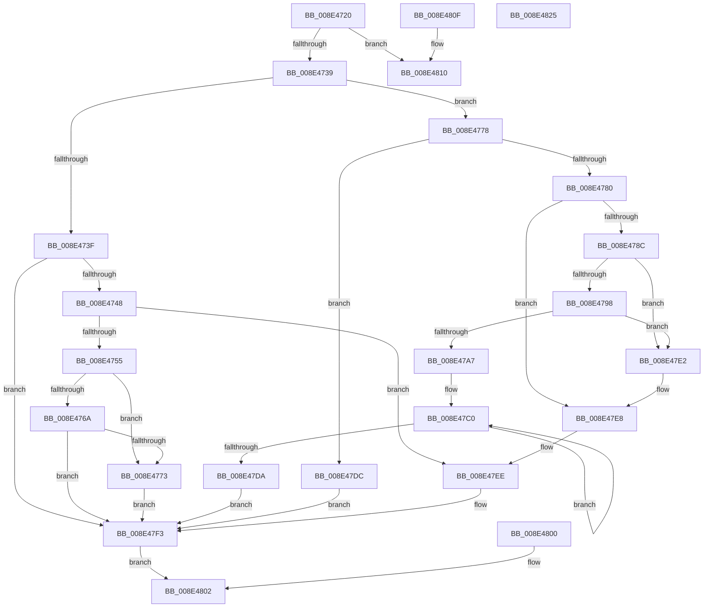

# PiControlCopyUserModeCallersBuffer

- RVA: `0x008E4720`–`0x008E4826` (길이 `262` bytes)
- VA: `0x00000001408E4720`
- 실행 섹션: `PAGE`
- PDB 이름 있음: `예`; PDB Function 태그: `아니요`
- unwind 정보 RVA: `0x0008642C`
- 디코드: `74`개 명령, `262/262` bytes 표시
- 미해석 바이트: `0` (있으면 어셈블리에 `.byte`로 보존)

> 이 문서는 커널 이미지의 기계어와 PDB 기호를 분석해 생성했습니다. 4번과 5번은 함수 원형과 자료형을 바이너리 사용 방식에서 추정한 C 해석이며 원본 소스 복구 결과는 아닙니다.

## 1. Dependencies

- 직접 호출 지점: **5**; 고유 호출 대상: **3**
- 직접 호출자로 확인된 함수: **7**
- RIP 상대 이미지 참조: **0**

### Outgoing calls
- `0x008E47E2` → [ExRaiseAccessViolation](ExRaiseAccessViolation_function_008E9240.md) (function, `0x008E9240`)
- `0x008E47E8` → [ExRaiseDatatypeMisalignment](../89/ExRaiseDatatypeMisalignment_function_00899FD0.md) (function, `0x00899FD0`)
- `0x008E47EE` → [ExRaiseDatatypeMisalignment](../89/ExRaiseDatatypeMisalignment_function_00899FD0.md) (function, `0x00899FD0`)
- `0x008E47F9` → [memcpy](../../text/6C/memcpy_function_006C6840.md) (function, `0x006C6840`)
- `0x008E4813` → [memcpy](../../text/6C/memcpy_function_006C6840.md) (function, `0x006C6840`)

### Direct callers
- [sub_008E3F77](Unknown_function_008E3F77.md) at `0x008E3FEA`
- [sub_008E402C](Unknown_function_008E402C.md) at `0x008E4079`
- [sub_008E44D3](Unknown_function_008E44D3.md) at `0x008E450E`
- [sub_008E4675](Unknown_function_008E4675.md) at `0x008E46C1`
- [sub_008E5795](Unknown_function_008E5795.md) at `0x008E57D1`
- [PiControlGetPropertyData](../8F/PiControlGetPropertyData_function_008FA330.md) at `0x008FA4F6`
- [PiControlGetPropertyData](../8F/PiControlGetPropertyData_function_008FA330.md) at `0x008FA53E`
- [PiControlGetRelatedDevice](../A1/PiControlGetRelatedDevice_function_00A16A40.md) at `0x00A16B57`
- [PiControlGetRelatedDevice](../A1/PiControlGetRelatedDevice_function_00A16A40.md) at `0x00A16BAF`

### Static image references
- 디코드된 RIP-relative 메모리 참조가 없습니다.

## 2. Other-region calls and transfers

- 다른 실행 섹션으로 향하는 call: **2**
  - `0x008E47F9` → [memcpy](../../text/6C/memcpy_function_006C6840.md) (`PAGE` → `.text`)
  - `0x008E4813` → [memcpy](../../text/6C/memcpy_function_006C6840.md) (`PAGE` → `.text`)
- 별도 외부 분기/꼬리 이동을 확인하지 못했습니다.

## 3. Assembly (complete function range)

```asm
008E4720  48 89 5C 24 08                  mov qword ptr [rsp + 8], rbx
008E4725  57                              push rdi
008E4726  48 83 EC 20                     sub rsp, 0x20
008E472A  4C 8B D1                        mov r10, rcx
008E472D  33 DB                           xor ebx, ebx
008E472F  38 5C 24 50                     cmp byte ptr [rsp + 0x50], bl
008E4733  0F 84 D7 00 00 00               je 0x1408e4810
008E4739  39 5C 24 58                     cmp dword ptr [rsp + 0x58], ebx
008E473D  74 39                           je 0x1408e4778
008E473F  45 85 C0                        test r8d, r8d
008E4742  0F 84 AB 00 00 00               je 0x1408e47f3
008E4748  41 8D 49 FF                     lea ecx, [r9 - 1]
008E474C  48 85 CA                        test rdx, rcx
008E474F  0F 85 99 00 00 00               jne 0x1408e47ee
008E4755  41 8B C8                        mov ecx, r8d
008E4758  48 03 CA                        add rcx, rdx
008E475B  48 B8 00 00 FF FF FF 7F 00 00   movabs rax, 0x7fffffff0000
008E4765  48 3B C8                        cmp rcx, rax
008E4768  77 09                           ja 0x1408e4773
008E476A  48 3B CA                        cmp rcx, rdx
008E476D  0F 83 80 00 00 00               jae 0x1408e47f3
008E4773  0F B6 00                        movzx eax, byte ptr [rax]
008E4776  EB 7B                           jmp 0x1408e47f3
008E4778  41 8B F8                        mov edi, r8d
008E477B  45 85 C0                        test r8d, r8d
008E477E  74 5C                           je 0x1408e47dc
008E4780  4D 8B DA                        mov r11, r10
008E4783  41 8D 49 FF                     lea ecx, [r9 - 1]
008E4787  49 85 CA                        test r10, rcx
008E478A  75 5C                           jne 0x1408e47e8
008E478C  49 8D 4A FF                     lea rcx, [r10 - 1]
008E4790  48 03 CF                        add rcx, rdi
008E4793  4C 3B D1                        cmp r10, rcx
008E4796  77 4A                           ja 0x1408e47e2
008E4798  48 B8 00 00 FF FF FF 7F 00 00   movabs rax, 0x7fffffff0000
008E47A2  48 3B C8                        cmp rcx, rax
008E47A5  73 3B                           jae 0x1408e47e2
008E47A7  48 81 E1 00 F0 FF FF            and rcx, 0xfffffffffffff000
008E47AE  48 81 C1 00 10 00 00            add rcx, 0x1000
008E47B5  66 66 66 0F 1F 84 00 00 00 00 00  nop word ptr [rax + rax]
008E47C0  41 0F B6 03                     movzx eax, byte ptr [r11]
008E47C4  41 88 03                        mov byte ptr [r11], al
008E47C7  49 81 E3 00 F0 FF FF            and r11, 0xfffffffffffff000
008E47CE  49 81 C3 00 10 00 00            add r11, 0x1000
008E47D5  4C 3B D9                        cmp r11, rcx
008E47D8  75 E6                           jne 0x1408e47c0
008E47DA  EB 17                           jmp 0x1408e47f3
008E47DC  90                              nop
008E47DD  44 8B C3                        mov r8d, ebx
008E47E0  EB 11                           jmp 0x1408e47f3
008E47E2  E8 59 4A 00 00                  call 0x1408e9240
008E47E7  CC                              int3
008E47E8  E8 E3 57 FB FF                  call 0x140899fd0
008E47ED  CC                              int3
008E47EE  E8 DD 57 FB FF                  call 0x140899fd0
008E47F3  45 8B C0                        mov r8d, r8d
008E47F6  49 8B CA                        mov rcx, r10
008E47F9  E8 42 20 DE FF                  call 0x1406c6840
008E47FE  EB 02                           jmp 0x1408e4802
008E4800  8B D8                           mov ebx, eax
008E4802  8B C3                           mov eax, ebx
008E4804  48 8B 5C 24 30                  mov rbx, qword ptr [rsp + 0x30]
008E4809  48 83 C4 20                     add rsp, 0x20
008E480D  5F                              pop rdi
008E480E  C3                              ret
008E480F  CC                              int3
008E4810  45 8B C0                        mov r8d, r8d
008E4813  E8 28 20 DE FF                  call 0x1406c6840
008E4818  33 C0                           xor eax, eax
008E481A  48 8B 5C 24 30                  mov rbx, qword ptr [rsp + 0x30]
008E481F  48 83 C4 20                     add rsp, 0x20
008E4823  5F                              pop rdi
008E4824  C3                              ret
008E4825  CC                              int3
```

## 4. C-style interpretation (structured pseudocode)

```c
__int64 __fastcall PiControlCopyUserModeCallersBuffer(__int64 a1, __int64 a2, int a3, __int64 a4, unsigned __int8 a5, unsigned int a6)
{
    __int64 result;
    __int64 v_r11;
    __int64 v_rbx;
    __int64 v_rsp;
    unsigned __int64 v_stack_p30;
    unsigned __int64 v_stack_p8;

    v_stack_p8 = v_rbx;
    v_rsp = (v_rsp) - (32);
    v_rbx = 0;
    if (a5 == 0) goto loc_008E4810;
    if (a6 == 0) goto loc_008E4778;
    if (a3 == 0) goto loc_008E47F3;
    if (((a2) & (a4 - 1)) != 0) goto loc_008E47EE;
    a1 = ((unsigned int)(a3)) + (a2);
    if (a1 > result) goto loc_008E4773;
    if (a1 >= a2) goto loc_008E47F3;
loc_008E4773:
    goto loc_008E47F3;
loc_008E4778:
    if (a3 == 0) goto loc_008E47DC;
    if (((a1) & (a4 - 1)) != 0) goto loc_008E47E8;
    a1 = (a1 - 1) + ((unsigned int)(a3));
    if (a1 > a1) goto loc_008E47E2;
    if (a1 >= (*(unsigned __int8 *)(result))) goto loc_008E47E2;
    a1 = (a1) & (0xFFFFFFFFFFFFF000ULL);
    a1 = (a1) + (0x1000ULL);
loc_008E47C0:
    *(unsigned __int8 *)(a1) = (unsigned __int8)(*(unsigned __int8 *)(a1));
    v_r11 = (a1) & (0xFFFFFFFFFFFFF000ULL);
    v_r11 = (v_r11) + (0x1000ULL);
    if (v_r11 != a1) goto loc_008E47C0;
    goto loc_008E47F3;
loc_008E47DC:
    goto loc_008E47F3;
loc_008E47E2:
    result = ExRaiseAccessViolation(a1, a2, 0, a4);
loc_008E47E8:
    result = ExRaiseDatatypeMisalignment(a1, a2, 0, a4);
loc_008E47EE:
    result = ExRaiseDatatypeMisalignment(a1, a2, 0, a4);
loc_008E47F3:
    result = memcpy(a1, a2, 0, a4);
    goto loc_008E4802;
loc_008E4802:
    v_rsp = (v_rsp) + (32);
    return 0;
loc_008E4810:
    result = memcpy(a1, a2, 0, a4);
    result = 0;
    v_rsp = (v_rsp) + (32);
    return result;
}
```

## 5. (Beta) C Style

```c
int64_t PiControlCopyUserModeCallersBuffer(int64_t Arg1, int64_t Arg2, int32_t Arg3, void *Arg4, uint8_t Arg5, uint32_t Arg6)
{
    uint8_t *arg4 = (uint8_t *)Arg4;

    int64_t result;
    int64_t local_r11;
    int64_t local_rbx;
    int64_t local_rsp;
    uint64_t v_stack_p30;
    uint64_t v_stack_p8;

    v_stack_p8 = local_rbx;
    local_rsp = (local_rsp) - (32);
    local_rbx = 0;
    if (Arg5 == 0) goto loc_008E4810;
    if (Arg6 == 0) goto loc_008E4778;
    if (Arg3 == 0) goto loc_008E47F3;
    if (((Arg2) & (Arg4 - 1)) != 0) goto loc_008E47EE;
    Arg1 = ((uint32_t)(Arg3)) + (Arg2);
    if (Arg1 > result) goto loc_008E4773;
    if (Arg1 >= Arg2) goto loc_008E47F3;
loc_008E4773:
    goto loc_008E47F3;
loc_008E4778:
    if (Arg3 == 0) goto loc_008E47DC;
    if (((Arg1) & (Arg4 - 1)) != 0) goto loc_008E47E8;
    Arg1 = (Arg1 - 1) + ((uint32_t)(Arg3));
    if (Arg1 > Arg1) goto loc_008E47E2;
    if (Arg1 >= (*(uint8_t *)(result))) goto loc_008E47E2;
    Arg1 = (Arg1) & (0xFFFFFFFFFFFFF000ULL);
    Arg1 = (Arg1) + (0x1000ULL);
loc_008E47C0:
    *(uint8_t *)(Arg1) = (uint8_t)(*(uint8_t *)(Arg1));
    local_r11 = (Arg1) & (0xFFFFFFFFFFFFF000ULL);
    local_r11 = (local_r11) + (0x1000ULL);
    if (local_r11 != Arg1) goto loc_008E47C0;
    goto loc_008E47F3;
loc_008E47DC:
    goto loc_008E47F3;
loc_008E47E2:
    result = ExRaiseAccessViolation(Arg1, Arg2, 0, Arg4);
loc_008E47E8:
    result = ExRaiseDatatypeMisalignment(Arg1, Arg2, 0, Arg4);
loc_008E47EE:
    result = ExRaiseDatatypeMisalignment(Arg1, Arg2, 0, Arg4);
loc_008E47F3:
    result = memcpy(Arg1, Arg2, 0, Arg4);
    goto loc_008E4802;
loc_008E4802:
    local_rsp = (local_rsp) + (32);
    return 0;
loc_008E4810:
    result = memcpy(Arg1, Arg2, 0, Arg4);
    result = 0;
    local_rsp = (local_rsp) + (32);
    return result;
}
```

### 관측된 메모리 오프셋

구조체 형식이 확인되지 않은 접근은 인자 기준의 오프셋으로만 기록했습니다.

| 기준 인자 | 오프셋 표현 | 폭 (bit) | 접근 |
|---|---:|---:|---|
| `Arg4` | `- 0x1` | `32` | `R` |

## 6. Execution-region graph

[열기: 2D/3D 그래프와 함수 탐색 컨트롤 패널](../../../control-panel.html?section=page&rva=0x008E4720&view=graph)

- 2D 그래프는 위에서 아래로 흐르고, 3D 그래프는 빈 공간을 드래그해 회전합니다. Shift+드래그는 이동, 휠은 확대·축소, 함수 노드 선택은 대상 보고서 이동입니다.

### Static fallback


