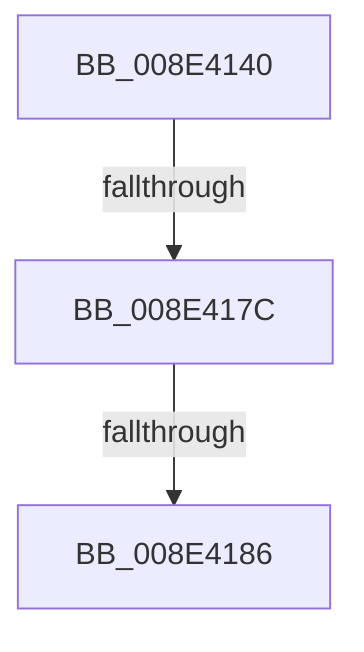

# PiControlGetDeviceInterfaceEnabled

- RVA: `0x008E4140`–`0x008E4190` (길이 `80` bytes)
- VA: `0x00000001408E4140`
- 실행 섹션: `PAGE`
- PDB 이름 있음: `예`; PDB Function 태그: `아니요`
- unwind 정보 RVA: `0x00086250`
- 디코드: `19`개 명령, `80/80` bytes 표시
- 미해석 바이트: `0` (있으면 어셈블리에 `.byte`로 보존)

> 이 문서는 커널 이미지의 기계어와 PDB 기호를 분석해 생성했습니다. 4번과 5번은 함수 원형과 자료형을 바이너리 사용 방식에서 추정한 C 해석이며 원본 소스 복구 결과는 아닙니다.

## 1. Dependencies

- 직접 호출 지점: **0**; 고유 호출 대상: **0**
- 직접 호출자로 확인된 함수: **1**
- RIP 상대 이미지 참조: **1**

### Outgoing calls
- 직접 디코드된 call 명령이 없습니다.

### Direct callers
- [sub_008E3F77](Unknown_function_008E3F77.md) at `0x008E3FAD`

### Static image references
- `0x008E414F` → RVA `0x00E0A740` (`.data`; read)

## 2. Other-region calls and transfers

- 다른 실행 섹션으로 향하는 call: **0**
- call이 아닌 외부 분기/꼬리 이동: **3**
  - `0x008E4176` → [sub_008E45A9](Unknown_function_008E45A9.md) (`tail-transfer`)
  - `0x008E4180` → [sub_008E45A9](Unknown_function_008E45A9.md) (`tail-transfer`)
  - `0x008E418A` → [sub_008E45A9](Unknown_function_008E45A9.md) (`tail-transfer`)

## 3. Assembly (complete function range)

```asm
008E4140  4C 8B DC                        mov r11, rsp
008E4143  56                              push rsi
008E4144  41 55                           push r13
008E4146  41 56                           push r14
008E4148  48 81 EC E0 00 00 00            sub rsp, 0xe0
008E414F  48 8B 05 EA 65 52 00            mov rax, qword ptr [rip + 0x5265ea]
008E4156  48 33 C4                        xor rax, rsp
008E4159  48 89 84 24 C0 00 00 00         mov qword ptr [rsp + 0xc0], rax
008E4161  0F B7 32                        movzx esi, word ptr [rdx]
008E4164  B9 EF 03 00 00                  mov ecx, 0x3ef
008E4169  45 0F B6 E9                     movzx r13d, r9b
008E416D  4C 8B F2                        mov r14, rdx
008E4170  8D 46 FF                        lea eax, [rsi - 1]
008E4173  66 3B C1                        cmp ax, cx
008E4176  0F 87 2D 04 00 00               ja 0x1408e45a9
008E417C  40 F6 C6 01                     test sil, 1
008E4180  0F 85 23 04 00 00               jne 0x1408e45a9
008E4186  83 7A 10 00                     cmp dword ptr [rdx + 0x10], 0
008E418A  0F 85 19 04 00 00               jne 0x1408e45a9
```

## 4. C-style interpretation (structured pseudocode)

```c
__int64 __fastcall PiControlGetDeviceInterfaceEnabled(__int64 a1, __int64 a2, __int64 a3, unsigned __int8 a4)
{
    __int64 result;
    __int64 v_rsp;
    unsigned __int64 v_stack_m38;

    v_rsp = (v_rsp) - (224);
    result = (*(unsigned __int64 *)(v_rip + 5400042)) ^ (v_rsp);
    v_stack_m38 = result;
}
```

## 5. (Beta) C Style

```c
int64_t PiControlGetDeviceInterfaceEnabled(int64_t Arg1, void *Arg2, int64_t Arg3, uint8_t Arg4)
{
    uint8_t *arg2 = (uint8_t *)Arg2;

    int64_t result;
    int64_t local_rsp;
    uint64_t v_stack_m38;

    local_rsp = (local_rsp) - (224);
    result = (*(uint64_t *)(v_rip + 0x5265EA)) ^ (local_rsp);
    v_stack_m38 = result;
}
```

### 관측된 메모리 오프셋

구조체 형식이 확인되지 않은 접근은 인자 기준의 오프셋으로만 기록했습니다.

| 기준 인자 | 오프셋 표현 | 폭 (bit) | 접근 |
|---|---:|---:|---|
| `Arg2` | `+ 0x0` | `16` | `R` |
| `Arg2` | `+ 0x10` | `32` | `R` |

## 6. Execution-region graph

[열기: 2D/3D 그래프와 함수 탐색 컨트롤 패널](../../../control-panel.html?section=page&rva=0x008E4140&view=graph)

- 2D 그래프는 위에서 아래로 흐르고, 3D 그래프는 빈 공간을 드래그해 회전합니다. Shift+드래그는 이동, 휠은 확대·축소, 함수 노드 선택은 대상 보고서 이동입니다.

### Static fallback


