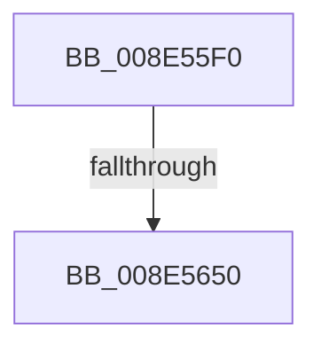

# PiControlGetSetDeviceStatus

- RVA: `0x008E55F0`–`0x008E5659` (길이 `105` bytes)
- VA: `0x00000001408E55F0`
- 실행 섹션: `PAGE`
- PDB 이름 있음: `예`; PDB Function 태그: `예`
- unwind 정보 RVA: `0x0008661C`
- 디코드: `30`개 명령, `105/105` bytes 표시
- 미해석 바이트: `0` (있으면 어셈블리에 `.byte`로 보존)

> 이 문서는 커널 이미지의 기계어와 PDB 기호를 분석해 생성했습니다. 4번과 5번은 함수 원형과 자료형을 바이너리 사용 방식에서 추정한 C 해석이며 원본 소스 복구 결과는 아닙니다.

## 1. Dependencies

- 직접 호출 지점: **0**; 고유 호출 대상: **0**
- 직접 호출자로 확인된 함수: **1**
- RIP 상대 이미지 참조: **0**

### Outgoing calls
- 직접 디코드된 call 명령이 없습니다.

### Direct callers
- [sub_008E402C](Unknown_function_008E402C.md) at `0x008E40C1`

### Static image references
- 디코드된 RIP-relative 메모리 참조가 없습니다.

## 2. Other-region calls and transfers

- 다른 실행 섹션으로 향하는 call: **0**
- call이 아닌 외부 분기/꼬리 이동: **2**
  - `0x008E564A` → [sub_008E582F](Unknown_function_008E582F.md) (`tail-transfer`)
  - `0x008E5653` → [sub_008E582F](Unknown_function_008E582F.md) (`tail-transfer`)

## 3. Assembly (complete function range)

```asm
008E55F0  4C 8B DC                        mov r11, rsp
008E55F3  49 89 73 20                     mov qword ptr [r11 + 0x20], rsi
008E55F7  55                              push rbp
008E55F8  41 54                           push r12
008E55FA  41 55                           push r13
008E55FC  41 56                           push r14
008E55FE  41 57                           push r15
008E5600  49 8D 6B A1                     lea rbp, [r11 - 0x5f]
008E5604  48 81 EC 90 00 00 00            sub rsp, 0x90
008E560B  0F B7 0A                        movzx ecx, word ptr [rdx]
008E560E  45 33 ED                        xor r13d, r13d
008E5611  33 C0                           xor eax, eax
008E5613  45 8B F8                        mov r15d, r8d
008E5616  0F 57 C0                        xorps xmm0, xmm0
008E5619  48 89 45 2F                     mov qword ptr [rbp + 0x2f], rax
008E561D  0F 11 45 EF                     movups xmmword ptr [rbp - 0x11], xmm0
008E5621  48 8B F2                        mov rsi, rdx
008E5624  4C 89 6D E7                     mov qword ptr [rbp - 0x19], r13
008E5628  8D 41 FF                        lea eax, [rcx - 1]
008E562B  44 89 6D 6F                     mov dword ptr [rbp + 0x6f], r13d
008E562F  BA 8F 01 00 00                  mov edx, 0x18f
008E5634  66 89 4D F1                     mov word ptr [rbp - 0xf], cx
008E5638  66 89 4D EF                     mov word ptr [rbp - 0x11], cx
008E563C  45 0F B6 F1                     movzx r14d, r9b
008E5640  45 8B E5                        mov r12d, r13d
008E5643  0F 11 45 1F                     movups xmmword ptr [rbp + 0x1f], xmm0
008E5647  66 3B C2                        cmp ax, dx
008E564A  0F 87 DF 01 00 00               ja 0x1408e582f
008E5650  F6 C1 01                        test cl, 1
008E5653  0F 85 D6 01 00 00               jne 0x1408e582f
```

## 4. C-style interpretation (structured pseudocode)

```c
__int64 __fastcall PiControlGetSetDeviceStatus(__int64 a1, __int64 a2, int a3, unsigned __int8 a4)
{
    __int64 result;
    __int64 v_r13;
    __int64 v_rsp;

    *(unsigned __int64 *)(v_rsp + 32) = v_rsi;
    v_rsp = (v_rsp) - (144);
    v_r13 = 0;
    result = 0;
    *(unsigned __int64 *)(v_rsp - 95 + 47) = 0;
    *(unsigned __int64 *)(v_rsp - 95 - 17) = v_xmm0;
    *(unsigned __int64 *)(v_rsp - 95 - 25) = 0;
    *(unsigned int *)(v_rsp - 95 + 111) = 0;
    *(unsigned __int16 *)(v_rsp - 95 - 15) = (unsigned __int16)(*(unsigned __int16 *)(a2));
    *(unsigned __int16 *)(v_rsp - 95 - 17) = (unsigned __int16)(*(unsigned __int16 *)(a2));
    *(unsigned __int64 *)(v_rsp - 95 + 31) = v_xmm0;
}
```

## 5. (Beta) C Style

```c
int64_t PiControlGetSetDeviceStatus(int64_t Arg1, void *Arg2, int32_t Arg3, uint8_t Arg4)
{
    uint8_t *arg2 = (uint8_t *)Arg2;

    int64_t result;
    int64_t local_r13;
    int64_t local_rsp;

    *(uint64_t *)(local_rsp + 0x20) = local_rsi;
    local_rsp = (local_rsp) - (144);
    local_r13 = 0;
    result = 0;
    *(uint64_t *)(local_rsp - 0x5F + 0x2F) = 0;
    *(uint64_t *)(local_rsp - 0x5F - 0x11) = v_xmm0;
    *(uint64_t *)(local_rsp - 0x5F - 0x19) = 0;
    *(uint32_t *)(local_rsp - 0x5F + 0x6F) = 0;
    *(uint16_t *)(local_rsp - 0x5F - 0xF) = (uint16_t)(*(uint16_t *)(arg2));
    *(uint16_t *)(local_rsp - 0x5F - 0x11) = (uint16_t)(*(uint16_t *)(arg2));
    *(uint64_t *)(local_rsp - 0x5F + 0x1F) = v_xmm0;
}
```

### 관측된 메모리 오프셋

구조체 형식이 확인되지 않은 접근은 인자 기준의 오프셋으로만 기록했습니다.

| 기준 인자 | 오프셋 표현 | 폭 (bit) | 접근 |
|---|---:|---:|---|
| `Arg2` | `+ 0x0` | `16` | `R` |

## 6. Execution-region graph

[열기: 2D/3D 그래프와 함수 탐색 컨트롤 패널](../../../control-panel.html?section=page&rva=0x008E55F0&view=graph)

- 2D 그래프는 위에서 아래로 흐르고, 3D 그래프는 빈 공간을 드래그해 회전합니다. Shift+드래그는 이동, 휠은 확대·축소, 함수 노드 선택은 대상 보고서 이동입니다.

### Static fallback


