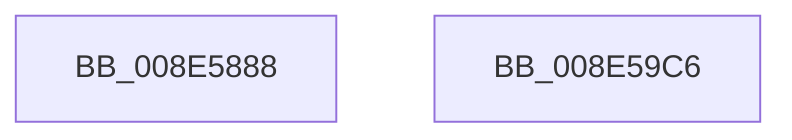

# PiControlGetUserFlagsFromDeviceNode

- RVA: `0x008E5888`–`0x008E59C7` (길이 `319` bytes)
- VA: `0x00000001408E5888`
- 실행 섹션: `PAGE`
- PDB 이름 있음: `예`; PDB Function 태그: `아니요`
- unwind 정보 RVA: `0x00060BC4`
- 디코드: `92`개 명령, `319/319` bytes 표시
- 미해석 바이트: `0` (있으면 어셈블리에 `.byte`로 보존)

> 이 문서는 커널 이미지의 기계어와 PDB 기호를 분석해 생성했습니다. 4번과 5번은 함수 원형과 자료형을 바이너리 사용 방식에서 추정한 C 해석이며 원본 소스 복구 결과는 아닙니다.

## 1. Dependencies

- 직접 호출 지점: **3**; 고유 호출 대상: **3**
- 직접 호출자로 확인된 함수: **1**
- RIP 상대 이미지 참조: **0**

### Outgoing calls
- `0x008E589D` → [PipAreDriversLoaded](../../text/47/PipAreDriversLoaded_function_004708D4.md) (function, `0x004708D4`)
- `0x008E58B5` → [PipIsDevNodeDNStarted](../../text/47/PipIsDevNodeDNStarted_function_00470870.md) (function, `0x00470870`)
- `0x008E58CA` → [CmIsRootEnumeratedDevice](../8F/CmIsRootEnumeratedDevice_function_008F6E08.md) (function, `0x008F6E08`)

### Direct callers
- [sub_008E5659](Unknown_function_008E5659.md) at `0x008E573A`

### Static image references
- 디코드된 RIP-relative 메모리 참조가 없습니다.

## 2. Other-region calls and transfers

- 다른 실행 섹션으로 향하는 call: **2**
  - `0x008E589D` → [PipAreDriversLoaded](../../text/47/PipAreDriversLoaded_function_004708D4.md) (`PAGE` → `.text`)
  - `0x008E58B5` → [PipIsDevNodeDNStarted](../../text/47/PipIsDevNodeDNStarted_function_00470870.md) (`PAGE` → `.text`)
- 별도 외부 분기/꼬리 이동을 확인하지 못했습니다.

## 3. Assembly (complete function range)

```asm
008E5888  48 89 5C 24 08                  mov qword ptr [rsp + 8], rbx
008E588D  48 89 74 24 10                  mov qword ptr [rsp + 0x10], rsi
008E5892  57                              push rdi
008E5893  48 83 EC 20                     sub rsp, 0x20
008E5897  48 8B F2                        mov rsi, rdx
008E589A  48 8B F9                        mov rdi, rcx
008E589D  E8 32 B0 B8 FF                  call 0x1404708d4
008E58A2  F7 D8                           neg eax
008E58A4  48 8B CF                        mov rcx, rdi
008E58A7  45 1B C0                        sbb r8d, r8d
008E58AA  41 83 E0 02                     and r8d, 2
008E58AE  41 81 C0 00 00 80 01            add r8d, 0x1800000
008E58B5  E8 B6 AF B8 FF                  call 0x140470870
008E58BA  48 8B 4F 30                     mov rcx, qword ptr [rdi + 0x30]
008E58BE  41 8B D8                        mov ebx, r8d
008E58C1  83 CB 08                        or ebx, 8
008E58C4  85 C0                           test eax, eax
008E58C6  41 0F 44 D8                     cmove ebx, r8d
008E58CA  E8 39 15 01 00                  call 0x1408f6e08
008E58CF  44 8B 97 90 01 00 00            mov r10d, dword ptr [rdi + 0x190]
008E58D6  41 B8 00 40 00 00               mov r8d, 0x4000
008E58DC  44 8B 8F 8C 01 00 00            mov r9d, dword ptr [rdi + 0x18c]
008E58E3  8B CB                           mov ecx, ebx
008E58E5  83 C9 01                        or ecx, 1
008E58E8  41 BB 00 20 00 00               mov r11d, 0x2000
008E58EE  84 C0                           test al, al
008E58F0  41 8B C1                        mov eax, r9d
008E58F3  0F 44 CB                        cmove ecx, ebx
008E58F6  BB 00 01 00 00                  mov ebx, 0x100
008E58FB  8B D1                           mov edx, ecx
008E58FD  41 0B D0                        or edx, r8d
008E5900  F6 87 30 02 00 00 10            test byte ptr [rdi + 0x230], 0x10
008E5907  0F 44 D1                        cmove edx, ecx
008E590A  8B CA                           mov ecx, edx
008E590C  0F BA E9 12                     bts ecx, 0x12
008E5910  41 F6 C2 01                     test r10b, 1
008E5914  0F 44 CA                        cmove ecx, edx
008E5917  8B D1                           mov edx, ecx
008E5919  0F BA EA 1E                     bts edx, 0x1e
008E591D  41 F6 C2 02                     test r10b, 2
008E5921  0F 44 D1                        cmove edx, ecx
008E5924  8B CA                           mov ecx, edx
008E5926  0F BA E9 19                     bts ecx, 0x19
008E592A  41 F6 C2 40                     test r10b, 0x40
008E592E  0F 44 CA                        cmove ecx, edx
008E5931  8B D1                           mov edx, ecx
008E5933  0B D3                           or edx, ebx
008E5935  41 F6 C2 04                     test r10b, 4
008E5939  0F 44 D1                        cmove edx, ecx
008E593C  41 23 C0                        and eax, r8d
008E593F  44 8B C2                        mov r8d, edx
008E5942  41 0F BA E8 0F                  bts r8d, 0xf
008E5947  85 C0                           test eax, eax
008E5949  8B 87 58 02 00 00               mov eax, dword ptr [rdi + 0x258]
008E594F  44 0F 44 C2                     cmove r8d, edx
008E5953  41 8B C8                        mov ecx, r8d
008E5956  0F BA E9 0A                     bts ecx, 0xa
008E595A  45 85 CB                        test r11d, r9d
008E595D  41 0F 44 C8                     cmove ecx, r8d
008E5961  41 B8 00 10 00 00               mov r8d, 0x1000
008E5967  8B D1                           mov edx, ecx
008E5969  83 CA 40                        or edx, 0x40
008E596C  41 0F BA E1 14                  bt r9d, 0x14
008E5971  0F 43 D1                        cmovae edx, ecx
008E5974  8B CA                           mov ecx, edx
008E5976  41 0B C8                        or ecx, r8d
008E5979  45 85 C8                        test r8d, r9d
008E597C  41 B8 00 02 00 00               mov r8d, 0x200
008E5982  0F 44 CA                        cmove ecx, edx
008E5985  8B D1                           mov edx, ecx
008E5987  41 0B D0                        or edx, r8d
008E598A  41 0F BA E1 15                  bt r9d, 0x15
008E598F  0F 43 D1                        cmovae edx, ecx
008E5992  8B CA                           mov ecx, edx
008E5994  41 0B CB                        or ecx, r11d
008E5997  85 C0                           test eax, eax
008E5999  0F 45 CA                        cmovne ecx, edx
008E599C  8B D1                           mov edx, ecx
008E599E  0F BA EA 10                     bts edx, 0x10
008E59A2  44 85 D3                        test ebx, r10d
008E59A5  0F 44 D1                        cmove edx, ecx
008E59A8  8B C2                           mov eax, edx
008E59AA  0F BA E8 11                     bts eax, 0x11
008E59AE  45 85 D0                        test r8d, r10d
008E59B1  0F 44 C2                        cmove eax, edx
008E59B4  48 8B 5C 24 30                  mov rbx, qword ptr [rsp + 0x30]
008E59B9  89 06                           mov dword ptr [rsi], eax
008E59BB  48 8B 74 24 38                  mov rsi, qword ptr [rsp + 0x38]
008E59C0  48 83 C4 20                     add rsp, 0x20
008E59C4  5F                              pop rdi
008E59C5  C3                              ret
008E59C6  CC                              int3
```

## 4. C-style interpretation (structured pseudocode)

```c
__int64 __fastcall PiControlGetUserFlagsFromDeviceNode(__int64 a1, __int64 a2, int a3)
{
    __int64 result;
    __int64 v_rbx;
    __int64 v_rsp;
    unsigned __int64 v_stack_p10;
    unsigned __int64 v_stack_p8;

    v_stack_p8 = v_rbx;
    v_stack_p10 = v_rsi;
    v_rsp = (v_rsp) - (32);
    result = PipAreDriversLoaded(a1, a2, a3, a4);
    result = (unsigned int)(-(result));
    a3 = (unsigned int)((a3) & (2));
    a3 = (unsigned int)((a3) + (0x1800000ULL));
    result = PipIsDevNodeDNStarted(a1, a2, a3, a4);
    v_rbx = (unsigned int)(((unsigned int)(a3)) | (8));
    if ((unsigned int)(result) == 0) { v_rbx = a3; }
    result = CmIsRootEnumeratedDevice(*(unsigned __int64 *)(a1 + 48), a2, a3, a4);
    a1 = (unsigned int)(((unsigned int)((unsigned int)(v_rbx))) | (1));
    if ((unsigned __int8)(result) == 0) { a1 = (unsigned int)(v_rbx); }
    a2 = (unsigned int)(((unsigned int)((unsigned int)(a1))) | ((unsigned int)((unsigned int)(0x4000ULL))));
    if (((*(unsigned __int8 *)(a1 + 560)) & (16)) == 0) { a2 = (unsigned int)(a1); }
    a1 = (unsigned int)((unsigned int)(a2));
    if ((((unsigned __int8)((unsigned int)(*(unsigned int *)(a1 + 400)))) & (1)) == 0) { a1 = (unsigned int)(a2); }
    a2 = (unsigned int)((unsigned int)(a1));
    if ((((unsigned __int8)((unsigned int)(*(unsigned int *)(a1 + 400)))) & (2)) == 0) { a2 = (unsigned int)(a1); }
    a1 = (unsigned int)((unsigned int)(a2));
    if ((((unsigned __int8)((unsigned int)(*(unsigned int *)(a1 + 400)))) & (64)) == 0) { a1 = (unsigned int)(a2); }
    a2 = (unsigned int)(((unsigned int)((unsigned int)(a1))) | (256));
    if ((((unsigned __int8)((unsigned int)(*(unsigned int *)(a1 + 400)))) & (4)) == 0) { a2 = (unsigned int)(a1); }
    result = (unsigned int)(((unsigned int)((unsigned int)((unsigned int)(*(unsigned int *)(a1 + 396))))) & ((unsigned int)((unsigned int)(0x4000ULL))));
    a3 = (unsigned int)((unsigned int)(a2));
    if ((unsigned int)(result) == 0) { a3 = (unsigned int)(a2); }
    a1 = (unsigned int)(a3);
    if ((((unsigned int)((unsigned int)(0x2000ULL))) & ((unsigned int)((unsigned int)(*(unsigned int *)(a1 + 396))))) == 0) { a1 = a3; }
    a2 = (unsigned int)(((unsigned int)((unsigned int)(a1))) | (64));
    if (condition_is_above_or_equal) { a2 = (unsigned int)(a1); }
    a1 = (unsigned int)(((unsigned int)((unsigned int)(a2))) | ((unsigned int)((unsigned int)(0x1000ULL))));
    if ((((unsigned int)((unsigned int)(0x1000ULL))) & ((unsigned int)((unsigned int)(*(unsigned int *)(a1 + 396))))) == 0) { a1 = (unsigned int)(a2); }
    a2 = (unsigned int)(((unsigned int)((unsigned int)(a1))) | (512));
    if (condition_is_above_or_equal) { a2 = (unsigned int)(a1); }
    a1 = (unsigned int)(((unsigned int)((unsigned int)(a2))) | ((unsigned int)((unsigned int)(0x2000ULL))));
    if ((unsigned int)((unsigned int)(*(unsigned int *)(a1 + 600))) != 0) { a1 = (unsigned int)(a2); }
    a2 = (unsigned int)((unsigned int)(a1));
    if (((256) & ((unsigned int)((unsigned int)(*(unsigned int *)(a1 + 400))))) == 0) { a2 = (unsigned int)(a1); }
    result = (unsigned int)((unsigned int)(a2));
    if (((512) & ((unsigned int)((unsigned int)(*(unsigned int *)(a1 + 400))))) == 0) { result = (unsigned int)(a2); }
    *(unsigned int *)(a2) = (unsigned int)(result);
    v_rsp = (v_rsp) + (32);
    return result;
}
```

## 5. (Beta) C Style

```c
int64_t PiControlGetUserFlagsFromDeviceNode(void *Arg1, void *Arg2, int32_t Arg3)
{
    uint8_t *arg1 = (uint8_t *)Arg1;
    uint8_t *arg2 = (uint8_t *)Arg2;

    int64_t result;
    int64_t local_rbx;
    int64_t local_rsp;
    uint64_t v_stack_p10;
    uint64_t v_stack_p8;

    v_stack_p8 = local_rbx;
    v_stack_p10 = local_rsi;
    local_rsp = (local_rsp) - (32);
    result = PipAreDriversLoaded(Arg1, Arg2, Arg3, a4);
    result = (uint32_t)(-(result));
    Arg3 = (uint32_t)((Arg3) & (2));
    Arg3 = (uint32_t)((Arg3) + (0x1800000ULL));
    result = PipIsDevNodeDNStarted(Arg1, Arg2, Arg3, a4);
    local_rbx = (uint32_t)(((uint32_t)(Arg3)) | (8));
    if ((uint32_t)(result) == 0) { local_rbx = Arg3; }
    result = CmIsRootEnumeratedDevice(*(uint64_t *)(arg1 + 0x30), Arg2, Arg3, a4);
    Arg1 = (uint32_t)(((uint32_t)((uint32_t)(local_rbx))) | (1));
    if ((uint8_t)(result) == 0) { Arg1 = (uint32_t)(local_rbx); }
    Arg2 = (uint32_t)(((uint32_t)((uint32_t)(Arg1))) | ((uint32_t)((uint32_t)(0x4000ULL))));
    if (((*(uint8_t *)(arg1 + 0x230)) & (16)) == 0) { Arg2 = (uint32_t)(Arg1); }
    Arg1 = (uint32_t)((uint32_t)(Arg2));
    if ((((uint8_t)((uint32_t)(*(uint32_t *)(arg1 + 0x190)))) & (1)) == 0) { Arg1 = (uint32_t)(Arg2); }
    Arg2 = (uint32_t)((uint32_t)(Arg1));
    if ((((uint8_t)((uint32_t)(*(uint32_t *)(arg1 + 0x190)))) & (2)) == 0) { Arg2 = (uint32_t)(Arg1); }
    Arg1 = (uint32_t)((uint32_t)(Arg2));
    if ((((uint8_t)((uint32_t)(*(uint32_t *)(arg1 + 0x190)))) & (64)) == 0) { Arg1 = (uint32_t)(Arg2); }
    Arg2 = (uint32_t)(((uint32_t)((uint32_t)(Arg1))) | (256));
    if ((((uint8_t)((uint32_t)(*(uint32_t *)(arg1 + 0x190)))) & (4)) == 0) { Arg2 = (uint32_t)(Arg1); }
    result = (uint32_t)(((uint32_t)((uint32_t)((uint32_t)(*(uint32_t *)(arg1 + 0x18C))))) & ((uint32_t)((uint32_t)(0x4000ULL))));
    Arg3 = (uint32_t)((uint32_t)(Arg2));
    if ((uint32_t)(result) == 0) { Arg3 = (uint32_t)(Arg2); }
    Arg1 = (uint32_t)(Arg3);
    if ((((uint32_t)((uint32_t)(0x2000ULL))) & ((uint32_t)((uint32_t)(*(uint32_t *)(arg1 + 0x18C))))) == 0) { Arg1 = Arg3; }
    Arg2 = (uint32_t)(((uint32_t)((uint32_t)(Arg1))) | (64));
    if (condition_is_above_or_equal) { Arg2 = (uint32_t)(Arg1); }
    Arg1 = (uint32_t)(((uint32_t)((uint32_t)(Arg2))) | ((uint32_t)((uint32_t)(0x1000ULL))));
    if ((((uint32_t)((uint32_t)(0x1000ULL))) & ((uint32_t)((uint32_t)(*(uint32_t *)(arg1 + 0x18C))))) == 0) { Arg1 = (uint32_t)(Arg2); }
    Arg2 = (uint32_t)(((uint32_t)((uint32_t)(Arg1))) | (512));
    if (condition_is_above_or_equal) { Arg2 = (uint32_t)(Arg1); }
    Arg1 = (uint32_t)(((uint32_t)((uint32_t)(Arg2))) | ((uint32_t)((uint32_t)(0x2000ULL))));
    if ((uint32_t)((uint32_t)(*(uint32_t *)(arg1 + 0x258))) != 0) { Arg1 = (uint32_t)(Arg2); }
    Arg2 = (uint32_t)((uint32_t)(Arg1));
    if (((256) & ((uint32_t)((uint32_t)(*(uint32_t *)(arg1 + 0x190))))) == 0) { Arg2 = (uint32_t)(Arg1); }
    result = (uint32_t)((uint32_t)(Arg2));
    if (((512) & ((uint32_t)((uint32_t)(*(uint32_t *)(arg1 + 0x190))))) == 0) { result = (uint32_t)(Arg2); }
    *(uint32_t *)(arg2) = (uint32_t)(result);
    local_rsp = (local_rsp) + (32);
    return result;
}
```

### 관측된 메모리 오프셋

구조체 형식이 확인되지 않은 접근은 인자 기준의 오프셋으로만 기록했습니다.

| 기준 인자 | 오프셋 표현 | 폭 (bit) | 접근 |
|---|---:|---:|---|
| `Arg1` | `+ 0x30` | `64` | `R` |
| `Arg1` | `+ 0x18C` | `32` | `R` |
| `Arg1` | `+ 0x190` | `32` | `R` |
| `Arg1` | `+ 0x230` | `8` | `R` |
| `Arg1` | `+ 0x258` | `32` | `R` |
| `Arg2` | `+ 0x0` | `32` | `W` |

## 6. Execution-region graph

[열기: 2D/3D 그래프와 함수 탐색 컨트롤 패널](../../../control-panel.html?section=page&rva=0x008E5888&view=graph)

- 2D 그래프는 위에서 아래로 흐르고, 3D 그래프는 빈 공간을 드래그해 회전합니다. Shift+드래그는 이동, 휠은 확대·축소, 함수 노드 선택은 대상 보고서 이동입니다.

### Static fallback


