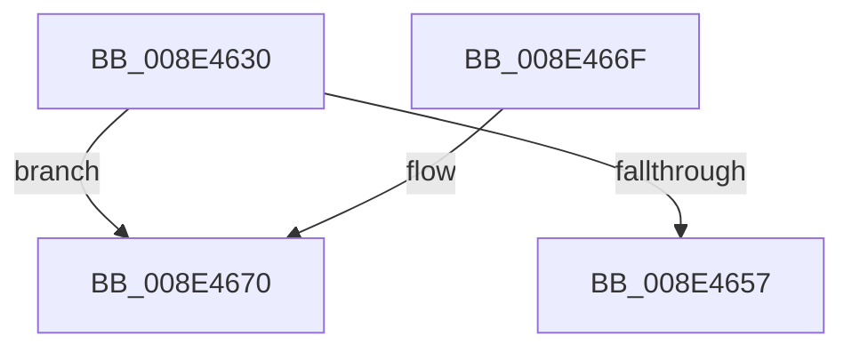

# PiControlMakeUserModeCallersCopy

- RVA: `0x008E4630`–`0x008E4675` (길이 `69` bytes)
- VA: `0x00000001408E4630`
- 실행 섹션: `PAGE`
- PDB 이름 있음: `예`; PDB Function 태그: `아니요`
- unwind 정보 RVA: `0x000863C0`
- 디코드: `25`개 명령, `69/69` bytes 표시
- 미해석 바이트: `0` (있으면 어셈블리에 `.byte`로 보존)

> 이 문서는 커널 이미지의 기계어와 PDB 기호를 분석해 생성했습니다. 4번과 5번은 함수 원형과 자료형을 바이너리 사용 방식에서 추정한 C 해석이며 원본 소스 복구 결과는 아닙니다.

## 1. Dependencies

- 직접 호출 지점: **0**; 고유 호출 대상: **0**
- 직접 호출자로 확인된 함수: **13**
- RIP 상대 이미지 참조: **0**

### Outgoing calls
- 직접 디코드된 call 명령이 없습니다.

### Direct callers
- [NtReplacePartitionUnit](../../text/6A/NtReplacePartitionUnit_function_006A85A0.md) at `0x006A870B`
- [NtReplacePartitionUnit](../../text/6A/NtReplacePartitionUnit_function_006A85A0.md) at `0x006A8736`
- [PiCMCaptureObjectInputData](PiCMCaptureObjectInputData_function_008E8220.md) at `0x008E83C7`
- [PiCMCaptureObjectInputData](PiCMCaptureObjectInputData_function_008E8220.md) at `0x008E8410`
- [PiCMCaptureRegistryPropertyInputData](PiCMCaptureRegistryPropertyInputData_function_008ED078.md) at `0x008ED1EA`
- [PiCMCaptureRegistryPropertyInputData](PiCMCaptureRegistryPropertyInputData_function_008ED078.md) at `0x008ED242`
- [PiCMCaptureRegistryPropertyInputData](PiCMCaptureRegistryPropertyInputData_function_008ED078.md) at `0x008ED345`
- [PiCMCapturePropertyInputData](PiCMCapturePropertyInputData_function_008ED3A0.md) at `0x008ED512`
- [PiCMCapturePropertyInputData](PiCMCapturePropertyInputData_function_008ED3A0.md) at `0x008ED578`
- [PiCMCapturePropertyInputData](PiCMCapturePropertyInputData_function_008ED3A0.md) at `0x008ED670`
- [PiCMCaptureRegistryInputData](../96/PiCMCaptureRegistryInputData_function_00962108.md) at `0x0096224B`
- [PiCMCaptureRegistryInputData](../96/PiCMCaptureRegistryInputData_function_00962108.md) at `0x009622C5`
- [PiCMCaptureRegisterInterfaceInputData](../96/PiCMCaptureRegisterInterfaceInputData_function_00962C94.md) at `0x00962EBD`
- [PiCMCaptureRegisterInterfaceInputData](../96/PiCMCaptureRegisterInterfaceInputData_function_00962C94.md) at `0x00962F94`
- [PiCMCaptureRegisterInterfaceInputData](../96/PiCMCaptureRegisterInterfaceInputData_function_00962C94.md) at `0x00963034`
- [PiCMCaptureRegisterInterfaceInputData](../96/PiCMCaptureRegisterInterfaceInputData_function_00962C94.md) at `0x00963098`
- [PiCMCaptureInterfaceListInputData](../A1/PiCMCaptureInterfaceListInputData_function_00A165D4.md) at `0x00A16749`
- [PiCMCaptureDeviceListInputData](../A2/PiCMCaptureDeviceListInputData_function_00A2BD70.md) at `0x00A2BF3B`
- [PiCMCaptureDeviceListInputData](../A2/PiCMCaptureDeviceListInputData_function_00A2BD70.md) at `0x00A2BFAC`
- [PiCMCaptureInterfaceAliasInputData](../A4/PiCMCaptureInterfaceAliasInputData_function_00A47B18.md) at `0x00A47CE9`
- [PiCMCaptureInterfaceAliasInputData](../A4/PiCMCaptureInterfaceAliasInputData_function_00A47B18.md) at `0x00A47D58`
- [PiControlQueryDeviceRelations](../A4/PiControlQueryDeviceRelations_function_00A4BD20.md) at `0x00A4BDB8`
- [PiControlQueryDeviceRelations](../A4/PiControlQueryDeviceRelations_function_00A4BD20.md) at `0x00A4BE44`
- [PiControlGetDeviceDepth](../A5/PiControlGetDeviceDepth_function_00A5EB00.md) at `0x00A5EB5C`
- [PiCMCaptureCreateDeviceInputData](../AC/PiCMCaptureCreateDeviceInputData_function_00ACBFA8.md) at `0x00ACC1BE`
- [PiCMCaptureCreateDeviceInputData](../AC/PiCMCaptureCreateDeviceInputData_function_00ACBFA8.md) at `0x00ACC291`
- [PiCMCaptureCreateDeviceInputData](../AC/PiCMCaptureCreateDeviceInputData_function_00ACBFA8.md) at `0x00ACC331`
- [PiCMCaptureCreateDeviceInputData](../AC/PiCMCaptureCreateDeviceInputData_function_00ACBFA8.md) at `0x00ACC395`
- [sub_00B36E7C](../B3/Unknown_function_00B36E7C.md) at `0x00B36F5B`

### Static image references
- 디코드된 RIP-relative 메모리 참조가 없습니다.

## 2. Other-region calls and transfers

- 다른 실행 섹션으로 향하는 call: **0**
- call이 아닌 외부 분기/꼬리 이동: **1**
  - `0x008E4673` → [sub_008E46DC](Unknown_function_008E46DC.md) (`tail-transfer`)

## 3. Assembly (complete function range)

```asm
008E4630  48 89 5C 24 18                  mov qword ptr [rsp + 0x18], rbx
008E4635  48 89 6C 24 20                  mov qword ptr [rsp + 0x20], rbp
008E463A  56                              push rsi
008E463B  57                              push rdi
008E463C  41 56                           push r14
008E463E  48 83 EC 30                     sub rsp, 0x30
008E4642  0F B6 5C 24 70                  movzx ebx, byte ptr [rsp + 0x70]
008E4647  45 8B F1                        mov r14d, r9d
008E464A  41 8B F0                        mov esi, r8d
008E464D  48 8B EA                        mov rbp, rdx
008E4650  48 8B F9                        mov rdi, rcx
008E4653  84 DB                           test bl, bl
008E4655  75 19                           jne 0x1408e4670
008E4657  48 89 11                        mov qword ptr [rcx], rdx
008E465A  33 C0                           xor eax, eax
008E465C  48 8B 5C 24 60                  mov rbx, qword ptr [rsp + 0x60]
008E4661  48 8B 6C 24 68                  mov rbp, qword ptr [rsp + 0x68]
008E4666  48 83 C4 30                     add rsp, 0x30
008E466A  41 5E                           pop r14
008E466C  5F                              pop rdi
008E466D  5E                              pop rsi
008E466E  C3                              ret
008E466F  CC                              int3
008E4670  45 85 C0                        test r8d, r8d
008E4673  74 67                           je 0x1408e46dc
```

## 4. C-style interpretation (structured pseudocode)

```c
__int64 __fastcall PiControlMakeUserModeCallersCopy(__int64 a1, __int64 a2, int a3, int a4, unsigned __int8 a5)
{
    __int64 result;
    __int64 v_rsp;
    unsigned __int64 v_stack_p18;
    unsigned __int64 v_stack_p20;

    v_stack_p18 = v_rbx;
    v_stack_p20 = v_rbp;
    v_rsp = (v_rsp) - (48);
    if (a5 != 0) goto loc_008E4670;
    *(unsigned __int64 *)(a1) = a2;
    result = 0;
    v_rsp = (v_rsp) + (48);
    return result;
loc_008E4670:
}
```

## 5. (Beta) C Style

```c
int64_t PiControlMakeUserModeCallersCopy(void *Arg1, int64_t Arg2, int32_t Arg3, int32_t Arg4, uint8_t Arg5)
{
    uint8_t *arg1 = (uint8_t *)Arg1;

    int64_t result;
    int64_t local_rsp;
    uint64_t v_stack_p18;
    uint64_t v_stack_p20;

    v_stack_p18 = local_rbx;
    v_stack_p20 = local_rbp;
    local_rsp = (local_rsp) - (48);
    if (Arg5 != 0) goto loc_008E4670;
    *(uint64_t *)(arg1) = Arg2;
    result = 0;
    local_rsp = (local_rsp) + (48);
    return result;
loc_008E4670:
}
```

### 관측된 메모리 오프셋

구조체 형식이 확인되지 않은 접근은 인자 기준의 오프셋으로만 기록했습니다.

| 기준 인자 | 오프셋 표현 | 폭 (bit) | 접근 |
|---|---:|---:|---|
| `Arg1` | `+ 0x0` | `64` | `W` |

## 6. Execution-region graph

[열기: 2D/3D 그래프와 함수 탐색 컨트롤 패널](../../../control-panel.html?section=page&rva=0x008E4630&view=graph)

- 2D 그래프는 위에서 아래로 흐르고, 3D 그래프는 빈 공간을 드래그해 회전합니다. Shift+드래그는 이동, 휠은 확대·축소, 함수 노드 선택은 대상 보고서 이동입니다.

### Static fallback


