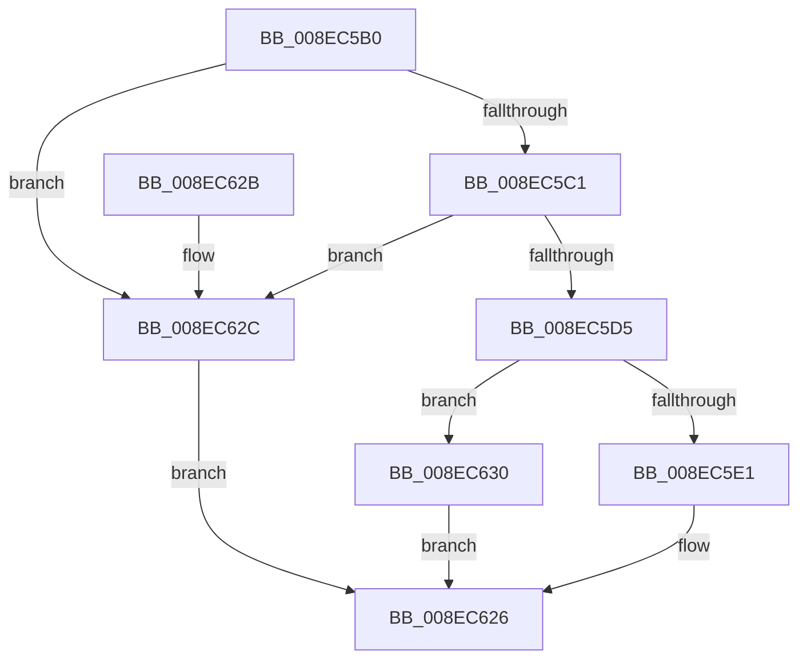

# PiDaFastIoDispatch

- RVA: `0x008EC5B0`–`0x008EC677` (길이 `199` bytes)
- VA: `0x00000001408EC5B0`
- 실행 섹션: `PAGE`
- PDB 이름 있음: `예`; PDB Function 태그: `아니요`
- unwind 정보 RVA: `0x00086C7C`
- 디코드: `43`개 명령, `199/199` bytes 표시
- 미해석 바이트: `0` (있으면 어셈블리에 `.byte`로 보존)

> 이 문서는 커널 이미지의 기계어와 PDB 기호를 분석해 생성했습니다. 4번과 5번은 함수 원형과 자료형을 바이너리 사용 방식에서 추정한 C 해석이며 원본 소스 복구 결과는 아닙니다.

## 1. Dependencies

- 직접 호출 지점: **2**; 고유 호출 대상: **2**
- 직접 호출자로 확인된 함수: **0**
- RIP 상대 이미지 참조: **2**

### Outgoing calls
- `0x008EC621` → [PiCMFastIoDeviceDispatch](PiCMFastIoDeviceDispatch_function_008EB3D0.md) (function, `0x008EB3D0`)
- `0x008EC670` → [guard_dispatch_icall](../../text/6B/guard_dispatch_icall_function_006BAAD0.md) (function, `0x006BAAD0`)

### Direct callers
- 이 함수 시작 RVA로 연결되는 직접 call은 확인되지 않았습니다. 간접 호출은 완전히 역산할 수 없습니다.

### Static image references
- `0x008EC5C5` → RVA `0x000019A0` (`.rdata`; read)
- `0x008EC5D5` → RVA `0x008EB3D0` (`PiCMFastIoDeviceDispatch`; read)

## 2. Other-region calls and transfers

- 다른 실행 섹션으로 향하는 call: **1**
  - `0x008EC670` → [guard_dispatch_icall](../../text/6B/guard_dispatch_icall_function_006BAAD0.md) (`PAGE` → `.text`)
- 별도 외부 분기/꼬리 이동을 확인하지 못했습니다.

## 3. Assembly (complete function range)

```asm
008EC5B0  48 83 EC 58                     sub rsp, 0x58
008EC5B4  48 8B 41 18                     mov rax, qword ptr [rcx + 0x18]
008EC5B8  4C 8B D9                        mov r11, rcx
008EC5BB  48 83 F8 05                     cmp rax, 5
008EC5BF  73 6B                           jae 0x1408ec62c
008EC5C1  4C 8D 14 40                     lea r10, [rax + rax*2]
008EC5C5  48 8D 05 D4 53 71 FF            lea rax, [rip - 0x8eac2c]
008EC5CC  4A 8B 04 D0                     mov rax, qword ptr [rax + r10*8]
008EC5D0  48 85 C0                        test rax, rax
008EC5D3  74 57                           je 0x1408ec62c
008EC5D5  48 8D 0D F4 ED FF FF            lea rcx, [rip - 0x120c]
008EC5DC  48 3B C1                        cmp rax, rcx
008EC5DF  75 4F                           jne 0x1408ec630
008EC5E1  48 8B 84 24 A0 00 00 00         mov rax, qword ptr [rsp + 0xa0]
008EC5E9  49 8B CB                        mov rcx, r11
008EC5EC  48 89 44 24 40                  mov qword ptr [rsp + 0x40], rax
008EC5F1  48 8B 84 24 98 00 00 00         mov rax, qword ptr [rsp + 0x98]
008EC5F9  48 89 44 24 38                  mov qword ptr [rsp + 0x38], rax
008EC5FE  8B 84 24 90 00 00 00            mov eax, dword ptr [rsp + 0x90]
008EC605  89 44 24 30                     mov dword ptr [rsp + 0x30], eax
008EC609  8B 84 24 88 00 00 00            mov eax, dword ptr [rsp + 0x88]
008EC610  89 44 24 28                     mov dword ptr [rsp + 0x28], eax
008EC614  48 8B 84 24 80 00 00 00         mov rax, qword ptr [rsp + 0x80]
008EC61C  48 89 44 24 20                  mov qword ptr [rsp + 0x20], rax
008EC621  E8 AA ED FF FF                  call 0x1408eb3d0
008EC626  48 83 C4 58                     add rsp, 0x58
008EC62A  C3                              ret
008EC62B  CC                              int3
008EC62C  32 C0                           xor al, al
008EC62E  EB F6                           jmp 0x1408ec626
008EC630  48 8B 8C 24 A0 00 00 00         mov rcx, qword ptr [rsp + 0xa0]
008EC638  48 89 4C 24 40                  mov qword ptr [rsp + 0x40], rcx
008EC63D  48 8B 8C 24 98 00 00 00         mov rcx, qword ptr [rsp + 0x98]
008EC645  48 89 4C 24 38                  mov qword ptr [rsp + 0x38], rcx
008EC64A  8B 8C 24 90 00 00 00            mov ecx, dword ptr [rsp + 0x90]
008EC651  89 4C 24 30                     mov dword ptr [rsp + 0x30], ecx
008EC655  8B 8C 24 88 00 00 00            mov ecx, dword ptr [rsp + 0x88]
008EC65C  89 4C 24 28                     mov dword ptr [rsp + 0x28], ecx
008EC660  48 8B 8C 24 80 00 00 00         mov rcx, qword ptr [rsp + 0x80]
008EC668  48 89 4C 24 20                  mov qword ptr [rsp + 0x20], rcx
008EC66D  49 8B CB                        mov rcx, r11
008EC670  E8 5B E4 DC FF                  call 0x1406baad0
008EC675  EB AF                           jmp 0x1408ec626
```

## 4. C-style interpretation (structured pseudocode)

```c
__int64 __fastcall PiDaFastIoDispatch(__int64 a1, __int64 a2, __int64 a3, __int64 a4, __int64 a5, unsigned int a6, unsigned int a7, __int64 a8, __int64 a9)
{
    __int64 result;
    __int64 v_rsp;
    unsigned __int64 v_stack_m18;
    unsigned __int64 v_stack_m20;
    unsigned int v_stack_m28;
    unsigned int v_stack_m30;
    unsigned __int64 v_stack_m38;
    unsigned __int64 v_stack_p20;
    unsigned int v_stack_p28;
    unsigned int v_stack_p30;
    unsigned __int64 v_stack_p38;
    unsigned __int64 v_stack_p40;

    v_rsp = (v_rsp) - (88);
    if ((*(unsigned __int64 *)(a1 + 24)) >= 5) goto loc_008EC62C;
    if (*(unsigned __int64 *)(v_rip - 9350188 + *(unsigned __int64 *)(a1 + 24) + *(unsigned __int64 *)(a1 + 24) * 2 * 8) == 0) goto loc_008EC62C;
    if ((*(unsigned __int64 *)(v_rip - 9350188 + *(unsigned __int64 *)(a1 + 24) + *(unsigned __int64 *)(a1 + 24) * 2 * 8)) != (v_rip - 4620)) goto loc_008EC630;
    v_stack_m18 = a9;
    v_stack_m20 = a8;
    v_stack_m28 = (unsigned int)((unsigned int)(a7));
    v_stack_m30 = (unsigned int)((unsigned int)(a6));
    v_stack_m38 = a5;
    result = PiCMFastIoDeviceDispatch(a1, a2, a3, a4);
loc_008EC626:
    v_rsp = (v_rsp) + (88);
    return result;
loc_008EC62C:
    result = 0;
    goto loc_008EC626;
loc_008EC630:
    v_stack_p40 = a9;
    v_stack_p38 = a8;
    v_stack_p30 = (unsigned int)((unsigned int)(a7));
    v_stack_p28 = (unsigned int)((unsigned int)(a6));
    v_stack_p20 = a5;
    result = guard_dispatch_icall(a1, a2, a3, a4);
    goto loc_008EC626;
}
```

## 5. (Beta) C Style

```c
int64_t PiDaFastIoDispatch(void *Arg1, int64_t Arg2, int64_t Arg3, int64_t Arg4, int64_t Arg5, uint32_t Arg6, uint32_t Arg7, int64_t Arg8, int64_t Arg9)
{
    uint8_t *arg1 = (uint8_t *)Arg1;

    int64_t result;
    int64_t local_rsp;
    uint64_t v_stack_m18;
    uint64_t v_stack_m20;
    uint32_t v_stack_m28;
    uint32_t v_stack_m30;
    uint64_t v_stack_m38;
    uint64_t v_stack_p20;
    uint32_t v_stack_p28;
    uint32_t v_stack_p30;
    uint64_t v_stack_p38;
    uint64_t v_stack_p40;

    local_rsp = (local_rsp) - (88);
    if ((*(uint64_t *)(arg1 + 0x18)) >= 5) goto loc_008EC62C;
    if (*(uint64_t *)(v_rip - 0x8EAC2C + *(uint64_t *)(arg1 + 0x18) + *(uint64_t *)(arg1 + 0x18) * 2 * 8) == 0) goto loc_008EC62C;
    if ((*(uint64_t *)(v_rip - 0x8EAC2C + *(uint64_t *)(arg1 + 0x18) + *(uint64_t *)(arg1 + 0x18) * 2 * 8)) != (v_rip - 4620)) goto loc_008EC630;
    v_stack_m18 = Arg9;
    v_stack_m20 = Arg8;
    v_stack_m28 = (uint32_t)((uint32_t)(Arg7));
    v_stack_m30 = (uint32_t)((uint32_t)(Arg6));
    v_stack_m38 = Arg5;
    result = PiCMFastIoDeviceDispatch(Arg1, Arg2, Arg3, Arg4);
loc_008EC626:
    local_rsp = (local_rsp) + (88);
    return result;
loc_008EC62C:
    result = 0;
    goto loc_008EC626;
loc_008EC630:
    v_stack_p40 = Arg9;
    v_stack_p38 = Arg8;
    v_stack_p30 = (uint32_t)((uint32_t)(Arg7));
    v_stack_p28 = (uint32_t)((uint32_t)(Arg6));
    v_stack_p20 = Arg5;
    result = guard_dispatch_icall(Arg1, Arg2, Arg3, Arg4);
    goto loc_008EC626;
}
```

### 관측된 메모리 오프셋

구조체 형식이 확인되지 않은 접근은 인자 기준의 오프셋으로만 기록했습니다.

| 기준 인자 | 오프셋 표현 | 폭 (bit) | 접근 |
|---|---:|---:|---|
| `Arg1` | `+ 0x18` | `64` | `R` |

## 6. Execution-region graph

[열기: 2D/3D 그래프와 함수 탐색 컨트롤 패널](../../../control-panel.html?section=page&rva=0x008EC5B0&view=graph)

- 2D 그래프는 위에서 아래로 흐르고, 3D 그래프는 빈 공간을 드래그해 회전합니다. Shift+드래그는 이동, 휠은 확대·축소, 함수 노드 선택은 대상 보고서 이동입니다.

### Static fallback


