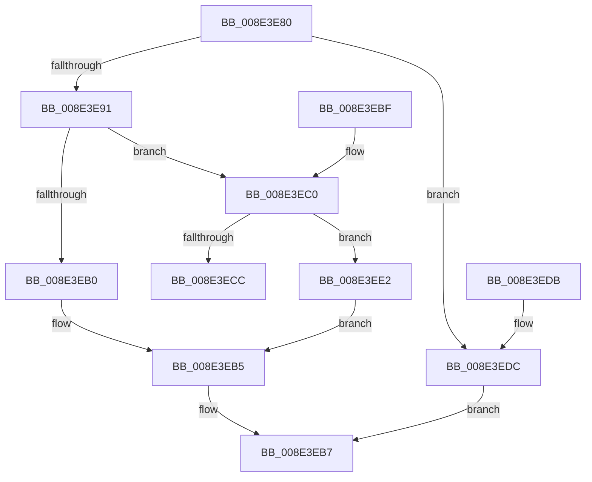

# PiDmCmObjectMatchCallback

- RVA: `0x008E3E80`–`0x008E3EE9` (길이 `105` bytes)
- VA: `0x00000001408E3E80`
- 실행 섹션: `PAGE`
- PDB 이름 있음: `예`; PDB Function 태그: `아니요`
- unwind 정보 RVA: `0x00086188`
- 디코드: `34`개 명령, `105/105` bytes 표시
- 미해석 바이트: `0` (있으면 어셈블리에 `.byte`로 보존)

> 이 문서는 커널 이미지의 기계어와 PDB 기호를 분석해 생성했습니다. 4번과 5번은 함수 원형과 자료형을 바이너리 사용 방식에서 추정한 C 해석이며 원본 소스 복구 결과는 아닙니다.

## 1. Dependencies

- 직접 호출 지점: **3**; 고유 호출 대상: **3**
- 직접 호출자로 확인된 함수: **1**
- RIP 상대 이미지 참조: **3**

### Outgoing calls
- `0x008E3EB0` → [PiPnpRtlInterfaceFilterCallback](PiPnpRtlInterfaceFilterCallback_function_008E4FC0.md) (function, `0x008E4FC0`)
- `0x008E3ECC` → [PiPnpRtlEnumeratorFilterCallback](PiPnpRtlEnumeratorFilterCallback_function_008E52F0.md) (function, `0x008E52F0`)
- `0x008E3EE2` → [guard_dispatch_icall](../../text/6B/guard_dispatch_icall_function_006BAAD0.md) (function, `0x006BAAD0`)

### Direct callers
- [PiDmGetObjectListCallback](PiDmGetObjectListCallback_function_008E3D30.md) at `0x008E3E33`

### Static image references
- `0x008E3E95` → RVA `0x008E4FC0` (`PiPnpRtlInterfaceFilterCallback`; read)
- `0x008E3EA4` → RVA `0x00E66398` (`.data`; read)
- `0x008E3EC0` → RVA `0x008E52F0` (`PiPnpRtlEnumeratorFilterCallback`; read)

## 2. Other-region calls and transfers

- 다른 실행 섹션으로 향하는 call: **1**
  - `0x008E3EE2` → [guard_dispatch_icall](../../text/6B/guard_dispatch_icall_function_006BAAD0.md) (`PAGE` → `.text`)
- 별도 외부 분기/꼬리 이동을 확인하지 못했습니다.

## 3. Assembly (complete function range)

```asm
008E3E80  40 53                           push rbx
008E3E82  48 83 EC 30                     sub rsp, 0x30
008E3E86  48 8B 02                        mov rax, qword ptr [rdx]
008E3E89  49 8B D8                        mov rbx, r8
008E3E8C  48 85 C0                        test rax, rax
008E3E8F  74 4B                           je 0x1408e3edc
008E3E91  4C 8B 4A 08                     mov r9, qword ptr [rdx + 8]
008E3E95  4C 8D 15 24 11 00 00            lea r10, [rip + 0x1124]
008E3E9C  44 8B 42 10                     mov r8d, dword ptr [rdx + 0x10]
008E3EA0  48 8B 51 10                     mov rdx, qword ptr [rcx + 0x10]
008E3EA4  48 8B 0D ED 24 58 00            mov rcx, qword ptr [rip + 0x5824ed]
008E3EAB  49 3B C2                        cmp rax, r10
008E3EAE  75 10                           jne 0x1408e3ec0
008E3EB0  E8 0B 11 00 00                  call 0x1408e4fc0
008E3EB5  88 03                           mov byte ptr [rbx], al
008E3EB7  33 C0                           xor eax, eax
008E3EB9  48 83 C4 30                     add rsp, 0x30
008E3EBD  5B                              pop rbx
008E3EBE  C3                              ret
008E3EBF  CC                              int3
008E3EC0  4C 8D 15 29 14 00 00            lea r10, [rip + 0x1429]
008E3EC7  49 3B C2                        cmp rax, r10
008E3ECA  75 16                           jne 0x1408e3ee2
008E3ECC  E8 1F 14 00 00                  call 0x1408e52f0
008E3ED1  88 03                           mov byte ptr [rbx], al
008E3ED3  33 C0                           xor eax, eax
008E3ED5  48 83 C4 30                     add rsp, 0x30
008E3ED9  5B                              pop rbx
008E3EDA  C3                              ret
008E3EDB  CC                              int3
008E3EDC  41 C6 00 01                     mov byte ptr [r8], 1
008E3EE0  EB D5                           jmp 0x1408e3eb7
008E3EE2  E8 E9 6B DD FF                  call 0x1406baad0
008E3EE7  EB CC                           jmp 0x1408e3eb5
```

## 4. C-style interpretation (structured pseudocode)

```c
__int64 __fastcall PiDmCmObjectMatchCallback(__int64 a1, __int64 a2, __int64 a3)
{
    __int64 result;
    __int64 v_rsp;

    v_rsp = (v_rsp) - (48);
    if (*(unsigned __int64 *)(a2) == 0) goto loc_008E3EDC;
    if ((*(unsigned __int64 *)(a2)) != (v_rip + 4388)) goto loc_008E3EC0;
    result = PiPnpRtlInterfaceFilterCallback(*(unsigned __int64 *)(v_rip + 5776621), *(unsigned __int64 *)(a1 + 16), (unsigned int)(*(unsigned int *)(a2 + 16)), *(unsigned __int64 *)(a2 + 8));
loc_008E3EB5:
    *(unsigned __int8 *)(a3) = (unsigned __int8)(result);
loc_008E3EB7:
    result = 0;
    v_rsp = (v_rsp) + (48);
    return result;
loc_008E3EC0:
    if (0 != (v_rip + 5161)) goto loc_008E3EE2;
    result = PiPnpRtlEnumeratorFilterCallback(*(unsigned __int64 *)(v_rip + 5776621), *(unsigned __int64 *)(a1 + 16), (unsigned int)(*(unsigned int *)(a2 + 16)), *(unsigned __int64 *)(a2 + 8));
    *(unsigned __int8 *)(a3) = (unsigned __int8)(result);
    result = 0;
    v_rsp = (v_rsp) + (48);
    return result;
loc_008E3EDC:
    *(unsigned __int8 *)((unsigned int)(*(unsigned int *)(a2 + 16))) = 1;
    goto loc_008E3EB7;
loc_008E3EE2:
    result = guard_dispatch_icall(*(unsigned __int64 *)(v_rip + 5776621), *(unsigned __int64 *)(a1 + 16), (unsigned int)(*(unsigned int *)(a2 + 16)), *(unsigned __int64 *)(a2 + 8));
    goto loc_008E3EB5;
}
```

## 5. (Beta) C Style

```c
int64_t PiDmCmObjectMatchCallback(void *Arg1, void *Arg2, void *Arg3)
{
    uint8_t *arg1 = (uint8_t *)Arg1;
    uint8_t *arg2 = (uint8_t *)Arg2;
    uint8_t *arg3 = (uint8_t *)Arg3;

    int64_t result;
    int64_t local_rsp;

    local_rsp = (local_rsp) - (48);
    if (*(uint64_t *)(arg2) == 0) goto loc_008E3EDC;
    if ((*(uint64_t *)(arg2)) != (v_rip + 4388)) goto loc_008E3EC0;
    result = PiPnpRtlInterfaceFilterCallback(*(uint64_t *)(v_rip + 0x5824ED), *(uint64_t *)(arg1 + 0x10), (uint32_t)(*(uint32_t *)(arg2 + 0x10)), *(uint64_t *)(arg2 + 0x8));
loc_008E3EB5:
    *(uint8_t *)(arg3) = (uint8_t)(result);
loc_008E3EB7:
    result = 0;
    local_rsp = (local_rsp) + (48);
    return result;
loc_008E3EC0:
    if (0 != (v_rip + 5161)) goto loc_008E3EE2;
    result = PiPnpRtlEnumeratorFilterCallback(*(uint64_t *)(v_rip + 0x5824ED), *(uint64_t *)(arg1 + 0x10), (uint32_t)(*(uint32_t *)(arg2 + 0x10)), *(uint64_t *)(arg2 + 0x8));
    *(uint8_t *)(arg3) = (uint8_t)(result);
    result = 0;
    local_rsp = (local_rsp) + (48);
    return result;
loc_008E3EDC:
    *(uint8_t *)((uint32_t)(*(uint32_t *)(arg2 + 0x10))) = 1;
    goto loc_008E3EB7;
loc_008E3EE2:
    result = guard_dispatch_icall(*(uint64_t *)(v_rip + 0x5824ED), *(uint64_t *)(arg1 + 0x10), (uint32_t)(*(uint32_t *)(arg2 + 0x10)), *(uint64_t *)(arg2 + 0x8));
    goto loc_008E3EB5;
}
```

### 관측된 메모리 오프셋

구조체 형식이 확인되지 않은 접근은 인자 기준의 오프셋으로만 기록했습니다.

| 기준 인자 | 오프셋 표현 | 폭 (bit) | 접근 |
|---|---:|---:|---|
| `Arg1` | `+ 0x10` | `64` | `R` |
| `Arg2` | `+ 0x0` | `64` | `R` |
| `Arg2` | `+ 0x8` | `64` | `R` |
| `Arg2` | `+ 0x10` | `32` | `R` |
| `Arg3` | `+ 0x0` | `8` | `W` |

## 6. Execution-region graph

[열기: 2D/3D 그래프와 함수 탐색 컨트롤 패널](../../../control-panel.html?section=page&rva=0x008E3E80&view=graph)

- 2D 그래프는 위에서 아래로 흐르고, 3D 그래프는 빈 공간을 드래그해 회전합니다. Shift+드래그는 이동, 휠은 확대·축소, 함수 노드 선택은 대상 보고서 이동입니다.

### Static fallback


