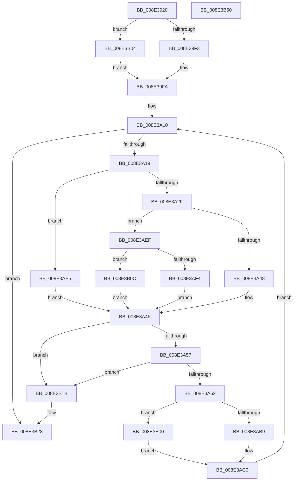

# PiDmEnumObjectsWithCallback

- RVA: `0x008E3920`–`0x008E3B51` (길이 `561` bytes)
- VA: `0x00000001408E3920`
- 실행 섹션: `PAGE`
- PDB 이름 있음: `예`; PDB Function 태그: `아니요`
- unwind 정보 RVA: `0x0008611C`
- 디코드: `139`개 명령, `561/561` bytes 표시
- 미해석 바이트: `0` (있으면 어셈블리에 `.byte`로 보존)

> 이 문서는 커널 이미지의 기계어와 PDB 기호를 분석해 생성했습니다. 4번과 5번은 함수 원형과 자료형을 바이너리 사용 방식에서 추정한 C 해석이며 원본 소스 복구 결과는 아닙니다.

## 1. Dependencies

- 직접 호출 지점: **18**; 고유 호출 대상: **15**
- 직접 호출자로 확인된 함수: **4**
- RIP 상대 이미지 참조: **5**

### Outgoing calls
- `0x008E3968` → [memset](../../text/6C/memset_function_006C6C40.md) (function, `0x006C6C40`)
- `0x008E3988` → [PiDmGetObjectManagerForObjectType](../95/PiDmGetObjectManagerForObjectType_function_00951140.md) (function, `0x00951140`)
- `0x008E39B6` → [PiDmObjectManagerAcquireSharedLock](../95/PiDmObjectManagerAcquireSharedLock_function_009511A0.md) (function, `0x009511A0`)
- `0x008E39E5` → [RtlEnumerateGenericTableLikeADirectory](../../text/3E/RtlEnumerateGenericTableLikeADirectory_function_003E5980.md) (function, `0x003E5980`)
- `0x008E39FD` → [PiDmObjectManagerReleaseLock](../95/PiDmObjectManagerReleaseLock_function_0095111C.md) (function, `0x0095111C`)
- `0x008E3A1C` → [PiDmObjectAcquireSharedLock](PiDmObjectAcquireSharedLock_function_008E38B8.md) (function, `0x008E38B8`)
- `0x008E3A2F` → [PiDmObjectReleaseLock](PiDmObjectReleaseLock_function_008E5584.md) (function, `0x008E5584`)
- `0x008E3A48` → [PiDmGetObjectListCallback](PiDmGetObjectListCallback_function_008E3D30.md) (function, `0x008E3D30`)
- `0x008E3A7D` → [ExAcquireResourceSharedLite](../../text/21/ExAcquireResourceSharedLite_function_00211BC0.md) (function, `0x00211BC0`)
- `0x008E3AAF` → [RtlEnumerateGenericTableLikeADirectory](../../text/3E/RtlEnumerateGenericTableLikeADirectory_function_003E5980.md) (function, `0x003E5980`)
- `0x008E3AC3` → [ExReleaseResourceLite](../../text/25/ExReleaseResourceLite_function_0025FA10.md) (function, `0x0025FA10`)
- `0x008E3AD1` → [KeLeaveCriticalRegionThread](../../text/25/KeLeaveCriticalRegionThread_function_0025EFF0.md) (function, `0x0025EFF0`)
- `0x008E3ADB` → [PiDmObjectRelease](PiDmObjectRelease_function_008E4F70.md) (function, `0x008E4F70`)
- `0x008E3AE5` → [PiDmObjectReleaseLock](PiDmObjectReleaseLock_function_008E5584.md) (function, `0x008E5584`)
- `0x008E3AF4` → [PiDqEnumQueryObjectsCallback](../8D/PiDqEnumQueryObjectsCallback_function_008DF400.md) (function, `0x008DF400`)
- `0x008E3B0F` → [guard_dispatch_icall](../../text/6B/guard_dispatch_icall_function_006BAAD0.md) (function, `0x006BAAD0`)
- `0x008E3B1E` → [PiDmObjectRelease](PiDmObjectRelease_function_008E4F70.md) (function, `0x008E4F70`)
- `0x008E3B30` → [_security_check_cookie](../../text/6A/_security_check_cookie_function_006AC640.md) (function, `0x006AC640`)

### Direct callers
- [PiDmListInit](../73/PiDmListInit_function_00730280.md) at `0x007302AF`
- [PiDqObjectManagerEnumerateAndRegisterQuery](../8D/PiDqObjectManagerEnumerateAndRegisterQuery_function_008DCF74.md) at `0x008DD1F9`
- [PiDmGetObjectList](../8F/PiDmGetObjectList_function_008FF0A0.md) at `0x008FF0EA`
- [PpDevCfgInit](../../init/C3/PpDevCfgInit_function_00C351A4.md) at `0x00C354A0`

### Static image references
- `0x008E3937` → RVA `0x00E0A740` (`.data`; read)
- `0x008E3994` → RVA `0x00AFCAD0` (` ?? ::NNGAKEGL::`string'`; read)
- `0x008E39A3` → RVA `0x00011540` (`.rdata`; read)
- `0x008E3A02` → RVA `0x008E3D30` (`PiDmGetObjectListCallback`; read)
- `0x008E3A09` → RVA `0x008DF400` (`PiDqEnumQueryObjectsCallback`; read)

## 2. Other-region calls and transfers

- 다른 실행 섹션으로 향하는 call: **8**
  - `0x008E3968` → [memset](../../text/6C/memset_function_006C6C40.md) (`PAGE` → `.text`)
  - `0x008E39E5` → [RtlEnumerateGenericTableLikeADirectory](../../text/3E/RtlEnumerateGenericTableLikeADirectory_function_003E5980.md) (`PAGE` → `.text`)
  - `0x008E3A7D` → [ExAcquireResourceSharedLite](../../text/21/ExAcquireResourceSharedLite_function_00211BC0.md) (`PAGE` → `.text`)
  - `0x008E3AAF` → [RtlEnumerateGenericTableLikeADirectory](../../text/3E/RtlEnumerateGenericTableLikeADirectory_function_003E5980.md) (`PAGE` → `.text`)
  - `0x008E3AC3` → [ExReleaseResourceLite](../../text/25/ExReleaseResourceLite_function_0025FA10.md) (`PAGE` → `.text`)
  - `0x008E3AD1` → [KeLeaveCriticalRegionThread](../../text/25/KeLeaveCriticalRegionThread_function_0025EFF0.md) (`PAGE` → `.text`)
  - `0x008E3B0F` → [guard_dispatch_icall](../../text/6B/guard_dispatch_icall_function_006BAAD0.md) (`PAGE` → `.text`)
  - `0x008E3B30` → [_security_check_cookie](../../text/6A/_security_check_cookie_function_006AC640.md) (`PAGE` → `.text`)
- 별도 외부 분기/꼬리 이동을 확인하지 못했습니다.

## 3. Assembly (complete function range)

```asm
008E3920  48 89 5C 24 20                  mov qword ptr [rsp + 0x20], rbx
008E3925  55                              push rbp
008E3926  56                              push rsi
008E3927  57                              push rdi
008E3928  41 54                           push r12
008E392A  41 55                           push r13
008E392C  41 56                           push r14
008E392E  41 57                           push r15
008E3930  48 81 EC E0 00 00 00            sub rsp, 0xe0
008E3937  48 8B 05 02 6E 52 00            mov rax, qword ptr [rip + 0x526e02]
008E393E  48 33 C4                        xor rax, rsp
008E3941  48 89 84 24 D0 00 00 00         mov qword ptr [rsp + 0xd0], rax
008E3949  45 33 E4                        xor r12d, r12d
008E394C  4D 8B F0                        mov r14, r8
008E394F  48 8B EA                        mov rbp, rdx
008E3952  4C 89 64 24 60                  mov qword ptr [rsp + 0x60], r12
008E3957  8B D9                           mov ebx, ecx
008E3959  33 D2                           xor edx, edx
008E395B  48 8D 4C 24 68                  lea rcx, [rsp + 0x68]
008E3960  41 8B FC                        mov edi, r12d
008E3963  45 8D 44 24 68                  lea r8d, [r12 + 0x68]
008E3968  E8 D3 32 DE FF                  call 0x1406c6c40
008E396D  48 8D 44 24 60                  lea rax, [rsp + 0x60]
008E3972  4C 89 64 24 50                  mov qword ptr [rsp + 0x50], r12
008E3977  8B CB                           mov ecx, ebx
008E3979  48 89 44 24 48                  mov qword ptr [rsp + 0x48], rax
008E397E  44 89 64 24 44                  mov dword ptr [rsp + 0x44], r12d
008E3983  40 88 7C 24 40                  mov byte ptr [rsp + 0x40], dil
008E3988  E8 B3 D7 06 00                  call 0x140951140
008E398D  48 8B F0                        mov rsi, rax
008E3990  89 5C 24 7C                     mov dword ptr [rsp + 0x7c], ebx
008E3994  48 8D 0D 35 91 21 00            lea rcx, [rip + 0x219135]
008E399B  44 89 64 24 78                  mov dword ptr [rsp + 0x78], r12d
008E39A0  83 FB 03                        cmp ebx, 3
008E39A3  48 8D 05 96 DB 72 FF            lea rax, [rip - 0x8d246a]
008E39AA  48 0F 45 C1                     cmovne rax, rcx
008E39AE  48 8B CE                        mov rcx, rsi
008E39B1  48 89 44 24 70                  mov qword ptr [rsp + 0x70], rax
008E39B6  E8 E5 D7 06 00                  call 0x1409511a0
008E39BB  48 8D 44 24 48                  lea rax, [rsp + 0x48]
008E39C0  45 33 C9                        xor r9d, r9d
008E39C3  48 89 44 24 30                  mov qword ptr [rsp + 0x30], rax
008E39C8  48 8D 4E 68                     lea rcx, [rsi + 0x68]
008E39CC  48 8D 44 24 44                  lea rax, [rsp + 0x44]
008E39D1  45 33 C0                        xor r8d, r8d
008E39D4  48 89 44 24 28                  mov qword ptr [rsp + 0x28], rax
008E39D9  33 D2                           xor edx, edx
008E39DB  48 8D 44 24 50                  lea rax, [rsp + 0x50]
008E39E0  48 89 44 24 20                  mov qword ptr [rsp + 0x20], rax
008E39E5  E8 96 1F B0 FF                  call 0x1403e5980
008E39EA  48 85 C0                        test rax, rax
008E39ED  0F 84 11 01 00 00               je 0x1408e3b04
008E39F3  48 8B 18                        mov rbx, qword ptr [rax]
008E39F6  F0 FF 43 08                     lock inc dword ptr [rbx + 8]
008E39FA  48 8B CE                        mov rcx, rsi
008E39FD  E8 1A D7 06 00                  call 0x14095111c
008E3A02  4C 8D 25 27 03 00 00            lea r12, [rip + 0x327]
008E3A09  4C 8D 2D F0 B9 FF FF            lea r13, [rip - 0x4610]
008E3A10  48 85 DB                        test rbx, rbx
008E3A13  0F 84 0A 01 00 00               je 0x1408e3b23
008E3A19  48 8B CB                        mov rcx, rbx
008E3A1C  E8 97 FE FF FF                  call 0x1408e38b8
008E3A21  8B 43 20                        mov eax, dword ptr [rbx + 0x20]
008E3A24  48 8B CB                        mov rcx, rbx
008E3A27  A8 01                           test al, 1
008E3A29  0F 84 B6 00 00 00               je 0x1408e3ae5
008E3A2F  E8 50 1B 00 00                  call 0x1408e5584
008E3A34  4C 8D 44 24 40                  lea r8, [rsp + 0x40]
008E3A39  49 8B D6                        mov rdx, r14
008E3A3C  48 8B CB                        mov rcx, rbx
008E3A3F  49 3B EC                        cmp rbp, r12
008E3A42  0F 85 A7 00 00 00               jne 0x1408e3aef
008E3A48  E8 E3 02 00 00                  call 0x1408e3d30
008E3A4D  8B F8                           mov edi, eax
008E3A4F  85 FF                           test edi, edi
008E3A51  0F 88 C4 00 00 00               js 0x1408e3b1b
008E3A57  80 7C 24 40 00                  cmp byte ptr [rsp + 0x40], 0
008E3A5C  0F 85 B9 00 00 00               jne 0x1408e3b1b
008E3A62  48 89 5C 24 48                  mov qword ptr [rsp + 0x48], rbx
008E3A67  B2 01                           mov dl, 1
008E3A69  65 48 8B 04 25 88 01 00 00      mov rax, qword ptr gs:[0x188]
008E3A72  48 8B CE                        mov rcx, rsi
008E3A75  66 FF 88 E4 01 00 00            dec word ptr [rax + 0x1e4]
008E3A7C  90                              nop
008E3A7D  E8 3E E1 92 FF                  call 0x140211bc0
008E3A82  48 8D 44 24 48                  lea rax, [rsp + 0x48]
008E3A87  41 B9 01 00 00 00               mov r9d, 1
008E3A8D  48 89 44 24 30                  mov qword ptr [rsp + 0x30], rax
008E3A92  48 8D 4E 68                     lea rcx, [rsi + 0x68]
008E3A96  48 8D 44 24 44                  lea rax, [rsp + 0x44]
008E3A9B  45 33 C0                        xor r8d, r8d
008E3A9E  48 89 44 24 28                  mov qword ptr [rsp + 0x28], rax
008E3AA3  33 D2                           xor edx, edx
008E3AA5  48 8D 44 24 50                  lea rax, [rsp + 0x50]
008E3AAA  48 89 44 24 20                  mov qword ptr [rsp + 0x20], rax
008E3AAF  E8 CC 1E B0 FF                  call 0x1403e5980
008E3AB4  48 85 C0                        test rax, rax
008E3AB7  74 47                           je 0x1408e3b00
008E3AB9  48 8B 18                        mov rbx, qword ptr [rax]
008E3ABC  F0 FF 43 08                     lock inc dword ptr [rbx + 8]
008E3AC0  48 8B CE                        mov rcx, rsi
008E3AC3  E8 48 BF 97 FF                  call 0x14025fa10
008E3AC8  65 48 8B 0C 25 88 01 00 00      mov rcx, qword ptr gs:[0x188]
008E3AD1  E8 1A B5 97 FF                  call 0x14025eff0
008E3AD6  48 8B 4C 24 48                  mov rcx, qword ptr [rsp + 0x48]
008E3ADB  E8 90 14 00 00                  call 0x1408e4f70
008E3AE0  E9 2B FF FF FF                  jmp 0x1408e3a10
008E3AE5  E8 9A 1A 00 00                  call 0x1408e5584
008E3AEA  E9 60 FF FF FF                  jmp 0x1408e3a4f
008E3AEF  49 3B ED                        cmp rbp, r13
008E3AF2  75 18                           jne 0x1408e3b0c
008E3AF4  E8 07 B9 FF FF                  call 0x1408df400
008E3AF9  8B F8                           mov edi, eax
008E3AFB  E9 4F FF FF FF                  jmp 0x1408e3a4f
008E3B00  33 DB                           xor ebx, ebx
008E3B02  EB BC                           jmp 0x1408e3ac0
008E3B04  49 8B DC                        mov rbx, r12
008E3B07  E9 EE FE FF FF                  jmp 0x1408e39fa
008E3B0C  48 8B C5                        mov rax, rbp
008E3B0F  E8 BC 6F DD FF                  call 0x1406baad0
008E3B14  8B F8                           mov edi, eax
008E3B16  E9 34 FF FF FF                  jmp 0x1408e3a4f
008E3B1B  48 8B CB                        mov rcx, rbx
008E3B1E  E8 4D 14 00 00                  call 0x1408e4f70
008E3B23  8B C7                           mov eax, edi
008E3B25  48 8B 8C 24 D0 00 00 00         mov rcx, qword ptr [rsp + 0xd0]
008E3B2D  48 33 CC                        xor rcx, rsp
008E3B30  E8 0B 8B DC FF                  call 0x1406ac640
008E3B35  48 8B 9C 24 38 01 00 00         mov rbx, qword ptr [rsp + 0x138]
008E3B3D  48 81 C4 E0 00 00 00            add rsp, 0xe0
008E3B44  41 5F                           pop r15
008E3B46  41 5E                           pop r14
008E3B48  41 5D                           pop r13
008E3B4A  41 5C                           pop r12
008E3B4C  5F                              pop rdi
008E3B4D  5E                              pop rsi
008E3B4E  5D                              pop rbp
008E3B4F  C3                              ret
008E3B50  CC                              int3
```

## 4. C-style interpretation (structured pseudocode)

```c
__int64 __fastcall PiDmEnumObjectsWithCallback(int a1, __int64 a2, __int64 a3, int a4)
{
    __int64 result;
    __int64 v_r12;
    __int64 v_rbx;
    __int64 v_rsp;
    unsigned __int64 v_stack_m48;
    unsigned int v_stack_m9C;
    unsigned int v_stack_mA0;
    unsigned __int64 v_stack_mA8;
    unsigned __int64 v_stack_mB0;
    unsigned __int64 v_stack_mB8;
    unsigned __int64 v_stack_mC8;
    unsigned __int64 v_stack_mD0;
    unsigned int v_stack_mD4;
    unsigned __int8 v_stack_mD8;
    unsigned __int64 v_stack_mE8;
    unsigned __int64 v_stack_mF0;
    unsigned __int64 v_stack_mF8;
    unsigned __int64 v_stack_p20;

    v_stack_p20 = v_rbx;
    v_rsp = (v_rsp) - (224);
    result = (*(unsigned __int64 *)(v_rip + 5402114)) ^ (v_rsp);
    v_stack_m48 = result;
    v_r12 = 0;
    v_stack_mB8 = 0;
    a2 = 0;
    result = memset(v_stack_mB0, a2, v_r12 + 104, a4);
    v_stack_mC8 = 0;
    v_stack_mD0 = v_stack_mB8;
    v_stack_mD4 = 0;
    v_stack_mD8 = 0;
    result = PiDmGetObjectManagerForObjectType((unsigned int)((unsigned int)((unsigned int)(a1))), a2, v_r12 + 104, a4);
    v_stack_m9C = (unsigned int)((unsigned int)(a1));
    v_stack_mA0 = 0;
    result = v_rip - 9249898;
    if (((unsigned int)((unsigned int)(a1))) != 3) { result = v_rip + 2199861; }
    v_stack_mA8 = result;
    result = PiDmObjectManagerAcquireSharedLock(result, a2, v_r12 + 104, a4);
    a4 = 0;
    v_stack_mE8 = v_stack_mD0;
    a3 = 0;
    v_stack_mF0 = v_stack_mD4;
    a2 = 0;
    v_stack_mF8 = v_stack_mC8;
    result = RtlEnumerateGenericTableLikeADirectory(result + 104, a2, a3, a4);
    if (result == 0) goto loc_008E3B04;
loc_008E39FA:
    result = PiDmObjectManagerReleaseLock(result, a2, a3, a4);
loc_008E3A10:
    if (*(unsigned __int64 *)(result) == 0) goto loc_008E3B23;
    result = PiDmObjectAcquireSharedLock(*(unsigned __int64 *)(result), a2, a3, a4);
    if ((((unsigned __int8)((unsigned int)(*(unsigned int *)(*(unsigned __int64 *)(result) + 32)))) & (1)) == 0) goto loc_008E3AE5;
    result = PiDmObjectReleaseLock(*(unsigned __int64 *)(result), a2, a3, a4);
    if (0 != (v_rip + 807)) goto loc_008E3AEF;
    result = PiDmGetObjectListCallback(*(unsigned __int64 *)(result), 0, v_stack_mD8, a4);
loc_008E3A4F:
    if (sign_flag) goto loc_008E3B1B;
    if (v_stack_mD8 != 0) goto loc_008E3B1B;
    v_stack_mD0 = *(unsigned __int64 *)(result);
    result = ExAcquireResourceSharedLite(result, 1, v_stack_mD8, a4);
    v_stack_mE8 = v_stack_mD0;
    a3 = 0;
    v_stack_mF0 = v_stack_mD4;
    a2 = 0;
    v_stack_mF8 = v_stack_mC8;
    result = RtlEnumerateGenericTableLikeADirectory(result + 104, a2, a3, 1);
    if (result == 0) goto loc_008E3B00;
loc_008E3AC0:
    result = ExReleaseResourceLite(result, a2, a3, 1);
    result = KeLeaveCriticalRegionThread(*(unsigned __int64 *)(gs_base + (0 + 392)), a2, a3, 1);
    result = PiDmObjectRelease(v_stack_mD0, a2, a3, 1);
    goto loc_008E3A10;
loc_008E3AE5:
    result = PiDmObjectReleaseLock(v_stack_mD0, a2, a3, 1);
    goto loc_008E3A4F;
loc_008E3AEF:
    if (0 != (v_rip - 17936)) goto loc_008E3B0C;
    result = PiDqEnumQueryObjectsCallback(v_stack_mD0, a2, a3, 1);
    goto loc_008E3A4F;
loc_008E3B00:
    v_rbx = 0;
    goto loc_008E3AC0;
loc_008E3B04:
    goto loc_008E39FA;
loc_008E3B0C:
    result = guard_dispatch_icall(v_stack_mD0, a2, a3, 1);
    goto loc_008E3A4F;
loc_008E3B1B:
    result = PiDmObjectRelease(v_rip + 807, a2, a3, 1);
loc_008E3B23:
    a1 = (v_stack_m48) ^ (v_rsp);
    result = _security_check_cookie(a1, a2, a3, 1);
    v_rsp = (v_rsp) + (224);
    return result;
}
```

## 5. (Beta) C Style

```c
int64_t PiDmEnumObjectsWithCallback(int32_t Arg1, int64_t Arg2, int64_t Arg3, int32_t Arg4)
{
    int64_t result;
    int64_t local_r12;
    int64_t local_rbx;
    int64_t local_rsp;
    uint64_t v_stack_m48;
    uint32_t v_stack_m9C;
    uint32_t v_stack_mA0;
    uint64_t v_stack_mA8;
    uint64_t v_stack_mB0;
    uint64_t v_stack_mB8;
    uint64_t v_stack_mC8;
    uint64_t v_stack_mD0;
    uint32_t v_stack_mD4;
    uint8_t v_stack_mD8;
    uint64_t v_stack_mE8;
    uint64_t v_stack_mF0;
    uint64_t v_stack_mF8;
    uint64_t v_stack_p20;

    v_stack_p20 = local_rbx;
    local_rsp = (local_rsp) - (224);
    result = (*(uint64_t *)(v_rip + 0x526E02)) ^ (local_rsp);
    v_stack_m48 = result;
    local_r12 = 0;
    v_stack_mB8 = 0;
    Arg2 = 0;
    result = memset(v_stack_mB0, Arg2, local_r12 + 104, Arg4);
    v_stack_mC8 = 0;
    v_stack_mD0 = v_stack_mB8;
    v_stack_mD4 = 0;
    v_stack_mD8 = 0;
    result = PiDmGetObjectManagerForObjectType((uint32_t)((uint32_t)((uint32_t)(Arg1))), Arg2, local_r12 + 104, Arg4);
    v_stack_m9C = (uint32_t)((uint32_t)(Arg1));
    v_stack_mA0 = 0;
    result = v_rip - 9249898;
    if (((uint32_t)((uint32_t)(Arg1))) != 3) { result = v_rip + 2199861; }
    v_stack_mA8 = result;
    result = PiDmObjectManagerAcquireSharedLock(result, Arg2, local_r12 + 104, Arg4);
    Arg4 = 0;
    v_stack_mE8 = v_stack_mD0;
    Arg3 = 0;
    v_stack_mF0 = v_stack_mD4;
    Arg2 = 0;
    v_stack_mF8 = v_stack_mC8;
    result = RtlEnumerateGenericTableLikeADirectory(result + 104, Arg2, Arg3, Arg4);
    if (result == 0) goto loc_008E3B04;
loc_008E39FA:
    result = PiDmObjectManagerReleaseLock(result, Arg2, Arg3, Arg4);
loc_008E3A10:
    if (*(uint64_t *)(result) == 0) goto loc_008E3B23;
    result = PiDmObjectAcquireSharedLock(*(uint64_t *)(result), Arg2, Arg3, Arg4);
    if ((((uint8_t)((uint32_t)(*(uint32_t *)(*(uint64_t *)(result) + 0x20)))) & (1)) == 0) goto loc_008E3AE5;
    result = PiDmObjectReleaseLock(*(uint64_t *)(result), Arg2, Arg3, Arg4);
    if (0 != (v_rip + 807)) goto loc_008E3AEF;
    result = PiDmGetObjectListCallback(*(uint64_t *)(result), 0, v_stack_mD8, Arg4);
loc_008E3A4F:
    if (sign_flag) goto loc_008E3B1B;
    if (v_stack_mD8 != 0) goto loc_008E3B1B;
    v_stack_mD0 = *(uint64_t *)(result);
    result = ExAcquireResourceSharedLite(result, 1, v_stack_mD8, Arg4);
    v_stack_mE8 = v_stack_mD0;
    Arg3 = 0;
    v_stack_mF0 = v_stack_mD4;
    Arg2 = 0;
    v_stack_mF8 = v_stack_mC8;
    result = RtlEnumerateGenericTableLikeADirectory(result + 104, Arg2, Arg3, 1);
    if (result == 0) goto loc_008E3B00;
loc_008E3AC0:
    result = ExReleaseResourceLite(result, Arg2, Arg3, 1);
    result = KeLeaveCriticalRegionThread(*(uint64_t *)(gs_base + (0 + 0x188)), Arg2, Arg3, 1);
    result = PiDmObjectRelease(v_stack_mD0, Arg2, Arg3, 1);
    goto loc_008E3A10;
loc_008E3AE5:
    result = PiDmObjectReleaseLock(v_stack_mD0, Arg2, Arg3, 1);
    goto loc_008E3A4F;
loc_008E3AEF:
    if (0 != (v_rip - 17936)) goto loc_008E3B0C;
    result = PiDqEnumQueryObjectsCallback(v_stack_mD0, Arg2, Arg3, 1);
    goto loc_008E3A4F;
loc_008E3B00:
    local_rbx = 0;
    goto loc_008E3AC0;
loc_008E3B04:
    goto loc_008E39FA;
loc_008E3B0C:
    result = guard_dispatch_icall(v_stack_mD0, Arg2, Arg3, 1);
    goto loc_008E3A4F;
loc_008E3B1B:
    result = PiDmObjectRelease(v_rip + 807, Arg2, Arg3, 1);
loc_008E3B23:
    Arg1 = (v_stack_m48) ^ (local_rsp);
    result = _security_check_cookie(Arg1, Arg2, Arg3, 1);
    local_rsp = (local_rsp) + (224);
    return result;
}
```

## 6. Execution-region graph

[열기: 2D/3D 그래프와 함수 탐색 컨트롤 패널](../../../control-panel.html?section=page&rva=0x008E3920&view=graph)

- 2D 그래프는 위에서 아래로 흐르고, 3D 그래프는 빈 공간을 드래그해 회전합니다. Shift+드래그는 이동, 휠은 확대·축소, 함수 노드 선택은 대상 보고서 이동입니다.

### Static fallback


