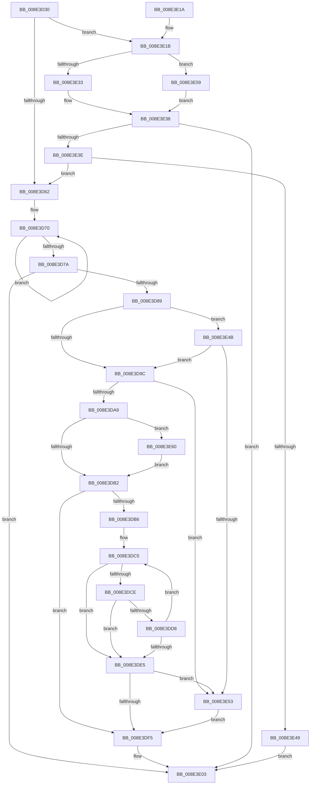

# PiDmGetObjectListCallback

- RVA: `0x008E3D30`–`0x008E3E6C` (길이 `316` bytes)
- VA: `0x00000001408E3D30`
- 실행 섹션: `PAGE`
- PDB 이름 있음: `예`; PDB Function 태그: `아니요`
- unwind 정보 RVA: `0x00086170`
- 디코드: `88`개 명령, `316/316` bytes 표시
- 미해석 바이트: `0` (있으면 어셈블리에 `.byte`로 보존)

> 이 문서는 커널 이미지의 기계어와 PDB 기호를 분석해 생성했습니다. 4번과 5번은 함수 원형과 자료형을 바이너리 사용 방식에서 추정한 C 해석이며 원본 소스 복구 결과는 아닙니다.

## 1. Dependencies

- 직접 호출 지점: **2**; 고유 호출 대상: **2**
- 직접 호출자로 확인된 함수: **2**
- RIP 상대 이미지 참조: **2**

### Outgoing calls
- `0x008E3E33` → [PiDmCmObjectMatchCallback](PiDmCmObjectMatchCallback_function_008E3E80.md) (function, `0x008E3E80`)
- `0x008E3E59` → [guard_dispatch_icall](../../text/6B/guard_dispatch_icall_function_006BAAD0.md) (function, `0x006BAAD0`)

### Direct callers
- [PiDmEnumObjectsWithCallback](PiDmEnumObjectsWithCallback_function_008E3920.md) at `0x008E3A48`
- [PiDmListEnumObjectsWithCallback](PiDmListEnumObjectsWithCallback_function_008E3B60.md) at `0x008E3C64`

### Static image references
- `0x008E3E1F` → RVA `0x008E3E80` (`PiDmCmObjectMatchCallback`; read)
- `0x008E3E60` → RVA `0x006C8EC0` (` ?? ::FNODOBFM::`string'`; read)

## 2. Other-region calls and transfers

- 다른 실행 섹션으로 향하는 call: **1**
  - `0x008E3E59` → [guard_dispatch_icall](../../text/6B/guard_dispatch_icall_function_006BAAD0.md) (`PAGE` → `.text`)
- 별도 외부 분기/꼬리 이동을 확인하지 못했습니다.

## 3. Assembly (complete function range)

```asm
008E3D30  48 89 5C 24 08                  mov qword ptr [rsp + 8], rbx
008E3D35  48 89 6C 24 18                  mov qword ptr [rsp + 0x18], rbp
008E3D3A  48 89 74 24 20                  mov qword ptr [rsp + 0x20], rsi
008E3D3F  57                              push rdi
008E3D40  48 83 EC 20                     sub rsp, 0x20
008E3D44  33 ED                           xor ebp, ebp
008E3D46  48 8B FA                        mov rdi, rdx
008E3D49  8B F5                           mov esi, ebp
008E3D4B  48 8B D9                        mov rbx, rcx
008E3D4E  41 88 30                        mov byte ptr [r8], sil
008E3D51  48 8B 02                        mov rax, qword ptr [rdx]
008E3D54  40 88 74 24 38                  mov byte ptr [rsp + 0x38], sil
008E3D59  48 85 C0                        test rax, rax
008E3D5C  0F 85 B9 00 00 00               jne 0x1408e3e1b
008E3D62  48 8B 43 10                     mov rax, qword ptr [rbx + 0x10]
008E3D66  49 C7 C2 FF FF FF FF            mov r10, 0xffffffffffffffff
008E3D6D  0F 1F 00                        nop dword ptr [rax]
008E3D70  49 FF C2                        inc r10
008E3D73  66 42 39 2C 50                  cmp word ptr [rax + r10*2], bp
008E3D78  75 F6                           jne 0x1408e3d70
008E3D7A  8B 47 18                        mov eax, dword ptr [rdi + 0x18]
008E3D7D  41 FF C2                        inc r10d
008E3D80  44 01 57 1C                     add dword ptr [rdi + 0x1c], r10d
008E3D84  41 3B C2                        cmp eax, r10d
008E3D87  76 7A                           jbe 0x1408e3e03
008E3D89  4C 8B 5F 10                     mov r11, qword ptr [rdi + 0x10]
008E3D8D  8B D0                           mov edx, eax
008E3D8F  4C 8B 43 10                     mov r8, qword ptr [rbx + 0x10]
008E3D93  4D 85 DB                        test r11, r11
008E3D96  0F 84 AF 00 00 00               je 0x1408e3e4b
008E3D9C  48 81 FA FF FF FF 7F            cmp rdx, 0x7fffffff
008E3DA3  0F 87 AA 00 00 00               ja 0x1408e3e53
008E3DA9  4D 85 C0                        test r8, r8
008E3DAC  0F 84 AE 00 00 00               je 0x1408e3e60
008E3DB2  85 C0                           test eax, eax
008E3DB4  74 3F                           je 0x1408e3df5
008E3DB6  41 B9 FE FF FF 7F               mov r9d, 0x7ffffffe
008E3DBC  49 8B C3                        mov rax, r11
008E3DBF  4C 2B CA                        sub r9, rdx
008E3DC2  4D 2B C3                        sub r8, r11
008E3DC5  49 8D 0C 11                     lea rcx, [r9 + rdx]
008E3DC9  48 85 C9                        test rcx, rcx
008E3DCC  74 17                           je 0x1408e3de5
008E3DCE  41 0F B7 0C 00                  movzx ecx, word ptr [r8 + rax]
008E3DD3  66 85 C9                        test cx, cx
008E3DD6  74 0D                           je 0x1408e3de5
008E3DD8  66 89 08                        mov word ptr [rax], cx
008E3DDB  48 83 C0 02                     add rax, 2
008E3DDF  48 83 EA 01                     sub rdx, 1
008E3DE3  75 E0                           jne 0x1408e3dc5
008E3DE5  48 85 D2                        test rdx, rdx
008E3DE8  48 8D 48 FE                     lea rcx, [rax - 2]
008E3DEC  48 0F 45 C8                     cmovne rcx, rax
008E3DF0  66 89 29                        mov word ptr [rcx], bp
008E3DF3  74 5E                           je 0x1408e3e53
008E3DF5  41 8B C2                        mov eax, r10d
008E3DF8  48 03 C0                        add rax, rax
008E3DFB  48 01 47 10                     add qword ptr [rdi + 0x10], rax
008E3DFF  44 29 57 18                     sub dword ptr [rdi + 0x18], r10d
008E3E03  8B C6                           mov eax, esi
008E3E05  48 8B 5C 24 30                  mov rbx, qword ptr [rsp + 0x30]
008E3E0A  48 8B 6C 24 40                  mov rbp, qword ptr [rsp + 0x40]
008E3E0F  48 8B 74 24 48                  mov rsi, qword ptr [rsp + 0x48]
008E3E14  48 83 C4 20                     add rsp, 0x20
008E3E18  5F                              pop rdi
008E3E19  C3                              ret
008E3E1A  CC                              int3
008E3E1B  48 8B 52 08                     mov rdx, qword ptr [rdx + 8]
008E3E1F  48 8D 0D 5A 00 00 00            lea rcx, [rip + 0x5a]
008E3E26  48 3B C1                        cmp rax, rcx
008E3E29  4C 8D 44 24 38                  lea r8, [rsp + 0x38]
008E3E2E  48 8B CB                        mov rcx, rbx
008E3E31  75 26                           jne 0x1408e3e59
008E3E33  E8 48 00 00 00                  call 0x1408e3e80
008E3E38  8B F0                           mov esi, eax
008E3E3A  85 C0                           test eax, eax
008E3E3C  78 C5                           js 0x1408e3e03
008E3E3E  40 38 6C 24 38                  cmp byte ptr [rsp + 0x38], bpl
008E3E43  0F 85 19 FF FF FF               jne 0x1408e3d62
008E3E49  EB B8                           jmp 0x1408e3e03
008E3E4B  85 C0                           test eax, eax
008E3E4D  0F 84 49 FF FF FF               je 0x1408e3d9c
008E3E53  66 41 89 2B                     mov word ptr [r11], bp
008E3E57  EB 9C                           jmp 0x1408e3df5
008E3E59  E8 72 6C DD FF                  call 0x1406baad0
008E3E5E  EB D8                           jmp 0x1408e3e38
008E3E60  4C 8D 05 59 50 DE FF            lea r8, [rip - 0x21afa7]
008E3E67  E9 46 FF FF FF                  jmp 0x1408e3db2
```

## 4. C-style interpretation (structured pseudocode)

```c
__int64 __fastcall PiDmGetObjectListCallback(__int64 a1, __int64 a2, __int64 a3)
{
    __int64 result;
    __int64 v_r10;
    __int64 v_rbp;
    __int64 v_rsp;
    unsigned __int8 v_stack_p10;
    unsigned __int64 v_stack_p18;
    unsigned __int64 v_stack_p20;
    unsigned __int64 v_stack_p38;
    unsigned __int64 v_stack_p8;

    v_stack_p8 = v_rbx;
    v_stack_p18 = v_rbp;
    v_stack_p20 = v_rsi;
    v_rsp = (v_rsp) - (32);
    v_rbp = 0;
    *(unsigned __int8 *)(a3) = 0;
    v_stack_p10 = 0;
    if (*(unsigned __int64 *)(a2) != 0) goto loc_008E3E1B;
loc_008E3D62:
loc_008E3D70:
    v_r10 = (-1) + 1;
    if ((*(unsigned __int16 *)(*(unsigned __int64 *)(a1 + 16) + v_r10 * 2)) != 0) goto loc_008E3D70;
    v_r10 = (unsigned int)((v_r10) + 1);
    if (((unsigned int)((unsigned int)(*(unsigned int *)(a2 + 24)))) <= ((unsigned int)(v_r10))) goto loc_008E3E03;
    if (*(unsigned __int64 *)(a2 + 16) == 0) goto loc_008E3E4B;
loc_008E3D9C:
    if (((unsigned int)((unsigned int)((unsigned int)(*(unsigned int *)(a2 + 24))))) > 0x7FFFFFFFULL) goto loc_008E3E53;
    if (*(unsigned __int64 *)(a1 + 16) == 0) goto loc_008E3E60;
loc_008E3DB2:
    if ((unsigned int)((unsigned int)(*(unsigned int *)(a2 + 24))) == 0) goto loc_008E3DF5;
    a4 = ((unsigned int)(0x7FFFFFFEULL)) - ((unsigned int)((unsigned int)((unsigned int)(*(unsigned int *)(a2 + 24)))));
    a3 = (*(unsigned __int64 *)(a1 + 16)) - (*(unsigned __int64 *)(a2 + 16));
loc_008E3DC5:
    if (a4 + (unsigned int)((unsigned int)((unsigned int)(*(unsigned int *)(a2 + 24)))) * 1 == 0) goto loc_008E3DE5;
    if ((unsigned __int16)(*(unsigned __int16 *)(a3 + *(unsigned __int64 *)(a2 + 16) * 1)) == 0) goto loc_008E3DE5;
    *(unsigned __int16 *)(*(unsigned __int64 *)(a2 + 16)) = (unsigned __int16)(*(unsigned __int16 *)(a3 + *(unsigned __int64 *)(a2 + 16) * 1));
    result = (*(unsigned __int64 *)(a2 + 16)) + (2);
    a2 = ((unsigned int)((unsigned int)((unsigned int)(*(unsigned int *)(a2 + 24))))) - (1);
    if (condition_is_not_equal) goto loc_008E3DC5;
loc_008E3DE5:
    a1 = result - 2;
    if (a2 != 0) { a1 = result; }
    *(unsigned __int16 *)(a1) = 0;
    if (a2 == 0) goto loc_008E3E53;
loc_008E3DF5:
    result = ((unsigned int)((unsigned int)(v_r10))) + ((unsigned int)((unsigned int)(v_r10)));
loc_008E3E03:
    v_rsp = (v_rsp) + (32);
    return 0;
loc_008E3E1B:
    if (0 != (v_rip + 90)) goto loc_008E3E59;
    result = PiDmCmObjectMatchCallback(v_stack_p8, *(unsigned __int64 *)(a2 + 8), v_stack_p38, a4);
loc_008E3E38:
    if (sign_flag) goto loc_008E3E03;
    if (v_stack_p38 != ((unsigned __int8)(v_stack_p18))) goto loc_008E3D62;
    goto loc_008E3E03;
loc_008E3E4B:
    if ((unsigned int)(result) == 0) goto loc_008E3D9C;
loc_008E3E53:
    *(unsigned __int16 *)(*(unsigned __int64 *)(a2 + 16)) = (unsigned __int16)(v_stack_p18);
    goto loc_008E3DF5;
loc_008E3E59:
    result = guard_dispatch_icall(v_stack_p8, *(unsigned __int64 *)(a2 + 8), v_stack_p38, a4);
    goto loc_008E3E38;
loc_008E3E60:
    goto loc_008E3DB2;
}
```

## 5. (Beta) C Style

```c
int64_t PiDmGetObjectListCallback(void *Arg1, void *Arg2, void *Arg3)
{
    uint8_t *arg1 = (uint8_t *)Arg1;
    uint8_t *arg2 = (uint8_t *)Arg2;
    uint8_t *arg3 = (uint8_t *)Arg3;

    int64_t result;
    int64_t local_r10;
    int64_t local_rbp;
    int64_t local_rsp;
    uint8_t v_stack_p10;
    uint64_t v_stack_p18;
    uint64_t v_stack_p20;
    uint64_t v_stack_p38;
    uint64_t v_stack_p8;

    v_stack_p8 = local_rbx;
    v_stack_p18 = local_rbp;
    v_stack_p20 = local_rsi;
    local_rsp = (local_rsp) - (32);
    local_rbp = 0;
    *(uint8_t *)(arg3) = 0;
    v_stack_p10 = 0;
    if (*(uint64_t *)(arg2) != 0) goto loc_008E3E1B;
loc_008E3D62:
loc_008E3D70:
    local_r10 = (-1) + 1;
    if ((*(uint16_t *)(*(uint64_t *)(arg1 + 0x10) + local_r10 * 2)) != 0) goto loc_008E3D70;
    local_r10 = (uint32_t)((local_r10) + 1);
    if (((uint32_t)((uint32_t)(*(uint32_t *)(arg2 + 0x18)))) <= ((uint32_t)(local_r10))) goto loc_008E3E03;
    if (*(uint64_t *)(arg2 + 0x10) == 0) goto loc_008E3E4B;
loc_008E3D9C:
    if (((uint32_t)((uint32_t)((uint32_t)(*(uint32_t *)(arg2 + 0x18))))) > 0x7FFFFFFFULL) goto loc_008E3E53;
    if (*(uint64_t *)(arg1 + 0x10) == 0) goto loc_008E3E60;
loc_008E3DB2:
    if ((uint32_t)((uint32_t)(*(uint32_t *)(arg2 + 0x18))) == 0) goto loc_008E3DF5;
    a4 = ((uint32_t)(0x7FFFFFFEULL)) - ((uint32_t)((uint32_t)((uint32_t)(*(uint32_t *)(arg2 + 0x18)))));
    Arg3 = (*(uint64_t *)(arg1 + 0x10)) - (*(uint64_t *)(arg2 + 0x10));
loc_008E3DC5:
    if (a4 + (uint32_t)((uint32_t)((uint32_t)(*(uint32_t *)(arg2 + 0x18)))) * 1 == 0) goto loc_008E3DE5;
    if ((uint16_t)(*(uint16_t *)(arg3 + *(uint64_t *)(arg2 + 0x10) * 1)) == 0) goto loc_008E3DE5;
    *(uint16_t *)(*(uint64_t *)(arg2 + 0x10)) = (uint16_t)(*(uint16_t *)(arg3 + *(uint64_t *)(arg2 + 0x10) * 1));
    result = (*(uint64_t *)(arg2 + 0x10)) + (2);
    Arg2 = ((uint32_t)((uint32_t)((uint32_t)(*(uint32_t *)(arg2 + 0x18))))) - (1);
    if (condition_is_not_equal) goto loc_008E3DC5;
loc_008E3DE5:
    Arg1 = result - 2;
    if (Arg2 != NULL) { Arg1 = result; }
    *(uint16_t *)(arg1) = 0;
    if (Arg2 == NULL) goto loc_008E3E53;
loc_008E3DF5:
    result = ((uint32_t)((uint32_t)(local_r10))) + ((uint32_t)((uint32_t)(local_r10)));
loc_008E3E03:
    local_rsp = (local_rsp) + (32);
    return 0;
loc_008E3E1B:
    if (0 != (v_rip + 90)) goto loc_008E3E59;
    result = PiDmCmObjectMatchCallback(v_stack_p8, *(uint64_t *)(arg2 + 0x8), v_stack_p38, a4);
loc_008E3E38:
    if (sign_flag) goto loc_008E3E03;
    if (v_stack_p38 != ((uint8_t)(v_stack_p18))) goto loc_008E3D62;
    goto loc_008E3E03;
loc_008E3E4B:
    if ((uint32_t)(result) == 0) goto loc_008E3D9C;
loc_008E3E53:
    *(uint16_t *)(*(uint64_t *)(arg2 + 0x10)) = (uint16_t)(v_stack_p18);
    goto loc_008E3DF5;
loc_008E3E59:
    result = guard_dispatch_icall(v_stack_p8, *(uint64_t *)(arg2 + 0x8), v_stack_p38, a4);
    goto loc_008E3E38;
loc_008E3E60:
    goto loc_008E3DB2;
}
```

### 관측된 메모리 오프셋

구조체 형식이 확인되지 않은 접근은 인자 기준의 오프셋으로만 기록했습니다.

| 기준 인자 | 오프셋 표현 | 폭 (bit) | 접근 |
|---|---:|---:|---|
| `Arg1` | `+ 0x10` | `64` | `R` |
| `Arg2` | `+ 0x0` | `64` | `R` |
| `Arg2` | `+ 0x8` | `64` | `R` |
| `Arg2` | `+ 0x10` | `64` | `R` |
| `Arg2` | `+ 0x10` | `64` | `R/W` |
| `Arg2` | `+ 0x18` | `32` | `R` |
| `Arg2` | `+ 0x18` | `32` | `R/W` |
| `Arg2` | `+ 0x1C` | `32` | `R/W` |
| `Arg3` | `+ 0x0` | `8` | `W` |

## 6. Execution-region graph

[열기: 2D/3D 그래프와 함수 탐색 컨트롤 패널](../../../control-panel.html?section=page&rva=0x008E3D30&view=graph)

- 2D 그래프는 위에서 아래로 흐르고, 3D 그래프는 빈 공간을 드래그해 회전합니다. Shift+드래그는 이동, 휠은 확대·축소, 함수 노드 선택은 대상 보고서 이동입니다.

### Static fallback


