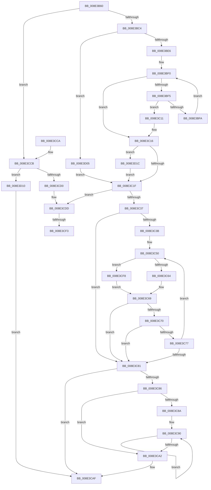

# PiDmListEnumObjectsWithCallback

- RVA: `0x008E3B60`–`0x008E3D26` (길이 `454` bytes)
- VA: `0x00000001408E3B60`
- 실행 섹션: `PAGE`
- PDB 이름 있음: `예`; PDB Function 태그: `예`
- unwind 정보 RVA: `0x00086144`
- 디코드: `126`개 명령, `454/454` bytes 표시
- 미해석 바이트: `0` (있으면 어셈블리에 `.byte`로 보존)

> 이 문서는 커널 이미지의 기계어와 PDB 기호를 분석해 생성했습니다. 4번과 5번은 함수 원형과 자료형을 바이너리 사용 방식에서 추정한 C 해석이며 원본 소스 복구 결과는 아닙니다.

## 1. Dependencies

- 직접 호출 지점: **10**; 고유 호출 대상: **8**
- 직접 호출자로 확인된 함수: **4**
- RIP 상대 이미지 참조: **2**

### Outgoing calls
- `0x008E3BB4` → [PiDmObjectAcquireSharedLock](PiDmObjectAcquireSharedLock_function_008E38B8.md) (function, `0x008E38B8`)
- `0x008E3BD5` → [ExAllocatePool2](../../poolcode/B8/ExAllocatePool2_function_00B820F0.md) (function, `0x00B820F0`)
- `0x008E3C27` → [PiDmObjectReleaseLock](PiDmObjectReleaseLock_function_008E5584.md) (function, `0x008E5584`)
- `0x008E3C64` → [PiDmGetObjectListCallback](PiDmGetObjectListCallback_function_008E3D30.md) (function, `0x008E3D30`)
- `0x008E3C93` → [PiDmObjectRelease](PiDmObjectRelease_function_008E4F70.md) (function, `0x008E4F70`)
- `0x008E3CAA` → [ExFreePoolWithTag](../../poolcode/B8/ExFreePoolWithTag_function_00B82870.md) (function, `0x00B82870`)
- `0x008E3CD8` → [PiDmObjectReleaseLock](PiDmObjectReleaseLock_function_008E5584.md) (function, `0x008E5584`)
- `0x008E3CE0` → [CmpLockSiloKeyLockTrackerExclusive](../8F/CmpLockSiloKeyLockTrackerExclusive_function_008F9EF8.md) (function, `0x008F9EF8`)
- `0x008E3CFB` → [guard_dispatch_icall](../../text/6B/guard_dispatch_icall_function_006BAAD0.md) (function, `0x006BAAD0`)
- `0x008E3D15` → [PiDmObjectReleaseLock](PiDmObjectReleaseLock_function_008E5584.md) (function, `0x008E5584`)

### Direct callers
- [PiDqObjectManagerEnumerateAndRegisterQuery](../8D/PiDqObjectManagerEnumerateAndRegisterQuery_function_008DCF74.md) at `0x008DD1CB`
- [PiDmGetObjectConstraintList](../8D/PiDmGetObjectConstraintList_function_008DF2F4.md) at `0x008DF38E`
- [PiPnpRtlApplyMandatoryDeviceContainerFilters](../95/PiPnpRtlApplyMandatoryDeviceContainerFilters_function_00950874.md) at `0x00950912`
- [sub_00B1DC0E](../B1/Unknown_function_00B1DC0E.md) at `0x00B1DFBC`
- [sub_00B1DC0E](../B1/Unknown_function_00B1DC0E.md) at `0x00B1E045`

### Static image references
- `0x008E3BA5` → RVA `0x000018A0` (`.rdata`; read)
- `0x008E3C3E` → RVA `0x008E3D30` (`PiDmGetObjectListCallback`; read)

## 2. Other-region calls and transfers

- 다른 실행 섹션으로 향하는 call: **3**
  - `0x008E3BD5` → [ExAllocatePool2](../../poolcode/B8/ExAllocatePool2_function_00B820F0.md) (`PAGE` → `POOLCODE`)
  - `0x008E3CAA` → [ExFreePoolWithTag](../../poolcode/B8/ExFreePoolWithTag_function_00B82870.md) (`PAGE` → `POOLCODE`)
  - `0x008E3CFB` → [guard_dispatch_icall](../../text/6B/guard_dispatch_icall_function_006BAAD0.md) (`PAGE` → `.text`)
- call이 아닌 외부 분기/꼬리 이동: **2**
  - `0x008E3CED` → [sub_00B1D1DA](../B1/Unknown_function_00B1D1DA.md) (`tail-transfer`)
  - `0x008E3CF3` → [sub_00B1D1DA + 0xA](../B1/Unknown_function_00B1D1DA.md) (`tail-transfer`)

## 3. Assembly (complete function range)

```asm
008E3B60  48 89 5C 24 18                  mov qword ptr [rsp + 0x18], rbx
008E3B65  48 89 54 24 10                  mov qword ptr [rsp + 0x10], rdx
008E3B6A  55                              push rbp
008E3B6B  56                              push rsi
008E3B6C  57                              push rdi
008E3B6D  41 54                           push r12
008E3B6F  41 55                           push r13
008E3B71  41 56                           push r14
008E3B73  41 57                           push r15
008E3B75  48 83 EC 30                     sub rsp, 0x30
008E3B79  33 F6                           xor esi, esi
008E3B7B  48 63 C1                        movsxd rax, ecx
008E3B7E  4D 8B E9                        mov r13, r9
008E3B81  8B DE                           mov ebx, esi
008E3B83  4D 8B E0                        mov r12, r8
008E3B86  40 88 74 24 20                  mov byte ptr [rsp + 0x20], sil
008E3B8B  44 8B FE                        mov r15d, esi
008E3B8E  40 88 74 24 70                  mov byte ptr [rsp + 0x70], sil
008E3B93  48 8D 0C 80                     lea rcx, [rax + rax*4]
008E3B97  44 8B F6                        mov r14d, esi
008E3B9A  48 8D 2C CD 00 00 00 00         lea rbp, [rcx*8]
008E3BA2  48 8B CA                        mov rcx, rdx
008E3BA5  48 8D 05 F4 DC 71 FF            lea rax, [rip - 0x8e230c]
008E3BAC  48 8B 7C 28 08                  mov rdi, qword ptr [rax + rbp + 8]
008E3BB1  48 03 FA                        add rdi, rdx
008E3BB4  E8 FF FC FF FF                  call 0x1408e38b8
008E3BB9  8B 47 10                        mov eax, dword ptr [rdi + 0x10]
008E3BBC  85 C0                           test eax, eax
008E3BBE  0F 84 07 01 00 00               je 0x1408e3ccb
008E3BC4  8B D0                           mov edx, eax
008E3BC6  B9 00 01 00 00                  mov ecx, 0x100
008E3BCB  48 C1 E2 03                     shl rdx, 3
008E3BCF  41 B8 50 6E 70 5A               mov r8d, 0x5a706e50
008E3BD5  E8 16 E5 29 00                  call 0x140b820f0
008E3BDA  4C 8B F0                        mov r14, rax
008E3BDD  48 85 C0                        test rax, rax
008E3BE0  0F 84 1F 01 00 00               je 0x1408e3d05
008E3BE6  48 8B 17                        mov rdx, qword ptr [rdi]
008E3BE9  4C 8D 05 B0 DC 71 FF            lea r8, [rip - 0x8e2350]
008E3BF0  48 3B D7                        cmp rdx, rdi
008E3BF3  74 21                           je 0x1408e3c16
008E3BF5  3B 5F 10                        cmp ebx, dword ptr [rdi + 0x10]
008E3BF8  73 17                           jae 0x1408e3c11
008E3BFA  48 8B CA                        mov rcx, rdx
008E3BFD  49 2B 4C 28 18                  sub rcx, qword ptr [r8 + rbp + 0x18]
008E3C02  48 89 0C D8                     mov qword ptr [rax + rbx*8], rcx
008E3C06  F0 FF 41 08                     lock inc dword ptr [rcx + 8]
008E3C0A  48 8B 12                        mov rdx, qword ptr [rdx]
008E3C0D  FF C3                           inc ebx
008E3C0F  EB DF                           jmp 0x1408e3bf0
008E3C11  C6 44 24 70 01                  mov byte ptr [rsp + 0x70], 1
008E3C16  3B 5F 10                        cmp ebx, dword ptr [rdi + 0x10]
008E3C19  0F 82 FD 00 00 00               jb 0x1408e3d1c
008E3C1F  48 8B 6C 24 78                  mov rbp, qword ptr [rsp + 0x78]
008E3C24  48 8B CD                        mov rcx, rbp
008E3C27  E8 58 19 00 00                  call 0x1408e5584
008E3C2C  40 38 74 24 70                  cmp byte ptr [rsp + 0x70], sil
008E3C31  0F 85 A6 00 00 00               jne 0x1408e3cdd
008E3C37  85 DB                           test ebx, ebx
008E3C39  74 46                           je 0x1408e3c81
008E3C3B  49 8B FE                        mov rdi, r14
008E3C3E  48 8D 2D EB 00 00 00            lea rbp, [rip + 0xeb]
008E3C45  66 66 66 0F 1F 84 00 00 00 00 00  nop word ptr [rax + rax]
008E3C50  48 8B 0F                        mov rcx, qword ptr [rdi]
008E3C53  4C 8D 44 24 20                  lea r8, [rsp + 0x20]
008E3C58  49 8B D5                        mov rdx, r13
008E3C5B  4C 3B E5                        cmp r12, rbp
008E3C5E  0F 85 94 00 00 00               jne 0x1408e3cf8
008E3C64  E8 C7 00 00 00                  call 0x1408e3d30
008E3C69  44 8B F8                        mov r15d, eax
008E3C6C  85 C0                           test eax, eax
008E3C6E  78 11                           js 0x1408e3c81
008E3C70  80 7C 24 20 00                  cmp byte ptr [rsp + 0x20], 0
008E3C75  75 0A                           jne 0x1408e3c81
008E3C77  FF C6                           inc esi
008E3C79  48 83 C7 08                     add rdi, 8
008E3C7D  3B F3                           cmp esi, ebx
008E3C7F  72 CF                           jb 0x1408e3c50
008E3C81  4D 85 F6                        test r14, r14
008E3C84  74 29                           je 0x1408e3caf
008E3C86  85 DB                           test ebx, ebx
008E3C88  74 18                           je 0x1408e3ca2
008E3C8A  49 8B FE                        mov rdi, r14
008E3C8D  0F 1F 00                        nop dword ptr [rax]
008E3C90  48 8B 0F                        mov rcx, qword ptr [rdi]
008E3C93  E8 D8 12 00 00                  call 0x1408e4f70
008E3C98  48 8D 7F 08                     lea rdi, [rdi + 8]
008E3C9C  48 83 EB 01                     sub rbx, 1
008E3CA0  75 EE                           jne 0x1408e3c90
008E3CA2  BA 50 6E 70 5A                  mov edx, 0x5a706e50
008E3CA7  49 8B CE                        mov rcx, r14
008E3CAA  E8 C1 EB 29 00                  call 0x140b82870
008E3CAF  48 8B 9C 24 80 00 00 00         mov rbx, qword ptr [rsp + 0x80]
008E3CB7  41 8B C7                        mov eax, r15d
008E3CBA  48 83 C4 30                     add rsp, 0x30
008E3CBE  41 5F                           pop r15
008E3CC0  41 5E                           pop r14
008E3CC2  41 5D                           pop r13
008E3CC4  41 5C                           pop r12
008E3CC6  5F                              pop rdi
008E3CC7  5E                              pop rsi
008E3CC8  5D                              pop rbp
008E3CC9  C3                              ret
008E3CCA  CC                              int3
008E3CCB  48 39 3F                        cmp qword ptr [rdi], rdi
008E3CCE  74 40                           je 0x1408e3d10
008E3CD0  48 8B 6C 24 78                  mov rbp, qword ptr [rsp + 0x78]
008E3CD5  48 8B CD                        mov rcx, rbp
008E3CD8  E8 A7 18 00 00                  call 0x1408e5584
008E3CDD  48 8B CD                        mov rcx, rbp
008E3CE0  E8 13 62 01 00                  call 0x1408f9ef8
008E3CE5  48 8B 07                        mov rax, qword ptr [rdi]
008E3CE8  8B CE                           mov ecx, esi
008E3CEA  48 3B C7                        cmp rax, rdi
008E3CED  0F 85 E7 94 23 00               jne 0x140b1d1da
008E3CF3  E9 EC 94 23 00                  jmp 0x140b1d1e4
008E3CF8  49 8B C4                        mov rax, r12
008E3CFB  E8 D0 6D DD FF                  call 0x1406baad0
008E3D00  E9 64 FF FF FF                  jmp 0x1408e3c69
008E3D05  41 BF 9A 00 00 C0               mov r15d, 0xc000009a
008E3D0B  E9 0F FF FF FF                  jmp 0x1408e3c1f
008E3D10  48 8B 4C 24 78                  mov rcx, qword ptr [rsp + 0x78]
008E3D15  E8 6A 18 00 00                  call 0x1408e5584
008E3D1A  EB 93                           jmp 0x1408e3caf
008E3D1C  C6 44 24 70 01                  mov byte ptr [rsp + 0x70], 1
008E3D21  E9 F9 FE FF FF                  jmp 0x1408e3c1f
```

## 4. C-style interpretation (structured pseudocode)

```c
__int64 __fastcall PiDmListEnumObjectsWithCallback(int a1, __int64 a2, __int64 a3, __int64 a4)
{
    __int64 result;
    __int64 v_rbx;
    __int64 v_rdi;
    __int64 v_rsi;
    __int64 v_rsp;
    unsigned __int8 v_stack_m48;
    unsigned __int64 v_stack_p10;
    unsigned __int64 v_stack_p18;
    unsigned __int8 v_stack_p70;
    unsigned __int64 v_stack_p78;
    unsigned __int8 v_stack_p8;

    v_stack_p18 = v_rbx;
    v_stack_p10 = a2;
    v_rsp = (v_rsp) - (48);
    v_rsi = 0;
    v_stack_m48 = 0;
    v_stack_p8 = 0;
    v_rdi = (*(unsigned __int64 *)(v_rip - 9315084 + (int)(a1) + (int)(a1) * 4 * 8 * 1 + 8)) + (a2);
    result = PiDmObjectAcquireSharedLock(a2, a2, a3, a4);
    if ((unsigned int)((unsigned int)(*(unsigned int *)(v_rdi + 16))) == 0) goto loc_008E3CCB;
    a2 = ((unsigned int)((unsigned int)((unsigned int)(*(unsigned int *)(v_rdi + 16))))) << (3);
    result = ExAllocatePool2(256, a2, (unsigned int)(0x5A706E50ULL), a4);
    if (result == 0) goto loc_008E3D05;
loc_008E3BF0:
    if ((*(unsigned __int64 *)(v_rdi)) == v_rdi) goto loc_008E3C16;
    if (0 >= (*(unsigned int *)(v_rdi + 16))) goto loc_008E3C11;
    a1 = (*(unsigned __int64 *)(v_rdi)) - (*(unsigned __int64 *)(v_rip - 9315152 + (int)(a1) + (int)(a1) * 4 * 8 * 1 + 24));
    *(unsigned __int64 *)(result + 0 * 8) = a1;
    v_rbx = (unsigned int)((0) + 1);
    goto loc_008E3BF0;
loc_008E3C11:
    v_stack_p8 = 1;
loc_008E3C16:
    if (((unsigned int)(v_rbx)) < (*(unsigned int *)(v_rdi + 16))) goto loc_008E3D1C;
loc_008E3C1F:
    result = PiDmObjectReleaseLock(v_stack_p10, *(unsigned __int64 *)(*(unsigned __int64 *)(v_rdi)), v_rip - 9315152, a4);
    if (v_stack_p8 != 0) goto loc_008E3CDD;
    if ((unsigned int)(v_rbx) == 0) goto loc_008E3C81;
loc_008E3C50:
    if (a3 != (v_rip + 235)) goto loc_008E3CF8;
    result = PiDmGetObjectListCallback(*(unsigned __int64 *)(result), a4, v_stack_m48, a4);
loc_008E3C69:
    if (sign_flag) goto loc_008E3C81;
    if (v_stack_m48 != 0) goto loc_008E3C81;
    v_rsi = (unsigned int)((v_rsi) + 1);
    v_rdi = (result) + (8);
    if (((unsigned int)(v_rsi)) < ((unsigned int)(v_rbx))) goto loc_008E3C50;
loc_008E3C81:
    if (result == 0) goto loc_008E3CAF;
    if ((unsigned int)(v_rbx) == 0) goto loc_008E3CA2;
loc_008E3C90:
    result = PiDmObjectRelease(*(unsigned __int64 *)(result), a4, v_stack_m48, a4);
    v_rbx = (v_rbx) - (1);
    if (condition_is_not_equal) goto loc_008E3C90;
loc_008E3CA2:
    result = ExFreePoolWithTag(result, (unsigned int)(0x5A706E50ULL), v_stack_m48, a4);
loc_008E3CAF:
    v_rsp = (v_rsp) + (48);
    return (unsigned int)((unsigned int)((unsigned int)((unsigned int)(result))));
loc_008E3CCB:
    if ((*(unsigned __int64 *)(result + 8)) == (result + 8)) goto loc_008E3D10;
    result = PiDmObjectReleaseLock(v_stack_p78, (unsigned int)(0x5A706E50ULL), v_stack_m48, a4);
loc_008E3CDD:
    result = CmpLockSiloKeyLockTrackerExclusive(v_stack_p78, (unsigned int)(0x5A706E50ULL), v_stack_m48, a4);
loc_008E3CF8:
    result = guard_dispatch_icall((unsigned int)((unsigned int)(v_rsi)), (unsigned int)(0x5A706E50ULL), v_stack_m48, a4);
    goto loc_008E3C69;
loc_008E3D05:
    goto loc_008E3C1F;
loc_008E3D10:
    result = PiDmObjectReleaseLock(v_stack_p78, (unsigned int)(0x5A706E50ULL), v_stack_m48, a4);
    goto loc_008E3CAF;
loc_008E3D1C:
    v_stack_p70 = 1;
    goto loc_008E3C1F;
}
```

## 5. (Beta) C Style

```c
int64_t PiDmListEnumObjectsWithCallback(void *Arg1, int64_t Arg2, int64_t Arg3, int64_t Arg4)
{
    uint8_t *arg1 = (uint8_t *)Arg1;

    int64_t result;
    int64_t local_rbx;
    int64_t local_rdi;
    int64_t local_rsi;
    int64_t local_rsp;
    uint8_t v_stack_m48;
    uint64_t v_stack_p10;
    uint64_t v_stack_p18;
    uint8_t v_stack_p70;
    uint64_t v_stack_p78;
    uint8_t v_stack_p8;

    v_stack_p18 = local_rbx;
    v_stack_p10 = Arg2;
    local_rsp = (local_rsp) - (48);
    local_rsi = 0;
    v_stack_m48 = 0;
    v_stack_p8 = 0;
    local_rdi = (*(uint64_t *)(v_rip - 0x8E230C + (int32_t)(arg1) + (int32_t)(arg1) * 4 * 8 * 1 + 0x8)) + (Arg2);
    result = PiDmObjectAcquireSharedLock(Arg2, Arg2, Arg3, Arg4);
    if ((uint32_t)((uint32_t)(*(uint32_t *)(local_rdi + 0x10))) == 0) goto loc_008E3CCB;
    Arg2 = ((uint32_t)((uint32_t)((uint32_t)(*(uint32_t *)(local_rdi + 0x10))))) << (3);
    result = ExAllocatePool2(256, Arg2, (uint32_t)(0x5A706E50ULL), Arg4);
    if (result == 0) goto loc_008E3D05;
loc_008E3BF0:
    if ((*(uint64_t *)(local_rdi)) == local_rdi) goto loc_008E3C16;
    if (0 >= (*(uint32_t *)(local_rdi + 0x10))) goto loc_008E3C11;
    Arg1 = (*(uint64_t *)(local_rdi)) - (*(uint64_t *)(v_rip - 0x8E2350 + (int32_t)(arg1) + (int32_t)(arg1) * 4 * 8 * 1 + 0x18));
    *(void **)(result + 0x0 * 8) = Arg1;
    local_rbx = (uint32_t)((0) + 1);
    goto loc_008E3BF0;
loc_008E3C11:
    v_stack_p8 = 1;
loc_008E3C16:
    if (((uint32_t)(local_rbx)) < (*(uint32_t *)(local_rdi + 0x10))) goto loc_008E3D1C;
loc_008E3C1F:
    result = PiDmObjectReleaseLock(v_stack_p10, *(uint64_t *)(*(uint64_t *)(local_rdi)), v_rip - 9315152, Arg4);
    if (v_stack_p8 != 0) goto loc_008E3CDD;
    if ((uint32_t)(local_rbx) == 0) goto loc_008E3C81;
loc_008E3C50:
    if (Arg3 != (v_rip + 235)) goto loc_008E3CF8;
    result = PiDmGetObjectListCallback(*(uint64_t *)(result), Arg4, v_stack_m48, Arg4);
loc_008E3C69:
    if (sign_flag) goto loc_008E3C81;
    if (v_stack_m48 != 0) goto loc_008E3C81;
    local_rsi = (uint32_t)((local_rsi) + 1);
    local_rdi = (result) + (8);
    if (((uint32_t)(local_rsi)) < ((uint32_t)(local_rbx))) goto loc_008E3C50;
loc_008E3C81:
    if (result == 0) goto loc_008E3CAF;
    if ((uint32_t)(local_rbx) == 0) goto loc_008E3CA2;
loc_008E3C90:
    result = PiDmObjectRelease(*(uint64_t *)(result), Arg4, v_stack_m48, Arg4);
    local_rbx = (local_rbx) - (1);
    if (condition_is_not_equal) goto loc_008E3C90;
loc_008E3CA2:
    result = ExFreePoolWithTag(result, (uint32_t)(0x5A706E50ULL), v_stack_m48, Arg4);
loc_008E3CAF:
    local_rsp = (local_rsp) + (48);
    return (uint32_t)((uint32_t)((uint32_t)((uint32_t)(result))));
loc_008E3CCB:
    if ((*(uint64_t *)(result + 0x8)) == (result + 8)) goto loc_008E3D10;
    result = PiDmObjectReleaseLock(v_stack_p78, (uint32_t)(0x5A706E50ULL), v_stack_m48, Arg4);
loc_008E3CDD:
    result = CmpLockSiloKeyLockTrackerExclusive(v_stack_p78, (uint32_t)(0x5A706E50ULL), v_stack_m48, Arg4);
loc_008E3CF8:
    result = guard_dispatch_icall((uint32_t)((uint32_t)(local_rsi)), (uint32_t)(0x5A706E50ULL), v_stack_m48, Arg4);
    goto loc_008E3C69;
loc_008E3D05:
    goto loc_008E3C1F;
loc_008E3D10:
    result = PiDmObjectReleaseLock(v_stack_p78, (uint32_t)(0x5A706E50ULL), v_stack_m48, Arg4);
    goto loc_008E3CAF;
loc_008E3D1C:
    v_stack_p70 = 1;
    goto loc_008E3C1F;
}
```

### 관측된 메모리 오프셋

구조체 형식이 확인되지 않은 접근은 인자 기준의 오프셋으로만 기록했습니다.

| 기준 인자 | 오프셋 표현 | 폭 (bit) | 접근 |
|---|---:|---:|---|
| `Arg1` | `+ 0x0 + rax*4` | `64` | `R` |

## 6. Execution-region graph

[열기: 2D/3D 그래프와 함수 탐색 컨트롤 패널](../../../control-panel.html?section=page&rva=0x008E3B60&view=graph)

- 2D 그래프는 위에서 아래로 흐르고, 3D 그래프는 빈 공간을 드래그해 회전합니다. Shift+드래그는 이동, 휠은 확대·축소, 함수 노드 선택은 대상 보고서 이동입니다.

### Static fallback


