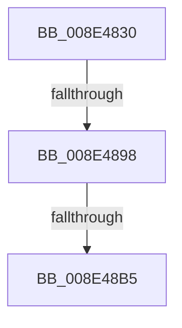

# PiDmObjectGetCachedObjectProperty

- RVA: `0x008E4830`–`0x008E48BF` (길이 `143` bytes)
- VA: `0x00000001408E4830`
- 실행 섹션: `PAGE`
- PDB 이름 있음: `예`; PDB Function 태그: `아니요`
- unwind 정보 RVA: `0x00086458`
- 디코드: `33`개 명령, `143/143` bytes 표시
- 미해석 바이트: `0` (있으면 어셈블리에 `.byte`로 보존)

> 이 문서는 커널 이미지의 기계어와 PDB 기호를 분석해 생성했습니다. 4번과 5번은 함수 원형과 자료형을 바이너리 사용 방식에서 추정한 C 해석이며 원본 소스 복구 결과는 아닙니다.

## 1. Dependencies

- 직접 호출 지점: **0**; 고유 호출 대상: **0**
- 직접 호출자로 확인된 함수: **1**
- RIP 상대 이미지 참조: **1**

### Outgoing calls
- 직접 디코드된 call 명령이 없습니다.

### Direct callers
- [PiDmObjectGetCachedCmProperty](../8F/PiDmObjectGetCachedCmProperty_function_008FEE70.md) at `0x008FEF26`

### Static image references
- `0x008E484A` → RVA `0x00E0A740` (`.data`; read)

## 2. Other-region calls and transfers

- 다른 실행 섹션으로 향하는 call: **0**
- call이 아닌 외부 분기/꼬리 이동: **3**
  - `0x008E4892` → [sub_008E4C8E](Unknown_function_008E4C8E.md) (`tail-transfer`)
  - `0x008E48AF` → [sub_008E4A2F + 0x26](Unknown_function_008E4A2F.md) (`tail-transfer`)
  - `0x008E48BA` → [sub_008E4A2F](Unknown_function_008E4A2F.md) (`tail-transfer`)

## 3. Assembly (complete function range)

```asm
008E4830  48 89 74 24 20                  mov qword ptr [rsp + 0x20], rsi
008E4835  55                              push rbp
008E4836  41 54                           push r12
008E4838  41 55                           push r13
008E483A  41 56                           push r14
008E483C  41 57                           push r15
008E483E  48 8D 6C 24 E0                  lea rbp, [rsp - 0x20]
008E4843  48 81 EC 20 01 00 00            sub rsp, 0x120
008E484A  48 8B 05 EF 5E 52 00            mov rax, qword ptr [rip + 0x525eef]
008E4851  48 33 C4                        xor rax, rsp
008E4854  48 89 45 10                     mov qword ptr [rbp + 0x10], rax
008E4858  48 8B 45 70                     mov rax, qword ptr [rbp + 0x70]
008E485C  33 F6                           xor esi, esi
008E485E  4C 8B A5 80 00 00 00            mov r12, qword ptr [rbp + 0x80]
008E4865  4C 8B FA                        mov r15, rdx
008E4868  48 89 44 24 48                  mov qword ptr [rsp + 0x48], rax
008E486D  44 8B E9                        mov r13d, ecx
008E4870  48 8B 45 78                     mov rax, qword ptr [rbp + 0x78]
008E4874  48 89 44 24 50                  mov qword ptr [rsp + 0x50], rax
008E4879  48 8B 85 90 00 00 00            mov rax, qword ptr [rbp + 0x90]
008E4880  48 89 44 24 58                  mov qword ptr [rsp + 0x58], rax
008E4885  48 89 54 24 78                  mov qword ptr [rsp + 0x78], rdx
008E488A  48 89 74 24 70                  mov qword ptr [rsp + 0x70], rsi
008E488F  4D 85 E4                        test r12, r12
008E4892  0F 84 F6 03 00 00               je 0x1408e4c8e
008E4898  44 8B B5 88 00 00 00            mov r14d, dword ptr [rbp + 0x88]
008E489F  45 85 F6                        test r14d, r14d
008E48A2  44 89 74 24 40                  mov dword ptr [rsp + 0x40], r14d
008E48A7  4C 0F 44 E6                     cmove r12, rsi
008E48AB  41 83 FD 07                     cmp r13d, 7
008E48AF  0F 8C A0 01 00 00               jl 0x1408e4a55
008E48B5  B8 16 00 00 C0                  mov eax, 0xc0000016
008E48BA  E9 70 01 00 00                  jmp 0x1408e4a2f
```

## 4. C-style interpretation (structured pseudocode)

```c
__int64 __fastcall PiDmObjectGetCachedObjectProperty(int a1, __int64 a2, __int64 a3, __int64 a4, __int64 a5, __int64 a6, __int64 a7, unsigned int a8, __int64 a9)
{
    __int64 result;
    __int64 v_rsi;
    __int64 v_rsp;
    unsigned __int64 v_stack_m100;
    unsigned int v_stack_m108;
    unsigned __int64 v_stack_m38;
    unsigned __int64 v_stack_m48;
    unsigned __int64 v_stack_mD0;
    unsigned __int64 v_stack_mD8;
    unsigned __int64 v_stack_mF0;
    unsigned __int64 v_stack_mF8;
    unsigned __int64 v_stack_p20;

    v_stack_p20 = v_rsi;
    v_rsp = (v_rsp) - (288);
    result = (*(unsigned __int64 *)(v_rip + 5398255)) ^ (v_rsp);
    v_stack_m38 = result;
    v_rsi = 0;
    v_stack_m100 = a5;
    v_stack_mF8 = a6;
    v_stack_mF0 = a9;
    v_stack_mD0 = a2;
    v_stack_mD8 = 0;
    v_stack_m108 = (unsigned int)((unsigned int)(a8));
    if ((unsigned int)((unsigned int)(a8)) == 0) { a7 = 0; }
}
```

## 5. (Beta) C Style

```c
int64_t PiDmObjectGetCachedObjectProperty(int32_t Arg1, int64_t Arg2, int64_t Arg3, int64_t Arg4, int64_t Arg5, int64_t Arg6, int64_t Arg7, uint32_t Arg8, int64_t Arg9)
{
    int64_t result;
    int64_t local_rsi;
    int64_t local_rsp;
    uint64_t v_stack_m100;
    uint32_t v_stack_m108;
    uint64_t v_stack_m38;
    uint64_t v_stack_m48;
    uint64_t v_stack_mD0;
    uint64_t v_stack_mD8;
    uint64_t v_stack_mF0;
    uint64_t v_stack_mF8;
    uint64_t v_stack_p20;

    v_stack_p20 = local_rsi;
    local_rsp = (local_rsp) - (288);
    result = (*(uint64_t *)(v_rip + 0x525EEF)) ^ (local_rsp);
    v_stack_m38 = result;
    local_rsi = 0;
    v_stack_m100 = Arg5;
    v_stack_mF8 = Arg6;
    v_stack_mF0 = Arg9;
    v_stack_mD0 = Arg2;
    v_stack_mD8 = 0;
    v_stack_m108 = (uint32_t)((uint32_t)(Arg8));
    if ((uint32_t)((uint32_t)(Arg8)) == 0) { Arg7 = 0; }
}
```

## 6. Execution-region graph

[열기: 2D/3D 그래프와 함수 탐색 컨트롤 패널](../../../control-panel.html?section=page&rva=0x008E4830&view=graph)

- 2D 그래프는 위에서 아래로 흐르고, 3D 그래프는 빈 공간을 드래그해 회전합니다. Shift+드래그는 이동, 휠은 확대·축소, 함수 노드 선택은 대상 보고서 이동입니다.

### Static fallback


