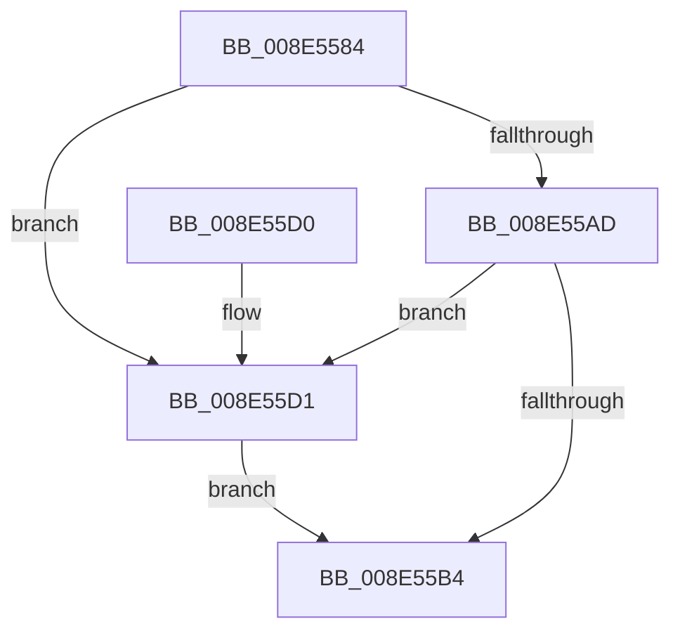

# PiDmObjectReleaseLock

- RVA: `0x008E5584`–`0x008E55DB` (길이 `87` bytes)
- VA: `0x00000001408E5584`
- 실행 섹션: `PAGE`
- PDB 이름 있음: `예`; PDB Function 태그: `아니요`
- unwind 정보 RVA: `0x00064CA8`
- 디코드: `26`개 명령, `87/87` bytes 표시
- 미해석 바이트: `0` (있으면 어셈블리에 `.byte`로 보존)

> 이 문서는 커널 이미지의 기계어와 PDB 기호를 분석해 생성했습니다. 4번과 5번은 함수 원형과 자료형을 바이너리 사용 방식에서 추정한 C 해석이며 원본 소스 복구 결과는 아닙니다.

## 1. Dependencies

- 직접 호출 지점: **3**; 고유 호출 대상: **3**
- 직접 호출자로 확인된 함수: **19**
- RIP 상대 이미지 참조: **0**

### Outgoing calls
- `0x008E55B7` → [KeAbPostRelease](../../text/2E/KeAbPostRelease_function_002E1600.md) (function, `0x002E1600`)
- `0x008E55C5` → [KeLeaveCriticalRegionThread](../../text/25/KeLeaveCriticalRegionThread_function_0025EFF0.md) (function, `0x0025EFF0`)
- `0x008E55D4` → [ExfReleasePushLock](../../text/26/ExfReleasePushLock_function_002638D0.md) (function, `0x002638D0`)

### Direct callers
- [PiDmListRemoveObject](../70/PiDmListRemoveObject_function_007045E8.md) at `0x0070463F`
- [PiDmListRemoveObject](../70/PiDmListRemoveObject_function_007045E8.md) at `0x00704647`
- [PiPnpRtlEnsureObjectCached](../72/PiPnpRtlEnsureObjectCached_function_0072F928.md) at `0x0072F9B1`
- [PiDmListRemoveList](../73/PiDmListRemoveList_function_00730474.md) at `0x007304F7`
- [PiDmListRemoveList](../73/PiDmListRemoveList_function_00730474.md) at `0x0073050C`
- [PiDmListRemoveList](../73/PiDmListRemoveList_function_00730474.md) at `0x00730518`
- [PiDmListRemoveList](../73/PiDmListRemoveList_function_00730474.md) at `0x00730523`
- [sub_008E28A3](Unknown_function_008E28A3.md) at `0x008E29E9`
- [sub_008E2EB2](Unknown_function_008E2EB2.md) at `0x008E30D8`
- [sub_008E314B](Unknown_function_008E314B.md) at `0x008E31D1`
- [sub_008E314B](Unknown_function_008E314B.md) at `0x008E330B`
- [sub_008E314B](Unknown_function_008E314B.md) at `0x008E33AA`
- [PiDmEnumObjectsWithCallback](PiDmEnumObjectsWithCallback_function_008E3920.md) at `0x008E3A2F`
- [PiDmEnumObjectsWithCallback](PiDmEnumObjectsWithCallback_function_008E3920.md) at `0x008E3AE5`
- [PiDmListEnumObjectsWithCallback](PiDmListEnumObjectsWithCallback_function_008E3B60.md) at `0x008E3C27`
- [PiDmListEnumObjectsWithCallback](PiDmListEnumObjectsWithCallback_function_008E3B60.md) at `0x008E3CD8`
- [PiDmListEnumObjectsWithCallback](PiDmListEnumObjectsWithCallback_function_008E3B60.md) at `0x008E3D15`
- [PiDmObjectIsEnumerable](PiDmObjectIsEnumerable_function_008E6458.md) at `0x008E6473`
- [PiDmObjectGetCachedObjectReference](../8F/PiDmObjectGetCachedObjectReference_function_008F7FB0.md) at `0x008F8043`
- [PiPnpRtlObjectEventWorker](../8F/PiPnpRtlObjectEventWorker_function_008F8630.md) at `0x008F8932`
- [PiDmObjectProcessPropertyChange](../8F/PiDmObjectProcessPropertyChange_function_008F8A48.md) at `0x008F8B16`
- [PiDmObjectProcessPropertyChange](../8F/PiDmObjectProcessPropertyChange_function_008F8A48.md) at `0x008F8DBD`
- [PiDmObjectUpdateCachedObjectProperty](../8F/PiDmObjectUpdateCachedObjectProperty_function_008F9C94.md) at `0x008F9DB0`
- [PiDmObjectUpdateCachedObjectProperty](../8F/PiDmObjectUpdateCachedObjectProperty_function_008F9C94.md) at `0x008F9E6B`
- [PiDmListAddList](../94/PiDmListAddList_function_0094F4F8.md) at `0x0094F54C`
- [PiDmListAddList](../94/PiDmListAddList_function_0094F4F8.md) at `0x0094F554`
- [PiDmListAddList](../94/PiDmListAddList_function_0094F4F8.md) at `0x0094F5AD`
- [PiDmListAddList](../94/PiDmListAddList_function_0094F4F8.md) at `0x0094F5BC`
- [PiDmListAddObject](../95/PiDmListAddObject_function_00950128.md) at `0x0095017F`
- [PiDmListAddObject](../95/PiDmListAddObject_function_00950128.md) at `0x00950187`
- [IopRegisterDeviceInterface](../95/IopRegisterDeviceInterface_function_009501B0.md) at `0x009505DF`
- [IopProcessSetInterfaceState](../95/IopProcessSetInterfaceState_function_00950964.md) at `0x00950CCB`
- [sub_00B1D1DA](../B1/Unknown_function_00B1D1DA.md) at `0x00B1D1EA`
- [sub_00B1DC0E](../B1/Unknown_function_00B1DC0E.md) at `0x00B1DEAF`

### Static image references
- 디코드된 RIP-relative 메모리 참조가 없습니다.

## 2. Other-region calls and transfers

- 다른 실행 섹션으로 향하는 call: **3**
  - `0x008E55B7` → [KeAbPostRelease](../../text/2E/KeAbPostRelease_function_002E1600.md) (`PAGE` → `.text`)
  - `0x008E55C5` → [KeLeaveCriticalRegionThread](../../text/25/KeLeaveCriticalRegionThread_function_0025EFF0.md) (`PAGE` → `.text`)
  - `0x008E55D4` → [ExfReleasePushLock](../../text/26/ExfReleasePushLock_function_002638D0.md) (`PAGE` → `.text`)
- 별도 외부 분기/꼬리 이동을 확인하지 못했습니다.

## 3. Assembly (complete function range)

```asm
008E5584  40 53                           push rbx
008E5586  48 83 EC 20                     sub rsp, 0x20
008E558A  48 8B D9                        mov rbx, rcx
008E558D  0F 0D 09                        prefetchw byte ptr [rcx]
008E5590  48 8B 01                        mov rax, qword ptr [rcx]
008E5593  45 33 C0                        xor r8d, r8d
008E5596  48 8B D0                        mov rdx, rax
008E5599  48 83 E2 F0                     and rdx, 0xfffffffffffffff0
008E559D  48 83 FA 10                     cmp rdx, 0x10
008E55A1  48 8D 48 F0                     lea rcx, [rax - 0x10]
008E55A5  49 0F 46 C8                     cmovbe rcx, r8
008E55A9  A8 02                           test al, 2
008E55AB  75 24                           jne 0x1408e55d1
008E55AD  F0 48 0F B1 0B                  lock cmpxchg qword ptr [rbx], rcx
008E55B2  75 1D                           jne 0x1408e55d1
008E55B4  48 8B CB                        mov rcx, rbx
008E55B7  E8 44 C0 9F FF                  call 0x1402e1600
008E55BC  65 48 8B 0C 25 88 01 00 00      mov rcx, qword ptr gs:[0x188]
008E55C5  E8 26 9A 97 FF                  call 0x14025eff0
008E55CA  48 83 C4 20                     add rsp, 0x20
008E55CE  5B                              pop rbx
008E55CF  C3                              ret
008E55D0  CC                              int3
008E55D1  48 8B CB                        mov rcx, rbx
008E55D4  E8 F7 E2 97 FF                  call 0x1402638d0
008E55D9  EB D9                           jmp 0x1408e55b4
```

## 4. C-style interpretation (structured pseudocode)

```c
__int64 __fastcall PiDmObjectReleaseLock(__int64 a1, __int64 a2, int a3)
{
    __int64 result;
    __int64 v_rsp;

    v_rsp = (v_rsp) - (32);
    a3 = 0;
    a2 = (*(unsigned __int64 *)(a1)) & (-16);
    a1 = *(unsigned __int64 *)(a1) - 16;
    if (a2 <= 16) { a1 = 0; }
    if ((((unsigned __int8)(*(unsigned __int64 *)(a1))) & (2)) != 0) goto loc_008E55D1;
    if ((((unsigned __int8)(*(unsigned __int64 *)(a1))) & (2)) != 0) goto loc_008E55D1;
loc_008E55B4:
    result = KeAbPostRelease(a1, a2, a3, a4);
    result = KeLeaveCriticalRegionThread(*(unsigned __int64 *)(gs_base + (0 + 392)), a2, a3, a4);
    v_rsp = (v_rsp) + (32);
    return result;
loc_008E55D1:
    result = ExfReleasePushLock(a1, a2, a3, a4);
    goto loc_008E55B4;
}
```

## 5. (Beta) C Style

```c
int64_t PiDmObjectReleaseLock(void *Arg1, int64_t Arg2, int32_t Arg3)
{
    uint8_t *arg1 = (uint8_t *)Arg1;

    int64_t result;
    int64_t local_rsp;

    local_rsp = (local_rsp) - (32);
    Arg3 = 0;
    Arg2 = (*(uint64_t *)(arg1)) & (-16);
    Arg1 = *(uint64_t *)(arg1) - 16;
    if (Arg2 <= 16) { Arg1 = 0; }
    if ((((uint8_t)(*(uint64_t *)(arg1))) & (2)) != 0) goto loc_008E55D1;
    if ((((uint8_t)(*(uint64_t *)(arg1))) & (2)) != 0) goto loc_008E55D1;
loc_008E55B4:
    result = KeAbPostRelease(Arg1, Arg2, Arg3, a4);
    result = KeLeaveCriticalRegionThread(*(uint64_t *)(gs_base + (0 + 0x188)), Arg2, Arg3, a4);
    local_rsp = (local_rsp) + (32);
    return result;
loc_008E55D1:
    result = ExfReleasePushLock(Arg1, Arg2, Arg3, a4);
    goto loc_008E55B4;
}
```

### 관측된 메모리 오프셋

구조체 형식이 확인되지 않은 접근은 인자 기준의 오프셋으로만 기록했습니다.

| 기준 인자 | 오프셋 표현 | 폭 (bit) | 접근 |
|---|---:|---:|---|
| `Arg1` | `+ 0x0` | `8` | `R` |
| `Arg1` | `+ 0x0` | `64` | `R` |

## 6. Execution-region graph

[열기: 2D/3D 그래프와 함수 탐색 컨트롤 패널](../../../control-panel.html?section=page&rva=0x008E5584&view=graph)

- 2D 그래프는 위에서 아래로 흐르고, 3D 그래프는 빈 공간을 드래그해 회전합니다. Shift+드래그는 이동, 휠은 확대·축소, 함수 노드 선택은 대상 보고서 이동입니다.

### Static fallback


