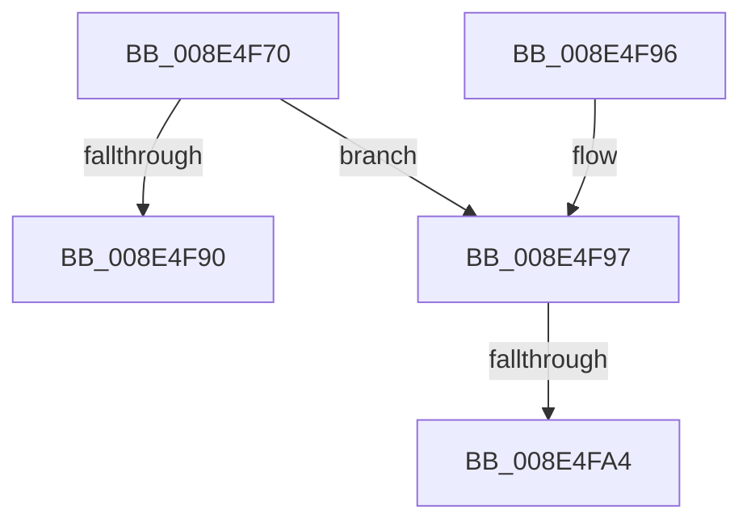

# PiDmObjectRelease

- RVA: `0x008E4F70`–`0x008E4FB4` (길이 `68` bytes)
- VA: `0x00000001408E4F70`
- 실행 섹션: `PAGE`
- PDB 이름 있음: `예`; PDB Function 태그: `예`
- unwind 정보 RVA: `0x0006084C`
- 디코드: `19`개 명령, `68/68` bytes 표시
- 미해석 바이트: `0` (있으면 어셈블리에 `.byte`로 보존)

> 이 문서는 커널 이미지의 기계어와 PDB 기호를 분석해 생성했습니다. 4번과 5번은 함수 원형과 자료형을 바이너리 사용 방식에서 추정한 C 해석이며 원본 소스 복구 결과는 아닙니다.

## 1. Dependencies

- 직접 호출 지점: **1**; 고유 호출 대상: **1**
- 직접 호출자로 확인된 함수: **40**
- RIP 상대 이미지 참조: **0**

### Outgoing calls
- `0x008E4FA9` → [ExFreePoolWithTag](../../poolcode/B8/ExFreePoolWithTag_function_00B82870.md) (function, `0x00B82870`)

### Direct callers
- [PiPnpRtlFreeInstallerClassChangeInfo](../70/PiPnpRtlFreeInstallerClassChangeInfo_function_00704564.md) at `0x00704579`
- [PiPnpRtlFreeInstallerClassChangeInfo](../70/PiPnpRtlFreeInstallerClassChangeInfo_function_00704564.md) at `0x00704587`
- [PiPnpRtlFreeInstallerClassChangeInfo](../70/PiPnpRtlFreeInstallerClassChangeInfo_function_00704564.md) at `0x007045A5`
- [PiUEventGetDmObjectFromUserHandle](../72/PiUEventGetDmObjectFromUserHandle_function_0072DF88.md) at `0x0072E066`
- [PiPnpRtlEnsureObjectCached](../72/PiPnpRtlEnsureObjectCached_function_0072F928.md) at `0x0072F96B`
- [PiPnpRtlFreeContainerRemoveInfo](../72/PiPnpRtlFreeContainerRemoveInfo_function_0072FA94.md) at `0x0072FAA9`
- [PiPnpRtlFreeContainerRemoveInfo](../72/PiPnpRtlFreeContainerRemoveInfo_function_0072FA94.md) at `0x0072FAB7`
- [PiPnpRtlFreeInterfaceDeleteInfo](../72/PiPnpRtlFreeInterfaceDeleteInfo_function_0072FAF8.md) at `0x0072FB0D`
- [PiPnpRtlFreeInterfaceDeleteInfo](../72/PiPnpRtlFreeInterfaceDeleteInfo_function_0072FAF8.md) at `0x0072FB1B`
- [PiPnpRtlFreeInterfaceDeleteInfo](../72/PiPnpRtlFreeInterfaceDeleteInfo_function_0072FAF8.md) at `0x0072FB29`
- [PiPnpRtlFreeInterfaceDeleteInfo](../72/PiPnpRtlFreeInterfaceDeleteInfo_function_0072FAF8.md) at `0x0072FB37`
- [PiDmListInitEnumCallback](../73/PiDmListInitEnumCallback_function_007302E0.md) at `0x00730441`
- [PiDmObjectManagerPopulate](../73/PiDmObjectManagerPopulate_function_00730598.md) at `0x007306B1`
- [PiDmObjectManagerPopulate](../73/PiDmObjectManagerPopulate_function_00730598.md) at `0x007306E7`
- [PiDqQueryDeleteObjectFromResultSet](../8D/PiDqQueryDeleteObjectFromResultSet_function_008DC600.md) at `0x008DC620`
- [PiDqObjectManagerEnumerateAndRegisterQuery](../8D/PiDqObjectManagerEnumerateAndRegisterQuery_function_008DCF74.md) at `0x008DD050`
- [PiDqObjectManagerEnumerateAndRegisterQuery](../8D/PiDqObjectManagerEnumerateAndRegisterQuery_function_008DCF74.md) at `0x008DD1D7`
- [PiDqQueryActionQueueEntryFree](../8D/PiDqQueryActionQueueEntryFree_function_008DE1B0.md) at `0x008DE1C2`
- [PiDmGetObjectConstraintList](../8D/PiDmGetObjectConstraintList_function_008DF2F4.md) at `0x008DF3C3`
- [PiPnpRtlObjectEventCreate](../8D/PiPnpRtlObjectEventCreate_function_008DF7E0.md) at `0x008DFAA7`
- [sub_008E0A15](Unknown_function_008E0A15.md) at `0x008E0A97`
- [sub_008E28A3](Unknown_function_008E28A3.md) at `0x008E29F1`
- [sub_008E2AB2](Unknown_function_008E2AB2.md) at `0x008E2DA6`
- [sub_008E2EB2](Unknown_function_008E2EB2.md) at `0x008E3050`
- [sub_008E2EB2](Unknown_function_008E2EB2.md) at `0x008E30F2`
- [sub_008E3554](Unknown_function_008E3554.md) at `0x008E3558`
- [PiDmEnumObjectsWithCallback](PiDmEnumObjectsWithCallback_function_008E3920.md) at `0x008E3ADB`
- [PiDmEnumObjectsWithCallback](PiDmEnumObjectsWithCallback_function_008E3920.md) at `0x008E3B1E`
- [PiDmListEnumObjectsWithCallback](PiDmListEnumObjectsWithCallback_function_008E3B60.md) at `0x008E3C93`
- [sub_008E41B3](Unknown_function_008E41B3.md) at `0x008E4420`
- [sub_008E48BF](Unknown_function_008E48BF.md) at `0x008E4A17`
- [sub_008E4C9A](Unknown_function_008E4C9A.md) at `0x008E4D28`
- [sub_008E4C9A](Unknown_function_008E4C9A.md) at `0x008E4E0C`
- [PiPnpRtlObjectEventRelease](PiPnpRtlObjectEventRelease_function_008E6E24.md) at `0x008E6E46`
- [PiPnpRtlCmActionCallback](PiPnpRtlCmActionCallback_function_008EF110.md) at `0x008EF5AD`
- [PiPnpRtlCmActionCallback](PiPnpRtlCmActionCallback_function_008EF110.md) at `0x008EF5BE`
- [sub_008F36E5](../8F/Unknown_function_008F36E5.md) at `0x008F36ED`
- [PiDmObjectGetCachedObjectReference](../8F/PiDmObjectGetCachedObjectReference_function_008F7FB0.md) at `0x008F80CD`
- [PiDmObjectProcessPropertyChange](../8F/PiDmObjectProcessPropertyChange_function_008F8A48.md) at `0x008F8B4B`
- [PiDmObjectProcessPropertyChange](../8F/PiDmObjectProcessPropertyChange_function_008F8A48.md) at `0x008F8B5D`
- [PiDmCacheDataFree](../8F/PiDmCacheDataFree_function_008F9C48.md) at `0x008F9C74`
- [PiDmObjectUpdateCachedObjectProperty](../8F/PiDmObjectUpdateCachedObjectProperty_function_008F9C94.md) at `0x008F9E83`
- [PiDmObjectCreate](../94/PiDmObjectCreate_function_0094F5CC.md) at `0x0094F84A`
- [IopRegisterDeviceInterface](../95/IopRegisterDeviceInterface_function_009501B0.md) at `0x00950533`
- [IopRegisterDeviceInterface](../95/IopRegisterDeviceInterface_function_009501B0.md) at `0x0095054D`
- [IopRegisterDeviceInterface](../95/IopRegisterDeviceInterface_function_009501B0.md) at `0x00950566`
- [IopRegisterDeviceInterface](../95/IopRegisterDeviceInterface_function_009501B0.md) at `0x009506A0`
- [PiPnpRtlApplyMandatoryDeviceContainerFilters](../95/PiPnpRtlApplyMandatoryDeviceContainerFilters_function_00950874.md) at `0x00950930`
- [IopProcessSetInterfaceState](../95/IopProcessSetInterfaceState_function_00950964.md) at `0x00950BA3`
- [PiDmRemoveCacheReferenceForObject](../95/PiDmRemoveCacheReferenceForObject_function_00950F24.md) at `0x00950FA4`
- [PiDmAddCacheReferenceForObject](../95/PiDmAddCacheReferenceForObject_function_00950FB4.md) at `0x009510E5`
- [PiUEventFreeClientRegistrationContext](../9C/PiUEventFreeClientRegistrationContext_function_009C3A2C.md) at `0x009C3BA9`
- [PiDmGetReferencedObjectFromProperty](../A7/PiDmGetReferencedObjectFromProperty_function_00A776F0.md) at `0x00A77783`
- [PiDmListRemoveObjectWorker](../A8/PiDmListRemoveObjectWorker_function_00A88748.md) at `0x00A88834`
- [sub_00B1CD26](../B1/Unknown_function_00B1CD26.md) at `0x00B1CDBD`
- [sub_00B1DC0E](../B1/Unknown_function_00B1DC0E.md) at `0x00B1E05F`

### Static image references
- 디코드된 RIP-relative 메모리 참조가 없습니다.

## 2. Other-region calls and transfers

- 다른 실행 섹션으로 향하는 call: **1**
  - `0x008E4FA9` → [ExFreePoolWithTag](../../poolcode/B8/ExFreePoolWithTag_function_00B82870.md) (`PAGE` → `POOLCODE`)
- call이 아닌 외부 분기/꼬리 이동: **2**
  - `0x008E4F9E` → [sub_00B1D1F6](../B1/Unknown_function_00B1D1F6.md) (`tail-transfer`)
  - `0x008E4FAF` → [sub_00B1D1F6](../B1/Unknown_function_00B1D1F6.md) (`tail-transfer`)

## 3. Assembly (complete function range)

```asm
008E4F70  40 53                           push rbx
008E4F72  48 83 EC 20                     sub rsp, 0x20
008E4F76  48 8B D9                        mov rbx, rcx
008E4F79  C7 44 24 30 00 00 00 00         mov dword ptr [rsp + 0x30], 0
008E4F81  B8 FF FF FF FF                  mov eax, 0xffffffff
008E4F86  F0 0F C1 41 08                  lock xadd dword ptr [rcx + 8], eax
008E4F8B  83 F8 01                        cmp eax, 1
008E4F8E  74 07                           je 0x1408e4f97
008E4F90  48 83 C4 20                     add rsp, 0x20
008E4F94  5B                              pop rbx
008E4F95  C3                              ret
008E4F96  CC                              int3
008E4F97  48 8B 49 10                     mov rcx, qword ptr [rcx + 0x10]
008E4F9B  48 85 C9                        test rcx, rcx
008E4F9E  0F 84 52 82 23 00               je 0x140b1d1f6
008E4FA4  BA 50 6E 70 5A                  mov edx, 0x5a706e50
008E4FA9  E8 C2 D8 29 00                  call 0x140b82870
008E4FAE  90                              nop
008E4FAF  E9 42 82 23 00                  jmp 0x140b1d1f6
```

## 4. C-style interpretation (structured pseudocode)

```c
__int64 __fastcall PiDmObjectRelease(__int64 a1)
{
    __int64 result;
    __int64 v_rsp;
    unsigned int v_stack_p8;

    v_rsp = (v_rsp) - (32);
    v_stack_p8 = 0;
    if (((unsigned int)((unsigned int)(0xFFFFFFFFULL))) == 1) goto loc_008E4F97;
    v_rsp = (v_rsp) + (32);
    return (unsigned int)(0xFFFFFFFFULL);
loc_008E4F97:
    result = ExFreePoolWithTag(*(unsigned __int64 *)(a1 + 16), (unsigned int)(0x5A706E50ULL), a3, a4);
}
```

## 5. (Beta) C Style

```c
int64_t PiDmObjectRelease(void *Arg1)
{
    uint8_t *arg1 = (uint8_t *)Arg1;

    int64_t result;
    int64_t local_rsp;
    uint32_t v_stack_p8;

    local_rsp = (local_rsp) - (32);
    v_stack_p8 = 0;
    if (((uint32_t)((uint32_t)(0xFFFFFFFFULL))) == 1) goto loc_008E4F97;
    local_rsp = (local_rsp) + (32);
    return (uint32_t)(0xFFFFFFFFULL);
loc_008E4F97:
    result = ExFreePoolWithTag(*(uint64_t *)(arg1 + 0x10), (uint32_t)(0x5A706E50ULL), a3, a4);
}
```

### 관측된 메모리 오프셋

구조체 형식이 확인되지 않은 접근은 인자 기준의 오프셋으로만 기록했습니다.

| 기준 인자 | 오프셋 표현 | 폭 (bit) | 접근 |
|---|---:|---:|---|
| `Arg1` | `+ 0x8` | `32` | `R/W` |
| `Arg1` | `+ 0x10` | `64` | `R` |

## 6. Execution-region graph

[열기: 2D/3D 그래프와 함수 탐색 컨트롤 패널](../../../control-panel.html?section=page&rva=0x008E4F70&view=graph)

- 2D 그래프는 위에서 아래로 흐르고, 3D 그래프는 빈 공간을 드래그해 회전합니다. Shift+드래그는 이동, 휠은 확대·축소, 함수 노드 선택은 대상 보고서 이동입니다.

### Static fallback


