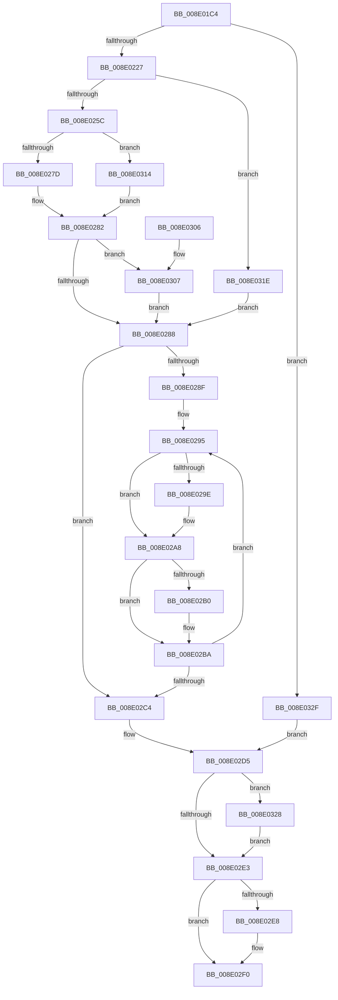

# PiDqQueryEvaluateFilter

- RVA: `0x008E01C4`–`0x008E0336` (길이 `370` bytes)
- VA: `0x00000001408E01C4`
- 실행 섹션: `PAGE`
- PDB 이름 있음: `예`; PDB Function 태그: `아니요`
- unwind 정보 RVA: `0x00085CC8`
- 디코드: `104`개 명령, `370/370` bytes 표시
- 미해석 바이트: `0` (있으면 어셈블리에 `.byte`로 보존)

> 이 문서는 커널 이미지의 기계어와 PDB 기호를 분석해 생성했습니다. 4번과 5번은 함수 원형과 자료형을 바이너리 사용 방식에서 추정한 C 해석이며 원본 소스 복구 결과는 아닙니다.

## 1. Dependencies

- 직접 호출 지점: **9**; 고유 호출 대상: **7**
- 직접 호출자로 확인된 함수: **2**
- RIP 상대 이미지 참조: **1**

### Outgoing calls
- `0x008E0216` → [ExAllocatePool2](../../poolcode/B8/ExAllocatePool2_function_00B820F0.md) (function, `0x00B820F0`)
- `0x008E0241` → [PiPnpRtlBeginOperation](PiPnpRtlBeginOperation_function_008E033C.md) (function, `0x008E033C`)
- `0x008E027D` → [FilterEvalStrict](FilterEvalStrict_function_008E0ADC.md) (function, `0x008E0ADC`)
- `0x008E02A3` → [ExFreePoolWithTag](../../poolcode/B8/ExFreePoolWithTag_function_00B82870.md) (function, `0x00B82870`)
- `0x008E02B5` → [ExFreePoolWithTag](../../poolcode/B8/ExFreePoolWithTag_function_00B82870.md) (function, `0x00B82870`)
- `0x008E02CC` → [ExFreePoolWithTag](../../poolcode/B8/ExFreePoolWithTag_function_00B82870.md) (function, `0x00B82870`)
- `0x008E02EB` → [PiPnpRtlEndOperation](PiPnpRtlEndOperation_function_008E0518.md) (function, `0x008E0518`)
- `0x008E0314` → [FilterEvalImpliedAnd](../8D/FilterEvalImpliedAnd_function_008DE898.md) (function, `0x008DE898`)
- `0x008E0328` → [ZwClose](../../text/6A/ZwClose_function_006AD2B0.md) (function, `0x006AD2B0`)

### Direct callers
- [PiDqQueryApplyObjectEvent](../8D/PiDqQueryApplyObjectEvent_function_008DDACC.md) at `0x008DDE95`
- [PiDqQueryEnumObject](../8D/PiDqQueryEnumObject_function_008DF424.md) at `0x008DF4C4`

### Static image references
- `0x008E0270` → RVA `0x008DF580` (`PiDqPropertyCallback`; read)

## 2. Other-region calls and transfers

- 다른 실행 섹션으로 향하는 call: **5**
  - `0x008E0216` → [ExAllocatePool2](../../poolcode/B8/ExAllocatePool2_function_00B820F0.md) (`PAGE` → `POOLCODE`)
  - `0x008E02A3` → [ExFreePoolWithTag](../../poolcode/B8/ExFreePoolWithTag_function_00B82870.md) (`PAGE` → `POOLCODE`)
  - `0x008E02B5` → [ExFreePoolWithTag](../../poolcode/B8/ExFreePoolWithTag_function_00B82870.md) (`PAGE` → `POOLCODE`)
  - `0x008E02CC` → [ExFreePoolWithTag](../../poolcode/B8/ExFreePoolWithTag_function_00B82870.md) (`PAGE` → `POOLCODE`)
  - `0x008E0328` → [ZwClose](../../text/6A/ZwClose_function_006AD2B0.md) (`PAGE` → `.text`)
- 별도 외부 분기/꼬리 이동을 확인하지 못했습니다.

## 3. Assembly (complete function range)

```asm
008E01C4  48 89 5C 24 10                  mov qword ptr [rsp + 0x10], rbx
008E01C9  55                              push rbp
008E01CA  56                              push rsi
008E01CB  57                              push rdi
008E01CC  41 56                           push r14
008E01CE  41 57                           push r15
008E01D0  48 8B EC                        mov rbp, rsp
008E01D3  48 83 EC 60                     sub rsp, 0x60
008E01D7  48 8B 41 18                     mov rax, qword ptr [rcx + 0x18]
008E01DB  0F 57 C0                        xorps xmm0, xmm0
008E01DE  83 65 30 00                     and dword ptr [rbp + 0x30], 0
008E01E2  48 8B D9                        mov rbx, rcx
008E01E5  4C 8B FA                        mov r15, rdx
008E01E8  33 FF                           xor edi, edi
008E01EA  0F 11 45 D0                     movups xmmword ptr [rbp - 0x30], xmm0
008E01EE  49 8B F0                        mov rsi, r8
008E01F1  41 88 38                        mov byte ptr [r8], dil
008E01F4  0F 11 45 E0                     movups xmmword ptr [rbp - 0x20], xmm0
008E01F8  41 B8 50 6E 70 58               mov r8d, 0x58706e50
008E01FE  48 89 7D 40                     mov qword ptr [rbp + 0x40], rdi
008E0202  0F 11 45 F0                     movups xmmword ptr [rbp - 0x10], xmm0
008E0206  8B 48 50                        mov ecx, dword ptr [rax + 0x50]
008E0209  48 8D 14 49                     lea rdx, [rcx + rcx*2]
008E020D  B9 00 01 00 00                  mov ecx, 0x100
008E0212  48 C1 E2 04                     shl rdx, 4
008E0216  E8 D5 1E 2A 00                  call 0x140b820f0
008E021B  4C 8B F0                        mov r14, rax
008E021E  48 85 C0                        test rax, rax
008E0221  0F 84 08 01 00 00               je 0x1408e032f
008E0227  48 8B 43 18                     mov rax, qword ptr [rbx + 0x18]
008E022B  8B 48 50                        mov ecx, dword ptr [rax + 0x50]
008E022E  89 4D D8                        mov dword ptr [rbp - 0x28], ecx
008E0231  48 8D 4D 40                     lea rcx, [rbp + 0x40]
008E0235  4C 89 75 E0                     mov qword ptr [rbp - 0x20], r14
008E0239  4C 89 7D F0                     mov qword ptr [rbp - 0x10], r15
008E023D  48 89 5D F8                     mov qword ptr [rbp - 8], rbx
008E0241  E8 F6 00 00 00                  call 0x1408e033c
008E0246  48 8B 43 18                     mov rax, qword ptr [rbx + 0x18]
008E024A  44 8B 40 50                     mov r8d, dword ptr [rax + 0x50]
008E024E  4C 8B 48 58                     mov r9, qword ptr [rax + 0x58]
008E0252  41 83 F8 01                     cmp r8d, 1
008E0256  0F 82 C2 00 00 00               jb 0x1408e031e
008E025C  41 F7 01 00 00 F0 0F            test dword ptr [r9], 0xff00000
008E0263  48 8D 45 30                     lea rax, [rbp + 0x30]
008E0267  48 89 44 24 20                  mov qword ptr [rsp + 0x20], rax
008E026C  48 8D 55 D0                     lea rdx, [rbp - 0x30]
008E0270  48 8D 0D 09 F3 FF FF            lea rcx, [rip - 0xcf7]
008E0277  0F 84 97 00 00 00               je 0x1408e0314
008E027D  E8 5A 08 00 00                  call 0x1408e0adc
008E0282  8B D8                           mov ebx, eax
008E0284  85 C0                           test eax, eax
008E0286  79 7F                           jns 0x1408e0307
008E0288  8B 45 E8                        mov eax, dword ptr [rbp - 0x18]
008E028B  85 C0                           test eax, eax
008E028D  74 35                           je 0x1408e02c4
008E028F  49 8D 7E 28                     lea rdi, [r14 + 0x28]
008E0293  8B F0                           mov esi, eax
008E0295  48 8B 4F F0                     mov rcx, qword ptr [rdi - 0x10]
008E0299  48 85 C9                        test rcx, rcx
008E029C  74 0A                           je 0x1408e02a8
008E029E  BA 50 6E 70 58                  mov edx, 0x58706e50
008E02A3  E8 C8 25 2A 00                  call 0x140b82870
008E02A8  48 8B 0F                        mov rcx, qword ptr [rdi]
008E02AB  48 85 C9                        test rcx, rcx
008E02AE  74 0A                           je 0x1408e02ba
008E02B0  BA 50 6E 70 58                  mov edx, 0x58706e50
008E02B5  E8 B6 25 2A 00                  call 0x140b82870
008E02BA  48 83 C7 30                     add rdi, 0x30
008E02BE  48 83 EE 01                     sub rsi, 1
008E02C2  75 D1                           jne 0x1408e0295
008E02C4  BA 50 6E 70 58                  mov edx, 0x58706e50
008E02C9  49 8B CE                        mov rcx, r14
008E02CC  E8 9F 25 2A 00                  call 0x140b82870
008E02D1  48 8B 7D 40                     mov rdi, qword ptr [rbp + 0x40]
008E02D5  48 8B 4D D0                     mov rcx, qword ptr [rbp - 0x30]
008E02D9  48 8D 51 FF                     lea rdx, [rcx - 1]
008E02DD  48 83 FA FD                     cmp rdx, -3
008E02E1  76 45                           jbe 0x1408e0328
008E02E3  48 85 FF                        test rdi, rdi
008E02E6  74 08                           je 0x1408e02f0
008E02E8  48 8B CF                        mov rcx, rdi
008E02EB  E8 28 02 00 00                  call 0x1408e0518
008E02F0  8B C3                           mov eax, ebx
008E02F2  48 8B 9C 24 98 00 00 00         mov rbx, qword ptr [rsp + 0x98]
008E02FA  48 83 C4 60                     add rsp, 0x60
008E02FE  41 5F                           pop r15
008E0300  41 5E                           pop r14
008E0302  5F                              pop rdi
008E0303  5E                              pop rsi
008E0304  5D                              pop rbp
008E0305  C3                              ret
008E0306  CC                              int3
008E0307  39 7D 30                        cmp dword ptr [rbp + 0x30], edi
008E030A  0F 95 C0                        setne al
008E030D  88 06                           mov byte ptr [rsi], al
008E030F  E9 74 FF FF FF                  jmp 0x1408e0288
008E0314  E8 7F E5 FF FF                  call 0x1408de898
008E0319  E9 64 FF FF FF                  jmp 0x1408e0282
008E031E  BB 0D 00 00 C0                  mov ebx, 0xc000000d
008E0323  E9 60 FF FF FF                  jmp 0x1408e0288
008E0328  E8 83 CF DC FF                  call 0x1406ad2b0
008E032D  EB B4                           jmp 0x1408e02e3
008E032F  BB 9A 00 00 C0                  mov ebx, 0xc000009a
008E0334  EB 9F                           jmp 0x1408e02d5
```

## 4. C-style interpretation (structured pseudocode)

```c
__int64 __fastcall PiDqQueryEvaluateFilter(__int64 a1, __int64 a2, __int64 a3)
{
    __int64 result;
    __int64 v_rdi;
    __int64 v_rsi;
    __int64 v_rsp;
    unsigned __int64 v_stack_m30;
    unsigned __int64 v_stack_m38;
    unsigned int v_stack_m40;
    unsigned __int64 v_stack_m48;
    unsigned int v_stack_m50;
    unsigned __int64 v_stack_m58;
    unsigned __int64 v_stack_m68;
    unsigned __int64 v_stack_p10;
    unsigned __int64 v_stack_p18;
    unsigned int v_stack_p8;

    v_stack_p10 = v_rbx;
    v_rsp = (v_rsp) - (96);
    v_rdi = 0;
    v_stack_m58 = v_xmm0;
    *(unsigned __int8 *)(a3) = 0;
    v_stack_m48 = v_xmm0;
    v_stack_p18 = 0;
    v_stack_m38 = v_xmm0;
    a2 = ((unsigned int)(*(unsigned int *)(*(unsigned __int64 *)(a1 + 24) + 80)) + (unsigned int)(*(unsigned int *)(*(unsigned __int64 *)(a1 + 24) + 80)) * 2) << (4);
    result = ExAllocatePool2(256, a2, (unsigned int)(0x58706E50ULL), a4);
    if (result == 0) goto loc_008E032F;
    v_stack_m50 = (unsigned int)((unsigned int)(*(unsigned int *)(*(unsigned __int64 *)(a1 + 24) + 80)));
    v_stack_m48 = result;
    v_stack_m38 = a2;
    v_stack_m30 = a1;
    result = PiPnpRtlBeginOperation(v_stack_p18, a2, (unsigned int)(0x58706E50ULL), a4);
    if (((unsigned int)((unsigned int)(*(unsigned int *)(*(unsigned __int64 *)(a1 + 24) + 80)))) < 1) goto loc_008E031E;
    v_stack_m68 = v_stack_p8;
    if (((*(unsigned int *)(*(unsigned __int64 *)(*(unsigned __int64 *)(a1 + 24) + 88))) & (0xFF00000ULL)) == 0) goto loc_008E0314;
    result = FilterEvalStrict(v_rip - 3319, v_stack_m58, (unsigned int)(*(unsigned int *)(*(unsigned __int64 *)(a1 + 24) + 80)), *(unsigned __int64 *)(*(unsigned __int64 *)(a1 + 24) + 88));
loc_008E0282:
    if (!sign_flag) goto loc_008E0307;
loc_008E0288:
    if ((unsigned int)((unsigned int)(v_stack_m40)) == 0) goto loc_008E02C4;
loc_008E0295:
    result = (unsigned int)(v_stack_m40);
    if (*(unsigned __int64 *)(result + 40 - 16) != 0) {
        a2 = 0x58706E50ULL;
        result = ExFreePoolWithTag(*(unsigned __int64 *)(result + 40 - 16), a2, (unsigned int)(*(unsigned int *)(*(unsigned __int64 *)(a1 + 24) + 80)), *(unsigned __int64 *)(*(unsigned __int64 *)(a1 + 24) + 88));
    }
    if (*(unsigned __int64 *)(result + 40) != 0) {
        a2 = 0x58706E50ULL;
        result = ExFreePoolWithTag(*(unsigned __int64 *)(result + 40), a2, (unsigned int)(*(unsigned int *)(*(unsigned __int64 *)(a1 + 24) + 80)), *(unsigned __int64 *)(*(unsigned __int64 *)(a1 + 24) + 88));
    }
    v_rdi = (result + 40) + (48);
    v_rsi = ((unsigned int)((unsigned int)((unsigned int)(v_stack_m40)))) - (1);
    if (condition_is_not_equal) goto loc_008E0295;
loc_008E02C4:
    result = ExFreePoolWithTag(result, (unsigned int)(0x58706E50ULL), (unsigned int)(*(unsigned int *)(*(unsigned __int64 *)(a1 + 24) + 80)), *(unsigned __int64 *)(*(unsigned __int64 *)(a1 + 24) + 88));
loc_008E02D5:
    if ((v_stack_m58 - 1) <= -3) goto loc_008E0328;
loc_008E02E3:
    if (v_stack_p18 != 0) {
        a1 = v_stack_p18;
        result = PiPnpRtlEndOperation(a1, v_stack_m58 - 1, (unsigned int)(*(unsigned int *)(*(unsigned __int64 *)(a1 + 24) + 80)), *(unsigned __int64 *)(*(unsigned __int64 *)(a1 + 24) + 88));
    }
    v_rsp = (v_rsp) + (96);
    return (unsigned int)((unsigned int)((unsigned int)((unsigned int)(result))));
loc_008E0307:
    result = (v_stack_p8 != ((unsigned int)(v_stack_p18))) ? 1 : 0;
    *(unsigned __int8 *)(v_rsi) = (unsigned __int8)(result);
    goto loc_008E0288;
loc_008E0314:
    result = FilterEvalImpliedAnd(a1, v_stack_m58 - 1, (unsigned int)(*(unsigned int *)(*(unsigned __int64 *)(a1 + 24) + 80)), *(unsigned __int64 *)(*(unsigned __int64 *)(a1 + 24) + 88));
    goto loc_008E0282;
loc_008E031E:
    goto loc_008E0288;
loc_008E0328:
    result = ZwClose(a1, v_stack_m58 - 1, (unsigned int)(*(unsigned int *)(*(unsigned __int64 *)(a1 + 24) + 80)), *(unsigned __int64 *)(*(unsigned __int64 *)(a1 + 24) + 88));
    goto loc_008E02E3;
loc_008E032F:
    goto loc_008E02D5;
}
```

## 5. (Beta) C Style

```c
int64_t PiDqQueryEvaluateFilter(void *Arg1, int64_t Arg2, void *Arg3)
{
    uint8_t *arg1 = (uint8_t *)Arg1;
    uint8_t *arg3 = (uint8_t *)Arg3;

    int64_t result;
    int64_t local_rdi;
    int64_t local_rsi;
    int64_t local_rsp;
    uint64_t v_stack_m30;
    uint64_t v_stack_m38;
    uint32_t v_stack_m40;
    uint64_t v_stack_m48;
    uint32_t v_stack_m50;
    uint64_t v_stack_m58;
    uint64_t v_stack_m68;
    uint64_t v_stack_p10;
    uint64_t v_stack_p18;
    uint32_t v_stack_p8;

    v_stack_p10 = local_rbx;
    local_rsp = (local_rsp) - (96);
    local_rdi = 0;
    v_stack_m58 = v_xmm0;
    *(uint8_t *)(arg3) = 0;
    v_stack_m48 = v_xmm0;
    v_stack_p18 = 0;
    v_stack_m38 = v_xmm0;
    Arg2 = ((uint32_t)(*(uint32_t *)(*(uint64_t *)(arg1 + 0x18) + 0x50)) + (uint32_t)(*(uint32_t *)(*(uint64_t *)(arg1 + 0x18) + 0x50)) * 2) << (4);
    result = ExAllocatePool2(256, Arg2, (uint32_t)(0x58706E50ULL), a4);
    if (result == 0) goto loc_008E032F;
    v_stack_m50 = (uint32_t)((uint32_t)(*(uint32_t *)(*(uint64_t *)(arg1 + 0x18) + 0x50)));
    v_stack_m48 = result;
    v_stack_m38 = Arg2;
    v_stack_m30 = Arg1;
    result = PiPnpRtlBeginOperation(v_stack_p18, Arg2, (uint32_t)(0x58706E50ULL), a4);
    if (((uint32_t)((uint32_t)(*(uint32_t *)(*(uint64_t *)(arg1 + 0x18) + 0x50)))) < 1) goto loc_008E031E;
    v_stack_m68 = v_stack_p8;
    if (((*(uint32_t *)(*(uint64_t *)(*(uint64_t *)(arg1 + 0x18) + 0x58))) & (0xFF00000ULL)) == 0) goto loc_008E0314;
    result = FilterEvalStrict(v_rip - 3319, v_stack_m58, (uint32_t)(*(uint32_t *)(*(uint64_t *)(arg1 + 0x18) + 0x50)), *(uint64_t *)(*(uint64_t *)(arg1 + 0x18) + 0x58));
loc_008E0282:
    if (!sign_flag) goto loc_008E0307;
loc_008E0288:
    if ((uint32_t)((uint32_t)(v_stack_m40)) == 0) goto loc_008E02C4;
loc_008E0295:
    result = (uint32_t)(v_stack_m40);
    if (*(uint64_t *)(result + 0x28 - 0x10) != 0) {
        Arg2 = 0x58706E50ULL;
        result = ExFreePoolWithTag(*(uint64_t *)(result + 0x28 - 0x10), Arg2, (uint32_t)(*(uint32_t *)(*(uint64_t *)(arg1 + 0x18) + 0x50)), *(uint64_t *)(*(uint64_t *)(arg1 + 0x18) + 0x58));
    }
    if (*(uint64_t *)(result + 0x28) != 0) {
        Arg2 = 0x58706E50ULL;
        result = ExFreePoolWithTag(*(uint64_t *)(result + 0x28), Arg2, (uint32_t)(*(uint32_t *)(*(uint64_t *)(arg1 + 0x18) + 0x50)), *(uint64_t *)(*(uint64_t *)(arg1 + 0x18) + 0x58));
    }
    local_rdi = (result + 40) + (48);
    local_rsi = ((uint32_t)((uint32_t)((uint32_t)(v_stack_m40)))) - (1);
    if (condition_is_not_equal) goto loc_008E0295;
loc_008E02C4:
    result = ExFreePoolWithTag(result, (uint32_t)(0x58706E50ULL), (uint32_t)(*(uint32_t *)(*(uint64_t *)(arg1 + 0x18) + 0x50)), *(uint64_t *)(*(uint64_t *)(arg1 + 0x18) + 0x58));
loc_008E02D5:
    if ((v_stack_m58 - 1) <= -3) goto loc_008E0328;
loc_008E02E3:
    if (v_stack_p18 != 0) {
        Arg1 = v_stack_p18;
        result = PiPnpRtlEndOperation(Arg1, v_stack_m58 - 1, (uint32_t)(*(uint32_t *)(*(uint64_t *)(arg1 + 0x18) + 0x50)), *(uint64_t *)(*(uint64_t *)(arg1 + 0x18) + 0x58));
    }
    local_rsp = (local_rsp) + (96);
    return (uint32_t)((uint32_t)((uint32_t)((uint32_t)(result))));
loc_008E0307:
    result = (v_stack_p8 != ((uint32_t)(v_stack_p18))) ? 1 : 0;
    *(uint8_t *)(local_rsi) = (uint8_t)(result);
    goto loc_008E0288;
loc_008E0314:
    result = FilterEvalImpliedAnd(Arg1, v_stack_m58 - 1, (uint32_t)(*(uint32_t *)(*(uint64_t *)(arg1 + 0x18) + 0x50)), *(uint64_t *)(*(uint64_t *)(arg1 + 0x18) + 0x58));
    goto loc_008E0282;
loc_008E031E:
    goto loc_008E0288;
loc_008E0328:
    result = ZwClose(Arg1, v_stack_m58 - 1, (uint32_t)(*(uint32_t *)(*(uint64_t *)(arg1 + 0x18) + 0x50)), *(uint64_t *)(*(uint64_t *)(arg1 + 0x18) + 0x58));
    goto loc_008E02E3;
loc_008E032F:
    goto loc_008E02D5;
}
```

### 관측된 메모리 오프셋

구조체 형식이 확인되지 않은 접근은 인자 기준의 오프셋으로만 기록했습니다.

| 기준 인자 | 오프셋 표현 | 폭 (bit) | 접근 |
|---|---:|---:|---|
| `Arg1` | `+ 0x18` | `64` | `R` |
| `Arg3` | `+ 0x0` | `8` | `W` |

## 6. Execution-region graph

[열기: 2D/3D 그래프와 함수 탐색 컨트롤 패널](../../../control-panel.html?section=page&rva=0x008E01C4&view=graph)

- 2D 그래프는 위에서 아래로 흐르고, 3D 그래프는 빈 공간을 드래그해 회전합니다. Shift+드래그는 이동, 휠은 확대·축소, 함수 노드 선택은 대상 보고서 이동입니다.

### Static fallback


