# PiGetRelatedDevice

- RVA: `0x008E846C`–`0x008E86DF` (길이 `627` bytes)
- VA: `0x00000001408E846C`
- 실행 섹션: `PAGE`
- PDB 이름 있음: `예`; PDB Function 태그: `아니요`
- unwind 정보 RVA: `0x000869F4`
- 디코드: `155`개 명령, `627/627` bytes 표시
- 미해석 바이트: `0` (있으면 어셈블리에 `.byte`로 보존)

> 이 문서는 커널 이미지의 기계어와 PDB 기호를 분석해 생성했습니다. 4번과 5번은 함수 원형과 자료형을 바이너리 사용 방식에서 추정한 C 해석이며 원본 소스 복구 결과는 아닙니다.

## 1. Dependencies

- 직접 호출 지점: **14**; 고유 호출 대상: **10**
- 직접 호출자로 확인된 함수: **2**
- RIP 상대 이미지 참조: **4**

### Outgoing calls
- `0x008E84B4` → [ExAcquireResourceSharedLite](../../text/21/ExAcquireResourceSharedLite_function_00211BC0.md) (function, `0x00211BC0`)
- `0x008E84CD` → [ExAcquireFastMutex](../../text/20/ExAcquireFastMutex_function_0020E5A0.md) (function, `0x0020E5A0`)
- `0x008E84DE` → [RtlLookupElementGenericTableAvl](../../text/3F/RtlLookupElementGenericTableAvl_function_003FEFB0.md) (function, `0x003FEFB0`)
- `0x008E8523` → [ObfReferenceObjectWithTag](../../text/21/ObfReferenceObjectWithTag_function_00210710.md) (function, `0x00210710`)
- `0x008E852F` → [ExReleaseFastMutex](../../text/25/ExReleaseFastMutex_function_002519C0.md) (function, `0x002519C0`)
- `0x008E85DD` → [ExAcquireResourceSharedLite](../../text/21/ExAcquireResourceSharedLite_function_00211BC0.md) (function, `0x00211BC0`)
- `0x008E85EE` → [ExReleaseResourceLite](../../text/25/ExReleaseResourceLite_function_0025FA10.md) (function, `0x0025FA10`)
- `0x008E85F3` → [KeLeaveCriticalRegion](../../text/25/KeLeaveCriticalRegion_function_0025D8B0.md) (function, `0x0025D8B0`)
- `0x008E8619` → [memcpy](../../text/6C/memcpy_function_006C6840.md) (function, `0x006C6840`)
- `0x008E862D` → [ExReleaseResourceLite](../../text/25/ExReleaseResourceLite_function_0025FA10.md) (function, `0x0025FA10`)
- `0x008E8632` → [KeLeaveCriticalRegion](../../text/25/KeLeaveCriticalRegion_function_0025D8B0.md) (function, `0x0025D8B0`)
- `0x008E8641` → [ObfDereferenceObjectWithTag](../../text/2F/ObfDereferenceObjectWithTag_function_002F78E0.md) (function, `0x002F78E0`)
- `0x008E8672` → [PnpDeviceObjectFromDeviceInstanceWithTag](PnpDeviceObjectFromDeviceInstanceWithTag_function_008E7490.md) (function, `0x008E7490`)
- `0x008E8681` → [ObfDereferenceObjectWithTag](../../text/2F/ObfDereferenceObjectWithTag_function_002F78E0.md) (function, `0x002F78E0`)

### Direct callers
- [sub_008E80AE](Unknown_function_008E80AE.md) at `0x008E811A`
- [PiControlGetRelatedDevice](../A1/PiControlGetRelatedDevice_function_00A16A40.md) at `0x00A16AE9`

### Static image references
- `0x008E849C` → RVA `0x00F8C560` (`.data`; read)
- `0x008E84B9` → RVA `0x00F8CB40` (`.data`; read)
- `0x008E84D7` → RVA `0x00F8CB80` (`.data`; read)
- `0x008E85CC` → RVA `0x00F8C600` (`.data`; read)

## 2. Other-region calls and transfers

- 다른 실행 섹션으로 향하는 call: **13**
  - `0x008E84B4` → [ExAcquireResourceSharedLite](../../text/21/ExAcquireResourceSharedLite_function_00211BC0.md) (`PAGE` → `.text`)
  - `0x008E84CD` → [ExAcquireFastMutex](../../text/20/ExAcquireFastMutex_function_0020E5A0.md) (`PAGE` → `.text`)
  - `0x008E84DE` → [RtlLookupElementGenericTableAvl](../../text/3F/RtlLookupElementGenericTableAvl_function_003FEFB0.md) (`PAGE` → `.text`)
  - `0x008E8523` → [ObfReferenceObjectWithTag](../../text/21/ObfReferenceObjectWithTag_function_00210710.md) (`PAGE` → `.text`)
  - `0x008E852F` → [ExReleaseFastMutex](../../text/25/ExReleaseFastMutex_function_002519C0.md) (`PAGE` → `.text`)
  - `0x008E85DD` → [ExAcquireResourceSharedLite](../../text/21/ExAcquireResourceSharedLite_function_00211BC0.md) (`PAGE` → `.text`)
  - `0x008E85EE` → [ExReleaseResourceLite](../../text/25/ExReleaseResourceLite_function_0025FA10.md) (`PAGE` → `.text`)
  - `0x008E85F3` → [KeLeaveCriticalRegion](../../text/25/KeLeaveCriticalRegion_function_0025D8B0.md) (`PAGE` → `.text`)
  - `0x008E8619` → [memcpy](../../text/6C/memcpy_function_006C6840.md) (`PAGE` → `.text`)
  - `0x008E862D` → [ExReleaseResourceLite](../../text/25/ExReleaseResourceLite_function_0025FA10.md) (`PAGE` → `.text`)
  - `0x008E8632` → [KeLeaveCriticalRegion](../../text/25/KeLeaveCriticalRegion_function_0025D8B0.md) (`PAGE` → `.text`)
  - `0x008E8641` → [ObfDereferenceObjectWithTag](../../text/2F/ObfDereferenceObjectWithTag_function_002F78E0.md) (`PAGE` → `.text`)
  - `0x008E8681` → [ObfDereferenceObjectWithTag](../../text/2F/ObfDereferenceObjectWithTag_function_002F78E0.md) (`PAGE` → `.text`)
- 별도 외부 분기/꼬리 이동을 확인하지 못했습니다.

## 3. Assembly (complete function range)

```asm
008E846C  48 89 5C 24 10                  mov qword ptr [rsp + 0x10], rbx
008E8471  48 89 6C 24 18                  mov qword ptr [rsp + 0x18], rbp
008E8476  48 89 74 24 20                  mov qword ptr [rsp + 0x20], rsi
008E847B  57                              push rdi
008E847C  41 54                           push r12
008E847E  41 55                           push r13
008E8480  41 56                           push r14
008E8482  41 57                           push r15
008E8484  48 83 EC 30                     sub rsp, 0x30
008E8488  65 48 8B 04 25 88 01 00 00      mov rax, qword ptr gs:[0x188]
008E8491  4C 8B E2                        mov r12, rdx
008E8494  48 8B D9                        mov rbx, rcx
008E8497  45 33 ED                        xor r13d, r13d
008E849A  B2 01                           mov dl, 1
008E849C  48 8D 0D BD 40 6A 00            lea rcx, [rip + 0x6a40bd]
008E84A3  45 8B F1                        mov r14d, r9d
008E84A6  4D 8B F8                        mov r15, r8
008E84A9  66 FF 88 E4 01 00 00            dec word ptr [rax + 0x1e4]
008E84B0  41 8B F5                        mov esi, r13d
008E84B3  90                              nop
008E84B4  E8 07 97 92 FF                  call 0x140211bc0
008E84B9  48 8D 0D 80 46 6A 00            lea rcx, [rip + 0x6a4680]
008E84C0  4C 89 6C 24 20                  mov qword ptr [rsp + 0x20], r13
008E84C5  41 8B ED                        mov ebp, r13d
008E84C8  48 89 5C 24 28                  mov qword ptr [rsp + 0x28], rbx
008E84CD  E8 CE 60 92 FF                  call 0x14020e5a0
008E84D2  48 8D 54 24 20                  lea rdx, [rsp + 0x20]
008E84D7  48 8D 0D A2 46 6A 00            lea rcx, [rip + 0x6a46a2]
008E84DE  E8 CD 6A B1 FF                  call 0x1403fefb0
008E84E3  BB 50 6E 70 43                  mov ebx, 0x43706e50
008E84E8  48 85 C0                        test rax, rax
008E84EB  74 3B                           je 0x1408e8528
008E84ED  48 8B 28                        mov rbp, qword ptr [rax]
008E84F0  48 85 ED                        test rbp, rbp
008E84F3  74 33                           je 0x1408e8528
008E84F5  66 83 7D 00 03                  cmp word ptr [rbp], 3
008E84FA  0F 85 9B 01 00 00               jne 0x1408e869b
008E8500  48 8B 85 38 01 00 00            mov rax, qword ptr [rbp + 0x138]
008E8507  48 8B 48 28                     mov rcx, qword ptr [rax + 0x28]
008E850B  48 85 C9                        test rcx, rcx
008E850E  0F 84 87 01 00 00               je 0x1408e869b
008E8514  48 39 69 20                     cmp qword ptr [rcx + 0x20], rbp
008E8518  0F 85 7D 01 00 00               jne 0x1408e869b
008E851E  8B D3                           mov edx, ebx
008E8520  48 8B CD                        mov rcx, rbp
008E8523  E8 E8 81 92 FF                  call 0x140210710
008E8528  48 8D 0D 11 46 6A 00            lea rcx, [rip + 0x6a4611]
008E852F  E8 8C 94 96 FF                  call 0x1402519c0
008E8534  48 85 ED                        test rbp, rbp
008E8537  0F 84 57 01 00 00               je 0x1408e8694
008E853D  48 8B 85 38 01 00 00            mov rax, qword ptr [rbp + 0x138]
008E8544  48 8B 78 28                     mov rdi, qword ptr [rax + 0x28]
008E8548  48 85 FF                        test rdi, rdi
008E854B  0F 84 43 01 00 00               je 0x1408e8694
008E8551  8B 87 2C 01 00 00               mov eax, dword ptr [rdi + 0x12c]
008E8557  2D 15 03 00 00                  sub eax, 0x315
008E855C  83 F8 01                        cmp eax, 1
008E855F  0F 86 2F 01 00 00               jbe 0x1408e8694
008E8565  41 8B C6                        mov eax, r14d
008E8568  83 E8 01                        sub eax, 1
008E856B  0F 84 1A 01 00 00               je 0x1408e868b
008E8571  83 E8 01                        sub eax, 1
008E8574  75 26                           jne 0x1408e859c
008E8576  48 8B 7F 08                     mov rdi, qword ptr [rdi + 8]
008E857A  48 85 FF                        test rdi, rdi
008E857D  74 44                           je 0x1408e85c3
008E857F  8B 87 8C 01 00 00               mov eax, dword ptr [rdi + 0x18c]
008E8585  0F BA E0 0D                     bt eax, 0xd
008E8589  73 38                           jae 0x1408e85c3
008E858B  83 BF 94 01 00 00 18            cmp dword ptr [rdi + 0x194], 0x18
008E8592  75 2F                           jne 0x1408e85c3
008E8594  0F BA E0 0C                     bt eax, 0xc
008E8598  72 0B                           jb 0x1408e85a5
008E859A  EB 27                           jmp 0x1408e85c3
008E859C  83 F8 01                        cmp eax, 1
008E859F  0F 85 22 01 00 00               jne 0x1408e86c7
008E85A5  48 8B 3F                        mov rdi, qword ptr [rdi]
008E85A8  48 85 FF                        test rdi, rdi
008E85AB  74 10                           je 0x1408e85bd
008E85AD  8B 87 8C 01 00 00               mov eax, dword ptr [rdi + 0x18c]
008E85B3  0F BA E0 0D                     bt eax, 0xd
008E85B7  0F 82 E6 00 00 00               jb 0x1408e86a3
008E85BD  41 83 FE 01                     cmp r14d, 1
008E85C1  74 35                           je 0x1408e85f8
008E85C3  65 48 8B 04 25 88 01 00 00      mov rax, qword ptr gs:[0x188]
008E85CC  48 8D 0D 2D 40 6A 00            lea rcx, [rip + 0x6a402d]
008E85D3  B2 01                           mov dl, 1
008E85D5  66 FF 88 E4 01 00 00            dec word ptr [rax + 0x1e4]
008E85DC  90                              nop
008E85DD  E8 DE 95 92 FF                  call 0x140211bc0
008E85E2  48 85 FF                        test rdi, rdi
008E85E5  75 7F                           jne 0x1408e8666
008E85E7  48 8D 0D 12 40 6A 00            lea rcx, [rip + 0x6a4012]
008E85EE  E8 1D 74 97 FF                  call 0x14025fa10
008E85F3  E8 B8 52 97 FF                  call 0x14025d8b0
008E85F8  48 85 FF                        test rdi, rdi
008E85FB  0F 84 93 00 00 00               je 0x1408e8694
008E8601  44 0F B7 77 28                  movzx r14d, word ptr [rdi + 0x28]
008E8606  45 39 37                        cmp dword ptr [r15], r14d
008E8609  0F 86 C2 00 00 00               jbe 0x1408e86d1
008E860F  48 8B 57 30                     mov rdx, qword ptr [rdi + 0x30]
008E8613  45 8B C6                        mov r8d, r14d
008E8616  49 8B CC                        mov rcx, r12
008E8619  E8 22 E2 DD FF                  call 0x1406c6840
008E861E  66 47 89 2C 26                  mov word ptr [r14 + r12], r13w
008E8623  45 89 37                        mov dword ptr [r15], r14d
008E8626  48 8D 0D 33 3F 6A 00            lea rcx, [rip + 0x6a3f33]
008E862D  E8 DE 73 97 FF                  call 0x14025fa10
008E8632  E8 79 52 97 FF                  call 0x14025d8b0
008E8637  48 85 ED                        test rbp, rbp
008E863A  74 0A                           je 0x1408e8646
008E863C  8B D3                           mov edx, ebx
008E863E  48 8B CD                        mov rcx, rbp
008E8641  E8 9A F2 A0 FF                  call 0x1402f78e0
008E8646  48 8B 5C 24 68                  mov rbx, qword ptr [rsp + 0x68]
008E864B  8B C6                           mov eax, esi
008E864D  48 8B 74 24 78                  mov rsi, qword ptr [rsp + 0x78]
008E8652  48 8B 6C 24 70                  mov rbp, qword ptr [rsp + 0x70]
008E8657  48 83 C4 30                     add rsp, 0x30
008E865B  41 5F                           pop r15
008E865D  41 5E                           pop r14
008E865F  41 5D                           pop r13
008E8661  41 5C                           pop r12
008E8663  5F                              pop rdi
008E8664  C3                              ret
008E8665  CC                              int3
008E8666  4C 39 6F 30                     cmp qword ptr [rdi + 0x30], r13
008E866A  74 53                           je 0x1408e86bf
008E866C  48 8D 4F 28                     lea rcx, [rdi + 0x28]
008E8670  8B D3                           mov edx, ebx
008E8672  E8 19 EE FF FF                  call 0x1408e7490
008E8677  48 85 C0                        test rax, rax
008E867A  74 43                           je 0x1408e86bf
008E867C  8B D3                           mov edx, ebx
008E867E  48 8B C8                        mov rcx, rax
008E8681  E8 5A F2 A0 FF                  call 0x1402f78e0
008E8686  E9 5C FF FF FF                  jmp 0x1408e85e7
008E868B  48 8B 7F 10                     mov rdi, qword ptr [rdi + 0x10]
008E868F  E9 64 FF FF FF                  jmp 0x1408e85f8
008E8694  BE 0E 00 00 C0                  mov esi, 0xc000000e
008E8699  EB 8B                           jmp 0x1408e8626
008E869B  49 8B ED                        mov rbp, r13
008E869E  E9 85 FE FF FF                  jmp 0x1408e8528
008E86A3  83 BF 94 01 00 00 18            cmp dword ptr [rdi + 0x194], 0x18
008E86AA  0F 85 0D FF FF FF               jne 0x1408e85bd
008E86B0  0F BA E0 0C                     bt eax, 0xc
008E86B4  0F 82 EB FE FF FF               jb 0x1408e85a5
008E86BA  E9 FE FE FF FF                  jmp 0x1408e85bd
008E86BF  48 8B 3F                        mov rdi, qword ptr [rdi]
008E86C2  E9 1B FF FF FF                  jmp 0x1408e85e2
008E86C7  BE 0D 00 00 C0                  mov esi, 0xc000000d
008E86CC  E9 55 FF FF FF                  jmp 0x1408e8626
008E86D1  BE 23 00 00 C0                  mov esi, 0xc0000023
008E86D6  41 83 C6 02                     add r14d, 2
008E86DA  E9 44 FF FF FF                  jmp 0x1408e8623
```

## 4. C-style interpretation (structured pseudocode)

```c
__int64 __fastcall PiGetRelatedDevice(__int64 a1, __int64 a2, __int64 a3, int a4)
{
    __int64 result;
    __int64 v_r13;
    __int64 v_r14;
    __int64 v_rsp;
    unsigned __int64 v_stack_m30;
    unsigned __int64 v_stack_m38;
    unsigned __int64 v_stack_p10;
    unsigned __int64 v_stack_p18;
    unsigned __int64 v_stack_p20;

    v_stack_p10 = v_rbx;
    v_stack_p18 = v_rbp;
    v_stack_p20 = v_rsi;
    v_rsp = (v_rsp) - (48);
    v_r13 = 0;
    result = ExAcquireResourceSharedLite(v_rip + 6963389, 1, a3, a4);
    v_stack_m38 = 0;
    v_stack_m30 = a1;
    result = ExAcquireFastMutex(v_rip + 6964864, 1, a3, a4);
    result = RtlLookupElementGenericTableAvl(v_rip + 6964898, v_stack_m38, a3, a4);
    if (result == 0) goto loc_008E8528;
    if (*(unsigned __int64 *)(result) == 0) goto loc_008E8528;
    if ((*(unsigned __int16 *)(*(unsigned __int64 *)(result))) != 3) goto loc_008E869B;
    if (*(unsigned __int64 *)(*(unsigned __int64 *)(*(unsigned __int64 *)(result) + 312) + 40) == 0) goto loc_008E869B;
    if ((*(unsigned __int64 *)(*(unsigned __int64 *)(*(unsigned __int64 *)(*(unsigned __int64 *)(result) + 312) + 40) + 32)) != (*(unsigned __int64 *)(result))) goto loc_008E869B;
    result = ObfReferenceObjectWithTag(*(unsigned __int64 *)(result), (unsigned int)((unsigned int)((unsigned int)(0x43706E50ULL))), a3, a4);
loc_008E8528:
    result = ExReleaseFastMutex(v_rip + 6964753, (unsigned int)((unsigned int)((unsigned int)(0x43706E50ULL))), a3, a4);
    if (*(unsigned __int64 *)(result) == 0) goto loc_008E8694;
    if (*(unsigned __int64 *)(*(unsigned __int64 *)(*(unsigned __int64 *)(result) + 312) + 40) == 0) goto loc_008E8694;
    result = (unsigned int)(((unsigned int)(*(unsigned int *)(*(unsigned __int64 *)(*(unsigned __int64 *)(*(unsigned __int64 *)(result) + 312) + 40) + 300))) - (789));
    if (((unsigned int)(result)) <= 1) goto loc_008E8694;
    result = (unsigned int)(((unsigned int)((unsigned int)((unsigned int)(a4)))) - (1));
    if (condition_is_equal) goto loc_008E868B;
    result = (unsigned int)((result) - (1));
    if (condition_is_not_equal) goto loc_008E859C;
    if (*(unsigned __int64 *)(*(unsigned __int64 *)(*(unsigned __int64 *)(*(unsigned __int64 *)(result) + 312) + 40) + 8) == 0) goto loc_008E85C3;
    if (condition_is_above_or_equal) goto loc_008E85C3;
    if ((*(unsigned int *)(*(unsigned __int64 *)(*(unsigned __int64 *)(*(unsigned __int64 *)(*(unsigned __int64 *)(result) + 312) + 40) + 8) + 404)) != 24) goto loc_008E85C3;
    if ((*(unsigned int *)(*(unsigned __int64 *)(*(unsigned __int64 *)(*(unsigned __int64 *)(*(unsigned __int64 *)(result) + 312) + 40) + 8) + 404)) < 24) goto loc_008E85A5;
    goto loc_008E85C3;
loc_008E859C:
    if (((unsigned int)((unsigned int)(*(unsigned int *)(*(unsigned __int64 *)(*(unsigned __int64 *)(*(unsigned __int64 *)(*(unsigned __int64 *)(result) + 312) + 40) + 8) + 396)))) != 1) goto loc_008E86C7;
loc_008E85A5:
    if (*(unsigned __int64 *)(*(unsigned __int64 *)(*(unsigned __int64 *)(*(unsigned __int64 *)(*(unsigned __int64 *)(result) + 312) + 40) + 8)) == 0) goto loc_008E85BD;
    if (condition_is_below) goto loc_008E86A3;
loc_008E85BD:
    if (((unsigned int)((unsigned int)(a4))) == 1) goto loc_008E85F8;
loc_008E85C3:
    result = ExAcquireResourceSharedLite(v_rip + 6963245, 1, a3, a4);
loc_008E85E2:
    if (*(unsigned __int64 *)(*(unsigned __int64 *)(*(unsigned __int64 *)(*(unsigned __int64 *)(*(unsigned __int64 *)(result) + 312) + 40) + 8)) != 0) goto loc_008E8666;
loc_008E85E7:
    result = ExReleaseResourceLite(v_rip + 6963218, 1, a3, a4);
    result = KeLeaveCriticalRegion(v_rip + 6963218, 1, a3, a4);
loc_008E85F8:
    if (*(unsigned __int64 *)(*(unsigned __int64 *)(*(unsigned __int64 *)(*(unsigned __int64 *)(*(unsigned __int64 *)(result) + 312) + 40) + 8)) == 0) goto loc_008E8694;
    if ((*(unsigned int *)(a3)) <= ((unsigned int)(*(unsigned __int16 *)(*(unsigned __int64 *)(*(unsigned __int64 *)(*(unsigned __int64 *)(*(unsigned __int64 *)(*(unsigned __int64 *)(result) + 312) + 40) + 8)) + 40)))) goto loc_008E86D1;
    result = memcpy(a2, *(unsigned __int64 *)(*(unsigned __int64 *)(*(unsigned __int64 *)(*(unsigned __int64 *)(*(unsigned __int64 *)(*(unsigned __int64 *)(result) + 312) + 40) + 8)) + 48), (unsigned int)((unsigned int)(*(unsigned __int16 *)(*(unsigned __int64 *)(*(unsigned __int64 *)(*(unsigned __int64 *)(*(unsigned __int64 *)(*(unsigned __int64 *)(result) + 312) + 40) + 8)) + 40))), a4);
    *(unsigned __int16 *)(*(unsigned __int16 *)(*(unsigned __int64 *)(*(unsigned __int64 *)(*(unsigned __int64 *)(*(unsigned __int64 *)(*(unsigned __int64 *)(result) + 312) + 40) + 8)) + 40) + a2 * 1) = 0;
loc_008E8623:
    *(unsigned int *)(a3) = (unsigned int)(*(unsigned __int16 *)(*(unsigned __int64 *)(*(unsigned __int64 *)(*(unsigned __int64 *)(*(unsigned __int64 *)(*(unsigned __int64 *)(result) + 312) + 40) + 8)) + 40));
loc_008E8626:
    result = ExReleaseResourceLite(v_rip + 6962995, *(unsigned __int64 *)(*(unsigned __int64 *)(*(unsigned __int64 *)(*(unsigned __int64 *)(*(unsigned __int64 *)(*(unsigned __int64 *)(result) + 312) + 40) + 8)) + 48), (unsigned int)((unsigned int)(*(unsigned __int16 *)(*(unsigned __int64 *)(*(unsigned __int64 *)(*(unsigned __int64 *)(*(unsigned __int64 *)(*(unsigned __int64 *)(result) + 312) + 40) + 8)) + 40))), a4);
    result = KeLeaveCriticalRegion(v_rip + 6962995, *(unsigned __int64 *)(*(unsigned __int64 *)(*(unsigned __int64 *)(*(unsigned __int64 *)(*(unsigned __int64 *)(*(unsigned __int64 *)(result) + 312) + 40) + 8)) + 48), (unsigned int)((unsigned int)(*(unsigned __int16 *)(*(unsigned __int64 *)(*(unsigned __int64 *)(*(unsigned __int64 *)(*(unsigned __int64 *)(*(unsigned __int64 *)(result) + 312) + 40) + 8)) + 40))), a4);
    if (*(unsigned __int64 *)(result) != 0) {
        a2 = (unsigned int)((unsigned int)(0x43706E50ULL));
        a1 = *(unsigned __int64 *)(result);
        result = ObfDereferenceObjectWithTag(a1, a2, (unsigned int)((unsigned int)(*(unsigned __int16 *)(*(unsigned __int64 *)(*(unsigned __int64 *)(*(unsigned __int64 *)(*(unsigned __int64 *)(*(unsigned __int64 *)(result) + 312) + 40) + 8)) + 40))), a4);
    }
    v_rsp = (v_rsp) + (48);
    return 0;
loc_008E8666:
    if ((*(unsigned __int64 *)(*(unsigned __int64 *)(*(unsigned __int64 *)(*(unsigned __int64 *)(*(unsigned __int64 *)(*(unsigned __int64 *)(result) + 312) + 40) + 8)) + 48)) == 0) goto loc_008E86BF;
    result = PnpDeviceObjectFromDeviceInstanceWithTag(*(unsigned __int64 *)(*(unsigned __int64 *)(*(unsigned __int64 *)(*(unsigned __int64 *)(*(unsigned __int64 *)(result) + 312) + 40) + 8)) + 40, (unsigned int)((unsigned int)(v_stack_p10)), (unsigned int)((unsigned int)(*(unsigned __int16 *)(*(unsigned __int64 *)(*(unsigned __int64 *)(*(unsigned __int64 *)(*(unsigned __int64 *)(*(unsigned __int64 *)(result) + 312) + 40) + 8)) + 40))), a4);
    if (result == 0) goto loc_008E86BF;
    result = ObfDereferenceObjectWithTag(result, (unsigned int)((unsigned int)(v_stack_p10)), (unsigned int)((unsigned int)(*(unsigned __int16 *)(*(unsigned __int64 *)(*(unsigned __int64 *)(*(unsigned __int64 *)(*(unsigned __int64 *)(*(unsigned __int64 *)(result) + 312) + 40) + 8)) + 40))), a4);
    goto loc_008E85E7;
loc_008E868B:
    goto loc_008E85F8;
loc_008E8694:
    goto loc_008E8626;
loc_008E869B:
    goto loc_008E8528;
loc_008E86A3:
    if ((*(unsigned int *)(*(unsigned __int64 *)(*(unsigned __int64 *)(*(unsigned __int64 *)(*(unsigned __int64 *)(*(unsigned __int64 *)(*(unsigned __int64 *)(result) + 312) + 40) + 8)) + 16) + 404)) != 24) goto loc_008E85BD;
    if ((*(unsigned int *)(*(unsigned __int64 *)(*(unsigned __int64 *)(*(unsigned __int64 *)(*(unsigned __int64 *)(*(unsigned __int64 *)(*(unsigned __int64 *)(result) + 312) + 40) + 8)) + 16) + 404)) < 24) goto loc_008E85A5;
    goto loc_008E85BD;
loc_008E86BF:
    goto loc_008E85E2;
loc_008E86C7:
    goto loc_008E8626;
loc_008E86D1:
    v_r14 = (unsigned int)((*(unsigned __int16 *)(*(unsigned __int64 *)(*(unsigned __int64 *)(*(unsigned __int64 *)(*(unsigned __int64 *)(*(unsigned __int64 *)(result) + 312) + 40) + 8)) + 40)) + (2));
    goto loc_008E8623;
}
```

## 5. (Beta) C Style

```c
int64_t PiGetRelatedDevice(int64_t Arg1, int64_t Arg2, void *Arg3, int32_t Arg4)
{
    uint8_t *arg3 = (uint8_t *)Arg3;

    int64_t result;
    int64_t local_r13;
    int64_t local_r14;
    int64_t local_rsp;
    uint64_t v_stack_m30;
    uint64_t v_stack_m38;
    uint64_t v_stack_p10;
    uint64_t v_stack_p18;
    uint64_t v_stack_p20;

    v_stack_p10 = local_rbx;
    v_stack_p18 = local_rbp;
    v_stack_p20 = local_rsi;
    local_rsp = (local_rsp) - (48);
    local_r13 = 0;
    result = ExAcquireResourceSharedLite(v_rip + 6963389, 1, Arg3, Arg4);
    v_stack_m38 = 0;
    v_stack_m30 = Arg1;
    result = ExAcquireFastMutex(v_rip + 6964864, 1, Arg3, Arg4);
    result = RtlLookupElementGenericTableAvl(v_rip + 6964898, v_stack_m38, Arg3, Arg4);
    if (result == 0) goto loc_008E8528;
    if (*(uint64_t *)(result) == 0) goto loc_008E8528;
    if ((*(uint16_t *)(*(uint64_t *)(result))) != 3) goto loc_008E869B;
    if (*(uint64_t *)(*(uint64_t *)(*(uint64_t *)(result) + 0x138) + 0x28) == 0) goto loc_008E869B;
    if ((*(uint64_t *)(*(uint64_t *)(*(uint64_t *)(*(uint64_t *)(result) + 0x138) + 0x28) + 0x20)) != (*(uint64_t *)(result))) goto loc_008E869B;
    result = ObfReferenceObjectWithTag(*(uint64_t *)(result), (uint32_t)((uint32_t)((uint32_t)(0x43706E50ULL))), Arg3, Arg4);
loc_008E8528:
    result = ExReleaseFastMutex(v_rip + 6964753, (uint32_t)((uint32_t)((uint32_t)(0x43706E50ULL))), Arg3, Arg4);
    if (*(uint64_t *)(result) == 0) goto loc_008E8694;
    if (*(uint64_t *)(*(uint64_t *)(*(uint64_t *)(result) + 0x138) + 0x28) == 0) goto loc_008E8694;
    result = (uint32_t)(((uint32_t)(*(uint32_t *)(*(uint64_t *)(*(uint64_t *)(*(uint64_t *)(result) + 0x138) + 0x28) + 0x12C))) - (789));
    if (((uint32_t)(result)) <= 1) goto loc_008E8694;
    result = (uint32_t)(((uint32_t)((uint32_t)((uint32_t)(Arg4)))) - (1));
    if (condition_is_equal) goto loc_008E868B;
    result = (uint32_t)((result) - (1));
    if (condition_is_not_equal) goto loc_008E859C;
    if (*(uint64_t *)(*(uint64_t *)(*(uint64_t *)(*(uint64_t *)(result) + 0x138) + 0x28) + 0x8) == 0) goto loc_008E85C3;
    if (condition_is_above_or_equal) goto loc_008E85C3;
    if ((*(uint32_t *)(*(uint64_t *)(*(uint64_t *)(*(uint64_t *)(*(uint64_t *)(result) + 0x138) + 0x28) + 0x8) + 0x194)) != 24) goto loc_008E85C3;
    if ((*(uint32_t *)(*(uint64_t *)(*(uint64_t *)(*(uint64_t *)(*(uint64_t *)(result) + 0x138) + 0x28) + 0x8) + 0x194)) < 24) goto loc_008E85A5;
    goto loc_008E85C3;
loc_008E859C:
    if (((uint32_t)((uint32_t)(*(uint32_t *)(*(uint64_t *)(*(uint64_t *)(*(uint64_t *)(*(uint64_t *)(result) + 0x138) + 0x28) + 0x8) + 0x18C)))) != 1) goto loc_008E86C7;
loc_008E85A5:
    if (*(uint64_t *)(*(uint64_t *)(*(uint64_t *)(*(uint64_t *)(*(uint64_t *)(result) + 0x138) + 0x28) + 0x8)) == 0) goto loc_008E85BD;
    if (condition_is_below) goto loc_008E86A3;
loc_008E85BD:
    if (((uint32_t)((uint32_t)(Arg4))) == 1) goto loc_008E85F8;
loc_008E85C3:
    result = ExAcquireResourceSharedLite(v_rip + 6963245, 1, Arg3, Arg4);
loc_008E85E2:
    if (*(uint64_t *)(*(uint64_t *)(*(uint64_t *)(*(uint64_t *)(*(uint64_t *)(result) + 0x138) + 0x28) + 0x8)) != 0) goto loc_008E8666;
loc_008E85E7:
    result = ExReleaseResourceLite(v_rip + 6963218, 1, Arg3, Arg4);
    result = KeLeaveCriticalRegion(v_rip + 6963218, 1, Arg3, Arg4);
loc_008E85F8:
    if (*(uint64_t *)(*(uint64_t *)(*(uint64_t *)(*(uint64_t *)(*(uint64_t *)(result) + 0x138) + 0x28) + 0x8)) == 0) goto loc_008E8694;
    if ((*(uint32_t *)(arg3)) <= ((uint32_t)(*(uint16_t *)(*(uint64_t *)(*(uint64_t *)(*(uint64_t *)(*(uint64_t *)(*(uint64_t *)(result) + 0x138) + 0x28) + 0x8)) + 0x28)))) goto loc_008E86D1;
    result = memcpy(Arg2, *(uint64_t *)(*(uint64_t *)(*(uint64_t *)(*(uint64_t *)(*(uint64_t *)(*(uint64_t *)(result) + 0x138) + 0x28) + 0x8)) + 0x30), (uint32_t)((uint32_t)(*(uint16_t *)(*(uint64_t *)(*(uint64_t *)(*(uint64_t *)(*(uint64_t *)(*(uint64_t *)(result) + 0x138) + 0x28) + 0x8)) + 0x28))), Arg4);
    *(uint16_t *)(*(uint16_t *)(*(uint64_t *)(*(uint64_t *)(*(uint64_t *)(*(uint64_t *)(*(uint64_t *)(result) + 0x138) + 0x28) + 0x8)) + 0x28) + Arg2 * 1) = 0;
loc_008E8623:
    *(uint32_t *)(arg3) = (uint32_t)(*(uint16_t *)(*(uint64_t *)(*(uint64_t *)(*(uint64_t *)(*(uint64_t *)(*(uint64_t *)(result) + 0x138) + 0x28) + 0x8)) + 0x28));
loc_008E8626:
    result = ExReleaseResourceLite(v_rip + 6962995, *(uint64_t *)(*(uint64_t *)(*(uint64_t *)(*(uint64_t *)(*(uint64_t *)(*(uint64_t *)(result) + 0x138) + 0x28) + 0x8)) + 0x30), (uint32_t)((uint32_t)(*(uint16_t *)(*(uint64_t *)(*(uint64_t *)(*(uint64_t *)(*(uint64_t *)(*(uint64_t *)(result) + 0x138) + 0x28) + 0x8)) + 0x28))), Arg4);
    result = KeLeaveCriticalRegion(v_rip + 6962995, *(uint64_t *)(*(uint64_t *)(*(uint64_t *)(*(uint64_t *)(*(uint64_t *)(*(uint64_t *)(result) + 0x138) + 0x28) + 0x8)) + 0x30), (uint32_t)((uint32_t)(*(uint16_t *)(*(uint64_t *)(*(uint64_t *)(*(uint64_t *)(*(uint64_t *)(*(uint64_t *)(result) + 0x138) + 0x28) + 0x8)) + 0x28))), Arg4);
    if (*(uint64_t *)(result) != 0) {
        Arg2 = (uint32_t)((uint32_t)(0x43706E50ULL));
        Arg1 = *(uint64_t *)(result);
        result = ObfDereferenceObjectWithTag(Arg1, Arg2, (uint32_t)((uint32_t)(*(uint16_t *)(*(uint64_t *)(*(uint64_t *)(*(uint64_t *)(*(uint64_t *)(*(uint64_t *)(result) + 0x138) + 0x28) + 0x8)) + 0x28))), Arg4);
    }
    local_rsp = (local_rsp) + (48);
    return 0;
loc_008E8666:
    if ((*(uint64_t *)(*(uint64_t *)(*(uint64_t *)(*(uint64_t *)(*(uint64_t *)(*(uint64_t *)(result) + 0x138) + 0x28) + 0x8)) + 0x30)) == 0) goto loc_008E86BF;
    result = PnpDeviceObjectFromDeviceInstanceWithTag(*(uint64_t *)(*(uint64_t *)(*(uint64_t *)(*(uint64_t *)(*(uint64_t *)(result) + 0x138) + 0x28) + 0x8)) + 40, (uint32_t)((uint32_t)(v_stack_p10)), (uint32_t)((uint32_t)(*(uint16_t *)(*(uint64_t *)(*(uint64_t *)(*(uint64_t *)(*(uint64_t *)(*(uint64_t *)(result) + 0x138) + 0x28) + 0x8)) + 0x28))), Arg4);
    if (result == 0) goto loc_008E86BF;
    result = ObfDereferenceObjectWithTag(result, (uint32_t)((uint32_t)(v_stack_p10)), (uint32_t)((uint32_t)(*(uint16_t *)(*(uint64_t *)(*(uint64_t *)(*(uint64_t *)(*(uint64_t *)(*(uint64_t *)(result) + 0x138) + 0x28) + 0x8)) + 0x28))), Arg4);
    goto loc_008E85E7;
loc_008E868B:
    goto loc_008E85F8;
loc_008E8694:
    goto loc_008E8626;
loc_008E869B:
    goto loc_008E8528;
loc_008E86A3:
    if ((*(uint32_t *)(*(uint64_t *)(*(uint64_t *)(*(uint64_t *)(*(uint64_t *)(*(uint64_t *)(*(uint64_t *)(result) + 0x138) + 0x28) + 0x8)) + 0x10) + 0x194)) != 24) goto loc_008E85BD;
    if ((*(uint32_t *)(*(uint64_t *)(*(uint64_t *)(*(uint64_t *)(*(uint64_t *)(*(uint64_t *)(*(uint64_t *)(result) + 0x138) + 0x28) + 0x8)) + 0x10) + 0x194)) < 24) goto loc_008E85A5;
    goto loc_008E85BD;
loc_008E86BF:
    goto loc_008E85E2;
loc_008E86C7:
    goto loc_008E8626;
loc_008E86D1:
    local_r14 = (uint32_t)((*(uint16_t *)(*(uint64_t *)(*(uint64_t *)(*(uint64_t *)(*(uint64_t *)(*(uint64_t *)(result) + 0x138) + 0x28) + 0x8)) + 0x28)) + (2));
    goto loc_008E8623;
}
```

### 관측된 메모리 오프셋

구조체 형식이 확인되지 않은 접근은 인자 기준의 오프셋으로만 기록했습니다.

| 기준 인자 | 오프셋 표현 | 폭 (bit) | 접근 |
|---|---:|---:|---|
| `Arg3` | `+ 0x0` | `32` | `R` |
| `Arg3` | `+ 0x0` | `32` | `W` |

## 6. Execution-region graph

[열기: 2D/3D 그래프와 함수 탐색 컨트롤 패널](../../../control-panel.html?section=page&rva=0x008E846C&view=graph)

- 2D 그래프는 위에서 아래로 흐르고, 3D 그래프는 빈 공간을 드래그해 회전합니다. Shift+드래그는 이동, 휠은 확대·축소, 함수 노드 선택은 대상 보고서 이동입니다.

### Static fallback

```mermaid
flowchart TD
  bb_008E846C[BB_008E846C]
  bb_008E84ED[BB_008E84ED]
  bb_008E84F5[BB_008E84F5]
  bb_008E8500[BB_008E8500]
  bb_008E8514[BB_008E8514]
  bb_008E851E[BB_008E851E]
  bb_008E8528[BB_008E8528]
  bb_008E853D[BB_008E853D]
  bb_008E8551[BB_008E8551]
  bb_008E8565[BB_008E8565]
  bb_008E8571[BB_008E8571]
  bb_008E8576[BB_008E8576]
  bb_008E857F[BB_008E857F]
  bb_008E858B[BB_008E858B]
  bb_008E8594[BB_008E8594]
  bb_008E859A[BB_008E859A]
  bb_008E859C[BB_008E859C]
  bb_008E85A5[BB_008E85A5]
  bb_008E85AD[BB_008E85AD]
  bb_008E85BD[BB_008E85BD]
  bb_008E85C3[BB_008E85C3]
  bb_008E85E2[BB_008E85E2]
  bb_008E85E7[BB_008E85E7]
  bb_008E85F8[BB_008E85F8]
  bb_008E8601[BB_008E8601]
  bb_008E860F[BB_008E860F]
  bb_008E8623[BB_008E8623]
  bb_008E8626[BB_008E8626]
  bb_008E863C[BB_008E863C]
  bb_008E8646[BB_008E8646]
  bb_008E8665[BB_008E8665]
  bb_008E8666[BB_008E8666]
  bb_008E866C[BB_008E866C]
  bb_008E867C[BB_008E867C]
  bb_008E868B[BB_008E868B]
  bb_008E8694[BB_008E8694]
  bb_008E869B[BB_008E869B]
  bb_008E86A3[BB_008E86A3]
  bb_008E86B0[BB_008E86B0]
  bb_008E86BA[BB_008E86BA]
  bb_008E86BF[BB_008E86BF]
  bb_008E86C7[BB_008E86C7]
  bb_008E86D1[BB_008E86D1]
  bb_008E846C -->|branch| bb_008E8528
  bb_008E846C -->|fallthrough| bb_008E84ED
  bb_008E84ED -->|branch| bb_008E8528
  bb_008E84ED -->|fallthrough| bb_008E84F5
  bb_008E84F5 -->|branch| bb_008E869B
  bb_008E84F5 -->|fallthrough| bb_008E8500
  bb_008E8500 -->|branch| bb_008E869B
  bb_008E8500 -->|fallthrough| bb_008E8514
  bb_008E8514 -->|branch| bb_008E869B
  bb_008E8514 -->|fallthrough| bb_008E851E
  bb_008E851E -->|flow| bb_008E8528
  bb_008E8528 -->|branch| bb_008E8694
  bb_008E8528 -->|fallthrough| bb_008E853D
  bb_008E853D -->|branch| bb_008E8694
  bb_008E853D -->|fallthrough| bb_008E8551
  bb_008E8551 -->|branch| bb_008E8694
  bb_008E8551 -->|fallthrough| bb_008E8565
  bb_008E8565 -->|branch| bb_008E868B
  bb_008E8565 -->|fallthrough| bb_008E8571
  bb_008E8571 -->|branch| bb_008E859C
  bb_008E8571 -->|fallthrough| bb_008E8576
  bb_008E8576 -->|branch| bb_008E85C3
  bb_008E8576 -->|fallthrough| bb_008E857F
  bb_008E857F -->|branch| bb_008E85C3
  bb_008E857F -->|fallthrough| bb_008E858B
  bb_008E858B -->|branch| bb_008E85C3
  bb_008E858B -->|fallthrough| bb_008E8594
  bb_008E8594 -->|branch| bb_008E85A5
  bb_008E8594 -->|fallthrough| bb_008E859A
  bb_008E859A -->|branch| bb_008E85C3
  bb_008E859C -->|branch| bb_008E86C7
  bb_008E859C -->|fallthrough| bb_008E85A5
  bb_008E85A5 -->|branch| bb_008E85BD
  bb_008E85A5 -->|fallthrough| bb_008E85AD
  bb_008E85AD -->|branch| bb_008E86A3
  bb_008E85AD -->|fallthrough| bb_008E85BD
  bb_008E85BD -->|branch| bb_008E85F8
  bb_008E85BD -->|fallthrough| bb_008E85C3
  bb_008E85C3 -->|flow| bb_008E85E2
  bb_008E85E2 -->|branch| bb_008E8666
  bb_008E85E2 -->|fallthrough| bb_008E85E7
  bb_008E85E7 -->|flow| bb_008E85F8
  bb_008E85F8 -->|branch| bb_008E8694
  bb_008E85F8 -->|fallthrough| bb_008E8601
  bb_008E8601 -->|branch| bb_008E86D1
  bb_008E8601 -->|fallthrough| bb_008E860F
  bb_008E860F -->|flow| bb_008E8623
  bb_008E8623 -->|flow| bb_008E8626
  bb_008E8626 -->|branch| bb_008E8646
  bb_008E8626 -->|fallthrough| bb_008E863C
  bb_008E863C -->|flow| bb_008E8646
  bb_008E8665 -->|flow| bb_008E8666
  bb_008E8666 -->|branch| bb_008E86BF
  bb_008E8666 -->|fallthrough| bb_008E866C
  bb_008E866C -->|branch| bb_008E86BF
  bb_008E866C -->|fallthrough| bb_008E867C
  bb_008E867C -->|branch| bb_008E85E7
  bb_008E868B -->|branch| bb_008E85F8
  bb_008E8694 -->|branch| bb_008E8626
  bb_008E869B -->|branch| bb_008E8528
  bb_008E86A3 -->|branch| bb_008E85BD
  bb_008E86A3 -->|fallthrough| bb_008E86B0
  bb_008E86B0 -->|branch| bb_008E85A5
  bb_008E86B0 -->|fallthrough| bb_008E86BA
  bb_008E86BA -->|branch| bb_008E85BD
  bb_008E86BF -->|branch| bb_008E85E2
  bb_008E86C7 -->|branch| bb_008E8626
  bb_008E86D1 -->|branch| bb_008E8623
```


