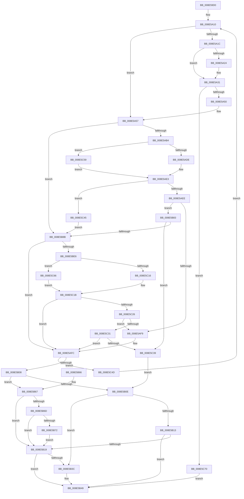

# PiPnpRtlApplyMandatoryDeviceInterfaceFilters

- RVA: `0x008E59D0`–`0x008E5C7A` (길이 `682` bytes)
- VA: `0x00000001408E59D0`
- 실행 섹션: `PAGE`
- PDB 이름 있음: `예`; PDB Function 태그: `아니요`
- unwind 정보 RVA: `0x000866B8`
- 디코드: `175`개 명령, `682/682` bytes 표시
- 미해석 바이트: `0` (있으면 어셈블리에 `.byte`로 보존)

> 이 문서는 커널 이미지의 기계어와 PDB 기호를 분석해 생성했습니다. 4번과 5번은 함수 원형과 자료형을 바이너리 사용 방식에서 추정한 C 해석이며 원본 소스 복구 결과는 아닙니다.

## 1. Dependencies

- 직접 호출 지점: **10**; 고유 호출 대상: **6**
- 직접 호출자로 확인된 함수: **2**
- RIP 상대 이미지 참조: **3**

### Outgoing calls
- `0x008E5A2C` → [ExFreePoolWithTag](../../poolcode/B8/ExFreePoolWithTag_function_00B82870.md) (function, `0x00B82870`)
- `0x008E5A3F` → [ExAllocatePool2](../../poolcode/B8/ExAllocatePool2_function_00B820F0.md) (function, `0x00B820F0`)
- `0x008E5ADE` → [PiPnpRtlObjectActionCallback](PiPnpRtlObjectActionCallback_function_008E2850.md) (function, `0x008E2850`)
- `0x008E5B30` → [PiPnpRtlApplyMandatoryDeviceFilters](PiPnpRtlApplyMandatoryDeviceFilters_function_008E5E90.md) (function, `0x008E5E90`)
- `0x008E5B44` → [ExFreePoolWithTag](../../poolcode/B8/ExFreePoolWithTag_function_00B82870.md) (function, `0x00B82870`)
- `0x008E5B7A` → [ExFreePoolWithTag](../../poolcode/B8/ExFreePoolWithTag_function_00B82870.md) (function, `0x00B82870`)
- `0x008E5BD6` → [PnpGetObjectPropertyWorker](PnpGetObjectPropertyWorker_function_008E1810.md) (function, `0x008E1810`)
- `0x008E5C16` → [PiPnpRtlObjectActionCallback](PiPnpRtlObjectActionCallback_function_008E2850.md) (function, `0x008E2850`)
- `0x008E5C5C` → [guard_dispatch_icall](../../text/6B/guard_dispatch_icall_function_006BAAD0.md) (function, `0x006BAAD0`)
- `0x008E5C69` → [guard_dispatch_icall](../../text/6B/guard_dispatch_icall_function_006BAAD0.md) (function, `0x006BAAD0`)

### Direct callers
- [IopDeviceInterfaceFilterCallback](IopDeviceInterfaceFilterCallback_function_008E5410.md) at `0x008E5514`
- [PiPnpRtlApplyMandatoryFilters](PiPnpRtlApplyMandatoryFilters_function_008E5C80.md) at `0x008E5E2A`

### Static image references
- `0x008E5A10` → RVA `0x008E2850` (`PiPnpRtlObjectActionCallback`; read)
- `0x008E5A5B` → RVA `0x00011490` (`.rdata`; read)
- `0x008E5A62` → RVA `0x00E66398` (`.data`; read)

## 2. Other-region calls and transfers

- 다른 실행 섹션으로 향하는 call: **6**
  - `0x008E5A2C` → [ExFreePoolWithTag](../../poolcode/B8/ExFreePoolWithTag_function_00B82870.md) (`PAGE` → `POOLCODE`)
  - `0x008E5A3F` → [ExAllocatePool2](../../poolcode/B8/ExAllocatePool2_function_00B820F0.md) (`PAGE` → `POOLCODE`)
  - `0x008E5B44` → [ExFreePoolWithTag](../../poolcode/B8/ExFreePoolWithTag_function_00B82870.md) (`PAGE` → `POOLCODE`)
  - `0x008E5B7A` → [ExFreePoolWithTag](../../poolcode/B8/ExFreePoolWithTag_function_00B82870.md) (`PAGE` → `POOLCODE`)
  - `0x008E5C5C` → [guard_dispatch_icall](../../text/6B/guard_dispatch_icall_function_006BAAD0.md) (`PAGE` → `.text`)
  - `0x008E5C69` → [guard_dispatch_icall](../../text/6B/guard_dispatch_icall_function_006BAAD0.md) (`PAGE` → `.text`)
- 별도 외부 분기/꼬리 이동을 확인하지 못했습니다.

## 3. Assembly (complete function range)

```asm
008E59D0  48 8B C4                        mov rax, rsp
008E59D3  48 89 58 10                     mov qword ptr [rax + 0x10], rbx
008E59D7  4C 89 48 20                     mov qword ptr [rax + 0x20], r9
008E59DB  4C 89 40 18                     mov qword ptr [rax + 0x18], r8
008E59DF  48 89 48 08                     mov qword ptr [rax + 8], rcx
008E59E3  55                              push rbp
008E59E4  56                              push rsi
008E59E5  57                              push rdi
008E59E6  41 54                           push r12
008E59E8  41 55                           push r13
008E59EA  41 56                           push r14
008E59EC  41 57                           push r15
008E59EE  48 8D 68 A9                     lea rbp, [rax - 0x57]
008E59F2  48 81 EC C0 00 00 00            sub rsp, 0xc0
008E59F9  83 65 C3 00                     and dword ptr [rbp - 0x3d], 0
008E59FD  45 33 E4                        xor r12d, r12d
008E5A00  B8 C8 00 00 00                  mov eax, 0xc8
008E5A05  33 FF                           xor edi, edi
008E5A07  89 45 BF                        mov dword ptr [rbp - 0x41], eax
008E5A0A  49 8B D8                        mov rbx, r8
008E5A0D  4C 8B EA                        mov r13, rdx
008E5A10  48 8D 0D 39 CE FF FF            lea rcx, [rip - 0x31c7]
008E5A17  41 3B C4                        cmp eax, r12d
008E5A1A  76 3B                           jbe 0x1408e5a57
008E5A1C  44 8B E0                        mov r12d, eax
008E5A1F  48 85 FF                        test rdi, rdi
008E5A22  74 0D                           je 0x1408e5a31
008E5A24  BA 50 6E 70 47                  mov edx, 0x47706e50
008E5A29  48 8B CF                        mov rcx, rdi
008E5A2C  E8 3F CE 29 00                  call 0x140b82870
008E5A31  49 8B D4                        mov rdx, r12
008E5A34  B9 00 01 00 00                  mov ecx, 0x100
008E5A39  41 B8 50 6E 70 47               mov r8d, 0x47706e50
008E5A3F  E8 AC C6 29 00                  call 0x140b820f0
008E5A44  48 8B F8                        mov rdi, rax
008E5A47  48 85 C0                        test rax, rax
008E5A4A  0F 84 20 02 00 00               je 0x1408e5c70
008E5A50  48 8D 0D F9 CD FF FF            lea rcx, [rip - 0x3207]
008E5A57  83 65 BF 00                     and dword ptr [rbp - 0x41], 0
008E5A5B  48 8D 05 2E BA 72 FF            lea rax, [rip - 0x8d45d2]
008E5A62  4C 8B 3D 2F 09 58 00            mov r15, qword ptr [rip + 0x58092f]
008E5A69  48 83 65 CF 00                  and qword ptr [rbp - 0x31], 0
008E5A6E  48 83 65 D7 00                  and qword ptr [rbp - 0x29], 0
008E5A73  83 65 0B 00                     and dword ptr [rbp + 0xb], 0
008E5A77  4D 8B B7 E8 01 00 00            mov r14, qword ptr [r15 + 0x1e8]
008E5A7E  83 65 1B 00                     and dword ptr [rbp + 0x1b], 0
008E5A82  48 83 65 E7 00                  and qword ptr [rbp - 0x19], 0
008E5A87  83 65 17 00                     and dword ptr [rbp + 0x17], 0
008E5A8B  48 89 45 EF                     mov qword ptr [rbp - 0x11], rax
008E5A8F  48 8D 45 C3                     lea rax, [rbp - 0x3d]
008E5A93  48 89 45 F7                     mov qword ptr [rbp - 9], rax
008E5A97  48 8D 45 BF                     lea rax, [rbp - 0x41]
008E5A9B  48 89 45 0F                     mov qword ptr [rbp + 0xf], rax
008E5A9F  48 89 5D DF                     mov qword ptr [rbp - 0x21], rbx
008E5AA3  48 89 7D FF                     mov qword ptr [rbp - 1], rdi
008E5AA7  44 89 65 07                     mov dword ptr [rbp + 7], r12d
008E5AAB  4D 85 F6                        test r14, r14
008E5AAE  0F 84 D7 00 00 00               je 0x1408e5b8b
008E5AB4  41 B9 08 00 00 00               mov r9d, 8
008E5ABA  48 8D 45 CF                     lea rax, [rbp - 0x31]
008E5ABE  48 89 44 24 28                  mov qword ptr [rsp + 0x28], rax
008E5AC3  4C 3B F1                        cmp r14, rcx
008E5AC6  49 8B D5                        mov rdx, r13
008E5AC9  C7 44 24 20 01 00 00 00         mov dword ptr [rsp + 0x20], 1
008E5AD1  49 8B CF                        mov rcx, r15
008E5AD4  45 8D 41 FB                     lea r8d, [r9 - 5]
008E5AD8  0F 85 7B 01 00 00               jne 0x1408e5c59
008E5ADE  E8 6D CD FF FF                  call 0x1408e2850
008E5AE3  3D 02 00 00 C0                  cmp eax, 0xc0000002
008E5AE8  0F 84 57 01 00 00               je 0x1408e5c45
008E5AEE  3D 20 01 00 C0                  cmp eax, 0xc0000120
008E5AF3  0F 85 8A 00 00 00               jne 0x1408e5b83
008E5AF9  8B 5D CF                        mov ebx, dword ptr [rbp - 0x31]
008E5AFC  81 FB 23 00 00 C0               cmp ebx, 0xc0000023
008E5B02  0F 84 45 01 00 00               je 0x1408e5c4d
008E5B08  8B C3                           mov eax, ebx
008E5B0A  85 DB                           test ebx, ebx
008E5B0C  79 59                           jns 0x1408e5b67
008E5B0E  48 85 FF                        test rdi, rdi
008E5B11  75 29                           jne 0x1408e5b3c
008E5B13  8B D8                           mov ebx, eax
008E5B15  85 C0                           test eax, eax
008E5B17  78 30                           js 0x1408e5b49
008E5B19  48 8B 45 7F                     mov rax, qword ptr [rbp + 0x7f]
008E5B1D  45 33 C0                        xor r8d, r8d
008E5B20  4C 8B 4D 77                     mov r9, qword ptr [rbp + 0x77]
008E5B24  48 8B D7                        mov rdx, rdi
008E5B27  48 8B 4D 5F                     mov rcx, qword ptr [rbp + 0x5f]
008E5B2B  48 89 44 24 20                  mov qword ptr [rsp + 0x20], rax
008E5B30  E8 5B 03 00 00                  call 0x1408e5e90
008E5B35  8B D8                           mov ebx, eax
008E5B37  48 85 FF                        test rdi, rdi
008E5B3A  74 0D                           je 0x1408e5b49
008E5B3C  BA 50 6E 70 47                  mov edx, 0x47706e50
008E5B41  48 8B CF                        mov rcx, rdi
008E5B44  E8 27 CD 29 00                  call 0x140b82870
008E5B49  8B C3                           mov eax, ebx
008E5B4B  48 8B 9C 24 08 01 00 00         mov rbx, qword ptr [rsp + 0x108]
008E5B53  48 81 C4 C0 00 00 00            add rsp, 0xc0
008E5B5A  41 5F                           pop r15
008E5B5C  41 5E                           pop r14
008E5B5E  41 5D                           pop r13
008E5B60  41 5C                           pop r12
008E5B62  5F                              pop rdi
008E5B63  5E                              pop rsi
008E5B64  5D                              pop rbp
008E5B65  C3                              ret
008E5B66  CC                              int3
008E5B67  83 7D BF 00                     cmp dword ptr [rbp - 0x41], 0
008E5B6B  75 AC                           jne 0x1408e5b19
008E5B6D  48 85 FF                        test rdi, rdi
008E5B70  74 A7                           je 0x1408e5b19
008E5B72  BA 50 6E 70 47                  mov edx, 0x47706e50
008E5B77  48 8B CF                        mov rcx, rdi
008E5B7A  E8 F1 CC 29 00                  call 0x140b82870
008E5B7F  33 FF                           xor edi, edi
008E5B81  EB 96                           jmp 0x1408e5b19
008E5B83  85 C0                           test eax, eax
008E5B85  0F 85 AE 00 00 00               jne 0x1408e5c39
008E5B8B  8B 45 17                        mov eax, dword ptr [rbp + 0x17]
008E5B8E  41 B8 03 00 00 00               mov r8d, 3
008E5B94  4C 8B 4D DF                     mov r9, qword ptr [rbp - 0x21]
008E5B98  49 8B D5                        mov rdx, r13
008E5B9B  89 44 24 50                     mov dword ptr [rsp + 0x50], eax
008E5B9F  49 8B CF                        mov rcx, r15
008E5BA2  48 8B 45 0F                     mov rax, qword ptr [rbp + 0xf]
008E5BA6  48 89 44 24 48                  mov qword ptr [rsp + 0x48], rax
008E5BAB  8B 45 07                        mov eax, dword ptr [rbp + 7]
008E5BAE  89 44 24 40                     mov dword ptr [rsp + 0x40], eax
008E5BB2  48 8B 45 FF                     mov rax, qword ptr [rbp - 1]
008E5BB6  48 89 44 24 38                  mov qword ptr [rsp + 0x38], rax
008E5BBB  48 8B 45 F7                     mov rax, qword ptr [rbp - 9]
008E5BBF  48 89 44 24 30                  mov qword ptr [rsp + 0x30], rax
008E5BC4  48 8B 45 EF                     mov rax, qword ptr [rbp - 0x11]
008E5BC8  48 89 44 24 28                  mov qword ptr [rsp + 0x28], rax
008E5BCD  48 8B 45 E7                     mov rax, qword ptr [rbp - 0x19]
008E5BD1  48 89 44 24 20                  mov qword ptr [rsp + 0x20], rax
008E5BD6  E8 35 BC FF FF                  call 0x1408e1810
008E5BDB  8B D8                           mov ebx, eax
008E5BDD  4D 85 F6                        test r14, r14
008E5BE0  0F 84 16 FF FF FF               je 0x1408e5afc
008E5BE6  89 45 CF                        mov dword ptr [rbp - 0x31], eax
008E5BE9  41 B9 08 00 00 00               mov r9d, 8
008E5BEF  48 8D 05 5A CC FF FF            lea rax, [rip - 0x33a6]
008E5BF6  49 8B D5                        mov rdx, r13
008E5BF9  4C 3B F0                        cmp r14, rax
008E5BFC  49 8B CF                        mov rcx, r15
008E5BFF  48 8D 45 CF                     lea rax, [rbp - 0x31]
008E5C03  48 89 44 24 28                  mov qword ptr [rsp + 0x28], rax
008E5C08  45 8D 41 FB                     lea r8d, [r9 - 5]
008E5C0C  C7 44 24 20 02 00 00 00         mov dword ptr [rsp + 0x20], 2
008E5C14  75 50                           jne 0x1408e5c66
008E5C16  E8 35 CC FF FF                  call 0x1408e2850
008E5C1B  3D 02 00 00 C0                  cmp eax, 0xc0000002
008E5C20  0F 84 D6 FE FF FF               je 0x1408e5afc
008E5C26  3D 20 01 00 C0                  cmp eax, 0xc0000120
008E5C2B  0F 84 C8 FE FF FF               je 0x1408e5af9
008E5C31  85 C0                           test eax, eax
008E5C33  0F 84 C3 FE FF FF               je 0x1408e5afc
008E5C39  BB E5 00 00 C0                  mov ebx, 0xc00000e5
008E5C3E  8B C3                           mov eax, ebx
008E5C40  E9 C9 FE FF FF                  jmp 0x1408e5b0e
008E5C45  45 33 F6                        xor r14d, r14d
008E5C48  E9 3E FF FF FF                  jmp 0x1408e5b8b
008E5C4D  8B 45 BF                        mov eax, dword ptr [rbp - 0x41]
008E5C50  48 8B 5D 6F                     mov rbx, qword ptr [rbp + 0x6f]
008E5C54  E9 B7 FD FF FF                  jmp 0x1408e5a10
008E5C59  49 8B C6                        mov rax, r14
008E5C5C  E8 6F 4E DD FF                  call 0x1406baad0
008E5C61  E9 7D FE FF FF                  jmp 0x1408e5ae3
008E5C66  49 8B C6                        mov rax, r14
008E5C69  E8 62 4E DD FF                  call 0x1406baad0
008E5C6E  EB AB                           jmp 0x1408e5c1b
008E5C70  BB 9A 00 00 C0                  mov ebx, 0xc000009a
008E5C75  E9 CF FE FF FF                  jmp 0x1408e5b49
```

## 4. C-style interpretation (structured pseudocode)

```c
__int64 __fastcall PiPnpRtlApplyMandatoryDeviceInterfaceFilters(__int64 a1, __int64 a2, __int64 a3, __int64 a4)
{
    __int64 result;
    __int64 v_r12;
    __int64 v_r14;
    __int64 v_rdi;
    __int64 v_rsp;
    unsigned __int64 v_stack_mD0;
    unsigned int v_stack_mD8;
    unsigned __int64 v_stack_p10;
    unsigned __int64 v_stack_p20;
    unsigned __int64 v_stack_p28;
    unsigned __int64 v_stack_p30;
    unsigned __int64 v_stack_p38;
    unsigned int v_stack_p40;
    unsigned __int64 v_stack_p48;
    unsigned int v_stack_p50;

    *(unsigned __int64 *)(v_rsp + 16) = v_rbx;
    *(unsigned __int64 *)(v_rsp + 32) = a4;
    *(unsigned __int64 *)(v_rsp + 24) = a3;
    *(unsigned __int64 *)(v_rsp + 8) = a1;
    v_rsp = (v_rsp) - (192);
    v_r12 = 0;
    v_rdi = 0;
    *(unsigned int *)(v_rsp - 87 - 65) = 200;
loc_008E5A10:
    if (200 <= 0) goto loc_008E5A57;
    result = 200;
    if (0 != 0) {
        a2 = 0x47706E50ULL;
        a1 = 0;
        result = ExFreePoolWithTag(a1, a2, a3, a4);
    }
    result = ExAllocatePool2(256, 200, (unsigned int)(0x47706E50ULL), a4);
    if (result == 0) goto loc_008E5C70;
loc_008E5A57:
    *(unsigned __int64 *)(v_rsp - 87 - 17) = v_rip - 9258450;
    *(unsigned __int64 *)(v_rsp - 87 - 9) = v_rsp - 87 - 61;
    *(unsigned __int64 *)(v_rsp - 87 + 15) = v_rsp - 87 - 65;
    *(unsigned __int64 *)(v_rsp - 87 - 33) = a3;
    *(unsigned __int64 *)(v_rsp - 87 - 1) = result;
    *(unsigned int *)(v_rsp - 87 + 7) = 200;
    if (*(unsigned __int64 *)(*(unsigned __int64 *)(v_rip + 5769519) + 488) == 0) goto loc_008E5B8B;
    v_stack_mD0 = v_rsp - 87 - 49;
    v_stack_mD8 = 1;
    if ((*(unsigned __int64 *)(*(unsigned __int64 *)(v_rip + 5769519) + 488)) != (v_rip - 12807)) goto loc_008E5C59;
    result = PiPnpRtlObjectActionCallback(*(unsigned __int64 *)(v_rip + 5769519), a2, 8 - 5, 8);
loc_008E5AE3:
    if (((unsigned int)(result)) == 0xC0000002ULL) goto loc_008E5C45;
    if (((unsigned int)(result)) != 0xC0000120ULL) goto loc_008E5B83;
loc_008E5AF9:
loc_008E5AFC:
    if (((unsigned int)((unsigned int)(*(unsigned int *)(v_rsp - 87 - 49)))) == 0xC0000023ULL) goto loc_008E5C4D;
    if (!sign_flag) goto loc_008E5B67;
loc_008E5B0E:
    if (result != 0) goto loc_008E5B3C;
    if (sign_flag) goto loc_008E5B49;
loc_008E5B19:
    a3 = 0;
    v_stack_mD8 = *(unsigned __int64 *)(v_rsp - 87 + 127);
    result = PiPnpRtlApplyMandatoryDeviceFilters(*(unsigned __int64 *)(v_rsp - 87 + 95), result, a3, *(unsigned __int64 *)(v_rsp - 87 + 119));
    if (result != 0) {
        a2 = 0x47706E50ULL;
        a1 = result;
        result = ExFreePoolWithTag(a1, a2, a3, *(unsigned __int64 *)(v_rsp - 87 + 119));
    }
    v_rsp = (v_rsp) + (192);
    return (unsigned int)((unsigned int)((unsigned int)((unsigned int)(result))));
loc_008E5B67:
    if ((*(unsigned int *)(v_rsp - 87 - 65)) != 0) goto loc_008E5B19;
    if (result == 0) goto loc_008E5B19;
    result = ExFreePoolWithTag(result, (unsigned int)(0x47706E50ULL), a3, *(unsigned __int64 *)(v_rsp - 87 + 119));
    v_rdi = 0;
    goto loc_008E5B19;
loc_008E5B83:
    if ((unsigned int)(result) != 0) goto loc_008E5C39;
loc_008E5B8B:
    v_stack_p50 = (unsigned int)((unsigned int)(*(unsigned int *)(v_rsp - 87 + 23)));
    v_stack_p48 = *(unsigned __int64 *)(v_rsp - 87 + 15);
    v_stack_p40 = (unsigned int)((unsigned int)(*(unsigned int *)(v_rsp - 87 + 7)));
    v_stack_p38 = *(unsigned __int64 *)(v_rsp - 87 - 1);
    v_stack_p30 = *(unsigned __int64 *)(v_rsp - 87 - 9);
    v_stack_p28 = *(unsigned __int64 *)(v_rsp - 87 - 17);
    v_stack_p20 = *(unsigned __int64 *)(v_rsp - 87 - 25);
    result = PnpGetObjectPropertyWorker(*(unsigned __int64 *)(v_rip + 5769519), a2, 3, *(unsigned __int64 *)(v_rsp - 87 - 33));
    if (*(unsigned __int64 *)(*(unsigned __int64 *)(v_rip + 5769519) + 488) == 0) goto loc_008E5AFC;
    *(unsigned int *)(v_rsp - 87 - 49) = (unsigned int)(result);
    v_stack_p28 = v_rsp - 87 - 49;
    v_stack_p20 = 2;
    if ((*(unsigned __int64 *)(*(unsigned __int64 *)(v_rip + 5769519) + 488)) != (v_rip - 13222)) goto loc_008E5C66;
    result = PiPnpRtlObjectActionCallback(*(unsigned __int64 *)(v_rip + 5769519), a2, 8 - 5, 8);
loc_008E5C1B:
    if (((unsigned int)(result)) == 0xC0000002ULL) goto loc_008E5AFC;
    if (((unsigned int)(result)) == 0xC0000120ULL) goto loc_008E5AF9;
    if ((unsigned int)(result) == 0) goto loc_008E5AFC;
loc_008E5C39:
    goto loc_008E5B0E;
loc_008E5C45:
    v_r14 = 0;
    goto loc_008E5B8B;
loc_008E5C4D:
    goto loc_008E5A10;
loc_008E5C59:
    result = guard_dispatch_icall(*(unsigned __int64 *)(v_rip + 5769519), a2, 8 - 5, 8);
    goto loc_008E5AE3;
loc_008E5C66:
    result = guard_dispatch_icall(*(unsigned __int64 *)(v_rip + 5769519), a2, 8 - 5, 8);
    goto loc_008E5C1B;
loc_008E5C70:
    goto loc_008E5B49;
}
```

## 5. (Beta) C Style

```c
int64_t PiPnpRtlApplyMandatoryDeviceInterfaceFilters(int64_t Arg1, int64_t Arg2, int64_t Arg3, int64_t Arg4)
{
    int64_t result;
    int64_t local_r12;
    int64_t local_r14;
    int64_t local_rdi;
    int64_t local_rsp;
    uint64_t v_stack_mD0;
    uint32_t v_stack_mD8;
    uint64_t v_stack_p10;
    uint64_t v_stack_p20;
    uint64_t v_stack_p28;
    uint64_t v_stack_p30;
    uint64_t v_stack_p38;
    uint32_t v_stack_p40;
    uint64_t v_stack_p48;
    uint32_t v_stack_p50;

    *(uint64_t *)(local_rsp + 0x10) = local_rbx;
    *(uint64_t *)(local_rsp + 0x20) = Arg4;
    *(uint64_t *)(local_rsp + 0x18) = Arg3;
    *(uint64_t *)(local_rsp + 0x8) = Arg1;
    local_rsp = (local_rsp) - (192);
    local_r12 = 0;
    local_rdi = 0;
    *(uint32_t *)(local_rsp - 0x57 - 0x41) = 200;
loc_008E5A10:
    if (200 <= 0) goto loc_008E5A57;
    result = 200;
    if (0 != 0) {
        Arg2 = 0x47706E50ULL;
        Arg1 = 0;
        result = ExFreePoolWithTag(Arg1, Arg2, Arg3, Arg4);
    }
    result = ExAllocatePool2(256, 200, (uint32_t)(0x47706E50ULL), Arg4);
    if (result == 0) goto loc_008E5C70;
loc_008E5A57:
    *(uint64_t *)(local_rsp - 0x57 - 0x11) = v_rip - 9258450;
    *(uint64_t *)(local_rsp - 0x57 - 0x9) = local_rsp - 87 - 61;
    *(uint64_t *)(local_rsp - 0x57 + 0xF) = local_rsp - 87 - 65;
    *(uint64_t *)(local_rsp - 0x57 - 0x21) = Arg3;
    *(uint64_t *)(local_rsp - 0x57 - 0x1) = result;
    *(uint32_t *)(local_rsp - 0x57 + 0x7) = 200;
    if (*(uint64_t *)(*(uint64_t *)(v_rip + 0x58092F) + 0x1E8) == 0) goto loc_008E5B8B;
    v_stack_mD0 = local_rsp - 87 - 49;
    v_stack_mD8 = 1;
    if ((*(uint64_t *)(*(uint64_t *)(v_rip + 0x58092F) + 0x1E8)) != (v_rip - 12807)) goto loc_008E5C59;
    result = PiPnpRtlObjectActionCallback(*(uint64_t *)(v_rip + 0x58092F), Arg2, 8 - 5, 8);
loc_008E5AE3:
    if (((uint32_t)(result)) == 0xC0000002ULL) goto loc_008E5C45;
    if (((uint32_t)(result)) != 0xC0000120ULL) goto loc_008E5B83;
loc_008E5AF9:
loc_008E5AFC:
    if (((uint32_t)((uint32_t)(*(uint32_t *)(local_rsp - 0x57 - 0x31)))) == 0xC0000023ULL) goto loc_008E5C4D;
    if (!sign_flag) goto loc_008E5B67;
loc_008E5B0E:
    if (result != 0) goto loc_008E5B3C;
    if (sign_flag) goto loc_008E5B49;
loc_008E5B19:
    Arg3 = 0;
    v_stack_mD8 = *(uint64_t *)(local_rsp - 0x57 + 0x7F);
    result = PiPnpRtlApplyMandatoryDeviceFilters(*(uint64_t *)(local_rsp - 0x57 + 0x5F), result, Arg3, *(uint64_t *)(local_rsp - 0x57 + 0x77));
    if (result != 0) {
        Arg2 = 0x47706E50ULL;
        Arg1 = result;
        result = ExFreePoolWithTag(Arg1, Arg2, Arg3, *(uint64_t *)(local_rsp - 0x57 + 0x77));
    }
    local_rsp = (local_rsp) + (192);
    return (uint32_t)((uint32_t)((uint32_t)((uint32_t)(result))));
loc_008E5B67:
    if ((*(uint32_t *)(local_rsp - 0x57 - 0x41)) != 0) goto loc_008E5B19;
    if (result == 0) goto loc_008E5B19;
    result = ExFreePoolWithTag(result, (uint32_t)(0x47706E50ULL), Arg3, *(uint64_t *)(local_rsp - 0x57 + 0x77));
    local_rdi = 0;
    goto loc_008E5B19;
loc_008E5B83:
    if ((uint32_t)(result) != 0) goto loc_008E5C39;
loc_008E5B8B:
    v_stack_p50 = (uint32_t)((uint32_t)(*(uint32_t *)(local_rsp - 0x57 + 0x17)));
    v_stack_p48 = *(uint64_t *)(local_rsp - 0x57 + 0xF);
    v_stack_p40 = (uint32_t)((uint32_t)(*(uint32_t *)(local_rsp - 0x57 + 0x7)));
    v_stack_p38 = *(uint64_t *)(local_rsp - 0x57 - 0x1);
    v_stack_p30 = *(uint64_t *)(local_rsp - 0x57 - 0x9);
    v_stack_p28 = *(uint64_t *)(local_rsp - 0x57 - 0x11);
    v_stack_p20 = *(uint64_t *)(local_rsp - 0x57 - 0x19);
    result = PnpGetObjectPropertyWorker(*(uint64_t *)(v_rip + 0x58092F), Arg2, 3, *(uint64_t *)(local_rsp - 0x57 - 0x21));
    if (*(uint64_t *)(*(uint64_t *)(v_rip + 0x58092F) + 0x1E8) == 0) goto loc_008E5AFC;
    *(uint32_t *)(local_rsp - 0x57 - 0x31) = (uint32_t)(result);
    v_stack_p28 = local_rsp - 87 - 49;
    v_stack_p20 = 2;
    if ((*(uint64_t *)(*(uint64_t *)(v_rip + 0x58092F) + 0x1E8)) != (v_rip - 13222)) goto loc_008E5C66;
    result = PiPnpRtlObjectActionCallback(*(uint64_t *)(v_rip + 0x58092F), Arg2, 8 - 5, 8);
loc_008E5C1B:
    if (((uint32_t)(result)) == 0xC0000002ULL) goto loc_008E5AFC;
    if (((uint32_t)(result)) == 0xC0000120ULL) goto loc_008E5AF9;
    if ((uint32_t)(result) == 0) goto loc_008E5AFC;
loc_008E5C39:
    goto loc_008E5B0E;
loc_008E5C45:
    local_r14 = 0;
    goto loc_008E5B8B;
loc_008E5C4D:
    goto loc_008E5A10;
loc_008E5C59:
    result = guard_dispatch_icall(*(uint64_t *)(v_rip + 0x58092F), Arg2, 8 - 5, 8);
    goto loc_008E5AE3;
loc_008E5C66:
    result = guard_dispatch_icall(*(uint64_t *)(v_rip + 0x58092F), Arg2, 8 - 5, 8);
    goto loc_008E5C1B;
loc_008E5C70:
    goto loc_008E5B49;
}
```

## 6. Execution-region graph

[열기: 2D/3D 그래프와 함수 탐색 컨트롤 패널](../../../control-panel.html?section=page&rva=0x008E59D0&view=graph)

- 2D 그래프는 위에서 아래로 흐르고, 3D 그래프는 빈 공간을 드래그해 회전합니다. Shift+드래그는 이동, 휠은 확대·축소, 함수 노드 선택은 대상 보고서 이동입니다.

### Static fallback


