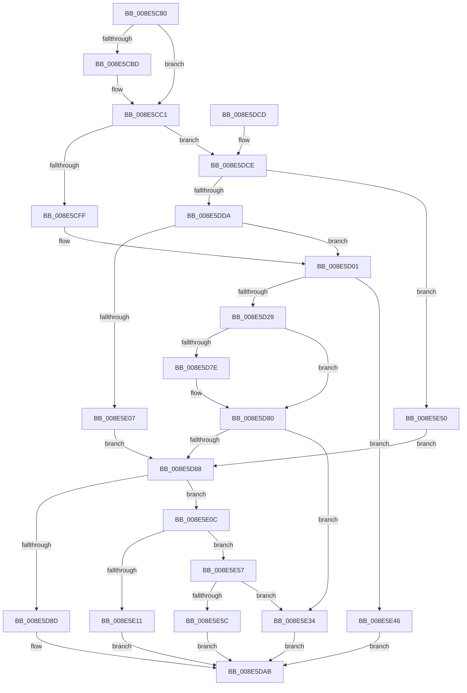

# PiPnpRtlApplyMandatoryFilters

- RVA: `0x008E5C80`–`0x008E5E7C` (길이 `508` bytes)
- VA: `0x00000001408E5C80`
- 실행 섹션: `PAGE`
- PDB 이름 있음: `예`; PDB Function 태그: `아니요`
- unwind 정보 RVA: `0x000866D8`
- 디코드: `121`개 명령, `508/508` bytes 표시
- 미해석 바이트: `0` (있으면 어셈블리에 `.byte`로 보존)

> 이 문서는 커널 이미지의 기계어와 PDB 기호를 분석해 생성했습니다. 4번과 5번은 함수 원형과 자료형을 바이너리 사용 방식에서 추정한 C 해석이며 원본 소스 복구 결과는 아닙니다.

## 1. Dependencies

- 직접 호출 지점: **10**; 고유 호출 대상: **10**
- 직접 호출자로 확인된 함수: **5**
- RIP 상대 이미지 참조: **2**

### Outgoing calls
- `0x008E5CD8` → [ExAcquireResourceSharedLite](../../text/21/ExAcquireResourceSharedLite_function_00211BC0.md) (function, `0x00211BC0`)
- `0x008E5CE4` → [ExReleaseResourceLite](../../text/25/ExReleaseResourceLite_function_0025FA10.md) (function, `0x0025FA10`)
- `0x008E5CF2` → [KeLeaveCriticalRegionThread](../../text/25/KeLeaveCriticalRegionThread_function_0025EFF0.md) (function, `0x0025EFF0`)
- `0x008E5D6F` → [SeAccessCheck](../../text/3A/SeAccessCheck_function_003A6BC0.md) (function, `0x003A6BC0`)
- `0x008E5DA6` → [PiPnpRtlApplyMandatoryDeviceFilters](PiPnpRtlApplyMandatoryDeviceFilters_function_008E5E90.md) (function, `0x008E5E90`)
- `0x008E5DD0` → [PsGetSessionById](../../text/22/PsGetSessionById_function_00225150.md) (function, `0x00225150`)
- `0x008E5DF0` → [ObfDereferenceObjectWithTag](../../text/2F/ObfDereferenceObjectWithTag_function_002F78E0.md) (function, `0x002F78E0`)
- `0x008E5DF8` → [PsGetServerSiloServiceSessionId](../../text/45/PsGetServerSiloServiceSessionId_function_0045ED00.md) (function, `0x0045ED00`)
- `0x008E5E2A` → [PiPnpRtlApplyMandatoryDeviceInterfaceFilters](PiPnpRtlApplyMandatoryDeviceInterfaceFilters_function_008E59D0.md) (function, `0x008E59D0`)
- `0x008E5E72` → [PiPnpRtlApplyMandatoryDeviceContainerFilters](../95/PiPnpRtlApplyMandatoryDeviceContainerFilters_function_00950874.md) (function, `0x00950874`)

### Direct callers
- [PiDqQueryApplyObjectEvent](../8D/PiDqQueryApplyObjectEvent_function_008DDACC.md) at `0x008DDE44`
- [PiDqQueryEnumObject](../8D/PiDqQueryEnumObject_function_008DF424.md) at `0x008DF484`
- [sub_008E6A55](Unknown_function_008E6A55.md) at `0x008E6AA0`
- [sub_008E6A55](Unknown_function_008E6A55.md) at `0x008E6AD5`
- [IoGetDeviceInterfaceAlias](../8F/IoGetDeviceInterfaceAlias_function_008F5570.md) at `0x008F56BC`
- [sub_00B1E436](../B1/Unknown_function_00B1E436.md) at `0x00B1E623`

### Static image references
- `0x008E5D01` → RVA `0x00E663A0` (`.data`; read)
- `0x008E5D57` → RVA `0x000114A8` (`.rdata`; read)

## 2. Other-region calls and transfers

- 다른 실행 섹션으로 향하는 call: **7**
  - `0x008E5CD8` → [ExAcquireResourceSharedLite](../../text/21/ExAcquireResourceSharedLite_function_00211BC0.md) (`PAGE` → `.text`)
  - `0x008E5CE4` → [ExReleaseResourceLite](../../text/25/ExReleaseResourceLite_function_0025FA10.md) (`PAGE` → `.text`)
  - `0x008E5CF2` → [KeLeaveCriticalRegionThread](../../text/25/KeLeaveCriticalRegionThread_function_0025EFF0.md) (`PAGE` → `.text`)
  - `0x008E5D6F` → [SeAccessCheck](../../text/3A/SeAccessCheck_function_003A6BC0.md) (`PAGE` → `.text`)
  - `0x008E5DD0` → [PsGetSessionById](../../text/22/PsGetSessionById_function_00225150.md) (`PAGE` → `.text`)
  - `0x008E5DF0` → [ObfDereferenceObjectWithTag](../../text/2F/ObfDereferenceObjectWithTag_function_002F78E0.md) (`PAGE` → `.text`)
  - `0x008E5DF8` → [PsGetServerSiloServiceSessionId](../../text/45/PsGetServerSiloServiceSessionId_function_0045ED00.md) (`PAGE` → `.text`)
- 별도 외부 분기/꼬리 이동을 확인하지 못했습니다.

## 3. Assembly (complete function range)

```asm
008E5C80  48 89 5C 24 08                  mov qword ptr [rsp + 8], rbx
008E5C85  48 89 6C 24 10                  mov qword ptr [rsp + 0x10], rbp
008E5C8A  48 89 74 24 18                  mov qword ptr [rsp + 0x18], rsi
008E5C8F  48 89 7C 24 20                  mov qword ptr [rsp + 0x20], rdi
008E5C94  41 54                           push r12
008E5C96  41 56                           push r14
008E5C98  41 57                           push r15
008E5C9A  48 81 EC 80 00 00 00            sub rsp, 0x80
008E5CA1  48 8B BC 24 C0 00 00 00         mov rdi, qword ptr [rsp + 0xc0]
008E5CA9  4D 8B E1                        mov r12, r9
008E5CAC  41 8B E8                        mov ebp, r8d
008E5CAF  4C 8B F2                        mov r14, rdx
008E5CB2  4C 8B F9                        mov r15, rcx
008E5CB5  48 8B 1F                        mov rbx, qword ptr [rdi]
008E5CB8  48 85 DB                        test rbx, rbx
008E5CBB  75 04                           jne 0x1408e5cc1
008E5CBD  48 8B 5F 10                     mov rbx, qword ptr [rdi + 0x10]
008E5CC1  65 48 8B 04 25 88 01 00 00      mov rax, qword ptr gs:[0x188]
008E5CCA  B2 01                           mov dl, 1
008E5CCC  66 FF 88 E4 01 00 00            dec word ptr [rax + 0x1e4]
008E5CD3  90                              nop
008E5CD4  48 8B 4B 30                     mov rcx, qword ptr [rbx + 0x30]
008E5CD8  E8 E3 BE 92 FF                  call 0x140211bc0
008E5CDD  48 8B 4B 30                     mov rcx, qword ptr [rbx + 0x30]
008E5CE1  8B 73 78                        mov esi, dword ptr [rbx + 0x78]
008E5CE4  E8 27 9D 97 FF                  call 0x14025fa10
008E5CE9  65 48 8B 0C 25 88 01 00 00      mov rcx, qword ptr gs:[0x188]
008E5CF2  E8 F9 92 97 FF                  call 0x14025eff0
008E5CF7  85 F6                           test esi, esi
008E5CF9  0F 85 CF 00 00 00               jne 0x1408e5dce
008E5CFF  33 DB                           xor ebx, ebx
008E5D01  48 8B 0D 98 06 58 00            mov rcx, qword ptr [rip + 0x580698]
008E5D08  0F 57 C0                        xorps xmm0, xmm0
008E5D0B  89 5C 24 50                     mov dword ptr [rsp + 0x50], ebx
008E5D0F  89 9C 24 C0 00 00 00            mov dword ptr [rsp + 0xc0], ebx
008E5D16  0F 11 44 24 58                  movups xmmword ptr [rsp + 0x58], xmm0
008E5D1B  0F 11 44 24 68                  movups xmmword ptr [rsp + 0x68], xmm0
008E5D20  48 85 C9                        test rcx, rcx
008E5D23  0F 84 1D 01 00 00               je 0x1408e5e46
008E5D29  48 8D 84 24 C0 00 00 00         lea rax, [rsp + 0xc0]
008E5D31  48 85 FF                        test rdi, rdi
008E5D34  48 89 44 24 48                  mov qword ptr [rsp + 0x48], rax
008E5D39  48 8D 54 24 58                  lea rdx, [rsp + 0x58]
008E5D3E  48 8D 44 24 50                  lea rax, [rsp + 0x50]
008E5D43  48 0F 45 D7                     cmovne rdx, rdi
008E5D47  48 89 44 24 40                  mov qword ptr [rsp + 0x40], rax
008E5D4C  41 B9 00 00 0F 00               mov r9d, 0xf0000
008E5D52  C6 44 24 38 01                  mov byte ptr [rsp + 0x38], 1
008E5D57  48 8D 05 4A B7 72 FF            lea rax, [rip - 0x8d48b6]
008E5D5E  48 89 44 24 30                  mov qword ptr [rsp + 0x30], rax
008E5D63  45 33 C0                        xor r8d, r8d
008E5D66  48 89 5C 24 28                  mov qword ptr [rsp + 0x28], rbx
008E5D6B  89 5C 24 20                     mov dword ptr [rsp + 0x20], ebx
008E5D6F  E8 4C 0E AC FF                  call 0x1403a6bc0
008E5D74  83 BC 24 C0 00 00 00 00         cmp dword ptr [rsp + 0xc0], 0
008E5D7C  7D 02                           jge 0x1408e5d80
008E5D7E  32 C0                           xor al, al
008E5D80  84 C0                           test al, al
008E5D82  0F 85 AC 00 00 00               jne 0x1408e5e34
008E5D88  83 FD 01                        cmp ebp, 1
008E5D8B  75 7F                           jne 0x1408e5e0c
008E5D8D  48 8B 84 24 C8 00 00 00         mov rax, qword ptr [rsp + 0xc8]
008E5D95  4C 8B CF                        mov r9, rdi
008E5D98  4D 8B C4                        mov r8, r12
008E5D9B  48 89 44 24 20                  mov qword ptr [rsp + 0x20], rax
008E5DA0  49 8B D6                        mov rdx, r14
008E5DA3  49 8B CF                        mov rcx, r15
008E5DA6  E8 E5 00 00 00                  call 0x1408e5e90
008E5DAB  4C 8D 9C 24 80 00 00 00         lea r11, [rsp + 0x80]
008E5DB3  49 8B 5B 20                     mov rbx, qword ptr [r11 + 0x20]
008E5DB7  49 8B 6B 28                     mov rbp, qword ptr [r11 + 0x28]
008E5DBB  49 8B 73 30                     mov rsi, qword ptr [r11 + 0x30]
008E5DBF  49 8B 7B 38                     mov rdi, qword ptr [r11 + 0x38]
008E5DC3  49 8B E3                        mov rsp, r11
008E5DC6  41 5F                           pop r15
008E5DC8  41 5E                           pop r14
008E5DCA  41 5C                           pop r12
008E5DCC  C3                              ret
008E5DCD  CC                              int3
008E5DCE  8B CE                           mov ecx, esi
008E5DD0  E8 7B F3 93 FF                  call 0x140225150
008E5DD5  48 85 C0                        test rax, rax
008E5DD8  74 76                           je 0x1408e5e50
008E5DDA  48 8B 88 E8 02 00 00            mov rcx, qword ptr [rax + 0x2e8]
008E5DE1  BA 50 73 51 79                  mov edx, 0x79517350
008E5DE6  48 8B 99 A0 00 00 00            mov rbx, qword ptr [rcx + 0xa0]
008E5DED  48 8B C8                        mov rcx, rax
008E5DF0  E8 EB 1A A1 FF                  call 0x1402f78e0
008E5DF5  48 8B CB                        mov rcx, rbx
008E5DF8  E8 03 8F B7 FF                  call 0x14045ed00
008E5DFD  33 DB                           xor ebx, ebx
008E5DFF  3B F0                           cmp esi, eax
008E5E01  0F 84 FA FE FF FF               je 0x1408e5d01
008E5E07  E9 7C FF FF FF                  jmp 0x1408e5d88
008E5E0C  83 FD 03                        cmp ebp, 3
008E5E0F  75 46                           jne 0x1408e5e57
008E5E11  48 8B 84 24 C8 00 00 00         mov rax, qword ptr [rsp + 0xc8]
008E5E19  4C 8B CF                        mov r9, rdi
008E5E1C  4D 8B C4                        mov r8, r12
008E5E1F  48 89 44 24 20                  mov qword ptr [rsp + 0x20], rax
008E5E24  49 8B D6                        mov rdx, r14
008E5E27  49 8B CF                        mov rcx, r15
008E5E2A  E8 A1 FB FF FF                  call 0x1408e59d0
008E5E2F  E9 77 FF FF FF                  jmp 0x1408e5dab
008E5E34  48 8B 8C 24 C8 00 00 00         mov rcx, qword ptr [rsp + 0xc8]
008E5E3C  8B C3                           mov eax, ebx
008E5E3E  C6 01 01                        mov byte ptr [rcx], 1
008E5E41  E9 65 FF FF FF                  jmp 0x1408e5dab
008E5E46  B8 0D 00 00 C0                  mov eax, 0xc000000d
008E5E4B  E9 5B FF FF FF                  jmp 0x1408e5dab
008E5E50  33 DB                           xor ebx, ebx
008E5E52  E9 31 FF FF FF                  jmp 0x1408e5d88
008E5E57  83 FD 05                        cmp ebp, 5
008E5E5A  75 D8                           jne 0x1408e5e34
008E5E5C  48 8B 84 24 C8 00 00 00         mov rax, qword ptr [rsp + 0xc8]
008E5E64  4C 8B CF                        mov r9, rdi
008E5E67  49 8B D6                        mov rdx, r14
008E5E6A  48 89 44 24 20                  mov qword ptr [rsp + 0x20], rax
008E5E6F  49 8B CF                        mov rcx, r15
008E5E72  E8 FD A9 06 00                  call 0x140950874
008E5E77  E9 2F FF FF FF                  jmp 0x1408e5dab
```

## 4. C-style interpretation (structured pseudocode)

```c
__int64 __fastcall PiPnpRtlApplyMandatoryFilters(__int64 a1, __int64 a2, int a3, __int64 a4, unsigned int a5, __int64 a6)
{
    __int64 result;
    __int64 v_rbx;
    __int64 v_rsp;
    unsigned __int64 v_stack_m18;
    unsigned __int64 v_stack_m30;
    unsigned __int64 v_stack_m40;
    unsigned int v_stack_m48;
    unsigned __int64 v_stack_m50;
    unsigned __int64 v_stack_m58;
    unsigned __int8 v_stack_m60;
    unsigned __int64 v_stack_m68;
    unsigned __int64 v_stack_m70;
    unsigned int v_stack_m78;
    unsigned __int64 v_stack_p10;
    unsigned __int64 v_stack_p18;
    unsigned __int64 v_stack_p20;
    unsigned int v_stack_p28;
    unsigned __int64 v_stack_p8;

    v_stack_p8 = v_rbx;
    v_stack_p10 = v_rbp;
    v_stack_p18 = v_rsi;
    v_stack_p20 = v_rdi;
    v_rsp = (v_rsp) - (128);
    v_rbx = *(unsigned __int64 *)(a5);
    if (*(unsigned __int64 *)(a5) == 0) {
        v_rbx = *(unsigned __int64 *)(a5 + 16);
    }
    result = ExAcquireResourceSharedLite(*(unsigned __int64 *)(v_rbx + 48), 1, a3, a4);
    result = ExReleaseResourceLite(*(unsigned __int64 *)(v_rbx + 48), 1, a3, a4);
    result = KeLeaveCriticalRegionThread(*(unsigned __int64 *)(gs_base + (0 + 392)), 1, a3, a4);
    if ((unsigned int)((unsigned int)(*(unsigned int *)(v_rbx + 120))) != 0) goto loc_008E5DCE;
    v_rbx = 0;
loc_008E5D01:
    v_stack_m48 = 0;
    v_stack_p28 = 0;
    v_stack_m40 = v_xmm0;
    v_stack_m30 = v_xmm0;
    if (*(unsigned __int64 *)(v_rip + 5768856) == 0) goto loc_008E5E46;
    v_stack_m50 = a5;
    a2 = v_stack_m40;
    if (a5 != 0) { a2 = a5; }
    v_stack_m58 = v_stack_m48;
    v_stack_m60 = 1;
    v_stack_m68 = v_rip - 9259190;
    a3 = 0;
    v_stack_m70 = 0;
    v_stack_m78 = 0;
    result = SeAccessCheck(*(unsigned __int64 *)(v_rip + 5768856), a2, a3, (unsigned int)(0xF0000ULL));
    if (a5 < 0) {
        result = 0;
    }
    if (0 != 0) goto loc_008E5E34;
loc_008E5D88:
    if (((unsigned int)((unsigned int)(a3))) != 1) goto loc_008E5E0C;
    v_stack_m78 = a6;
    result = PiPnpRtlApplyMandatoryDeviceFilters(a1, a2, a4, a5);
loc_008E5DAB:
    return result;
loc_008E5DCE:
    result = PsGetSessionById((unsigned int)((unsigned int)(*(unsigned __int64 *)(v_stack_m18 + 48))), a2, a4, a5);
    if (result == 0) goto loc_008E5E50;
    result = ObfDereferenceObjectWithTag(result, (unsigned int)(0x79517350ULL), a4, a5);
    result = PsGetServerSiloServiceSessionId(*(unsigned __int64 *)(*(unsigned __int64 *)(result + 744) + 160), (unsigned int)(0x79517350ULL), a4, a5);
    v_rbx = 0;
    if (((unsigned int)(*(unsigned __int64 *)(v_stack_m18 + 48))) == ((unsigned int)(result))) goto loc_008E5D01;
    goto loc_008E5D88;
loc_008E5E0C:
    if (((unsigned int)(*(unsigned __int64 *)(v_stack_m18 + 40))) != 3) goto loc_008E5E57;
    v_stack_m60 = a6;
    result = PiPnpRtlApplyMandatoryDeviceInterfaceFilters(a1, a2, a4, *(unsigned __int64 *)(v_stack_m18 + 56));
    goto loc_008E5DAB;
loc_008E5E34:
    *(unsigned __int8 *)(a6) = 1;
    goto loc_008E5DAB;
loc_008E5E46:
    goto loc_008E5DAB;
loc_008E5E50:
    v_rbx = 0;
    goto loc_008E5D88;
loc_008E5E57:
    if (((unsigned int)(*(unsigned __int64 *)(v_stack_m18 + 40))) != 5) goto loc_008E5E34;
    v_stack_m60 = a6;
    result = PiPnpRtlApplyMandatoryDeviceContainerFilters(a1, a2, a4, *(unsigned __int64 *)(v_stack_m18 + 56));
    goto loc_008E5DAB;
}
```

## 5. (Beta) C Style

```c
int64_t PiPnpRtlApplyMandatoryFilters(int64_t Arg1, int64_t Arg2, int32_t Arg3, int64_t Arg4, void *Arg5, void *Arg6)
{
    uint8_t *arg5 = (uint8_t *)Arg5;
    uint8_t *arg6 = (uint8_t *)Arg6;

    int64_t result;
    int64_t local_rbx;
    int64_t local_rsp;
    uint64_t v_stack_m18;
    uint64_t v_stack_m30;
    uint64_t v_stack_m40;
    uint32_t v_stack_m48;
    uint64_t v_stack_m50;
    uint64_t v_stack_m58;
    uint8_t v_stack_m60;
    uint64_t v_stack_m68;
    uint64_t v_stack_m70;
    uint32_t v_stack_m78;
    uint64_t v_stack_p10;
    uint64_t v_stack_p18;
    uint64_t v_stack_p20;
    uint32_t v_stack_p28;
    uint64_t v_stack_p8;

    v_stack_p8 = local_rbx;
    v_stack_p10 = local_rbp;
    v_stack_p18 = local_rsi;
    v_stack_p20 = local_rdi;
    local_rsp = (local_rsp) - (128);
    local_rbx = *(uint64_t *)(arg5);
    if (*(uint64_t *)(arg5) == 0) {
        local_rbx = *(uint64_t *)(arg5 + 0x10);
    }
    result = ExAcquireResourceSharedLite(*(uint64_t *)(local_rbx + 0x30), 1, Arg3, Arg4);
    result = ExReleaseResourceLite(*(uint64_t *)(local_rbx + 0x30), 1, Arg3, Arg4);
    result = KeLeaveCriticalRegionThread(*(uint64_t *)(gs_base + (0 + 0x188)), 1, Arg3, Arg4);
    if ((uint32_t)((uint32_t)(*(uint32_t *)(local_rbx + 0x78))) != 0) goto loc_008E5DCE;
    local_rbx = 0;
loc_008E5D01:
    v_stack_m48 = 0;
    v_stack_p28 = 0;
    v_stack_m40 = v_xmm0;
    v_stack_m30 = v_xmm0;
    if (*(uint64_t *)(v_rip + 0x580698) == 0) goto loc_008E5E46;
    v_stack_m50 = Arg5;
    Arg2 = v_stack_m40;
    if (Arg5 != NULL) { Arg2 = Arg5; }
    v_stack_m58 = v_stack_m48;
    v_stack_m60 = 1;
    v_stack_m68 = v_rip - 9259190;
    Arg3 = 0;
    v_stack_m70 = 0;
    v_stack_m78 = 0;
    result = SeAccessCheck(*(uint64_t *)(v_rip + 0x580698), Arg2, Arg3, (uint32_t)(0xF0000ULL));
    if (Arg5 < 0) {
        result = 0;
    }
    if (0 != 0) goto loc_008E5E34;
loc_008E5D88:
    if (((uint32_t)((uint32_t)(Arg3))) != 1) goto loc_008E5E0C;
    v_stack_m78 = Arg6;
    result = PiPnpRtlApplyMandatoryDeviceFilters(Arg1, Arg2, Arg4, Arg5);
loc_008E5DAB:
    return result;
loc_008E5DCE:
    result = PsGetSessionById((uint32_t)((uint32_t)(*(uint64_t *)(v_stack_m18 + 0x30))), Arg2, Arg4, Arg5);
    if (result == 0) goto loc_008E5E50;
    result = ObfDereferenceObjectWithTag(result, (uint32_t)(0x79517350ULL), Arg4, Arg5);
    result = PsGetServerSiloServiceSessionId(*(uint64_t *)(*(uint64_t *)(result + 0x2E8) + 0xA0), (uint32_t)(0x79517350ULL), Arg4, Arg5);
    local_rbx = 0;
    if (((uint32_t)(*(uint64_t *)(v_stack_m18 + 0x30))) == ((uint32_t)(result))) goto loc_008E5D01;
    goto loc_008E5D88;
loc_008E5E0C:
    if (((uint32_t)(*(uint64_t *)(v_stack_m18 + 0x28))) != 3) goto loc_008E5E57;
    v_stack_m60 = Arg6;
    result = PiPnpRtlApplyMandatoryDeviceInterfaceFilters(Arg1, Arg2, Arg4, *(uint64_t *)(v_stack_m18 + 0x38));
    goto loc_008E5DAB;
loc_008E5E34:
    *(uint8_t *)(arg6) = 1;
    goto loc_008E5DAB;
loc_008E5E46:
    goto loc_008E5DAB;
loc_008E5E50:
    local_rbx = 0;
    goto loc_008E5D88;
loc_008E5E57:
    if (((uint32_t)(*(uint64_t *)(v_stack_m18 + 0x28))) != 5) goto loc_008E5E34;
    v_stack_m60 = Arg6;
    result = PiPnpRtlApplyMandatoryDeviceContainerFilters(Arg1, Arg2, Arg4, *(uint64_t *)(v_stack_m18 + 0x38));
    goto loc_008E5DAB;
}
```

### 관측된 메모리 오프셋

구조체 형식이 확인되지 않은 접근은 인자 기준의 오프셋으로만 기록했습니다.

| 기준 인자 | 오프셋 표현 | 폭 (bit) | 접근 |
|---|---:|---:|---|
| `Arg5` | `+ 0x0` | `64` | `R` |
| `Arg5` | `+ 0x10` | `64` | `R` |
| `Arg6` | `+ 0x0` | `8` | `W` |

## 6. Execution-region graph

[열기: 2D/3D 그래프와 함수 탐색 컨트롤 패널](../../../control-panel.html?section=page&rva=0x008E5C80&view=graph)

- 2D 그래프는 위에서 아래로 흐르고, 3D 그래프는 빈 공간을 드래그해 회전합니다. Shift+드래그는 이동, 휠은 확대·축소, 함수 노드 선택은 대상 보고서 이동입니다.

### Static fallback


