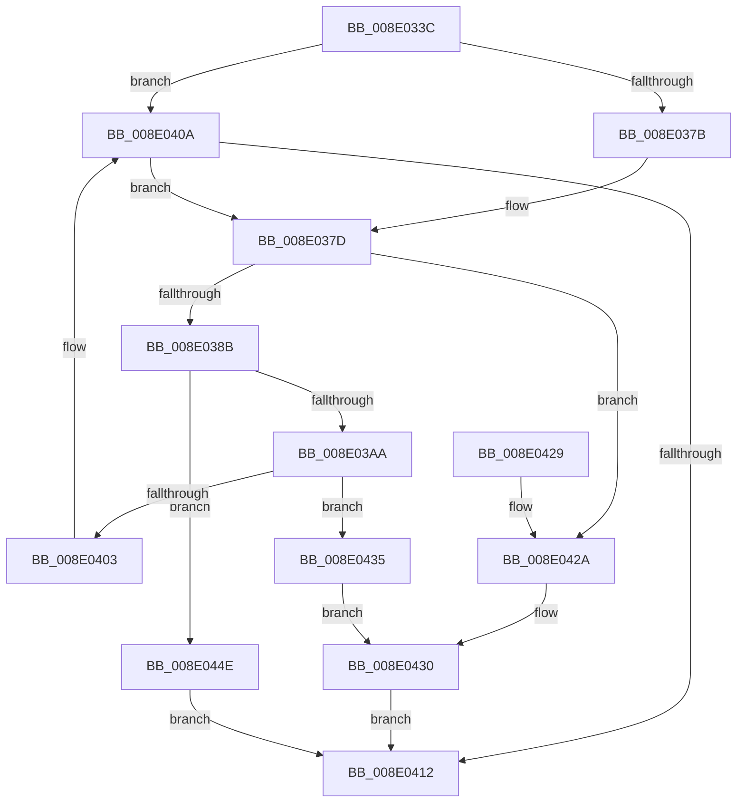

# PiPnpRtlBeginOperation

- RVA: `0x008E033C`–`0x008E0455` (길이 `281` bytes)
- VA: `0x00000001408E033C`
- 실행 섹션: `PAGE`
- PDB 이름 있음: `예`; PDB Function 태그: `아니요`
- unwind 정보 RVA: `0x00085CE0`
- 디코드: `65`개 명령, `281/281` bytes 표시
- 미해석 바이트: `0` (있으면 어셈블리에 `.byte`로 보존)

> 이 문서는 커널 이미지의 기계어와 PDB 기호를 분석해 생성했습니다. 4번과 5번은 함수 원형과 자료형을 바이너리 사용 방식에서 추정한 C 해석이며 원본 소스 복구 결과는 아닙니다.

## 1. Dependencies

- 직접 호출 지점: **5**; 고유 호출 대상: **5**
- 직접 호출자로 확인된 함수: **32**
- RIP 상대 이미지 참조: **5**

### Outgoing calls
- `0x008E0369` → [PiPnpRtlGetCurrentOperation](PiPnpRtlGetCurrentOperation_function_008E0460.md) (function, `0x008E0460`)
- `0x008E0399` → [ExAllocatePool2](../../poolcode/B8/ExAllocatePool2_function_00B820F0.md) (function, `0x00B820F0`)
- `0x008E03D7` → [RtlInitializeGenericTableAvl](../../text/46/RtlInitializeGenericTableAvl_function_00466100.md) (function, `0x00466100`)
- `0x008E03EA` → [PiPnpRtlOperationListAcquireExclusiveLock](PiPnpRtlOperationListAcquireExclusiveLock_function_008E065C.md) (function, `0x008E065C`)
- `0x008E0447` → [PiPnpRtlOperationListReleaseLock](PiPnpRtlOperationListReleaseLock_function_008E0630.md) (function, `0x008E0630`)

### Direct callers
- [IoReportDetectedDevice](../72/IoReportDetectedDevice_function_00725CD0.md) at `0x00725E28`
- [IoReportRootDevice](../72/IoReportRootDevice_function_00726780.md) at `0x00726844`
- [PipMergeDependencyEdgeList](../72/PipMergeDependencyEdgeList_function_00727D4C.md) at `0x00727DA5`
- [PiProcessAddBootDevices](../72/PiProcessAddBootDevices_function_0072D434.md) at `0x0072D478`
- [PiProcessSetDeviceProblem](../72/PiProcessSetDeviceProblem_function_0072D668.md) at `0x0072D6B6`
- [PiPnpRtlEnsureObjectCached](../72/PiPnpRtlEnsureObjectCached_function_0072F928.md) at `0x0072F9BA`
- [PpDevCfgProcessDevices](../73/PpDevCfgProcessDevices_function_007373C0.md) at `0x00737439`
- [PiCMDeleteDeviceWorker](../73/PiCMDeleteDeviceWorker_function_0073B420.md) at `0x0073B488`
- [PiInitializeDevice](../73/PiInitializeDevice_function_0073EC5C.md) at `0x0073ED10`
- [PiDqActionDataGetRequestedProperties](../8D/PiDqActionDataGetRequestedProperties_function_008DEBE4.md) at `0x008DEC54`
- [PiDqQueryEvaluateFilter](PiDqQueryEvaluateFilter_function_008E01C4.md) at `0x008E0241`
- [PiSwPropertySet](../8F/PiSwPropertySet_function_008F5EEC.md) at `0x008F5F1E`
- [PipEnumerateCompleted](../8F/PipEnumerateCompleted_function_008F7B1C.md) at `0x008F7BD0`
- [PiPnpRtlObjectEventWorker](../8F/PiPnpRtlObjectEventWorker_function_008F8630.md) at `0x008F8690`
- [PiProcessQueryDeviceState](../8F/PiProcessQueryDeviceState_function_008FA0F8.md) at `0x008FA125`
- [PipProcessStartPhase3](../8F/PipProcessStartPhase3_function_008FBAF8.md) at `0x008FBB3A`
- [IopRemoveDevice](../8F/IopRemoveDevice_function_008FC7FC.md) at `0x008FC84A`
- [PiDcUpdateDeviceContainerMembership](../8F/PiDcUpdateDeviceContainerMembership_function_008FD0A8.md) at `0x008FD0F3`
- [PipSetDevNodeProblem](../8F/PipSetDevNodeProblem_function_008FDE0C.md) at `0x008FDE59`
- [IopRegisterDeviceInterface](../95/IopRegisterDeviceInterface_function_009501B0.md) at `0x0095065D`
- [PiDqIrpPropertySet](../96/PiDqIrpPropertySet_function_00963770.md) at `0x00963920`
- [PnpProcessTargetDeviceEvent](../A0/PnpProcessTargetDeviceEvent_function_00A046BC.md) at `0x00A046F5`
- [PnpNewDeviceNodeDependencyCheck](../A0/PnpNewDeviceNodeDependencyCheck_function_00A062A0.md) at `0x00A062D7`
- [PnpUnlinkDeviceRemovalRelations](../A0/PnpUnlinkDeviceRemovalRelations_function_00A063D8.md) at `0x00A06545`
- [PiProcessClearDeviceProblem](../A2/PiProcessClearDeviceProblem_function_00A271CC.md) at `0x00A27289`
- [PipClearDevNodeProblem](../A2/PipClearDevNodeProblem_function_00A27C8C.md) at `0x00A27CE0`
- [PiProcessNewDeviceNode](../A2/PiProcessNewDeviceNode_function_00A28F20.md) at `0x00A29028`
- [PiDqActionDataGetChangedProperties](../A6/PiDqActionDataGetChangedProperties_function_00A61F10.md) at `0x00A61F92`
- [PiCMCreateDevice](../AC/PiCMCreateDevice_function_00ACB824.md) at `0x00ACB95B`
- [PiCMDeleteClassKey](../AD/PiCMDeleteClassKey_function_00AD9EB4.md) at `0x00AD9F4E`
- [PiCMDeleteObject](../AD/PiCMDeleteObject_function_00AD9FE4.md) at `0x00ADA121`
- [sub_00B266CA](../B2/Unknown_function_00B266CA.md) at `0x00B266CF`

### Static image references
- `0x008E03BE` → RVA `0x00A38760` (`PiPnpRtlOperationFreeGenericTableEntry`; read)
- `0x008E03C5` → RVA `0x00A30830` (`PiPnpRtlOperationAllocateGenericTableEntry`; read)
- `0x008E03D0` → RVA `0x00A11280` (`PiPnpRtlObjectEventCompareObjects`; read)
- `0x008E03EF` → RVA `0x00F8B9D0` (`.data`; read)
- `0x008E0440` → RVA `0x00F8B9D0` (`.data`; write)

## 2. Other-region calls and transfers

- 다른 실행 섹션으로 향하는 call: **2**
  - `0x008E0399` → [ExAllocatePool2](../../poolcode/B8/ExAllocatePool2_function_00B820F0.md) (`PAGE` → `POOLCODE`)
  - `0x008E03D7` → [RtlInitializeGenericTableAvl](../../text/46/RtlInitializeGenericTableAvl_function_00466100.md) (`PAGE` → `.text`)
- 별도 외부 분기/꼬리 이동을 확인하지 못했습니다.

## 3. Assembly (complete function range)

```asm
008E033C  48 8B C4                        mov rax, rsp
008E033F  48 89 58 10                     mov qword ptr [rax + 0x10], rbx
008E0343  48 89 68 18                     mov qword ptr [rax + 0x18], rbp
008E0347  48 89 70 20                     mov qword ptr [rax + 0x20], rsi
008E034B  57                              push rdi
008E034C  48 83 EC 30                     sub rsp, 0x30
008E0350  65 48 8B 2C 25 88 01 00 00      mov rbp, qword ptr gs:[0x188]
008E0359  48 8B F1                        mov rsi, rcx
008E035C  48 83 21 00                     and qword ptr [rcx], 0
008E0360  48 8D 48 08                     lea rcx, [rax + 8]
008E0364  48 83 60 08 00                  and qword ptr [rax + 8], 0
008E0369  E8 F2 00 00 00                  call 0x1408e0460
008E036E  8B F8                           mov edi, eax
008E0370  3D 25 02 00 C0                  cmp eax, 0xc0000225
008E0375  0F 85 8F 00 00 00               jne 0x1408e040a
008E037B  33 FF                           xor edi, edi
008E037D  48 8B 5C 24 40                  mov rbx, qword ptr [rsp + 0x40]
008E0382  48 85 DB                        test rbx, rbx
008E0385  0F 85 9F 00 00 00               jne 0x1408e042a
008E038B  BA 98 00 00 00                  mov edx, 0x98
008E0390  41 B8 50 6E 70 41               mov r8d, 0x41706e50
008E0396  8D 4A 68                        lea ecx, [rdx + 0x68]
008E0399  E8 52 1D 2A 00                  call 0x140b820f0
008E039E  48 8B D8                        mov rbx, rax
008E03A1  48 85 C0                        test rax, rax
008E03A4  0F 84 A4 00 00 00               je 0x1408e044e
008E03AA  48 83 64 24 20 00               and qword ptr [rsp + 0x20], 0
008E03B0  48 8D 48 18                     lea rcx, [rax + 0x18]
008E03B4  C7 80 90 00 00 00 01 00 00 00   mov dword ptr [rax + 0x90], 1
008E03BE  4C 8D 0D 9B 83 15 00            lea r9, [rip + 0x15839b]
008E03C5  4C 8D 05 64 04 15 00            lea r8, [rip + 0x150464]
008E03CC  48 89 68 10                     mov qword ptr [rax + 0x10], rbp
008E03D0  48 8D 15 A9 0E 13 00            lea rdx, [rip + 0x130ea9]
008E03D7  E8 24 5D B8 FF                  call 0x140466100
008E03DC  48 8D 83 80 00 00 00            lea rax, [rbx + 0x80]
008E03E3  48 89 40 08                     mov qword ptr [rax + 8], rax
008E03E7  48 89 00                        mov qword ptr [rax], rax
008E03EA  E8 6D 02 00 00                  call 0x1408e065c
008E03EF  48 8B 05 DA B5 6A 00            mov rax, qword ptr [rip + 0x6ab5da]
008E03F6  48 8D 0D D3 B5 6A 00            lea rcx, [rip + 0x6ab5d3]
008E03FD  48 39 48 08                     cmp qword ptr [rax + 8], rcx
008E0401  74 32                           je 0x1408e0435
008E0403  B9 03 00 00 00                  mov ecx, 3
008E0408  CD 29                           int 0x29
008E040A  85 C0                           test eax, eax
008E040C  0F 89 6B FF FF FF               jns 0x1408e037d
008E0412  48 8B 5C 24 48                  mov rbx, qword ptr [rsp + 0x48]
008E0417  8B C7                           mov eax, edi
008E0419  48 8B 6C 24 50                  mov rbp, qword ptr [rsp + 0x50]
008E041E  48 8B 74 24 58                  mov rsi, qword ptr [rsp + 0x58]
008E0423  48 83 C4 30                     add rsp, 0x30
008E0427  5F                              pop rdi
008E0428  C3                              ret
008E0429  CC                              int3
008E042A  FF 83 90 00 00 00               inc dword ptr [rbx + 0x90]
008E0430  48 89 1E                        mov qword ptr [rsi], rbx
008E0433  EB DD                           jmp 0x1408e0412
008E0435  48 89 03                        mov qword ptr [rbx], rax
008E0438  48 89 4B 08                     mov qword ptr [rbx + 8], rcx
008E043C  48 89 58 08                     mov qword ptr [rax + 8], rbx
008E0440  48 89 1D 89 B5 6A 00            mov qword ptr [rip + 0x6ab589], rbx
008E0447  E8 E4 01 00 00                  call 0x1408e0630
008E044C  EB E2                           jmp 0x1408e0430
008E044E  BF 9A 00 00 C0                  mov edi, 0xc000009a
008E0453  EB BD                           jmp 0x1408e0412
```

## 4. C-style interpretation (structured pseudocode)

```c
__int64 __fastcall PiPnpRtlBeginOperation(__int64 a1)
{
    __int64 result;
    __int64 v_rdi;
    __int64 v_rsp;
    unsigned __int64 v_stack_m18;
    unsigned __int64 v_stack_p10;
    unsigned __int64 v_stack_p18;
    unsigned __int64 v_stack_p20;
    unsigned __int64 v_stack_p8;

    *(unsigned __int64 *)(v_rsp + 16) = v_rbx;
    *(unsigned __int64 *)(v_rsp + 24) = v_rbp;
    *(unsigned __int64 *)(v_rsp + 32) = v_rsi;
    v_rsp = (v_rsp) - (48);
    result = PiPnpRtlGetCurrentOperation(v_rsp + 8, a2, a3, a4);
    if (((unsigned int)(result)) != 0xC0000225ULL) goto loc_008E040A;
    v_rdi = 0;
loc_008E037D:
    if (v_stack_p8 != 0) goto loc_008E042A;
    result = ExAllocatePool2(152 + 104, 152, (unsigned int)(0x41706E50ULL), a4);
    if (result == 0) goto loc_008E044E;
    *(unsigned int *)(result + 144) = 1;
    *(unsigned __int64 *)(result + 16) = *(unsigned __int64 *)(gs_base + (0 + 392));
    result = RtlInitializeGenericTableAvl(result + 24, v_rip + 1248937, v_rip + 1377380, v_rip + 1409947);
    *(unsigned __int64 *)(result + 128 + 8) = result + 128;
    *(unsigned __int64 *)(result + 128) = result + 128;
    result = PiPnpRtlOperationListAcquireExclusiveLock(result + 24, v_rip + 1248937, v_rip + 1377380, v_rip + 1409947);
    if ((*(unsigned __int64 *)(*(unsigned __int64 *)(v_rip + 6993370) + 8)) == (v_rip + 6993363)) goto loc_008E0435;
loc_008E040A:
    if (!sign_flag) goto loc_008E037D;
loc_008E0412:
    v_rsp = (v_rsp) + (48);
    return 0;
loc_008E042A:
loc_008E0430:
    *(unsigned __int64 *)(v_stack_p20) = v_stack_p10;
    goto loc_008E0412;
loc_008E0435:
    *(unsigned __int64 *)(v_stack_p10) = 0;
    *(unsigned __int64 *)(v_stack_p10 + 8) = 3;
    *(unsigned __int64 *)(0 + 8) = v_stack_p10;
    *(unsigned __int64 *)(v_rip + 6993289) = v_stack_p10;
    result = PiPnpRtlOperationListReleaseLock(3, v_rip + 1248937, v_rip + 1377380, v_rip + 1409947);
    goto loc_008E0430;
loc_008E044E:
    goto loc_008E0412;
}
```

## 5. (Beta) C Style

```c
int64_t PiPnpRtlBeginOperation(void *Arg1)
{
    uint8_t *arg1 = (uint8_t *)Arg1;

    int64_t result;
    int64_t local_rdi;
    int64_t local_rsp;
    uint64_t v_stack_m18;
    uint64_t v_stack_p10;
    uint64_t v_stack_p18;
    uint64_t v_stack_p20;
    uint64_t v_stack_p8;

    *(uint64_t *)(local_rsp + 0x10) = local_rbx;
    *(uint64_t *)(local_rsp + 0x18) = local_rbp;
    *(uint64_t *)(local_rsp + 0x20) = local_rsi;
    local_rsp = (local_rsp) - (48);
    result = PiPnpRtlGetCurrentOperation(local_rsp + 8, a2, a3, a4);
    if (((uint32_t)(result)) != 0xC0000225ULL) goto loc_008E040A;
    local_rdi = 0;
loc_008E037D:
    if (v_stack_p8 != 0) goto loc_008E042A;
    result = ExAllocatePool2(152 + 104, 152, (uint32_t)(0x41706E50ULL), a4);
    if (result == 0) goto loc_008E044E;
    *(uint32_t *)(result + 0x90) = 1;
    *(uint64_t *)(result + 0x10) = *(uint64_t *)(gs_base + (0 + 0x188));
    result = RtlInitializeGenericTableAvl(result + 24, v_rip + 1248937, v_rip + 1377380, v_rip + 1409947);
    *(uint64_t *)(result + 0x80 + 0x8) = result + 128;
    *(uint64_t *)(result + 0x80) = result + 128;
    result = PiPnpRtlOperationListAcquireExclusiveLock(result + 24, v_rip + 1248937, v_rip + 1377380, v_rip + 1409947);
    if ((*(uint64_t *)(*(uint64_t *)(v_rip + 0x6AB5DA) + 0x8)) == (v_rip + 6993363)) goto loc_008E0435;
loc_008E040A:
    if (!sign_flag) goto loc_008E037D;
loc_008E0412:
    local_rsp = (local_rsp) + (48);
    return 0;
loc_008E042A:
loc_008E0430:
    *(uint64_t *)(v_stack_p20) = v_stack_p10;
    goto loc_008E0412;
loc_008E0435:
    *(uint64_t *)(v_stack_p10) = 0;
    *(uint64_t *)(v_stack_p10 + 0x8) = 3;
    *(uint64_t *)(0 + 0x8) = v_stack_p10;
    *(uint64_t *)(v_rip + 0x6AB589) = v_stack_p10;
    result = PiPnpRtlOperationListReleaseLock(3, v_rip + 1248937, v_rip + 1377380, v_rip + 1409947);
    goto loc_008E0430;
loc_008E044E:
    goto loc_008E0412;
}
```

### 관측된 메모리 오프셋

구조체 형식이 확인되지 않은 접근은 인자 기준의 오프셋으로만 기록했습니다.

| 기준 인자 | 오프셋 표현 | 폭 (bit) | 접근 |
|---|---:|---:|---|
| `Arg1` | `+ 0x0` | `64` | `R/W` |
| `Arg1` | `+ 0x0` | `64` | `W` |

## 6. Execution-region graph

[열기: 2D/3D 그래프와 함수 탐색 컨트롤 패널](../../../control-panel.html?section=page&rva=0x008E033C&view=graph)

- 2D 그래프는 위에서 아래로 흐르고, 3D 그래프는 빈 공간을 드래그해 회전합니다. Shift+드래그는 이동, 휠은 확대·축소, 함수 노드 선택은 대상 보고서 이동입니다.

### Static fallback


