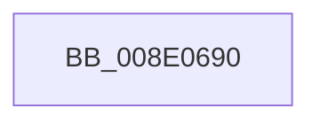

# PiPnpRtlCacheObjectBaseKey

- RVA: `0x008E0690`–`0x008E06CC` (길이 `60` bytes)
- VA: `0x00000001408E0690`
- 실행 섹션: `PAGE`
- PDB 이름 있음: `예`; PDB Function 태그: `아니요`
- unwind 정보 RVA: `0x00085D20`
- 디코드: `16`개 명령, `60/60` bytes 표시
- 미해석 바이트: `0` (있으면 어셈블리에 `.byte`로 보존)

> 이 문서는 커널 이미지의 기계어와 PDB 기호를 분석해 생성했습니다. 4번과 5번은 함수 원형과 자료형을 바이너리 사용 방식에서 추정한 C 해석이며 원본 소스 복구 결과는 아닙니다.

## 1. Dependencies

- 직접 호출 지점: **0**; 고유 호출 대상: **0**
- 직접 호출자로 확인된 함수: **3**
- RIP 상대 이미지 참조: **1**

### Outgoing calls
- 직접 디코드된 call 명령이 없습니다.

### Direct callers
- [sub_008E2EB2](Unknown_function_008E2EB2.md) at `0x008E2F86`
- [sub_008E34DB](Unknown_function_008E34DB.md) at `0x008E354A`
- [PiPnpRtlCmActionCallback](PiPnpRtlCmActionCallback_function_008EF110.md) at `0x008EF213`
- [PiPnpRtlCmActionCallback](PiPnpRtlCmActionCallback_function_008EF110.md) at `0x008EF69F`

### Static image references
- `0x008E06A6` → RVA `0x00E0A740` (`.data`; read)

## 2. Other-region calls and transfers

- 다른 실행 섹션으로 향하는 call: **0**
- call이 아닌 외부 분기/꼬리 이동: **1**
  - `0x008E06C6` → [sub_008E0753 + 0x1C](Unknown_function_008E0753.md) (`tail-transfer`)

## 3. Assembly (complete function range)

```asm
008E0690  4C 8B DC                        mov r11, rsp
008E0693  55                              push rbp
008E0694  41 54                           push r12
008E0696  41 55                           push r13
008E0698  41 56                           push r14
008E069A  48 8D 6C 24 88                  lea rbp, [rsp - 0x78]
008E069F  48 81 EC 78 01 00 00            sub rsp, 0x178
008E06A6  48 8B 05 93 A0 52 00            mov rax, qword ptr [rip + 0x52a093]
008E06AD  48 33 C4                        xor rax, rsp
008E06B0  48 89 45 40                     mov qword ptr [rbp + 0x40], rax
008E06B4  48 89 4C 24 70                  mov qword ptr [rsp + 0x70], rcx
008E06B9  4D 8B E9                        mov r13, r9
008E06BC  45 8B F0                        mov r14d, r8d
008E06BF  4C 8B E2                        mov r12, rdx
008E06C2  41 83 F8 07                     cmp r8d, 7
008E06C6  0F 8D A3 00 00 00               jge 0x1408e076f
```

## 4. C-style interpretation (structured pseudocode)

```c
__int64 __fastcall PiPnpRtlCacheObjectBaseKey(__int64 a1, __int64 a2, int a3, __int64 a4)
{
    __int64 result;
    __int64 v_rsp;
    unsigned __int64 v_stack_m128;
    unsigned __int64 v_stack_m58;
    unsigned __int64 v_stack_m98;

    v_rsp = (v_rsp) - (376);
    result = (*(unsigned __int64 *)(v_rip + 5415059)) ^ (v_rsp);
    v_stack_m58 = result;
    v_stack_m128 = a1;
}
```

## 5. (Beta) C Style

```c
int64_t PiPnpRtlCacheObjectBaseKey(int64_t Arg1, int64_t Arg2, int32_t Arg3, int64_t Arg4)
{
    int64_t result;
    int64_t local_rsp;
    uint64_t v_stack_m128;
    uint64_t v_stack_m58;
    uint64_t v_stack_m98;

    local_rsp = (local_rsp) - (376);
    result = (*(uint64_t *)(v_rip + 0x52A093)) ^ (local_rsp);
    v_stack_m58 = result;
    v_stack_m128 = Arg1;
}
```

## 6. Execution-region graph

[열기: 2D/3D 그래프와 함수 탐색 컨트롤 패널](../../../control-panel.html?section=page&rva=0x008E0690&view=graph)

- 2D 그래프는 위에서 아래로 흐르고, 3D 그래프는 빈 공간을 드래그해 회전합니다. Shift+드래그는 이동, 휠은 확대·축소, 함수 노드 선택은 대상 보고서 이동입니다.

### Static fallback


