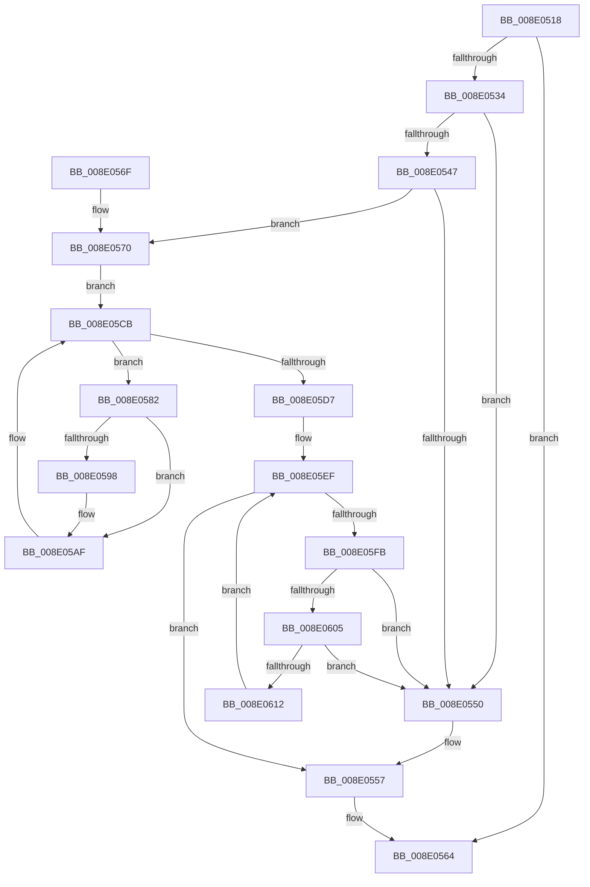

# PiPnpRtlEndOperation

- RVA: `0x008E0518`–`0x008E0629` (길이 `273` bytes)
- VA: `0x00000001408E0518`
- 실행 섹션: `PAGE`
- PDB 이름 있음: `예`; PDB Function 태그: `아니요`
- unwind 정보 RVA: `0x00085D10`
- 디코드: `69`개 명령, `273/273` bytes 표시
- 미해석 바이트: `0` (있으면 어셈블리에 `.byte`로 보존)

> 이 문서는 커널 이미지의 기계어와 PDB 기호를 분석해 생성했습니다. 4번과 5번은 함수 원형과 자료형을 바이너리 사용 방식에서 추정한 C 해석이며 원본 소스 복구 결과는 아닙니다.

## 1. Dependencies

- 직접 호출 지점: **12**; 고유 호출 대상: **11**
- 직접 호출자로 확인된 함수: **32**
- RIP 상대 이미지 참조: **1**

### Outgoing calls
- `0x008E0534` → [PiPnpRtlDisableRemoveOperationDispatch](PiPnpRtlDisableRemoveOperationDispatch_function_008E0AAC.md) (function, `0x008E0AAC`)
- `0x008E0539` → [PiPnpRtlOperationListAcquireExclusiveLock](PiPnpRtlOperationListAcquireExclusiveLock_function_008E065C.md) (function, `0x008E065C`)
- `0x008E055F` → [ExFreePoolWithTag](../../poolcode/B8/ExFreePoolWithTag_function_00B82870.md) (function, `0x00B82870`)
- `0x008E0577` → [PiPnpRtlOperationListReleaseLock](PiPnpRtlOperationListReleaseLock_function_008E0630.md) (function, `0x008E0630`)
- `0x008E059B` → [ZwClose](../../text/6A/ZwClose_function_006AD2B0.md) (function, `0x006AD2B0`)
- `0x008E05AF` → [PiPnpRtlObjectEventDispatch](PiPnpRtlObjectEventDispatch_function_008E0D5C.md) (function, `0x008E0D5C`)
- `0x008E05BC` → [RtlDeleteElementGenericTableAvl](../../text/3E/RtlDeleteElementGenericTableAvl_function_003EE750.md) (function, `0x003EE750`)
- `0x008E05C6` → [PiPnpRtlObjectEventRelease](PiPnpRtlObjectEventRelease_function_008E6E24.md) (function, `0x008E6E24`)
- `0x008E05CE` → [RtlIsGenericTableEmptyAvl](../../text/45/RtlIsGenericTableEmptyAvl_function_00457B60.md) (function, `0x00457B60`)
- `0x008E05DE` → [ExReleaseResourceLite](../../text/25/ExReleaseResourceLite_function_0025FA10.md) (function, `0x0025FA10`)
- `0x008E05E3` → [KeLeaveCriticalRegion](../../text/25/KeLeaveCriticalRegion_function_0025D8B0.md) (function, `0x0025D8B0`)
- `0x008E0622` → [PiPnpRtlObjectEventRelease](PiPnpRtlObjectEventRelease_function_008E6E24.md) (function, `0x008E6E24`)

### Direct callers
- [IoReportDetectedDevice](../72/IoReportDetectedDevice_function_00725CD0.md) at `0x007260B7`
- [IoReportRootDevice](../72/IoReportRootDevice_function_00726780.md) at `0x00726B0A`
- [PipMergeDependencyEdgeList](../72/PipMergeDependencyEdgeList_function_00727D4C.md) at `0x00727E96`
- [PiProcessAddBootDevices](../72/PiProcessAddBootDevices_function_0072D434.md) at `0x0072D4AC`
- [PiProcessSetDeviceProblem](../72/PiProcessSetDeviceProblem_function_0072D668.md) at `0x0072D7A9`
- [PiPnpRtlEnsureObjectCached](../72/PiPnpRtlEnsureObjectCached_function_0072F928.md) at `0x0072FA05`
- [PpDevCfgProcessDevices](../73/PpDevCfgProcessDevices_function_007373C0.md) at `0x00737519`
- [PiCMDeleteDeviceWorker](../73/PiCMDeleteDeviceWorker_function_0073B420.md) at `0x0073B680`
- [PiInitializeDevice](../73/PiInitializeDevice_function_0073EC5C.md) at `0x0073EDC5`
- [PiDqActionDataGetRequestedProperties](../8D/PiDqActionDataGetRequestedProperties_function_008DEBE4.md) at `0x008DED14`
- [PiDqQueryEvaluateFilter](PiDqQueryEvaluateFilter_function_008E01C4.md) at `0x008E02EB`
- [PiSwPropertySet](../8F/PiSwPropertySet_function_008F5EEC.md) at `0x008F5FD8`
- [PipEnumerateCompleted](../8F/PipEnumerateCompleted_function_008F7B1C.md) at `0x008F7C0B`
- [PiPnpRtlObjectEventWorker](../8F/PiPnpRtlObjectEventWorker_function_008F8630.md) at `0x008F87FC`
- [PiProcessQueryDeviceState](../8F/PiProcessQueryDeviceState_function_008FA0F8.md) at `0x008FA266`
- [PipProcessStartPhase3](../8F/PipProcessStartPhase3_function_008FBAF8.md) at `0x008FBC12`
- [IopRemoveDevice](../8F/IopRemoveDevice_function_008FC7FC.md) at `0x008FC9FE`
- [PiDcUpdateDeviceContainerMembership](../8F/PiDcUpdateDeviceContainerMembership_function_008FD0A8.md) at `0x008FD2A2`
- [PipSetDevNodeProblem](../8F/PipSetDevNodeProblem_function_008FDE0C.md) at `0x008FE07B`
- [IopRegisterDeviceInterface](../95/IopRegisterDeviceInterface_function_009501B0.md) at `0x00950723`
- [PiDqIrpPropertySet](../96/PiDqIrpPropertySet_function_00963770.md) at `0x00963A04`
- [PnpProcessTargetDeviceEvent](../A0/PnpProcessTargetDeviceEvent_function_00A046BC.md) at `0x00A04774`
- [PnpNewDeviceNodeDependencyCheck](../A0/PnpNewDeviceNodeDependencyCheck_function_00A062A0.md) at `0x00A06378`
- [PnpUnlinkDeviceRemovalRelations](../A0/PnpUnlinkDeviceRemovalRelations_function_00A063D8.md) at `0x00A06633`
- [PiProcessClearDeviceProblem](../A2/PiProcessClearDeviceProblem_function_00A271CC.md) at `0x00A272C5`
- [PipClearDevNodeProblem](../A2/PipClearDevNodeProblem_function_00A27C8C.md) at `0x00A27DD4`
- [PiProcessNewDeviceNode](../A2/PiProcessNewDeviceNode_function_00A28F20.md) at `0x00A2A404`
- [PiDqActionDataGetChangedProperties](../A6/PiDqActionDataGetChangedProperties_function_00A61F10.md) at `0x00A620F3`
- [PiCMCreateDevice](../AC/PiCMCreateDevice_function_00ACB824.md) at `0x00ACBE5A`
- [PiCMDeleteClassKey](../AD/PiCMDeleteClassKey_function_00AD9EB4.md) at `0x00AD9FBC`
- [PiCMDeleteObject](../AD/PiCMDeleteObject_function_00AD9FE4.md) at `0x00ADA17C`
- [sub_00B266CA](../B2/Unknown_function_00B266CA.md) at `0x00B2697F`

### Static image references
- `0x008E05D7` → RVA `0x00F8B960` (`.data`; read)

## 2. Other-region calls and transfers

- 다른 실행 섹션으로 향하는 call: **6**
  - `0x008E055F` → [ExFreePoolWithTag](../../poolcode/B8/ExFreePoolWithTag_function_00B82870.md) (`PAGE` → `POOLCODE`)
  - `0x008E059B` → [ZwClose](../../text/6A/ZwClose_function_006AD2B0.md) (`PAGE` → `.text`)
  - `0x008E05BC` → [RtlDeleteElementGenericTableAvl](../../text/3E/RtlDeleteElementGenericTableAvl_function_003EE750.md) (`PAGE` → `.text`)
  - `0x008E05CE` → [RtlIsGenericTableEmptyAvl](../../text/45/RtlIsGenericTableEmptyAvl_function_00457B60.md) (`PAGE` → `.text`)
  - `0x008E05DE` → [ExReleaseResourceLite](../../text/25/ExReleaseResourceLite_function_0025FA10.md) (`PAGE` → `.text`)
  - `0x008E05E3` → [KeLeaveCriticalRegion](../../text/25/KeLeaveCriticalRegion_function_0025D8B0.md) (`PAGE` → `.text`)
- 별도 외부 분기/꼬리 이동을 확인하지 못했습니다.

## 3. Assembly (complete function range)

```asm
008E0518  48 89 5C 24 10                  mov qword ptr [rsp + 0x10], rbx
008E051D  57                              push rdi
008E051E  48 83 EC 20                     sub rsp, 0x20
008E0522  48 83 64 24 30 00               and qword ptr [rsp + 0x30], 0
008E0528  48 8B D9                        mov rbx, rcx
008E052B  83 81 90 00 00 00 FF            add dword ptr [rcx + 0x90], -1
008E0532  75 30                           jne 0x1408e0564
008E0534  E8 73 05 00 00                  call 0x1408e0aac
008E0539  E8 1E 01 00 00                  call 0x1408e065c
008E053E  48 8B 0B                        mov rcx, qword ptr [rbx]
008E0541  48 39 59 08                     cmp qword ptr [rcx + 8], rbx
008E0545  75 09                           jne 0x1408e0550
008E0547  48 8B 43 08                     mov rax, qword ptr [rbx + 8]
008E054B  48 39 18                        cmp qword ptr [rax], rbx
008E054E  74 20                           je 0x1408e0570
008E0550  B9 03 00 00 00                  mov ecx, 3
008E0555  CD 29                           int 0x29
008E0557  BA 50 6E 70 41                  mov edx, 0x41706e50
008E055C  48 8B CB                        mov rcx, rbx
008E055F  E8 0C 23 2A 00                  call 0x140b82870
008E0564  48 8B 5C 24 38                  mov rbx, qword ptr [rsp + 0x38]
008E0569  48 83 C4 20                     add rsp, 0x20
008E056D  5F                              pop rdi
008E056E  C3                              ret
008E056F  CC                              int3
008E0570  48 89 08                        mov qword ptr [rax], rcx
008E0573  48 89 41 08                     mov qword ptr [rcx + 8], rax
008E0577  E8 B4 00 00 00                  call 0x1408e0630
008E057C  48 8D 7B 18                     lea rdi, [rbx + 0x18]
008E0580  EB 49                           jmp 0x1408e05cb
008E0582  48 8B 43 28                     mov rax, qword ptr [rbx + 0x28]
008E0586  48 8B 48 20                     mov rcx, qword ptr [rax + 0x20]
008E058A  48 89 4C 24 30                  mov qword ptr [rsp + 0x30], rcx
008E058F  48 8B 41 10                     mov rax, qword ptr [rcx + 0x10]
008E0593  48 85 C0                        test rax, rax
008E0596  74 17                           je 0x1408e05af
008E0598  48 8B C8                        mov rcx, rax
008E059B  E8 10 CD DC FF                  call 0x1406ad2b0
008E05A0  48 8B 44 24 30                  mov rax, qword ptr [rsp + 0x30]
008E05A5  48 83 60 10 00                  and qword ptr [rax + 0x10], 0
008E05AA  48 8B 4C 24 30                  mov rcx, qword ptr [rsp + 0x30]
008E05AF  E8 A8 07 00 00                  call 0x1408e0d5c
008E05B4  48 8D 54 24 30                  lea rdx, [rsp + 0x30]
008E05B9  48 8B CF                        mov rcx, rdi
008E05BC  E8 8F E1 B0 FF                  call 0x1403ee750
008E05C1  48 8B 4C 24 30                  mov rcx, qword ptr [rsp + 0x30]
008E05C6  E8 59 68 00 00                  call 0x1408e6e24
008E05CB  48 8B CF                        mov rcx, rdi
008E05CE  E8 8D 75 B7 FF                  call 0x140457b60
008E05D3  84 C0                           test al, al
008E05D5  74 AB                           je 0x1408e0582
008E05D7  48 8D 0D 82 B3 6A 00            lea rcx, [rip + 0x6ab382]
008E05DE  E8 2D F4 97 FF                  call 0x14025fa10
008E05E3  E8 C8 D2 97 FF                  call 0x14025d8b0
008E05E8  48 8D BB 80 00 00 00            lea rdi, [rbx + 0x80]
008E05EF  48 8B 0F                        mov rcx, qword ptr [rdi]
008E05F2  48 3B CF                        cmp rcx, rdi
008E05F5  0F 84 5C FF FF FF               je 0x1408e0557
008E05FB  48 39 79 08                     cmp qword ptr [rcx + 8], rdi
008E05FF  0F 85 4B FF FF FF               jne 0x1408e0550
008E0605  48 8B 01                        mov rax, qword ptr [rcx]
008E0608  48 39 48 08                     cmp qword ptr [rax + 8], rcx
008E060C  0F 85 3E FF FF FF               jne 0x1408e0550
008E0612  48 89 07                        mov qword ptr [rdi], rax
008E0615  48 83 C1 C8                     add rcx, -0x38
008E0619  48 89 78 08                     mov qword ptr [rax + 8], rdi
008E061D  48 89 4C 24 30                  mov qword ptr [rsp + 0x30], rcx
008E0622  E8 FD 67 00 00                  call 0x1408e6e24
008E0627  EB C6                           jmp 0x1408e05ef
```

## 4. C-style interpretation (structured pseudocode)

```c
__int64 __fastcall PiPnpRtlEndOperation(__int64 a1)
{
    __int64 result;
    __int64 v_rsp;
    unsigned __int64 v_stack_p10;
    unsigned __int64 v_stack_p30;
    unsigned __int64 v_stack_p8;

    v_stack_p10 = v_rbx;
    v_rsp = (v_rsp) - (32);
    if (condition_is_not_equal) goto loc_008E0564;
    result = PiPnpRtlDisableRemoveOperationDispatch(a1, a2, a3, a4);
    result = PiPnpRtlOperationListAcquireExclusiveLock(a1, a2, a3, a4);
    if ((*(unsigned __int64 *)(*(unsigned __int64 *)(a1) + 8)) != a1) goto loc_008E0550;
    if ((*(unsigned __int64 *)(*(unsigned __int64 *)(a1 + 8))) == a1) goto loc_008E0570;
loc_008E0550:
loc_008E0557:
    result = ExFreePoolWithTag(a1, (unsigned int)(0x41706E50ULL), a3, a4);
loc_008E0564:
    v_rsp = (v_rsp) + (32);
    return result;
loc_008E0570:
    *(unsigned __int64 *)(result) = a1;
    *(unsigned __int64 *)(a1 + 8) = result;
    result = PiPnpRtlOperationListReleaseLock(a1, (unsigned int)(0x41706E50ULL), a3, a4);
    goto loc_008E05CB;
loc_008E0582:
    v_stack_p30 = *(unsigned __int64 *)(*(unsigned __int64 *)(v_stack_p10 + 40) + 32);
    result = *(unsigned __int64 *)(*(unsigned __int64 *)(*(unsigned __int64 *)(v_stack_p10 + 40) + 32) + 16);
    if (*(unsigned __int64 *)(*(unsigned __int64 *)(*(unsigned __int64 *)(v_stack_p10 + 40) + 32) + 16) != 0) {
        a1 = *(unsigned __int64 *)(*(unsigned __int64 *)(*(unsigned __int64 *)(v_stack_p10 + 40) + 32) + 16);
        result = ZwClose(a1, (unsigned int)(0x41706E50ULL), a3, a4);
        result = v_stack_p30;
        a1 = v_stack_p30;
    }
    result = PiPnpRtlObjectEventDispatch(a1, (unsigned int)(0x41706E50ULL), a3, a4);
    result = RtlDeleteElementGenericTableAvl(v_stack_p10 + 24, v_stack_p30, a3, a4);
    result = PiPnpRtlObjectEventRelease(v_stack_p30, v_stack_p30, a3, a4);
loc_008E05CB:
    result = RtlIsGenericTableEmptyAvl(v_stack_p10 + 24, v_stack_p30, a3, a4);
    if ((unsigned __int8)(result) == 0) goto loc_008E0582;
    result = ExReleaseResourceLite(v_rip + 6992770, v_stack_p30, a3, a4);
    result = KeLeaveCriticalRegion(v_rip + 6992770, v_stack_p30, a3, a4);
loc_008E05EF:
    if ((*(unsigned __int64 *)(v_stack_p10 + 128)) == (v_stack_p10 + 128)) goto loc_008E0557;
    if ((*(unsigned __int64 *)(*(unsigned __int64 *)(v_stack_p10 + 128) + 8)) != (v_stack_p10 + 128)) goto loc_008E0550;
    if ((*(unsigned __int64 *)(*(unsigned __int64 *)(*(unsigned __int64 *)(v_stack_p10 + 128)) + 8)) != (*(unsigned __int64 *)(v_stack_p10 + 128))) goto loc_008E0550;
    *(unsigned __int64 *)(v_stack_p10 + 128) = *(unsigned __int64 *)(*(unsigned __int64 *)(v_stack_p10 + 128));
    a1 = (*(unsigned __int64 *)(v_stack_p10 + 128)) + (-56);
    *(unsigned __int64 *)(*(unsigned __int64 *)(*(unsigned __int64 *)(v_stack_p10 + 128)) + 8) = v_stack_p10 + 128;
    v_stack_p30 = a1;
    result = PiPnpRtlObjectEventRelease(a1, v_stack_p30, a3, a4);
    goto loc_008E05EF;
}
```

## 5. (Beta) C Style

```c
int64_t PiPnpRtlEndOperation(void *Arg1)
{
    uint8_t *arg1 = (uint8_t *)Arg1;

    int64_t result;
    int64_t local_rsp;
    uint64_t v_stack_p10;
    uint64_t v_stack_p30;
    uint64_t v_stack_p8;

    v_stack_p10 = local_rbx;
    local_rsp = (local_rsp) - (32);
    if (condition_is_not_equal) goto loc_008E0564;
    result = PiPnpRtlDisableRemoveOperationDispatch(Arg1, a2, a3, a4);
    result = PiPnpRtlOperationListAcquireExclusiveLock(Arg1, a2, a3, a4);
    if ((*(uint64_t *)(*(uint64_t *)(arg1) + 0x8)) != Arg1) goto loc_008E0550;
    if ((*(uint64_t *)(*(uint64_t *)(arg1 + 0x8))) == Arg1) goto loc_008E0570;
loc_008E0550:
loc_008E0557:
    result = ExFreePoolWithTag(Arg1, (uint32_t)(0x41706E50ULL), a3, a4);
loc_008E0564:
    local_rsp = (local_rsp) + (32);
    return result;
loc_008E0570:
    *(void **)(result) = Arg1;
    *(uint64_t *)(arg1 + 0x8) = result;
    result = PiPnpRtlOperationListReleaseLock(Arg1, (uint32_t)(0x41706E50ULL), a3, a4);
    goto loc_008E05CB;
loc_008E0582:
    v_stack_p30 = *(uint64_t *)(*(uint64_t *)(v_stack_p10 + 0x28) + 0x20);
    result = *(uint64_t *)(*(uint64_t *)(*(uint64_t *)(v_stack_p10 + 0x28) + 0x20) + 0x10);
    if (*(uint64_t *)(*(uint64_t *)(*(uint64_t *)(v_stack_p10 + 0x28) + 0x20) + 0x10) != 0) {
        Arg1 = *(uint64_t *)(*(uint64_t *)(*(uint64_t *)(v_stack_p10 + 0x28) + 0x20) + 0x10);
        result = ZwClose(Arg1, (uint32_t)(0x41706E50ULL), a3, a4);
        result = v_stack_p30;
        Arg1 = v_stack_p30;
    }
    result = PiPnpRtlObjectEventDispatch(Arg1, (uint32_t)(0x41706E50ULL), a3, a4);
    result = RtlDeleteElementGenericTableAvl(v_stack_p10 + 24, v_stack_p30, a3, a4);
    result = PiPnpRtlObjectEventRelease(v_stack_p30, v_stack_p30, a3, a4);
loc_008E05CB:
    result = RtlIsGenericTableEmptyAvl(v_stack_p10 + 24, v_stack_p30, a3, a4);
    if ((uint8_t)(result) == 0) goto loc_008E0582;
    result = ExReleaseResourceLite(v_rip + 6992770, v_stack_p30, a3, a4);
    result = KeLeaveCriticalRegion(v_rip + 6992770, v_stack_p30, a3, a4);
loc_008E05EF:
    if ((*(uint64_t *)(v_stack_p10 + 0x80)) == (v_stack_p10 + 128)) goto loc_008E0557;
    if ((*(uint64_t *)(*(uint64_t *)(v_stack_p10 + 0x80) + 0x8)) != (v_stack_p10 + 128)) goto loc_008E0550;
    if ((*(uint64_t *)(*(uint64_t *)(*(uint64_t *)(v_stack_p10 + 0x80)) + 0x8)) != (*(uint64_t *)(v_stack_p10 + 0x80))) goto loc_008E0550;
    *(uint64_t *)(v_stack_p10 + 0x80) = *(uint64_t *)(*(uint64_t *)(v_stack_p10 + 0x80));
    Arg1 = (*(uint64_t *)(v_stack_p10 + 0x80)) + (-56);
    *(uint64_t *)(*(uint64_t *)(*(uint64_t *)(v_stack_p10 + 0x80)) + 0x8) = v_stack_p10 + 128;
    v_stack_p30 = Arg1;
    result = PiPnpRtlObjectEventRelease(Arg1, v_stack_p30, a3, a4);
    goto loc_008E05EF;
}
```

### 관측된 메모리 오프셋

구조체 형식이 확인되지 않은 접근은 인자 기준의 오프셋으로만 기록했습니다.

| 기준 인자 | 오프셋 표현 | 폭 (bit) | 접근 |
|---|---:|---:|---|
| `Arg1` | `+ 0x0` | `64` | `R` |
| `Arg1` | `+ 0x0` | `64` | `W` |
| `Arg1` | `+ 0x8` | `64` | `R` |
| `Arg1` | `+ 0x18` | `64` | `R` |
| `Arg1` | `+ 0x28` | `64` | `R` |
| `Arg1` | `+ 0x80` | `64` | `R` |
| `Arg1` | `+ 0x90` | `32` | `R/W` |

## 6. Execution-region graph

[열기: 2D/3D 그래프와 함수 탐색 컨트롤 패널](../../../control-panel.html?section=page&rva=0x008E0518&view=graph)

- 2D 그래프는 위에서 아래로 흐르고, 3D 그래프는 빈 공간을 드래그해 회전합니다. Shift+드래그는 이동, 휠은 확대·축소, 함수 노드 선택은 대상 보고서 이동입니다.

### Static fallback


