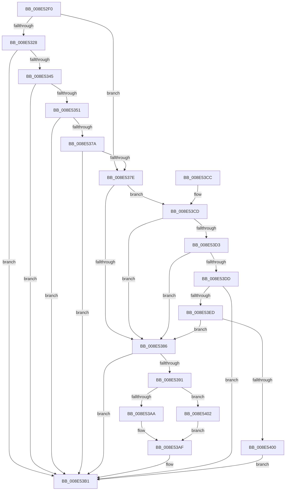

# PiPnpRtlEnumeratorFilterCallback

- RVA: `0x008E52F0`–`0x008E5409` (길이 `281` bytes)
- VA: `0x00000001408E52F0`
- 실행 섹션: `PAGE`
- PDB 이름 있음: `예`; PDB Function 태그: `아니요`
- unwind 정보 RVA: `0x000865E4`
- 디코드: `89`개 명령, `281/281` bytes 표시
- 미해석 바이트: `0` (있으면 어셈블리에 `.byte`로 보존)

> 이 문서는 커널 이미지의 기계어와 PDB 기호를 분석해 생성했습니다. 4번과 5번은 함수 원형과 자료형을 바이너리 사용 방식에서 추정한 C 해석이며 원본 소스 복구 결과는 아닙니다.

## 1. Dependencies

- 직접 호출 지점: **6**; 고유 호출 대상: **4**
- 직접 호출자로 확인된 함수: **1**
- RIP 상대 이미지 참조: **1**

### Outgoing calls
- `0x008E533C` → [RtlInitUnicodeStringEx](../../text/46/RtlInitUnicodeStringEx_function_00463960.md) (function, `0x00463960`)
- `0x008E536E` → [guard_dispatch_icall](../../text/6B/guard_dispatch_icall_function_006BAAD0.md) (function, `0x006BAAD0`)
- `0x008E53AA` → [PiCMMandatoryFilterCallback](PiCMMandatoryFilterCallback_function_008E6490.md) (function, `0x008E6490`)
- `0x008E53E4` → [RtlInitUnicodeStringEx](../../text/46/RtlInitUnicodeStringEx_function_00463960.md) (function, `0x00463960`)
- `0x008E53F7` → [RtlPrefixUnicodeString](../8F/RtlPrefixUnicodeString_function_008F4F70.md) (function, `0x008F4F70`)
- `0x008E5402` → [guard_dispatch_icall](../../text/6B/guard_dispatch_icall_function_006BAAD0.md) (function, `0x006BAAD0`)

### Direct callers
- [PiDmCmObjectMatchCallback](PiDmCmObjectMatchCallback_function_008E3E80.md) at `0x008E3ECC`

### Static image references
- `0x008E5395` → RVA `0x008E6490` (`PiCMMandatoryFilterCallback`; read)

## 2. Other-region calls and transfers

- 다른 실행 섹션으로 향하는 call: **4**
  - `0x008E533C` → [RtlInitUnicodeStringEx](../../text/46/RtlInitUnicodeStringEx_function_00463960.md) (`PAGE` → `.text`)
  - `0x008E536E` → [guard_dispatch_icall](../../text/6B/guard_dispatch_icall_function_006BAAD0.md) (`PAGE` → `.text`)
  - `0x008E53E4` → [RtlInitUnicodeStringEx](../../text/46/RtlInitUnicodeStringEx_function_00463960.md) (`PAGE` → `.text`)
  - `0x008E5402` → [guard_dispatch_icall](../../text/6B/guard_dispatch_icall_function_006BAAD0.md) (`PAGE` → `.text`)
- 별도 외부 분기/꼬리 이동을 확인하지 못했습니다.

## 3. Assembly (complete function range)

```asm
008E52F0  48 89 5C 24 08                  mov qword ptr [rsp + 8], rbx
008E52F5  48 89 74 24 18                  mov qword ptr [rsp + 0x18], rsi
008E52FA  55                              push rbp
008E52FB  57                              push rdi
008E52FC  41 54                           push r12
008E52FE  41 56                           push r14
008E5300  41 57                           push r15
008E5302  48 8B EC                        mov rbp, rsp
008E5305  48 83 EC 70                     sub rsp, 0x70
008E5309  45 33 E4                        xor r12d, r12d
008E530C  0F 57 C0                        xorps xmm0, xmm0
008E530F  49 8B F9                        mov rdi, r9
008E5312  45 8B F8                        mov r15d, r8d
008E5315  48 8B F2                        mov rsi, rdx
008E5318  4C 8B F1                        mov r14, rcx
008E531B  41 8A DC                        mov bl, r12b
008E531E  0F 11 45 E8                     movups xmmword ptr [rbp - 0x18], xmm0
008E5322  45 38 61 08                     cmp byte ptr [r9 + 8], r12b
008E5326  74 56                           je 0x1408e537e
008E5328  48 8D 4D D8                     lea rcx, [rbp - 0x28]
008E532C  44 89 65 38                     mov dword ptr [rbp + 0x38], r12d
008E5330  0F 11 45 D8                     movups xmmword ptr [rbp - 0x28], xmm0
008E5334  44 89 65 D0                     mov dword ptr [rbp - 0x30], r12d
008E5338  44 89 65 48                     mov dword ptr [rbp + 0x48], r12d
008E533C  E8 1F E6 B7 FF                  call 0x140463960
008E5341  85 C0                           test eax, eax
008E5343  78 6C                           js 0x1408e53b1
008E5345  49 8B 86 08 01 00 00            mov rax, qword ptr [r14 + 0x108]
008E534C  48 85 C0                        test rax, rax
008E534F  74 60                           je 0x1408e53b1
008E5351  48 8D 4D 38                     lea rcx, [rbp + 0x38]
008E5355  44 89 64 24 28                  mov dword ptr [rsp + 0x28], r12d
008E535A  48 89 4C 24 20                  mov qword ptr [rsp + 0x20], rcx
008E535F  4C 8D 4D 48                     lea r9, [rbp + 0x48]
008E5363  49 8B CE                        mov rcx, r14
008E5366  4C 8D 45 D0                     lea r8, [rbp - 0x30]
008E536A  48 8D 55 D8                     lea rdx, [rbp - 0x28]
008E536E  E8 5D 57 DD FF                  call 0x1406baad0
008E5373  3D 05 00 00 80                  cmp eax, 0x80000005
008E5378  74 37                           je 0x1408e53b1
008E537A  85 C0                           test eax, eax
008E537C  78 33                           js 0x1408e53b1
008E537E  48 8B 07                        mov rax, qword ptr [rdi]
008E5381  48 85 C0                        test rax, rax
008E5384  75 47                           jne 0x1408e53cd
008E5386  B3 01                           mov bl, 1
008E5388  48 8B 47 10                     mov rax, qword ptr [rdi + 0x10]
008E538C  48 85 C0                        test rax, rax
008E538F  74 20                           je 0x1408e53b1
008E5391  4C 8B 4F 18                     mov r9, qword ptr [rdi + 0x18]
008E5395  48 8D 0D F4 10 00 00            lea rcx, [rip + 0x10f4]
008E539C  48 3B C1                        cmp rax, rcx
008E539F  45 8B C7                        mov r8d, r15d
008E53A2  49 8B CE                        mov rcx, r14
008E53A5  48 8B D6                        mov rdx, rsi
008E53A8  75 58                           jne 0x1408e5402
008E53AA  E8 E1 10 00 00                  call 0x1408e6490
008E53AF  8A D8                           mov bl, al
008E53B1  4C 8D 5C 24 70                  lea r11, [rsp + 0x70]
008E53B6  8A C3                           mov al, bl
008E53B8  49 8B 5B 30                     mov rbx, qword ptr [r11 + 0x30]
008E53BC  49 8B 73 40                     mov rsi, qword ptr [r11 + 0x40]
008E53C0  49 8B E3                        mov rsp, r11
008E53C3  41 5F                           pop r15
008E53C5  41 5E                           pop r14
008E53C7  41 5C                           pop r12
008E53C9  5F                              pop rdi
008E53CA  5D                              pop rbp
008E53CB  C3                              ret
008E53CC  CC                              int3
008E53CD  66 83 38 02                     cmp word ptr [rax], 2
008E53D1  72 B3                           jb 0x1408e5386
008E53D3  48 8B 40 08                     mov rax, qword ptr [rax + 8]
008E53D7  66 44 39 20                     cmp word ptr [rax], r12w
008E53DB  74 A9                           je 0x1408e5386
008E53DD  48 8B D6                        mov rdx, rsi
008E53E0  48 8D 4D E8                     lea rcx, [rbp - 0x18]
008E53E4  E8 77 E5 B7 FF                  call 0x140463960
008E53E9  85 C0                           test eax, eax
008E53EB  78 C4                           js 0x1408e53b1
008E53ED  48 8B 0F                        mov rcx, qword ptr [rdi]
008E53F0  48 8D 55 E8                     lea rdx, [rbp - 0x18]
008E53F4  41 B0 01                        mov r8b, 1
008E53F7  E8 74 FB 00 00                  call 0x1408f4f70
008E53FC  84 C0                           test al, al
008E53FE  75 86                           jne 0x1408e5386
008E5400  EB AF                           jmp 0x1408e53b1
008E5402  E8 C9 56 DD FF                  call 0x1406baad0
008E5407  EB A6                           jmp 0x1408e53af
```

## 4. C-style interpretation (structured pseudocode)

```c
__int64 __fastcall PiPnpRtlEnumeratorFilterCallback(__int64 a1, __int64 a2, int a3, __int64 a4)
{
    __int64 result;
    __int64 v_r12;
    __int64 v_rsp;
    unsigned __int64 v_stack_m28;
    unsigned __int64 v_stack_m40;
    unsigned __int64 v_stack_m50;
    unsigned int v_stack_m58;
    unsigned int v_stack_m70;
    unsigned __int64 v_stack_m78;
    unsigned int v_stack_p10;
    unsigned __int64 v_stack_p18;
    unsigned int v_stack_p20;
    unsigned __int64 v_stack_p8;

    v_stack_p8 = v_rbx;
    v_stack_p18 = v_rsi;
    v_rsp = (v_rsp) - (112);
    v_r12 = 0;
    v_stack_m40 = v_xmm0;
    if ((*(unsigned __int8 *)(a4 + 8)) == 0) goto loc_008E537E;
    v_stack_p10 = 0;
    v_stack_m50 = v_xmm0;
    v_stack_m58 = 0;
    v_stack_p20 = 0;
    result = RtlInitUnicodeStringEx(v_stack_m50, a2, a3, a4);
    if (sign_flag) goto loc_008E53B1;
    if (*(unsigned __int64 *)(a1 + 264) == 0) goto loc_008E53B1;
    v_stack_m70 = 0;
    v_stack_m78 = v_stack_p10;
    result = guard_dispatch_icall(a1, v_stack_m50, v_stack_m58, v_stack_p20);
    if (((unsigned int)(result)) == 0x80000005ULL) goto loc_008E53B1;
    if (sign_flag) goto loc_008E53B1;
loc_008E537E:
    if (*(unsigned __int64 *)(a4) != 0) goto loc_008E53CD;
loc_008E5386:
    if (*(unsigned __int64 *)(a4 + 16) == 0) goto loc_008E53B1;
    if ((*(unsigned __int64 *)(a4 + 16)) != (v_rip + 4340)) goto loc_008E5402;
    result = PiCMMandatoryFilterCallback(a1, a2, (unsigned int)((unsigned int)((unsigned int)(a3))), *(unsigned __int64 *)(a4 + 24));
loc_008E53AF:
loc_008E53B1:
    return (unsigned __int8)((unsigned __int8)(result));
loc_008E53CD:
    if ((*(unsigned __int16 *)((unsigned __int8)((unsigned __int8)(result)))) < 2) goto loc_008E5386;
    if ((*(unsigned __int16 *)(*(unsigned __int64 *)((unsigned __int8)((unsigned __int8)(result)) + 8))) == 0) goto loc_008E5386;
    result = RtlInitUnicodeStringEx(v_stack_m40, *(unsigned __int64 *)(v_stack_m28 + 64), (unsigned int)((unsigned int)((unsigned int)(a3))), *(unsigned __int64 *)(a4 + 24));
    if (sign_flag) goto loc_008E53B1;
    result = RtlPrefixUnicodeString(*(unsigned __int64 *)(a4), v_stack_m40, 1, *(unsigned __int64 *)(a4 + 24));
    if ((unsigned __int8)(result) != 0) goto loc_008E5386;
    goto loc_008E53B1;
loc_008E5402:
    result = guard_dispatch_icall(*(unsigned __int64 *)(a4), v_stack_m40, 1, *(unsigned __int64 *)(a4 + 24));
    goto loc_008E53AF;
}
```

## 5. (Beta) C Style

```c
int64_t PiPnpRtlEnumeratorFilterCallback(void *Arg1, int64_t Arg2, int32_t Arg3, void *Arg4)
{
    uint8_t *arg1 = (uint8_t *)Arg1;
    uint8_t *arg4 = (uint8_t *)Arg4;

    int64_t result;
    int64_t local_r12;
    int64_t local_rsp;
    uint64_t v_stack_m28;
    uint64_t v_stack_m40;
    uint64_t v_stack_m50;
    uint32_t v_stack_m58;
    uint32_t v_stack_m70;
    uint64_t v_stack_m78;
    uint32_t v_stack_p10;
    uint64_t v_stack_p18;
    uint32_t v_stack_p20;
    uint64_t v_stack_p8;

    v_stack_p8 = local_rbx;
    v_stack_p18 = local_rsi;
    local_rsp = (local_rsp) - (112);
    local_r12 = 0;
    v_stack_m40 = v_xmm0;
    if ((*(uint8_t *)(arg4 + 0x8)) == 0) goto loc_008E537E;
    v_stack_p10 = 0;
    v_stack_m50 = v_xmm0;
    v_stack_m58 = 0;
    v_stack_p20 = 0;
    result = RtlInitUnicodeStringEx(v_stack_m50, Arg2, Arg3, Arg4);
    if (sign_flag) goto loc_008E53B1;
    if (*(uint64_t *)(arg1 + 0x108) == 0) goto loc_008E53B1;
    v_stack_m70 = 0;
    v_stack_m78 = v_stack_p10;
    result = guard_dispatch_icall(Arg1, v_stack_m50, v_stack_m58, v_stack_p20);
    if (((uint32_t)(result)) == 0x80000005ULL) goto loc_008E53B1;
    if (sign_flag) goto loc_008E53B1;
loc_008E537E:
    if (*(uint64_t *)(arg4) != 0) goto loc_008E53CD;
loc_008E5386:
    if (*(uint64_t *)(arg4 + 0x10) == 0) goto loc_008E53B1;
    if ((*(uint64_t *)(arg4 + 0x10)) != (v_rip + 4340)) goto loc_008E5402;
    result = PiCMMandatoryFilterCallback(Arg1, Arg2, (uint32_t)((uint32_t)((uint32_t)(Arg3))), *(uint64_t *)(arg4 + 0x18));
loc_008E53AF:
loc_008E53B1:
    return (uint8_t)((uint8_t)(result));
loc_008E53CD:
    if ((*(uint16_t *)((uint8_t)((uint8_t)(result)))) < 2) goto loc_008E5386;
    if ((*(uint16_t *)(*(uint64_t *)((uint8_t)((uint8_t)(result)) + 0x8))) == 0) goto loc_008E5386;
    result = RtlInitUnicodeStringEx(v_stack_m40, *(uint64_t *)(v_stack_m28 + 0x40), (uint32_t)((uint32_t)((uint32_t)(Arg3))), *(uint64_t *)(arg4 + 0x18));
    if (sign_flag) goto loc_008E53B1;
    result = RtlPrefixUnicodeString(*(uint64_t *)(arg4), v_stack_m40, 1, *(uint64_t *)(arg4 + 0x18));
    if ((uint8_t)(result) != 0) goto loc_008E5386;
    goto loc_008E53B1;
loc_008E5402:
    result = guard_dispatch_icall(*(uint64_t *)(arg4), v_stack_m40, 1, *(uint64_t *)(arg4 + 0x18));
    goto loc_008E53AF;
}
```

### 관측된 메모리 오프셋

구조체 형식이 확인되지 않은 접근은 인자 기준의 오프셋으로만 기록했습니다.

| 기준 인자 | 오프셋 표현 | 폭 (bit) | 접근 |
|---|---:|---:|---|
| `Arg1` | `+ 0x108` | `64` | `R` |
| `Arg4` | `+ 0x0` | `64` | `R` |
| `Arg4` | `+ 0x8` | `8` | `R` |
| `Arg4` | `+ 0x10` | `64` | `R` |
| `Arg4` | `+ 0x18` | `64` | `R` |

## 6. Execution-region graph

[열기: 2D/3D 그래프와 함수 탐색 컨트롤 패널](../../../control-panel.html?section=page&rva=0x008E52F0&view=graph)

- 2D 그래프는 위에서 아래로 흐르고, 3D 그래프는 빈 공간을 드래그해 회전합니다. Shift+드래그는 이동, 휠은 확대·축소, 함수 노드 선택은 대상 보고서 이동입니다.

### Static fallback


