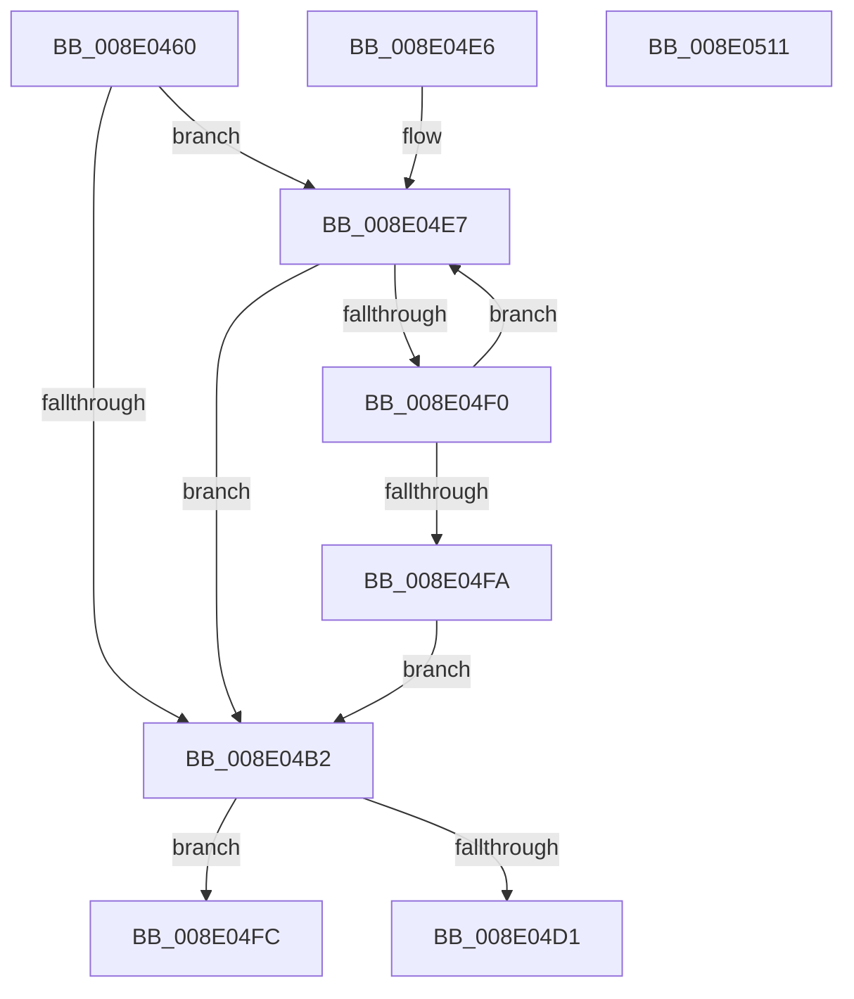

# PiPnpRtlGetCurrentOperation

- RVA: `0x008E0460`–`0x008E0512` (길이 `178` bytes)
- VA: `0x00000001408E0460`
- 실행 섹션: `PAGE`
- PDB 이름 있음: `예`; PDB Function 태그: `아니요`
- unwind 정보 RVA: `0x00085CF8`
- 디코드: `47`개 명령, `178/178` bytes 표시
- 미해석 바이트: `0` (있으면 어셈블리에 `.byte`로 보존)

> 이 문서는 커널 이미지의 기계어와 PDB 기호를 분석해 생성했습니다. 4번과 5번은 함수 원형과 자료형을 바이너리 사용 방식에서 추정한 C 해석이며 원본 소스 복구 결과는 아닙니다.

## 1. Dependencies

- 직접 호출 지점: **3**; 고유 호출 대상: **3**
- 직접 호출자로 확인된 함수: **1**
- RIP 상대 이미지 참조: **2**

### Outgoing calls
- `0x008E049A` → [ExAcquireResourceSharedLite](../../text/21/ExAcquireResourceSharedLite_function_00211BC0.md) (function, `0x00211BC0`)
- `0x008E04B9` → [ExReleaseResourceLite](../../text/25/ExReleaseResourceLite_function_0025FA10.md) (function, `0x0025FA10`)
- `0x008E04C7` → [KeLeaveCriticalRegionThread](../../text/25/KeLeaveCriticalRegionThread_function_0025EFF0.md) (function, `0x0025EFF0`)

### Direct callers
- [PiPnpRtlBeginOperation](PiPnpRtlBeginOperation_function_008E033C.md) at `0x008E0369`

### Static image references
- `0x008E048B` → RVA `0x00F8B9E0` (`.data`; read)
- `0x008E049F` → RVA `0x00F8B9D0` (`.data`; read)

## 2. Other-region calls and transfers

- 다른 실행 섹션으로 향하는 call: **3**
  - `0x008E049A` → [ExAcquireResourceSharedLite](../../text/21/ExAcquireResourceSharedLite_function_00211BC0.md) (`PAGE` → `.text`)
  - `0x008E04B9` → [ExReleaseResourceLite](../../text/25/ExReleaseResourceLite_function_0025FA10.md) (`PAGE` → `.text`)
  - `0x008E04C7` → [KeLeaveCriticalRegionThread](../../text/25/KeLeaveCriticalRegionThread_function_0025EFF0.md) (`PAGE` → `.text`)
- 별도 외부 분기/꼬리 이동을 확인하지 못했습니다.

## 3. Assembly (complete function range)

```asm
008E0460  48 89 5C 24 08                  mov qword ptr [rsp + 8], rbx
008E0465  48 89 74 24 10                  mov qword ptr [rsp + 0x10], rsi
008E046A  57                              push rdi
008E046B  48 83 EC 20                     sub rsp, 0x20
008E046F  65 48 8B 34 25 88 01 00 00      mov rsi, qword ptr gs:[0x188]
008E0478  48 8B F9                        mov rdi, rcx
008E047B  65 48 8B 04 25 88 01 00 00      mov rax, qword ptr gs:[0x188]
008E0484  33 DB                           xor ebx, ebx
008E0486  48 89 19                        mov qword ptr [rcx], rbx
008E0489  B2 01                           mov dl, 1
008E048B  48 8D 0D 4E B5 6A 00            lea rcx, [rip + 0x6ab54e]
008E0492  66 FF 88 E4 01 00 00            dec word ptr [rax + 0x1e4]
008E0499  90                              nop
008E049A  E8 21 17 93 FF                  call 0x140211bc0
008E049F  48 8B 15 2A B5 6A 00            mov rdx, qword ptr [rip + 0x6ab52a]
008E04A6  48 8D 05 23 B5 6A 00            lea rax, [rip + 0x6ab523]
008E04AD  48 3B D0                        cmp rdx, rax
008E04B0  75 35                           jne 0x1408e04e7
008E04B2  48 8D 0D 27 B5 6A 00            lea rcx, [rip + 0x6ab527]
008E04B9  E8 52 F5 97 FF                  call 0x14025fa10
008E04BE  65 48 8B 0C 25 88 01 00 00      mov rcx, qword ptr gs:[0x188]
008E04C7  E8 24 EB 97 FF                  call 0x14025eff0
008E04CC  48 85 DB                        test rbx, rbx
008E04CF  75 2B                           jne 0x1408e04fc
008E04D1  B8 25 02 00 C0                  mov eax, 0xc0000225
008E04D6  48 8B 5C 24 30                  mov rbx, qword ptr [rsp + 0x30]
008E04DB  48 8B 74 24 38                  mov rsi, qword ptr [rsp + 0x38]
008E04E0  48 83 C4 20                     add rsp, 0x20
008E04E4  5F                              pop rdi
008E04E5  C3                              ret
008E04E6  CC                              int3
008E04E7  48 8B DA                        mov rbx, rdx
008E04EA  48 39 72 10                     cmp qword ptr [rdx + 0x10], rsi
008E04EE  74 C2                           je 0x1408e04b2
008E04F0  48 8B 12                        mov rdx, qword ptr [rdx]
008E04F3  33 DB                           xor ebx, ebx
008E04F5  48 3B D0                        cmp rdx, rax
008E04F8  75 ED                           jne 0x1408e04e7
008E04FA  EB B6                           jmp 0x1408e04b2
008E04FC  48 8B 74 24 38                  mov rsi, qword ptr [rsp + 0x38]
008E0501  33 C0                           xor eax, eax
008E0503  48 89 1F                        mov qword ptr [rdi], rbx
008E0506  48 8B 5C 24 30                  mov rbx, qword ptr [rsp + 0x30]
008E050B  48 83 C4 20                     add rsp, 0x20
008E050F  5F                              pop rdi
008E0510  C3                              ret
008E0511  CC                              int3
```

## 4. C-style interpretation (structured pseudocode)

```c
__int64 __fastcall PiPnpRtlGetCurrentOperation(__int64 a1)
{
    __int64 result;
    __int64 v_rbx;
    __int64 v_rsp;
    unsigned __int64 v_stack_p10;
    unsigned __int64 v_stack_p30;
    unsigned __int64 v_stack_p38;
    unsigned __int64 v_stack_p8;

    v_stack_p8 = v_rbx;
    v_stack_p10 = v_rsi;
    v_rsp = (v_rsp) - (32);
    v_rbx = 0;
    *(unsigned __int64 *)(a1) = 0;
    result = ExAcquireResourceSharedLite(v_rip + 6993230, 1, a3, a4);
    if ((*(unsigned __int64 *)(v_rip + 6993194)) != (v_rip + 6993187)) goto loc_008E04E7;
loc_008E04B2:
    result = ExReleaseResourceLite(v_rip + 6993191, *(unsigned __int64 *)(v_rip + 6993194), a3, a4);
    result = KeLeaveCriticalRegionThread(*(unsigned __int64 *)(gs_base + (0 + 392)), *(unsigned __int64 *)(v_rip + 6993194), a3, a4);
    if (0 != 0) goto loc_008E04FC;
    v_rsp = (v_rsp) + (32);
    return (unsigned int)(0xC0000225ULL);
loc_008E04E7:
    if ((*(unsigned __int64 *)(*(unsigned __int64 *)(v_rip + 6993194) + 16)) == v_stack_p10) goto loc_008E04B2;
    v_rbx = 0;
    if ((*(unsigned __int64 *)(*(unsigned __int64 *)(v_rip + 6993194))) != ((unsigned int)(0xC0000225ULL))) goto loc_008E04E7;
    goto loc_008E04B2;
loc_008E04FC:
    result = 0;
    *(unsigned __int64 *)(a1) = 0;
    v_rsp = (v_rsp) + (32);
    return result;
}
```

## 5. (Beta) C Style

```c
int64_t PiPnpRtlGetCurrentOperation(void *Arg1)
{
    uint8_t *arg1 = (uint8_t *)Arg1;

    int64_t result;
    int64_t local_rbx;
    int64_t local_rsp;
    uint64_t v_stack_p10;
    uint64_t v_stack_p30;
    uint64_t v_stack_p38;
    uint64_t v_stack_p8;

    v_stack_p8 = local_rbx;
    v_stack_p10 = local_rsi;
    local_rsp = (local_rsp) - (32);
    local_rbx = 0;
    *(uint64_t *)(arg1) = 0;
    result = ExAcquireResourceSharedLite(v_rip + 6993230, 1, a3, a4);
    if ((*(uint64_t *)(v_rip + 0x6AB52A)) != (v_rip + 6993187)) goto loc_008E04E7;
loc_008E04B2:
    result = ExReleaseResourceLite(v_rip + 6993191, *(uint64_t *)(v_rip + 0x6AB52A), a3, a4);
    result = KeLeaveCriticalRegionThread(*(uint64_t *)(gs_base + (0 + 0x188)), *(uint64_t *)(v_rip + 0x6AB52A), a3, a4);
    if (0 != 0) goto loc_008E04FC;
    local_rsp = (local_rsp) + (32);
    return (uint32_t)(0xC0000225ULL);
loc_008E04E7:
    if ((*(uint64_t *)(*(uint64_t *)(v_rip + 0x6AB52A) + 0x10)) == v_stack_p10) goto loc_008E04B2;
    local_rbx = 0;
    if ((*(uint64_t *)(*(uint64_t *)(v_rip + 0x6AB52A))) != ((uint32_t)(0xC0000225ULL))) goto loc_008E04E7;
    goto loc_008E04B2;
loc_008E04FC:
    result = 0;
    *(uint64_t *)(arg1) = 0;
    local_rsp = (local_rsp) + (32);
    return result;
}
```

### 관측된 메모리 오프셋

구조체 형식이 확인되지 않은 접근은 인자 기준의 오프셋으로만 기록했습니다.

| 기준 인자 | 오프셋 표현 | 폭 (bit) | 접근 |
|---|---:|---:|---|
| `Arg1` | `+ 0x0` | `64` | `W` |

## 6. Execution-region graph

[열기: 2D/3D 그래프와 함수 탐색 컨트롤 패널](../../../control-panel.html?section=page&rva=0x008E0460&view=graph)

- 2D 그래프는 위에서 아래로 흐르고, 3D 그래프는 빈 공간을 드래그해 회전합니다. Shift+드래그는 이동, 휠은 확대·축소, 함수 노드 선택은 대상 보고서 이동입니다.

### Static fallback


