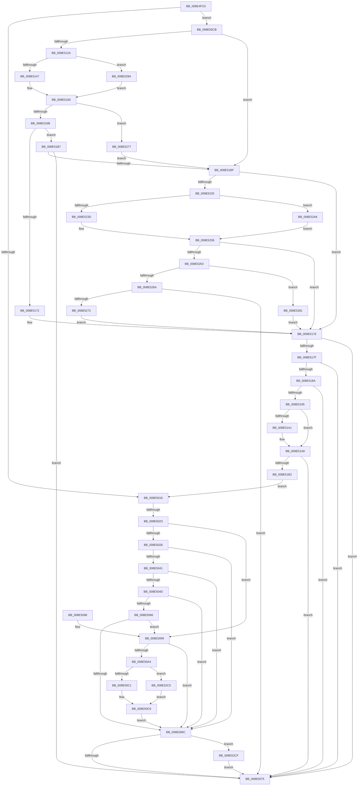

# PiPnpRtlInterfaceFilterCallback

- RVA: `0x008E4FC0`–`0x008E52E1` (길이 `801` bytes)
- VA: `0x00000001408E4FC0`
- 실행 섹션: `PAGE`
- PDB 이름 있음: `예`; PDB Function 태그: `예`
- unwind 정보 RVA: `0x000865B0`
- 디코드: `198`개 명령, `801/801` bytes 표시
- 미해석 바이트: `0` (있으면 어셈블리에 `.byte`로 보존)

> 이 문서는 커널 이미지의 기계어와 PDB 기호를 분석해 생성했습니다. 4번과 5번은 함수 원형과 자료형을 바이너리 사용 방식에서 추정한 C 해석이며 원본 소스 복구 결과는 아닙니다.

## 1. Dependencies

- 직접 호출 지점: **11**; 고유 호출 대상: **7**
- 직접 호출자로 확인된 함수: **1**
- RIP 상대 이미지 참조: **5**

### Outgoing calls
- `0x008E5038` → [RtlInitUnicodeStringEx](../../text/46/RtlInitUnicodeStringEx_function_00463960.md) (function, `0x00463960`)
- `0x008E505D` → [guard_dispatch_icall](../../text/6B/guard_dispatch_icall_function_006BAAD0.md) (function, `0x006BAAD0`)
- `0x008E507F` → [_security_check_cookie](../../text/6A/_security_check_cookie_function_006AC640.md) (function, `0x006AC640`)
- `0x008E50C1` → [IopDeviceInterfaceFilterCallback](IopDeviceInterfaceFilterCallback_function_008E5410.md) (function, `0x008E5410`)
- `0x008E515B` → [PiPnpRtlObjectActionCallback](PiPnpRtlObjectActionCallback_function_008E2850.md) (function, `0x008E2850`)
- `0x008E520A` → [PnpGetObjectPropertyWorker](PnpGetObjectPropertyWorker_function_008E1810.md) (function, `0x008E1810`)
- `0x008E5253` → [PiPnpRtlObjectActionCallback](PiPnpRtlObjectActionCallback_function_008E2850.md) (function, `0x008E2850`)
- `0x008E529E` → [guard_dispatch_icall](../../text/6B/guard_dispatch_icall_function_006BAAD0.md) (function, `0x006BAAD0`)
- `0x008E52BE` → [guard_dispatch_icall](../../text/6B/guard_dispatch_icall_function_006BAAD0.md) (function, `0x006BAAD0`)
- `0x008E52C5` → [guard_dispatch_icall](../../text/6B/guard_dispatch_icall_function_006BAAD0.md) (function, `0x006BAAD0`)
- `0x008E52D7` → [ExFreePoolWithTag](../../poolcode/B8/ExFreePoolWithTag_function_00B82870.md) (function, `0x00B82870`)

### Direct callers
- [PiDmCmObjectMatchCallback](PiDmCmObjectMatchCallback_function_008E3E80.md) at `0x008E3EB0`

### Static image references
- `0x008E4FD9` → RVA `0x00E0A740` (`.data`; read)
- `0x008E50A8` → RVA `0x008E5410` (`IopDeviceInterfaceFilterCallback`; read)
- `0x008E50CB` → RVA `0x00E66398` (`.data`; read)
- `0x008E50D2` → RVA `0x000114B8` (`.rdata`; read)
- `0x008E5130` → RVA `0x008E2850` (`PiPnpRtlObjectActionCallback`; read)

## 2. Other-region calls and transfers

- 다른 실행 섹션으로 향하는 call: **7**
  - `0x008E5038` → [RtlInitUnicodeStringEx](../../text/46/RtlInitUnicodeStringEx_function_00463960.md) (`PAGE` → `.text`)
  - `0x008E505D` → [guard_dispatch_icall](../../text/6B/guard_dispatch_icall_function_006BAAD0.md) (`PAGE` → `.text`)
  - `0x008E507F` → [_security_check_cookie](../../text/6A/_security_check_cookie_function_006AC640.md) (`PAGE` → `.text`)
  - `0x008E529E` → [guard_dispatch_icall](../../text/6B/guard_dispatch_icall_function_006BAAD0.md) (`PAGE` → `.text`)
  - `0x008E52BE` → [guard_dispatch_icall](../../text/6B/guard_dispatch_icall_function_006BAAD0.md) (`PAGE` → `.text`)
  - `0x008E52C5` → [guard_dispatch_icall](../../text/6B/guard_dispatch_icall_function_006BAAD0.md) (`PAGE` → `.text`)
  - `0x008E52D7` → [ExFreePoolWithTag](../../poolcode/B8/ExFreePoolWithTag_function_00B82870.md) (`PAGE` → `POOLCODE`)
- call이 아닌 외부 분기/꼬리 이동: **1**
  - `0x008E501D` → [sub_00B1D252](../B1/Unknown_function_00B1D252.md) (`tail-transfer`)

## 3. Assembly (complete function range)

```asm
008E4FC0  40 55                           push rbp
008E4FC2  53                              push rbx
008E4FC3  56                              push rsi
008E4FC4  57                              push rdi
008E4FC5  41 54                           push r12
008E4FC7  41 55                           push r13
008E4FC9  41 56                           push r14
008E4FCB  41 57                           push r15
008E4FCD  48 8D 6C 24 F8                  lea rbp, [rsp - 8]
008E4FD2  48 81 EC 08 01 00 00            sub rsp, 0x108
008E4FD9  48 8B 05 60 57 52 00            mov rax, qword ptr [rip + 0x525760]
008E4FE0  48 33 C4                        xor rax, rsp
008E4FE3  48 89 45 F0                     mov qword ptr [rbp - 0x10], rax
008E4FE7  4C 8B F2                        mov r14, rdx
008E4FEA  32 DB                           xor bl, bl
008E4FEC  33 D2                           xor edx, edx
008E4FEE  0F 57 C0                        xorps xmm0, xmm0
008E4FF1  49 8B F9                        mov rdi, r9
008E4FF4  45 8B E0                        mov r12d, r8d
008E4FF7  48 8B F1                        mov rsi, rcx
008E4FFA  44 8B FA                        mov r15d, edx
008E4FFD  0F 11 45 E0                     movups xmmword ptr [rbp - 0x20], xmm0
008E5001  88 54 24 60                     mov byte ptr [rsp + 0x60], dl
008E5005  89 54 24 64                     mov dword ptr [rsp + 0x64], edx
008E5009  89 54 24 68                     mov dword ptr [rsp + 0x68], edx
008E500D  49 39 11                        cmp qword ptr [r9], rdx
008E5010  0F 85 B5 00 00 00               jne 0x1408e50cb
008E5016  48 8B 47 08                     mov rax, qword ptr [rdi + 8]
008E501A  48 85 C0                        test rax, rax
008E501D  0F 85 2F 82 23 00               jne 0x140b1d252
008E5023  38 5F 10                        cmp byte ptr [rdi + 0x10], bl
008E5026  74 71                           je 0x1408e5099
008E5028  0F 57 C0                        xorps xmm0, xmm0
008E502B  48 8D 4C 24 78                  lea rcx, [rsp + 0x78]
008E5030  49 8B D6                        mov rdx, r14
008E5033  0F 11 44 24 78                  movups xmmword ptr [rsp + 0x78], xmm0
008E5038  E8 23 E9 B7 FF                  call 0x140463960
008E503D  85 C0                           test eax, eax
008E503F  78 2B                           js 0x1408e506c
008E5041  48 8B 86 20 01 00 00            mov rax, qword ptr [rsi + 0x120]
008E5048  48 85 C0                        test rax, rax
008E504B  74 1F                           je 0x1408e506c
008E504D  45 33 C9                        xor r9d, r9d
008E5050  4C 8D 44 24 60                  lea r8, [rsp + 0x60]
008E5055  48 8D 54 24 78                  lea rdx, [rsp + 0x78]
008E505A  48 8B CE                        mov rcx, rsi
008E505D  E8 6E 5A DD FF                  call 0x1406baad0
008E5062  85 C0                           test eax, eax
008E5064  78 06                           js 0x1408e506c
008E5066  38 5C 24 60                     cmp byte ptr [rsp + 0x60], bl
008E506A  75 2D                           jne 0x1408e5099
008E506C  4D 85 FF                        test r15, r15
008E506F  0F 85 5A 02 00 00               jne 0x1408e52cf
008E5075  0F B6 C3                        movzx eax, bl
008E5078  48 8B 4D F0                     mov rcx, qword ptr [rbp - 0x10]
008E507C  48 33 CC                        xor rcx, rsp
008E507F  E8 BC 75 DC FF                  call 0x1406ac640
008E5084  48 81 C4 08 01 00 00            add rsp, 0x108
008E508B  41 5F                           pop r15
008E508D  41 5E                           pop r14
008E508F  41 5D                           pop r13
008E5091  41 5C                           pop r12
008E5093  5F                              pop rdi
008E5094  5E                              pop rsi
008E5095  5B                              pop rbx
008E5096  5D                              pop rbp
008E5097  C3                              ret
008E5098  CC                              int3
008E5099  48 8B 47 18                     mov rax, qword ptr [rdi + 0x18]
008E509D  B3 01                           mov bl, 1
008E509F  48 85 C0                        test rax, rax
008E50A2  74 C8                           je 0x1408e506c
008E50A4  4C 8B 4F 20                     mov r9, qword ptr [rdi + 0x20]
008E50A8  48 8D 0D 61 03 00 00            lea rcx, [rip + 0x361]
008E50AF  48 3B C1                        cmp rax, rcx
008E50B2  45 8B C4                        mov r8d, r12d
008E50B5  48 8B CE                        mov rcx, rsi
008E50B8  49 8B D6                        mov rdx, r14
008E50BB  0F 85 04 02 00 00               jne 0x1408e52c5
008E50C1  E8 4A 03 00 00                  call 0x1408e5410
008E50C6  0F B6 D8                        movzx ebx, al
008E50C9  EB A1                           jmp 0x1408e506c
008E50CB  4C 8B 2D C6 12 58 00            mov r13, qword ptr [rip + 0x5812c6]
008E50D2  48 8D 0D DF C3 72 FF            lea rcx, [rip - 0x8d3c21]
008E50D9  48 89 4D B0                     mov qword ptr [rbp - 0x50], rcx
008E50DD  48 8D 4C 24 64                  lea rcx, [rsp + 0x64]
008E50E2  48 89 4D B8                     mov qword ptr [rbp - 0x48], rcx
008E50E6  48 8D 4D E0                     lea rcx, [rbp - 0x20]
008E50EA  48 89 4D C0                     mov qword ptr [rbp - 0x40], rcx
008E50EE  48 8D 4C 24 68                  lea rcx, [rsp + 0x68]
008E50F3  49 8B 85 E8 01 00 00            mov rax, qword ptr [r13 + 0x1e8]
008E50FA  48 89 4D D0                     mov qword ptr [rbp - 0x30], rcx
008E50FE  4C 89 6C 24 78                  mov qword ptr [rsp + 0x78], r13
008E5103  48 89 55 90                     mov qword ptr [rbp - 0x70], rdx
008E5107  48 89 55 98                     mov qword ptr [rbp - 0x68], rdx
008E510B  48 C7 45 C8 10 00 00 00         mov qword ptr [rbp - 0x38], 0x10
008E5113  48 89 55 D8                     mov qword ptr [rbp - 0x28], rdx
008E5117  48 89 44 24 70                  mov qword ptr [rsp + 0x70], rax
008E511C  66 0F 7F 45 A0                  movdqa xmmword ptr [rbp - 0x60], xmm0
008E5121  48 85 C0                        test rax, rax
008E5124  0F 84 95 00 00 00               je 0x1408e51bf
008E512A  41 B9 08 00 00 00               mov r9d, 8
008E5130  48 8D 0D 19 D7 FF FF            lea rcx, [rip - 0x28e7]
008E5137  49 8B D6                        mov rdx, r14
008E513A  45 8D 41 FB                     lea r8d, [r9 - 5]
008E513E  48 3B C1                        cmp rax, rcx
008E5141  0F 85 43 01 00 00               jne 0x1408e528a
008E5147  48 8D 45 90                     lea rax, [rbp - 0x70]
008E514B  49 8B CD                        mov rcx, r13
008E514E  48 89 44 24 28                  mov qword ptr [rsp + 0x28], rax
008E5153  C7 44 24 20 01 00 00 00         mov dword ptr [rsp + 0x20], 1
008E515B  E8 F0 D6 FF FF                  call 0x1408e2850
008E5160  3D 02 00 00 C0                  cmp eax, 0xc0000002
008E5165  0F 84 0C 01 00 00               je 0x1408e5277
008E516B  3D 20 01 00 C0                  cmp eax, 0xc0000120
008E5170  75 45                           jne 0x1408e51b7
008E5172  44 8B 6D 90                     mov r13d, dword ptr [rbp - 0x70]
008E5176  45 85 ED                        test r13d, r13d
008E5179  0F 88 F6 FE FF FF               js 0x1408e5075
008E517F  83 7C 24 68 10                  cmp dword ptr [rsp + 0x68], 0x10
008E5184  0F 82 EB FE FF FF               jb 0x1408e5075
008E518A  83 7C 24 64 0D                  cmp dword ptr [rsp + 0x64], 0xd
008E518F  0F 85 E0 FE FF FF               jne 0x1408e5075
008E5195  48 8B 0F                        mov rcx, qword ptr [rdi]
008E5198  48 8B 01                        mov rax, qword ptr [rcx]
008E519B  48 2B 45 E0                     sub rax, qword ptr [rbp - 0x20]
008E519F  75 08                           jne 0x1408e51a9
008E51A1  48 8B 41 08                     mov rax, qword ptr [rcx + 8]
008E51A5  48 2B 45 E8                     sub rax, qword ptr [rbp - 0x18]
008E51A9  48 85 C0                        test rax, rax
008E51AC  0F 85 C3 FE FF FF               jne 0x1408e5075
008E51B2  E9 5F FE FF FF                  jmp 0x1408e5016
008E51B7  85 C0                           test eax, eax
008E51B9  0F 85 B6 FE FF FF               jne 0x1408e5075
008E51BF  8B 45 D8                        mov eax, dword ptr [rbp - 0x28]
008E51C2  41 B8 03 00 00 00               mov r8d, 3
008E51C8  4C 8B 4D A0                     mov r9, qword ptr [rbp - 0x60]
008E51CC  49 8B D6                        mov rdx, r14
008E51CF  89 44 24 50                     mov dword ptr [rsp + 0x50], eax
008E51D3  49 8B CD                        mov rcx, r13
008E51D6  48 8B 45 D0                     mov rax, qword ptr [rbp - 0x30]
008E51DA  48 89 44 24 48                  mov qword ptr [rsp + 0x48], rax
008E51DF  8B 45 C8                        mov eax, dword ptr [rbp - 0x38]
008E51E2  89 44 24 40                     mov dword ptr [rsp + 0x40], eax
008E51E6  48 8B 45 C0                     mov rax, qword ptr [rbp - 0x40]
008E51EA  48 89 44 24 38                  mov qword ptr [rsp + 0x38], rax
008E51EF  48 8B 45 B8                     mov rax, qword ptr [rbp - 0x48]
008E51F3  48 89 44 24 30                  mov qword ptr [rsp + 0x30], rax
008E51F8  48 8B 45 B0                     mov rax, qword ptr [rbp - 0x50]
008E51FC  48 89 44 24 28                  mov qword ptr [rsp + 0x28], rax
008E5201  48 8B 45 A8                     mov rax, qword ptr [rbp - 0x58]
008E5205  48 89 44 24 20                  mov qword ptr [rsp + 0x20], rax
008E520A  E8 01 C6 FF FF                  call 0x1408e1810
008E520F  44 8B E8                        mov r13d, eax
008E5212  48 8B 44 24 70                  mov rax, qword ptr [rsp + 0x70]
008E5217  48 85 C0                        test rax, rax
008E521A  0F 84 56 FF FF FF               je 0x1408e5176
008E5220  41 B9 08 00 00 00               mov r9d, 8
008E5226  44 89 6D 90                     mov dword ptr [rbp - 0x70], r13d
008E522A  48 8D 0D 1F D6 FF FF            lea rcx, [rip - 0x29e1]
008E5231  49 8B D6                        mov rdx, r14
008E5234  45 8D 41 FB                     lea r8d, [r9 - 5]
008E5238  48 3B C1                        cmp rax, rcx
008E523B  75 6B                           jne 0x1408e52a8
008E523D  48 8B 4C 24 78                  mov rcx, qword ptr [rsp + 0x78]
008E5242  48 8D 45 90                     lea rax, [rbp - 0x70]
008E5246  48 89 44 24 28                  mov qword ptr [rsp + 0x28], rax
008E524B  C7 44 24 20 02 00 00 00         mov dword ptr [rsp + 0x20], 2
008E5253  E8 F8 D5 FF FF                  call 0x1408e2850
008E5258  3D 02 00 00 C0                  cmp eax, 0xc0000002
008E525D  0F 84 13 FF FF FF               je 0x1408e5176
008E5263  3D 20 01 00 C0                  cmp eax, 0xc0000120
008E5268  74 17                           je 0x1408e5281
008E526A  85 C0                           test eax, eax
008E526C  0F 85 03 FE FF FF               jne 0x1408e5075
008E5272  E9 FF FE FF FF                  jmp 0x1408e5176
008E5277  4C 89 7C 24 70                  mov qword ptr [rsp + 0x70], r15
008E527C  E9 3E FF FF FF                  jmp 0x1408e51bf
008E5281  44 8B 6D 90                     mov r13d, dword ptr [rbp - 0x70]
008E5285  E9 EC FE FF FF                  jmp 0x1408e5176
008E528A  48 8D 4D 90                     lea rcx, [rbp - 0x70]
008E528E  48 89 4C 24 28                  mov qword ptr [rsp + 0x28], rcx
008E5293  49 8B CD                        mov rcx, r13
008E5296  C7 44 24 20 01 00 00 00         mov dword ptr [rsp + 0x20], 1
008E529E  E8 2D 58 DD FF                  call 0x1406baad0
008E52A3  E9 B8 FE FF FF                  jmp 0x1408e5160
008E52A8  48 8D 4D 90                     lea rcx, [rbp - 0x70]
008E52AC  48 89 4C 24 28                  mov qword ptr [rsp + 0x28], rcx
008E52B1  48 8B 4C 24 78                  mov rcx, qword ptr [rsp + 0x78]
008E52B6  C7 44 24 20 02 00 00 00         mov dword ptr [rsp + 0x20], 2
008E52BE  E8 0D 58 DD FF                  call 0x1406baad0
008E52C3  EB 93                           jmp 0x1408e5258
008E52C5  E8 06 58 DD FF                  call 0x1406baad0
008E52CA  E9 F7 FD FF FF                  jmp 0x1408e50c6
008E52CF  BA 50 6E 70 47                  mov edx, 0x47706e50
008E52D4  49 8B CF                        mov rcx, r15
008E52D7  E8 94 D5 29 00                  call 0x140b82870
008E52DC  E9 94 FD FF FF                  jmp 0x1408e5075
```

## 4. C-style interpretation (structured pseudocode)

```c
__int64 __fastcall PiPnpRtlInterfaceFilterCallback(__int64 a1, __int64 a2, int a3, __int64 a4)
{
    __int64 result;
    __int64 v_rbx;
    __int64 v_rsp;
    unsigned __int64 v_stack_m48;
    unsigned __int64 v_stack_m58;
    unsigned __int64 v_stack_m60;
    unsigned __int64 v_stack_m68;
    unsigned __int64 v_stack_m70;
    unsigned __int64 v_stack_m78;
    unsigned __int64 v_stack_m80;
    unsigned __int64 v_stack_m88;
    unsigned __int64 v_stack_m90;
    unsigned __int64 v_stack_m98;
    unsigned __int64 v_stack_mA0;
    unsigned __int64 v_stack_mA8;
    unsigned __int64 v_stack_mB0;
    unsigned __int64 v_stack_mB8;
    unsigned __int64 v_stack_mD0;
    unsigned int v_stack_mE0;
    unsigned int v_stack_mE4;
    unsigned __int8 v_stack_mE8;
    unsigned int v_stack_p20;
    unsigned __int64 v_stack_p28;
    unsigned __int64 v_stack_p30;
    unsigned __int64 v_stack_p38;
    unsigned int v_stack_p40;
    unsigned __int64 v_stack_p48;
    unsigned int v_stack_p50;
    unsigned __int64 v_stack_p64;
    unsigned __int64 v_stack_p68;
    unsigned __int64 v_stack_p70;
    unsigned __int64 v_stack_p78;

    v_rsp = (v_rsp) - (264);
    result = (*(unsigned __int64 *)(v_rip + 5396320)) ^ (v_rsp);
    v_stack_m58 = result;
    v_rbx = 0;
    a2 = 0;
    v_stack_m68 = v_xmm0;
    v_stack_mE8 = 0;
    v_stack_mE4 = 0;
    v_stack_mE0 = 0;
    if ((*(unsigned __int64 *)(a4)) != 0) goto loc_008E50CB;
loc_008E5016:
    if ((*(unsigned __int8 *)(a4 + 16)) == 0) goto loc_008E5099;
    v_stack_mD0 = v_xmm0;
    result = RtlInitUnicodeStringEx(v_stack_mD0, 0, a3, a4);
    if (sign_flag) goto loc_008E506C;
    if (*(unsigned __int64 *)(a1 + 288) == 0) goto loc_008E506C;
    a4 = 0;
    result = guard_dispatch_icall(a1, v_stack_mD0, v_stack_mE8, a4);
    if (sign_flag) goto loc_008E506C;
    if (v_stack_mE8 != 0) goto loc_008E5099;
loc_008E506C:
    if (0 != 0) goto loc_008E52CF;
loc_008E5075:
    a1 = (v_stack_m58) ^ (v_rsp);
    result = _security_check_cookie(a1, v_stack_mD0, v_stack_mE8, a4);
    v_rsp = (v_rsp) + (264);
    return result;
loc_008E5099:
    if (*(unsigned __int64 *)(a4 + 24) == 0) goto loc_008E506C;
    if ((*(unsigned __int64 *)(a4 + 24)) != (v_rip + 865)) goto loc_008E52C5;
    result = IopDeviceInterfaceFilterCallback(a1, 0, (unsigned int)((unsigned int)((unsigned int)(a3))), *(unsigned __int64 *)(a4 + 32));
loc_008E50C6:
    goto loc_008E506C;
loc_008E50CB:
    v_stack_m98 = v_rip - 9255969;
    v_stack_m90 = v_stack_p64;
    v_stack_m88 = v_stack_m68;
    v_stack_m78 = v_stack_p68;
    v_stack_p78 = *(unsigned __int64 *)(v_rip + 5771974);
    v_stack_mB8 = 0;
    v_stack_mB0 = 0;
    v_stack_m80 = 16;
    v_stack_m70 = 0;
    v_stack_p70 = *(unsigned __int64 *)(*(unsigned __int64 *)(v_rip + 5771974) + 488);
    v_stack_mA8 = v_xmm0;
    if (*(unsigned __int64 *)(*(unsigned __int64 *)(v_rip + 5771974) + 488) == 0) goto loc_008E51BF;
    if ((*(unsigned __int64 *)(*(unsigned __int64 *)(v_rip + 5771974) + 488)) != (v_rip - 10471)) goto loc_008E528A;
    v_stack_p28 = v_stack_mB8;
    v_stack_p20 = 1;
    result = PiPnpRtlObjectActionCallback(*(unsigned __int64 *)(v_rip + 5771974), 0, 8 - 5, 8);
loc_008E5160:
    if (((unsigned int)(result)) == 0xC0000002ULL) goto loc_008E5277;
    if (((unsigned int)(result)) != 0xC0000120ULL) goto loc_008E51B7;
loc_008E5176:
    if (sign_flag) goto loc_008E5075;
    if (v_stack_p68 < 16) goto loc_008E5075;
    if (v_stack_p64 != 13) goto loc_008E5075;
    result = (*(unsigned __int64 *)(*(unsigned __int64 *)(a4))) - (v_stack_m68);
    if (!(condition_is_not_equal)) {
        result = *(unsigned __int64 *)(*(unsigned __int64 *)(a4) + 8);
        result = (result) - (v_stack_m60);
    }
    if (result != 0) goto loc_008E5075;
    goto loc_008E5016;
loc_008E51B7:
    if ((unsigned int)(result) != 0) goto loc_008E5075;
loc_008E51BF:
    v_stack_p50 = (unsigned int)((unsigned int)(v_stack_m70));
    v_stack_p48 = v_stack_m78;
    v_stack_p40 = (unsigned int)((unsigned int)(v_stack_m80));
    v_stack_p38 = v_stack_m88;
    v_stack_p30 = v_stack_m90;
    v_stack_p28 = v_stack_m98;
    v_stack_p20 = v_stack_mA0;
    result = PnpGetObjectPropertyWorker((unsigned int)(v_stack_mB8), 0, 3, v_stack_mA8);
    if (v_stack_p70 == 0) goto loc_008E5176;
    v_stack_mB8 = (unsigned int)((unsigned int)((unsigned int)(result)));
    if (v_stack_p70 != (v_rip - 10721)) goto loc_008E52A8;
    v_stack_p28 = v_stack_mB8;
    v_stack_p20 = 2;
    result = PiPnpRtlObjectActionCallback(v_stack_p78, 0, 8 - 5, 8);
loc_008E5258:
    if (((unsigned int)(result)) == 0xC0000002ULL) goto loc_008E5176;
    if (((unsigned int)(result)) == 0xC0000120ULL) goto loc_008E5281;
    if ((unsigned int)(result) != 0) goto loc_008E5075;
    goto loc_008E5176;
loc_008E5277:
    v_stack_p70 = 0;
    goto loc_008E51BF;
loc_008E5281:
    goto loc_008E5176;
loc_008E528A:
    v_stack_p28 = v_stack_mB8;
    v_stack_p20 = 1;
    result = guard_dispatch_icall((unsigned int)(v_stack_mB8), 0, 8 - 5, 8);
    goto loc_008E5160;
loc_008E52A8:
    v_stack_p28 = v_stack_mB8;
    v_stack_p20 = 2;
    result = guard_dispatch_icall(v_stack_p78, 0, 8 - 5, 8);
    goto loc_008E5258;
loc_008E52C5:
    result = guard_dispatch_icall(v_stack_p78, 0, 8 - 5, 8);
    goto loc_008E50C6;
loc_008E52CF:
    result = ExFreePoolWithTag(0, (unsigned int)(0x47706E50ULL), 8 - 5, 8);
    goto loc_008E5075;
}
```

## 5. (Beta) C Style

```c
int64_t PiPnpRtlInterfaceFilterCallback(void *Arg1, int64_t Arg2, int32_t Arg3, void *Arg4)
{
    uint8_t *arg1 = (uint8_t *)Arg1;
    uint8_t *arg4 = (uint8_t *)Arg4;

    int64_t result;
    int64_t local_rbx;
    int64_t local_rsp;
    uint64_t v_stack_m48;
    uint64_t v_stack_m58;
    uint64_t v_stack_m60;
    uint64_t v_stack_m68;
    uint64_t v_stack_m70;
    uint64_t v_stack_m78;
    uint64_t v_stack_m80;
    uint64_t v_stack_m88;
    uint64_t v_stack_m90;
    uint64_t v_stack_m98;
    uint64_t v_stack_mA0;
    uint64_t v_stack_mA8;
    uint64_t v_stack_mB0;
    uint64_t v_stack_mB8;
    uint64_t v_stack_mD0;
    uint32_t v_stack_mE0;
    uint32_t v_stack_mE4;
    uint8_t v_stack_mE8;
    uint32_t v_stack_p20;
    uint64_t v_stack_p28;
    uint64_t v_stack_p30;
    uint64_t v_stack_p38;
    uint32_t v_stack_p40;
    uint64_t v_stack_p48;
    uint32_t v_stack_p50;
    uint64_t v_stack_p64;
    uint64_t v_stack_p68;
    uint64_t v_stack_p70;
    uint64_t v_stack_p78;

    local_rsp = (local_rsp) - (264);
    result = (*(uint64_t *)(v_rip + 0x525760)) ^ (local_rsp);
    v_stack_m58 = result;
    local_rbx = 0;
    Arg2 = 0;
    v_stack_m68 = v_xmm0;
    v_stack_mE8 = 0;
    v_stack_mE4 = 0;
    v_stack_mE0 = 0;
    if ((*(uint64_t *)(arg4)) != 0) goto loc_008E50CB;
loc_008E5016:
    if ((*(uint8_t *)(arg4 + 0x10)) == 0) goto loc_008E5099;
    v_stack_mD0 = v_xmm0;
    result = RtlInitUnicodeStringEx(v_stack_mD0, 0, Arg3, Arg4);
    if (sign_flag) goto loc_008E506C;
    if (*(uint64_t *)(arg1 + 0x120) == 0) goto loc_008E506C;
    Arg4 = 0;
    result = guard_dispatch_icall(Arg1, v_stack_mD0, v_stack_mE8, Arg4);
    if (sign_flag) goto loc_008E506C;
    if (v_stack_mE8 != 0) goto loc_008E5099;
loc_008E506C:
    if (0 != 0) goto loc_008E52CF;
loc_008E5075:
    Arg1 = (v_stack_m58) ^ (local_rsp);
    result = _security_check_cookie(Arg1, v_stack_mD0, v_stack_mE8, Arg4);
    local_rsp = (local_rsp) + (264);
    return result;
loc_008E5099:
    if (*(uint64_t *)(arg4 + 0x18) == 0) goto loc_008E506C;
    if ((*(uint64_t *)(arg4 + 0x18)) != (v_rip + 865)) goto loc_008E52C5;
    result = IopDeviceInterfaceFilterCallback(Arg1, 0, (uint32_t)((uint32_t)((uint32_t)(Arg3))), *(uint64_t *)(arg4 + 0x20));
loc_008E50C6:
    goto loc_008E506C;
loc_008E50CB:
    v_stack_m98 = v_rip - 9255969;
    v_stack_m90 = v_stack_p64;
    v_stack_m88 = v_stack_m68;
    v_stack_m78 = v_stack_p68;
    v_stack_p78 = *(uint64_t *)(v_rip + 0x5812C6);
    v_stack_mB8 = 0;
    v_stack_mB0 = 0;
    v_stack_m80 = 16;
    v_stack_m70 = 0;
    v_stack_p70 = *(uint64_t *)(*(uint64_t *)(v_rip + 0x5812C6) + 0x1E8);
    v_stack_mA8 = v_xmm0;
    if (*(uint64_t *)(*(uint64_t *)(v_rip + 0x5812C6) + 0x1E8) == 0) goto loc_008E51BF;
    if ((*(uint64_t *)(*(uint64_t *)(v_rip + 0x5812C6) + 0x1E8)) != (v_rip - 10471)) goto loc_008E528A;
    v_stack_p28 = v_stack_mB8;
    v_stack_p20 = 1;
    result = PiPnpRtlObjectActionCallback(*(uint64_t *)(v_rip + 0x5812C6), 0, 8 - 5, 8);
loc_008E5160:
    if (((uint32_t)(result)) == 0xC0000002ULL) goto loc_008E5277;
    if (((uint32_t)(result)) != 0xC0000120ULL) goto loc_008E51B7;
loc_008E5176:
    if (sign_flag) goto loc_008E5075;
    if (v_stack_p68 < 16) goto loc_008E5075;
    if (v_stack_p64 != 13) goto loc_008E5075;
    result = (*(uint64_t *)(*(uint64_t *)(arg4))) - (v_stack_m68);
    if (!(condition_is_not_equal)) {
        result = *(uint64_t *)(*(uint64_t *)(arg4) + 0x8);
        result = (result) - (v_stack_m60);
    }
    if (result != 0) goto loc_008E5075;
    goto loc_008E5016;
loc_008E51B7:
    if ((uint32_t)(result) != 0) goto loc_008E5075;
loc_008E51BF:
    v_stack_p50 = (uint32_t)((uint32_t)(v_stack_m70));
    v_stack_p48 = v_stack_m78;
    v_stack_p40 = (uint32_t)((uint32_t)(v_stack_m80));
    v_stack_p38 = v_stack_m88;
    v_stack_p30 = v_stack_m90;
    v_stack_p28 = v_stack_m98;
    v_stack_p20 = v_stack_mA0;
    result = PnpGetObjectPropertyWorker((uint32_t)(v_stack_mB8), 0, 3, v_stack_mA8);
    if (v_stack_p70 == 0) goto loc_008E5176;
    v_stack_mB8 = (uint32_t)((uint32_t)((uint32_t)(result)));
    if (v_stack_p70 != (v_rip - 10721)) goto loc_008E52A8;
    v_stack_p28 = v_stack_mB8;
    v_stack_p20 = 2;
    result = PiPnpRtlObjectActionCallback(v_stack_p78, 0, 8 - 5, 8);
loc_008E5258:
    if (((uint32_t)(result)) == 0xC0000002ULL) goto loc_008E5176;
    if (((uint32_t)(result)) == 0xC0000120ULL) goto loc_008E5281;
    if ((uint32_t)(result) != 0) goto loc_008E5075;
    goto loc_008E5176;
loc_008E5277:
    v_stack_p70 = 0;
    goto loc_008E51BF;
loc_008E5281:
    goto loc_008E5176;
loc_008E528A:
    v_stack_p28 = v_stack_mB8;
    v_stack_p20 = 1;
    result = guard_dispatch_icall((uint32_t)(v_stack_mB8), 0, 8 - 5, 8);
    goto loc_008E5160;
loc_008E52A8:
    v_stack_p28 = v_stack_mB8;
    v_stack_p20 = 2;
    result = guard_dispatch_icall(v_stack_p78, 0, 8 - 5, 8);
    goto loc_008E5258;
loc_008E52C5:
    result = guard_dispatch_icall(v_stack_p78, 0, 8 - 5, 8);
    goto loc_008E50C6;
loc_008E52CF:
    result = ExFreePoolWithTag(0, (uint32_t)(0x47706E50ULL), 8 - 5, 8);
    goto loc_008E5075;
}
```

### 관측된 메모리 오프셋

구조체 형식이 확인되지 않은 접근은 인자 기준의 오프셋으로만 기록했습니다.

| 기준 인자 | 오프셋 표현 | 폭 (bit) | 접근 |
|---|---:|---:|---|
| `Arg1` | `+ 0x120` | `64` | `R` |
| `Arg4` | `+ 0x0` | `64` | `R` |
| `Arg4` | `+ 0x8` | `64` | `R` |
| `Arg4` | `+ 0x10` | `8` | `R` |
| `Arg4` | `+ 0x18` | `64` | `R` |
| `Arg4` | `+ 0x20` | `64` | `R` |

## 6. Execution-region graph

[열기: 2D/3D 그래프와 함수 탐색 컨트롤 패널](../../../control-panel.html?section=page&rva=0x008E4FC0&view=graph)

- 2D 그래프는 위에서 아래로 흐르고, 3D 그래프는 빈 공간을 드래그해 회전합니다. Shift+드래그는 이동, 휠은 확대·축소, 함수 노드 선택은 대상 보고서 이동입니다.

### Static fallback


