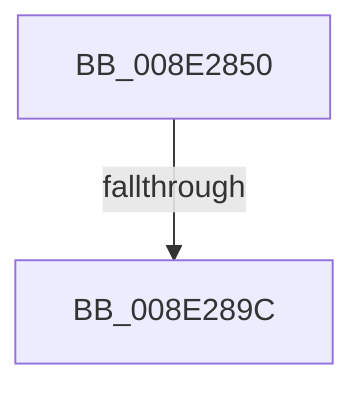

# PiPnpRtlObjectActionCallback

- RVA: `0x008E2850`–`0x008E28A3` (길이 `83` bytes)
- VA: `0x00000001408E2850`
- 실행 섹션: `PAGE`
- PDB 이름 있음: `예`; PDB Function 태그: `예`
- unwind 정보 RVA: `0x00085F7C`
- 디코드: `21`개 명령, `83/83` bytes 표시
- 미해석 바이트: `0` (있으면 어셈블리에 `.byte`로 보존)

> 이 문서는 커널 이미지의 기계어와 PDB 기호를 분석해 생성했습니다. 4번과 5번은 함수 원형과 자료형을 바이너리 사용 방식에서 추정한 C 해석이며 원본 소스 복구 결과는 아닙니다.

## 1. Dependencies

- 직접 호출 지점: **0**; 고유 호출 대상: **0**
- 직접 호출자로 확인된 함수: **10**
- RIP 상대 이미지 참조: **1**

### Outgoing calls
- 직접 디코드된 call 명령이 없습니다.

### Direct callers
- [PiDqPnPGetObjectPropertyInBestLocale](../8D/PiDqPnPGetObjectPropertyInBestLocale_function_008DEE10.md) at `0x008DF05D`
- [PiDqPnPGetObjectPropertyInBestLocale](../8D/PiDqPnPGetObjectPropertyInBestLocale_function_008DEE10.md) at `0x008DF1B9`
- [PiDqPnPGetObjectProperty](../8D/PiDqPnPGetObjectProperty_function_008DFD90.md) at `0x008DFFB0`
- [PiDqPnPGetObjectProperty](../8D/PiDqPnPGetObjectProperty_function_008DFD90.md) at `0x008E00C7`
- [PnpGetObjectProperty](PnpGetObjectProperty_function_008E1110.md) at `0x008E123B`
- [PnpGetObjectProperty](PnpGetObjectProperty_function_008E1110.md) at `0x008E143F`
- [PnpOpenObjectRegKey](PnpOpenObjectRegKey_function_008E15E8.md) at `0x008E1679`
- [PnpGetObjectProperty](PnpGetObjectProperty_function_008E2180.md) at `0x008E225B`
- [PnpGetObjectProperty](PnpGetObjectProperty_function_008E2180.md) at `0x008E23F0`
- [PiPnpRtlInterfaceFilterCallback](PiPnpRtlInterfaceFilterCallback_function_008E4FC0.md) at `0x008E515B`
- [PiPnpRtlInterfaceFilterCallback](PiPnpRtlInterfaceFilterCallback_function_008E4FC0.md) at `0x008E5253`
- [PiPnpRtlApplyMandatoryDeviceInterfaceFilters](PiPnpRtlApplyMandatoryDeviceInterfaceFilters_function_008E59D0.md) at `0x008E5ADE`
- [PiPnpRtlApplyMandatoryDeviceInterfaceFilters](PiPnpRtlApplyMandatoryDeviceInterfaceFilters_function_008E59D0.md) at `0x008E5C16`
- [PiPnpRtlApplyMandatoryDeviceFilters](PiPnpRtlApplyMandatoryDeviceFilters_function_008E5E90.md) at `0x008E6039`
- [PiPnpRtlApplyMandatoryDeviceFilters](PiPnpRtlApplyMandatoryDeviceFilters_function_008E5E90.md) at `0x008E6196`
- [PiPnpRtlApplyMandatoryDeviceFilters](PiPnpRtlApplyMandatoryDeviceFilters_function_008E5E90.md) at `0x008E62A1`
- [PiPnpRtlApplyMandatoryDeviceFilters](PiPnpRtlApplyMandatoryDeviceFilters_function_008E5E90.md) at `0x008E6366`
- [PnpGetObjectList](PnpGetObjectList_function_008E7520.md) at `0x008E75B2`
- [PnpGetObjectList](PnpGetObjectList_function_008E7520.md) at `0x008E7690`
- [PiCMHandleIoctl](PiCMHandleIoctl_function_008EB880.md) at `0x008EBC7E`
- [PiCMHandleIoctl](PiCMHandleIoctl_function_008EB880.md) at `0x008EBD39`

### Static image references
- `0x008E2865` → RVA `0x00E0A740` (`.data`; read)

## 2. Other-region calls and transfers

- 다른 실행 섹션으로 향하는 call: **0**
- call이 아닌 외부 분기/꼬리 이동: **1**
  - `0x008E2896` → [sub_008E2DBC](Unknown_function_008E2DBC.md) (`tail-transfer`)

## 3. Assembly (complete function range)

```asm
008E2850  40 55                           push rbp
008E2852  53                              push rbx
008E2853  56                              push rsi
008E2854  57                              push rdi
008E2855  41 55                           push r13
008E2857  41 56                           push r14
008E2859  48 8D 6C 24 88                  lea rbp, [rsp - 0x78]
008E285E  48 81 EC 78 01 00 00            sub rsp, 0x178
008E2865  48 8B 05 D4 7E 52 00            mov rax, qword ptr [rip + 0x527ed4]
008E286C  48 33 C4                        xor rax, rsp
008E286F  48 89 45 60                     mov qword ptr [rbp + 0x60], rax
008E2873  48 8B BD D8 00 00 00            mov rdi, qword ptr [rbp + 0xd8]
008E287A  45 8B D8                        mov r11d, r8d
008E287D  44 89 44 24 6C                  mov dword ptr [rsp + 0x6c], r8d
008E2882  4C 8B EA                        mov r13, rdx
008E2885  48 89 55 88                     mov qword ptr [rbp - 0x78], rdx
008E2889  BB 02 00 00 C0                  mov ebx, 0xc0000002
008E288E  48 89 4D A0                     mov qword ptr [rbp - 0x60], rcx
008E2892  41 83 F9 08                     cmp r9d, 8
008E2896  0F 85 20 05 00 00               jne 0x1408e2dbc
008E289C  83 BD D0 00 00 00 01            cmp dword ptr [rbp + 0xd0], 1
```

## 4. C-style interpretation (structured pseudocode)

```c
__int64 __fastcall PiPnpRtlObjectActionCallback(__int64 a1, __int64 a2, int a3, int a4, unsigned int a5, __int64 a6)
{
    __int64 result;
    __int64 v_rsp;
    unsigned __int64 v_stack_m108;
    unsigned __int64 v_stack_m120;
    unsigned int v_stack_m13C;
    unsigned __int64 v_stack_m48;
    unsigned __int64 v_stack_mA8;

    v_rsp = (v_rsp) - (376);
    result = (*(unsigned __int64 *)(v_rip + 5406420)) ^ (v_rsp);
    v_stack_m48 = result;
    v_stack_m13C = a3;
    v_stack_m120 = a2;
    v_stack_m108 = a1;
    return result;
}
```

## 5. (Beta) C Style

```c
int64_t PiPnpRtlObjectActionCallback(int64_t Arg1, int64_t Arg2, int32_t Arg3, int32_t Arg4, uint32_t Arg5, int64_t Arg6)
{
    int64_t result;
    int64_t local_rsp;
    uint64_t v_stack_m108;
    uint64_t v_stack_m120;
    uint32_t v_stack_m13C;
    uint64_t v_stack_m48;
    uint64_t v_stack_mA8;

    local_rsp = (local_rsp) - (376);
    result = (*(uint64_t *)(v_rip + 0x527ED4)) ^ (local_rsp);
    v_stack_m48 = result;
    v_stack_m13C = Arg3;
    v_stack_m120 = Arg2;
    v_stack_m108 = Arg1;
    return result;
}
```

## 6. Execution-region graph

[열기: 2D/3D 그래프와 함수 탐색 컨트롤 패널](../../../control-panel.html?section=page&rva=0x008E2850&view=graph)

- 2D 그래프는 위에서 아래로 흐르고, 3D 그래프는 빈 공간을 드래그해 회전합니다. Shift+드래그는 이동, 휠은 확대·축소, 함수 노드 선택은 대상 보고서 이동입니다.

### Static fallback


