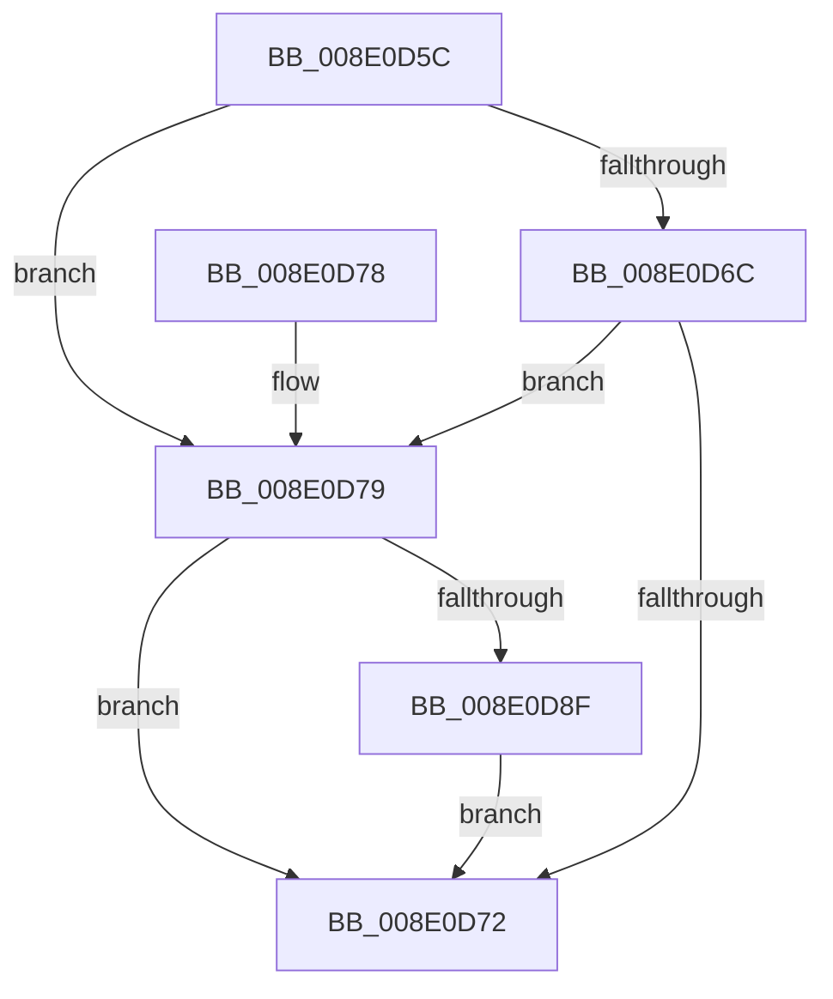

# PiPnpRtlObjectEventDispatch

- RVA: `0x008E0D5C`–`0x008E0D9C` (길이 `64` bytes)
- VA: `0x00000001408E0D5C`
- 실행 섹션: `PAGE`
- PDB 이름 있음: `예`; PDB Function 태그: `아니요`
- unwind 정보 RVA: `0x000795DC`
- 디코드: `22`개 명령, `64/64` bytes 표시
- 미해석 바이트: `0` (있으면 어셈블리에 `.byte`로 보존)

> 이 문서는 커널 이미지의 기계어와 PDB 기호를 분석해 생성했습니다. 4번과 5번은 함수 원형과 자료형을 바이너리 사용 방식에서 추정한 C 해석이며 원본 소스 복구 결과는 아닙니다.

## 1. Dependencies

- 직접 호출 지점: **3**; 고유 호출 대상: **3**
- 직접 호출자로 확인된 함수: **2**
- RIP 상대 이미지 참조: **0**

### Outgoing calls
- `0x008E0D79` → [PiDcHandleObjectEvent](../A5/PiDcHandleObjectEvent_function_00A50368.md) (function, `0x00A50368`)
- `0x008E0D85` → [PiDqGetObjectManagerForPnpObjectType](../A4/PiDqGetObjectManagerForPnpObjectType_function_00A43FCC.md) (function, `0x00A43FCC`)
- `0x008E0D95` → [PiDqObjectManagerHandleObjectEvent](../A4/PiDqObjectManagerHandleObjectEvent_function_00A4402C.md) (function, `0x00A4402C`)

### Direct callers
- [PiPnpRtlEndOperation](PiPnpRtlEndOperation_function_008E0518.md) at `0x008E05AF`
- [PiPnpRtlObjectEventWorker](../8F/PiPnpRtlObjectEventWorker_function_008F8630.md) at `0x008F898F`

### Static image references
- 디코드된 RIP-relative 메모리 참조가 없습니다.

## 2. Other-region calls and transfers

- 다른 실행 섹션으로 향하는 call: **0**
- 별도 외부 분기/꼬리 이동을 확인하지 못했습니다.

## 3. Assembly (complete function range)

```asm
008E0D5C  40 53                           push rbx
008E0D5E  48 83 EC 20                     sub rsp, 0x20
008E0D62  8B 41 04                        mov eax, dword ptr [rcx + 4]
008E0D65  48 8B D9                        mov rbx, rcx
008E0D68  A8 0B                           test al, 0xb
008E0D6A  75 0D                           jne 0x1408e0d79
008E0D6C  83 79 4C 00                     cmp dword ptr [rcx + 0x4c], 0
008E0D70  75 07                           jne 0x1408e0d79
008E0D72  48 83 C4 20                     add rsp, 0x20
008E0D76  5B                              pop rbx
008E0D77  C3                              ret
008E0D78  CC                              int3
008E0D79  E8 EA F5 16 00                  call 0x140a50368
008E0D7E  48 8B 4B 08                     mov rcx, qword ptr [rbx + 8]
008E0D82  8B 49 1C                        mov ecx, dword ptr [rcx + 0x1c]
008E0D85  E8 42 32 16 00                  call 0x140a43fcc
008E0D8A  48 85 C0                        test rax, rax
008E0D8D  74 E3                           je 0x1408e0d72
008E0D8F  48 8B D3                        mov rdx, rbx
008E0D92  48 8B C8                        mov rcx, rax
008E0D95  E8 92 32 16 00                  call 0x140a4402c
008E0D9A  EB D6                           jmp 0x1408e0d72
```

## 4. C-style interpretation (structured pseudocode)

```c
__int64 __fastcall PiPnpRtlObjectEventDispatch(__int64 a1)
{
    __int64 result;
    __int64 v_rsp;

    v_rsp = (v_rsp) - (32);
    if ((((unsigned __int8)((unsigned int)(*(unsigned int *)(a1 + 4)))) & (11)) != 0) goto loc_008E0D79;
    if ((*(unsigned int *)(a1 + 76)) != 0) goto loc_008E0D79;
loc_008E0D72:
    v_rsp = (v_rsp) + (32);
    return (unsigned int)(*(unsigned int *)(a1 + 4));
loc_008E0D79:
    result = PiDcHandleObjectEvent(a1, a2, a3, a4);
    result = PiDqGetObjectManagerForPnpObjectType((unsigned int)(*(unsigned int *)(*(unsigned __int64 *)(a1 + 8) + 28)), a2, a3, a4);
    if (result == 0) goto loc_008E0D72;
    result = PiDqObjectManagerHandleObjectEvent(result, a1, a3, a4);
    goto loc_008E0D72;
}
```

## 5. (Beta) C Style

```c
int64_t PiPnpRtlObjectEventDispatch(void *Arg1)
{
    uint8_t *arg1 = (uint8_t *)Arg1;

    int64_t result;
    int64_t local_rsp;

    local_rsp = (local_rsp) - (32);
    if ((((uint8_t)((uint32_t)(*(uint32_t *)(arg1 + 0x4)))) & (11)) != 0) goto loc_008E0D79;
    if ((*(uint32_t *)(arg1 + 0x4C)) != 0) goto loc_008E0D79;
loc_008E0D72:
    local_rsp = (local_rsp) + (32);
    return (uint32_t)(*(uint32_t *)(arg1 + 0x4));
loc_008E0D79:
    result = PiDcHandleObjectEvent(Arg1, a2, a3, a4);
    result = PiDqGetObjectManagerForPnpObjectType((uint32_t)(*(uint32_t *)(*(uint64_t *)(arg1 + 0x8) + 0x1C)), a2, a3, a4);
    if (result == 0) goto loc_008E0D72;
    result = PiDqObjectManagerHandleObjectEvent(result, Arg1, a3, a4);
    goto loc_008E0D72;
}
```

### 관측된 메모리 오프셋

구조체 형식이 확인되지 않은 접근은 인자 기준의 오프셋으로만 기록했습니다.

| 기준 인자 | 오프셋 표현 | 폭 (bit) | 접근 |
|---|---:|---:|---|
| `Arg1` | `+ 0x4` | `32` | `R` |
| `Arg1` | `+ 0x8` | `64` | `R` |
| `Arg1` | `+ 0x4C` | `32` | `R` |

## 6. Execution-region graph

[열기: 2D/3D 그래프와 함수 탐색 컨트롤 패널](../../../control-panel.html?section=page&rva=0x008E0D5C&view=graph)

- 2D 그래프는 위에서 아래로 흐르고, 3D 그래프는 빈 공간을 드래그해 회전합니다. Shift+드래그는 이동, 휠은 확대·축소, 함수 노드 선택은 대상 보고서 이동입니다.

### Static fallback


