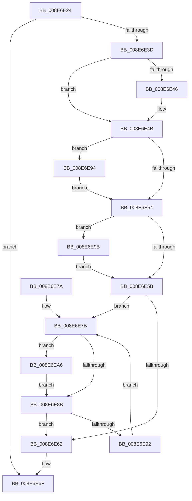

# PiPnpRtlObjectEventRelease

- RVA: `0x008E6E24`–`0x008E6EB2` (길이 `142` bytes)
- VA: `0x00000001408E6E24`
- 실행 섹션: `PAGE`
- PDB 이름 있음: `예`; PDB Function 태그: `아니요`
- unwind 정보 RVA: `0x00063524`
- 디코드: `46`개 명령, `142/142` bytes 표시
- 미해석 바이트: `0` (있으면 어셈블리에 `.byte`로 보존)

> 이 문서는 커널 이미지의 기계어와 PDB 기호를 분석해 생성했습니다. 4번과 5번은 함수 원형과 자료형을 바이너리 사용 방식에서 추정한 C 해석이며 원본 소스 복구 결과는 아닙니다.

## 1. Dependencies

- 직접 호출 지점: **5**; 고유 호출 대상: **4**
- 직접 호출자로 확인된 함수: **5**
- RIP 상대 이미지 참조: **0**

### Outgoing calls
- `0x008E6E46` → [PiDmObjectRelease](PiDmObjectRelease_function_008E4F70.md) (function, `0x008E4F70`)
- `0x008E6E6A` → [ExFreePoolWithTag](../../poolcode/B8/ExFreePoolWithTag_function_00B82870.md) (function, `0x00B82870`)
- `0x008E6E94` → [ZwClose](../../text/6A/ZwClose_function_006AD2B0.md) (function, `0x006AD2B0`)
- `0x008E6E9F` → [SeReleaseSubjectContext](../86/SeReleaseSubjectContext_function_0086B710.md) (function, `0x0086B710`)
- `0x008E6EAB` → [ExFreePoolWithTag](../../poolcode/B8/ExFreePoolWithTag_function_00B82870.md) (function, `0x00B82870`)

### Direct callers
- [PiDqObjectManagerServiceActionQueue](../8D/PiDqObjectManagerServiceActionQueue_function_008DD640.md) at `0x008DD7DD`
- [PiDqQueryActionQueueEntryFree](../8D/PiDqQueryActionQueueEntryFree_function_008DE1B0.md) at `0x008DE1D0`
- [PiPnpRtlObjectEventCreate](../8D/PiPnpRtlObjectEventCreate_function_008DF7E0.md) at `0x008DFA86`
- [PiPnpRtlEndOperation](PiPnpRtlEndOperation_function_008E0518.md) at `0x008E05C6`
- [PiPnpRtlEndOperation](PiPnpRtlEndOperation_function_008E0518.md) at `0x008E0622`
- [sub_008E0A15](Unknown_function_008E0A15.md) at `0x008E0A68`

### Static image references
- 디코드된 RIP-relative 메모리 참조가 없습니다.

## 2. Other-region calls and transfers

- 다른 실행 섹션으로 향하는 call: **3**
  - `0x008E6E6A` → [ExFreePoolWithTag](../../poolcode/B8/ExFreePoolWithTag_function_00B82870.md) (`PAGE` → `POOLCODE`)
  - `0x008E6E94` → [ZwClose](../../text/6A/ZwClose_function_006AD2B0.md) (`PAGE` → `.text`)
  - `0x008E6EAB` → [ExFreePoolWithTag](../../poolcode/B8/ExFreePoolWithTag_function_00B82870.md) (`PAGE` → `POOLCODE`)
- 별도 외부 분기/꼬리 이동을 확인하지 못했습니다.

## 3. Assembly (complete function range)

```asm
008E6E24  48 89 5C 24 10                  mov qword ptr [rsp + 0x10], rbx
008E6E29  57                              push rdi
008E6E2A  48 83 EC 20                     sub rsp, 0x20
008E6E2E  48 8B D9                        mov rbx, rcx
008E6E31  83 C8 FF                        or eax, 0xffffffff
008E6E34  F0 0F C1 01                     lock xadd dword ptr [rcx], eax
008E6E38  83 F8 01                        cmp eax, 1
008E6E3B  75 32                           jne 0x1408e6e6f
008E6E3D  48 8B 49 08                     mov rcx, qword ptr [rcx + 8]
008E6E41  48 85 C9                        test rcx, rcx
008E6E44  74 05                           je 0x1408e6e4b
008E6E46  E8 25 E1 FF FF                  call 0x1408e4f70
008E6E4B  48 8B 4B 10                     mov rcx, qword ptr [rbx + 0x10]
008E6E4F  48 85 C9                        test rcx, rcx
008E6E52  75 40                           jne 0x1408e6e94
008E6E54  8B 43 04                        mov eax, dword ptr [rbx + 4]
008E6E57  A8 04                           test al, 4
008E6E59  75 40                           jne 0x1408e6e9b
008E6E5B  33 FF                           xor edi, edi
008E6E5D  39 7B 4C                        cmp dword ptr [rbx + 0x4c], edi
008E6E60  77 19                           ja 0x1408e6e7b
008E6E62  BA 50 6E 70 41                  mov edx, 0x41706e50
008E6E67  48 8B CB                        mov rcx, rbx
008E6E6A  E8 01 BA 29 00                  call 0x140b82870
008E6E6F  48 8B 5C 24 38                  mov rbx, qword ptr [rsp + 0x38]
008E6E74  48 83 C4 20                     add rsp, 0x20
008E6E78  5F                              pop rdi
008E6E79  C3                              ret
008E6E7A  CC                              int3
008E6E7B  8B C7                           mov eax, edi
008E6E7D  48 C1 E0 05                     shl rax, 5
008E6E81  48 8B 4C 18 68                  mov rcx, qword ptr [rax + rbx + 0x68]
008E6E86  48 85 C9                        test rcx, rcx
008E6E89  75 1B                           jne 0x1408e6ea6
008E6E8B  FF C7                           inc edi
008E6E8D  3B 7B 4C                        cmp edi, dword ptr [rbx + 0x4c]
008E6E90  73 D0                           jae 0x1408e6e62
008E6E92  EB E7                           jmp 0x1408e6e7b
008E6E94  E8 17 64 DC FF                  call 0x1406ad2b0
008E6E99  EB B9                           jmp 0x1408e6e54
008E6E9B  48 8D 4B 18                     lea rcx, [rbx + 0x18]
008E6E9F  E8 6C 48 F8 FF                  call 0x14086b710
008E6EA4  EB B5                           jmp 0x1408e6e5b
008E6EA6  BA 50 6E 70 41                  mov edx, 0x41706e50
008E6EAB  E8 C0 B9 29 00                  call 0x140b82870
008E6EB0  EB D9                           jmp 0x1408e6e8b
```

## 4. C-style interpretation (structured pseudocode)

```c
__int64 __fastcall PiPnpRtlObjectEventRelease(__int64 a1)
{
    __int64 result;
    __int64 v_rdi;
    __int64 v_rsp;
    unsigned __int64 v_stack_p10;

    v_stack_p10 = v_rbx;
    v_rsp = (v_rsp) - (32);
    result = (unsigned int)((result) | (0xFFFFFFFFULL));
    if (((unsigned int)(result)) != 1) goto loc_008E6E6F;
    if (*(unsigned __int64 *)(a1 + 8) != 0) {
        result = PiDmObjectRelease(*(unsigned __int64 *)(a1 + 8), a2, a3, a4);
    }
    if (*(unsigned __int64 *)(a1 + 16) != 0) goto loc_008E6E94;
loc_008E6E54:
    if ((((unsigned __int8)((unsigned int)(*(unsigned int *)(a1 + 4)))) & (4)) != 0) goto loc_008E6E9B;
loc_008E6E5B:
    v_rdi = 0;
    if ((*(unsigned int *)(a1 + 76)) > 0) goto loc_008E6E7B;
loc_008E6E62:
    result = ExFreePoolWithTag(a1, (unsigned int)(0x41706E50ULL), a3, a4);
loc_008E6E6F:
    v_rsp = (v_rsp) + (32);
    return result;
loc_008E6E7B:
    result = (0) << (5);
    if (*(unsigned __int64 *)(result + v_stack_p10 * 1 + 104) != 0) goto loc_008E6EA6;
loc_008E6E8B:
    v_rdi = (unsigned int)((v_rdi) + 1);
    if (((unsigned int)(v_rdi)) >= (*(unsigned int *)(v_stack_p10 + 76))) goto loc_008E6E62;
    goto loc_008E6E7B;
loc_008E6E94:
    result = ZwClose(*(unsigned __int64 *)(result + v_stack_p10 * 1 + 104), (unsigned int)(0x41706E50ULL), a3, a4);
    goto loc_008E6E54;
loc_008E6E9B:
    result = SeReleaseSubjectContext(v_stack_p10 + 24, (unsigned int)(0x41706E50ULL), a3, a4);
    goto loc_008E6E5B;
loc_008E6EA6:
    result = ExFreePoolWithTag(v_stack_p10 + 24, (unsigned int)(0x41706E50ULL), a3, a4);
    goto loc_008E6E8B;
}
```

## 5. (Beta) C Style

```c
int64_t PiPnpRtlObjectEventRelease(void *Arg1)
{
    uint8_t *arg1 = (uint8_t *)Arg1;

    int64_t result;
    int64_t local_rdi;
    int64_t local_rsp;
    uint64_t v_stack_p10;

    v_stack_p10 = local_rbx;
    local_rsp = (local_rsp) - (32);
    result = (uint32_t)((result) | (0xFFFFFFFFULL));
    if (((uint32_t)(result)) != 1) goto loc_008E6E6F;
    if (*(uint64_t *)(arg1 + 0x8) != 0) {
        result = PiDmObjectRelease(*(uint64_t *)(arg1 + 0x8), a2, a3, a4);
    }
    if (*(uint64_t *)(arg1 + 0x10) != 0) goto loc_008E6E94;
loc_008E6E54:
    if ((((uint8_t)((uint32_t)(*(uint32_t *)(arg1 + 0x4)))) & (4)) != 0) goto loc_008E6E9B;
loc_008E6E5B:
    local_rdi = 0;
    if ((*(uint32_t *)(arg1 + 0x4C)) > 0) goto loc_008E6E7B;
loc_008E6E62:
    result = ExFreePoolWithTag(Arg1, (uint32_t)(0x41706E50ULL), a3, a4);
loc_008E6E6F:
    local_rsp = (local_rsp) + (32);
    return result;
loc_008E6E7B:
    result = (0) << (5);
    if (*(uint64_t *)(result + v_stack_p10 * 1 + 0x68) != 0) goto loc_008E6EA6;
loc_008E6E8B:
    local_rdi = (uint32_t)((local_rdi) + 1);
    if (((uint32_t)(local_rdi)) >= (*(uint32_t *)(v_stack_p10 + 0x4C))) goto loc_008E6E62;
    goto loc_008E6E7B;
loc_008E6E94:
    result = ZwClose(*(uint64_t *)(result + v_stack_p10 * 1 + 0x68), (uint32_t)(0x41706E50ULL), a3, a4);
    goto loc_008E6E54;
loc_008E6E9B:
    result = SeReleaseSubjectContext(v_stack_p10 + 24, (uint32_t)(0x41706E50ULL), a3, a4);
    goto loc_008E6E5B;
loc_008E6EA6:
    result = ExFreePoolWithTag(v_stack_p10 + 24, (uint32_t)(0x41706E50ULL), a3, a4);
    goto loc_008E6E8B;
}
```

### 관측된 메모리 오프셋

구조체 형식이 확인되지 않은 접근은 인자 기준의 오프셋으로만 기록했습니다.

| 기준 인자 | 오프셋 표현 | 폭 (bit) | 접근 |
|---|---:|---:|---|
| `Arg1` | `+ 0x0` | `32` | `R/W` |
| `Arg1` | `+ 0x4` | `32` | `R` |
| `Arg1` | `+ 0x8` | `64` | `R` |
| `Arg1` | `+ 0x10` | `64` | `R` |
| `Arg1` | `+ 0x18` | `64` | `R` |
| `Arg1` | `+ 0x4C` | `32` | `R` |

## 6. Execution-region graph

[열기: 2D/3D 그래프와 함수 탐색 컨트롤 패널](../../../control-panel.html?section=page&rva=0x008E6E24&view=graph)

- 2D 그래프는 위에서 아래로 흐르고, 3D 그래프는 빈 공간을 드래그해 회전합니다. Shift+드래그는 이동, 휠은 확대·축소, 함수 노드 선택은 대상 보고서 이동입니다.

### Static fallback


