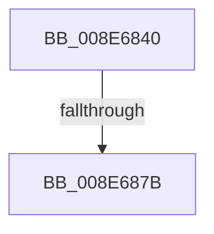

# PiUEventApplyAdditionalFilters

- RVA: `0x008E6840`–`0x008E6883` (길이 `67` bytes)
- VA: `0x00000001408E6840`
- 실행 섹션: `PAGE`
- PDB 이름 있음: `예`; PDB Function 태그: `아니요`
- unwind 정보 RVA: `0x00086764`
- 디코드: `21`개 명령, `67/67` bytes 표시
- 미해석 바이트: `0` (있으면 어셈블리에 `.byte`로 보존)

> 이 문서는 커널 이미지의 기계어와 PDB 기호를 분석해 생성했습니다. 4번과 5번은 함수 원형과 자료형을 바이너리 사용 방식에서 추정한 C 해석이며 원본 소스 복구 결과는 아닙니다.

## 1. Dependencies

- 직접 호출 지점: **0**; 고유 호출 대상: **0**
- 직접 호출자로 확인된 함수: **4**
- RIP 상대 이미지 참조: **1**

### Outgoing calls
- 직접 디코드된 call 명령이 없습니다.

### Direct callers
- [PiUEventNotifyTargetDeviceChange](PiUEventNotifyTargetDeviceChange_function_008E65B0.md) at `0x008E6691`
- [PiUEventNotifyDeviceInstancePropertyChange](../9C/PiUEventNotifyDeviceInstancePropertyChange_function_009C3C04.md) at `0x009C3CD5`
- [PiUEventNotifyDeviceInterfaceChange](../9C/PiUEventNotifyDeviceInterfaceChange_function_009C3CF4.md) at `0x009C3D89`
- [PiUEventNotifyDeviceInstanceChange](../9C/PiUEventNotifyDeviceInstanceChange_function_009C3E2C.md) at `0x009C3ED0`

### Static image references
- `0x008E6856` → RVA `0x00E0A740` (`.data`; read)

## 2. Other-region calls and transfers

- 다른 실행 섹션으로 향하는 call: **0**
- call이 아닌 외부 분기/꼬리 이동: **1**
  - `0x008E6875` → [sub_008E6A55](Unknown_function_008E6A55.md) (`tail-transfer`)

## 3. Assembly (complete function range)

```asm
008E6840  4C 8B DC                        mov r11, rsp
008E6843  55                              push rbp
008E6844  53                              push rbx
008E6845  56                              push rsi
008E6846  57                              push rdi
008E6847  41 56                           push r14
008E6849  41 57                           push r15
008E684B  49 8D 6B A1                     lea rbp, [r11 - 0x5f]
008E684F  48 81 EC A8 00 00 00            sub rsp, 0xa8
008E6856  48 8B 05 E3 3E 52 00            mov rax, qword ptr [rip + 0x523ee3]
008E685D  48 33 C4                        xor rax, rsp
008E6860  48 89 45 17                     mov qword ptr [rbp + 0x17], rax
008E6864  8B 41 60                        mov eax, dword ptr [rcx + 0x60]
008E6867  B3 01                           mov bl, 1
008E6869  88 5D D7                        mov byte ptr [rbp - 0x29], bl
008E686C  4C 8B F2                        mov r14, rdx
008E686F  48 8B F9                        mov rdi, rcx
008E6872  83 F8 04                        cmp eax, 4
008E6875  0F 85 DA 01 00 00               jne 0x1408e6a55
008E687B  48 8B 5A 38                     mov rbx, qword ptr [rdx + 0x38]
008E687F  48 8D 72 38                     lea rsi, [rdx + 0x38]
```

## 4. C-style interpretation (structured pseudocode)

```c
__int64 __fastcall PiUEventApplyAdditionalFilters(__int64 a1, __int64 a2)
{
    __int64 result;
    __int64 v_rsp;

    v_rsp = (v_rsp) - (168);
    result = (*(unsigned __int64 *)(v_rip + 5390051)) ^ (v_rsp);
    *(unsigned __int64 *)(v_rsp - 95 + 23) = result;
    *(unsigned __int8 *)(v_rsp - 95 - 41) = 1;
    return (unsigned int)(*(unsigned int *)(a1 + 96));
}
```

## 5. (Beta) C Style

```c
int64_t PiUEventApplyAdditionalFilters(void *Arg1, void *Arg2)
{
    uint8_t *arg1 = (uint8_t *)Arg1;
    uint8_t *arg2 = (uint8_t *)Arg2;

    int64_t result;
    int64_t local_rsp;

    local_rsp = (local_rsp) - (168);
    result = (*(uint64_t *)(v_rip + 0x523EE3)) ^ (local_rsp);
    *(uint64_t *)(local_rsp - 0x5F + 0x17) = result;
    *(uint8_t *)(local_rsp - 0x5F - 0x29) = 1;
    return (uint32_t)(*(uint32_t *)(arg1 + 0x60));
}
```

### 관측된 메모리 오프셋

구조체 형식이 확인되지 않은 접근은 인자 기준의 오프셋으로만 기록했습니다.

| 기준 인자 | 오프셋 표현 | 폭 (bit) | 접근 |
|---|---:|---:|---|
| `Arg1` | `+ 0x60` | `32` | `R` |
| `Arg2` | `+ 0x38` | `64` | `R` |

## 6. Execution-region graph

[열기: 2D/3D 그래프와 함수 탐색 컨트롤 패널](../../../control-panel.html?section=page&rva=0x008E6840&view=graph)

- 2D 그래프는 위에서 아래로 흐르고, 3D 그래프는 빈 공간을 드래그해 회전합니다. Shift+드래그는 이동, 휠은 확대·축소, 함수 노드 선택은 대상 보고서 이동입니다.

### Static fallback


