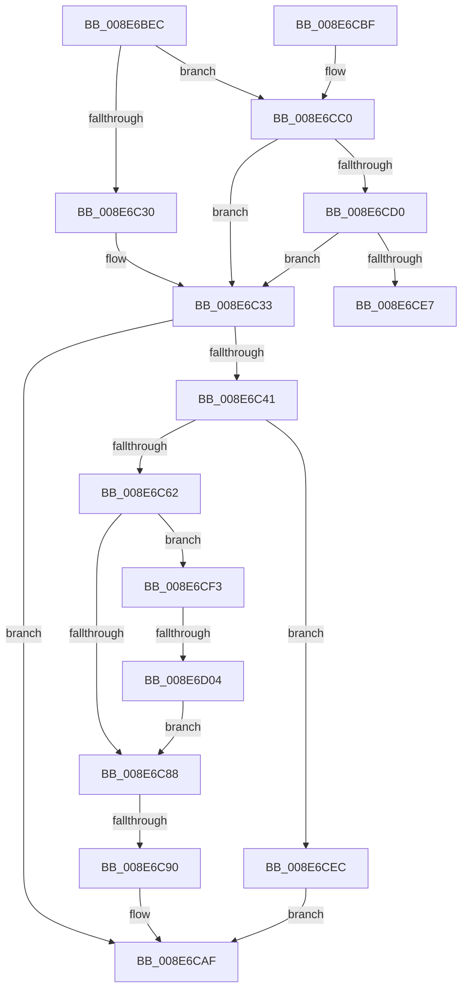

# PiUEventNotifyClient

- RVA: `0x008E6BEC`–`0x008E6D2D` (길이 `321` bytes)
- VA: `0x00000001408E6BEC`
- 실행 섹션: `PAGE`
- PDB 이름 있음: `예`; PDB Function 태그: `예`
- unwind 정보 RVA: `0x000867D4`
- 디코드: `85`개 명령, `321/321` bytes 표시
- 미해석 바이트: `0` (있으면 어셈블리에 `.byte`로 보존)

> 이 문서는 커널 이미지의 기계어와 PDB 기호를 분석해 생성했습니다. 4번과 5번은 함수 원형과 자료형을 바이너리 사용 방식에서 추정한 C 해석이며 원본 소스 복구 결과는 아닙니다.

## 1. Dependencies

- 직접 호출 지점: **11**; 고유 호출 대상: **8**
- 직접 호출자로 확인된 함수: **4**
- RIP 상대 이미지 참조: **2**

### Outgoing calls
- `0x008E6C1E` → [ExAcquireFastMutex](../../text/20/ExAcquireFastMutex_function_0020E5A0.md) (function, `0x0020E5A0`)
- `0x008E6C37` → [ExReleaseFastMutex](../../text/25/ExReleaseFastMutex_function_002519C0.md) (function, `0x002519C0`)
- `0x008E6C51` → [ExAllocatePool2](../../poolcode/B8/ExAllocatePool2_function_00B820F0.md) (function, `0x00B820F0`)
- `0x008E6C65` → [PiUEventReferenceEventEntry](../A2/PiUEventReferenceEventEntry_function_00A2143C.md) (function, `0x00A2143C`)
- `0x008E6C72` → [ExAcquireFastMutex](../../text/20/ExAcquireFastMutex_function_0020E5A0.md) (function, `0x0020E5A0`)
- `0x008E6C7D` → [PiUEventQueuePendingEvent](../A2/PiUEventQueuePendingEvent_function_00A20130.md) (function, `0x00A20130`)
- `0x008E6CA2` → [ExReleaseFastMutex](../../text/25/ExReleaseFastMutex_function_002519C0.md) (function, `0x002519C0`)
- `0x008E6CAA` → [PiUEventNotifyClientPendingEvent](../A1/PiUEventNotifyClientPendingEvent_function_00A1E784.md) (function, `0x00A1E784`)
- `0x008E6CC3` → [PiUEventIsClientStuck](../AB/PiUEventIsClientStuck_function_00AB4E6C.md) (function, `0x00AB4E6C`)
- `0x008E6D10` → [PiUEventDequeuePendingEventWorker](../9C/PiUEventDequeuePendingEventWorker_function_009C29C0.md) (function, `0x009C29C0`)
- `0x008E6D21` → [PiUEventQueuePendingEvent](../A2/PiUEventQueuePendingEvent_function_00A20130.md) (function, `0x00A20130`)

### Direct callers
- [PiUEventNotifyTargetDeviceChange](PiUEventNotifyTargetDeviceChange_function_008E65B0.md) at `0x008E66A0`
- [PiUEventNotifyDeviceInstancePropertyChange](../9C/PiUEventNotifyDeviceInstancePropertyChange_function_009C3C04.md) at `0x009C3CE4`
- [PiUEventNotifyDeviceInterfaceChange](../9C/PiUEventNotifyDeviceInterfaceChange_function_009C3CF4.md) at `0x009C3DC1`
- [PiUEventNotifyDeviceInstanceChange](../9C/PiUEventNotifyDeviceInstanceChange_function_009C3E2C.md) at `0x009C3EB2`

### Static image references
- `0x008E6CD9` → RVA `0x00EF012C` (`.data`; read)
- `0x008E6CF3` → RVA `0x00EF012D` (`.data`; read)

## 2. Other-region calls and transfers

- 다른 실행 섹션으로 향하는 call: **5**
  - `0x008E6C1E` → [ExAcquireFastMutex](../../text/20/ExAcquireFastMutex_function_0020E5A0.md) (`PAGE` → `.text`)
  - `0x008E6C37` → [ExReleaseFastMutex](../../text/25/ExReleaseFastMutex_function_002519C0.md) (`PAGE` → `.text`)
  - `0x008E6C51` → [ExAllocatePool2](../../poolcode/B8/ExAllocatePool2_function_00B820F0.md) (`PAGE` → `POOLCODE`)
  - `0x008E6C72` → [ExAcquireFastMutex](../../text/20/ExAcquireFastMutex_function_0020E5A0.md) (`PAGE` → `.text`)
  - `0x008E6CA2` → [ExReleaseFastMutex](../../text/25/ExReleaseFastMutex_function_002519C0.md) (`PAGE` → `.text`)
- call이 아닌 외부 분기/꼬리 이동: **3**
  - `0x008E6C8A` → [sub_00B1D4A4 + 0x15C](../B1/Unknown_function_00B1D4A4.md) (`tail-transfer`)
  - `0x008E6CE7` → [sub_00B1D4A4](../B1/Unknown_function_00B1D4A4.md) (`tail-transfer`)
  - `0x008E6CFE` → [sub_00B1D4A4 + 0xAB](../B1/Unknown_function_00B1D4A4.md) (`tail-transfer`)

## 3. Assembly (complete function range)

```asm
008E6BEC  40 55                           push rbp
008E6BEE  53                              push rbx
008E6BEF  56                              push rsi
008E6BF0  57                              push rdi
008E6BF1  41 56                           push r14
008E6BF3  48 8D 6C 24 C9                  lea rbp, [rsp - 0x37]
008E6BF8  48 81 EC 90 00 00 00            sub rsp, 0x90
008E6BFF  33 FF                           xor edi, edi
008E6C01  4C 8B F1                        mov r14, rcx
008E6C04  48 8B 4A 10                     mov rcx, qword ptr [rdx + 0x10]
008E6C08  48 8B DA                        mov rbx, rdx
008E6C0B  48 21 7D 27                     and qword ptr [rbp + 0x27], rdi
008E6C0F  40 32 F6                        xor sil, sil
008E6C12  48 21 7D 7F                     and qword ptr [rbp + 0x7f], rdi
008E6C16  48 21 7D 77                     and qword ptr [rbp + 0x77], rdi
008E6C1A  48 21 7D 6F                     and qword ptr [rbp + 0x6f], rdi
008E6C1E  E8 7D 79 92 FF                  call 0x14020e5a0
008E6C23  40 38 B3 8C 00 00 00            cmp byte ptr [rbx + 0x8c], sil
008E6C2A  0F 85 90 00 00 00               jne 0x1408e6cc0
008E6C30  40 B6 01                        mov sil, 1
008E6C33  48 8B 4B 10                     mov rcx, qword ptr [rbx + 0x10]
008E6C37  E8 84 AD 96 FF                  call 0x1402519c0
008E6C3C  40 84 F6                        test sil, sil
008E6C3F  75 6E                           jne 0x1408e6caf
008E6C41  BA 20 00 00 00                  mov edx, 0x20
008E6C46  B9 00 01 00 00                  mov ecx, 0x100
008E6C4B  41 B8 50 6E 70 59               mov r8d, 0x59706e50
008E6C51  E8 9A B4 29 00                  call 0x140b820f0
008E6C56  48 8B F0                        mov rsi, rax
008E6C59  48 85 C0                        test rax, rax
008E6C5C  0F 84 8A 00 00 00               je 0x1408e6cec
008E6C62  49 8B CE                        mov rcx, r14
008E6C65  E8 D2 A7 13 00                  call 0x140a2143c
008E6C6A  4C 89 76 18                     mov qword ptr [rsi + 0x18], r14
008E6C6E  48 8B 4B 10                     mov rcx, qword ptr [rbx + 0x10]
008E6C72  E8 29 79 92 FF                  call 0x14020e5a0
008E6C77  48 8B D6                        mov rdx, rsi
008E6C7A  48 8B CB                        mov rcx, rbx
008E6C7D  E8 AE 94 13 00                  call 0x140a20130
008E6C82  8B F8                           mov edi, eax
008E6C84  85 C0                           test eax, eax
008E6C86  78 6B                           js 0x1408e6cf3
008E6C88  85 FF                           test edi, edi
008E6C8A  0F 88 70 69 23 00               js 0x140b1d600
008E6C90  48 A1 14 00 00 00 80 F7 FF FF   movabs rax, qword ptr [0xfffff78000000014]
008E6C9A  48 89 46 10                     mov qword ptr [rsi + 0x10], rax
008E6C9E  48 8B 4B 10                     mov rcx, qword ptr [rbx + 0x10]
008E6CA2  E8 19 AD 96 FF                  call 0x1402519c0
008E6CA7  48 8B CB                        mov rcx, rbx
008E6CAA  E8 D5 7A 13 00                  call 0x140a1e784
008E6CAF  8B C7                           mov eax, edi
008E6CB1  48 81 C4 90 00 00 00            add rsp, 0x90
008E6CB8  41 5E                           pop r14
008E6CBA  5F                              pop rdi
008E6CBB  5E                              pop rsi
008E6CBC  5B                              pop rbx
008E6CBD  5D                              pop rbp
008E6CBE  C3                              ret
008E6CBF  CC                              int3
008E6CC0  48 8B CB                        mov rcx, rbx
008E6CC3  E8 A4 E1 1C 00                  call 0x140ab4e6c
008E6CC8  84 C0                           test al, al
008E6CCA  0F 84 63 FF FF FF               je 0x1408e6c33
008E6CD0  FF 83 88 00 00 00               inc dword ptr [rbx + 0x88]
008E6CD6  40 B6 01                        mov sil, 1
008E6CD9  8A 05 4D 94 60 00               mov al, byte ptr [rip + 0x60944d]
008E6CDF  84 C0                           test al, al
008E6CE1  0F 89 4C FF FF FF               jns 0x1408e6c33
008E6CE7  E9 B8 67 23 00                  jmp 0x140b1d4a4
008E6CEC  BF 9A 00 00 C0                  mov edi, 0xc000009a
008E6CF1  EB BC                           jmp 0x1408e6caf
008E6CF3  F6 05 33 94 60 00 01            test byte ptr [rip + 0x609433], 1
008E6CFA  4C 8B 73 70                     mov r14, qword ptr [rbx + 0x70]
008E6CFE  0F 85 4B 68 23 00               jne 0x140b1d54f
008E6D04  45 33 C9                        xor r9d, r9d
008E6D07  45 33 C0                        xor r8d, r8d
008E6D0A  49 8B D6                        mov rdx, r14
008E6D0D  48 8B CB                        mov rcx, rbx
008E6D10  E8 AB BC 0D 00                  call 0x1409c29c0
008E6D15  FF 83 88 00 00 00               inc dword ptr [rbx + 0x88]
008E6D1B  48 8B D6                        mov rdx, rsi
008E6D1E  48 8B CB                        mov rcx, rbx
008E6D21  E8 0A 94 13 00                  call 0x140a20130
008E6D26  8B F8                           mov edi, eax
008E6D28  E9 5B FF FF FF                  jmp 0x1408e6c88
```

## 4. C-style interpretation (structured pseudocode)

```c
__int64 __fastcall PiUEventNotifyClient(__int64 a1, __int64 a2, __int64 a3, int a4)
{
    __int64 result;
    __int64 v_rdi;
    __int64 v_rsi;
    __int64 v_rsp;
    unsigned __int64 v_stack_m38;
    unsigned __int64 v_stack_m5F;
    unsigned __int64 v_stack_p10;
    unsigned __int64 v_stack_p18;
    unsigned __int64 v_stack_p20;

    v_rsp = (v_rsp) - (144);
    v_rdi = 0;
    v_rsi = 0;
    result = ExAcquireFastMutex(*(unsigned __int64 *)(a2 + 16), a2, a3, a4);
    if ((*(unsigned __int8 *)(a2 + 140)) != 0) goto loc_008E6CC0;
loc_008E6C33:
    result = ExReleaseFastMutex(*(unsigned __int64 *)(a2 + 16), a2, a3, a4);
    if (1 != 0) goto loc_008E6CAF;
    result = ExAllocatePool2(256, 32, (unsigned int)(0x59706E50ULL), a4);
    if (result == 0) goto loc_008E6CEC;
    result = PiUEventReferenceEventEntry(a1, 32, (unsigned int)(0x59706E50ULL), a4);
    *(unsigned __int64 *)(result + 24) = a1;
    result = ExAcquireFastMutex(*(unsigned __int64 *)(a2 + 16), 32, (unsigned int)(0x59706E50ULL), a4);
    result = PiUEventQueuePendingEvent(a2, result, (unsigned int)(0x59706E50ULL), a4);
    if (sign_flag) goto loc_008E6CF3;
loc_008E6C88:
    *(unsigned __int64 *)(result + 16) = result;
    result = ExReleaseFastMutex(*(unsigned __int64 *)(a2 + 16), result, (unsigned int)(0x59706E50ULL), a4);
    result = PiUEventNotifyClientPendingEvent(a2, result, (unsigned int)(0x59706E50ULL), a4);
loc_008E6CAF:
    v_rsp = (v_rsp) + (144);
    return (unsigned int)((unsigned int)((unsigned int)((unsigned int)(result))));
loc_008E6CC0:
    result = PiUEventIsClientStuck(a2, result, (unsigned int)(0x59706E50ULL), a4);
    if ((unsigned __int8)(result) == 0) goto loc_008E6C33;
    if (!sign_flag) goto loc_008E6C33;
loc_008E6CEC:
    goto loc_008E6CAF;
loc_008E6CF3:
    a4 = 0;
    a3 = 0;
    result = PiUEventDequeuePendingEventWorker(a2, *(unsigned __int64 *)(a2 + 112), a3, a4);
    result = PiUEventQueuePendingEvent(a2, 1, a3, a4);
    goto loc_008E6C88;
}
```

## 5. (Beta) C Style

```c
int64_t PiUEventNotifyClient(int64_t Arg1, void *Arg2, int64_t Arg3, int32_t Arg4)
{
    uint8_t *arg2 = (uint8_t *)Arg2;

    int64_t result;
    int64_t local_rdi;
    int64_t local_rsi;
    int64_t local_rsp;
    uint64_t v_stack_m38;
    uint64_t v_stack_m5F;
    uint64_t v_stack_p10;
    uint64_t v_stack_p18;
    uint64_t v_stack_p20;

    local_rsp = (local_rsp) - (144);
    local_rdi = 0;
    local_rsi = 0;
    result = ExAcquireFastMutex(*(uint64_t *)(arg2 + 0x10), Arg2, Arg3, Arg4);
    if ((*(uint8_t *)(arg2 + 0x8C)) != 0) goto loc_008E6CC0;
loc_008E6C33:
    result = ExReleaseFastMutex(*(uint64_t *)(arg2 + 0x10), Arg2, Arg3, Arg4);
    if (1 != 0) goto loc_008E6CAF;
    result = ExAllocatePool2(256, 32, (uint32_t)(0x59706E50ULL), Arg4);
    if (result == 0) goto loc_008E6CEC;
    result = PiUEventReferenceEventEntry(Arg1, 32, (uint32_t)(0x59706E50ULL), Arg4);
    *(uint64_t *)(result + 0x18) = Arg1;
    result = ExAcquireFastMutex(*(uint64_t *)(arg2 + 0x10), 32, (uint32_t)(0x59706E50ULL), Arg4);
    result = PiUEventQueuePendingEvent(Arg2, result, (uint32_t)(0x59706E50ULL), Arg4);
    if (sign_flag) goto loc_008E6CF3;
loc_008E6C88:
    *(uint64_t *)(result + 0x10) = result;
    result = ExReleaseFastMutex(*(uint64_t *)(arg2 + 0x10), result, (uint32_t)(0x59706E50ULL), Arg4);
    result = PiUEventNotifyClientPendingEvent(Arg2, result, (uint32_t)(0x59706E50ULL), Arg4);
loc_008E6CAF:
    local_rsp = (local_rsp) + (144);
    return (uint32_t)((uint32_t)((uint32_t)((uint32_t)(result))));
loc_008E6CC0:
    result = PiUEventIsClientStuck(Arg2, result, (uint32_t)(0x59706E50ULL), Arg4);
    if ((uint8_t)(result) == 0) goto loc_008E6C33;
    if (!sign_flag) goto loc_008E6C33;
loc_008E6CEC:
    goto loc_008E6CAF;
loc_008E6CF3:
    Arg4 = 0;
    Arg3 = 0;
    result = PiUEventDequeuePendingEventWorker(Arg2, *(uint64_t *)(arg2 + 0x70), Arg3, Arg4);
    result = PiUEventQueuePendingEvent(Arg2, 1, Arg3, Arg4);
    goto loc_008E6C88;
}
```

### 관측된 메모리 오프셋

구조체 형식이 확인되지 않은 접근은 인자 기준의 오프셋으로만 기록했습니다.

| 기준 인자 | 오프셋 표현 | 폭 (bit) | 접근 |
|---|---:|---:|---|
| `Arg2` | `+ 0x10` | `64` | `R` |
| `Arg2` | `+ 0x70` | `64` | `R` |
| `Arg2` | `+ 0x88` | `32` | `R/W` |
| `Arg2` | `+ 0x8C` | `8` | `R` |

## 6. Execution-region graph

[열기: 2D/3D 그래프와 함수 탐색 컨트롤 패널](../../../control-panel.html?section=page&rva=0x008E6BEC&view=graph)

- 2D 그래프는 위에서 아래로 흐르고, 3D 그래프는 빈 공간을 드래그해 회전합니다. Shift+드래그는 이동, 휠은 확대·축소, 함수 노드 선택은 대상 보고서 이동입니다.

### Static fallback


