# PiUEventNotifyTargetDeviceChange

- RVA: `0x008E65B0`–`0x008E6831` (길이 `641` bytes)
- VA: `0x00000001408E65B0`
- 실행 섹션: `PAGE`
- PDB 이름 있음: `예`; PDB Function 태그: `예`
- unwind 정보 RVA: `0x00086738`
- 디코드: `159`개 명령, `641/641` bytes 표시
- 미해석 바이트: `0` (있으면 어셈블리에 `.byte`로 보존)

> 이 문서는 커널 이미지의 기계어와 PDB 기호를 분석해 생성했습니다. 4번과 5번은 함수 원형과 자료형을 바이너리 사용 방식에서 추정한 C 해석이며 원본 소스 복구 결과는 아닙니다.

## 1. Dependencies

- 직접 호출 지점: **9**; 고유 호출 대상: **9**
- 직접 호출자로 확인된 함수: **1**
- RIP 상대 이미지 참조: **12**

### Outgoing calls
- `0x008E6639` → [ExAcquireFastMutex](../../text/20/ExAcquireFastMutex_function_0020E5A0.md) (function, `0x0020E5A0`)
- `0x008E6641` → [PiUEventHashStringIntoBucket](../../text/48/PiUEventHashStringIntoBucket_function_00486690.md) (function, `0x00486690`)
- `0x008E6682` → [wcsicmp](../../text/50/wcsicmp_function_00500080.md) (function, `0x00500080`)
- `0x008E6691` → [PiUEventApplyAdditionalFilters](PiUEventApplyAdditionalFilters_function_008E6840.md) (function, `0x008E6840`)
- `0x008E66A0` → [PiUEventNotifyClient](PiUEventNotifyClient_function_008E6BEC.md) (function, `0x008E6BEC`)
- `0x008E66DB` → [ExReleaseFastMutex](../../text/25/ExReleaseFastMutex_function_002519C0.md) (function, `0x002519C0`)
- `0x008E67B1` → [ExAllocatePool2](../../poolcode/B8/ExAllocatePool2_function_00B820F0.md) (function, `0x00B820F0`)
- `0x008E67E6` → [memset](../../text/6C/memset_function_006C6C40.md) (function, `0x006C6C40`)
- `0x008E6827` → [ExFreePoolWithTag](../../poolcode/B8/ExFreePoolWithTag_function_00B82870.md) (function, `0x00B82870`)

### Direct callers
- [PiUEventProcessEventWorker](../9C/PiUEventProcessEventWorker_function_009C2870.md) at `0x009C2981`

### Static image references
- `0x008E65E5` → RVA `0x0001A210` (`.rdata`; read)
- `0x008E65F2` → RVA `0x0001A218` (`.rdata`; read)
- `0x008E6632` → RVA `0x00F8C760` (`.data`; read)
- `0x008E6649` → RVA `0x00F8C960` (`.data`; read)
- `0x008E6712` → RVA `0x00012320` (`.rdata`; read)
- `0x008E671F` → RVA `0x00012328` (`.rdata`; read)
- `0x008E6733` → RVA `0x000114E8` (`.rdata`; read)
- `0x008E6740` → RVA `0x000114F0` (`.rdata`; read)
- `0x008E6754` → RVA `0x0001A220` (`.rdata`; read)
- `0x008E6761` → RVA `0x0001A228` (`.rdata`; read)
- `0x008E6775` → RVA `0x000122E8` (`.rdata`; read)
- `0x008E6782` → RVA `0x000122F0` (`.rdata`; read)

## 2. Other-region calls and transfers

- 다른 실행 섹션으로 향하는 call: **7**
  - `0x008E6639` → [ExAcquireFastMutex](../../text/20/ExAcquireFastMutex_function_0020E5A0.md) (`PAGE` → `.text`)
  - `0x008E6641` → [PiUEventHashStringIntoBucket](../../text/48/PiUEventHashStringIntoBucket_function_00486690.md) (`PAGE` → `.text`)
  - `0x008E6682` → [wcsicmp](../../text/50/wcsicmp_function_00500080.md) (`PAGE` → `.text`)
  - `0x008E66DB` → [ExReleaseFastMutex](../../text/25/ExReleaseFastMutex_function_002519C0.md) (`PAGE` → `.text`)
  - `0x008E67B1` → [ExAllocatePool2](../../poolcode/B8/ExAllocatePool2_function_00B820F0.md) (`PAGE` → `POOLCODE`)
  - `0x008E67E6` → [memset](../../text/6C/memset_function_006C6C40.md) (`PAGE` → `.text`)
  - `0x008E6827` → [ExFreePoolWithTag](../../poolcode/B8/ExFreePoolWithTag_function_00B82870.md) (`PAGE` → `POOLCODE`)
- call이 아닌 외부 분기/꼬리 이동: **3**
  - `0x008E67D4` → [sub_00B1D464 + 0x10](../B1/Unknown_function_00B1D464.md) (`tail-transfer`)
  - `0x008E67F4` → [sub_00B1D464 + 0x1B](../B1/Unknown_function_00B1D464.md) (`tail-transfer`)
  - `0x008E680A` → [sub_00B1D464](../B1/Unknown_function_00B1D464.md) (`tail-transfer`)

## 3. Assembly (complete function range)

```asm
008E65B0  48 89 5C 24 18                  mov qword ptr [rsp + 0x18], rbx
008E65B5  55                              push rbp
008E65B6  56                              push rsi
008E65B7  57                              push rdi
008E65B8  41 54                           push r12
008E65BA  41 55                           push r13
008E65BC  41 56                           push r14
008E65BE  41 57                           push r15
008E65C0  48 83 EC 40                     sub rsp, 0x40
008E65C4  48 8B 41 50                     mov rax, qword ptr [rcx + 0x50]
008E65C8  33 FF                           xor edi, edi
008E65CA  40 32 F6                        xor sil, sil
008E65CD  40 88 BC 24 80 00 00 00         mov byte ptr [rsp + 0x80], dil
008E65D5  45 33 FF                        xor r15d, r15d
008E65D8  40 88 B4 24 88 00 00 00         mov byte ptr [rsp + 0x88], sil
008E65E0  33 ED                           xor ebp, ebp
008E65E2  48 8B D9                        mov rbx, rcx
008E65E5  48 2B 05 24 3C 73 FF            sub rax, qword ptr [rip - 0x8cc3dc]
008E65EC  75 0B                           jne 0x1408e65f9
008E65EE  48 8B 41 58                     mov rax, qword ptr [rcx + 0x58]
008E65F2  48 2B 05 1F 3C 73 FF            sub rax, qword ptr [rip - 0x8cc3e1]
008E65F9  48 85 C0                        test rax, rax
008E65FC  0F 85 0C 01 00 00               jne 0x1408e670e
008E6602  8B 49 60                        mov ecx, dword ptr [rcx + 0x60]
008E6605  83 E9 01                        sub ecx, 1
008E6608  0F 84 89 01 00 00               je 0x1408e6797
008E660E  83 F9 02                        cmp ecx, 2
008E6611  0F 85 D2 00 00 00               jne 0x1408e66e9
008E6617  C6 84 24 80 00 00 00 01         mov byte ptr [rsp + 0x80], 1
008E661F  B8 88 00 00 00                  mov eax, 0x88
008E6624  4C 8D 2C 18                     lea r13, [rax + rbx]
008E6628  40 38 73 4C                     cmp byte ptr [rbx + 0x4c], sil
008E662C  0F 85 6F 01 00 00               jne 0x1408e67a1
008E6632  48 8D 0D 27 61 6A 00            lea rcx, [rip + 0x6a6127]
008E6639  E8 62 7F 92 FF                  call 0x14020e5a0
008E663E  49 8B CD                        mov rcx, r13
008E6641  E8 4A 00 BA FF                  call 0x140486690
008E6646  44 8B E0                        mov r12d, eax
008E6649  48 8D 0D 10 63 6A 00            lea rcx, [rip + 0x6a6310]
008E6650  49 C1 E4 04                     shl r12, 4
008E6654  4C 03 E1                        add r12, rcx
008E6657  4D 8B 34 24                     mov r14, qword ptr [r12]
008E665B  4D 3B F4                        cmp r14, r12
008E665E  74 69                           je 0x1408e66c9
008E6660  8A 84 24 80 00 00 00            mov al, byte ptr [rsp + 0x80]
008E6667  49 8B F6                        mov rsi, r14
008E666A  4D 8B 36                        mov r14, qword ptr [r14]
008E666D  84 C0                           test al, al
008E666F  74 06                           je 0x1408e6677
008E6671  80 7E 28 00                     cmp byte ptr [rsi + 0x28], 0
008E6675  75 45                           jne 0x1408e66bc
008E6677  48 8B 56 18                     mov rdx, qword ptr [rsi + 0x18]
008E667B  49 8B CD                        mov rcx, r13
008E667E  48 8B 52 10                     mov rdx, qword ptr [rdx + 0x10]
008E6682  E8 F9 99 C1 FF                  call 0x140500080
008E6687  85 C0                           test eax, eax
008E6689  75 7A                           jne 0x1408e6705
008E668B  48 8B D6                        mov rdx, rsi
008E668E  48 8B CB                        mov rcx, rbx
008E6691  E8 AA 01 00 00                  call 0x1408e6840
008E6696  84 C0                           test al, al
008E6698  74 6B                           je 0x1408e6705
008E669A  48 8B D6                        mov rdx, rsi
008E669D  48 8B CB                        mov rcx, rbx
008E66A0  E8 47 05 00 00                  call 0x1408e6bec
008E66A5  44 8B F8                        mov r15d, eax
008E66A8  85 C0                           test eax, eax
008E66AA  78 59                           js 0x1408e6705
008E66AC  8A 84 24 80 00 00 00            mov al, byte ptr [rsp + 0x80]
008E66B3  48 85 FF                        test rdi, rdi
008E66B6  0F 85 48 01 00 00               jne 0x1408e6804
008E66BC  40 8A B4 24 88 00 00 00         mov sil, byte ptr [rsp + 0x88]
008E66C4  4D 3B F4                        cmp r14, r12
008E66C7  75 9E                           jne 0x1408e6667
008E66C9  33 DB                           xor ebx, ebx
008E66CB  48 85 FF                        test rdi, rdi
008E66CE  0F 85 F4 00 00 00               jne 0x1408e67c8
008E66D4  48 8D 0D 85 60 6A 00            lea rcx, [rip + 0x6a6085]
008E66DB  E8 E0 B2 96 FF                  call 0x1402519c0
008E66E0  48 85 FF                        test rdi, rdi
008E66E3  0F 85 36 01 00 00               jne 0x1408e681f
008E66E9  48 8B 9C 24 90 00 00 00         mov rbx, qword ptr [rsp + 0x90]
008E66F1  41 8B C7                        mov eax, r15d
008E66F4  48 83 C4 40                     add rsp, 0x40
008E66F8  41 5F                           pop r15
008E66FA  41 5E                           pop r14
008E66FC  41 5D                           pop r13
008E66FE  41 5C                           pop r12
008E6700  5F                              pop rdi
008E6701  5E                              pop rsi
008E6702  5D                              pop rbp
008E6703  C3                              ret
008E6704  CC                              int3
008E6705  8A 84 24 80 00 00 00            mov al, byte ptr [rsp + 0x80]
008E670C  EB AE                           jmp 0x1408e66bc
008E670E  48 8B 41 50                     mov rax, qword ptr [rcx + 0x50]
008E6712  48 2B 05 07 BC 72 FF            sub rax, qword ptr [rip - 0x8d43f9]
008E6719  75 0B                           jne 0x1408e6726
008E671B  48 8B 41 58                     mov rax, qword ptr [rcx + 0x58]
008E671F  48 2B 05 02 BC 72 FF            sub rax, qword ptr [rip - 0x8d43fe]
008E6726  48 85 C0                        test rax, rax
008E6729  0F 84 D3 FE FF FF               je 0x1408e6602
008E672F  48 8B 41 50                     mov rax, qword ptr [rcx + 0x50]
008E6733  48 2B 05 AE AD 72 FF            sub rax, qword ptr [rip - 0x8d5252]
008E673A  75 0B                           jne 0x1408e6747
008E673C  48 8B 41 58                     mov rax, qword ptr [rcx + 0x58]
008E6740  48 2B 05 A9 AD 72 FF            sub rax, qword ptr [rip - 0x8d5257]
008E6747  48 85 C0                        test rax, rax
008E674A  0F 84 B2 FE FF FF               je 0x1408e6602
008E6750  48 8B 41 50                     mov rax, qword ptr [rcx + 0x50]
008E6754  48 2B 05 C5 3A 73 FF            sub rax, qword ptr [rip - 0x8cc53b]
008E675B  75 0B                           jne 0x1408e6768
008E675D  48 8B 41 58                     mov rax, qword ptr [rcx + 0x58]
008E6761  48 2B 05 C0 3A 73 FF            sub rax, qword ptr [rip - 0x8cc540]
008E6768  48 85 C0                        test rax, rax
008E676B  0F 84 91 FE FF FF               je 0x1408e6602
008E6771  48 8B 41 50                     mov rax, qword ptr [rcx + 0x50]
008E6775  48 2B 05 6C BB 72 FF            sub rax, qword ptr [rip - 0x8d4494]
008E677C  75 0B                           jne 0x1408e6789
008E677E  48 8B 41 58                     mov rax, qword ptr [rcx + 0x58]
008E6782  48 2B 05 67 BB 72 FF            sub rax, qword ptr [rip - 0x8d4499]
008E6789  48 85 C0                        test rax, rax
008E678C  0F 85 57 FF FF FF               jne 0x1408e66e9
008E6792  E9 6B FE FF FF                  jmp 0x1408e6602
008E6797  B8 80 00 00 00                  mov eax, 0x80
008E679C  E9 83 FE FF FF                  jmp 0x1408e6624
008E67A1  BA 00 10 00 00                  mov edx, 0x1000
008E67A6  B9 00 01 00 00                  mov ecx, 0x100
008E67AB  41 B8 50 6E 70 59               mov r8d, 0x59706e50
008E67B1  E8 3A B9 29 00                  call 0x140b820f0
008E67B6  48 8B F8                        mov rdi, rax
008E67B9  48 85 C0                        test rax, rax
008E67BC  74 3B                           je 0x1408e67f9
008E67BE  BD 01 00 00 00                  mov ebp, 1
008E67C3  E9 6A FE FF FF                  jmp 0x1408e6632
008E67C8  83 FD 01                        cmp ebp, 1
008E67CB  0F 86 03 FF FF FF               jbe 0x1408e66d4
008E67D1  40 84 F6                        test sil, sil
008E67D4  0F 84 9A 6C 23 00               je 0x140b1d474
008E67DA  48 8D 4F 04                     lea rcx, [rdi + 4]
008E67DE  33 D2                           xor edx, edx
008E67E0  41 B8 FC 0F 00 00               mov r8d, 0xffc
008E67E6  E8 55 04 DE FF                  call 0x1406c6c40
008E67EB  83 0F FF                        or dword ptr [rdi], 0xffffffff
008E67EE  41 B8 04 00 00 00               mov r8d, 4
008E67F4  E9 86 6C 23 00                  jmp 0x140b1d47f
008E67F9  41 BF 9A 00 00 C0               mov r15d, 0xc000009a
008E67FF  E9 E5 FE FF FF                  jmp 0x1408e66e9
008E6804  81 FD 00 04 00 00               cmp ebp, 0x400
008E680A  0F 83 54 6C 23 00               jae 0x140b1d464
008E6810  8B 4E 30                        mov ecx, dword ptr [rsi + 0x30]
008E6813  8B D5                           mov edx, ebp
008E6815  FF C5                           inc ebp
008E6817  89 0C 97                        mov dword ptr [rdi + rdx*4], ecx
008E681A  E9 9D FE FF FF                  jmp 0x1408e66bc
008E681F  BA 50 6E 70 59                  mov edx, 0x59706e50
008E6824  48 8B CF                        mov rcx, rdi
008E6827  E8 44 C0 29 00                  call 0x140b82870
008E682C  E9 B8 FE FF FF                  jmp 0x1408e66e9
```

## 4. C-style interpretation (structured pseudocode)

```c
__int64 __fastcall PiUEventNotifyTargetDeviceChange(__int64 a1)
{
    __int64 result;
    __int64 v_r12;
    __int64 v_r15;
    __int64 v_rbp;
    __int64 v_rbx;
    __int64 v_rdi;
    __int64 v_rsi;
    __int64 v_rsp;
    unsigned __int8 v_stack_p10;
    unsigned __int64 v_stack_p18;
    unsigned __int8 v_stack_p8;
    unsigned __int8 v_stack_p80;

    v_stack_p18 = v_rbx;
    v_rsp = (v_rsp) - (64);
    v_rdi = 0;
    v_rsi = 0;
    v_stack_p8 = 0;
    v_r15 = 0;
    v_stack_p10 = 0;
    v_rbp = 0;
    result = (*(unsigned __int64 *)(a1 + 80)) - (*(unsigned __int64 *)(v_rip - 9225180));
    if (!(condition_is_not_equal)) {
        result = *(unsigned __int64 *)(a1 + 88);
        result = (result) - (*(unsigned __int64 *)(v_rip - 9225185));
    }
    if (result != 0) goto loc_008E670E;
loc_008E6602:
    a1 = (unsigned int)(((unsigned int)(*(unsigned int *)(a1 + 96))) - (1));
    if (condition_is_equal) goto loc_008E6797;
    if (((unsigned int)(a1)) != 2) goto loc_008E66E9;
    v_stack_p8 = 1;
loc_008E6624:
    if ((*(unsigned __int8 *)(a1 + 76)) != 0) goto loc_008E67A1;
loc_008E6632:
    result = ExAcquireFastMutex(v_rip + 6971687, a2, a3, a4);
    result = PiUEventHashStringIntoBucket(136 + a1 * 1, a2, a3, a4);
    v_r12 = ((unsigned int)((unsigned int)(result))) << (4);
    v_r12 = (v_r12) + (v_rip + 6972176);
    if ((*(unsigned __int64 *)(v_r12)) == v_r12) goto loc_008E66C9;
loc_008E6667:
    if ((unsigned __int8)(v_stack_p8) == 0) goto loc_008E6677;
    if ((*(unsigned __int8 *)(*(unsigned __int64 *)(v_r12) + 40)) != 0) goto loc_008E66BC;
loc_008E6677:
    result = wcsicmp(136 + a1 * 1, *(unsigned __int64 *)(*(unsigned __int64 *)(*(unsigned __int64 *)(v_r12) + 24) + 16), a3, a4);
    if ((unsigned int)(result) != 0) goto loc_008E6705;
    result = PiUEventApplyAdditionalFilters(a1, *(unsigned __int64 *)(v_r12), a3, a4);
    if ((unsigned __int8)(result) == 0) goto loc_008E6705;
    result = PiUEventNotifyClient(a1, *(unsigned __int64 *)(v_r12), a3, a4);
    if (sign_flag) goto loc_008E6705;
    if (0 != 0) goto loc_008E6804;
loc_008E66BC:
    if ((*(unsigned __int64 *)(*(unsigned __int64 *)(v_r12))) != v_r12) goto loc_008E6667;
loc_008E66C9:
    v_rbx = 0;
    if (0 != 0) goto loc_008E67C8;
loc_008E66D4:
    result = ExReleaseFastMutex(v_rip + 6971525, *(unsigned __int64 *)(v_r12), a3, a4);
    if (0 != 0) goto loc_008E681F;
loc_008E66E9:
    v_rsp = (v_rsp) + (64);
    return (unsigned int)((unsigned int)((unsigned int)((unsigned int)(result))));
loc_008E6705:
    goto loc_008E66BC;
loc_008E670E:
    result = (*(unsigned __int64 *)(v_rip + 6971525 + 80)) - (*(unsigned __int64 *)(v_rip - 9257977));
    if (!(condition_is_not_equal)) {
        result = *(unsigned __int64 *)(v_rip + 6971525 + 88);
        result = (result) - (*(unsigned __int64 *)(v_rip - 9257982));
    }
    if (result == 0) goto loc_008E6602;
    result = (*(unsigned __int64 *)(v_rip + 6971525 + 80)) - (*(unsigned __int64 *)(v_rip - 9261650));
    if (!(condition_is_not_equal)) {
        result = *(unsigned __int64 *)(v_rip + 6971525 + 88);
        result = (result) - (*(unsigned __int64 *)(v_rip - 9261655));
    }
    if (result == 0) goto loc_008E6602;
    result = (*(unsigned __int64 *)(v_rip + 6971525 + 80)) - (*(unsigned __int64 *)(v_rip - 9225531));
    if (!(condition_is_not_equal)) {
        result = *(unsigned __int64 *)(v_rip + 6971525 + 88);
        result = (result) - (*(unsigned __int64 *)(v_rip - 9225536));
    }
    if (result == 0) goto loc_008E6602;
    result = (*(unsigned __int64 *)(v_rip + 6971525 + 80)) - (*(unsigned __int64 *)(v_rip - 9258132));
    if (!(condition_is_not_equal)) {
        result = *(unsigned __int64 *)(v_rip + 6971525 + 88);
        result = (result) - (*(unsigned __int64 *)(v_rip - 9258137));
    }
    if (result != 0) goto loc_008E66E9;
    goto loc_008E6602;
loc_008E6797:
    goto loc_008E6624;
loc_008E67A1:
    result = ExAllocatePool2(256, (unsigned int)(0x1000ULL), (unsigned int)(0x59706E50ULL), a4);
    if (result == 0) goto loc_008E67F9;
    goto loc_008E6632;
loc_008E67C8:
    if (1 <= 1) goto loc_008E66D4;
    a2 = 0;
    result = memset(result + 4, a2, (unsigned int)(0xFFCULL), a4);
loc_008E67F9:
    goto loc_008E66E9;
loc_008E6804:
    v_rbp = (unsigned int)((1) + 1);
    *(unsigned int *)(result + 1 * 4) = (unsigned int)((unsigned int)(*(unsigned int *)(v_stack_p10 + 48)));
    goto loc_008E66BC;
loc_008E681F:
    result = ExFreePoolWithTag(result, (unsigned int)(0x59706E50ULL), 4, a4);
    goto loc_008E66E9;
}
```

## 5. (Beta) C Style

```c
int64_t PiUEventNotifyTargetDeviceChange(void *Arg1)
{
    uint8_t *arg1 = (uint8_t *)Arg1;

    int64_t result;
    int64_t local_r12;
    int64_t local_r15;
    int64_t local_rbp;
    int64_t local_rbx;
    int64_t local_rdi;
    int64_t local_rsi;
    int64_t local_rsp;
    uint8_t v_stack_p10;
    uint64_t v_stack_p18;
    uint8_t v_stack_p8;
    uint8_t v_stack_p80;

    v_stack_p18 = local_rbx;
    local_rsp = (local_rsp) - (64);
    local_rdi = 0;
    local_rsi = 0;
    v_stack_p8 = 0;
    local_r15 = 0;
    v_stack_p10 = 0;
    local_rbp = 0;
    result = (*(uint64_t *)(arg1 + 0x50)) - (*(uint64_t *)(v_rip - 0x8CC3DC));
    if (!(condition_is_not_equal)) {
        result = *(uint64_t *)(arg1 + 0x58);
        result = (result) - (*(uint64_t *)(v_rip - 0x8CC3E1));
    }
    if (result != 0) goto loc_008E670E;
loc_008E6602:
    Arg1 = (uint32_t)(((uint32_t)(*(uint32_t *)(arg1 + 0x60))) - (1));
    if (condition_is_equal) goto loc_008E6797;
    if (((uint32_t)(Arg1)) != 2) goto loc_008E66E9;
    v_stack_p8 = 1;
loc_008E6624:
    if ((*(uint8_t *)(arg1 + 0x4C)) != 0) goto loc_008E67A1;
loc_008E6632:
    result = ExAcquireFastMutex(v_rip + 6971687, a2, a3, a4);
    result = PiUEventHashStringIntoBucket(136 + Arg1 * 1, a2, a3, a4);
    local_r12 = ((uint32_t)((uint32_t)(result))) << (4);
    local_r12 = (local_r12) + (v_rip + 6972176);
    if ((*(uint64_t *)(local_r12)) == local_r12) goto loc_008E66C9;
loc_008E6667:
    if ((uint8_t)(v_stack_p8) == 0) goto loc_008E6677;
    if ((*(uint8_t *)(*(uint64_t *)(local_r12) + 0x28)) != 0) goto loc_008E66BC;
loc_008E6677:
    result = wcsicmp(136 + Arg1 * 1, *(uint64_t *)(*(uint64_t *)(*(uint64_t *)(local_r12) + 0x18) + 0x10), a3, a4);
    if ((uint32_t)(result) != 0) goto loc_008E6705;
    result = PiUEventApplyAdditionalFilters(Arg1, *(uint64_t *)(local_r12), a3, a4);
    if ((uint8_t)(result) == 0) goto loc_008E6705;
    result = PiUEventNotifyClient(Arg1, *(uint64_t *)(local_r12), a3, a4);
    if (sign_flag) goto loc_008E6705;
    if (0 != 0) goto loc_008E6804;
loc_008E66BC:
    if ((*(uint64_t *)(*(uint64_t *)(local_r12))) != local_r12) goto loc_008E6667;
loc_008E66C9:
    local_rbx = 0;
    if (0 != 0) goto loc_008E67C8;
loc_008E66D4:
    result = ExReleaseFastMutex(v_rip + 6971525, *(uint64_t *)(local_r12), a3, a4);
    if (0 != 0) goto loc_008E681F;
loc_008E66E9:
    local_rsp = (local_rsp) + (64);
    return (uint32_t)((uint32_t)((uint32_t)((uint32_t)(result))));
loc_008E6705:
    goto loc_008E66BC;
loc_008E670E:
    result = (*(uint64_t *)(v_rip + 0x6A6085 + 0x50)) - (*(uint64_t *)(v_rip - 0x8D43F9));
    if (!(condition_is_not_equal)) {
        result = *(uint64_t *)(v_rip + 0x6A6085 + 0x58);
        result = (result) - (*(uint64_t *)(v_rip - 0x8D43FE));
    }
    if (result == 0) goto loc_008E6602;
    result = (*(uint64_t *)(v_rip + 0x6A6085 + 0x50)) - (*(uint64_t *)(v_rip - 0x8D5252));
    if (!(condition_is_not_equal)) {
        result = *(uint64_t *)(v_rip + 0x6A6085 + 0x58);
        result = (result) - (*(uint64_t *)(v_rip - 0x8D5257));
    }
    if (result == 0) goto loc_008E6602;
    result = (*(uint64_t *)(v_rip + 0x6A6085 + 0x50)) - (*(uint64_t *)(v_rip - 0x8CC53B));
    if (!(condition_is_not_equal)) {
        result = *(uint64_t *)(v_rip + 0x6A6085 + 0x58);
        result = (result) - (*(uint64_t *)(v_rip - 0x8CC540));
    }
    if (result == 0) goto loc_008E6602;
    result = (*(uint64_t *)(v_rip + 0x6A6085 + 0x50)) - (*(uint64_t *)(v_rip - 0x8D4494));
    if (!(condition_is_not_equal)) {
        result = *(uint64_t *)(v_rip + 0x6A6085 + 0x58);
        result = (result) - (*(uint64_t *)(v_rip - 0x8D4499));
    }
    if (result != 0) goto loc_008E66E9;
    goto loc_008E6602;
loc_008E6797:
    goto loc_008E6624;
loc_008E67A1:
    result = ExAllocatePool2(256, (uint32_t)(0x1000ULL), (uint32_t)(0x59706E50ULL), a4);
    if (result == 0) goto loc_008E67F9;
    goto loc_008E6632;
loc_008E67C8:
    if (1 <= 1) goto loc_008E66D4;
    a2 = 0;
    result = memset(result + 4, a2, (uint32_t)(0xFFCULL), a4);
loc_008E67F9:
    goto loc_008E66E9;
loc_008E6804:
    local_rbp = (uint32_t)((1) + 1);
    *(uint32_t *)(result + 0x1 * 4) = (uint32_t)((uint32_t)(*(uint32_t *)(v_stack_p10 + 0x30)));
    goto loc_008E66BC;
loc_008E681F:
    result = ExFreePoolWithTag(result, (uint32_t)(0x59706E50ULL), 4, a4);
    goto loc_008E66E9;
}
```

### 관측된 메모리 오프셋

구조체 형식이 확인되지 않은 접근은 인자 기준의 오프셋으로만 기록했습니다.

| 기준 인자 | 오프셋 표현 | 폭 (bit) | 접근 |
|---|---:|---:|---|
| `Arg1` | `+ 0x4C` | `8` | `R` |
| `Arg1` | `+ 0x50` | `64` | `R` |
| `Arg1` | `+ 0x58` | `64` | `R` |
| `Arg1` | `+ 0x60` | `32` | `R` |

## 6. Execution-region graph

[열기: 2D/3D 그래프와 함수 탐색 컨트롤 패널](../../../control-panel.html?section=page&rva=0x008E65B0&view=graph)

- 2D 그래프는 위에서 아래로 흐르고, 3D 그래프는 빈 공간을 드래그해 회전합니다. Shift+드래그는 이동, 휠은 확대·축소, 함수 노드 선택은 대상 보고서 이동입니다.

### Static fallback

```mermaid
flowchart TD
  bb_008E65B0[BB_008E65B0]
  bb_008E65EE[BB_008E65EE]
  bb_008E65F9[BB_008E65F9]
  bb_008E6602[BB_008E6602]
  bb_008E660E[BB_008E660E]
  bb_008E6617[BB_008E6617]
  bb_008E6624[BB_008E6624]
  bb_008E6632[BB_008E6632]
  bb_008E6660[BB_008E6660]
  bb_008E6667[BB_008E6667]
  bb_008E6671[BB_008E6671]
  bb_008E6677[BB_008E6677]
  bb_008E668B[BB_008E668B]
  bb_008E669A[BB_008E669A]
  bb_008E66AC[BB_008E66AC]
  bb_008E66BC[BB_008E66BC]
  bb_008E66C9[BB_008E66C9]
  bb_008E66D4[BB_008E66D4]
  bb_008E66E9[BB_008E66E9]
  bb_008E6704[BB_008E6704]
  bb_008E6705[BB_008E6705]
  bb_008E670E[BB_008E670E]
  bb_008E671B[BB_008E671B]
  bb_008E6726[BB_008E6726]
  bb_008E672F[BB_008E672F]
  bb_008E673C[BB_008E673C]
  bb_008E6747[BB_008E6747]
  bb_008E6750[BB_008E6750]
  bb_008E675D[BB_008E675D]
  bb_008E6768[BB_008E6768]
  bb_008E6771[BB_008E6771]
  bb_008E677E[BB_008E677E]
  bb_008E6789[BB_008E6789]
  bb_008E6792[BB_008E6792]
  bb_008E6797[BB_008E6797]
  bb_008E67A1[BB_008E67A1]
  bb_008E67BE[BB_008E67BE]
  bb_008E67C8[BB_008E67C8]
  bb_008E67D1[BB_008E67D1]
  bb_008E67DA[BB_008E67DA]
  bb_008E67F9[BB_008E67F9]
  bb_008E6804[BB_008E6804]
  bb_008E6810[BB_008E6810]
  bb_008E681F[BB_008E681F]
  bb_008E65B0 -->|branch| bb_008E65F9
  bb_008E65B0 -->|fallthrough| bb_008E65EE
  bb_008E65EE -->|flow| bb_008E65F9
  bb_008E65F9 -->|branch| bb_008E670E
  bb_008E65F9 -->|fallthrough| bb_008E6602
  bb_008E6602 -->|branch| bb_008E6797
  bb_008E6602 -->|fallthrough| bb_008E660E
  bb_008E660E -->|branch| bb_008E66E9
  bb_008E660E -->|fallthrough| bb_008E6617
  bb_008E6617 -->|flow| bb_008E6624
  bb_008E6624 -->|branch| bb_008E67A1
  bb_008E6624 -->|fallthrough| bb_008E6632
  bb_008E6632 -->|branch| bb_008E66C9
  bb_008E6632 -->|fallthrough| bb_008E6660
  bb_008E6660 -->|flow| bb_008E6667
  bb_008E6667 -->|branch| bb_008E6677
  bb_008E6667 -->|fallthrough| bb_008E6671
  bb_008E6671 -->|branch| bb_008E66BC
  bb_008E6671 -->|fallthrough| bb_008E6677
  bb_008E6677 -->|branch| bb_008E6705
  bb_008E6677 -->|fallthrough| bb_008E668B
  bb_008E668B -->|branch| bb_008E6705
  bb_008E668B -->|fallthrough| bb_008E669A
  bb_008E669A -->|branch| bb_008E6705
  bb_008E669A -->|fallthrough| bb_008E66AC
  bb_008E66AC -->|branch| bb_008E6804
  bb_008E66AC -->|fallthrough| bb_008E66BC
  bb_008E66BC -->|branch| bb_008E6667
  bb_008E66BC -->|fallthrough| bb_008E66C9
  bb_008E66C9 -->|branch| bb_008E67C8
  bb_008E66C9 -->|fallthrough| bb_008E66D4
  bb_008E66D4 -->|branch| bb_008E681F
  bb_008E66D4 -->|fallthrough| bb_008E66E9
  bb_008E6704 -->|flow| bb_008E6705
  bb_008E6705 -->|branch| bb_008E66BC
  bb_008E670E -->|branch| bb_008E6726
  bb_008E670E -->|fallthrough| bb_008E671B
  bb_008E671B -->|flow| bb_008E6726
  bb_008E6726 -->|branch| bb_008E6602
  bb_008E6726 -->|fallthrough| bb_008E672F
  bb_008E672F -->|branch| bb_008E6747
  bb_008E672F -->|fallthrough| bb_008E673C
  bb_008E673C -->|flow| bb_008E6747
  bb_008E6747 -->|branch| bb_008E6602
  bb_008E6747 -->|fallthrough| bb_008E6750
  bb_008E6750 -->|branch| bb_008E6768
  bb_008E6750 -->|fallthrough| bb_008E675D
  bb_008E675D -->|flow| bb_008E6768
  bb_008E6768 -->|branch| bb_008E6602
  bb_008E6768 -->|fallthrough| bb_008E6771
  bb_008E6771 -->|branch| bb_008E6789
  bb_008E6771 -->|fallthrough| bb_008E677E
  bb_008E677E -->|flow| bb_008E6789
  bb_008E6789 -->|branch| bb_008E66E9
  bb_008E6789 -->|fallthrough| bb_008E6792
  bb_008E6792 -->|branch| bb_008E6602
  bb_008E6797 -->|branch| bb_008E6624
  bb_008E67A1 -->|branch| bb_008E67F9
  bb_008E67A1 -->|fallthrough| bb_008E67BE
  bb_008E67BE -->|branch| bb_008E6632
  bb_008E67C8 -->|branch| bb_008E66D4
  bb_008E67C8 -->|fallthrough| bb_008E67D1
  bb_008E67D1 -->|fallthrough| bb_008E67DA
  bb_008E67F9 -->|branch| bb_008E66E9
  bb_008E6804 -->|fallthrough| bb_008E6810
  bb_008E6810 -->|branch| bb_008E66BC
  bb_008E681F -->|branch| bb_008E66E9
```


