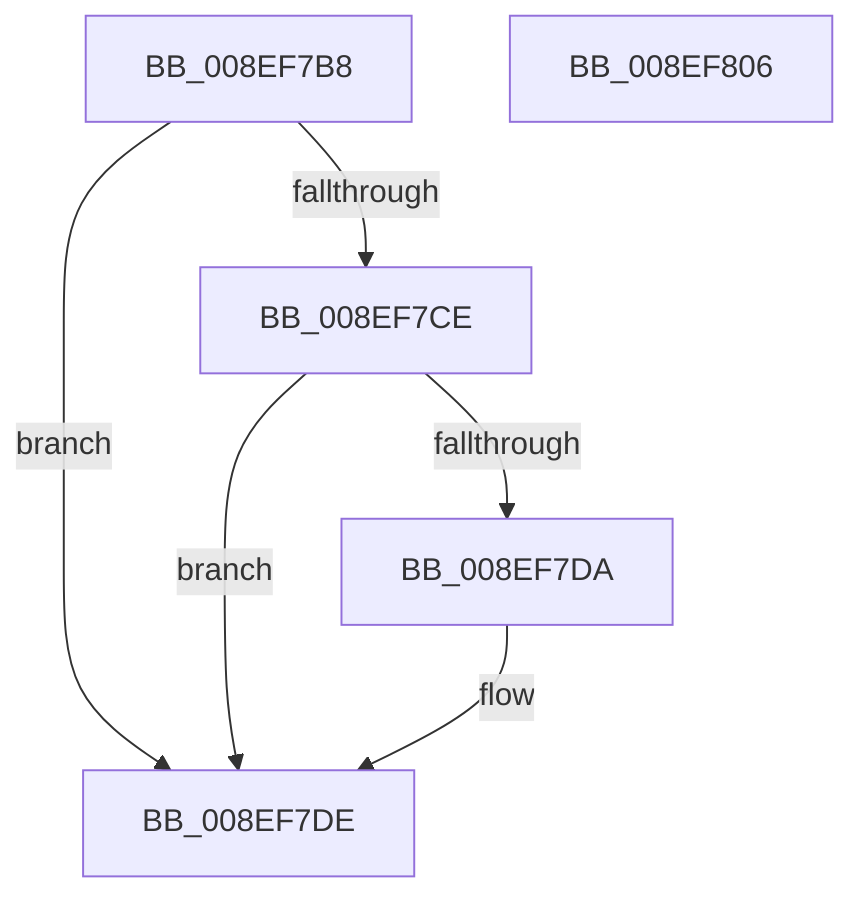

# PnpCtxRegOpenKey

- RVA: `0x008EF7B8`–`0x008EF807` (길이 `79` bytes)
- VA: `0x00000001408EF7B8`
- 실행 섹션: `PAGE`
- PDB 이름 있음: `예`; PDB Function 태그: `아니요`
- unwind 정보 RVA: `0x00064C80`
- 디코드: `24`개 명령, `79/79` bytes 표시
- 미해석 바이트: `0` (있으면 어셈블리에 `.byte`로 보존)

> 이 문서는 커널 이미지의 기계어와 PDB 기호를 분석해 생성했습니다. 4번과 5번은 함수 원형과 자료형을 바이너리 사용 방식에서 추정한 C 해석이며 원본 소스 복구 결과는 아닙니다.

## 1. Dependencies

- 직접 호출 지점: **1**; 고유 호출 대상: **1**
- 직접 호출자로 확인된 함수: **65**
- RIP 상대 이미지 참조: **0**

### Outgoing calls
- `0x008EF7FB` → [_RegRtlOpenKeyTransacted](_RegRtlOpenKeyTransacted_function_008EF810.md) (function, `0x008EF810`)

### Direct callers
- [PipUpdateDeviceProducts](../../text/5A/PipUpdateDeviceProducts_function_005A46C0.md) at `0x005A4773`
- [PipUpdateDeviceProducts](../../text/5A/PipUpdateDeviceProducts_function_005A46C0.md) at `0x005A491C`
- [DrvDbGetConfigurationSubKeyCallback](../../text/6A/DrvDbGetConfigurationSubKeyCallback_function_006A2E40.md) at `0x006A2E97`
- [PipHardwareConfigClearStartOverrideCallback](../72/PipHardwareConfigClearStartOverrideCallback_function_007233D0.md) at `0x0072345A`
- [PnpHardwareConfigCreateBootDriverFlags](../72/PnpHardwareConfigCreateBootDriverFlags_function_00723B88.md) at `0x00723DD4`
- [PnpCheckDriverDependencies](../72/PnpCheckDriverDependencies_function_0072C3C4.md) at `0x0072C489`
- [PnpCheckDriverDependencies](../72/PnpCheckDriverDependencies_function_0072C3C4.md) at `0x0072C4DE`
- [PnpRegCopyKeySecurity](../72/PnpRegCopyKeySecurity_function_0072CAC8.md) at `0x0072CB09`
- [PnpRegCopyKeySecurity](../72/PnpRegCopyKeySecurity_function_0072CAC8.md) at `0x0072CB34`
- [PnpRegCopyKeySecurityTree](../72/PnpRegCopyKeySecurityTree_function_0072CBF8.md) at `0x0072CC37`
- [PnpRegCopyKeySecurityTree](../72/PnpRegCopyKeySecurityTree_function_0072CBF8.md) at `0x0072CCAD`
- [PiPnpRtlInit](../73/PiPnpRtlInit_function_007300A4.md) at `0x00730150`
- [PiDevCfgCopyVariableData](../73/PiDevCfgCopyVariableData_function_007327F8.md) at `0x00732849`
- [PiDevCfgInitDriverDatabaseCallback](../73/PiDevCfgInitDriverDatabaseCallback_function_00733958.md) at `0x007339BA`
- [PiDevCfgQueryIncludedDriverNode](../73/PiDevCfgQueryIncludedDriverNode_function_00734D88.md) at `0x00734F27`
- [PiDrvDbCreateNode](../74/PiDrvDbCreateNode_function_00740AFC.md) at `0x00740D66`
- [PiDrvDbCreateNode](../74/PiDrvDbCreateNode_function_00740AFC.md) at `0x00740D92`
- [PiDrvDbOverlayCopyKeys](../74/PiDrvDbOverlayCopyKeys_function_007413FC.md) at `0x007414A7`
- [PiDrvDbOverlayCopyKeys](../74/PiDrvDbOverlayCopyKeys_function_007413FC.md) at `0x00741714`
- [PiDrvDbOverlayNodeHive](../74/PiDrvDbOverlayNodeHive_function_00741990.md) at `0x00741A6A`
- [PiDrvDbOverlayNodeHive](../74/PiDrvDbOverlayNodeHive_function_00741990.md) at `0x00741AE7`
- [PiDrvDbOverlayNodeHive](../74/PiDrvDbOverlayNodeHive_function_00741990.md) at `0x00741B20`
- [PiDrvDbOverlayNodeHive](../74/PiDrvDbOverlayNodeHive_function_00741990.md) at `0x00741B58`
- [PiDrvDbOverlayNodeHive](../74/PiDrvDbOverlayNodeHive_function_00741990.md) at `0x00741BF9`
- [PiDrvDbQueryHiveFileName](../74/PiDrvDbQueryHiveFileName_function_00741DDC.md) at `0x00741E3C`
- [PiDrvDbRegisterNode](../74/PiDrvDbRegisterNode_function_00742658.md) at `0x00742A37`
- [PiDrvDbResolveFilePathKeyValues](../74/PiDrvDbResolveFilePathKeyValues_function_00742C00.md) at `0x00742CB9`
- [PiDrvDbResolveFilePathKeyValues](../74/PiDrvDbResolveFilePathKeyValues_function_00742C00.md) at `0x00742F80`
- [PiDrvDbResolveNodeFilePaths](../74/PiDrvDbResolveNodeFilePaths_function_007433A4.md) at `0x00743411`
- [PnpCtxOpenContextNodeBaseKey](../82/PnpCtxOpenContextNodeBaseKey_function_00828F14.md) at `0x00828F84`
- [CmEnumDevicesInContainerWithCallbackWorker](../82/CmEnumDevicesInContainerWithCallbackWorker_function_0082B688.md) at `0x0082B725`
- [CmEnumDevicesInContainerWithCallbackWorker](../82/CmEnumDevicesInContainerWithCallbackWorker_function_0082B688.md) at `0x0082B7BC`
- [CmGetDevicesInBaseContainerList](../82/CmGetDevicesInBaseContainerList_function_0082BA6C.md) at `0x0082BAED`
- [CmGetDevicesInBaseContainerList](../82/CmGetDevicesInBaseContainerList_function_0082BA6C.md) at `0x0082BB1E`
- [CmGetDevicesInBaseContainerList](../82/CmGetDevicesInBaseContainerList_function_0082BA6C.md) at `0x0082BB4B`
- [CmRemoveDeviceFromContainerWorker](../82/CmRemoveDeviceFromContainerWorker_function_0082C080.md) at `0x0082C0FE`
- [CmRemoveDeviceFromContainerWorker](../82/CmRemoveDeviceFromContainerWorker_function_0082C080.md) at `0x0082C12F`
- [CmRemoveDeviceFromContainerWorker](../82/CmRemoveDeviceFromContainerWorker_function_0082C080.md) at `0x0082C15C`
- [CmClassSubkeyCallback](../82/CmClassSubkeyCallback_function_0082C830.md) at `0x0082C876`
- [CmDeviceClassesSubkeyCallback](../82/CmDeviceClassesSubkeyCallback_function_0082C940.md) at `0x0082CA2F`
- [CmEnumSubkeyCallback](../82/CmEnumSubkeyCallback_function_0082CE50.md) at `0x0082CF40`
- [CmGetMatchingDeviceListForSubkey](../82/CmGetMatchingDeviceListForSubkey_function_0082D5A0.md) at `0x0082D66C`
- [CmDevicePanelEnumSubkeyCallback](../82/CmDevicePanelEnumSubkeyCallback_function_0082E9B0.md) at `0x0082EB3D`
- [CmRemovePanelDeviceWorker](../82/CmRemovePanelDeviceWorker_function_0082F470.md) at `0x0082F4E4`
- [CmRemovePanelDeviceWorker](../82/CmRemovePanelDeviceWorker_function_0082F470.md) at `0x0082F515`
- [CmAppendDeclarativeFilterLevel](../82/CmAppendDeclarativeFilterLevel_function_0082F7A4.md) at `0x0082F7FF`
- [DrvDbDeleteObjectSubKey](../83/DrvDbDeleteObjectSubKey_function_00832EEC.md) at `0x00832F63`
- [DrvDbDeleteObjectSubKey](../83/DrvDbDeleteObjectSubKey_function_00832EEC.md) at `0x008330EF`
- [DrvDbInitializeDatabaseNodeVersion](../83/DrvDbInitializeDatabaseNodeVersion_function_00835B94.md) at `0x00835BCC`
- [sub_008EE966](Unknown_function_008EE966.md) at `0x008EF0A8`
- [_CmOpenCommonClassRegKeyWorker](../8F/_CmOpenCommonClassRegKeyWorker_function_008F0A1C.md) at `0x008F0F5C`
- [_CmOpenDeviceInterfaceRegKeyWorker](../8F/_CmOpenDeviceInterfaceRegKeyWorker_function_008F2B48.md) at `0x008F319F`
- [CmOpenDeviceContainerRegKeyWorker](../8F/CmOpenDeviceContainerRegKeyWorker_function_008F4904.md) at `0x008F4A8F`
- [sub_00930F5A](../93/Unknown_function_00930F5A.md) at `0x00930F84`
- [PiDrvDbLoadNode](../93/PiDrvDbLoadNode_function_00931AB0.md) at `0x00931C2B`
- [PnpCtxOpenContextBaseKey](../96/PnpCtxOpenContextBaseKey_function_00962A0C.md) at `0x00962A61`
- [PiDevCfgMigrateDevice](../96/PiDevCfgMigrateDevice_function_00963E60.md) at `0x009641E7`
- [PiDevCfgClearDeviceMigrationNode](../96/PiDevCfgClearDeviceMigrationNode_function_00965780.md) at `0x00965AAE`
- [PiDqOpenUserObjectRegKey](../99/PiDqOpenUserObjectRegKey_function_00990444.md) at `0x00990637`
- [CmGetMatchingFilteredDeviceInterfaceListWorker](../A0/CmGetMatchingFilteredDeviceInterfaceListWorker_function_00A097EC.md) at `0x00A098C4`
- [CmDeleteDeviceInterfaceMappedPropertyFromRegValue](../A7/CmDeleteDeviceInterfaceMappedPropertyFromRegValue_function_00A72DA8.md) at `0x00A72EB8`
- [DrvDbOpenDriverDatabaseRegKey](../AA/DrvDbOpenDriverDatabaseRegKey_function_00AA0FB8.md) at `0x00AA108C`
- [PiCMDeleteDeviceKey](../AD/PiCMDeleteDeviceKey_function_00AD6780.md) at `0x00AD68B0`
- [PipHardwareConfigOpenKey](../AD/PipHardwareConfigOpenKey_function_00AD8848.md) at `0x00AD88B3`
- [sub_00B23888](../B2/Unknown_function_00B23888.md) at `0x00B23AAD`
- [sub_00B240D8](../B2/Unknown_function_00B240D8.md) at `0x00B2412B`
- [sub_00B24164](../B2/Unknown_function_00B24164.md) at `0x00B24212`
- [sub_00B24270](../B2/Unknown_function_00B24270.md) at `0x00B2428A`
- [sub_00B24270](../B2/Unknown_function_00B24270.md) at `0x00B242B8`
- [sub_00B2819A](../B2/Unknown_function_00B2819A.md) at `0x00B281F4`
- [sub_00B28770](../B2/Unknown_function_00B28770.md) at `0x00B287AD`
- [sub_00B2C1C4](../B2/Unknown_function_00B2C1C4.md) at `0x00B2C1FA`
- [sub_00B2C1C4](../B2/Unknown_function_00B2C1C4.md) at `0x00B2C24C`
- [sub_00B2C1C4](../B2/Unknown_function_00B2C1C4.md) at `0x00B2C2C3`
- [sub_00B47E86](../B4/Unknown_function_00B47E86.md) at `0x00B47F31`
- [PipHardwareConfigExists](../../init/C3/PipHardwareConfigExists_function_00C30BE4.md) at `0x00C30C7D`
- [PipMigratePnpState](../../init/C3/PipMigratePnpState_function_00C317D4.md) at `0x00C3185A`
- [PipMigratePnpState](../../init/C3/PipMigratePnpState_function_00C317D4.md) at `0x00C318F1`
- [PipMigratePnpState](../../init/C3/PipMigratePnpState_function_00C317D4.md) at `0x00C3192F`
- [PipMigratePnpState](../../init/C3/PipMigratePnpState_function_00C317D4.md) at `0x00C31B6C`
- [PipMigratePnpState](../../init/C3/PipMigratePnpState_function_00C317D4.md) at `0x00C31BF7`
- [PipMigrateServiceCallback](../../init/C3/PipMigrateServiceCallback_function_00C31E60.md) at `0x00C31E9B`
- [PipMigrateServiceCallback](../../init/C3/PipMigrateServiceCallback_function_00C31E60.md) at `0x00C31ED5`
- [PipMigrateServiceCallback](../../init/C3/PipMigrateServiceCallback_function_00C31E60.md) at `0x00C31F02`
- [PipResetDevices](../../init/C3/PipResetDevices_function_00C32190.md) at `0x00C321D4`
- [PipResetMatchingFilteredDevices](../../init/C3/PipResetMatchingFilteredDevices_function_00C32260.md) at `0x00C322E9`
- [PpDevCfgInit](../../init/C3/PpDevCfgInit_function_00C351A4.md) at `0x00C35338`
- [PipCommitPendingOsExtensionResource](../../init/C3/PipCommitPendingOsExtensionResource_function_00C35960.md) at `0x00C359E7`
- [PipCommitPendingOsExtensionResource](../../init/C3/PipCommitPendingOsExtensionResource_function_00C35960.md) at `0x00C35A20`
- [PipCommitPendingService](../../init/C3/PipCommitPendingService_function_00C35B70.md) at `0x00C35C02`
- [PipCommitPendingService](../../init/C3/PipCommitPendingService_function_00C35B70.md) at `0x00C35C3B`
- [PipCommitPendingService](../../init/C3/PipCommitPendingService_function_00C35B70.md) at `0x00C35C73`
- [PipCommitPendingService](../../init/C3/PipCommitPendingService_function_00C35B70.md) at `0x00C35CB2`
- [PipProcessPendingObjects](../../init/C3/PipProcessPendingObjects_function_00C35F00.md) at `0x00C35FC2`
- [PipProcessPendingOsExtensionResources](../../init/C3/PipProcessPendingOsExtensionResources_function_00C36164.md) at `0x00C361BA`
- [PipProcessPendingServices](../../init/C3/PipProcessPendingServices_function_00C3620C.md) at `0x00C36262`

### Static image references
- 디코드된 RIP-relative 메모리 참조가 없습니다.

## 2. Other-region calls and transfers

- 다른 실행 섹션으로 향하는 call: **0**
- 별도 외부 분기/꼬리 이동을 확인하지 못했습니다.

## 3. Assembly (complete function range)

```asm
008EF7B8  40 53                           push rbx
008EF7BA  48 83 EC 30                     sub rsp, 0x30
008EF7BE  33 C0                           xor eax, eax
008EF7C0  45 8B D1                        mov r10d, r9d
008EF7C3  4D 8B D8                        mov r11, r8
008EF7C6  48 8B DA                        mov rbx, rdx
008EF7C9  48 85 C9                        test rcx, rcx
008EF7CC  74 10                           je 0x1408ef7de
008EF7CE  48 8B 89 E0 00 00 00            mov rcx, qword ptr [rcx + 0xe0]
008EF7D5  48 85 C9                        test rcx, rcx
008EF7D8  74 04                           je 0x1408ef7de
008EF7DA  48 8B 41 08                     mov rax, qword ptr [rcx + 8]
008EF7DE  44 8B 4C 24 60                  mov r9d, dword ptr [rsp + 0x60]
008EF7E3  45 8B C2                        mov r8d, r10d
008EF7E6  48 89 44 24 28                  mov qword ptr [rsp + 0x28], rax
008EF7EB  49 8B D3                        mov rdx, r11
008EF7EE  48 8B 44 24 68                  mov rax, qword ptr [rsp + 0x68]
008EF7F3  48 8B CB                        mov rcx, rbx
008EF7F6  48 89 44 24 20                  mov qword ptr [rsp + 0x20], rax
008EF7FB  E8 10 00 00 00                  call 0x1408ef810
008EF800  48 83 C4 30                     add rsp, 0x30
008EF804  5B                              pop rbx
008EF805  C3                              ret
008EF806  CC                              int3
```

## 4. C-style interpretation (structured pseudocode)

```c
__int64 __fastcall PnpCtxRegOpenKey(__int64 a1, __int64 a2, __int64 a3, int a4, unsigned int a5, __int64 a6)
{
    __int64 result;
    __int64 v_rsp;
    unsigned __int64 v_stack_m10;
    unsigned __int64 v_stack_m18;

    v_rsp = (v_rsp) - (48);
    result = 0;
    if (a1 == 0) goto loc_008EF7DE;
    if (*(unsigned __int64 *)(a1 + 224) != 0) {
        result = *(unsigned __int64 *)(*(unsigned __int64 *)(a1 + 224) + 8);
    }
    v_stack_m10 = result;
    v_stack_m18 = a6;
    result = _RegRtlOpenKeyTransacted(a2, a3, (unsigned int)((unsigned int)((unsigned int)(a4))), (unsigned int)(a5));
    v_rsp = (v_rsp) + (48);
    return result;
}
```

## 5. (Beta) C Style

```c
int64_t PnpCtxRegOpenKey(int64_t Arg1, int64_t Arg2, int64_t Arg3, int32_t Arg4, uint32_t Arg5, int64_t Arg6)
{
    int64_t result;
    int64_t local_rsp;
    uint64_t v_stack_m10;
    uint64_t v_stack_m18;

    local_rsp = (local_rsp) - (48);
    result = 0;
    if (Arg1 == 0) goto loc_008EF7DE;
    if (*(uint64_t *)(Arg1 + 0xE0) != 0) {
        result = *(uint64_t *)(*(uint64_t *)(Arg1 + 0xE0) + 0x8);
    }
    v_stack_m10 = result;
    v_stack_m18 = Arg6;
    result = _RegRtlOpenKeyTransacted(Arg2, Arg3, (uint32_t)((uint32_t)((uint32_t)(Arg4))), (uint32_t)(Arg5));
    local_rsp = (local_rsp) + (48);
    return result;
}
```

## 6. Execution-region graph

[열기: 2D/3D 그래프와 함수 탐색 컨트롤 패널](../../../control-panel.html?section=page&rva=0x008EF7B8&view=graph)

- 2D 그래프는 위에서 아래로 흐르고, 3D 그래프는 빈 공간을 드래그해 회전합니다. Shift+드래그는 이동, 휠은 확대·축소, 함수 노드 선택은 대상 보고서 이동입니다.

### Static fallback


